# 第 12 章：刚体物理

在这本书中，我花了不少篇幅谈论物理——我们世界中的物体如何倾向于下落并相互弹开。这也指导了我们动画中的物体应如何表现，但作为动画师，我们通常刻意地为这种行为设置关键帧。第 2 章中的球看起来似乎受物理定律支配，但那是我们费尽心力让它看起来那样的——我们才是掌控者。但如果我们*不*想掌控呢？如果我们的目标是*混乱与破坏*呢？

比如，如果一个角色掀翻一张桌子，或撞碎一堵砖墙？用常规技术，这需要费大力气为大量东西制作动画，但如果我们不特别在意桌上的物体或墙上的砖块最终落在哪里，我们可以直接让程序替我们干活。

**刚体物理**是一项模拟刚体在空间中移动和碰撞物理特性的功能——岩石、玻璃球、汤罐头——字面上任何硬物。通过将场景中的物体指定为刚体，它们将表现得遵循许多自然物理定律，如重力、惯性和摩擦力，而无需我们直接干预。

在本章中，我们将探讨以下主题：

* 刚体入门
* 提高刚体的准确性和性能
* 控制动画刚体

## 技术要求

要跟随本章操作，你只需要 Blender 的默认场景。你可以删除灯光和相机，但我们需要那个立方体。那将是我们的第一个 `Rigid Body`。

## 创建刚体世界

`Rigid Body` 中的关键词“rigid”（刚性）将该模拟与其他物理模拟（如 `Fluid` 流体、`Cloth` 布料或 `Soft Body` 柔体）区分开来。拿起某物扔出去——如果它不飞溅、不弯曲、不晃动，你就可以把它视为刚体物体。

刚体物理入门之简单可能会让你惊讶。我们将从创建最简单的刚体模拟开始。

### 我们的第一个刚体模拟

当场景中有一个或多个物体是刚体时，刚体物理模拟会自动启用。场景中的任何网格物体都可以成为刚体。

这些设置位于选中网格物体的 `Physics Properties`（物理属性）选项卡中：

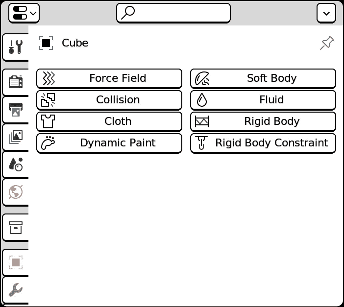

图 12.1：物理属性

> **重要提示**
> 除非物体被赋予特定的 `Physics Properties`（如 `Rigid Body`），否则它们不会影响模拟。

点击 `Rigid Body` 将选中的物体指定为刚体。现在试试：

1. 选择默认立方体。
2. 在 `Physics Properties` 选项卡中进入立方体的物理设置。
3. 点击 `Rigid Body`。

忽略刚出现的设置，从第 `1` 帧播放动画。这就有了——一个立方体在空旷空间中下落！

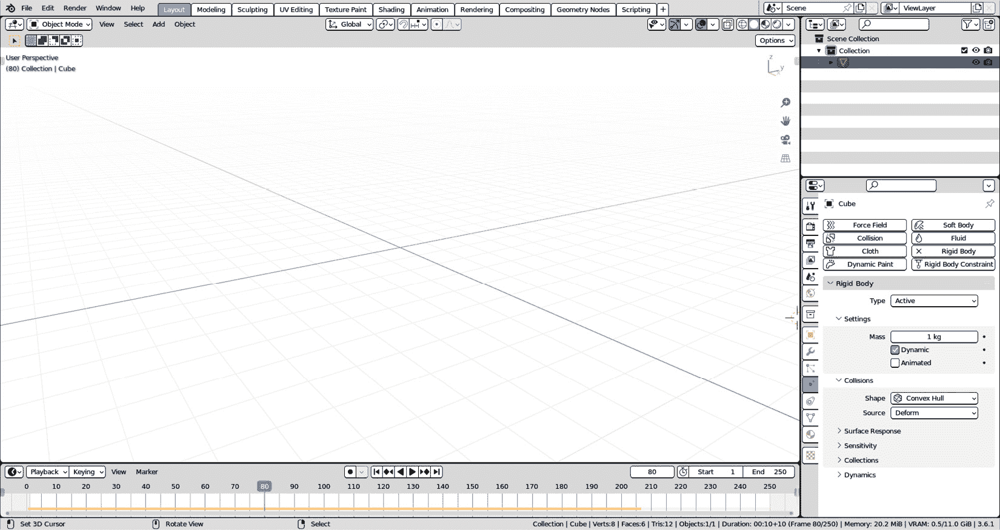

图 12.2：没了！

这不是最令人兴奋的模拟，但请耐心往下看。为了理解发生了什么，让我们回顾一下你的场景和刚刚变成刚体的物体所发生的一些关键变化。

#### 刚体

与 `Fluid`、`Cloth` 或 `Soft Body` 模拟中的物体不同，`Rigid Body` 的网格不会改变。相反，整个物体会在重力和其他刚体等力的作用下移动（现在我们可以看到重力对立方体的影响；其他刚体稍后再谈）。

默认情况下，一旦为物体启用了 `Rigid Body`（刚体）物理属性，我们就会失去对它的控制。移动它只能决定模拟开始时的初始起点，在此之后，它就不再受我们控制了。

**重要提示**

基于上述原因，你应该在模拟的起始帧（默认为第 `1` 帧）或之前编辑你的刚体物体。在模拟开始后的帧上编辑物体会倒退时间，可能导致意想不到的结果。

与其他动画一样，模拟结果是非破坏性的；当我们回到第 `1` 帧时，立方体会回到它开始的位置。这是件好事——否则，每次它掉下去我们都得亲自去捡回来！

## 刚体模拟中的帧

与 Blender 中的其他物理类型一样，刚体模拟仅在动画播放时工作。播放动画时，模拟会实时执行。

请注意 `Timeline`（时间轴）区域中出现的细黄条：

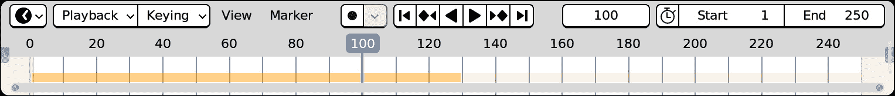

图 12.3：模拟的缓存帧

这表示 Blender 已存储（或 `cached` 缓存）了所选物体的物理模拟结果的帧，与模拟的整个帧范围相比。

缓存是为了性能原因；播放缓存帧比首次计算它们要快。模拟会自动缓存，并且每当我们更改模拟中的某些内容时都会被清除。

**重要提示**

Blender 必须知道第一帧的模拟状态，才能计算第二帧会发生什么，然后是第三帧，以此类推。因此，每当你想查看更改效果时，都应该允许动画从第 `1` 帧开始播放。如果你在 `Timeline` 中跳转到未缓存的帧，不要指望在 `3D Viewport`（3D 视图）中获得准确的结果。

## 刚体世界设置

每个刚体都有单独的属性，点击 `Rigid Body` 时会出现，我们马上就会讲到。在此之前，你应该了解我们 `Rigid Body World`（刚体世界）的*全局*参数，它们影响整个模拟，位于 `Scene Properties | Rigid Body World`（场景属性 | 刚体世界）：

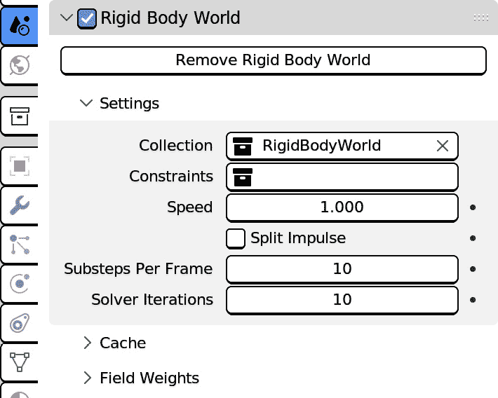

图 12.4：刚体世界设置

显而易见，`Gravity`（重力）也会影响你的刚体：

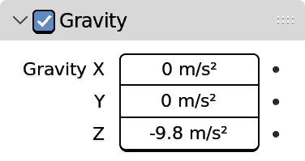

图 12.5：重力

这里看到的大多数默认值很少需要更改，但知道我们可以让物体变得失重……甚至让它们向上或向侧面掉落，这很好！

**提示**

大物体通常看起来下落得异常缓慢。默认立方体宽 2 米，与我们习惯抛掷的现实世界物体相比相当大。为了获得外观准确的模拟，请注意场景的比例，并确保物体尺寸逼真（且具有逼真的 `Mass` 质量）。你也可以将 `Gravity` 或 `Speed` 乘以给定因子，这实际上等同于缩放整个模拟空间。

另请注意 `Rigid Body World | Cache` 下的 `Simulation Start` 和 `End` 属性，以防你希望模拟的帧范围不是默认的 `1` 到 `250`：

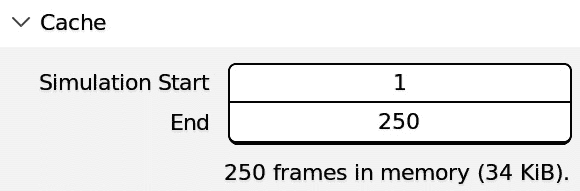

图 12.6：模拟起始和结束帧

现在你知道所有东西在哪里了，我们准备让这个模拟变得更有趣一些。

## 主动和被动刚体

我们的场景需要一个地板；否则，所有东西都会掉进无限虚空。为了排斥落在上面的刚体并阻止它们掉进无限虚空，我们的地板也必须是一种刚体，但它本身不会掉进无限虚空（无限虚空似乎是这里的默认设置）。

让我们首先创建地板。

### 创建地板

你可能会认为平面或网格足以作为地板，但这次不行。地板需要具有非零厚度；否则，我们模拟中的其他刚体可能会直接穿过它。那不是你想要在场景里（或你家里）的地板。

我们刚刚转换为刚体的默认立方体将很好地充当地板：

1. 在 `X` 和 `Y` 轴上缩放立方体，使其覆盖大面积区域。
2. 在 `Z` 轴上将立方体向下移动 `-1.0`，使其顶面与“地板”应有的位置对齐。
3. 将立方体重命名为 `Floor`。
4. 为了让如此大的物体不那么显眼，转到 `Object Properties | Viewport Display`（物体属性 | 视口显示），并将 `Display As` 设置为 `Wire`（线框）。

这些步骤大多是为了方便我们；重要的是我们要把地板做得又大又平。各方向几十米应该足够了：

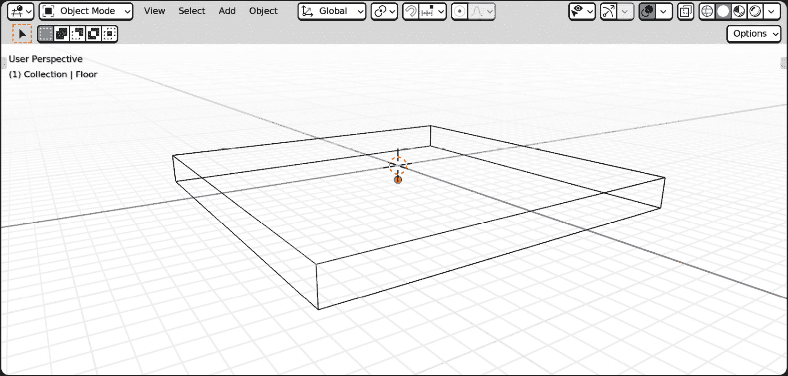

图 12.7：地板

这是一个不错的地板大小的地板，但播放模拟时它仍然会掉下去。同样，这不是你想要在场景或家里的地板。接下来我们终于来看看那些我们一直忽略的 `Rigid Body` 属性来修复它。

### 被动刚体

别搞错了——我们的地板确实需要是一个刚体，只是不是 `Active`（主动）类型。

刚体有两种类型。默认情况下，刚体是 `Active`，这是一种花哨的说法，意思是物理模拟器会让它四处移动：

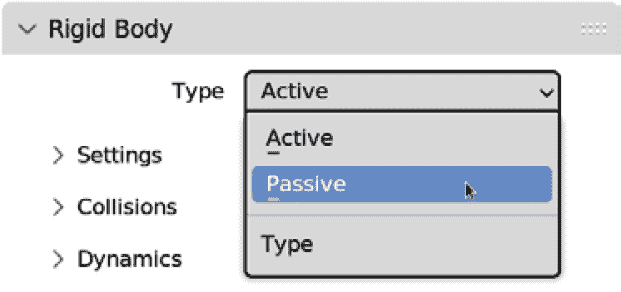

图 12.8：刚体类型

相反，`Passive`（被动）刚体固定在空间中。它会影响其他 `Active` 刚体，而自身不受它们或模拟中任何其他事物的影响。这正是我们想要的地板效果。

**提示**

让 `Active` 刚体实际上变为被动的另一种方法是禁用 `Rigid Body | Settings | Dynamic`。你可以为这个属性制作动画，以启动和停止单个主动刚体。

让我们把地板设为 `Passive` 刚体，然后添加一些 `Active` 刚体，以便看到效果：

1. 在 `Floor` 物体的 `Rigid Body` 属性顶部，将 `Type` 从 `Active` 改为 `Passive`。

现在我们的地板表现得像地板该有的样子：什么都不做。但它会阻挡其他刚体！让我们在场景中添加一些来看看实际效果。

2. `Add`（`Shift + A`）几个你选择的实体 `Mesh` 物体到场景中，并将它们放在地板上方：

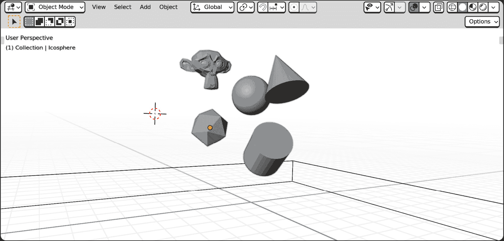

图 12.9：可作为刚体的基础网格物体

1. 像第一个那样，将这些新物体中的每一个都设为 `Rigid Body`。

你的新刚体将下落，撞击地板，并以惊人的真实感翻滚。现在我们可以看到刚体物理的真谛了：让一堆垃圾掉下去！

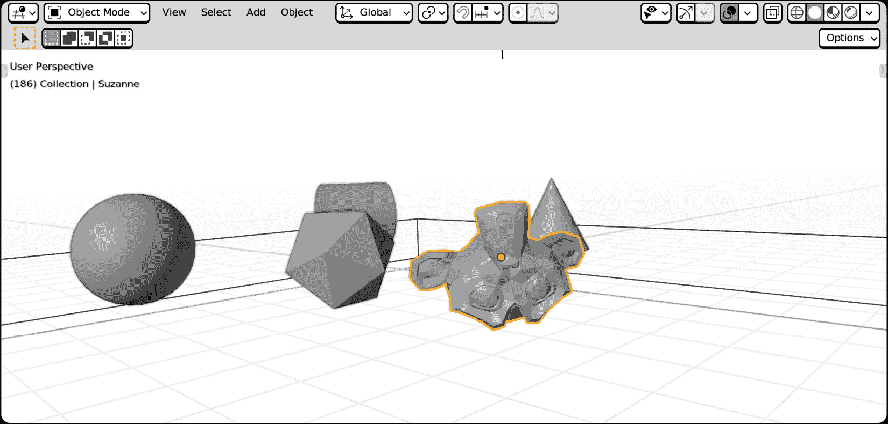

图 12.10：就像在现实生活中扔一个 2 米高的猴子头模型！

我估计刚体物理至少 60% 的用例只是让垃圾掉下去。继续玩吧；这非常有趣！

玩够了的话，继续下一节，我们将介绍*我*眼中的乐趣：学习一堆关于刚体的技术细节。哦，耶！

## 刚体碰撞

这是关于刚体物理你需要知道的最重要的事：一切关乎 `collisions`（碰撞）。你可能已经注意到你的主动刚体在发生碰撞——相互撞击并以一种逼真的方式做出反应，如果手动动画制作会非常耗时。重力等力很容易模拟——呵，我们只需两个关键帧和二次插值就能模拟重力——但碰撞？碰撞才是事情变得有趣的地方。

## 将垃圾拼凑在一起的算法

看看这堵由砖块组成的墙，其中每块砖都是一个主动刚体。推倒砖墙是个有趣的练习；我们很快就要自己制作一个了：

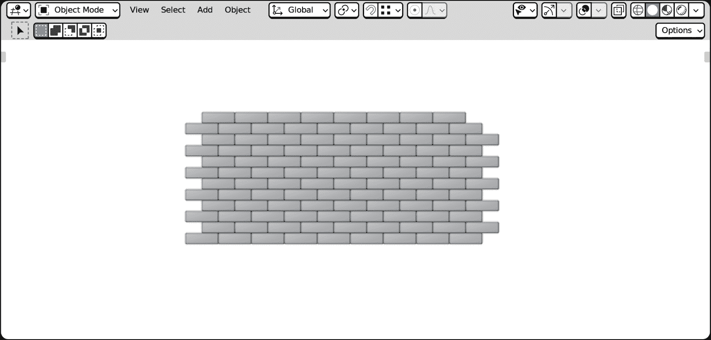

**图 12.11：第 1 帧上简单的砖墙**

看起来挺不错，对吧？它会保持直立，直到我们用别的东西把它撞倒，对吧？

错！它炸了，因为你对碰撞不够小心：

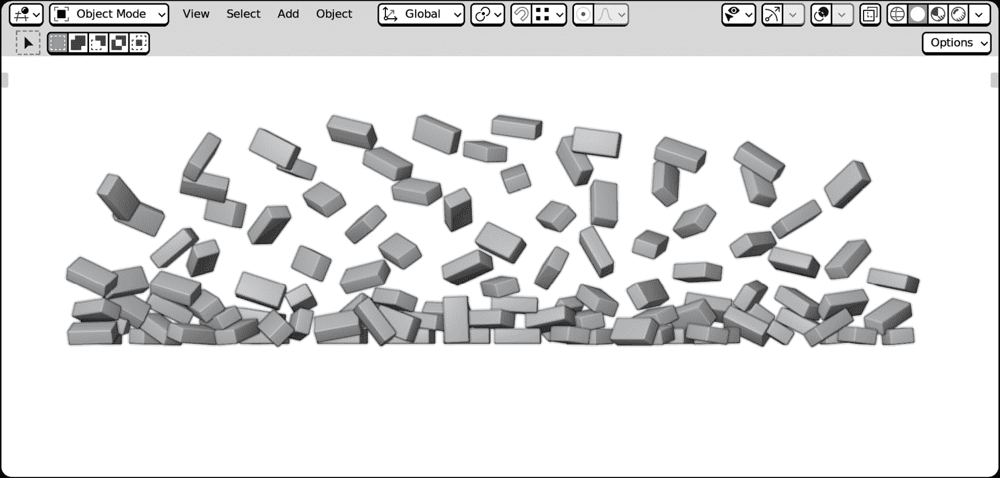

**图 12.12：同一堵墙，第 12 帧**

这种情况发生的频率比你想象的要高，这只是你在模拟中可能遇到的众多问题的一个例子。只要我们掌握一些关于碰撞的知识，就能避免许多此类问题。

刚体碰撞的工作原理如下：在每一帧，物理引擎检查主动刚体是否正在与另一个刚体碰撞（或即将碰撞）。当这种情况发生时，会施加一个冲量，在下一帧改变刚体的运动，使其远离碰撞物体。碰撞越剧烈，冲量越大。

例如，在第 `1` 帧获取一个主动刚体，将其嵌入地板一半：

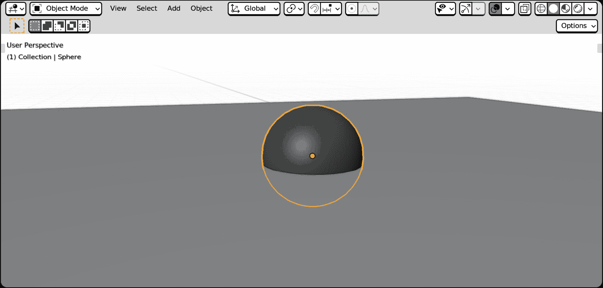

**图 12.13：嵌入地面的刚体球体**

引擎认为这个刚体正在与地板*剧烈碰撞*。模拟开始时，它会像从大炮发射一样飞向空中。这就是为什么如果我们不小心，模拟可能会在开头“爆炸”。

> **提示**
>
> 两个 `Passive` 刚体发生碰撞无所谓，所以你可以随意把它们粘在一起。它们是被动的。它们能去哪儿呢？

那么物理引擎如何高效检测两个刚体是否碰撞？这引出了我们的下一个话题……

## 碰撞形状

在碰撞检测中考虑的不是刚体的网格，而是 `Shape`。注意 `Shape` 是本章中的一个特定技术术语。每个刚体都有一个 `Shape` 属性，可在 `Rigid Body` | `Collision` | `Shape` 下找到：

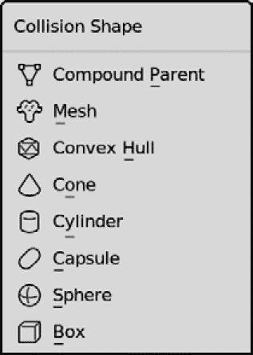

**图 12.14：碰撞形状**

这些形状是物理引擎唯一关心的形状！

## 基本碰撞形状

刚体的形状旨在或多或少地类似于物体本身，但经过简化。`Box`、`Sphere`、`Capsule`、`Cylinder` 和 `Cone` 是最简单的形状，强烈建议将其用于外观类似这些形状的物体。更简单的形状更容易计算，因此对性能和稳定性更有利，尽管这会以准确性为代价，即刚体的 `Shape` 属性偏离我们实际看到的网格对象的“形状”处：

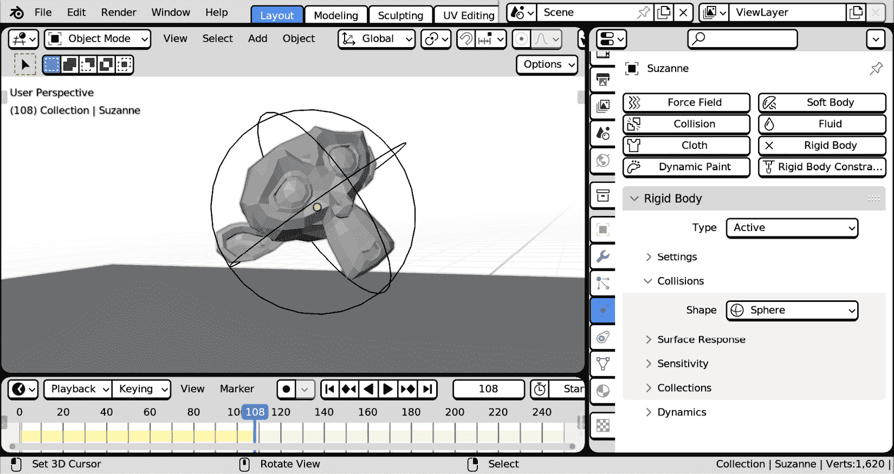

**图 12.15：像完美球体一样滚动的猴子头**

> **重要提示**
>
> 当使用 `Box`、`Sphere`、`Capsule`、`Cylinder` 或 `Cone` 时，形状会在 `3D Viewport` 中以线框显示，以便你将其与关联的对象网格进行比较。
>
> 形状的大小会根据网格的尺寸自动缩放。某些形状与局部 `Z` 轴对齐，因此你可能需要编辑对象，使其局部 `Z` 轴与其较长的尺寸对齐。

球体、盒子、胶囊体、圆柱体和圆锥体是方便的形状，因为测试它们是否碰撞所需的几何公式很简单。不过其他形状怎么办呢？

## 网格和凸包

默认形状是 `Convex Hull`，这是直接从网格复制的形状，但有一个重要区别：由于计算考虑，它必须是凸的。如果你能看到刚体的 `Convex Hull`，它看起来会像包裹着收缩膜的物体。这是一个很好的通用形状，适用于大部分是凸形的物体。

不过有时 `Convex Hull` 还不够好。注意似乎覆盖着这个碗的“隐形收缩膜”：

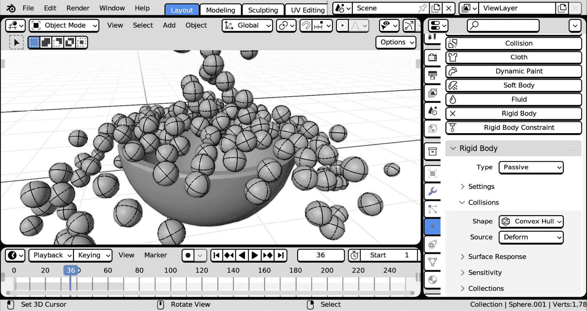

**图 12.16：弹珠无法进入碗中**

如果你必须准确模拟凹面物体的物理效果，总有 `Mesh` 形状，它尽可能忠实地复制网格本身，包括所有凹面部分：

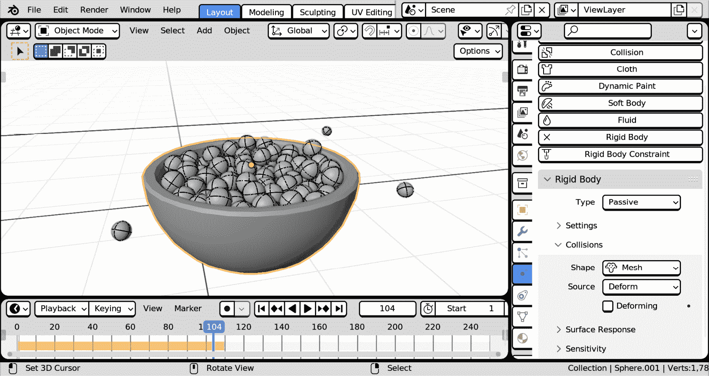

**图 12.17：使用 Mesh 形状进行精确凹面碰撞**

此选项是最准确的选择，但也是最慢且最不稳定的。检测凹面网格的碰撞比你想象的更难！因此，最好少用 `Mesh` 形状，如果可能的话，仅将其用于 `Passive` 刚体。

> **提示**
>
> 高细节层级的 `Mesh` 或 `Convex Hull` 形状会不必要地拖慢模拟。但请记住：物体不必是自己的刚体。你可以改用*代理*——一个具有相同基本形状的不可见刚体——然后将更复杂的物体设为其子级。

## 复合父级

最后是 `Compound Parent`，这是一个被低估的形状，它组合了刚体所有子级的形状。通过组合简单形状，你可以制作各种自定义形状，甚至性能远超 `Mesh` 或 `Convex Hull` 形状的凹面形状：

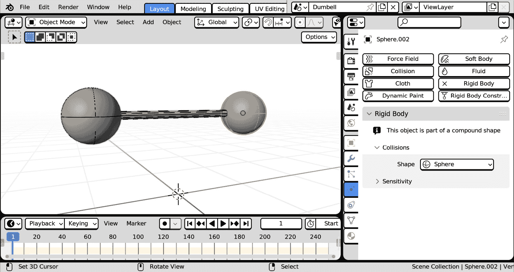

**图 12.18：用于制作哑铃的复合形状**

现在我们已经了解了所有可用的碰撞形状，让我们看看能否在模拟中使用其中一种或多种。

## 选择刚体碰撞形状

最明显的处理对象是地板，因为它是 `Box` 形状。简单的形状总是更好！

1. 对于地板，将 `Rigid Body` | `Collisions` | `Shape` 设置为 `Box`。
2. 为其余刚体选择最合适的碰撞形状。

给我们平坦的地板一个漂亮的平坦形状，将帮助我们避免各种神秘的、不需要的行为。至于你一直在玩的那些其他刚体，尝试不同的形状看看它们的效果！此外，你可以查看 `Settings` | `Mass`、`Surface Response` | `Friction` 和 `Surface Response` | `Bounciness` 等属性如何影响模拟。

然后，当你玩够了，把你的主动刚体放在一边。是时候收起这些幼稚的东西……改玩积木了！

## 摧毁一堵墙

我最喜欢的部分来了：

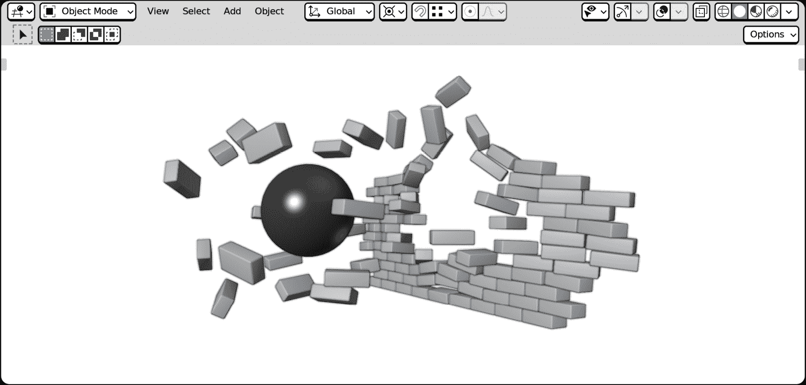

**图 12.19：粉碎！**

我还需要多说吗？我们要用刚体砖块建一堵墙，然后把它撞倒！

## 建墙

首先，我们将一砖一瓦地建墙。每块砖都是一个独立的刚体，所以诀窍在于确保我们正确堆叠砖块，并且它们具有正确的 `Rigid Body` 设置。

### 砖块

每堵墙都从一块砖开始，所以让我们先制作一块：

1. **添加** (`Shift` + `A`) 一个 `Cube` 到场景中。
2. 在 `Edit Mode` 中，将立方体缩放到砖块的大致尺寸。
3. 确保砖块平放，不悬空也不与地板相交。
4. 将物体命名为 `Brick`。

> **重要提示**
>
> 具有更改过的对象 `Scale` 值（即在 `Object Mode` 中缩放）的主动刚体将表现不正确，就好像它们比实际更大或更小。这又是一个在 `Edit Mode` 中缩放事物的理由。你也可以使用 `Apply` (`Ctrl` + `A`) | `Scale`。

现在我们有了一块砖。我给我的砖添加了一个新材质和一个 `Bevel` 修改器，以便更好地看到每块砖：

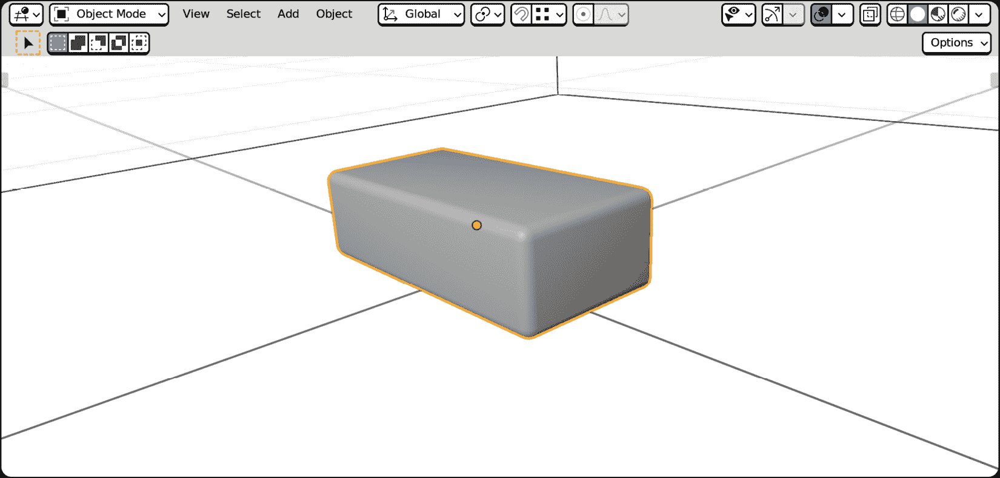

图 12.20：一块砖

在我们大量复制这块砖来砌墙之前，我们应该先把它设置为一个具有所有正确参数的**刚体**。

## 刚体停用

我们需要为砖块启用的设置之一是启用 `Deactivation`（停用），这是一项在静止时自动激活和停用刚体模拟的功能：

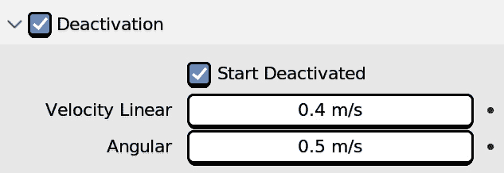

图 12.21：停用设置

这不仅能提高性能，还能确保墙中的砖块像砖块该有的样子那样保持静止，直到我们让东西撞向它们时才开始“模拟”。

让我们在调整砖块设置时利用这一功能：

1.  将 `Brick` 设为 `Active`（主动）`Rigid Body`（刚体）。
2.  将 `Brick` 的 `Collision`（碰撞）| `Shape`（形状）设为 `Box`（盒子）。
3.  启用 `Dynamics`（动力学）| `Deactivation`（停用）。
4.  启用 `Deactivation`（停用）| `Start Deactivated`（开始时停用）。

现在 `Brick` 被计算为 `Box` 形状，虽然它是一个 `Active Rigid Body`（主动刚体），但它在模拟开始时不会移动。这不是最令人兴奋的事情，但砖块嘛，就是这样。

这解决了 `Brick` 所有必要的 `Rigid Body` 设置。`Brick` 的每个副本都将具有相同的 `Rigid` `Body` 属性。

**提示**

如果你需要一次性调整许多刚体的属性（例如在复制砖块*之后*调整所有砖块），有一种方法可以做到：全选它们，然后在编辑属性时按住 `Alt` 键。这个方便的小技巧对许多其他属性也同样有效！

## 砌墙

现在我们准备好复制这块砖并堆叠起来砌墙了：

1.  选择 `Brick` 并使用 `Duplicate Linked`（链接复制）（`Alt` + `D`）多次来制作一层砖块。
2.  选择这一层砖块，复制它，并将新层放在旧层上方一个砖块高度的位置。
3.  将新层砖块向一侧移动半个砖块宽度。
4.  选择两层，复制它们，并按两块砖的高度堆叠。
5.  重复*步骤 4*，直到得到一堵像样的墙。删除最后一块悬空的砖。

**提示**

使用 `Snapping`（吸附）来完美对齐砖块。

现在我们有了一堵墙！

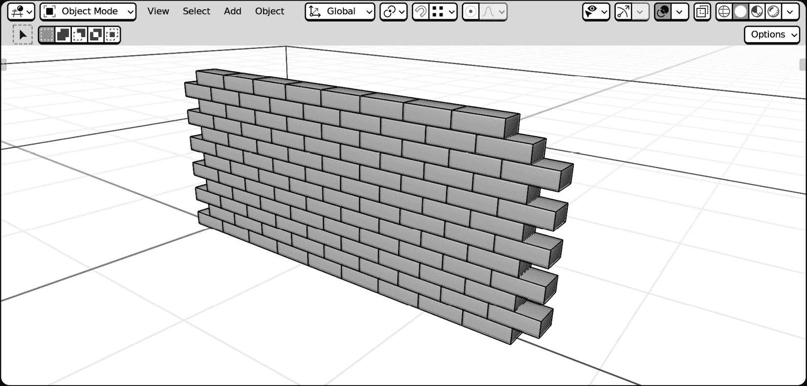

图 12.22：墙的示例

这堵墙到底有多大或多宽并不重要。反正它也撑不了多久……

## 摧毁墙壁

现在到了有趣的部分——破坏和混乱！我们将创建另一个刚体并用它来摧毁墙壁。只要你玩得开心，你可以把你的破坏球做成任何你喜欢的大小和形状：

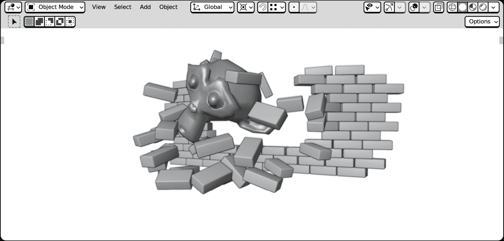

图 12.23：一个破坏猴头

一旦我们做了一个又大又重的东西，我们需要让它撞向墙壁。为此，我们将学习如何通过关键帧直接控制它。

### 创建破坏球

首先，让我们把破坏球（或立方体，或猴头）添加到场景中：

1.  向场景中添加一个实体网格物体。
2.  将你的新物体设为 `Rigid Body`（刚体）。
3.  选择一个合适的 `Collision`（碰撞）| `Shape`（形状）。
4.  启用 `Settings`（设置）| `Animated`（动画）。

现在我们有了一个撞倒墙壁的东西，让我们谈谈刚才启用的最后一个设置。

### 直接控制刚体

我们如何让刚体做点什么？一直以来，我们主要是通过将刚体放在地板上方，看着它们的势能随着落地而耗尽来进行“玩耍”。为了从一侧撞倒墙壁，也许我们可以把破坏球放在斜坡顶端，像这样：

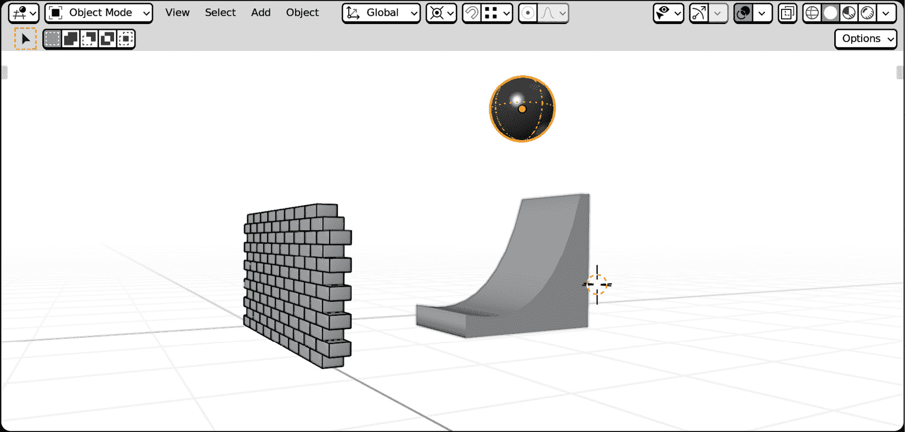

图 12.24：一个让刚体听话的装置

这种设置场景并看着重力处理其余事情的过程很有趣，但这不完全是动画制作，对吧？

`Rigid Body`（刚体）| `Settings`（设置）| `Animated`（动画）是一个关键属性，它允许我们直接控制刚体，无论它是主动还是被动。禁用时，模拟不会对刚体的动画做出反应。启用后，刚体可以像其他物体一样被制作动画，并会影响模拟中的其他物体。

#### 实时与刚体交互

就刚体物理而言，`Animated` 并不严格意味着某物被*制作了动画*（即设置了关键帧）。它涵盖任何非由模拟内部引起的运动，例如约束，或在本例中，在动画播放时手动移动物体。

你可以试一下：

1.  播放动画。
2.  在动画播放时，`Move`（移动）（`G`）你的破坏球撞向砖墙。

这有点像电子游戏……差不多。虽然很好玩，在快速测试中也有其用处，但这种交互功能是有限的。我们的小游戏只是个游戏，它只持续模拟的帧范围那么长，然后就会重置。

接下来，让我们做最显而易见的事！

### 为破坏球制作动画

我们想把这里的项目称为动画，而不仅仅是一个每次播放 250 帧的奇怪物理沙盒。你猜到了——是时候给破坏球制作动画了。

这么做会发生什么，不会让你感到惊讶：

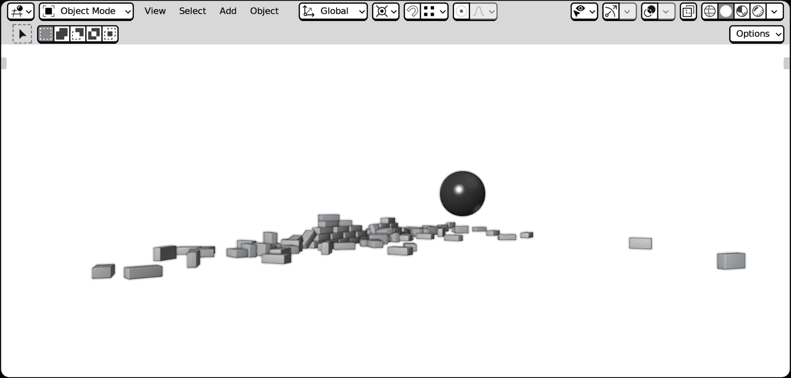

图 12.25：一堵被摧毁的墙

缺少了某些东西，那就是模拟对破坏球本身的影响。看它就在那里悬浮着。东西对它有反应，但它表现得像个**主宰者**，除了我们愚蠢地告诉它去哪里，它不对任何东西做出反应。它的 `Mass`（质量）可能是 `1000` kg 或 `0.001` kg，不管怎样都无所谓。如果它能和其他东西一起落在瓦砾中，或者在撞出一个凹痕后弹开滚走，那该多好。但 `Animated` 刚体始终是 `Passive`（被动）的，即使它是 `Active`（主动）的。

……真是这样吗？虽然刚体可能无法同时受其 `Transform`（变换）属性和模拟的影响，但我们可以通过对 `Animated` 属性本身设置关键帧，在两者之间切换。

这是我想展示的最后一个技巧：

1.  为你的破坏球制作动画，使其以令人满意的速度冲破墙壁。
2.  对 `Animated` 属性设置关键帧，使其在破坏球撞击墙壁前刚好关闭。

如果你对破坏球对墙壁的效果不满意，也可以调整破坏球的 `Mass`（质量）：

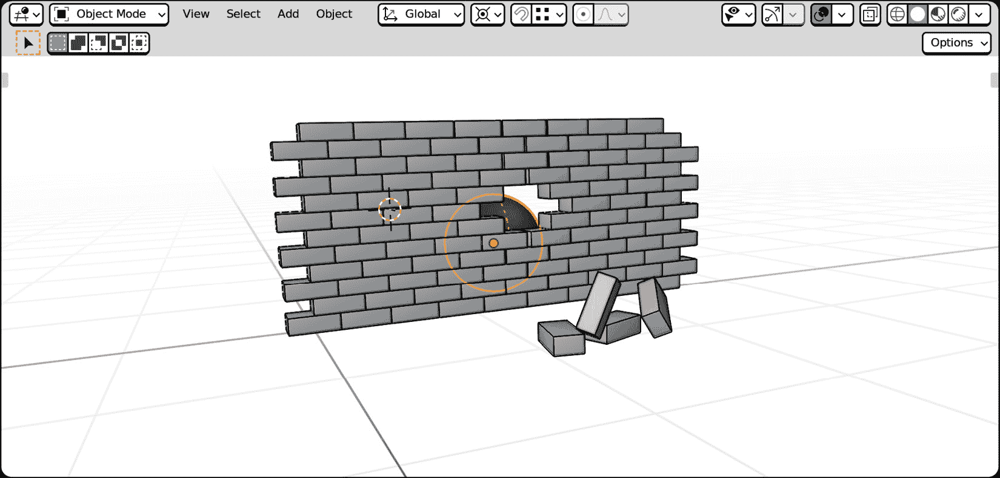

图 12.26：低质量破坏球的结果

这是最后一部分！现在我们抛出了破坏球，允许它撞向墙壁，同时表现得像其他任何刚体一样。

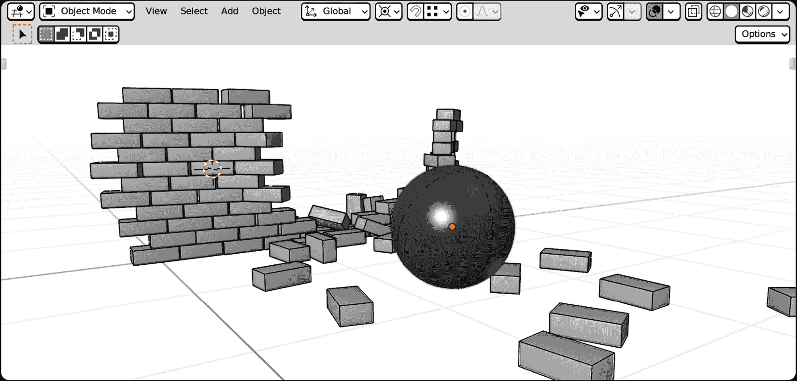

图 12.27：最终结果

继续玩转你的模拟，直到你对结果满意。接下来，我们将学习如何保存我们的工作（更准确地说，是 Blender 完成的工作）。

## 烘焙模拟

到目前为止，我们一直在“即时”模拟。每当我们对场景进行微小更改，缓存都会自动清除并重新计算模拟，以便我们查看更改的效果。当模拟轻量且我们在不断实验时，这很有趣，但最终我们会认为自己完成了。模拟结果将是完美的，然后我们希望保持原样，而不必担心意外的微小更改会清除缓存并改变结果。我们当然不想毁了所有的破坏成果！

这就是为什么烘焙模拟很重要：

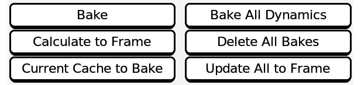

图 12.28：烘焙，以及用于更新缓存的其他操作符

`Bake` 是一个广泛的术语，出现在许多应用程序中，甚至在 Blender 中指代多个功能。烘焙模拟是指预先计算并保存结果。对于 `Fluid`（流体）或 `Cloth`（布料）等模拟，这通常需要很长时间，在这种情况下，这是计算模拟最可靠的方法。你可以把烘焙想象成一种渲染，只不过处理的不是图像，而是数据。

当你对模拟结果满意时，使用 `Rigid Body World`（刚体世界） | `Cache`（缓存） | `Bake`（烘焙）。模拟数据将与 `.blend` 文件一起保存，并在你关闭项目后依然保留。点击 `Delete Bake`（删除烘焙）可“取消烘焙”并恢复编辑模拟。

## 总结

说到 Blender 的刚体物理，Blender 使用了许多与其他应用程序提供的物理模拟相同的原理和术语（在某些情况下甚至可能是相同的代码）。这包括一些游戏引擎。

我真希望能为每种物理模拟都写一章，但那本身就是一整本书的内容了。我们还有更多东西要制作动画，还有更多摄像机来观察它们！具体来说，我们将学习如何在动画中使用多个摄像机，并从各个角度捕捉动作。

## 问题

1.  判断下列物体是否为刚体：雨滴。铅笔。棒球。袜子。卷饼。冷冻卷饼。马。

2.  什么是刚体世界？你现在身处刚体世界吗？你能逃离吗？

3.  如何调整刚体世界的全局缩放？

4.  不移动的刚体有什么意义？

5.  想象一个马克杯放在桌子上。在 Blender 和现实生活中，说马克杯正在与桌子*碰撞*，这在技术上准确吗？

6.  凹面形状在刚体物理中如此棘手的技术原因是什么？

7.  `Active`（激活）仅仅意味着刚体会移动，还是有更具体的含义？`Dynamic`（动态）意味着同样的事吗？`Animated`（动画）呢？

8.  当不可阻挡的力量遇到不可移动的物体时会发生什么？这不是禅宗公案或反问句——认真地说，在 Blender 中这样做会发生什么？

## 使用多摄像机制作动画

在实拍电影制作中，摄像机可能是昂贵的设备。然而，在计算机图形学的世界里，没有这样的成本阻碍我们！作为动画师，我们可以在场景中拥有任意数量的摄像机。我们可以在特定时间用特定摄像机渲染，并通过其他摄像机查看场景。更重要的是，我们可以像插入关键帧一样轻松地控制摄像机之间的切换时机。

很难想象有哪种动画用不上这个功能。你有没有看过一部看起来像是一镜到底、只在一个摄像机前表演的电影？好吧，我也看过，但这并不常见！对于我们的动画项目来说，如果它们不是短片、教程练习或前卫的电影实验，我们就需要学习如何在多个摄像机之间进行选择。事实上，我们将学习如何让*时间*本身为我们选择摄像机，一个接一个。然后，我们将抛开刚才告诉时间做的事，一次性用所有摄像机进行渲染。

在本章中，你将探索以下内容：

*   使用多个摄像机预览场景
*   在 `Timeline`（时间轴）中切换摄像机
*   在 `Video Sequencer`（视频序列编辑器）中切换摄像机

## 技术要求

在几乎任何动画中拥有多个摄像机都很有用，因此这是一个开放式的章节。要跟随练习，你可以使用 Blender 中你喜欢的任何动画，无论是本书的练习还是你正在做的其他项目。

作为示例，我将使用一个包含两个角色对话的场景：

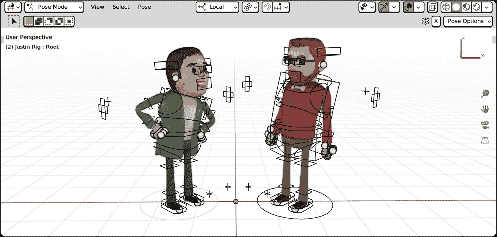

Figure 13.1: 一个包含两个角色的场景

在实拍制作中，此类场景通常在布置有两个或更多摄像机的棚内录制。在 Blender 中也不必有太大不同。

## 准备摄像机二号

如果一个独眼人说，“我盯着你呢”，我们知道他说的是哪只眼睛。对于眼睛不止一只的人，我们需要他们指明。这里说的是哪只眼睛？如果我们把 Blender 中的摄像机想象成眼睛，如果我们有不止一个，就需要回答一个类似的问题。

首先，让我们确保场景中有一些摄像机。

### 设置多个摄像机

向场景添加摄像机简直太简单了。如果你知道如何用 `Add`（添加）（`Shift` + `A`）| `Camera`（摄像机）添加第一个摄像机，那么你也就知道如何用 `Add`（`Shift` + `A`）| `Camera` 添加第二个摄像机。添加第三个摄像机，我们使用 `Add`（`Shift` + `A`）| `Camera`，添加第四个摄像机就像使用 `Add`（`Shift` + `A`）| `Camera` 一样简单……你懂了。

这是我的场景，有三个摄像机：

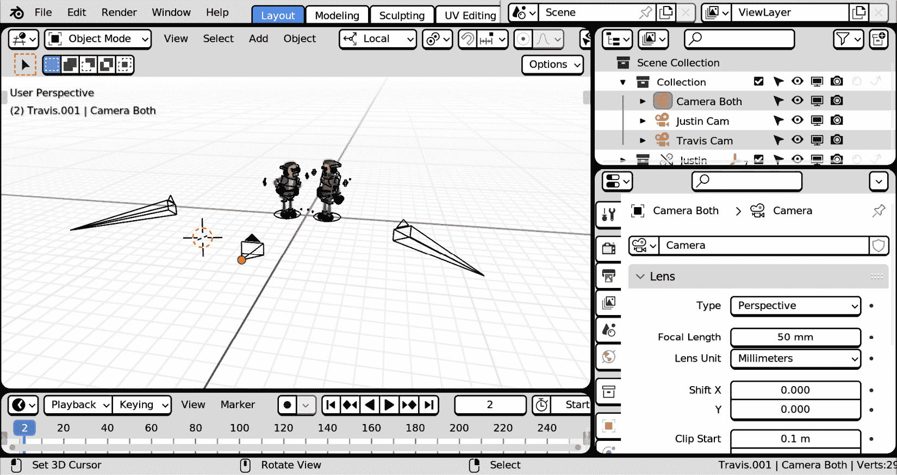

Figure 13.2: 一个包含三个摄像机的场景

默认情况下，每个摄像机对象使用自己唯一的 `Camera Data`（摄像机数据）——如 `Focal Length`（焦距）和 `Aperture`（光圈）等属性。因此，除了位于不同位置、指向不同物体外，你的多个摄像机在这方面还可以有各种设置。和许多其他事物一样，给摄像机起个具体的名字，而不仅仅是 `Camera.001`、`Camera.002` 等，也会有所帮助。

一旦你的场景中至少有两个摄像机，你就需要知道如何实际通过第二个摄像机观察，或让它渲染出任何东西。

### 活动摄像机

在场景中使用多个摄像机时，我们的主要关注点是知道哪个是 `active camera`（活动摄像机）——即默认用于渲染和查看场景的摄像机。通过导航到 `View`（视图） | `Viewpoint`（视点） | `Camera`（摄像机）（`Numpad 0` 小键盘 0），你将通过活动摄像机观察：

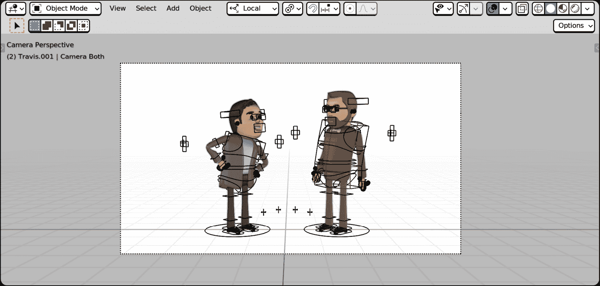

Figure 13.3: 通过活动摄像机查看的摄像机视图

同样，为了达到相同的结果，你可以走 `Render`（渲染） | `Render Frame`（渲染帧）（`F12`）这条路。如果你只有一个摄像机，那几乎肯定就是活动摄像机，你不必再多想。如果你从零个摄像机开始并添加一个，它会自动变为活动摄像机。同一时间只能有一个活动摄像机。

在第一个之后，我们添加到场景中的每个额外摄像机都将是非活动的：

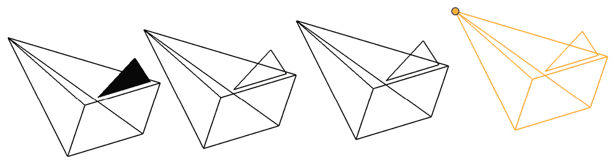

Figure 13.4: 一个活动摄像机和几个非活动摄像机

请注意，在 3D 视口中，活动摄像机与非活动摄像机的绘制方式有细微差别。除非我们将其中一个设为活动摄像机，或在本章后面将学习的其他上下文中专门选择它们，否则这些额外的摄像机不会查看或渲染任何内容。

以下是将非活动摄像机设为活动摄像机的方法：

1.  选择一个摄像机。
2.  点击 `View`（视图） | `Cameras`（摄像机） | `Set Active Object as Camera`（将活动对象设为摄像机）（`Ctrl` + `Numpad 0` 小键盘 0）。

> **Tip**
> 活动摄像机是 `Scene`（场景）的一个属性，也可以通过 `Scene Properties`（场景属性） | `Scene`（场景） | `Camera`（摄像机）访问。

现在我可以通过另一个摄像机查看和渲染场景：

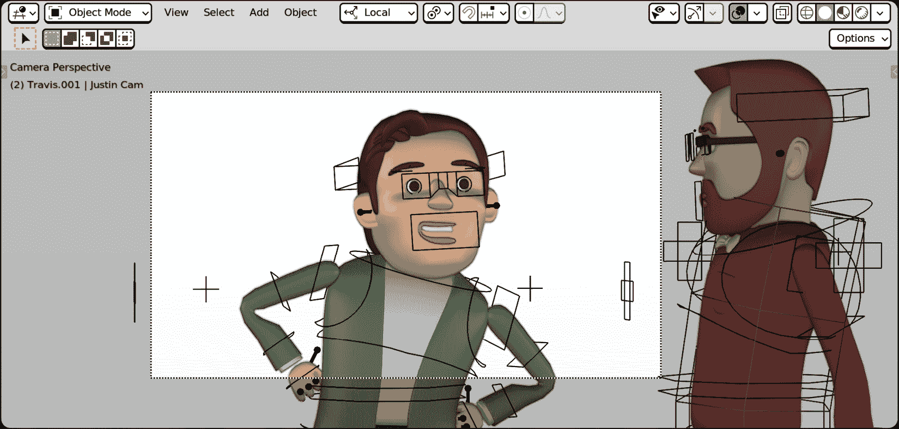

Figure 13.5: 通过第二个摄像机查看的摄像机视图

> **Tip**
> 你可能会意外发现，任何类型的对象——不仅仅是摄像机——都可以被设为活动摄像机。虽然这用处有限，但偶尔可能会派上用场，例如当你希望从 `Spot Light`（聚光灯）的视角查看场景时。

好吧，很好，但刚才还是活动摄像机的第一个摄像机现在变成非活动的了。和以前一样，我们仍然用一个活动摄像机查看和渲染场景，而多个非活动摄像机什么也不做。这引出了一个问题：这有什么用？让我们来找出答案。

### 在时间轴中切换摄像机

After discussing all that deep knowledge about keyframes, armatures, and object relationships, the time has finally come to perform the most basic technique of film editing in animation: cutting from one camera to another.

Recall what I said earlier: only one camera can be active at a time. Using the `Timeline`, we can determine which camera is active at any given frame.

We can achieve this not with keyframes, but by using `Markers`:

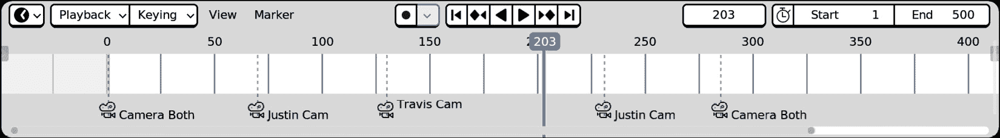

Figure 13.6: Markers in the Timeline bound to different cameras

`Markers` are interesting things. Usually, they are used to "mark" a frame for the animator's own reference, and we don't have to use them if we don't want to... unless they are the kind of markers that switch the active camera, in which case they are indispensable!

To create a marker in the `Timeline` that changes the active camera, we must `Bind` that camera to the marker. Here is how:

1.  Go to the frame where you want the active camera to change.

2.  Select the camera.

3.  In the `Timeline`, use `Marker` | `Bind Camera to Markers` (`Ctrl` + `B`).

    This inserts a camera-shaped marker at the current frame and binds the camera of the same name to that marker.

4.  Repeat these steps for another camera on another frame.

**Tip**

It is best to use `Bind Camera to Markers` on the very first frame of the animation to establish which camera is the starting active camera.

When a camera is bound to a marker, it becomes the active camera for all frames after that marker until another marker bound to a different camera is encountered. When the animation is rendered, using markers to switch cameras is faithfully executed, just like playing the animation in the `Camera View`.

Since markers can be selected, moved, and duplicated just like keyframes, we can easily create a large number of cuts and adjust exactly where each cut happens:

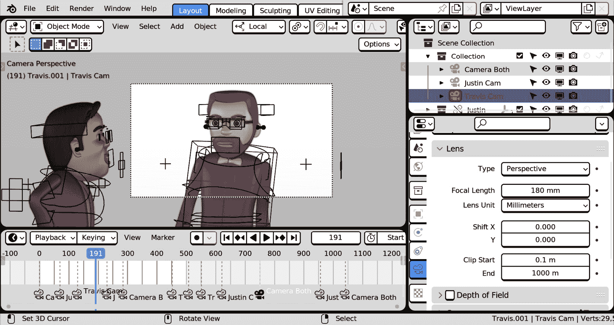

Figure 13.7: Lots of camera switching in the Timeline

Knowing this method of switching cameras gives us a technique used in almost every film and TV show!

However, using only the active camera to view and render a scene has its limitations. After all, there can only be one active camera at a time, and sometimes that is not enough. For these situations, we have some additional features available.

## 相机覆盖

Knowing what the active camera does and how to change it isn't the whole story. What if we want to view or render the scene with something other than the active camera? There are reasons and ways to do this.

## 使用本地相机查看

When we play the animation in the `Camera View`, the playback faithfully switches cameras at those cuts, so we can see in real-time what the rendered animation will look like. However, depending on the situation, this camera switching might not be what we want to see all the time. Suppose we have a non-active camera, but we still want to review a part of the animation through that camera. Or perhaps we need to look through that camera to decide exactly when to cut to it.

In these cases, you can always set a camera as the `Local Camera`. To set a camera to this mode for a given viewport, open the `3D Viewport` Sidebar (`N`) and go to `View` | `View` | `Local Camera`:

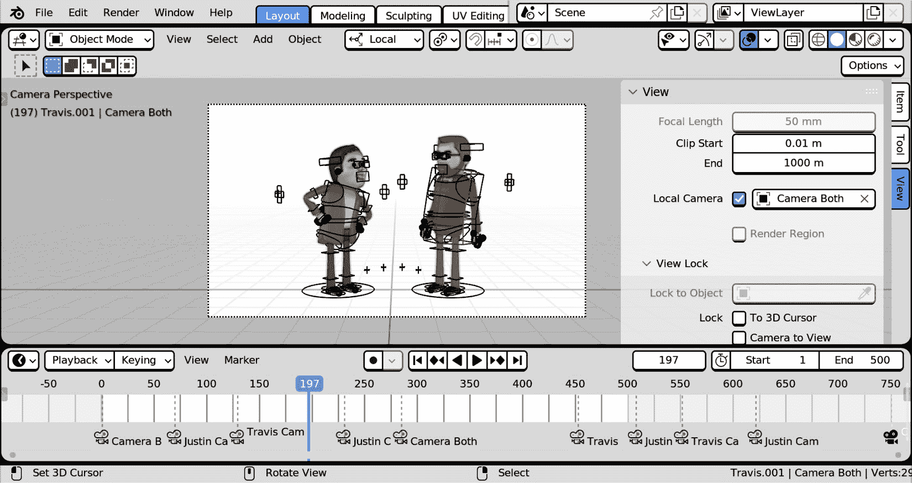

Figure 13.8: The Local Camera feature in the View tab

**Tip**

The `Local Camera` property is "local" to each specific `3D Viewport` it is set on. You can customize the user interface to contain as many such viewports as your computer can handle.

Now we know a handy trick for sticking to a single camera in the `3D Viewport`. Next, we will look at a completely different kind of camera override.

## 在视频序列编辑器中使用多个相机

Now that we know how to view the scene without the active camera, consider another scenario: what if we want to *render* the scene without the active camera? Doing so allows us to render the same moment from multiple angles, among other uses:

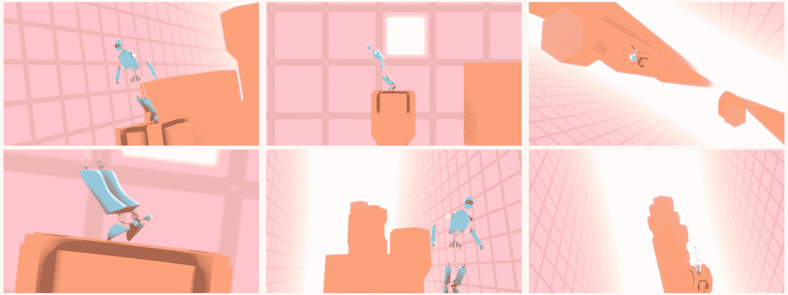

Figure 13.9: A single jumping animation seen from different cameras

To achieve this, we must turn once again to our old friend the `Video Sequencer`.

### 使用场景条带

Starting from an animation scene with multiple cameras, let's give ourselves a Video Sequence containing that scene as a `Scene Strip`:

1.  Add a new scene to the project (scenes are added and selected via the field in the top-right of the window).

2.  Name the scene something like `Sequence` to remember its purpose.

3.  Open the `Video Sequence` Editor in the UI.

4.  In the `Video Sequence` Editor, go to `Add` (`Shift` + `A`) | `Scene` to add the original scene as a `Scene Strip`.

5.  Find the `View Type` setting in the `Video Sequencer` header and set it to `Sequencer & Preview`.

You should now have a scene strip in the Sequencer:

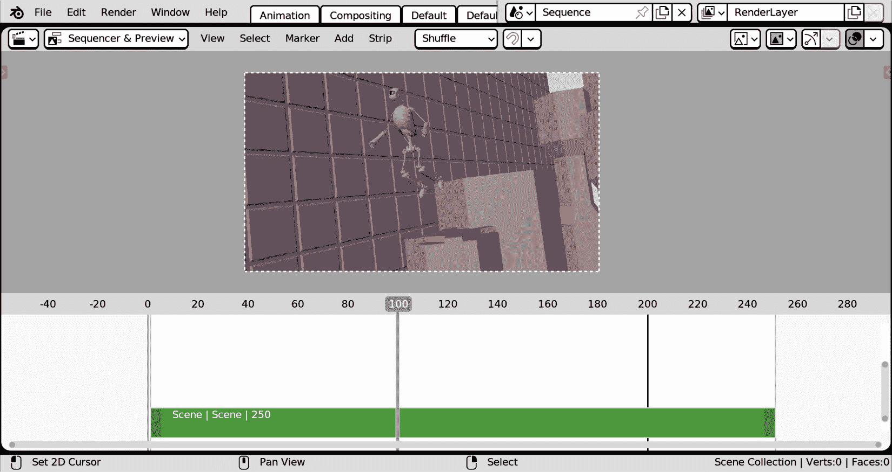

Figure 13.10: A scene strip in the Video Sequencer

Scene strips are a powerful and underestimated feature. They represent the frames of a given scene waiting to be rendered and can be edited just like `Movie` or `Image/Sequence` strips, allowing us to perform video editing techniques and add effects to one or more scenes before rendering. The scene in a scene strip is automatically rendered on demand when the Sequence scene is rendered, saving us the step of having to render each scene first and import it back into Blender as a `Movie` or `Image/Sequence`. While editing in the `Video Sequencer`, the scene's live `Camera View` stands in for rendered frames to generate what is seen in the `Preview` area.

**Tip**

In the Sidebar (`N`), you can go to `View` | `Scene Strip Display` | `Shading` to choose how scene strips are previewed in the `Video Sequencer`. Don't expect `Rendered` to be fast.

If a project has multiple animation scenes, we can sequence these scenes as scene strips in any order, along with transitions and effects, and render the whole thing at once. But even with just one scene, we can use the Sequencer to take advantage of multiple cameras in the scene.

### 为场景条带选择相机

A useful feature of scene strips is found in the `Video Sequencer` Sidebar (`N`) under `Strip` | `Scene`:

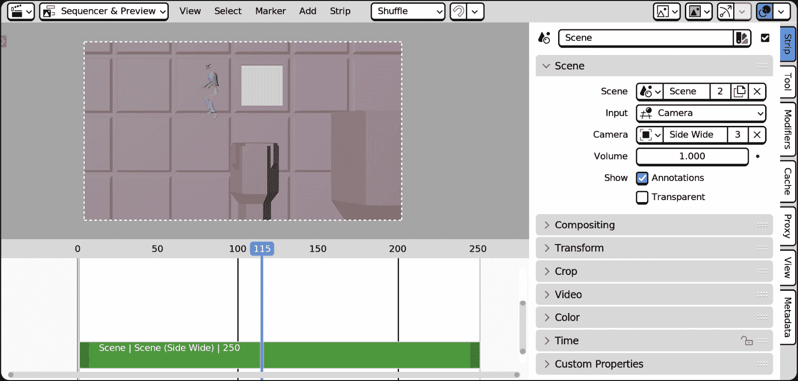

Figure 13.11: Camera property of a scene strip

By default, a scene strip uses the scene's active camera for rendering, just like rendering normally from inside the scene. However, when not empty, the scene strip's `Camera` property overrides the active camera and renders the scene using the selected camera instead.

No longer constrained by linear time or the active camera setting, we can use this feature to render from any camera in the scene, in any order, at any time. To do this, follow these steps:

1.  Duplicate (`Shift` + `D`) the scene strip once for each camera you want to use from the scene.

2.  Open the `Video Sequencer` Sidebar (`N`) and find `Strip` | `Scene` | `Camera`.

3.  For each strip in the sequence, select the strip and choose a different camera for the `Camera` property.

4.  Use `Move` (`G`) or any tools you like to edit the sequence as needed.

即使场景中同一时间只能有一个活动摄像机，这也不再阻碍我们。现在我们可以从多个摄像机角度即时重播同一时刻。

这只是开始；视频序列编辑器在叠加场景条带方面开启了各种可能性。在本例中，使用 `Wipe` 过渡，不是为了从一个条带过渡到下一个，而是使用两个不同的摄像机将帧在两个同步条带之间分割：

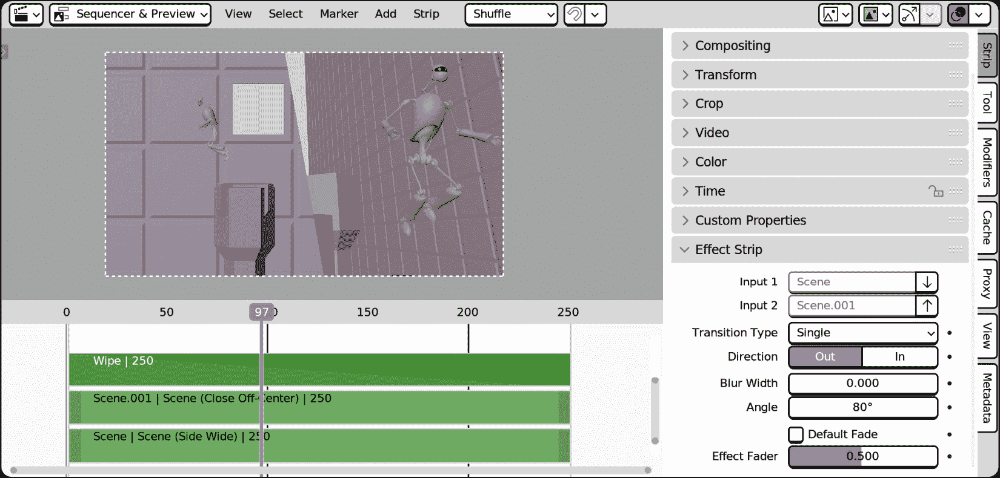

Figure 13.12: 视频序列编辑器中的分屏效果

你会想出什么效果？

## 总结

我不是在开玩笑，实拍摄像机非常昂贵。最好的租金要数千美元，外加一大笔押金。那只是摄像机本身；你还需要三脚架、起重机、滑轨和稳定器等安装设备，以支撑这台通常非常沉重的摄像机。然后你得雇佣一名受过专门训练的操作员来操作摄像机，他得有午休时间，否则会累得把摄像机摔了，你就损失押金了（你绝*不*想损失押金）。

好消息是这与我们无关！在 Blender 中，摄像机比泥土还便宜，比空气还轻，我们不需要付给任何人工会工资来操作它们。顺便说一句，这正是 3D 动画本世纪如此普及的一个重要原因，但那是另一个话题。

至于本书的最后一章，你可能还记得前面提到的线性时间，特别是关于不需要受其约束。这是否暗示我们的动画不必是线性的，甚至可能存在非线性动画编辑器？答案可能会让你大吃一惊！

## 练习题

1.  为什么我们可能想要在场景中使用多个摄像机？

2.  如果我们不能使用多个摄像机，如何绕过这一限制并仍能实现摄像机切换的动画效果？这样做可能会产生什么并发症？

3.  为什么该操作符称为 `Bind Camera to Markers`，如果它创建一个标记，而且只创建一个标记？

4.  “活动摄像机是用于查看和渲染场景的摄像机。”上述说法是否总是正确的？

5.  有多少种不同的方法可以愚弄一个认为他们正在用活动摄像机渲染当前场景一帧的 Blender 用户？

6.  如果我们想用不同的摄像机渲染同一帧段，但不能使用视频序列编辑器，还能做什么？

7.  如何将 `Sequence` 场景本身作为场景条带用于另一个序列中？

8.  如果你渲染一个包含场景条带序列的序列编辑器场景的一帧，其中一个条带是另一个包含场景条带序列的序列编辑器场景，第二个序列中的场景条带能否是第一个序列中场景条带所在的同一场景，但帧不同？

9.  什么是段错误？你刚才遇到一个了吗？
