# 第 14 章：非线性动画

关键帧存在哪里？在时间轴？图表编辑器？动作编辑器？当然，这三个编辑器都可以访问关键帧进行编辑，但关键帧真的在那里吗？也许真正的关键帧在动画属性的滑块上，每当它变黄时；又或许它们藏在 Blender 用户界面后面，每当你最小化窗口时就像蟑螂一样四散。*也许现在就有一个关键帧在你身后。*

事实是这些都是愚蠢的答案，但“关键帧存在哪里？”是一个严肃的问题，有真实的答案。关键帧存在于 F-Curve 中，F-Curve 与动画通道是同一回事。动画通道存在于动作中，而直接影响动画的动作则存在于 `Nonlinear Animation editor` 中。

也称为 `NLA`，`Nonlinear Animation editor` 是 Blender 中每个动画的执行总部。使用此编辑器，整个动作可以加速、减速、组合和重叠，同时完全绕过时间轴、动作编辑器和图表编辑器中显示的内容。这使其成为我所谓的“更高层级”角色动画的绝佳工具，这意味着不使用关键帧，而是同时使用多个动作进行动画制作！

在本章中，我们将利用 `NLA` 的功能让 Rain 同时行走和说话，结合我们之前创建的两个动作。

你将学习如何执行以下操作：

*   将之前制作的动作导入新动画
*   在 `NLA` 中延长和重复动作
*   在 `NLA` 中分层多个动作
*   动态控制动作的时间

## 技术要求

`Nonlinear Animation editor` 非常适合在单个角色动画中组合多个动作。要尝试这一点，请创建一个包含我们最喜欢的角色绑定 Rain 的新项目，就像我们自 *Chapter 6* 以来在每个角色动画练习中所做的那样。

此外，我们需要两个适合组合的动作。如果你完成了 *Chapter 8* 和 *Chapter 9* 的练习并保存了工作，那么你已经有了两个这样的动作：一个对口型动作和一个走循环动作：

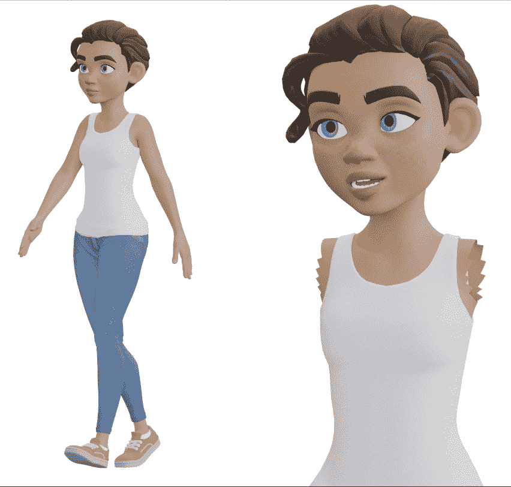

Figure 14.1: Rain 行走，Rain 说话

使用 `Nonlinear Animation editor`，我们将非破坏性地组合这些动作，让 Rain 同时行走和说话。

# 复用动作

动作是一种有趣的数据块类型。它们存储物体的所有动画通道；我们从本书开始就一直在创建它们，却几乎不需要考虑它们。动作会自动创建，通常整个动画中每个物体只有一个动作。当我们在 *Chapter 1* 中首次为 `Cube` 设置位置关键帧时，会自动创建一个名为 `CubeAction` 的动作。此后，属于 `Cube` 的每个属性的每个关键帧都存储在名为 `CubeAction` 的动作中，就这样了。Blender 从未提示过我们。我们为什么需要它提示？

我们处理的所有其他动画也是如此，包括角色 Rain 的动画。每次我们在新项目中为 Rain 制作动画时，都会为她创建一个动作，只考虑该动作中的关键帧，从未将动作本身视为动画数据的容器。然而，有时我们确实想考虑动作本身，这在角色动画中经常发生，特别是特定的动作……比如走循环。

## 追加走循环

角色的走循环可能是项目中最可复用的单个动作。我们将通过导入在 *Chapter 8* 中创建的走循环（应名为 `Rain Walkcycle`）到新动画中来开始此练习。

让我们将走循环从另一个 `.blend` 文件追加到我们的新项目中：

1.  使用 `File` | `Append` 并导航到你为走循环练习创建的 `.blend` 文件。
2.  追加 `Rain Walkcycle` 动作。

使用 `Append` 而不是 `Link` 可以避免在两个 `.blend` 文件之间创建另一个依赖关系，并使在当前 `.blend` 文件中编辑走循环变得更容易。`Link` 仍然是一个可行且有时必要的选项。正如我们稍后将看到的，`Nonlinear Animation editor` 允许我们使用追加和/或链接的动作来控制动画，而不改变动作本身。

使用 `Append` 后，你不会立即看到变化，但 `Rain Walkcycle` 可供我们分配给角色。

## 在动作编辑器中分配动作

仅仅因为我们追加了走路循环，并不意味着 Rain 就会开始走路。我们必须将该动作专门分配给 Rain 的骨架。动作可以在 `Action Editor`（动作编辑器）中分配，它基本上就像 `Dope Sheet`（动作表）一样，只不过它一次只编辑一个动作，并且在标题栏中间提供了这个非常重要的字段：

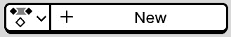

Figure 14.2: The Active Action for the active object

此字段为空是因为 Rain 尚未制作动画。或者可以说，正是因为此字段为空，Rain 才尚未制作动画。无论哪种情况，现在让我们来改变这一点：

1.  选择 Rain 的骨架对象 `RIG-rain`。
2.  通过进入 `Dope Sheet` 并将 `Editing Context`（编辑上下文）更改为 `Action Editor` 来调出 `Action Editor`。
3.  在 `Action Editor` 的标题栏中，选择动作 `Rain Walkcycle`。

现在 Rain 应该会像以前一样准确地走路了……

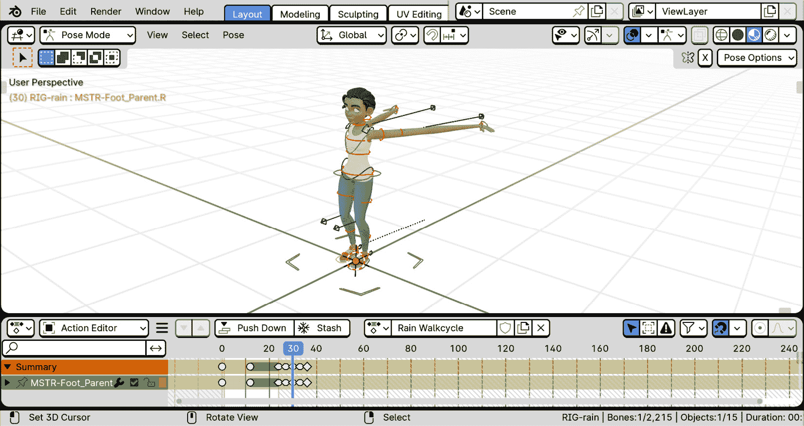

Figure 14.3: A completely normal walk cycle

嗯，也许不完全是。我们稍后会修复这个问题。

### 隐藏动作

当你从可用动作中选择 `Rain Walkcycle` 时，你可能会注意到列表中挤满了其他一大堆动作：

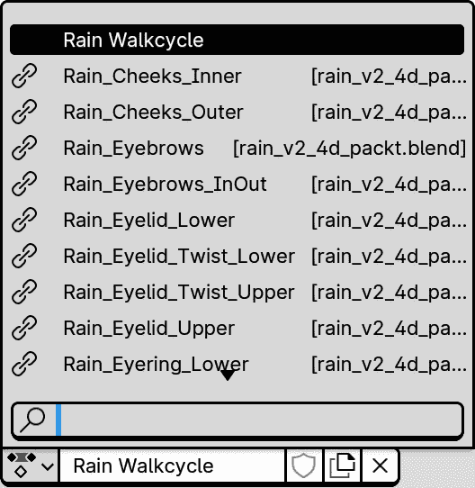

Figure 14.4: List of actions

Figure 14.4: List of actions

我们不记得创建过这些，甚至不记得追加过它们！

那是因为这些其他动作是在 Rain 绑定时制作的。并非所有动作都旨在直接用于动画中。这些额外的动作被 Action Constraints（动作约束）使用——这是一种特殊的约束，用于控制 Rain 骨架的各个部分。该动作通过一个或多个目标骨骼的移动来“播放”，从而使这些骨骼能够控制更复杂的运动。

我说角色绑定很复杂可不是开玩笑！话虽如此，让我们弄清楚为什么 Rain 现在走起路来一团糟。

## 关于遗忘设置的惨痛教训

我们看到的问题在分配动作时很常见。回想一下，在走路循环练习开始时，我们调整了 Rain 绑定中的一些重要属性，例如她的 `FK/IK Switch`（FK/IK 切换）设置。但我们并没有为这些属性插入关键帧，对吧？对于我们摆姿势的任何骨骼或更改的任何数值，如果我们没有为其插入关键帧，该动作就与它无关；我们对该属性所做的任何操作都不会带入新场景。没有它的动画数据，而动画数据是动作拥有的唯一东西！

这意味着我们必须手动修复这些被遗留的属性。为此，请执行以下步骤：

1.  前往 Rain 的 `CloudRig` 设置。
    在 `CloudRig | Settings | FK/IK Switch` 下，将 Rain 的手臂设置为使用 `FK`，脊柱设置为使用 `IK`。
2.  将 `Face Settings | Eye Target Parent` 设置为 `Torso_Loc`（**2**）。

Rain 再次像我们记忆中那样走路了：

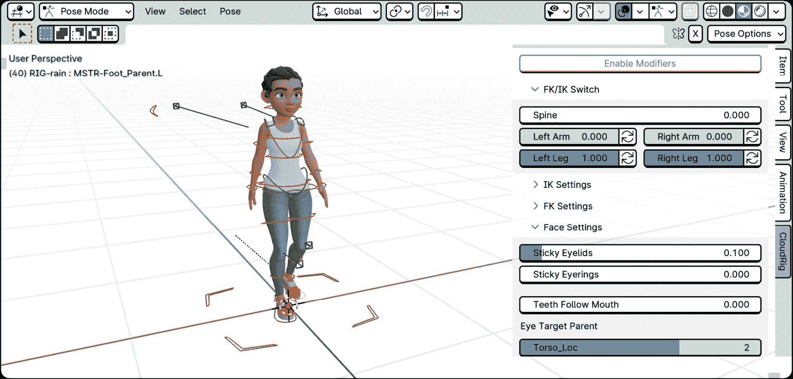

Figure 14.5: Rain, with restored settings

> **Tip**
>
> 为了从一开始就避免这个问题，你只需要记住为任何必须摆姿势的特定骨骼或必须设置的属性插入一帧关键帧，以使动作按预期工作。为姿势/属性添加关键帧会将其存储在动作中，以便当动作被追加时，它能随其他动画数据一同携带。

在追加了走路循环动作并将其分配给 Rain 后，它的工作方式与自动创建的任何动作（当插入第一帧关键帧时创建）相同。现在我们已经修正了原始 `.blend` 文件中遗留的任何剩余设置，这几乎就等同于我们在当前文件中创建了走路循环。使用 `Timeline`（时间轴）、`Dope Sheet` 或 `Graph Editor`（图表编辑器），我们可以像往常一样编辑和插入关键帧。

不过问题是——我们不需要编辑这个动作。事实上，我们将以一种方式使用它，使得在基本不改变其数据的情况下，轻松添加额外的动作并同时控制它们。

## 动作条

考虑一下我们可能想对 Rain 的走路动画做的一些基本操作：

*   在时间上偏移走路循环
*   加快或减慢 Rain 的步伐
*   开始/停止走路循环（换句话说，让循环重复有限的次数）

对于所有这些任务，我们已经知道一种解决方案：编辑关键帧！换句话说，选择关键帧，然后根据需要移动、缩放或复制它们。这通常是一个完美的解决方案，但并非总是如此。编辑关键帧意味着编辑动作，如果你链接了该动作，或者你不想复制或覆盖它，这就会有问题。

这就是 `Nonlinear Animation`（非线性动画）编辑器派上用场的地方。

## 非线性动画编辑器简介

虽然你可能认为你的动画完全由 `Dope Sheet`、`Timeline` 和 `Graph Editor` 中出现的关键帧控制，但 Blender 中的另一个区域一直在幕后操控一切：

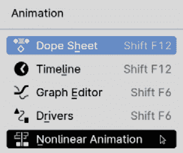

Figure 14.6: All the animation editors

你是否曾好奇最后一个编辑器是做什么的？这里有一个简短的解释。

当你移动关键帧时，你是在编辑动作，因为关键帧存在于动作内部。这不仅适用于 `Action Editor`；事实上，`Action Editor` 之所以这么叫，只是因为它一次编辑一个动作。`Dope Sheet`、`Graph Editor` 和 `Timeline` 都在编辑动作。到目前为止，我们所称的所有动画都可以被认为是“动作编辑”，就像 3D 建模可能被称为“物体编辑”一样。

但问题是：`NLA` **不**编辑动作。相反，`NLA` 通过将动作作为一个离散元素来控制，从而编辑动画。

### 查看非线性动画编辑器

乍一看，我们可以看到 `NLA` 为每个具有动画数据的对象显示一行：

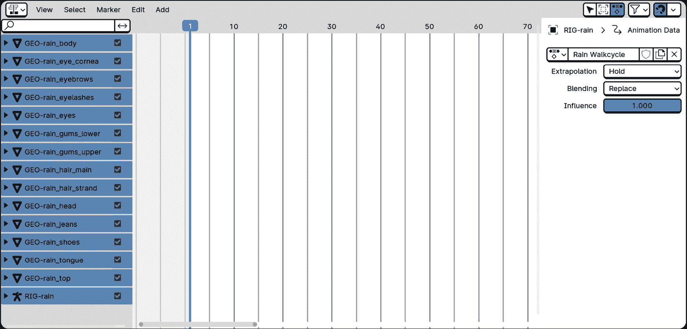

Figure 14.7: The Nonlinear Animation editor, or NLA

正如预期的那样，这包括 `RIG-rain`，但也包括一些我们不记得制作过动画的对象：这是因为 Rain 自带许多驱动器，而驱动器也算作动画数据（尽管 `NLA` 不显示那些驱动器）。还记得我们看到的一堆不记得创建的动作吗？当角色绑定被链接/追加时，它会带来大量意想不到的数据。

但这并不意味着我们非得看它！我们只关心 `RIG-rain` 的动画，所以让我们去 `NLA` 隐藏其他所有东西：

1.  调出 `Nonlinear Animation` 编辑器。
2.  在标题栏中，禁用 `Include Missing NLA`。

这会清除所有那些空行。现在，只剩下 `RIG-rain` 这一行，这正是我们所需要看到的一切：

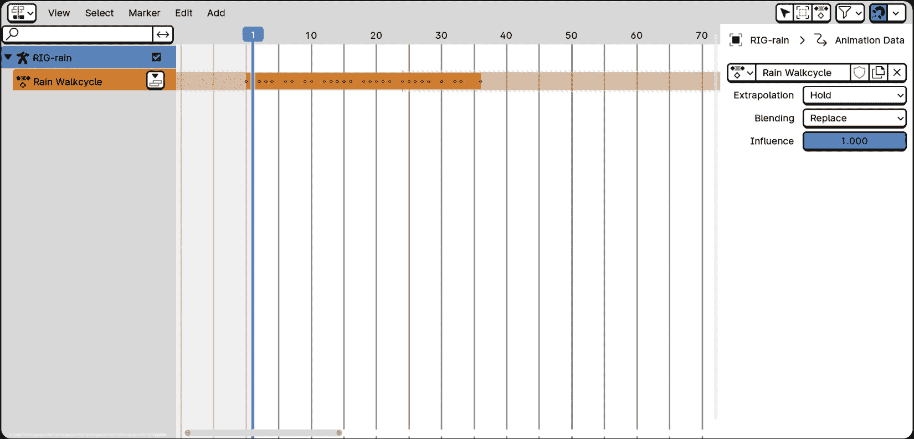

Figure 14.8: A cleaner NLA showing Rain’s animation data

最初，`NLA` 中没有太多东西，除了无法选择的一行关键帧，以及右侧边栏（`N`）中一些似乎没什么用的属性。让我们弄清楚这里发生了什么。

## NLA 中的动作

当你展开 `RIG-rain` 的 `NLA` 行时，你会看到 `Rain Walkcycle` 中的关键帧，当我们在 `Action Editor` 中为 Rain 选择它时，它成为了 `Active Action`（活动动作）。`Active Action` 是一个对象的动作，它暴露在除 `NLA` 之外的所有其他动画编辑器中。到目前为止，我们在本书中创建的每一个动作都是 `Active Action`；这是 Blender 中另一个一直伴随我们却不需要我们去思考的东西。

在 `Nonlinear Animation` 编辑器中，仅凭 `Active Action` 我们能做的事情不多。当我们将 `Active Action` 转变为所谓的 `action strip`（动作条）时，`NLA` 才变得有用。

### “下推”动作

## NLA 中的动作条

动作条是一种可以在时间轴上移动并在非线性动画编辑器中操作的动作，这很像 Blender 视频序列编辑器中的不同条带。

创建一个动作条后再解释它的作用会更容易，我们可以利用当前的 `Active Action`（活动动作）来创建。你只需前往 NLA 左侧边栏，点击 `Push Down Action`（下推动作）按钮——就是活动动作名称旁边的那个小按钮：

1.  在左侧边栏中，展开 `RIG-rain` 下的动画轨道。
2.  点击活动动作的 `Push Down Action` 按钮。

下推动作会将其转换为动作条，并将其放入属于该动作的对象的新 NLA 轨道中。

`Rain Walkcycle`（雨行走循环）动作现在变成了一个动作条：

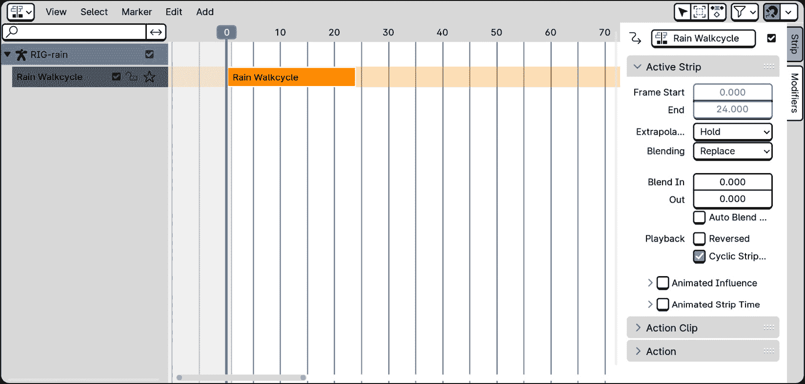

图 14.9：NLA 中的动作条

我们刚才所做的彻底改变了动画的工作方式，这是我们以前从未见过的。去打开任何其他动画编辑器——你将不再在时间轴、图表编辑器或动作编辑器中看到 `Rain Walkcycle` 的关键帧。关键帧似乎消失了……但 Rain 依然在动画！

发生的情况是 NLA 接管了动画。从现在起，如果我们想了解 Rain 运动的情况，必须参考 NLA，它使用一个或多个动作条来控制角色的动画。

接下来，我们将了解这个动作条能做什么。

## 使用动作条

动作条到底是什么？简单来说，你所看到的是将整个动作包装成一个单一的离散对象，可以沿着轨道在时间上移动。向任一方向移动动作条，Rain 就会开始更早或更晚地行走。

这类似于一次性选择并移动所有关键帧，但有一个重要区别：移动的是动作条，而不是单个关键帧。就像坐在行驶列车上的乘客，关键帧在动作内部保持原位不动，作为一个数据块，动作本身保持不变。这类似于在 `Object Mode`（物体模式）下移动物体；物体作为一个整体移动，而其数据——顶点、边和面——固定在物体上。

对于当前的练习，我们可以让 `Rain Walkcycle` 动作条保持原位，但有一个迫切问题：动作条时长只有 24 帧，即一个行走“循环”，导致 Rain 走两步就停下了。这并不比之前好多少，但很容易修正。

### 延长循环动作

动作条在右侧边栏 (`N`) 中也有各种属性，其中包括允许我们延长条带，使循环动画持续我们想要的时长：

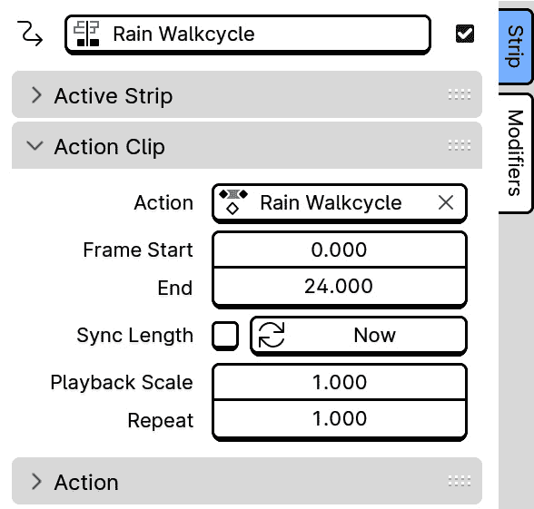

图 14.10：动作片段属性

通常我们会使用 `Strip | Action Clip | Repeat`（条带 | 动作片段 | 重复）来实现，但在 `Rain Walkcycle` 的情况下，直接增加 `End`（结束）帧以填满整个动画长度会更好：

1.  在非线性动画编辑器中选择 `Rain Walkcycle` 动作条。
2.  在右侧边栏 (`N`) 中找到 `Strip | Action Clip`（条带 | 动作片段）。
3.  编辑 `End` 帧以将条带延长至动画的最后一帧。

虽然行走循环不再无限重复，但它持续的时间与动画一样长，效果实际上是一样的：

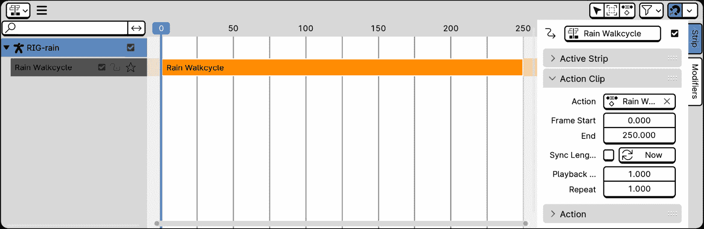

图 14.11：延长的动作条

这样延长 `Rain Walkcycle` 之所以有效，是因为我们已经将大多数动画通道设为循环，包括一些骨骼通道，它们被设定为沿 `Y` 轴持续移动。增加 `End` 帧更可取，因为它允许这些骨骼继续移动，而不是每 24 帧就弹回原位。

如果你还没这么做，可以将导致 `ROOT_Child` 向后移动的 `Y Location`（Y 位置）通道静音，从而让 Rain 的其余部分向前移动。但这需要编辑动作……

### 微调动作条

动作从其他动画编辑器中消失了——尽管它仍通过 NLA 影响动画——你可能会想：怎么找回它？想回去编辑一些关键帧难道这么疯狂？一点也不！如果下推动作是不可逆的，那简直是错误的，简直是不道德的。

编辑在 NLA 中用作动作条的动作称为*微调*。操作方法：选择条带，点击 `Edit | Start Tweaking Strip Actions`（编辑 | 开始微调条带动作），或者直接按 `Tab` 键：

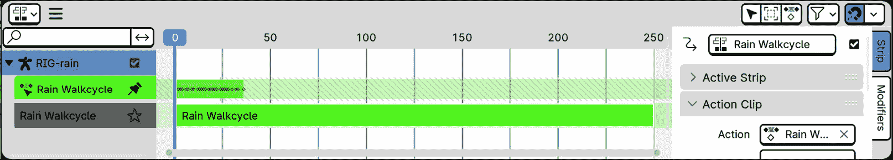

图 14.12：正在微调的动作条

这会使相关动作重新出现在所有其他动画编辑器中，关键帧可以像往常一样再次插入和编辑。

完成后，你可以在 NLA 中再次按 `Tab`，或选择 `Edit | Stop Tweaking Strip Actions`（编辑 | 停止微调条带动作）。这很像在 `Object Mode` 和 `Edit Mode` 之间切换，只不过是针对动作的！

> **提示**
>
> 要完全恢复到开始使用 NLA 之前的状态，你随时可以删除所有动画轨道，并在动作编辑器中找回该动作。

有了动作条，我们可以用全新的方式思考动作，但我们还没看到最精彩的部分，那就是引入不止一个动作时。

## 分层动作

在 *第 8 章* 和 *第 9 章* 的前几个练习中，我们制作了两个动画：Rain 行走和 Rain 说话。这两个练习创建了两个动作，其中一个我们已经追加了。我们的目标是追加第二个动作，并将其与第一个结合，让 Rain 在一个镜头中又走又说。这种情况在大型制作中并不罕见；例如，团队中的两名动画师可能分别为同一角色制作不同的动作，然后由第三名动画师将它们合并。又或者在游戏制作中，角色需要一个预制动作库（跑、跳、射击等），这些动作必须经过组合或紧凑序列测试。

如何结合两个动作？显而易见的方法是将关键帧从一个动作复制粘贴到另一个，创建一个巨大的*超级*动作。这通常是不可避免的，但也是破坏性且不灵活的。如果我们稍后想修改或偏移其中一个动作怎么办？又或者——这正是 NLA 大放异彩的地方——如果两个动作包含针对同一事物的动画通道怎么办？

非线性动画编辑器解决了这些问题。在本节中，我们将学习如何使用 NLA 以非破坏性方式将两个或多个动作作为动作条进行组合。

## 追加第二个动作

首先，我们需要找到在 *第 9 章* 中创建的对口型动作：

1.  点击 `File | Append`（文件 | 追加），导航到你为对口型练习制作的 `.blend` 文件。
2.  追加 `Rain Lipsync`（雨对口型）动作。
3.  调整动画长度以适应新动作。
4.  如果愿意，去视频序列编辑器添加对口型练习中使用的相同音频。

现在我们有了第二个动作，对口型动作可以在动作编辑器中分配给 Rain，就像我们在 NLA 中下推之前分配行走循环动作一样。但分配动作的方法不止一种……

### 在 NLA 中添加动作

如果我们在动作编辑器中为 Rain 选择新动作，它将成为新的活动动作，当我们返回 NLA 时可以看到这一点：

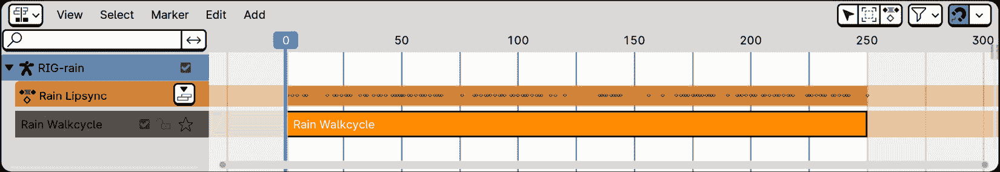

图 14.13：活动动作与动作条并存

注意这不会替换现有的动作条！稍后详述。

然后我们可以像处理第一个动作那样下推第二个动作，从而得到两个动作条供我们使用：

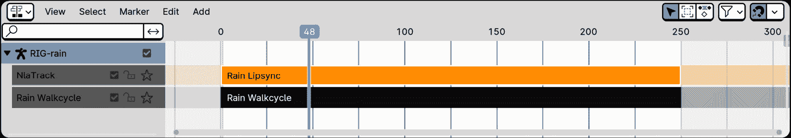

图 14.14：两个动作条

我们可以那样做，也可以通过直接在`Nonlinear Animation editor`中将动作添加为条带来节省几次按键。要执行此操作，请遵循以下步骤：

1. 前往`Nonlinear Animation editor`，确保选中`RIG-rain`。
2. 使用`Add Action`（`Shift + A`），选择你刚刚追加的对口型动作。
3. 如有需要，将新动作条移动到正确的时间点。

有两个动作条同时影响 Rain，我们终于能看到是什么让 NLA 如此特别了！

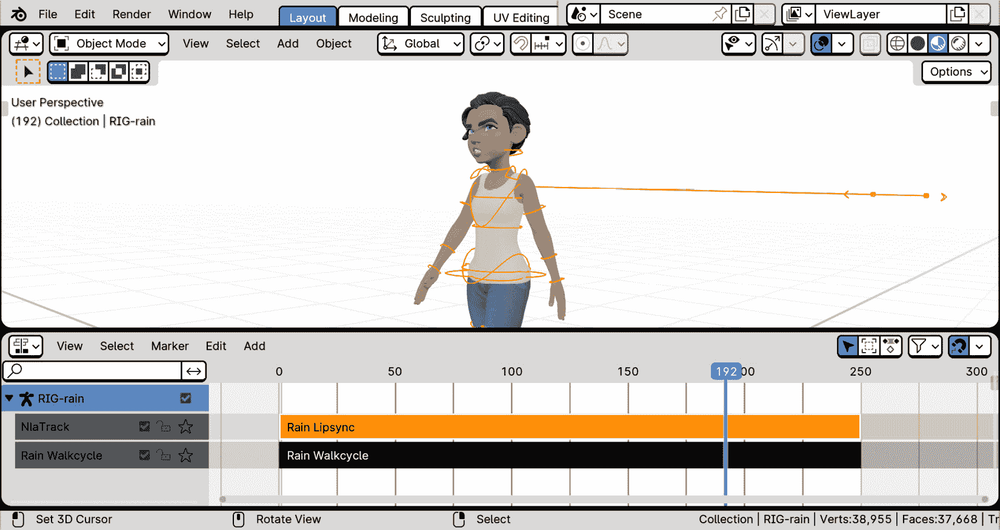

图 14.15：两个动作条让 Rain 走路和说话

我们之前制作的那两个动作已被合成为一个完整的动画，同时将这两个动作保留在单独的轨道中——这使得它们更容易独立控制、调整，或作为链接库进行引用。现在，Rain 可以在真正移动的同时说出她的台词了！

## 动画条带时间

这里还有一个我们可以用 NLA 做的技巧：控制时间本身！通过为一个简单的值制作动画，我们可以控制动作条的时间评估方式，从而模拟慢动作、延时摄影，甚至倒转时间让动作反向播放。

它是如何工作的？想象一下，你通过来回刷帧来玩弄你的动画，随着鼠标左右移动让 Rain 跳一小段舞。结果本身就是一种动画。本质上，你是在为当前帧号制作动画，这几乎正是我们在本节即将做的事情。

## Strip Time 属性

我知道你在想什么：我们难道不能已经控制时间了吗？只需随意拖动一些关键帧，直到所有东西以我们想要的速度移动。这不就是动画吗？

不再是这样了！以这种方式编辑关键帧是破坏性且粗糙的，而且我们现在正在`Nonlinear Animation editor`中！我们已经超越了编辑那些繁琐的小关键帧的需求。

相反，我们只需要为`Strip Time`属性制作动画：

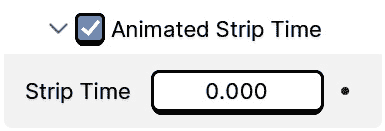

图 14.16：Strip Time 属性

`Strip Time`属性决定当前帧，不是针对场景本身，而只是针对动作条。换句话说，我们可能位于帧`50`，但我们具体想看`Rain Walkcycle`的哪一帧？现在由我们决定！

### 为 Strip Time 属性设置关键帧

让我们开始为`Rain Walkcycle`的`Strip Time`属性设置关键帧：

1. 在`Nonlinear Animation editor`中，选择 Rain 的走路循环动作条。
2. 在右侧边栏（`N`）中，启用`Strip` | `Active Strip` | `Animated` `Strip Time`。

   启用此属性最初会冻结动作条。无论场景本身位于哪一帧，动作都认为它是`Strip Time`指示的那一帧。必须有意地为该值制作动画，才能让事物再次移动。
3. 在帧`0`处，为`Strip Time`值设置关键帧。
4. 转到动画的最后一帧，将`Strip Time`值设为不同的帧号，并设置关键帧。

现在，为`Strip Time`值制作动画是让动作条时间前进的唯一方式，根据你如何为该值制作动画，走路循环的时间可能移动得非常慢或非常快。

在我们开始控制时间结构本身之前，通常最好先让时间正常流动，通过为`Strip Time`制作动画以匹配当前帧。这将帮助我们理解该功能的工作原理，并更容易选择确切的时间和方式来弯曲时间的流动。

### 从线性 Strip Time 开始

让我们看看`Strip Time`的`F-curve`。在我的情况下，我在帧`0`设置了值`0.0`，在帧`250`设置了值`250.0`，所以我知道`Strip Time`值将在这两个关键帧处匹配帧号：

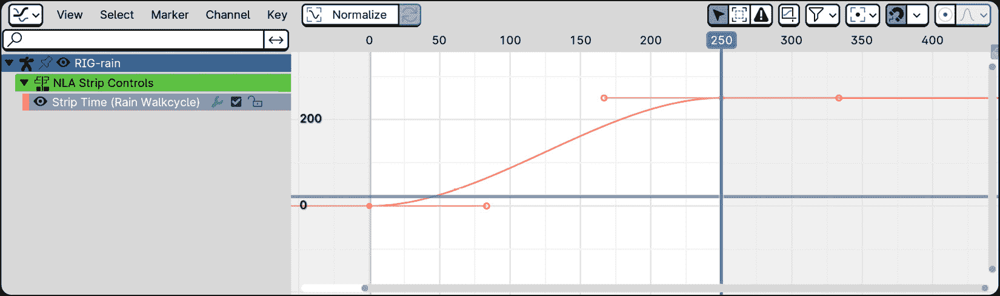

图 14.17：Strip Time 的初始动画

但仍有插值的问题，它会产生加速和减速 Rain 步伐的有趣效果。

让我们尝试使其完全线性：

1. 前往`Graph Editor`，找到你刚刚设置关键帧的`Strip Time`动画通道。
2. 编辑`Strip Time`的关键帧，使其值等于帧号。
3. 将`F-curve`段设为`Linear`。

现在我们回到了最无聊的线，字面上就是`X = Y`：

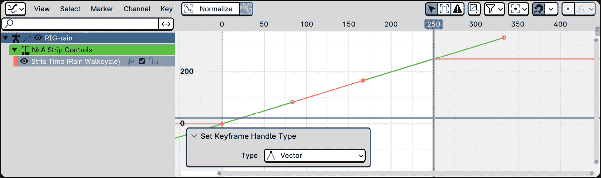

图 14.18：线性函数

这个一对一函数使`Strip Time`匹配当前帧，动作条再次表现正常。

我发誓这么做是有原因的。现在，我们有一个合适的起点可以偏离，如这个例子中 Rain 直接走进慢动作区域：

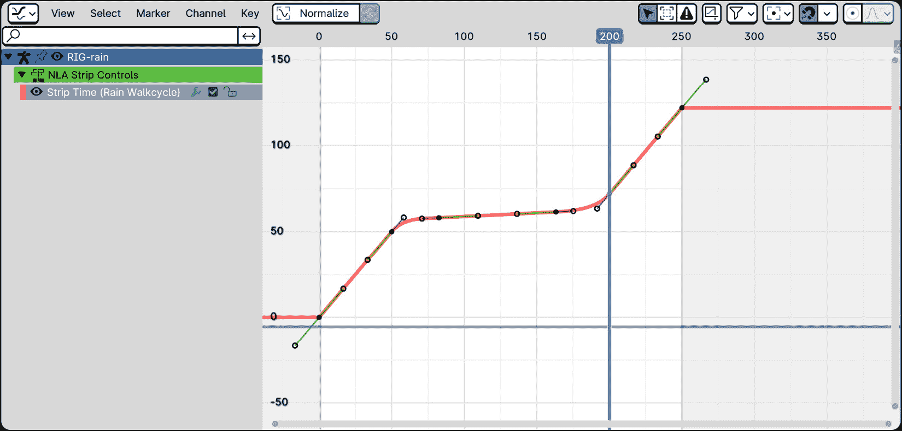

图 14.19：线性时间变为子弹时间再变回

仅用走路循环做这事不算最刺激，但你明白了——这就是事情真正变得非线性的部分。我们可以在一个镜头中让 Rain 减速、加速和倒放，而无需接触动作数据本身。我们可以让 Rain 处于慢动作中，而其他一切像延时摄影一样移动。如果我们也为 Rain 对口型动作的`Strip Time`值设置关键帧，我们可以让她在向前走时倒着说话，反之亦然。想象一下，当你添加更多自己的动作和角色时，你能做什么！

## 总结

想象你在读一本关于 Blender 的书，指导你在每个练习中只建模一个且仅一个物体。直到最后一章你才学到什么是物体，以及如何使用所谓的`Object Mode`将多个物体组合在一起。这就是教授`Nonlinear Animation editor`的感觉！

NLA 有点晦涩难懂。截至写作时，真正理解如何使用它的人不多——基本上就我、阿姆斯特丹的十几个人、亚洲和澳大利亚的半打人，还有三个来自南美叫 Pablo 的不同家伙。我只开半玩笑。但现在你知道了 NLA 的作用和用法，你可以算作这个独家精英俱乐部的成员了！

我们开始这本书学习如何为立方体制作动画，最后我们学会了如何为动画制作动画。这算是开始和结束旅程的不错方式。我想说你终于成为动画师了，但你不记得了吗？当你完成本书的*第 1 章*时，你已经是动画师了。你当然仍是学生，但这很好——我也是学生，你知道吗。我将永远学习和制作动画，希望你也一样。谢谢阅读。

## 问题

1. 动画师想要链接动作而不是使用`Append`的一些原因是什么？
2. 动作中存储了什么数据？
3. 为什么你可能想在为骨骼摆好姿势后只插入一帧关键帧，即使它不打算移动？
4. 为什么我们这个练习的`.blend`文件包含我们从未创建的动作？
5. Blender 中哪个编辑器用于编辑动作？
6. 为什么叫“下推”？
7. 当动作条移动时，动作会发生什么？
8. 为什么`Strip Time`的`F-curve`不能包含在动作中？
9. `Nonlinear Animation editor`的“非线性”体现在哪里？
10. 你能给“animate”、“animated”和“animation”这几个词多少个不同的技术定义？
