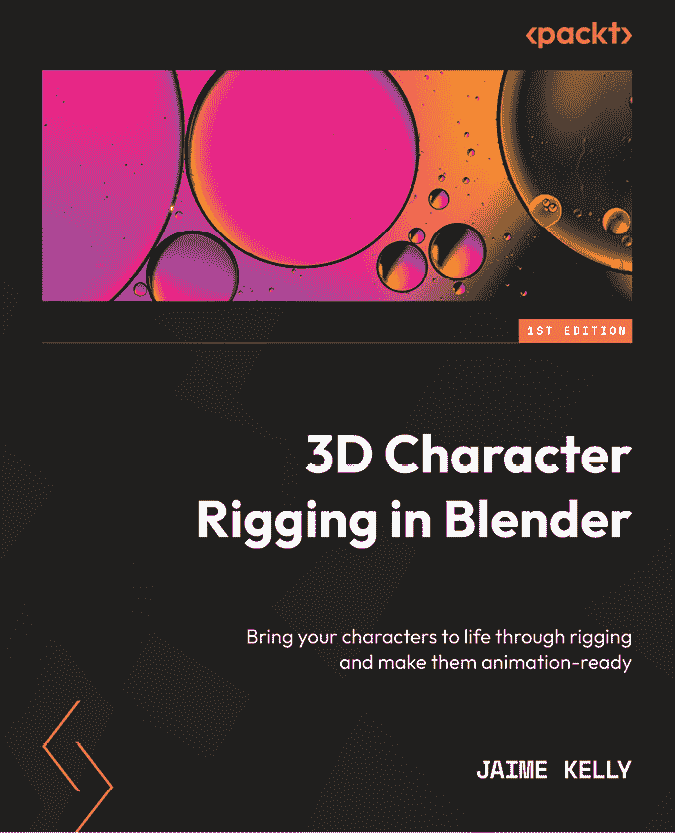
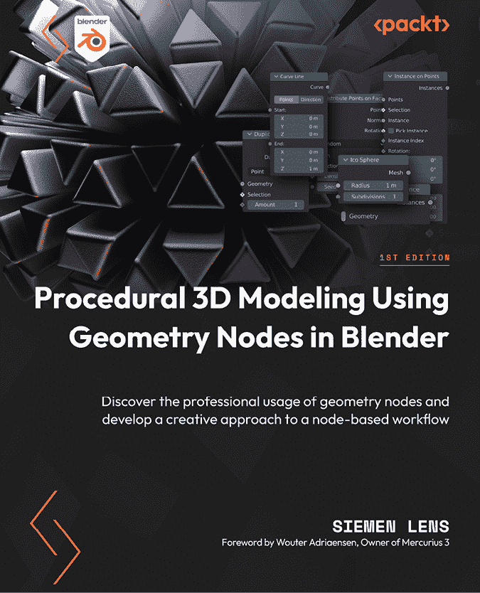

# 索引

## 滚动骨骼
- 关键帧设置：277，278

## 走路循环动画
- 在 Y 轴上：253，254
- 循环：258–260
- 循环，偏移：260–262
- 使用预览播放范围：266，267
- 确定步幅长度：254–258
- 在跑步机上行走：262–266

## 墙
- 砖块，建造：378，379
- 建造：378–381
- 破坏：378，381
- 刚体，直接控制：382
- 刚体停用：379，380
- 模拟，烘焙：385，386
- 拆除球，动画制作：383–385
- 拆除球，创建：382

## X
- X 欧拉旋转通道：77–80
- X 截距：79
- X 位置 F 曲线：66–68

---

# Packt 订阅

[packtpub.com](http://packtpub.com)

订阅我们的在线数字图书馆，即可完全访问超过 7,000 本书籍和视频，以及行业领先的工具，帮助您规划个人发展并提升职业生涯。更多信息，请访问我们的网站。

## 为什么要订阅？

- 花更少时间学习，更多时间编码，通过来自 4,000 多位行业专业人士的实用电子书和视频
- 通过专为您定制的技能计划提升学习效果
- 每月免费获取一本电子书或一个视频
- 全文搜索，轻松访问关键信息
- 复制粘贴、打印和书签内容

您知道吗？Packt 为每本出版的书籍提供电子书版本，包含 PDF 和 ePub 文件。您可以在[packtpub.com](http://packtpub.com)升级到电子书版本，作为纸质书客户，您有权享受电子书副本的折扣。如需更多详情，请联系我们：customercare@packtpub.com。

在[www.packtpub.com](http://www.packtpub.com)，您还可以阅读免费技术文章合集，订阅各类免费通讯，并获得 Packt 书籍和电子书的独家折扣和优惠。

---

# 您可能喜欢的其他书籍

如果您喜欢这本书，可能对 Packt 的这些其他书籍感兴趣：

## Blender 中的 3D 角色绑定
**Jaime Kelly**  
ISBN: 978-1-80323-880-7  
[查看图书](https://packt.link/1803238801)  

- 理解绑定的基本术语，学习如何创建和修改绑定。
- 了解骨骼如何与拓扑交互。
- 掌握通过网格进行权重绘制。
- 知道何时以及如何添加约束，如反向动力学、指向约束和子级约束。
- 使用形态键和骨骼驱动器等高级技术使绑定在视觉上更具吸引力。
- 熟悉行业领导者使用的高级技术

## 使用 Blender 几何节点进行程序化 3D 建模
**Siemen Lens**  
ISBN: 978-1-80461-255-2  
[查看图书](https://packt.link/1804612553)  

- 探索几何节点提供的不同节点输入和输出。
- 掌握几何节点系统的流程。
- 了解您将使用的常见节点及其在几何节点编辑器中的功能。
- 使用 Blender 内部的节点系统修改基础网格图元。
- 在曲线上分散并修改对齐的对象。
- 熟悉几何节点系统中更高级的节点。
- 使用命名属性链接几何和材质节点编辑器。
- 在实际项目中应用您新学到的节点知识

---

# Packt 正在寻找像您这样的作者

如果您有兴趣成为 Packt 的作者，请访问[authors.packtpub.com](http://authors.packtpub.com)并立即申请。我们已与数千名开发者和技术专业人士合作，就像您一样，帮助他们与全球技术社区分享见解。您可以提交一般申请，申请我们正在招募作者的特定热门主题，或提交您自己的想法。

---

# 作者寄语

你好！

我是 Sam Brubaker，《Blender 3D 动画实现》的作者。我真心希望您喜欢阅读这本书，并发现它对提高您的生产力和效率有用。

如果您能在亚马逊上留下评论，分享您对这本书的想法，那将对我（和其他潜在读者！）非常有帮助。

请访问下面的链接或扫描二维码留下您的评论：

[`packt.link/r/1801077215`](https://packt.link/r/1801077215)

您的评论将帮助我们了解这本书哪些方面做得好，哪些方面在未来的版本中可以改进，所以非常感谢。

最美好的祝愿，

**Sam Brubaker**

---

# 下载本书的免费 PDF 副本

感谢您购买本书！

您喜欢在外出时阅读，但无法随身携带纸质书吗？您购买的电子书是否与您选择的设备不兼容？别担心，现在每本 Packt 图书都免费提供无 DRM 限制的 PDF 版本。

随时随地，在任何设备上阅读。直接从您喜爱的技术书籍中搜索、复制和粘贴代码到您的应用程序中。

福利不止于此，您还可以每天在收件箱中获得独家折扣、通讯和优质免费内容。

请遵循以下简单步骤以获取福利：

1. 扫描二维码或访问下面的链接  
     
   [`packt.link/free-ebook/9781801077217`](https://packt.link/free-ebook/9781801077217)
2. 提交您的购买证明
3. 就这些！我们会直接将您的免费 PDF 和其他福利发送到您的邮箱。

---

# 目录

1. Blender 3D 动画实现
2. 贡献者
3. 关于作者
4. 关于审阅者
5. 前言
   1. 本书适合谁
   2. 开始所需条件
      1. 您的动画工作站
      2. 先决知识
      3. Blender
   3. 本书内容
   4. 充分利用本书
   5. 分享您的想法
   6. 下载本书的免费 PDF 副本
6. 第 1 部分：Blender 简介与动画基础
7. 第 1 章：时间轴中的基本关键帧
   1. 技术要求
   2. 浏览时间轴
      1. 在时间中移动

## 第 1 章：动画基础

## 设置帧范围

## 调整时间轴视图

## 动画播放

## 使用关键帧创建简单移动

### 关键初始位置

### 关键属性

### 关键第二个位置

### 关键帧原则

### 关键旋转

## 在时间轴中编辑关键帧

### 基础关键帧编辑

### 复制关键帧

### 保持位置

### 编辑动画时机

## 为 Blender 中几乎任何属性制作动画

### 其他关键帧方法

### 关键材质颜色

## 总结

## 问题

## 第 2 章：图表编辑器

## 技术要求

## 让球动起来

## 导航图表编辑器

### 打开图表编辑器

### 图表编辑器中的 X 轴和 Y 轴

### 动画通道

### 调整图表编辑器视图

## 插值与缓动

### 设置插值模式

### 设置缓动类型

## 让球弹跳

### 空中物体的线性插值

### 在图表编辑器中添加弹跳关键帧

## F 曲线外推

### 线性外推

### 循环外推

## 总结

## 问题

## 第 3 章：贝塞尔关键帧

## 技术要求

## 一位疲惫的动画师

### 独轮车的连接部件

### 关键路线检查点

### 在图表编辑器中插入关键帧的新方法

## 贝塞尔柄类型

### 显示关键帧柄

### 贝塞尔柄类型概览

### 自动和自动钳制贝塞尔柄

### 向量柄和对齐柄

### 组合向量柄和对齐柄

## 编辑贝塞尔柄

### 使用对齐柄实现平滑移动

### 使用自由柄实现弹跳

## 朝向、重心与平衡

### 运动路径作为视觉指南

### 转弯时的倾斜

### 深入倾斜

## 将关键帧复制到另一通道

### 复制关键帧

### 关键单个属性

### 粘贴关键帧

### 缩放关键帧数值

## 总结

## 问题

## 第 4 章：深入了解对象关系

## 技术要求

## 理解对象原点

### 关于对象和原点的真相

### 将原点居中

### 抓取原点

## 父子关系

### 父/子关系

## 理解约束

### 添加约束

### 世界空间与局部空间

### 复制约束

## 跟随路径

### 编辑动画路径

### 添加跟随路径约束

### 为路径制作动画

## 驱动器

### 添加驱动器

### 编辑驱动器

### 驱动器 F 曲线

### 对象关系最终图表

## 总结

## 问题

## 第 5 章：渲染动画

## 技术要求

## 设置相机

### 向场景添加相机

### 相机取景

### 动画相机

## 渲染基础

### 什么是渲染？

### 渲染控制

### 为渲染设置场景

### 预测和管理渲染性能

## 渲染图像序列

### 为什么输出图像序列而不是视频？

### 输出设置

### 预渲染清单

### 渲染动画

### 查看渲染帧

## 将图像序列转换为视频

### 视频序列编辑器

### 视频导出的输出设置

### 输出视频

## 总结

## 问题

## 第 2 部分：角色动画

## 第 6 章：链接与摆姿势

### 技术要求

### 在新场景中链接角色

#### 链接库

#### 创建库覆盖

### 理解 Rain 的骨架

#### Rain 绑定的艺术

#### CloudRig 界面

### 给骨架摆姿势

#### 姿势模式

#### IK 骨骼

#### FK 骨骼

#### 手指、面部和其他配件

### 创建姿势库

#### 资产浏览器

#### 创建姿势资产

#### 练习姿势

### 总结

### 问题

## 第 7 章：基础角色动画

### 技术要求

### 在新场景中准备 Rain

#### 简要回顾：将 Rain 链接到新项目中

#### 使用姿势资产

#### 为动画设置骨骼关系

#### 隐藏骨骼

### 为姿势骨骼设置关键帧

#### 定格或粗略制作动画

#### 回顾我们的关键姿势

### 动作表

#### 动作表简介

#### 整理动作表

### 深入制作该角色动画

#### 两个额外的中间姿势

#### 用于摆姿势的中间帧操作符

#### 挥手

### 润色动画

#### 在骨骼上使用图表编辑器

#### 为 Rain 的配件制作动画

### 总结

### 问题

## 第 8 章：走路循环

### 技术要求

### 准备走路循环场景

#### 走路循环的时间轴

#### 时间轴标记

#### 让 Rain 准备好走路

### 沿 Y 轴向前移动

#### 确定步幅长度

#### 循环动画

#### 让 Rain 在跑步机上行走

#### 使用预览播放范围

### 添加更多周期性运动

#### 躯干运动

#### 左右摇摆

#### 动作编辑器

#### 使用正弦波制作更多躯干动画

### 进阶脚部动作

#### 脚部翻滚

#### 抬脚

#### 修正腿部运动

#### 将左脚动画复制到右脚

### 完成走路循环

#### FK 脚趾

#### FK 手臂

#### 最后润色？

### 总结

### 问题

## 第 9 章：声音与对口型

### 技术要求

### 在 Blender 中使用声音

#### 将音频文件导入视频序列编辑器

#### 使用声音条

#### 处理声音的时间轴设置

### 不说话的表演

#### 关键面部表情

#### 自动关键帧与关键帧集

### 对口型的科学原理

#### 给动画师的语音学

#### 为嘴巴制作动画

### 总结

### 问题

## 第 10 章：使用动态约束进行道具交互

### 技术要求

### 触碰物体

#### 设置镜头

#### 伸手拿物体

### 设置物体到骨骼的关系

#### 虚拟骨骼——更聪明的绑定方式

#### 复制变换约束

### 具有动画影响的约束

#### 为约束的影响设置关键帧

### 释放球

#### 制作投掷/抛掷动画

#### 制作球被抛出的动画

### 总结

### 问题

## 第 3 部分：高级工具与技术

## 第 11 章：F 曲线修改器

### 技术要求

### 在哪里找到 F 曲线修改器

#### 添加我们的第一个 F 曲线修改器

### 玩转 F 曲线修改器

#### 阶跃插值修改器

#### 内置函数修改器

#### 用数学设置时钟

### 使用噪波修改器

# 第 11 章：噪波修改器的更多妙用

## 添加噪波修改器
添加噪波修改器

## 复制修改器
复制修改器

## 噪波修改器的更多妙用
噪波修改器的更多妙用

### 使用噪波修改器模拟爆炸
使用噪波修改器模拟爆炸

### 限制修改器的帧范围
限制修改器的帧范围

## 摘要
摘要

## 问题
问题

## 第 12 章：刚体物理
第 12 章：刚体物理

## 技术要求
技术要求

## 创建刚体世界
创建刚体世界

### 我们的第一个刚体模拟
我们的第一个刚体模拟

### 主动与被动刚体
主动与被动刚体

## 刚体碰撞
刚体碰撞

### 撞碎垃圾算法
撞碎垃圾算法

### 碰撞形状
碰撞形状

### 选择刚体碰撞形状
选择刚体碰撞形状

## 摧毁一堵墙
摧毁一堵墙

### 建造一堵墙
建造一堵墙

### 摧毁墙壁
摧毁墙壁

### 烘焙模拟
烘焙模拟

## 摘要
摘要

## 问题
问题

## 第 13 章：使用多摄像机制作动画
第 13 章：使用多摄像机制作动画

## 技术要求
技术要求

## 准备摄像机二
准备摄像机二

### 设置多个摄像机
设置多个摄像机

### 活动摄像机
活动摄像机

### 在时间轴中切换摄像机
在时间轴中切换摄像机

## 摄像机覆盖
摄像机覆盖

### 使用本地摄像机查看
使用本地摄像机查看

### 在视频序列编辑器中使用多个摄像机
在视频序列编辑器中使用多个摄像机

## 摘要
摘要

## 问题
问题

## 第 14 章：非线性动画
第 14 章：非线性动画

## 技术要求
技术要求

## 复用动作
复用动作

### 追加走路循环
追加走路循环

### 在动作编辑器中分配动作
在动作编辑器中分配动作

### 遗忘设置的惨痛教训
遗忘设置的惨痛教训

## 动作条
动作条

### 非线性动画编辑器简介
非线性动画编辑器简介

### NLA 中的动作
NLA 中的动作

## 分层动作
分层动作

### 追加第二个动作
追加第二个动作

## 动画条时间
动画条时间

### Strip Time 属性
Strip Time 属性

## 摘要
摘要

## 问题
问题

## 索引
索引

## 为什么要订阅？
为什么要订阅？

# 您可能喜欢的其他书籍
您可能喜欢的其他书籍

## Packt 正在寻找像您这样的作者
Packt 正在寻找像您这样的作者

## 下载本书的免费 PDF 副本
下载本书的免费 PDF 副本

## 地标

## 封面
封面

## 索引
索引

