## 开始使用 Unreal

在本书的第一章中，您将了解什么是 Unreal Engine，它的用途，以及如何开始使用它。然后您将学习如何设置 Epic Games 账户并下载 Unreal Engine，随后使用同一账户详情下载 Bridge，这是开始创建 MetaHuman 角色所需的应用程序。

总体而言，您将熟练掌握在 Windows 机器上安装和设置这些应用程序。

因此，我们将涵盖以下主题：

*   什么是 Unreal Engine？
*   什么是 MetaHuman？
*   设置 Unreal Engine 和 MetaHuman Creator

### 技术要求

在开始之前，我必须提醒您，本书涉及极高质量的 3D 角色，因此在设置 Unreal 之前了解这一点非常重要，以免因技术问题而感到失望。这是因为 Unreal Engine 像任何 3D 图形工具一样，需要一台强大的机器；其中很大一部分性能来自显卡。

因此，如果您想享受在 Unreal 中工作的实时体验，您需要一台能够处理最佳设置并实时显示 MetaHuman 角色的计算机。否则，您将遇到运行非常迟缓且容易频繁崩溃的机器，这是没人想要的。要完成本章，您需要互联网连接以及 Epic Games 推荐的最低硬件规格：

*   Windows 10 64 位
*   64 GB 内存
*   256 GB SSD（系统盘）
*   2 TB SSD（数据盘）
*   NVIDIA GeForce GTX 970
*   10 核 Xeon E5-2643 @ 3.4 GHz

您将在本书页面中看到的屏幕截图来自我的自己的机器，其配置如下：

*   Windows 10 64 位
*   256 GB 内存
*   1 TB SSD（系统盘）
*   4 TB SSD（数据盘）
*   NVIDIA GeForce RTX 3090
*   20 核 i9 10-900k @ 3.7 GHz

如果您是忠实的 Mac 用户，您的体验将不如 Windows 用户好得多。这很大程度上是因为 Epic Games 投入了更多时间将引擎开发用于 Windows。这并不是说它在 Mac 上不可用，但许多功能，特别是实现照片级真实感的渲染功能，在 Mac 机器上不可用，最著名的是 NVIDIA RTX 系列 GPU 显卡上的 `DirectX 12` 和 `Ray Tracing Cores`（光线追踪核心）。

我还想指出，有一些解决方案可以让您在强大的机器上进行测试。在大多数情况下，它们将帮助您完成本书的所有章节，除了实时面部动作捕捉和可能出现的实时身体动作捕捉。因此，如果您预算有限，我建议您查看一些云计算解决方案，例如：[paperspace.com](https://paperspace.com)。

> **注意**
>
> 在云机器上，您仍然无法进行任何实时动作捕捉，因为这需要与您的机器直接接口或共享网络。但是，您可以利用云机器的更高规格来尝试渲染和灯光设置。

此时，您可能正在不必要地担心。然而，我个人曾尝试在低配置机器上使用本书中提到的工具，在大多数情况下，我能够使用极低的渲染设置完成工作。然而，我完全无法进行任何实时动作捕捉。相反，我只能依赖动作捕捉素材库——所以如果您打算现在学习，以后再投资购买更新、更快的机器，这本书肯定仍然适合您。

## 什么是 Unreal？

简单来说，**Unreal Engine** 是一款游戏引擎。市面上还有许多其他游戏引擎，但 Unreal Engine 是游戏开发领域两大领先引擎之一，另一个是 Unity。如果 MetaHuman 是 Unity 公司的人开发的，这本书的标题就会略有不同！

Unreal Engine 是一款用于实时显示图形的极其强大的工具。它最初是为一款名为 Unreal 的基于 PC 的第一人称射击游戏而构建，由 Epic Games 在 1990 年代中期到后期开发。在早期，Unreal Engine 能够在 CPU 上以高达 60 fps 的速度渲染帧，给用户带来实时体验。

然而，存在许多限制，例如帧大小、任何给定时间可显示的三角形数量限制，以及光照背后数学的复杂性。最终结果是图形并非照片级真实，但比其他游戏引擎有了显著改进。

随着 GPU 随时间推移而改进，Unreal 也随之改进，因为它能够将大量数学计算迁移到 GPU 上。结果，引擎能够依赖专门设计用于更快计算 3D 渲染的硬件，并开发了许多功能来引入照片级真实感光照解决方案，这些解决方案以前仅存在于电影和电视中基于传统 CPU 路径追踪的方案中。

路径追踪或光线追踪渲染解决方案涉及非常复杂的数学，它会从最终渲染的像素追踪光子，穿过 CGI 摄像机并绕场景一周。这种追踪极其耗时，仅交付一张图像就需要大量的处理能力。因此，对于照片级真实感来说，传达运动感或实时感是不可能的。

由于最近的创新，Unreal Engine 现在被用于实时生成照片级真实感渲染，我们可以在 Disney 的《曼达洛人》中看到这一成果。负责实时环境的公司 StageCraft、Industrial Light & Magic 合作创建了 LED 背景，显示 Unreal Engine 中场景的输出。除了提供照片级真实感的背景外，LED 背景还会为真人演员补光，增加了更多真实感。

我预计如果您是完全的新手，您可能会挠头思考：*像 Unreal 这样的游戏引擎是做什么的？* 更广泛地说，它是一款旨在构建实时渲染图形游戏的软件应用程序。对于游戏，Unreal 用于创建以下内容：

*   用户功能
*   游戏逻辑
*   环境设计
*   动画
*   用户所见内容的实时渲染

无论是鼠标点击输入、Xbox 手柄按钮，还是 Oculus 头显，这些用户输入都会影响角色如何以及何时移动，以及在任何给定时间显示什么内容。

最终，本书旨在让您能够上手使用自己的角色，并按照您想要的方式为它们制作动画，即使您没有美术背景或角色动画背景。这很令人兴奋，不是吗？我认为是的。

接下来，让我们更多地思考一下我们将如何创建这些角色。

## 什么是 MetaHuman？

**MetaHuman** 是非常复杂的角色，它们具有看起来照片级真实和动作逼真的能力。它们是供用户和艺术家编辑的模板。角色模板的编辑在网页浏览器中进行，允许用户以极度真实感查看他们的角色设计。

MetaHuman Creator 的大量开发工作集中在实时渲染上。通常，CGI 角色的皮肤着色涉及大量的 CPU 处理，特别是对于高细节区域，例如细微的反射、毛孔和细小的汗毛或绒毛。MetaHuman 皮肤着色器旨在利用最近的技术硬件进步（例如 NVIDIA RTX 显卡上的实时光线追踪）在 Unreal Engine 中实时工作。

除了照片级真实感的皮肤着色器，MetaHuman 还拥有骨骼网络和混合形变，允许进行极其复杂和强大的面部木偶控制，以及结合面部和身体动作捕捉的能力，所有这些都在 Unreal 中实时进行。

既然您已经对虚幻引擎和 MetaHuman 有了很好的了解，我们将让软件在您的系统上运行起来，以便您能在下一章开始使用虚幻。

## 设置虚幻引擎和 MetaHuman Creator

在开始使用虚幻引擎和 MetaHuman 之前，我们需要进行一些设置。在接下来的章节中，我们将执行以下操作：

*   创建虚幻账号
*   下载并安装虚幻引擎 5
*   启动虚幻引擎 5
*   安装 Quixel Bridge
*   启动 MetaHuman Creator

那么，让我们开始吧。

## 创建 Epic 账号

要开始使用虚幻，您需要做的第一件事就是创建一个 Epic 账号。请按照以下说明操作：

1.  首先访问 Epic Games 网站：`https://www.epicgames.com/`。

> **注意**
>
> 根据您的地区，如果 URL 变成类似 `https://www.epicgames.com/store/en-US/` 的样子，请不要感到惊讶（您仍然在正确的地方）。

2.  进入 Epic Games 网站后，您可以导航到虚幻引擎链接。或者，直接使用以下 URL：`https://www.unrealengine.com/`。

3.  在右上角，点击 `Sign In`（即使您没有登录凭据，仍然必须点击它）。

4.  您将看到一系列登录方式，包括使用电子邮件账号和自定义密码，或者直接关联其他社交媒体或游戏凭据到 Epic Games。假设这是您的第一个账号且您未登录，请选择 `Don’t have an Epic Games account? Sign Up`（没有 Epic Games 账号？注册）：

图 1.1：不同的登录方式

5.  在下一页中，系统会要求您输入名、姓、用户名和电子邮件，并为您的电子邮件指定一个密码。您可以选择接收额外的邮件，但您需要阅读条款和条件并勾选确认已阅读。

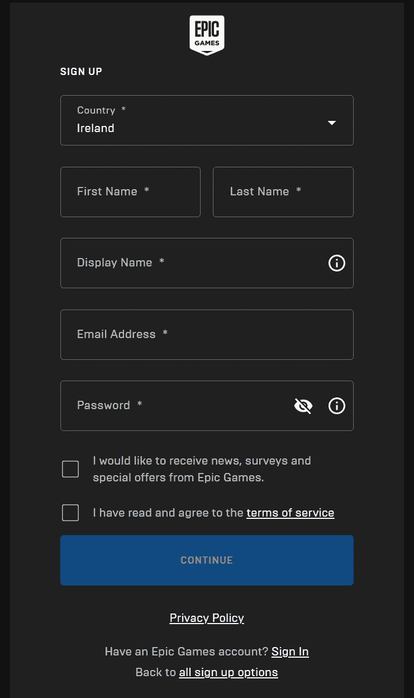

图 1.2：注册 Epic 账号

6.  完成后，验证链接将发送到您指定的电子邮箱。点击该链接后，您就成功创建了账号。每当您计划使用引擎时，都需要登录。

接下来，我们需要下载并安装虚幻引擎 5。

## 下载并安装虚幻引擎 5

使用您的虚幻账号，我们需要下载并安装虚幻引擎 5。您即将安装的应用程序是 Epic Games Launcher。您将在其中安装引擎，并获取与引擎相关的其他功能，例如更新、插件、脚本、模型以及许多其他资产。请按以下步骤操作：

1.  成功登录 Epic 后，您将看到如下页面（页面可能会有所不同，因为截图是印刷时 Epic 最新的营销素材）：

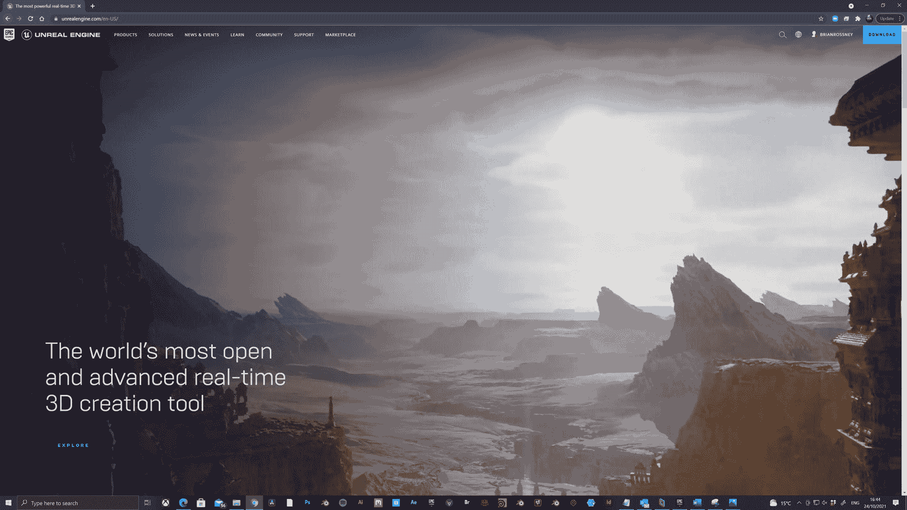

图 1.3：Epic 启动画面

在右上角，您将看到您的名字以及 `Download` 按钮。点击它以进入以下页面：

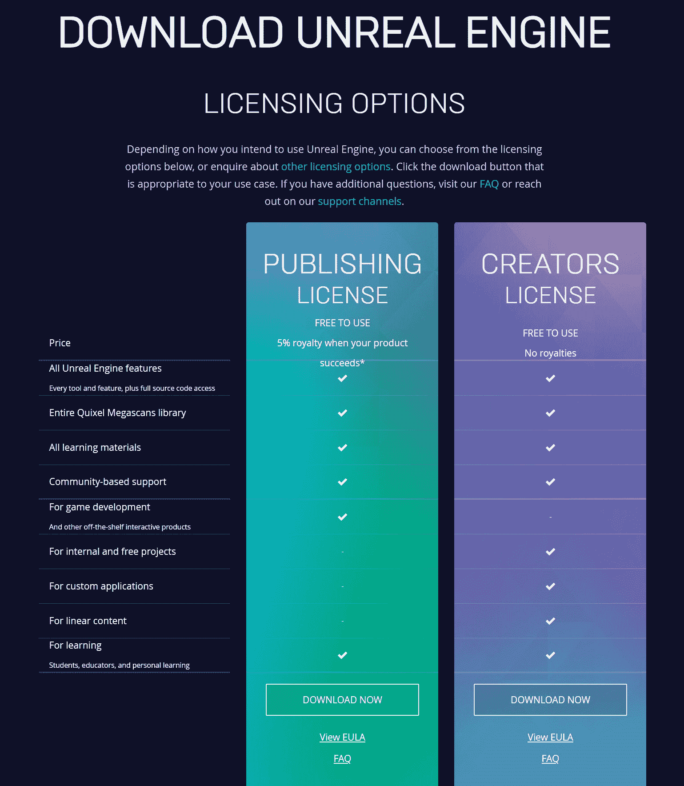

图 1.4：许可选项

为了本书的目的，我们假设您从事影视和动画业务，而非游戏开发业务。左侧栏是面向游戏开发者的 `Publishing License`（发行许可）协议，销售利润的一定比例归 Epic Games 所有。您只需关注右侧栏：`Creators License`（创作者许可）。在大多数情况下，本书读者将归属于 `Students, educators, and personal learning`（学生、教育工作者和个人学习）。然而，提供 `linear content`（线性内容）的专业人士，如影视和动画，则归属于 `Creators License` 选项。

2.  当您阅读完详情并查看了 EULA 许可协议后，点击 `Creators License` 下的 `DOWNLOAD NOW` 按钮。

3.  现在，选择您想要下载安装程序的位置，文件名将类似于 `EpicInstaller013.0.0.enterprise.msi`。这是一个 Windows 安装程序包，可以保存在您机器上的任何位置。您仅在安装过程中需要此文件。

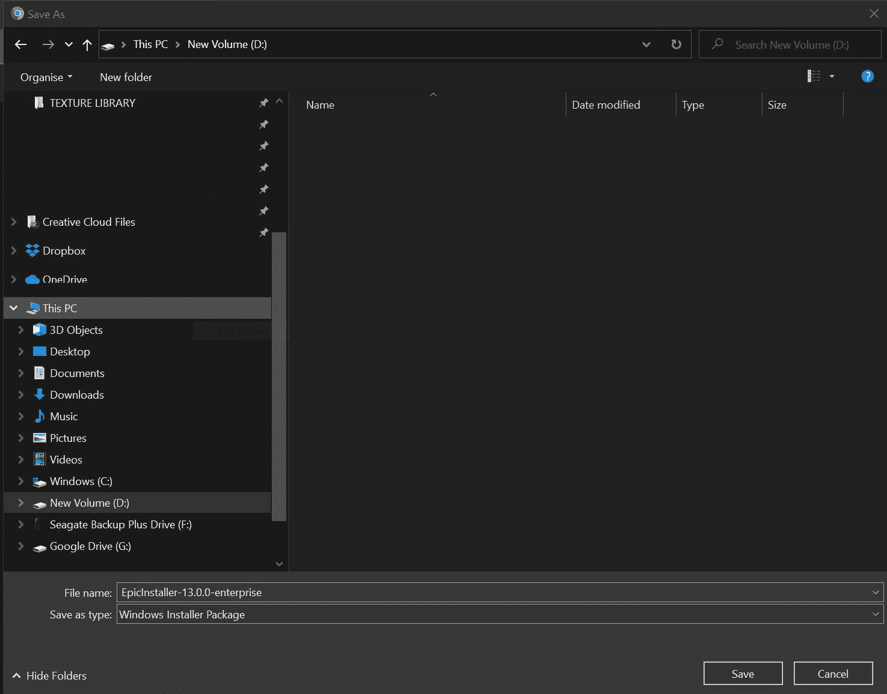

图 1.5：下载安装程序

找到合适的位置后，点击 `Save`。

4.  下载完成后，双击文件运行它：

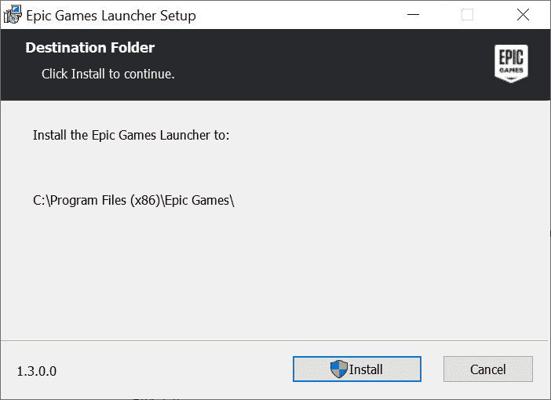

图 1.6：Epic Games Launcher

5.  现在，您可以点击 `Install`。

安装程序完成后，您的桌面上将出现一个标题为 `Epic Games Launcher` 的图标。点击它将打开 Launcher（请注意，首次打开可能需要几分钟）。通常它不会全屏打开，但如果全屏打开，看起来会像这样：

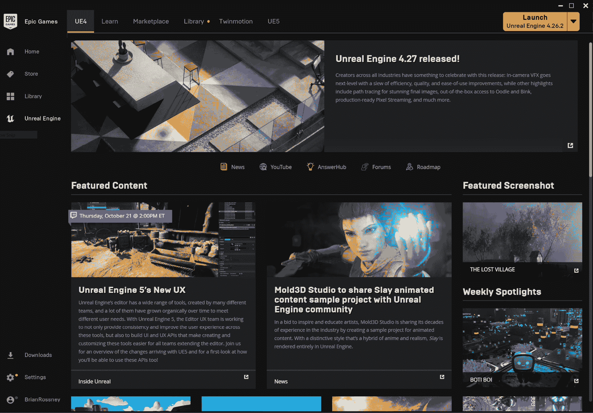

图 1.7：Epic Games Launcher 应用程序

从这里，您将看到 Epic Games 图标右侧顶部有几个选项卡。最值得注意的是以下几个：

*   `UE4`：用于博客、UE4 版本更新和一般新闻
*   `Learn`：打开学习中心，您可以在其中观看教程并下载示例项目
*   `Marketplace`：您可以在此购买专为虚幻引擎设计的模型、环境和角色
*   `Library`：用于查找您已保存、购买或安装的内容
*   `Twinmotion`：一款建筑预可视化应用程序，拥有专为建筑实时预可视化设计的资产和预设
*   `UE5`：您将从这里安装 UE5

从 `UE5` 点击 `Download UE5`，安装程序将立即开始安装。您将在 `UE5` 选项卡中看到这一过程，或者它可能会切换到 `Library` 选项卡并显示此下载的进度。

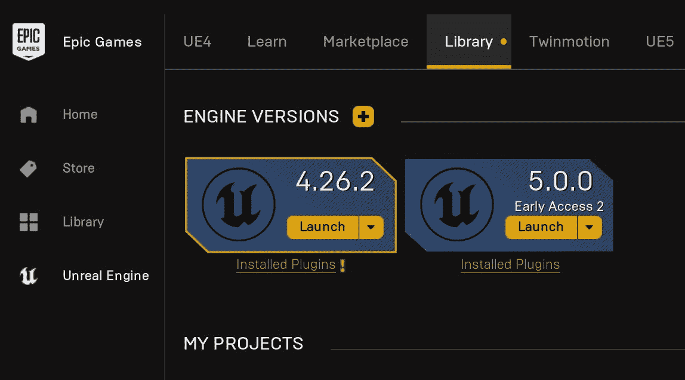

图 1.8：引擎版本

安装需要一段时间，您可能想稍后再回来继续。

> **注意**
>
> 在撰写本文时，UE5 仅处于 Early Access（早期访问）阶段。这意味着它在技术上不支持任何生产用途，且该版本独有的新功能被视为实验性功能。

在下一节中，我们将启动 UE5！

## 启动 UE5

在您遵循了上述所有说明且安装程序完成安装后，您将看到出现 `Launch` 按钮；这表明虚幻引擎已准备就绪。

当您点击 `Launch`（确保您已选择 UE 5.0）时，可能会收到如下弹出对话框：`The Megascans Plugin was designed for build 4.27.0. Attempt to load it anyway?`（Megascans 插件是为 4.27.0 版本设计的。仍要尝试加载吗？）此类消息属于预防性措施，因为在撰写本文时，并非所有内容都已测试可在 UE5 中工作。然而，既然我已在早期访问版中测试过它们，我知道它们是安全且稳定的，因此选择 `Yes` 没问题。

接下来，您将看到一个小的启动画面，因为虚幻引擎正在初始化。首次运行可能需要几分钟。最终，它将进入以下界面：

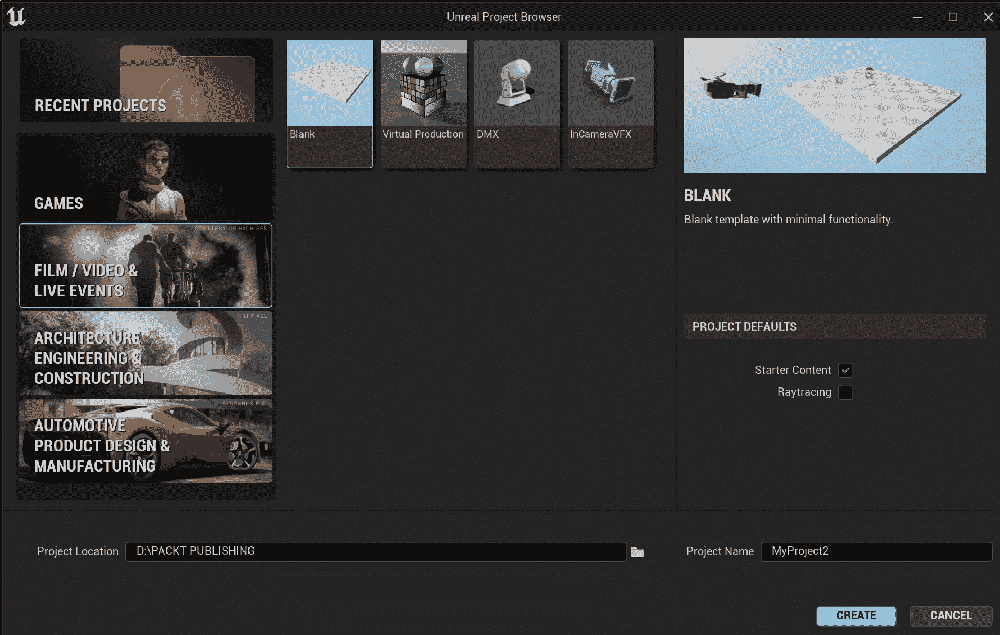

图 1.9：虚幻项目浏览器

在左侧，您将看到一个列出以下内容的列：

*   `RECENT PROJECTS`（最近的项目）
*   `GAMES`（游戏）
*   `FILM / VIDEO & LIVE EVENTS`（影视/视频和现场活动）
*   `ARCHITECTURE ENGINEERING & CONSTRUCTION`（建筑工程与施工）
*   `AUTOMOTIVE PRODUCT DESIGN & MANUFACTURING`（汽车产品设计与制造）

每个列表项都提供了供您选择的模板。每个模板将自动加载特定设置，并启用该性质工作所需的各种预装插件。

因为我们只对 `FILM / VIDEO & LIVE EVENTS` 感兴趣，当我们点击它时，我们可以选择与该类型工作相关的少量模板：

*   `Blank`（空白）
*   `Virtual Production`（虚拟制片）
*   `DMX`
*   `InCameraVFX`

屏幕将显示如下内容：

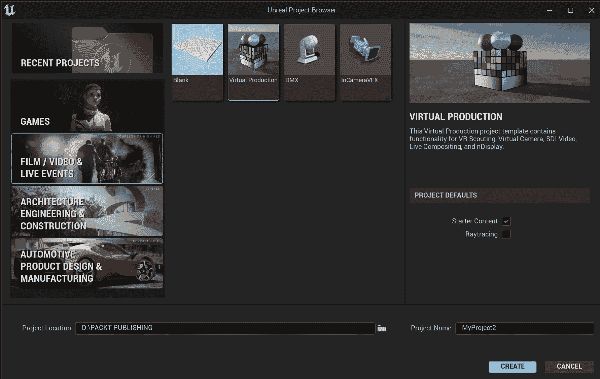

*图 1.10：虚拟制片模板*

> **注意**
>
> 如果你使用的是不支持光线追踪的低配置机器，最好将 `Raytracing` 保持为默认的关闭模式。你稍后随时可以在 `Project Settings` 中重新启用它。

从这个列表中，我们只需关注 `Virtual Production` 子模板。然后，我们需要选择新项目的位置并创建项目标题。对于我的项目，我将创建一个名为 `Lost Girl` 的文件夹，并将其放在 `D 盘`。项目文件夹将是 `Lost_Girl_SC_01`。你可以随意命名你的项目文件。

你可以随意将文件保存到任何你想要的目录，但建议最好避免将操作系统存储在其中的 `C 盘`。

你将再次看到一个启动画面，并提示项目正在加载。这将花费一两分钟，具体取决于你机器的规格。之后，你可能会收到一些弹窗：

*   你可能还会收到一个对话框，就像之前一样，警告你某个插件不是为 UE5 设计的，并询问你是否仍要继续。如果再次发生这种情况，请选择 `Yes`。
*   你可能还会被询问是否要更新项目。选择 `Yes`。这只需一两秒钟即可完成更新。
*   最后，它会询问你是否要管理插件。如果发生这种情况，你可以选择 `Yes` 然后关闭插件窗口。你也可以选择 `No`，稍后在将角色导入引擎时启用插件，但我确实建议此时选择 `Yes`。

就这样！我们现在已经让引擎运行起来了。

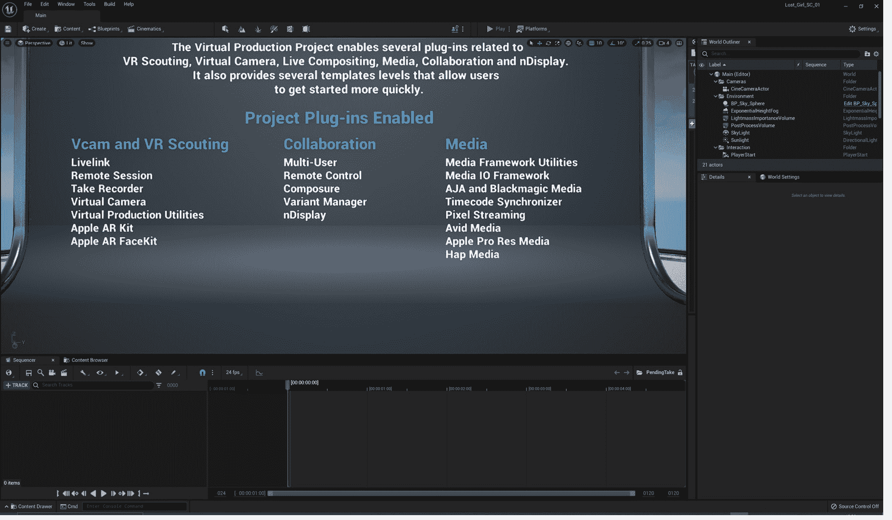

*图 1.11：虚幻引擎界面*

接下来，是安装 Quixel Bridge 的时候了。

## 安装 Quixel Bridge

MetaHuman Creator 是 Quixel 推出的一款在线应用程序。要让它运行起来，首先我们需要访问他们的网站，下载名为 Bridge 的应用程序，它允许我们启动 MetaHuman Creator 在线应用程序。

这听起来有点复杂，但 Bridge 应用程序的工作原理类似于一个带有你账户详细信息的资产管理工具。例如，它将启动你的个人 MetaHumans 项目，并允许你下载许多其他资产，例如 Megascans 树木、草地、建筑等，同时记录你过去创建或下载的所有内容。

这非常方便，因为 MetaHumans 占用大量硬盘空间，所以你可以将创作存储在云端，从而随时随地下载它们。此外，安装后，Bridge 还可以作为虚幻引擎中的插件工作，使资产管理变得更加容易。

因此，要开始使用，请完成以下步骤：

1.  首先，访问 Quixel 网站：`www.quixel.com`。
2.  接下来，点击 `DOWNLOAD BRIDGE` 按钮（此时我们甚至不需要登录）：

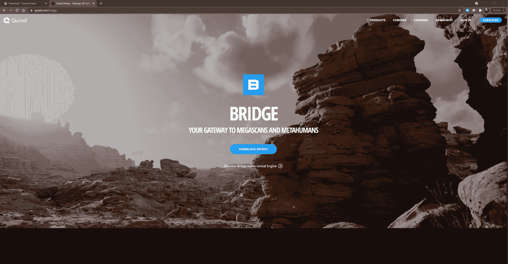

*图 1.12：下载 Quixel Bridge*

3.  下载安装程序 `Bridge.exe` 后，双击文件运行它。

这将自动安装并打开 Bridge，并应弹出一个如下所示的小窗口：

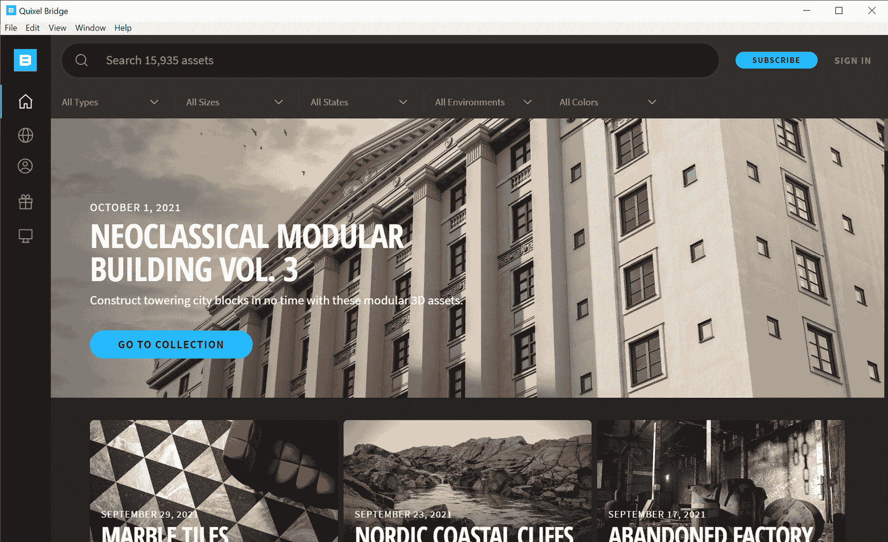

*图 1.13：Quixel Bridge 弹出式应用程序*

4.  点击页面右上角的 `SIGN IN` 按钮。
5.  这将引出另一个对话框，我们可以在其中选择 `SIGN IN WITH EPIC GAMES`。

右上角的 `SIGN IN` 将变为一个人物图标，表明你已成功登录：

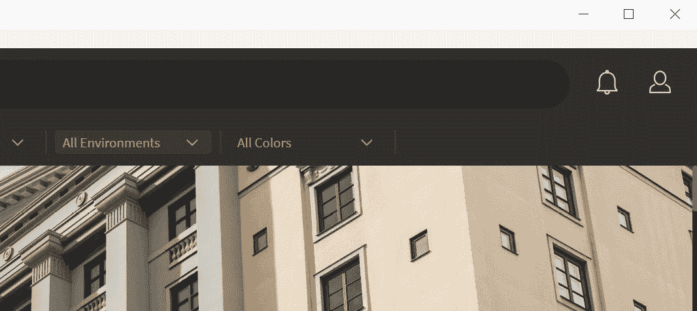

*图 1.14：成功登录*

我们几乎准备就绪。现在，让我们终于设置 MetaHuman Creator。

## 启动 MetaHuman Creator

现在你已将 Bridge 下载到计算机上，并使用与 Epic Games Launcher 相同的登录凭据登录，你已准备好启动 MetaHuman Creator。困难的部分已经结束，有趣的部分现在开始。

此时值得一提的是，Quixel 的 Bridge 不仅具有 MetaHumans 功能。Bridge 让你可以访问一个庞大的 3D 资产库，例如 Megascans，以及 2D 资产，例如纹理和材质。与大多数 3D 资产库不同，Bridge 提供扫描模型。换句话说，这些模型基于从真实物体获取的数据，这就是它们看起来如此逼真但文件体积庞大的原因。

要直接进入 MetaHumans，请查看屏幕左侧圆圈中的人物图标：

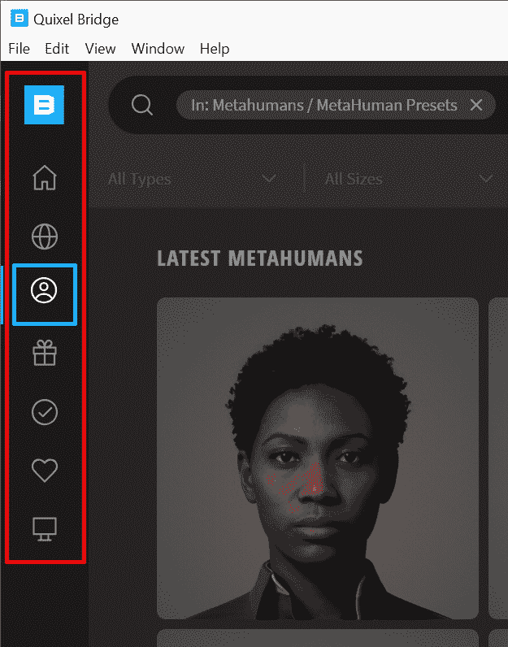

*图 1.15：MetaHumans 图标*

你将看到许多 MetaHuman 模板的缩略图。点击其中任何一个缩略图，你将看到与该点击角色相关的新选项，并会看到一个标题为 `START MHC` 的蓝色按钮（代表 MetaHuman Creator）：

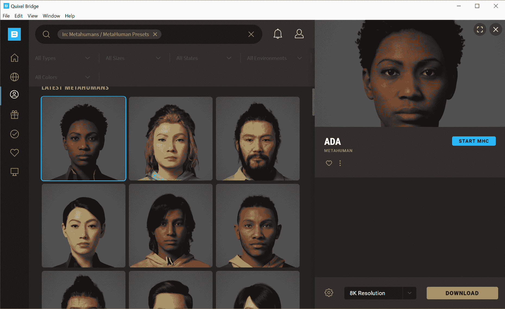

*图 1.16：启动 MHC*

就是这样。点击蓝色按钮后，你将开始 MHC 会话。这将花费片刻时间启动，你将看到如下页面：

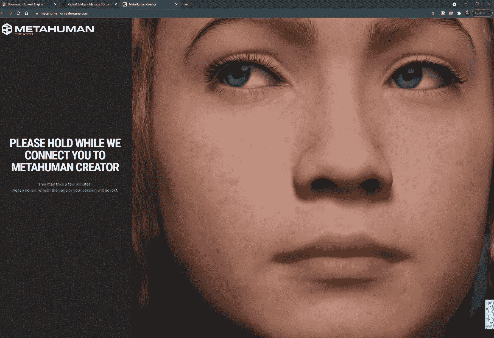

*图 1.17：连接到 MetaHuman Creator 在线会话*

正如本章前面所述，请务必拥有可靠的互联网连接，以加快 MHC 的处理过程。

### 总结

在本章中，你了解了什么是虚幻引擎，什么是 MetaHumans，以及创建 MetaHumans 需要哪些软件应用程序。

下一章完全关于 MetaHuman Creator 在线会话。虽然有很多功能，但你会发现该应用程序非常直观，而且在许多方面，你在本章所学的内容比接下来的内容要复杂得多。事实上，你会发现下一章非常有趣！
