## 在 MetaHuman 界面中创建角色

在上一章中，你学习了如何将 Epic Games Launcher、UE5 引擎和 Bridge 安装到你的机器上。此外，你还完成了设置 Epic Games 用户账户的步骤，你必须再次使用该账户登录 Quixel Bridge。

本章将涵盖你需要了解的关于 `MetaHumans Creator (MHC)` 以及所有角色设计发生的在线会话的所有内容。我们将查看许多 MHC 模板的所有可编辑功能，包括面部、头发、身体、融合、移动和雕刻参数，以及在角色设计阶段何时使用每个属性的最佳实践。

本章的主要目标是让你熟悉界面和角色设计潜力，但也将提供关于如何实施相同设计工具以进行更敏锐聚焦的设计过程的说明。

除了各种工具和预设编辑器外，当我们深入探讨皮肤着色器背后的科学原理时，你将熟悉 MHC 如何成为照片级真实感角色设计的佼佼者。

因此，我们将涵盖以下主题：

*   启动 Quixel Bridge
*   编辑你的 MetaHuman
*   使用 `Move and Sculpt tools`
*   下载和导出你的角色

### 技术要求

我们将继续上一章的内容，因此你需要安装 UE5 和 Bridge，以及可靠的互联网连接。强大的互联网连接在此尤为重要，因为你将为每个角色下载超过 1 GB 的数据。

## 启动 Quixel Bridge

### 启动 MetaHuman Creator

### 启动 Quixel Bridge

准备就绪后，前往 Quixel `Bridge` 并打开 `MetaHuman`。你可以轻松实现这一点：只需在屏幕左下角 Windows 开始图标旁的搜索栏中输入 `Bridge`，然后按下 `Enter` 键。这将启动 Quixel `Bridge`，如图 2.1 所示：

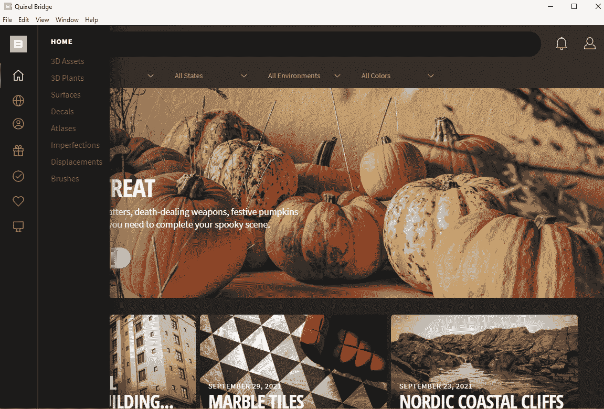

图 2.1：启动 Bridge

请注意左侧的栏目。点击人物图标将弹出 `MHC` 模板，你需要在开始 `MHC` 会话前从中进行选择。这将显示几张不同年龄段和种族的男性和女性 MetaHuman 图像。

点击一个配置文件将在右侧打开一个面板，显示你所选内容的放大图像及角色名称，如图 2.2 所示：

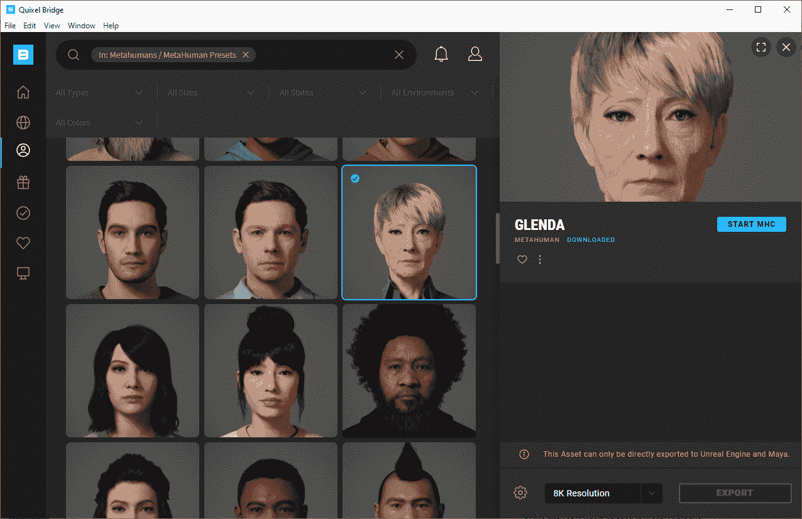

图 2.2：启动 MHC

你会注意到屏幕底部还有进一步的选项，例如 `Resolution`（分辨率），但我们将在本章末尾再讨论这些。开始第一次角色创建会话，你只需点击 `START MHC`。

执行此操作后，将出现一个网页浏览器窗口，类似于图 2.3 所示：

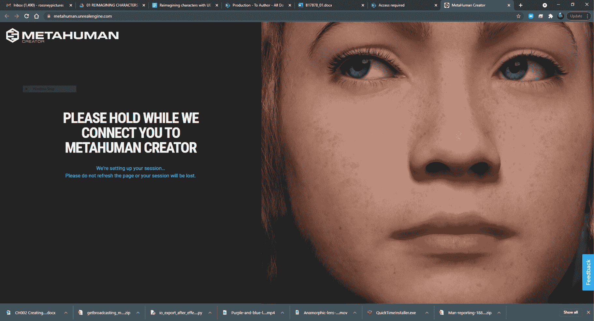

图 2.3：等待 MetaHuman Creator 连接

此时，你可能需要耐心等待，因为会话启动可能需要几秒钟，甚至几分钟。不过，现在不是去厨房泡杯茶的时候。原因在于，如果 `MHC` 闲置几分钟，也会超时。如果你确实在会话中途离开，发现会话因空闲而关闭，只需刷新网页浏览器，它就会重新启动。

会话加载完成后，如果你愿意，可以选择另一个模板。但是，如果你之前有过 `MHC` 会话，`Bridge` 会自动将你的会话保存在 `MY METAHUMANS` 下。

不过，如果你对最初的选择感到满意，请点击 `NEXT`，如图 2.4 所示：

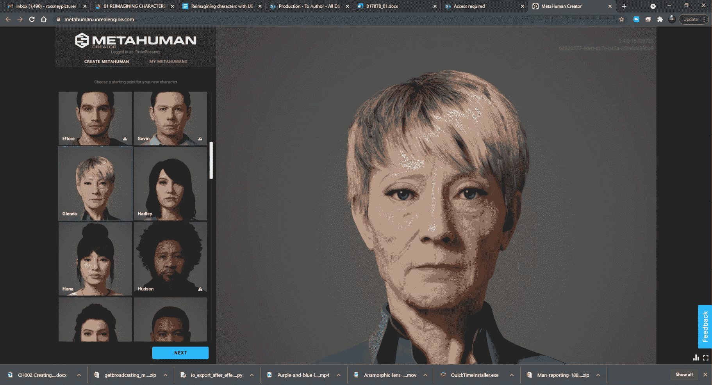

图 2.4：从 CREATE METAHUMAN 或 MY METAHUMANS 中选择

> **注意**
>
> 值得注意的是，到这个时候，你将有两次选择模板的机会。如果你心中已有特定的角色设计——例如，一位年迈的非裔美国男性——那么选择一位年轻的高加索女性作为起始模板就讲不通了。这并不是说你无法编辑一个预设使其类似于你想要的目标设计。然而，虽然你有可能将角色的种族从一种编辑为另一种，但在性别方面你会遇到问题。这归结为某些模板的编辑能力有限。简而言之，在开始会话时，请确保选择最符合你心中设计的年龄和性别（如果你有设计构想的话）。

## 开始 MHC 会话

选择 `NEXT` 后，你的会话将开始。默认情况下，你将看到所选模板角色“活”过来：

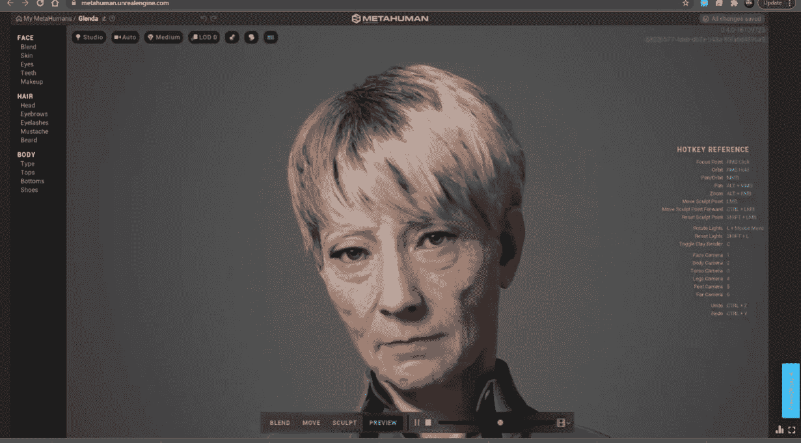

图 2.5：可编辑参数

在屏幕底部，你将看到播放控件。默认情况下，它处于 `PREVIEW`（预览）模式。请注意，在 `PREVIEW` 模式下，你**无法**对角色进行任何编辑。

然而，这是一个绝佳的机会，可以亲眼见证 `MHC` 有多么逼真。对于动画预览，你将有三个选项可供选择。你需要点击胶片条图标来查看这些选项，如图 2.6 所示：

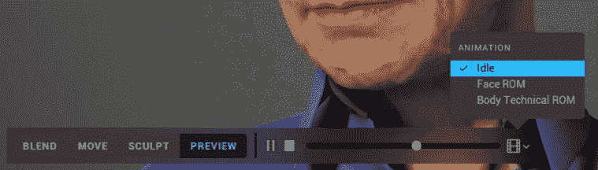

图 2.6：动画预览

选项如下：

*   `Idle`（待机）：提供一小范围的动作，适合背景角色。
*   `Face ROM`（面部活动范围）：提供面部完整的活动范围，动作幅度足够大，能有效显示项目若需要面部特写动画时可能出现的任何潜在问题。
*   `Body Technical ROM`（身体技术活动范围）：提供幅度足够大的动画，能显示大量身体运动时可能出现的任何潜在问题。

> **注意**
>
> `MHC` 提供的活动范围旨在让你大致了解角色动画后的样子。它**并非**一个详尽的调试工具，无法涵盖你添加自有动画时所有可能出现的正确或错误情况。
>
> 如果你熟悉传统意义上的 3D 角色设计，角色设计必须考虑完整的活动范围才能有效工作。模型或网格体必须允许所需类型的运动。在最基本的层面上，动画不得改变角色的网格体，导致角色的各部分相互穿模。例如，一个非常瘦的人走路时手可以更贴近身体两侧——实际上，他们的腕骨在迈步时可以非常接近髋骨——但对于体型较大的人来说，即使步态和活动范围相同，情况也并非如此。
>
> 话虽如此，`MHC` 角色的保真度会自动完成大量此类校准工作。因此，在 Maya、3ds Max 或 Houdini 中工作时，为适应不同活动范围而需要非常繁琐的工作，在 `MHC` 会话中会自动完成。
>
> 我们将在第 3 章 *深入 MetaHuman 蓝图* 中再次涉及其中一些内容，那时我们会在 Unreal 中为 MetaHuman 角色引入动画，但简而言之，在 `MHC` 会话期间，你可以随意推高角色的属性，而不会在任何给定的活动范围内发现不可用的异常现象。

## 热键参考

在预览模式下，了解一些热键很有价值，它们将允许你以任何你想要的角度预览活动范围或静态角色。如果你看一下图 2.7 所示的 `HOTKEY REFERENCE`（热键参考）区域，你会注意到一系列键盘和鼠标点击组合，它们将允许你自由导航：

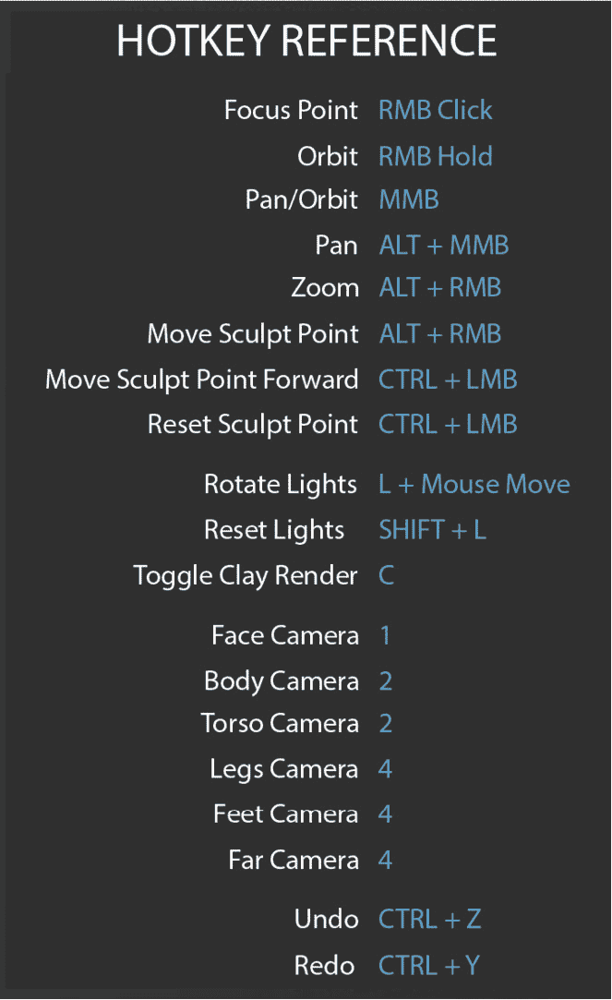

图 2.7：热键参考

如果你是 Maya 和 Unreal 等 3D 应用程序的新手，一定要密切关注这些热键，因为其中一些导航热键是通用的。你可以在预览动画时，仅通过在 `MHC` 视口中自由导航就获得很多乐趣。

在本节中，我们启动了 MetaHumans 会话，并开始熟悉将在其中花费大部分时间设计角色的界面。在下一节中，我们将着眼于面部。本节将分为几个小节，以对应 `MHC` 界面中的细分方式。

## 编辑你的 MetaHuman

现在，是时候编辑你的 MetaHuman 了。你可以在界面右上角找到可编辑参数，如图 2.8 所示：

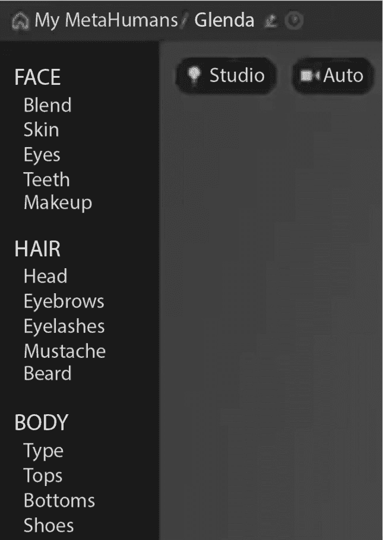

图 2.8：FACE、HAIR 和 BODY

我们将在接下来的章节中逐一介绍所有这些选项。这些都是功能强大的编辑器，在笔者撰写本书时，我有信心 Quixel 和 Epic Games 会在本书付印前增加更多功能。

## 面部

首先，我们来看看 MetaHuman 面部的可编辑选项。在 `FACE` 下，我们有以下子类别：

*   `Blend`（融合）
*   `Skin`（皮肤）
*   `Eyes`（眼睛）
*   `Teeth`（牙齿）
*   `Makeup`（化妆）

现在让我们来探索这五个子类别。首先，请确保你已停止任何活动范围的动画预览。在图 2.9 中，我们可以看到有几个选项可供选择：

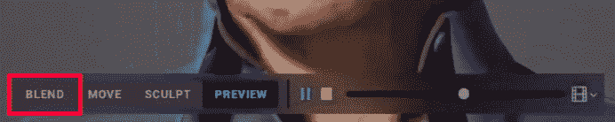

图 2.9：选择 BLEND

我们需要点击 `BLEND` 以继续下一节。

### Blend（融合）

### MetaHuman Creator 中的角色自定义

## 混合功能

首先，我们来看看 `Blend` 功能。简单来说，`Blend` 允许我们将所选模板的面部特征与其他现有模板进行混合。这是一个很好的切入点，因为这是一个非常直观的过程。例如，我们可能从模板中选择了一个男性角色，但希望让他看起来更女性化一些，或者更年长一些。以第二个例子为例，我们可以针对眼睛，仅将眼睛与年长角色模板的眼睛进行混合。

在 `图 2.10` 中，我将三个模板角色拖入了左上角的圆圈中。右侧主视口中的 Glenda 角色现已设置为可编辑状态：

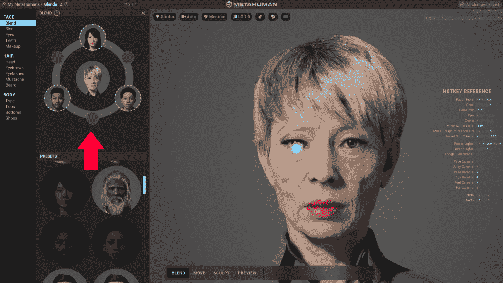

图 2.10：编辑点

仔细观察她脸部周围众多细小且极不明显的圆圈。每个圆圈代表一个可编辑的面部特征。通过左键点击一个小圆圈并向我添加到左侧的三个角色之一的方向拖动，该特征将混合到主视口中对应的特征上。我将一位年轻女性放在顶部，因此如果我点击并向上拖动，仅眼睛会混合进年轻女性的眼睛：

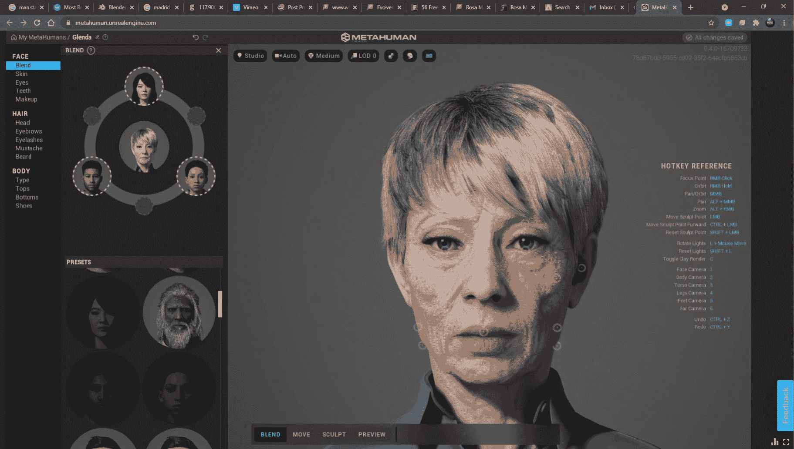

图 2.11：通过点击拖动混合眼睛

> **注意：** 编辑点非常不明显。您必须在右侧主视口中点击一个点，并向高亮视口中对应圆圈内您偏好的角色方向拖动。

在给出的示例中，我已将三个角色加载到左侧的 `Blend` 视口中。您最多可以加载六个模板，但请注意前三个影响力更大。第二组三个由较小的圆圈表示（我留空了它们），有助于进行细微的混合。

使用混合编辑角色需要一些规划。最佳实践是选择一个尽可能接近您理想设计的角色，然后使用 `Blend` 选项让模板尽可能接近您想象中的设计。

## 皮肤编辑器

虽然我们可以用 `Blend` 工具做很多事，比如改变面部属性的形状，但如果您想改变角色的肤色，它就派不上用场了。这就是 `Skin` 编辑器发挥作用的地方，如 `图 2.12` 所示：

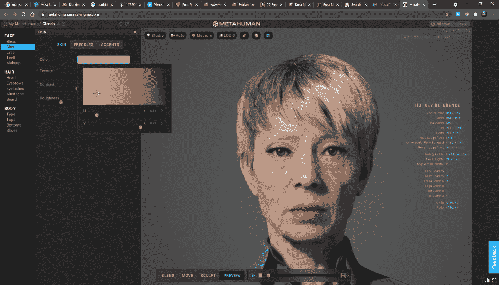

图 2.12：皮肤

以下是我们在皮肤方面可以编辑的一些功能：

*   **`Texture`**：在角色老化或返老还童时，这是一个非常重要的功能。它引入细纹和皱纹，也包括更广泛的变形，如皮肤松弛。
*   **`Contrast`**：这是另一个用于角色老化的有用功能，能进一步加深皱纹和褶皱。
*   **`Roughness`**：在 CGI 中，“粗糙度”是一个常用术语，用于描述表面有多亮或多反光。我们知道，如果表面粗糙，光线不会像镜子等光滑表面那样以直接的方式反射回来。在皮肤上，光滑表面可能是由于表面的油性，这能给我们带来更真实的效果。如果没有粉底化妆的帮助，我们很少能在皮肤上获得完全粗糙的表面。另一个给皮肤带来粗糙度的因素是皮肤表面微小的毛囊，它们肉眼几乎不可见，但被计入最终模型中。（撰写本文时，在 MHC 中没有直接编辑皮肤和微小毛囊粗糙度的方法，但一旦我们进入虚幻引擎的高级编辑阶段，它们是可以编辑的。）

`图 2.13` 展示了将 `Texture`、`Contrast` 和 `Roughness` 设置为零的 Glenda 角色。纹理和对比度的降低让她看起来年轻得多；我们可以看到对比度对她面部几何形状（形态）产生了显著影响：

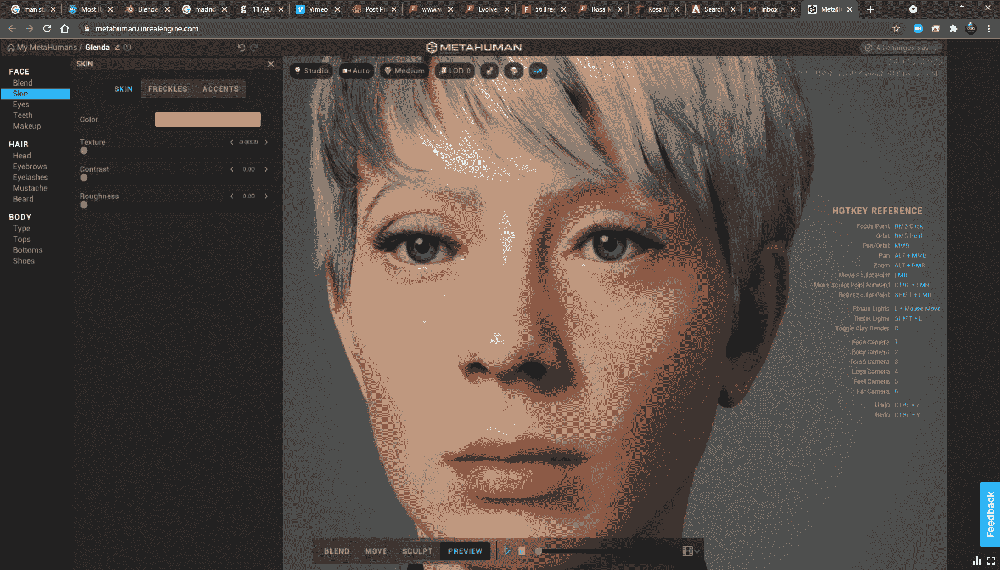

图 2.13：纹理、对比度和粗糙度

然而，将粗糙度降低到零确实会给我们带来略微不真实的外观，这可能不是您想要的。您可以尝试调整这些设置，使皮肤看起来更真实。

## 雀斑

在 `图 2.14` 中，您可以看到我已重新应用 Glenda 模板之前拥有的所有纹理和对比度，并添加了雀斑：

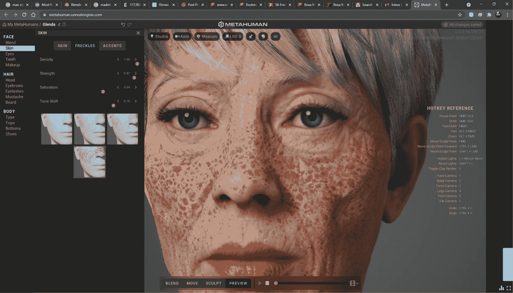

图 2.14：雀斑

请注意这四张灰色图片——每张都是雀斑图案的预设。第四个是密度最高、最明显的雀斑图案。在本例中，我将密度调高仅用于演示，但巧妙地使用此工具会给您带来非常真实的效果。

请务必根据喜好编辑饱和度和强度。无论您想要多么极端或细微的雀斑，在添加雀斑时，回到 `Skin` 选项卡再次调整纹理、对比度和粗糙度都很有帮助。原因之一是雀斑的添加会改变角色的整体肤色，您可能想在皮肤调整下调整基础肤色以进行补偿。通过给雀斑添加饱和度，面部的整体饱和度也会自然增加。

既然谈到肤色，MHC 有四个预览功能需要考虑，以便在肤色上做出更明智的决定。由于肤色中普遍存在的细微变化，允许我们看到这些变化的额外功能非常受欢迎。这些功能如下：

*   `Lighting`
*   `Camera`
*   `Render Quality`
*   `LOD`

您可以在此处看到这些选项：

图 2.15：查看选项

现在让我们逐一查看每个选项。

### 光照

在 MHC 的大多数光照设置中，使用了 `image-based lighting`（基于图像的光照）。简单来说，基于图像的光源是一个球体，其内部有一张图像，用作整个场景的光源。这能给我们带来非常真实的光照效果，也是虚幻引擎中使用的一种工艺。要理解现实世界中的基于图像光照，拿一大张纸贴近电脑显示器，全屏播放视频。确保所有灯光关闭，电脑屏幕亮度调至最大。您会看到屏幕现在正在照亮这张纸，视频同时影响着光照的强度和颜色。纸张反射率越高，光照影响在肉眼中就越明显。

如果您点击 `图 2.15` 中可见的 `Studio`，您将看到多种光照设置，帮助您设计心中构想的特定场景。共有 13 个光照预设，如 `图 2.16` 所示：

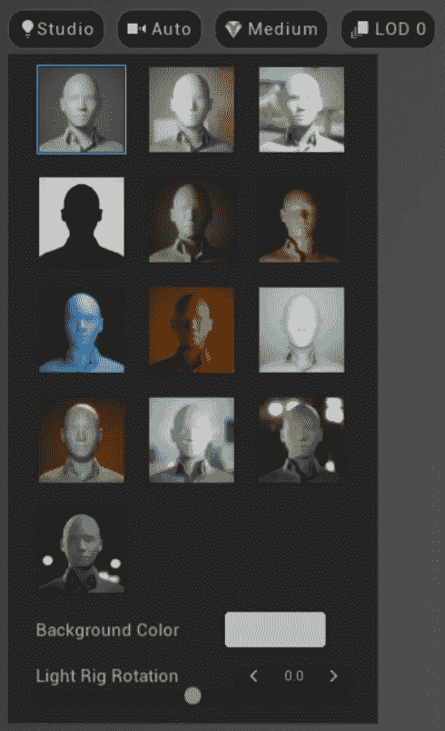

图 2.16：各种光照设备

现在让我们逐一了解每个选项：

*   **`Studio`**（默认设置）：由少量柔光灯组成的光照设置，以模拟柔和的摄影光照。这是默认光照设备。
*   **`Indoor`**：此预设包含使用图像而非一组灯光的光照（如前所述，这称为基于图像的光照）。在本例中，它是一张以 360 度角度捕获的室内图像，为我们提供了来自各个角度的真实光照。此预设允许用户看到角色在典型窗口采光和环境反射光下的对比度水平。
*   **`Outdoor`**：这是另一个基于图像光照的示例，允许用户查看室外环境光的效果，以及直射阳光的强烈程度和在角色皮肤上投射的阴影。

## 灯光预设

*   **`Silhouette`**：在角色设计中，一个重要却常被忽视的功能是以剪影形式查看角色。它让我们能在没有颜色、反射和阴影特征干扰的情况下，快速观察角色的形状轮廓。

*   **`Split`**：虽然类似于 `Studio` 灯光预设，但 `Split` 提供了高对比度，且由于主光的强度，是衡量角色皮肤半透明度的绝佳方式。在此预设中，我们有从高强度主光到完全黑暗的分割。它是同时展示写实感和极端光照、并确定从强光到黑暗的光衰减在写实感和风格上表现的绝佳方式。高强度光照与阴影之间的区域，尤其是在皮肤上，被称为 `roll-offs`（衰减过渡区），这是摄影师常用的术语。

*   **`Fireside`**：与 `Split` 类似，我们获得了高对比度，但也得到了火焰典型的渐变衰减和衰减效果。此外，我们还获得了从橙色到深蓝色的火焰典型色调。最重要的是，`Fireside` 允许用户确定强光的衰减过渡及其如何在面部周围过渡到阴影，以及与 `Split` 预设（会呈现皮肤表面明显的细节）相比，在这种微妙度下皮肤细节是否仍然存在。

*   **`Moonlight`**：与 `Fireside` 类似，我们看到了生动的色调——在本例中是蓝色的月光。然而，这是一种更强的环境光，且没有来自任何单一角度的强烈光照强度。

*   **`Tungsten`**：虽然不能完全代表普通钨丝灯的色调，但它确实让我们能看到肤色对钨丝灯的反应。这样的灯光预设可以决定在类似场景下，雀斑的细节会损失或保留多少。

*   **`Portrait`**：这是一个非常实用的预设，因为它既可作为室内光也可作为室外光，以确定角色皮肤的表现。例如，通过使用 `Left Mouse + L` 旋转场景灯光，或使用图 2.16 所示的 `Light Rig Rotation`（灯光装置旋转）滑块，我们可以模拟带有日光的窗户，而不会受到 `Indoor`（室内）灯光预设自带背景图像中的干扰元素影响。

*   **`Red Lantern`**：与 `Fireside` 类似，我们有强烈的红色色调可供使用，但我们拥有在没有深蓝色背景的情况下看到更高强度的优势。这使我们能够着眼于更具戏剧性的灯光设置进行工作。

*   **`GR22 Rooftop`**：这是基于图像的光照（IBL）非常有效的用例，但它提供略微阴天的光照。这是一个方便的灯光预设，适用于许多日光场景，因为虽然存在高强度区域，但大部分情况下我们获得的是略微漫射的光线。这种漫射光来自直接光被建筑物和地面表面反射回来，就像在现实世界中一样。

*   **`Downtown Night`**：这与 `GR22 Rooftop` 非常相似，只是处于夜晚，且纯粹由路灯和汽车等电光源照亮。

*   **`Underpass Night`**：这与 `Downtown Night` 相似，但空间更狭小。它仅包含固定灯光，结合了色调和强度各异的多个钨丝灯。

要进一步深入，MHC 有一个背景颜色选项。对于某些灯光预设，你可以看到更改背景颜色产生的强烈影响。例如，你可能想在通用的摄影棚柔光下查看角色外观，但又想看角色置于你为场景构想的特定颜色背景前的效果。在图 2.17 中，我用 Glenda 角色展示了一些灯光装置效果：

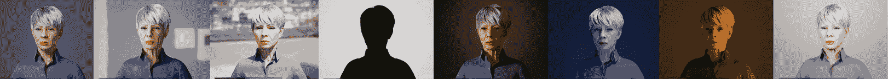

*图 2.17：各种灯光示例*

## 相机

根据图 2.15，默认相机设置为 `Face`（面部）。不过，有几个预设相机角度可供使用键盘快捷键调用：

*   `1`：`Face`（面部）
*   `2`：`Body`（身体）
*   `3`：`Torso`（躯干）
*   `4`：`Legs`（腿部）
*   `5`：`Feet`（脚部）
*   `6`：`Face`（面部）

或者，你也可以像使用相机预设一样轻松地用鼠标导航。如果你在场景中迷失了方向，一个实用的快捷键是按 `1` 键，使用 `Face` 相机预设回到正视角色头部的视角。

此外，我们还可以预览多种不同的渲染质量预设，以模拟虚幻引擎中存在的渲染质量设置。

## 渲染质量

在渲染质量方面，MHC 提供了三个选项供选择：

*   `Medium`（中等，这是默认设置）
*   `High (ray traced)`（高，光线追踪）
*   `Epic (ray traced)`（极高，光线追踪）

如果你选择带有光线追踪设置的最高质量，这不会对你的机器产生任何影响，因为高质量渲染的处理完全在云端完成。然而，此功能是一个有用的指示器，显示你在类似灯光设置下使用最高设置时将获得的结果。

渲染设置之间的差异很微妙。你可能会注意到发丝下的质量会因你使用的质量而增强。它们的存在仅是为了给你一个指示：如果你提供类似的设置，使用虚幻引擎自带的相应渲染质量设置，你的角色会是什么样子。

## 细节层次

**细节层次** (`LOD`) 是基于一个源对象生成多个网格体和纹理贴图。每个网格体和贴图将包含不同数量的细节。

`LOD` 的目的是引擎优化。由于游戏引擎的设计原则之一是实时渲染，`LOD` 通过在不需要时减少网格体中的三角面数量或纹理贴图中的像素数量来提供帮助。`LOD` 基于根据相机距离改变网格体复杂度的原则工作。相机离物体越远，在不破坏真实感错觉的前提下，所需的细节就越少。

例如，MetaHuman 面部的特写镜头需要尽可能最好的质量。在这种情况下，我们需要查看原始网格体和纹理贴图。一般来说，MHC 的原始网格体约为 35,000 个三角面，由宽度高达 8,000 像素的纹理贴图组成。如果不是必要，渲染这种数据将是巨大的资源浪费。

一个查看 `LOD` 对角色效果如何的好练习是：前往视口并通过 `Face` 相机观察。你可以通过简单地按键盘上的 `1` 来实现。这将给你一个角色的特写。从那里，你可以从 `LOD 0` 一直到 `LOD 7` 选择各种 `LOD`。

起初，你不会注意到 `LOD 0` 和 `LOD 1` 之间有太大区别，但一旦降到 `LOD 5`、`LOD 6` 和 `LOD 7`，你会注意到几何体和纹理贴图质量都有显著下降。你可以在图 2.18 中看到这一变化：

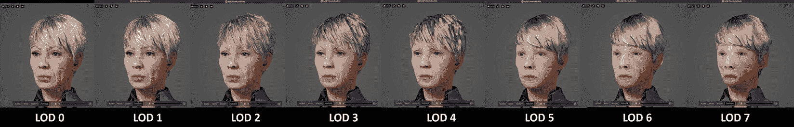

*图 2.18：LOD 0 到 7*

我们可以通过使用 `Far`（远景）相机进一步推演这一点；你可以通过按键盘上的 `6` 来实现。不幸的是，这是我们在 MHC 中能将相机拉远的最远距离。然而，通过在 `LOD 6` 和 `LOD 7` 之间切换，我们可以看到差异。这是因为 `LOD 6` 和 `LOD 7` 设计用于相机距离更远时使用。

在此视图下，如果你在 `LOD 3` 和 `LOD 4` 之间切换，不会看到太大区别。因此，显示 `LOD 0`（约 35,000 个三角面和 8K 纹理贴图）显然是资源浪费。没有 `LOD`，计算机永远无法处理多个角色，更不用说人群了。

当涉及 MetaHuman 和虚幻引擎时，这一过程在很大程度上是自动化的，但当我们把角色带入虚幻引擎时，我们将讨论 `LOD`，特别是针对头发的 `LOD`。

我们已经详细介绍了皮肤编辑器，在此我想提醒您，皮肤的额外编辑始终可以在 Unreal Engine 中完成。但目前，在下一节中，我们将讨论眼睛。

### 眼睛

MHC 拥有一个功能极其强大的眼睛编辑工具。其特别之处在于，部分眼部工具可在 Unreal 中进行编辑。例如，如果您想为虹膜大小制作动画，可以直接在 Unreal 中实现。

在这里，我们将查看 `Eyes` 编辑器的以下属性：

*   `PRESETS`（预设）
*   `IRIS`（虹膜）
*   `SCLERA`（巩膜）

现在让我们来看看这些内容。

#### 预设

如图 2.19 所示，MHC 提供了一些很棒的预设供选择，提供了一系列不同的棕色、蓝色和绿色眼睛供您挑选：

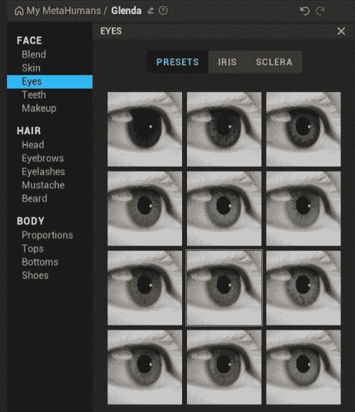

图 2.19：眼睛预设

在大多数情况下，您可以直接使用默认预设，但您可能希望深入具体细节（我们将在下一节中介绍），在那里您可以实现非常具体且自然的外观，从健康的眼睛到非常不健康的眼睛。

> **注意**
>
> 在开始编辑角色的眼睛之前，请善用灯光工具，确保拥有最佳可用灯光。眼睛细节丰富，因此您需要近距离观察，并将 LOD 设为 0，从而以最高质量进行渲染。

#### 虹膜

接下来让我们看看 `IRIS` 面板，如图 2.20 所示。不深究每个功能的具体作用，您面临的第一个选择是编辑右眼、左眼或双眼。`Base Color`（基础颜色）允许您编辑最接近虹膜的颜色，而 `Detail Color`（细节颜色）允许您编辑最接近角膜缘的眼部外侧区域。您还可以编辑 `Color Balance`（色彩平衡）和 `Color Balance Smoothness`（色彩平衡平滑度）选项，并从九种虹膜纹理中进行选择：

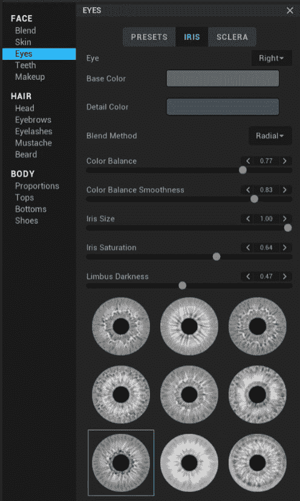

图 2.20：IRIS

就像肤色一样，`IRIS` 编辑功能仅限于自然外观。然而，通过加深角膜缘的黑暗度，并在颜色编辑器中追求高饱和度，您可以获得一些相当狂野的效果。

#### 巩膜

虽然 `IRIS` 编辑器是一个很棒的工具，但大部分真实感源自 `SCLERA` 选项卡，如图 2.21 所示。实际上，这涉及编辑眼白。虽然您可以通过 `Tint`（色调）选项做很多文章，它是在蓝色和黄色之间取得平衡，但 `Brightness`（亮度）选项结合 `Tint` 在眼部老化方面非常强大：

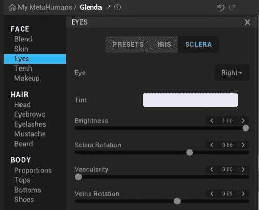

图 2.21：SCLERA

MHC 还通过 `Vascularity`（血管丰度）滑块带来了大量细节。当您开始旋转血管时，这一点清晰可见。这些是极端特写镜头的强大工具，值得在导出 MetaHuman 之前花些时间打磨。CGI 角色通常因为眼睛过于明亮完美而失去真实感。

让我们看一个结合 `Eyes` 编辑选项的示例。图 2.22 中的大部分编辑是使用 `SCLERA` 编辑选项卡完成的，除了在 `IRIS` 编辑选项卡中提亮角膜缘，以及降低基础和细节颜色选择器中的颜色饱和度：

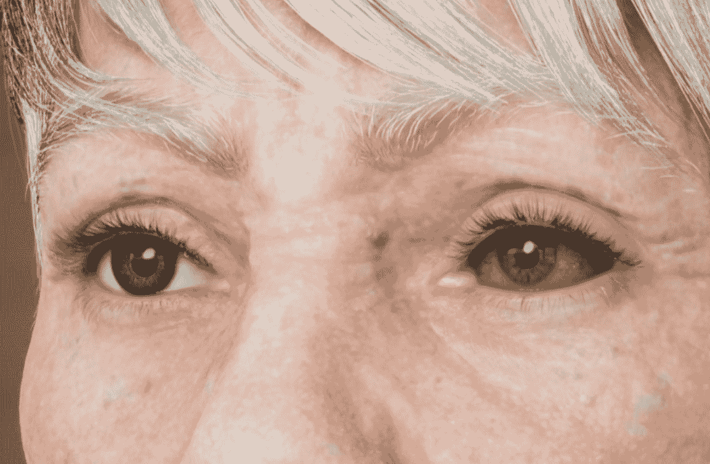

图 2.22：分离式眼睛编辑示例

我的目标只是让眼睛显老。总的来说，我可能有点过头了，格伦达此时该去看医生了。然而，她右眼的结果看起来更真实一些，仅仅是因为增加了细节并去除了完美的洁白。

### 牙齿

另一个能为 MetaHuman 增添真实感却常被忽视的工具是 `Teeth` 编辑器。就像眼睛一样，MHC 增加了一层细节和瑕疵，使角色更逼真。我们可以让牙齿因真实的着色而发黄，和/或真实地长得歪斜。我们甚至可以让牙龈萎缩。MHC 拥有相当多的牙齿编辑器，拥有您实现海量外观变化所需的一切。

首先，最好确保您处于光线充足的环境中，并打开角色的下颚，以便在编辑牙齿时更好地了解修改效果。为此，有一个方便的 `Jaw Open`（张嘴）滑块。

看图 2.23，显而易见，格伦达有一口好牙。它们完全整齐，完美洁白，没有牙菌斑或任何其他问题的迹象：

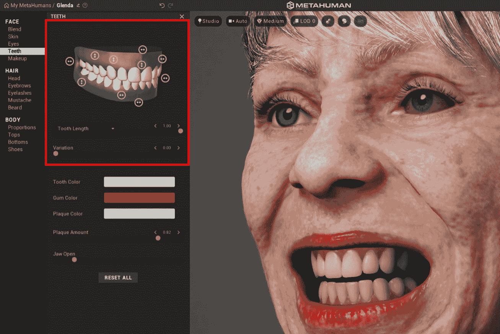

图 2.23：编辑前牙齿

有两种编辑方式：

*   在图 2.23 中，红框指示了可视化编辑方式。将鼠标悬停在每个灰色圆圈上，您将看到每个滑块编辑的内容——例如 `Tooth Length`（牙齿长度）、`Tooth Spacing`（牙齿间距）等。
*   然而，另一种方法是使用下拉列表，从显示 `Tooth Length` 的位置开始，如图 2.24 所示：

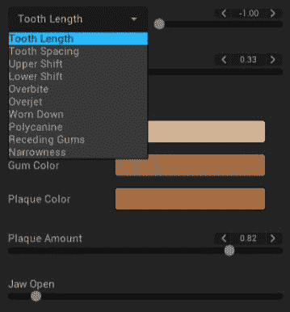

图 2.24：编辑牙齿

我建议使用下拉列表进行编辑，因为它提供了一个编辑强度的滑块，以及一个变化程度的滑块，同时还能提醒您正在编辑的内容，例如 `Tooth Length`、`Tooth Spacing`、`Overbite`（深覆合/地包天）等。牙齿的可视化图表也有滑块，如图 2.25 左上角所示，但它们只允许您编辑任何给定参数（如 `Overbite`）的强度。

大部分真实感在于对牙齿进行微妙的改动，例如牙菌斑颜色，并在下拉菜单中的所有项目上添加强度很低的细微变化，该菜单再次出现在图 2.25 中。操作 `TEETH` 图表下的下拉菜单、滑块和色板将赋予您最大程度的控制权：

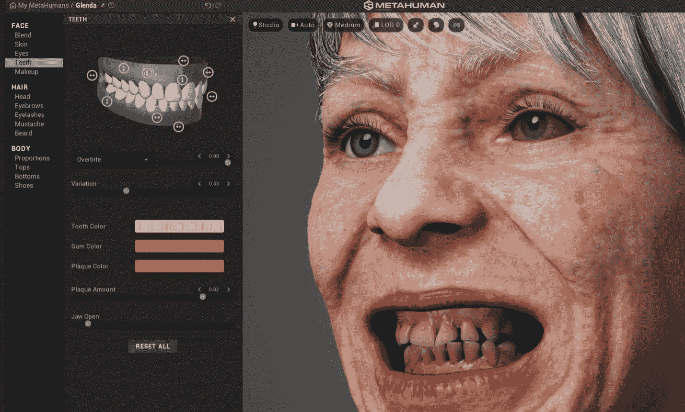

图 2.25：牙齿编辑器

话虽如此，如果您进行大幅度修改，预览 `Face ROM` 组件是值得的，因为牙齿对角色的整体表情有显著影响。一个主要考量因素是牙龈或深覆合的程度。深覆合会给人留下下颚发育不全和天真表情的印象，而反颌则会给人留下下颚过度发育和严肃表情的印象。当然，这很大程度上是主观的，但绝对值得考虑。

为了结束本节关于牙齿的内容，我想强调牙齿编辑对整体角色设计的重要性，以及它经常被忽视。

我们现在将继续，看一项并非适用于所有角色设计，但在 MHC 中是强大编辑工具的功能：化妆，以及将其应用于角色。

### 化妆

MHC 拥有一些非常出色的化妆功能，它们与角色的肤色协同工作。`Makeup` 编辑器分为四个选项卡：

*   `FOUNDATION`（粉底）
*   `EYES`（眼妆）
*   `BLUSH`（腮红）
*   `LIPS`（唇妆）

现在让我们逐一查看。

#### 粉底

如前所述，`Makeup` 编辑器与角色的肤色协同工作。早前在 `Skin` 编辑器下，我们可以选择编辑整体肤色。该信息会被纳入化妆 `FOUNDATION` 编辑器，根据您最初为角色选择的肤色，为用户提供合适的调色板。这是为了模拟现实世界的化妆决策。例如，白种人的妆容选择会与非裔美国人的不同。

正如您在图 2.26 中所见，我们可用的粉底调色板非常局限于角色的肤色；这是为了提供最佳效果：

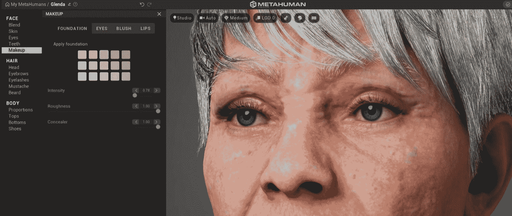

图 2.26：未涂粉底

## 妆容

务必勾选**涂抹粉底**，并从给定的调色板中选择一种颜色。之后，您可以编辑**强度**、**粗糙度**和**遮瑕**选项。**强度**不言自明，但在化妆术语中，可以理解为粉底涂抹的厚度。**粗糙度**可以理解为油性粉底和粉状粉底的区别。然而，**遮瑕**是指眼下部位涂抹的强度。

此外，如果您返回并增加角色雀斑的强度和密度，您将更好地了解您制作的粉底妆容涂抹得有多浓或多厚。在图 2.27 中，我正是这么做的：

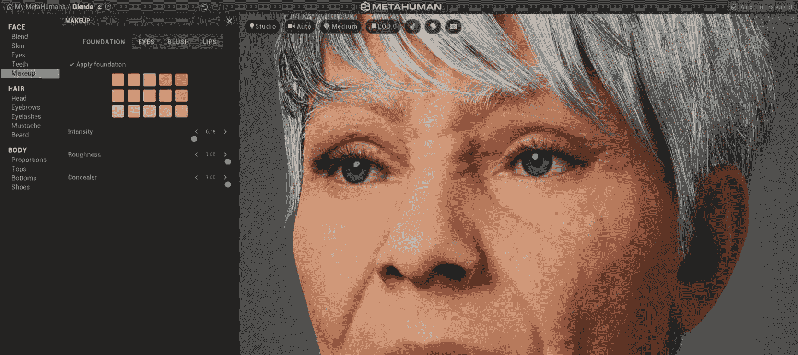

图 2.27：使用新调色板的粉底

我还让妆容变得非常粗糙，并将强度调低到足以让我们勉强看到雀斑透出来。请注意，图 2.26 和图 2.27 之间的调色板差别很大。

### 眼睛

请勿将其与之前的眼睛编辑器混淆，此编辑器专门用于眼部化妆。图 2.28 显示了一系列眼部化妆预设：

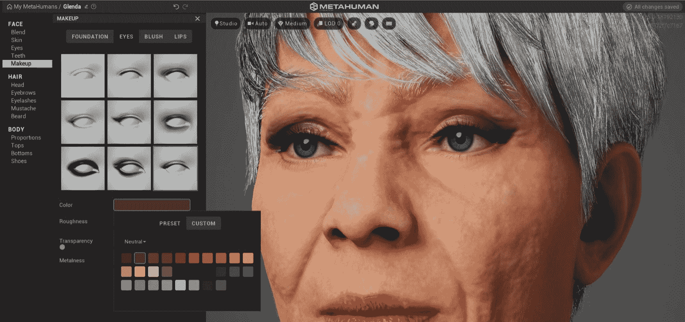

图 2.28：眼部化妆

与之前的眼睛编辑器类似，我们也有一系列妆容形状可供选择。例如，我们可以选择顶部的细眼线预设之一，或底部的夸张晕染形状。

同样，我们可用的调色板与肤色相衬，您可以在图 2.29 中看到这一点，但除了在预设下获得一个自然互补的调色板供选择外，您还可以选择其他选项，如**中性**、**深沉**和**鲜艳**；您对调色板的选择通常取决于您的角色。您还可以创建自定义调色板：

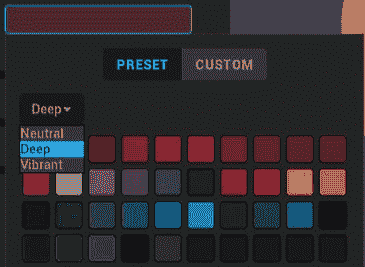

图 2.29：眼部化妆调色板选项

与**粉底**选项卡一样，我们有滑块允许我们编辑以下内容：

*   **粗糙度**：允许我们编辑眼部妆容对光线的反射程度。粗糙度为 0 时反射性极强，而粗糙度为 1 时则无反射。
*   **透明度**：这与强度的工作方式相同；透明度越低，涂抹的眼部妆容就越厚。
*   **金属度**：这是一种反射类型，表示金属度越高，我们在反射中看到的细节越多；设置较低会带来较暗淡的光泽。例如，一个高金属度且无粗糙度的表面看起来会像镜子。如果金属度低且粗糙度低，它会发亮但反射微弱。最后，如果金属度低且非常粗糙，它会非常暗淡，类似于粘土或灰泥。

与之前的许多功能（如粉底）一样，眼部妆容能给我们带来相当逼真的效果。我们将在下一节中看到更多相关内容，届时我们将介绍脸颊和腮红妆容。

### 腮红

同样，**腮红**调色板反映了与肤色互补的调色板。与眼影编辑器不同，我们只获得一个调色板，因为腮红通常只有互补色调，而不像眼影编辑器那样提供鲜艳的替代色调：

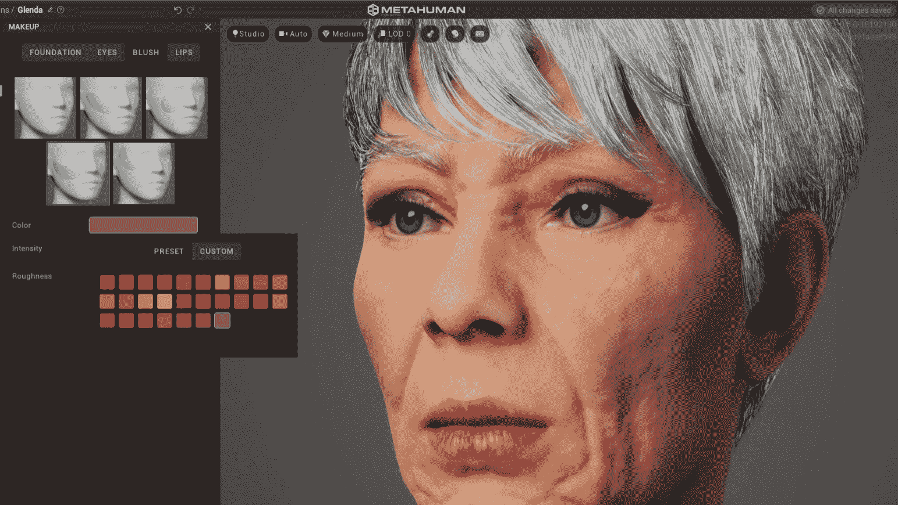

图 2.30：腮红调色板选项

从左上角开始，我们可以选择希望受影响的区域，主要集中在脸颊和太阳穴周围，如图 2.30 中的蓝色所示。

我们还获得**强度**和**粗糙度**滑块，这使我们能获得更强的真实感。低粗糙度的腮红会有不同于粉底的光泽，也不同于底层肤色的光泽。皮肤上所有这些细微的妆容变化都增加了真实感，绝对值得反复调整尝试。

### 嘴唇

最后，让我们讨论一下**嘴唇**编辑器，如图 2.31 所示。与**腮红**选择类似，变化不算大，但至少我们可以调整**粗糙度**、**透明度**和**颜色**，这与**腮红**中可用的种类已经很接近了：

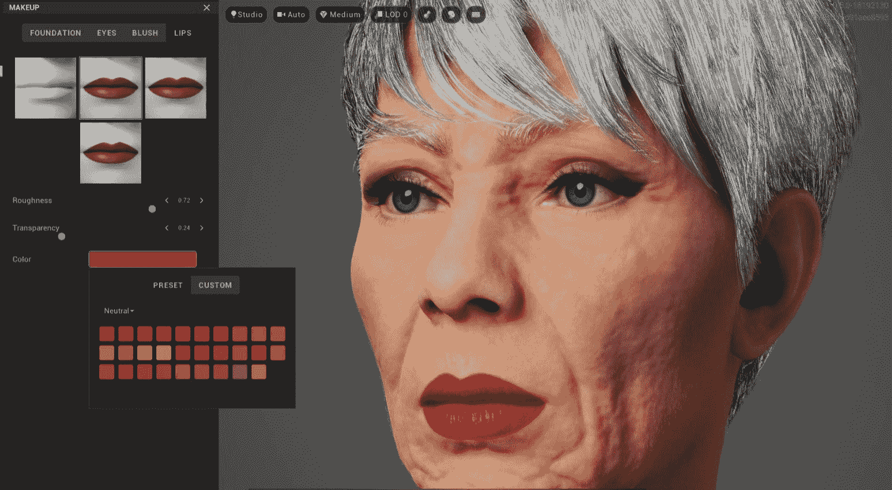

图 2.31：口红调色板选项

顶部的灰色缩略图指示口红的涂抹方式：第一个表示无口红，其余三个选项在涂抹方式上给我们非常细微的差别，有些稍微超出嘴唇区域，有些则涂抹得较少。

不过，如果我们想要更鲜艳或更前卫的效果，确实还有更多选项可供选择。我们还可以使用**自定义**按钮微调颜色选择。和之前一样，**粗糙度**滑块允许我们让口红更亮、反射更强。此时我们已经大量尝试了粗糙度；粗糙度低的结果会对场景中的光线产生真实的响应。在图 2.32 中，嘴唇的白色区域是光源的反射：

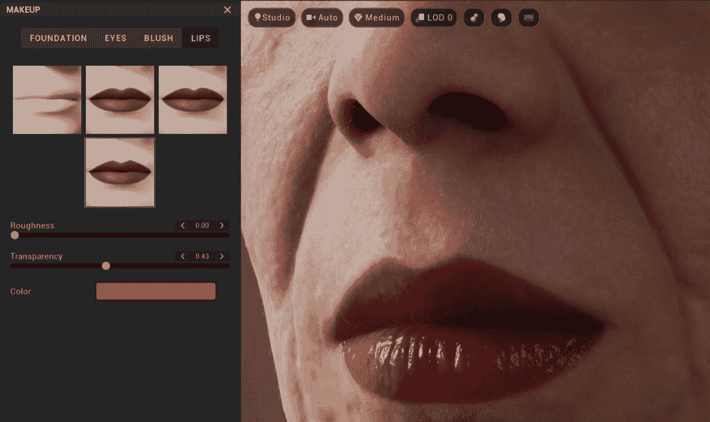

图 2.32：口红粗糙度设为零

### 注意

要查看粗糙度的效果，请尝试将嘴唇的粗糙度降至零，放大嘴唇，然后按住 `L` 键，在主视口周围左键单击鼠标以移动场景灯光。

本章迄今为止，我们详细介绍了面部。在下一节中，我们将转向完全不同的内容，当我们深入探讨头发和头发物理时，您将接触到一些新概念。

## 头发

就像面部一样，MHC 提供了许多可供选择的预设，也提供了一些自定义修改。如果您加载一个长发角色，您会立即注意到头发移动得非常逼真；您在虚幻引擎中也能获得完全相同的效果。

关于头发渲染，有两个主要因素需要考虑：

1.  **发丝** 或 **基于发丝的毛发**：这些使用样条线代表单根头发，虽然有一点“作弊”成分以营造更多头发的错觉。使用基于发丝的毛发，我们能获得更逼真的外观，但头发移动和与身体碰撞的物理表现更准确。
2.  **发卡**：这些是带有多根头发图像的简单多边形形状。发卡也更容易渲染，是在显示较低 LOD 时的默认选择。

默认情况下，MHC 对 LOD 0 和 LOD 1 使用**基于发丝的毛发**。换句话说，它们用于特写和中景镜头（头部和肩部镜头）。当角色离相机较远时，**基于发丝的毛发**的复杂度就大材小用且多余，因此改用发卡。如果您发现性能或帧率较低，MHC 也提供仅使用发卡的选项。

### 注意

关于 LOD 的一些预设仍在开发中，仅提供**基于发丝的毛发**，正如我之前提到的，这些仅在 LOD 0 和 LOD 1 中可用。由于没有发卡替代方案，除非您在虚幻引擎中强制设置 LOD 为 0 或 1，否则您的角色在远距离下将显得秃顶。在我们将角色导入引擎后，您将学习如何执行此操作。

关于**头发 LOD** 还有一个考虑因素是渲染质量。您可能记得，在本章前面的*渲染质量*部分，**史诗级（光线追踪）**为我们提供了头发内部更逼真的阴影，因此值得考虑该设置以获得最佳头发效果。当使用 LOD 1 或 LOD 2 时，如果您想在特写镜头中实现照片级真实感，很可能需要**史诗级（光线追踪）**设置。

# 头发与造型

话虽如此，根据角色与摄像机的距离，您也可能可以使用较低的渲染质量设置，这将缩短渲染时间。

除了头皮头发，`MHC` 还提供眉毛、睫毛、胡须和络腮胡的解决方案。我们现在将讨论这些元素。在浏览这些选项时，我们会发现可用的编辑选项在很大程度上是相似的。主要就是颜色、粗糙度和盐胡椒（黑白相间）。

## 头部

`Head`（头部）编辑器为我们提供了编辑头部头发的所有可用工具，如图 2.33 所示。与许多其他角色创建工具不同，`MHC` 在 Unreal 内部提供了物理动力学解决方案。简而言之，这意味着头发将真实地移动并与物体（如角色的肩膀）发生交互，并对重力和风等因素做出反应。头发越短，头发动力学效果越不明显：

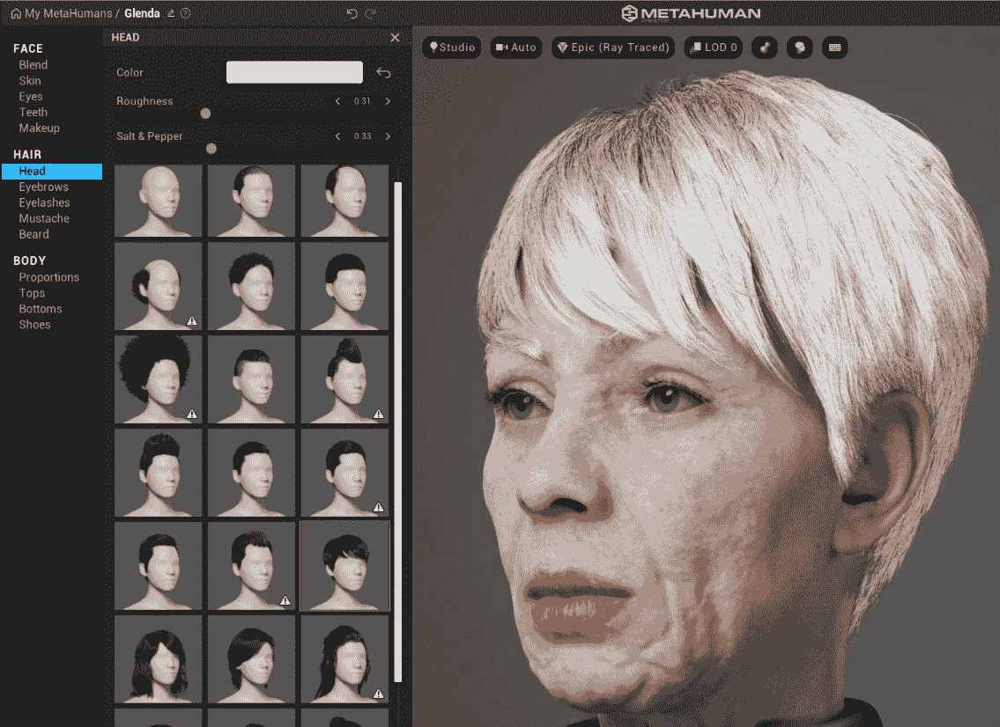

图 2.33：头部头发预设

在图 2.34 中，您可以看到，除了从预设菜单中选择想要的发型外，几乎没有其他编辑选项，尽管有几十个预设可供选择。

对于 Glenda 这个例子，我保留了灰色预设，但发现必须修改 `Color`（颜色）选项，才能编辑 `Roughness`（粗糙度）和 `Salt & Pepper`（盐胡椒/黑白相间）。`Roughness` 非常适合呈现哑光或亮面发质外观，而 `Salt & Pepper` 用于增加或减少白发。

在图 2.34 中，您可以看到特写时头发可以有多细致。在这个例子中，我们可以看到单根发丝：

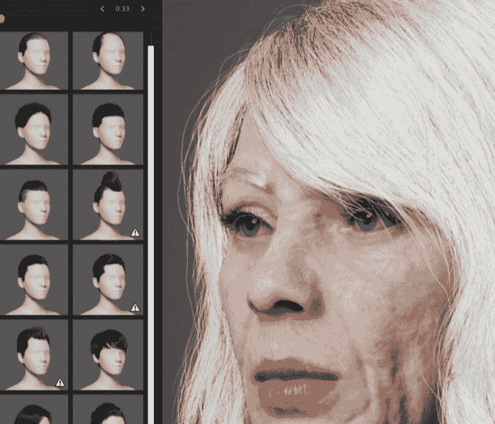

图 2.34：单根发丝清晰可见

就像化妆编辑器一样，我们也可以在 `PRESET`（预设）和 `CUSTOM`（自定义）之间选择。您将看到 `PRESET` 下的一个下拉菜单，如图 2.35 所示，允许我们保持在 `Neutral`（中性）调色板，或 `Deep`（深沉）和 `Vibrant`（鲜艳）调色板。如果您选择 `CUSTOM`，将获得更广泛的色域供选择：

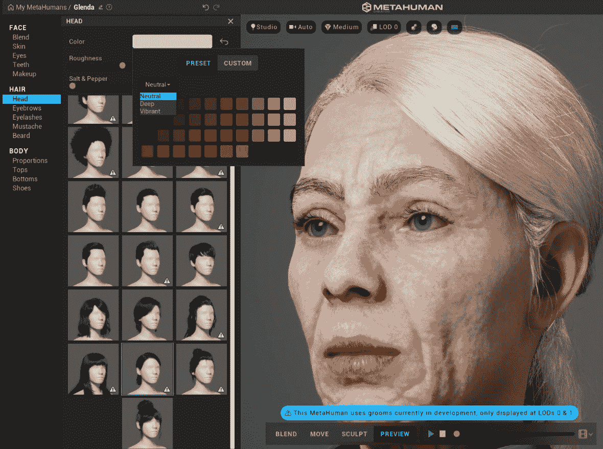

图 2.35：头部头发预设

带有警告图标的缩略图是具有有限 `LODs` 的预设。您可以在图 2.35 的预设缩略图右下角看到这些图标；警告内容为：**This MetaHuman uses grooms currently in development**，**only displayed at LODs 0 & 1**（此 MetaHuman 使用的造型正在开发中，仅在 LOD 0 和 1 显示）。这意味着它只能提供无 `LOD`（即基于发丝的最大质量头发渲染）和 `LOD` 值为 1（同样是基于发丝）的显示。这意味着无论摄像机距离如何，Unreal Engine 都将尝试以最大质量渲染头发。在引擎内部，当通常会启用 `LOD` 值 2 时，它将隐藏头发。对于没有 `LOD` 等级 2 或更高等级的角色实例，Unreal Engine 将不渲染头发。虽然此处的警告用处不大，但请注意这些警告，因为当使用具有有限 `LOD` 的角色时，您需要强制引擎完全不使用 `LOD`。否则，如果摄像机距离过远，您的角色将显得秃顶。

## 眉毛

使用 `Eyebrows`（眉毛）面板，如图 2.36 所示，我们只有少量预设可供选择（撰写时仅 11 个），以及我们之前见过的常用调色板和参数集进行编辑，包括 `Salt & Pepper`：

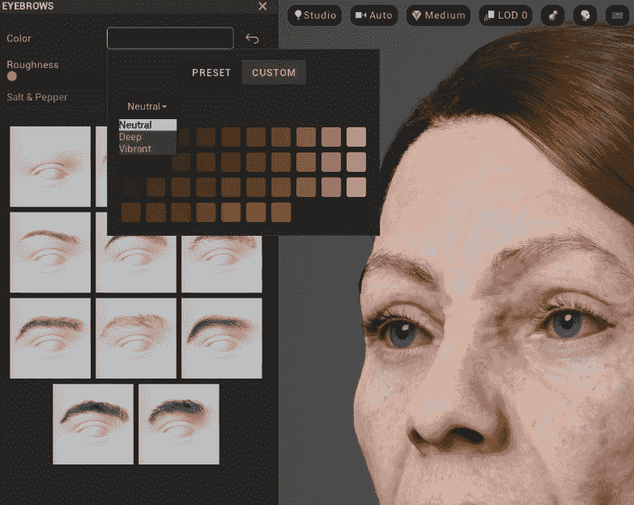

图 2.36：眉毛

## 睫毛

您会注意到，除了可用的预设外，图 2.37 中的 `Eyelash`（睫毛）参数与 `Eyebrows` 面板中的参数完全相同。然而，一旦进入 Unreal Engine，我们将获得对该参数稍多的编辑控制：

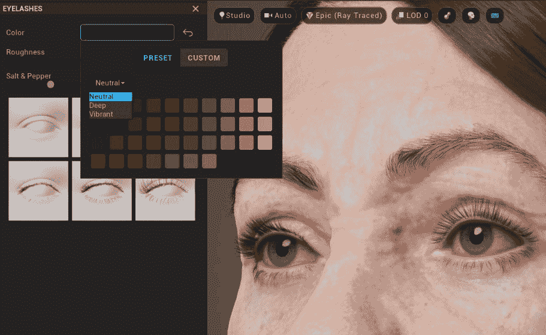

图 2.37：睫毛

## 胡须

`Mustache`（胡须）面板涉及相当多的细节。正如您在图 2.38 中所见，从我们之前所学，我们可以看到它是一种基于样条线的头发解决方案，这为我们提供了最佳细节。就像前两个编辑器一样，我们拥有相同的可编辑参数：

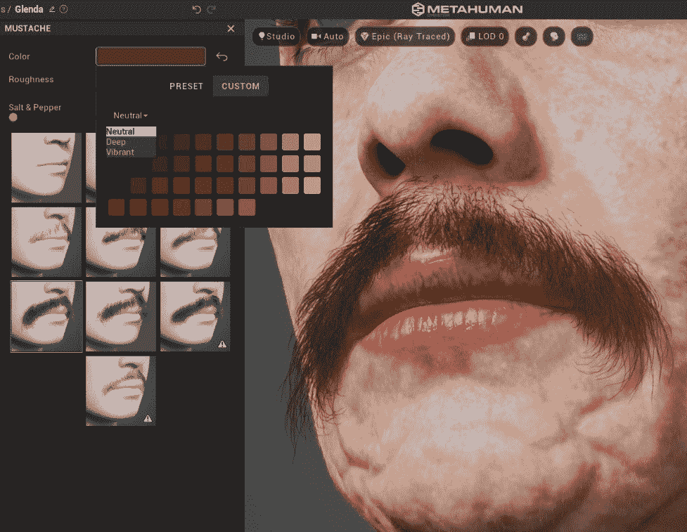

图 2.38：胡须

然而，不幸的是，在头发生长模式方面，我们仅限于选择少量预设。与睫毛类似，一旦将角色带入 Unreal Engine，我们确实有进一步的编辑选项。

## 络腮胡

最后，我们有最后一个与头发相关的编辑器：络腮胡。同样，如图 2.39 所示，我们有几个很棒的预设可供使用，并拥有常用的编辑参数。就像 `Scalp Hair`（头皮头发）部分一样，络腮胡对动画响应良好，特别是在碰撞动力学方面，例如真实地碰撞上胸部：

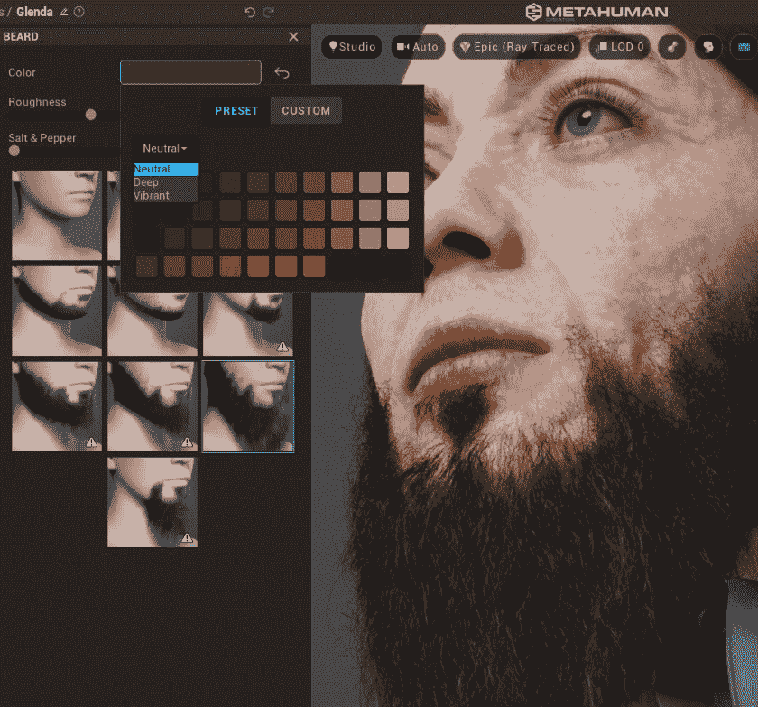

图 2.39：络腮胡

在本节中，我们介绍了 `MHC` 中提供的大量用于编辑的预设。其中一些概念我们在编辑面部时已经熟悉，例如调色板的 `LOD`，但我们也涉及了一些新概念，例如简要介绍了头发动力学。值得注意的是，可以在 Unreal Engine 中进行额外编辑；例如，如果我们愿意，可以添加一个单独的物理求解器，从睫毛获得独特的动画结果。一般来说，我们不需要这样做。

在下一节中，我们将探索新领域，查看身体部分。

# 身体

在 `BODY`（身体）部分，我们可以编辑角色的比例，但也有编辑服装和鞋子的选项。让我们现在来看看那些。

## 比例

首先，我们需要查看随 `MHC` 附带的身体比例和预设。我们可以在图 2.40 中看到这些：

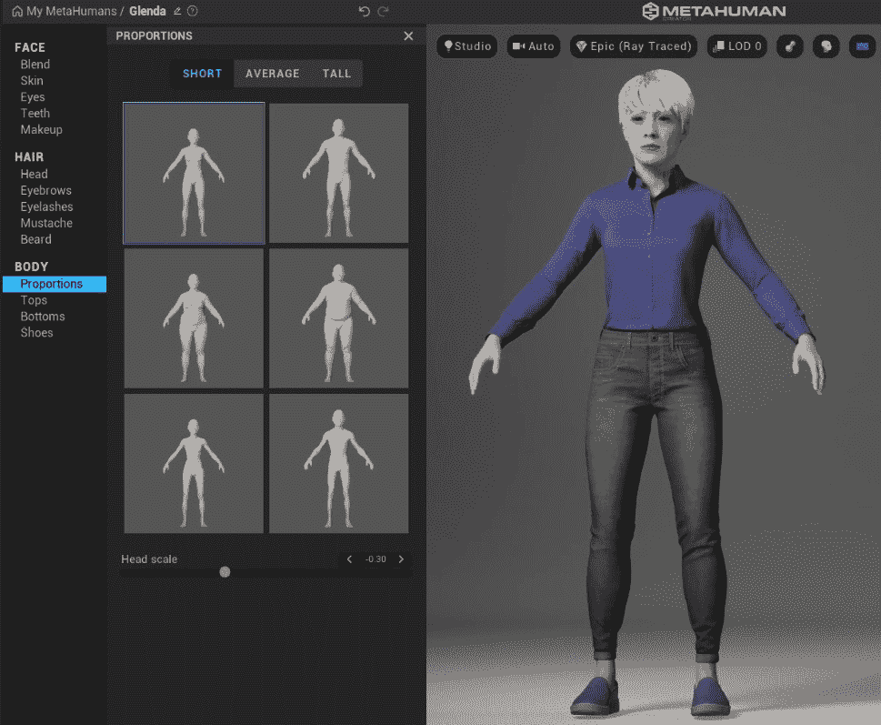

图 2.40：身体比例

有三个比例类别：`SHORT`（矮）、`AVERAGE`（中等）、`TALL`（高）。每个类别中都有 `Male`（男性）和 `Female`（女性）选项。两者都有三种主要体型：`Mesomorph`（中胚层/肌肉型）、`Endomorph`（内胚层/超重型）和 `Ectomorph`（外胚层/消瘦型）（肌肉发达、超重和消瘦）。与面部不同，我们没有获得那么多微调能力（例如，我们无法在体型之间混合）。

与几乎专门致力于角色创建的其他程序（如 Character Creator）相比，`MHC` 存在局限性。试图进行并列比较是不公平的，因为 `MHC` 的重点是写实人类，而 Realusion 的 Character Creator 等程序允许您对生理结构和肤质进行巨大更改，以至于您可以非常轻松地创建一个远超人类范畴的角色。因此，虽然这些限制将我们约束在创建更像人类的角色上，但这终究还是一种限制。还值得注意的是，`MHC` 仍在大力开发中，因此我们未来可能会看到更多功能。一个例子是只能创建成年人，且比例非常有限，例如膝盖到臀部、颈部长度、脚部大小等。

话虽如此，目前 `MHC` 中按性别划分体型的情况还算不错。如果您看图 2.40，我在 `Proportions`（比例）编辑器中选择了 `SHORT` 标签，您会注意到每个性别有三种体型：瘦、中、大。因为有三个与身高相关的标签——`SHORT`、`AVERAGE`、`TALL`——我们每个性别获得九种体型，总共 18 种体型。蒙皮权重和布料动力学也涉及其中，但超出了本书范围。

此外，您可能想知道缩放问题。在 Unreal Engine 内部重设角色缩放是完全可行的，不会对角色功能产生任何负面影响。

## 上装

# 服装

## 上装

在界面的 **BODY** 部分，您将从图 2.41 中看到，我们也有选项（尽管有限）来更改角色的服装：

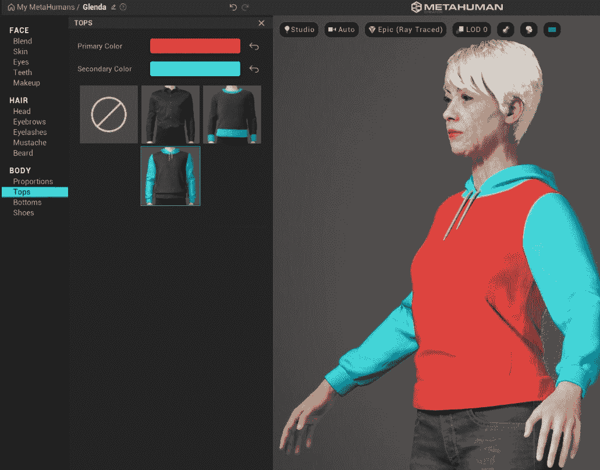

图 2.41：上装

然而，小改动也能产生大效果，您可以在此更改每件上装各个元素的颜色。例如，我给 Glenda 换了一件双色连帽衫。

> **注意**
>
> 我目前只能推测 Epic 和 Quixel 计划添加更多功能，但您可以想象，要适应任何一个人衣橱的变化，需要多少旋钮和按钮。目前，您可以自定义角色的服装，甚至包含精确的布料动力学，但这需要使用 Marvelous Designer、Maya 或 Blender 等第三方软件。

## 下装

与 **上装** 类似，正如您在图 2.42 中所见，**下装** 功能存在重大限制。正如我们对比两者时所见，我们仅获得两个额外的 **下装** 预设，但就像 **上装** 预设一样，小改动也能产生大效果：

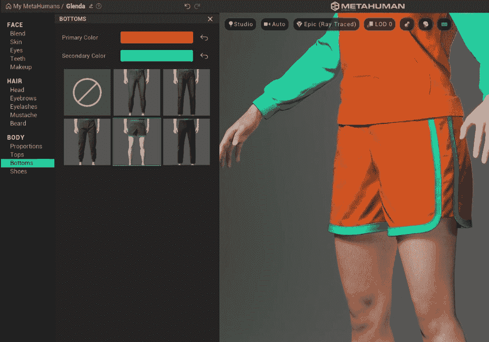

图 2.42：下装

## 鞋子

与 **上装** 和 **下装** 类似，MHC 中的 **鞋子** 存在一些重大限制；然而，就网格/几何体而言，自定义要流畅得多，因为它不涉及重新分配与布料模拟相关的权重绘制。虽然这听起来很复杂，但它只是意味着，就身体如何影响服装运动而言，鞋子不像衬衫那样复杂。鞋子不会改变形状，即使不穿的时候；它仍然保持脚的形状。然而，衬衫不穿时可以卷成一团。

由于复杂程度较低，建模或购买您选择的鞋子 3D 模型并在 Unreal 中替换它要简单得多。目前，我们仅限于少量可编辑主色和辅助色的鞋子。

除了编辑主色和辅助色之外，目前 MHC 中没有其他鞋子编辑选项，如图 2.43 所示：

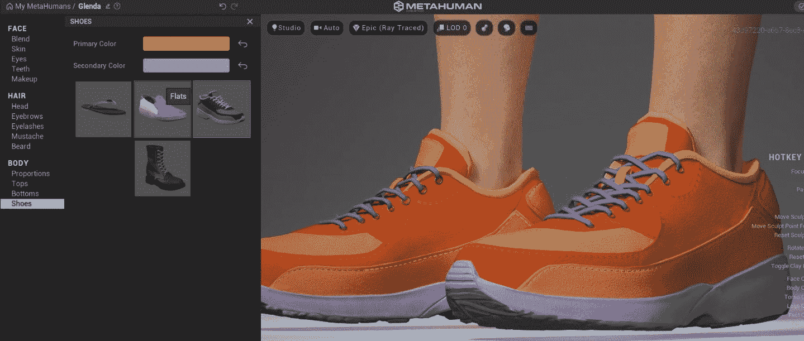

图 2.43：鞋子

我相信您会同意，身体和服装编辑器不如本章涵盖的面部、皮肤和其他区域的编辑器那样详细，但您可能会惊讶地发现，在下一节中，我们将直接回到一些面部编辑器进行进一步细化。

## 使用移动和雕刻工具

虽然我本可以在本章开头介绍 **雕刻** 和 **移动**，因为它们仅与头部相关，但我有充分的理由将它们留到最后。直到现在，您已经看到 MHC 提供了大量选项，能产生非常真实的效果。还有大量机会使用 **混合** 工具自定义面部。但有时，我们想更进一步，夸大某些特征。有时我们寻找不对称且更接近现实的东西，或者只是想专注于某个特定细节。

使用 **雕刻** 和 **移动** 工具，您可以获得比预设混合更多的效果，但如果弄错了，要恢复原状会更难。因此，应在用尽其他领域后再使用 **雕刻** 和 **移动**。

在界面中，**移动** 和 **雕刻** 之间主要的可见区别在于控制器：

*   在 **移动** 中，您使用指示线来指示您正在编辑的面部区域。移动指示线时，您会移动影响其周围区域的点簇。
*   在 **雕刻** 中，您使用面部上的点，且一次只能雕刻一个点。

这两个功能工作方式相似，且在很大程度上给出相似的结果，以至于我认为两者的选择取决于个人偏好。在图 2.44 中，您勉强能辨认出左侧的点，而右侧图像中的指示线则清晰得多：

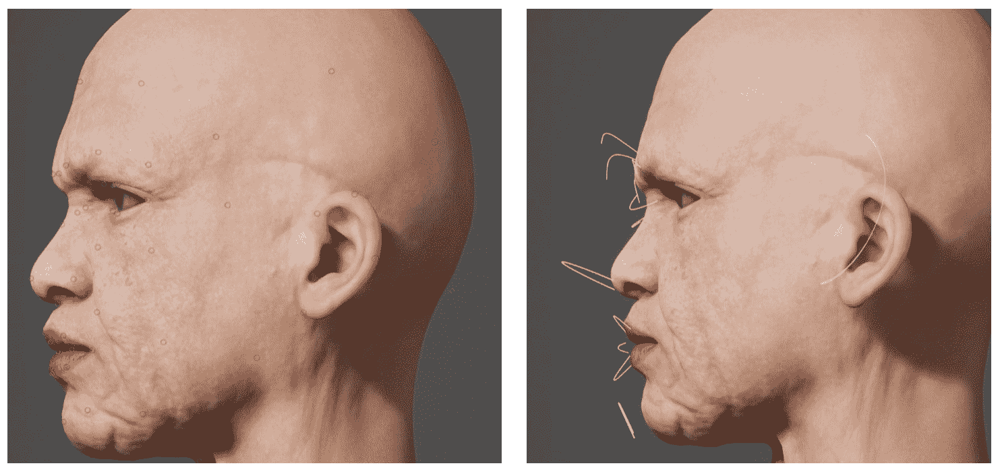

图 2.44：雕刻点和移动指示线

要查看 **移动** 与 **雕刻** 的行为有何不同，请看向面部正面并编辑一条眉毛。在 **移动** 模式下，当您编辑眉毛时，移动眉毛时会出现三个点，从而表明您在 **移动** 模式下同时移动三个点。在 **雕刻** 模式下，您只移动一个点，最大的变化影响发生在该点。

另一个要考虑的因素是不对称性。**移动** 指示线是非常有用的指示器，能显示您可以做些什么来为角色创建不对称性。例如，鼻子和嘴唇由同一组指示线操控，因此很难在这些区域创建不对称性。另一方面，左耳和右耳有各自的指示线供您操控。

要禁用对称性，请切换 **预览** 选项右侧的对称按钮，如图 2.45 所示：

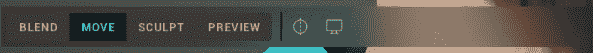

图 2.45：禁用对称性

我在图 2.46 中可能做得太过火了，可怜的 Glenda 看起来惨不忍睹。不过，这是一个在关闭对称选项的情况下，同时使用 **雕刻** 和 **移动** 工具将不对称性推向极致的好例子：

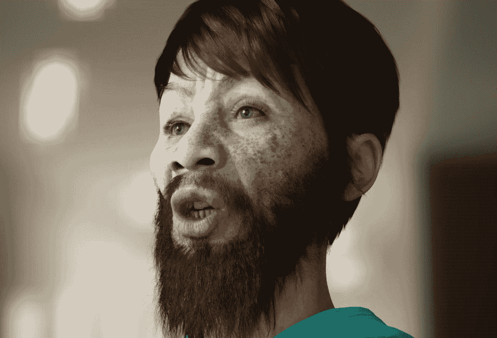

图 2.46：超越现实主义的编辑

> **注意**
>
> 在数字角色设计中，不对称性在创造真实感方面常被严重忽视。因为人类的面部左右两侧并不完全相同，所以引入一定程度的不对称性非常重要，无论多么细微。历史上，CGI 角色一直深受所谓 **恐怖谷** 效应之苦，而这种恐怖感很大程度上源于完美对称的存在，而完美对称在自然界中是不存在的。

本章我们详细介绍了如何使用 MHC 创建独特角色；我敦促您在进入下一节之前先尝试创建多个角色。在下一节中，如果您对角色设计满意，将下载并导出您的角色。

## 下载并导出您的角色

是时候下载您的角色并将其从 MHC 导出到 Unreal Engine 了。为此，您需要打开 Bridge 并导航到您的角色。您可能还记得首次启动 MHC 之前的这一步。但是，如果您进行了一些编辑，您会注意到 Bridge 中角色的图片也已自上次自动保存以来进行了更新。如果您看图 2.47，会注意到我的 Glenda 角色在 Bridge 中已更新：

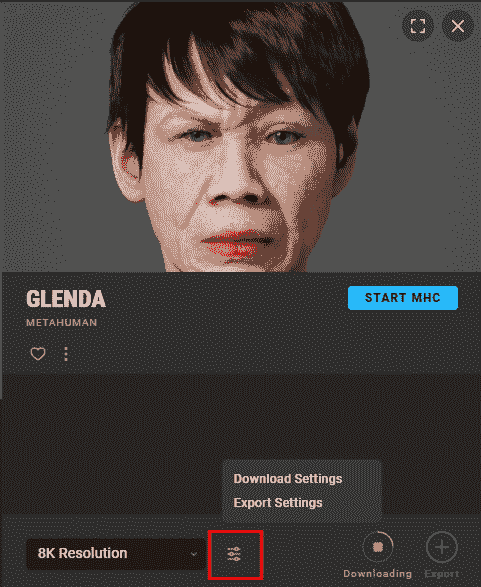

图 2.47：下载和导出设置

在这里您可以更改 **分辨率**、**下载设置** 和 **导出设置** 选项，我们将在此查看它们。

## 分辨率

在图 2.47 的左下角，您将看到一个下拉菜单，它与我们角色的纹理贴图分辨率有关。

最高可用的是 8K 分辨率。这意味着最高纹理贴图宽度超过 8000 像素。那是大量的像素；我强烈建议从 2K 甚至 1K 开始，因为具有 8K 纹理贴图的角色生成和下载需要很长时间，并且在首次导入引擎时编译也需要很长时间。

### MetaHuman 下载与导出工作流

如果您的显示器分辨率宽度达到 4,000 像素，8K 贴图将能得到充分展示。特别是面部 8K 贴图，在 4K 显示器上呈现特写绰绰有余。此外，请注意面部由多张贴图混合而成，可提供更丰富的细节。Glenda 角色的组合贴图总大小达 1.6 GB。

> **Note**
>
> 您可在后期制作中随时替换角色。因此，您可以用角色的低分辨率代理模型完成整个制作流程，待进入灯光渲染阶段时再替换为 8K 版本。这是一个非常简单的过程，仅下载和导出环节耗时较长。

## 下载注意事项

每当您关闭 `MHC` 或停止使用时，角色即可从 `Bridge` 内部下载。若 `Bridge` 处于打开状态且选中了该角色，您会看到其不时更新，尤其是在关闭 `MHC` 会话后。

要更改下载设置，请点击 `Download Settings`，如 *Figure 2.48* 所示。您将看到两个标签页：`TEXTURES` 和 `MODELS`。

首先，我们来看看 `TEXTURES` 标签页：

图 2.48：贴图设置

`TEXTURES` 标签页默认勾选了约一半的可用贴图，这对大多数情况已足够。我们还可额外选择 `Image format`（图像格式）——即 `JPEG`、`EXR` 或 `JPEG+EXR`。我强烈建议坚持使用 `JPEG`，因为 `EXR` 文件体积大得多，会增加下载和处理时间，甚至可能导致 `Unreal` 中的性能问题。在大多数情况下，像素数据不足以支撑 `EXR` 文件格式的优势。

现在，我们切换到 `MODELS` 标签页，这里有不同的选项：

图 2.49：模型设置

因为这是 `Bridge`，所以在选择 3D 模型格式时，我们有 `Megascans` 和 `MetaHumans` 两个选项。我们只需关注 `MetaHumans` 下拉列表，它提供两种格式供选择：`UAsset` 和 `UAsset + Source Asset`。

选择 `UAsset + Source Asset` 将同时下载仅可在 `Unreal` 中读取的角色网格格式，以及更通用的 `FBX` 格式。这是最保险的选择，因为单独下载 `UAsset` 很可能导致导出失败。（我们也可前往 `Export Settings` 为第三方 3D 软件提供更多选项，若您仅想在 `Maya`、`Houdini` 或 `Blender` 中使用 `MetaHuman`。）

确认设置后，点击 `Back` 按钮，再点击 *Figure 2.47* 所示面板底部的绿色 `Download` 按钮。下载过程耗时较长，因为 `MHC` 正根据您的修改烘焙贴图、生成新网格、写入新的 `Unreal` 文件，同时还要为下载进行压缩和解压。

现在，让我们看看 `Export Settings` 选项。

## 导出注意事项

接下来，我们将查看 `Export Settings`（可在 *Figure 2.47* 的 `Download Settings` 下方找到）。您将看到如下窗口：

图 2.50：导出设置

要导出角色，请执行以下操作：

1.  将 `Export Target` 设置为 `Unreal Engine`。
2.  将 `Engine Version` 设置为您安装的版本，应为 **5.0** 版本。
3.  将 `Plugin Location` 设置为 `Unreal` 的安装目录（选择此文件夹将允许 `Bridge` 自动安装插件）。
4.  在 `Default Project` 下选择您的项目文件夹作为默认位置。

> **Note**
>
> 若您仅将角色导出为 `Unreal` 资产，后续想将其引入 `Maya`、`Blender` 或其他第三方应用程序，可从 `Bridge` 重新下载并更改导出设置，将 `Export Target` 设为 `Maya` 或 `Blender`，*或者* 直接在 `Unreal` 中使用 `Level Sequencer` 将角色导出为 `FBX`。

完成后，可在 *Figure 2.47* 所示的同一面板中找到 `Export` 按钮。

一种替代且推荐的将角色安全导入正确项目的方法，是利用 `Unreal` 项目中的 `Bridge` 插件。此插件在 `UE5` 中默认启用。它是 `Bridge` 的迷你版，仅能从 `Unreal` 内部启动。要在 `Unreal` 中使用 `Bridge`，请导航至屏幕底部的 `Content` 文件夹并点击 `+ADD` 按钮。在此处，您将看到 `Add Quixel Content`；点击它。这两项均在 *Figure 2.51* 中高亮显示：

图 2.51：在 Unreal 5 的内容文件夹中加载 Quixel Bridge

此时系统可能会要求您再次登录。使用 `Epic Games` 凭据登录后，您将看到您的 `MetaHuman` 内容及类似界面，可在打开的 `Unreal` 项目中直接下载并添加角色。

这样做的优势在于：降低将角色误导出到错误项目文件夹的几率。此外，若插件尚未安装，点击 `+ADD` 触发的 `Quixel` 导入器会检查插件安装状态，并在屏幕右下角提示后自动为您安装；我们将在本节稍后详细探讨这一点。

## 后台处理

`UE5` 会将已下载到本地的文件导入 `Unreal Engine`。简单来说，`Bridge` 将相关文件保存到 `Unreal` 项目 `Content` 文件夹下的 `MetaHumans` 文件夹中。若您未安装 `MetaHumans` 插件（如 `Hair Grooms` 插件），请勿担心 —— 迷你 `Bridge` 插件会在导出步骤中自动安装它们。

屏幕底部将出现关于所有 `MetaHumans` 相关插件的各类通知。它可能会要求您点击 `Enable Missing` 以启用缺失的插件。请务必点击 `Enable Missing`，如 *Figure 2.52* 所示：

图 2.52：缺失插件与项目设置

此外，`UE5` 还将计算蒙皮权重、编译着色器等。这将耗费几分钟时间，在此期间您将无法使用 `Unreal Editor`。

完成后，请在 `UE5` 项目的 `Content Browser`（内容浏览器）区域中寻找已创建的 `MetaHumans` 文件夹，如 *Figure 2.53* 所示。所有 `MetaHuman` 角色都将导入此文件夹；该文件夹将在您首次执行导出流程时创建：

图 2.53：MetaHumans 文件夹

在该文件夹内，您将看到一个以角色命名的文件夹。打开它，您将看到角色的缩略图。在本例中，它名为 `BP_Glenda`（`BP` 代表 `Blueprint` 蓝图）。

*Figure 2.54* 显示我已将角色引入视口。我是通过将 `Blueprint` 直接拖放至视口中实现的：

图 2.54：拖放蓝图

> **Note**
>
> 您可以随时编辑场景。在 *Figure 2.54* 中，我使用了空白模板，并将 `HDRI` 背景拖放至场景中，以获得简单但逼真的灯光设置。

请随意将角色的 `Blueprint` 拖放到视口中的任意位置，以便开始检查它。此外，请注意角色文件夹内创建的其他文件夹。你应该会看到以下内容：

*   Body（身体）
*   Face（面部）
*   Female（女性）（如果你创建的是男性角色，则会显示 Male）
*   FemaleHair（女性头发）（如果你创建的是男性角色，则会显示 MaleHair）
*   Materials（材质）
*   Blueprint（蓝图）

你可以浏览这些文件夹以查找各种纹理贴图。

在本节中，我们重点介绍了如何将自定义 MetaHuman 导入 Unreal Engine。通过所需的下载和导出时间，你可能会注意到每个角色涉及的数据量有多大。我们刚开始了解 Unreal Engine 以及角色背后的文件夹结构，但请放心，到下一章结束时，你将对它们更加熟悉。

## 总结

在本章中，我们学习了如何上手使用 MHC，所有可用于自定义角色的各种参数，以及一些有助于设计流程的最佳实践。

我们还了解了一些关于纹理和着色器如何工作的知识，以及它们如何被用来提供特定的结果。除了了解所有可用的设计工具外，我们还通过使用 LOD 学习了一些优化知识。

虽然我们已经浏览了许多可编辑属性，如身体、面部、眼睛、头发、服装以及所有可供选择的预设，但我们也了解了 **Move**（移动）和 **Sculpt**（雕刻）工具，我们可以使用它们来微调角色并引入不对称性。

最后，我们了解了下载和导出阶段，以及一些已知问题的变通方法，例如只有 Bridge 插件能识别 UE5 安装。

我们在本章结束时已将自定义角色带入引擎，但现在，我们需要学习如何为 MetaHuman 制作动画。为此，在下一章中，我们将探讨 `Blueprints` 的概念，它们是什么，以及我们需要对它们做什么才能让角色“活”起来。
