## 第 3 章：深入 MetaHuman 蓝图

在上一章中，我们使用 Quixel Bridge 和 UE5 内的 Quixel Bridge 插件导出了一个 MetaHuman 角色。我们将大量资产导入了引擎——虽然大多数资产是图像和网格体，但将它们全部粘合在一起的“胶水”就是 `Blueprint`。

在本章中，你将接触 `Blueprints`，包括它们是什么以及它们有什么用途。通过使用 `Blueprints`，你将学习准备 MetaHuman 进行动画制作所需的第一步，即重新利用我们将导入项目的另一个角色的动作捕捉数据。然后，我们将编辑我们的 MetaHuman 和 Unreal Engine 模型骨架内的特性。

因此，在本章中，我们将涵盖以下主题：

*   什么是 `Blueprints`？
*   打开 `Blueprint`
*   导入和编辑骨架

### 技术要求

要完成本章，你需要 *第 1 章* 中详述的技术要求，以及我们在 *第 2 章* 中导入到 UE5 的 MetaHuman。

### 什么是蓝图？

那么，`Blueprint` 到底是什么？如果你正在思考这个问题，我不会怪你。

`Blueprints` 实际上是用 C++ 编程语言编写的模板的可视化表示。Epic Games 本可以轻松地在 Unreal 中创建一个控制台让用户编写 C++ 代码，但因为并非每个人都熟悉 C++ 编程语言，所以他们为艺术家创建了一种编辑相关代码的简便方法。此外，对于熟悉 C++ 的人来说，`Blueprints` 是创建相对易于艺术家使用的工具的一种非常方便的方式。

好消息是，在处理 MetaHuman 角色并为其制作动画时，你并不真的需要花费大量时间来使用它们，但它们是该过程不可或缺的一部分，并在后台被引擎使用。对于艺术家来说，掌握 `Blueprints` 的基础知识是一个很好的实践，因为它们是减少重复工作的绝佳方式；但也必须指出，有些任务如果不使用 `Blueprints` 根本无法完成。

就 MetaHuman 角色的功能而言，`Blueprints` 本质上将与角色相关的大部分信息保存在一个地方，我们使用 `Blueprint` 来更改角色。我们将进行的更改与角色如何制作动画有关，到本章结束时，你将熟悉需要编辑 `Blueprint` 的哪些区域才能正确地为角色制作动画。

你可以把 `Blueprint` 看作是一个驱动程序。它的功能是使用骨架驱动角色的网格体。它通过驱动骨骼来实现这一点，骨骼反过来驱动皮肤。因为存在布料模拟，皮肤驱动布料。因为也存在头发模拟，皮肤驱动头发。所有这些都是由 `Blueprint` 驱动的。

但 `Blueprint` 从哪里获得初始指令呢？答案是*你*。你告诉 `Blueprint` 它将使用哪种指令来为角色制作动画，然后指向各种动画模式供 `Blueprint` 使用。可以应用的动画类型只有几种，如下所示：

*   **预录制数据**：这只是一个包含动作数据的文件，通常面部和身体各有一个文件。我们可以从大量资源获取这些文件。我们也可以使用 UE5 第三人称游戏模板附带的动画文件，或者通过录制自己的动作捕捉数据来创建自己的文件（我们称之为 **Takes** / **采集片段**）。
*   **实时动作捕捉数据**：`Blueprint` 允许我们使用来自硬件设备的实时数据，例如：
    *   用于面部动作捕捉的 iPhone。
    *   利用摄像头的 Faceware Studio 等软件。
    *   动作捕捉服也通过第三方软件为我们提供实时数据。实时数据是指实时流式传输到引擎中的骨骼变换和/或旋转信息。
*   **动画蓝图**：这些主要用于游戏逻辑，但它们可以使用预录制数据中使用的相同动画文件类型，或在使用实时动作捕捉数据时保存的文件类型，这些是我们在传统 3D 动画电影制作中会使用的。

`Blueprints` 还允许接收来自用户的新数据，例如游戏中的玩家，并将根据玩家的行为调用相关的动画文件。例如，如果玩家奔跑，`Blueprint` 将执行 `run` 动画文件，从而驱动角色奔跑。该文件通常采用 `FBX` 或 `BVH` 格式。这些文件被称为 **资产**。

那么，让我们看看引擎内部的 `Blueprint`。

### 打开蓝图

一旦你成功将 MetaHuman 角色导入 UE5，你将看到一些文件夹和一个以 `BP_` 前缀开头的文件，如图 3.1 所示。该文件夹包含显示角色所需的所有资产。

### 导入和编辑骨架

### 角色蓝图界面

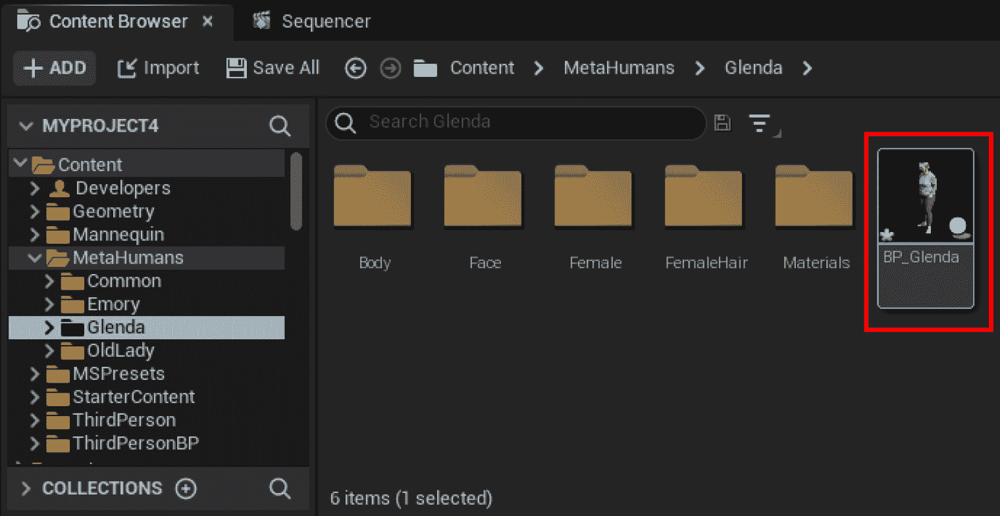

Figure 3.1: 内容浏览器中的蓝图

当你双击蓝图时，这将打开你角色的蓝图。你将看到屏幕由六个选项卡组成，如图 3.2 所示：

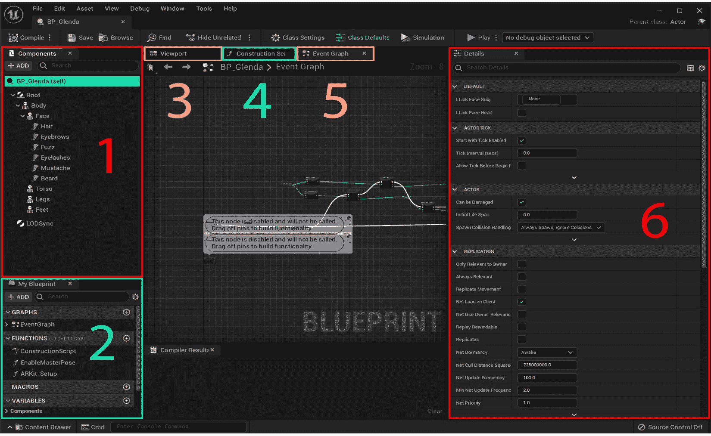

Figure 3.2: 角色蓝图的六个面板

### 六个面板

让我们分解一下这些选项卡：

1.  **`Components`（组件）**：这是我们可以选择想要编辑的 MetaHuman 哪个部分的地方。我们还可以向 MetaHuman 添加额外的组件，例如网格体、摄像机和灯光。

2.  **`My Blueprint`（我的蓝图）**：在这里，我们可以看到与 MetaHuman 关联的功能性元素，例如 ARKit 设置，它允许将面部动作捕捉导向我们的角色。

3.  **`Viewport`（视口）**：这为我们提供了角色的视图，而不显示关卡的其余部分。如果我们将角色带入了一个繁忙的场景，并希望在没有繁忙环境干扰的情况下检查或编辑角色，这将非常方便。

4.  **`Construction Script`（构造脚本）**：构造脚本允许引擎无论我们使用哪个关卡，都能对蓝图进行数据读写。在游戏世界中，这很有用，因为构造脚本可以保存诸如角色健康值之类的数据。就我们使用 MetaHuman 的目的而言，我们不需要对此进行任何更改。

5.  **`Event Graph`（事件图表）**：事件图表包含与事件相关的重要信息。事件可以是游戏开始，也可以是按下键盘上特定键的结果。就 MetaHuman 而言，事件图表决定了角色应该使用什么 LOD 值。例如，如果摄像机远离角色，这就是一个触发角色显示大于 0 的 LOD 值的事件。

6.  **`Details`（细节）**：这是我们进行大部分编辑的地方。它是上下文敏感的，因此根据我们在 `Components` 选项卡中点击的内容，我们将看到不同的信息。例如，身体将提供与面部不同的可编辑参数。

### 在细节面板中编辑材质

正如我们刚才提到的，当涉及到编辑角色时，我们通过编辑各种资产在 `Details` 面板中进行。其中许多资产是图像文件，但许多编辑器也允许你进一步完善角色。事实上，在某些情况下，你甚至可以比单独使用 MHC 更好地控制角色的许多方面。这种额外的控制可以为你的角色带来比仅靠 MHC 所能实现的更逼真的效果。

要查看一个你拥有多少额外编辑能力的示例，请在 `Components` 选项卡中点击 `Face`（面部），然后在 `Details` 选项卡中双击其中一个 `Eye materials`（眼部材质）选项。根据你选择的眼睛，它将被标记为 `M_EyeRefractive_Inst_L`。

一旦你打开了该眼睛的材质编辑器，就可以编辑 MHC 中无法编辑的某些属性。例如，你可以编辑眼睛的混浊度和虹膜内的环境光遮蔽，这会给眼睛增加很多深度，如图 3.3 所示：

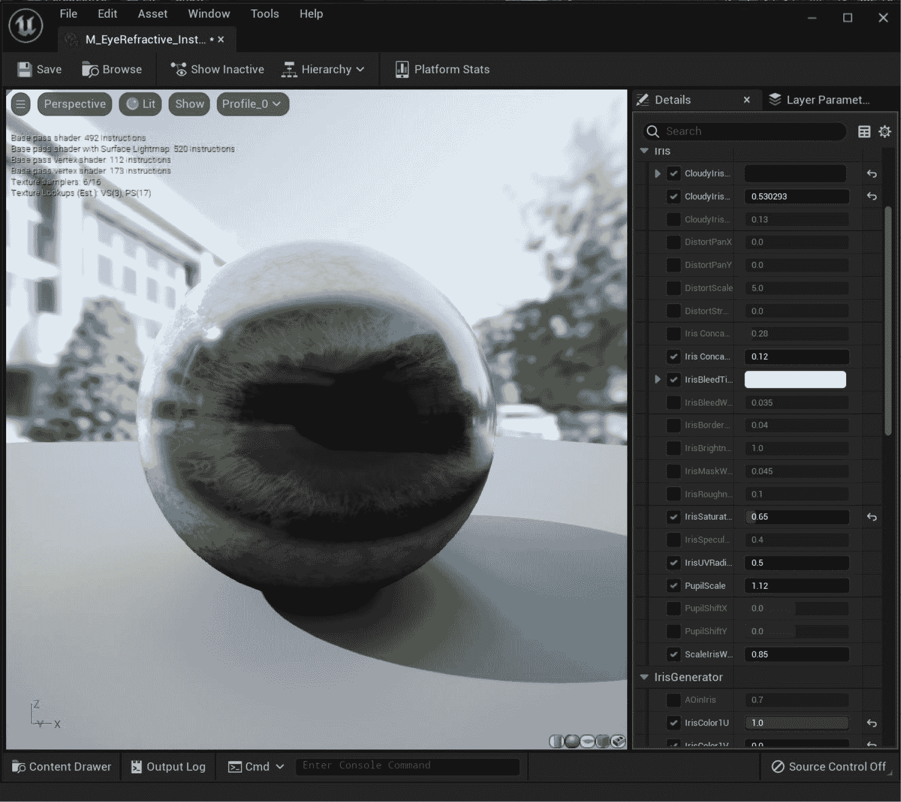

Figure 3.3: 编辑眼部材质

> **Note**
>
> 使用蓝图中独有的参数对角色进行进一步编辑不会影响你在 MHC 中的原始设计。你将始终通过 Bridge 拥有一个安全的备份副本。

顺便提醒一下，蓝图的作用就像驱动程序，而角色子文件夹就像乘客。虽然你可以直接通过角色蓝图访问所有这些组件，但也可以通过深入各个子文件夹来获得访问权限；有时你可能希望同时打开多个文件夹，所以在许多情况下，这仅仅取决于个人偏好。

### 导航蓝图

### 使用文件夹结构

为了向你展示如何使用文件夹进行导航，如图 3.4 所示，我直接进入了 `Hoodie`（连帽衫）文件夹，并双击了 `Hoodie Material`（连帽衫材质）资产以更改其颜色：

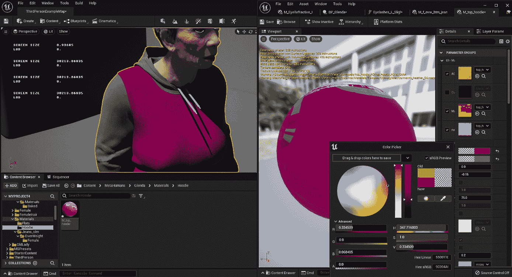

Figure 3.4: 直接在文件夹结构中进行进一步编辑

正如你所见，对这个特定资产的控制甚至比单独从 MHC 获得的还要多；例如，使用颜色选择器工具来更改 MetaHuman 的连帽衫颜色。你可能还记得在 *Chapter 2* *Creating Characters in the MetaHuman Interface*（在 MetaHuman 界面中创建角色）中，我们使用 MHC 颜色工具进行更改。

### 不使用文件夹进行导航

在图 3.5 中，你可以看到正在进行相同的编辑，但我们使用的是角色蓝图来编辑同一个资产。这两种方法同样有效。

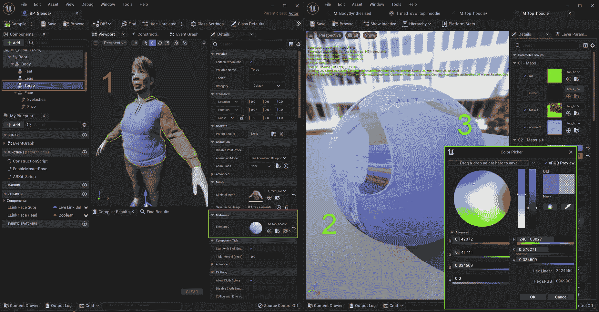

Figure 3.5: 在角色蓝图内编辑颜色

你可以在图 3.5 中看到，我遵循了以下步骤：

1.  我在 `Components` 选项卡中选择了 `Torso`（躯干）。
2.  我点击了 `Material`（材质）元素槽，这会打开 `Material Editor`（材质编辑器）。
3.  我点击当前颜色，这会打开 `Color Picker`（颜色选择器），允许我更改颜色。

虽然蓝图中有许多与角色外观相关的额外编辑器，但它们大多用于完善材质。在大多数情况下，结果很微妙，但你可以完全更改配色方案。

尽管这一切看起来令人生畏，但请放心，你实际上只会编辑蓝图的一小部分。至少，你只需要选择想要驱动角色的动画类型，而对于从另一个角色重定向动画，我们只需要编辑骨骼细节。

先让身体动画跑起来是合理的。UE5 自带几个入门包来帮助我们。其中一个入门包是第三人称游戏，它带有一个绑定了骨架的 `Mannequin`（模型/假人）角色。它还带有一些动画，我们可以用来测试我们自己的角色。

在本章的其余部分，我们将着眼于蓝图，旨在从入门游戏包中重定向动画，并在下一章将其应用到我们自己的角色上。

### 添加模型角色

在本节中，我们将 `Mannequin` 角色添加到项目中。然后，为了能够将动画从一个角色重定向到另一个角色，源角色和目标角色都必须拥有骨架。我们将在以下部分查看这两个骨架。

首先，我们要使用随 Unreal 附带的 `Mannequin` 角色的骨架。要将其添加到项目中，你只需转到 `Content Browser`（内容浏览器），点击 `+ADD`（+添加）按钮，然后选择 `Add Feature or Content Pack…`（添加功能或内容包……）：

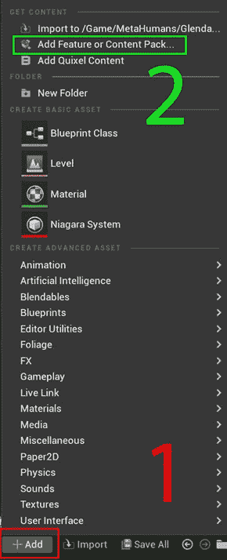

Figure 3.6: 添加内容包

点击 `Add Feature or Content Pack…` 后，你会看到一个弹出窗口，你可以在 `Blueprint`（蓝图）功能选项卡中选择 `Third Person`（第三人称）：

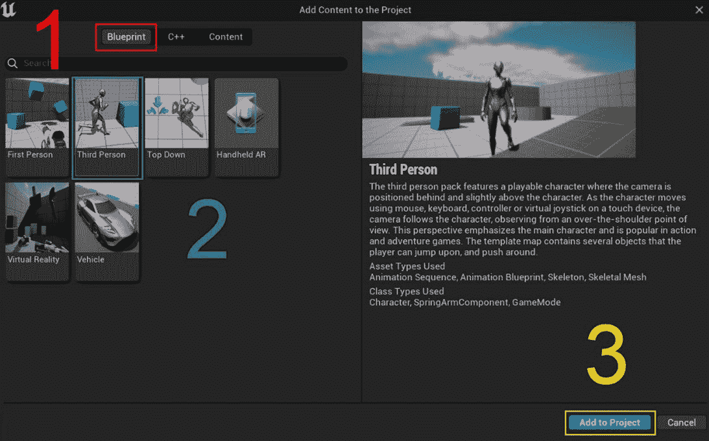

Figure 3.7: 向项目添加内容

我们选择 `Third Person` 的原因是它在项目中包含一个完整的角色，包括一个模型，我们可以对其进行重定向。然后，点击 `Add to Project`（添加到项目）。这会将项目加载到你的内容浏览器中。

你会注意到内容浏览器中现在有两个新文件夹：`Mannequin` 和 `Third PersonBP`。

在这个阶段我们要做的是编辑 `Mannequin` 骨架，使其结构、命名约定和动画方法与我们的 MetaHuman 相同。这样，我们就可以从 `Mannequin` 重定向动画并将其应用到我们的 MetaHuman 上。

如前所述，我们有两种编辑方式。我们可以遍历 `Mannequin` 的文件夹结构并搜索骨架蓝图，但我们将采取稳妥的策略：寻找主角蓝图，并从那里导航到骨架蓝图。

接下来，我们需要执行以下步骤：

1. 编辑 `Mannequin` 骨架的重定向选项。
2. 编辑 `MetaHuman` 骨架的重定向选项。

那么，让我们开始吧。

### 编辑 `Mannequin` 骨架的重定向选项

在本节中，我们将告诉虚幻引擎 `Mannequin` 角色的骨架以及我们的 `MetaHuman` 角色的骨架，我们只对它们的旋转数据感兴趣。

一旦我们将 `Third Person` 内容包添加到项目中，我们将看到一个名为 `ThirdPersonBP` 的新文件夹，这是个好的开始。您可以在图 3.8 中看到这一点：

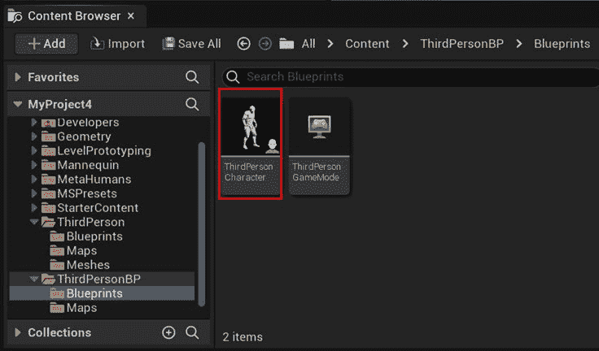

图 3.8：ThirdPerson 角色蓝图

在 `ThirdPersonBP` 文件夹中有一个标记为 `Blueprints` 的文件夹，其中包含我们需要编辑的 `ThirdPersonCharacter`。双击蓝图以将其打开。

在 `Components` 选项卡中，当按照图 3.9 点击 `Mesh (CharacterMesh0)` 时，您会注意到右侧的 `Details` 面板发生了变化。在 `Mesh` 下，您将看到 `Skeletal Mesh`。双击 `SK_Mannequinn` 的小缩略图：

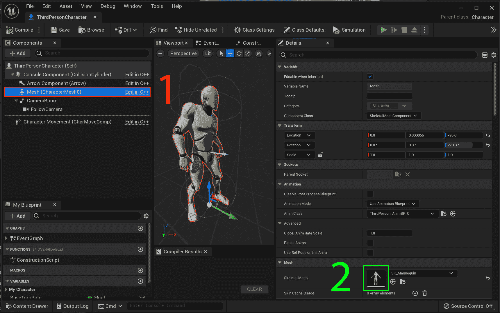

图 3.9：访问骨骼网格体编辑器选项卡

这将在蓝图中打开一个额外的选项卡，该选项卡将包含两个更多选项卡，以及一个显示 `Mannequin` 及其骨架的视口，如图 3.10 所示：

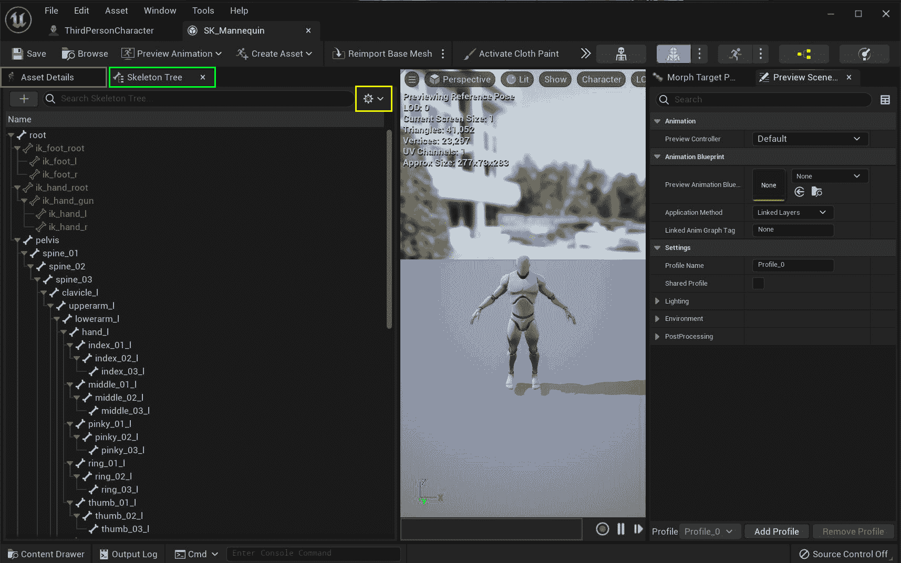

图 3.10：SK_Mannequinn 内部

这两个选项卡如下：

* `Asset Details`：如果我们想要编辑用于重定向动画的角色，它提供了大量选项。然而，我们只对该角色的绑定及其关联的动画感兴趣。
* `Skeleton Tree`：这是我们想要进行大部分编辑的地方。它向我们展示了每根骨头与其他骨头的关系。每根骨头都连接到 `root`。如果 `root` 部分移动或旋转，层级结构中的其余骨头也会移动。层级结构最底部的骨头影响力最小。

在图 3.10 的 `Skeleton Tree` 选项卡中，您可以看到从 `root` 到 `thumb` 的每根骨头都有名称。我们要做的是确保重定向选项设置为骨架，但别担心，我们不需要仔细逐个检查每根骨头。我们只需四次鼠标点击即可完成：

1. 点击齿轮图标。
2. 选择 `Show Retargeting Options`（显示重定向选项）。
3. 右键点击 `pelvis`（骨盆）。
4. 然后，左键点击 `Recursively Set Translation Retargeting Skeleton`（递归设置平移重定向为骨架）。

让我更详细地为您演示这些步骤。所以，点击图 3.11 中高亮显示的齿轮图标：

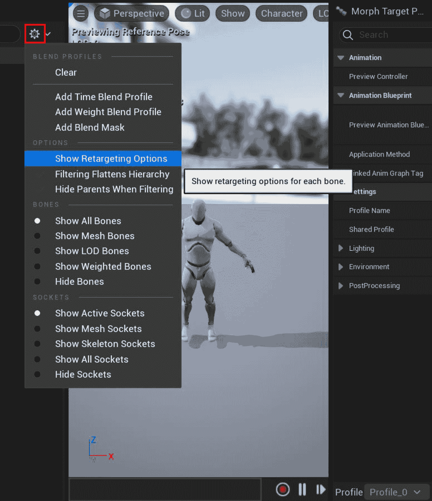

图 3.11：显示重定向选项

在 `OPTIONS` 下，点击 `Show Retargeting Options`。我们所做的一切只是确保骨架的层级结构被有效地用于驱动每根骨头的动画。因为所有骨头都在层级结构中相互连接，移动一根骨头会自然地对整个身体产生连锁反应。这被称为 `Inverse Kinematics (IK)`（反向运动学）。在某些动画数据中，每根骨头都有动画，因此骨架的自然层级结构不是很重要。对于 IK 动画，并非每根骨头的所有动画（如旋转和平移）都会传递下去；因此，依赖 IK 解决方案很重要。

我们将在下一步中利用骨骼层级结构，因为 `MetaHuman` 角色就是基于此设计的。因为该骨骼系统内存在骨骼层级，我们可以通过利用一个方便的重定向选项，快速改变骨头平移的性质。在这种情况下，我们要将 `Translation`（平移）设置为 `Skeleton`（骨架），从 `pelvis`（骨盆）骨头开始。

幸运的是，有一种快速的方法可以做到这一点。右键点击 `pelvis` 并选择 `Recursively Set Translation Retargeting Skeleton` 选项，如图 3.12 所示：

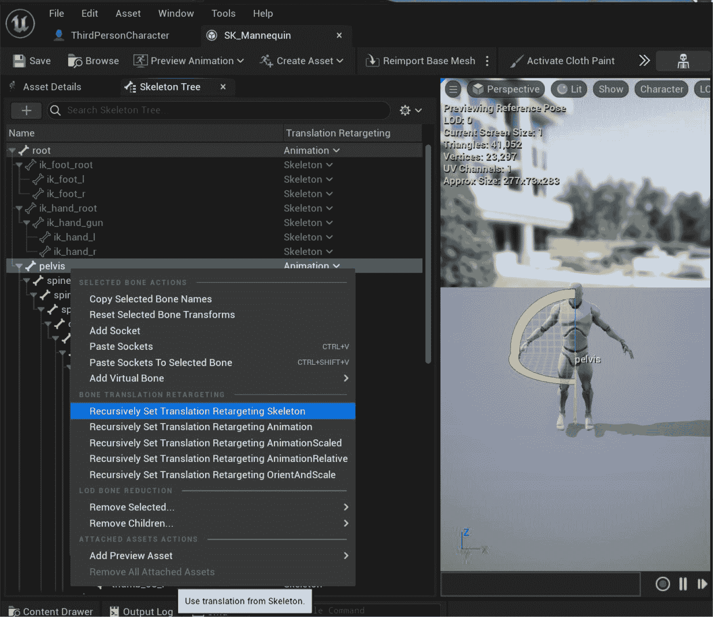

图 3.12：递归设置平移重定向为骨架

您现在已通过一次点击将从 `pelvis` 到 `skeleton` 的所有骨头都设置完毕。

> **Note**：编辑完重定向选项后，请务必在 `Blueprint` 选项卡中点击 `Save`（保存）。

除了确保我们的角色都使用骨骼动画外，通过这种方式操作，我们仅重定向 `rotational data`（旋转数据）。简单来说，这将允许我们从该角色重定向每根骨头的旋转动画，而不是 `transformation data`（变换数据）。如果我们将原始骨架的变换数据复制到新骨架（例如 `MetaHuman` 骨架），骨头将会不成比例地移动。

当新角色与原始角色存在显著比例差异时，这些问题最为明显。例如，如果原始骨架很高，那么它的骨头变换数据将与小个子角色截然不同。它的骨头会比其较小的对应骨头长。虽然旋转数据没问题，但高个子角色的变换数据会拉伸小个子角色，因为它会试图让骨头占据 3D 空间中相同的位置，尽管旋转值相对正确。

在图 3.13 中，您可以看到正确的数据变换。也就是说，这三个角色共享相同的姿势，网格体没有任何剧烈的拉伸或变形。如果变换数据从角色 A 传递到角色 B，角色 B 会被拉伸到相同的高度，角色 C 会被压扁到与角色 A 相同的高度。

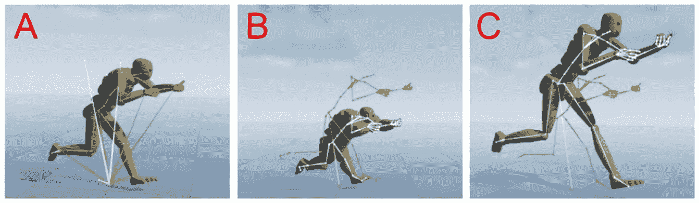

图 3.13：运动数据的正确转换

如果您发现已成功完成所有这些步骤并为 `MetaHuman` 制作了动画，那么很有可能您没有正确遵循这些步骤。一个常见的错误是忘记在蓝图中保存更改。

下一步是编辑新骨架的重定向选项，即我们的 `MetaHuman` 角色。

### 编辑 `MetaHuman` 骨架的重定向选项

要开始编辑 `MetaHuman` 骨架的重定向选项，请在角色的蓝图中，在 `Components` 选项卡中点击 `Body`。然后，在 `Details` 选项卡中，双击 `Mesh` 部分下 `Skeletal Mesh` 旁边的缩略图。如果您没有像 `Mannequin` 那样拥有准确的 `MetaHuman` 缩略图，请不要担心。

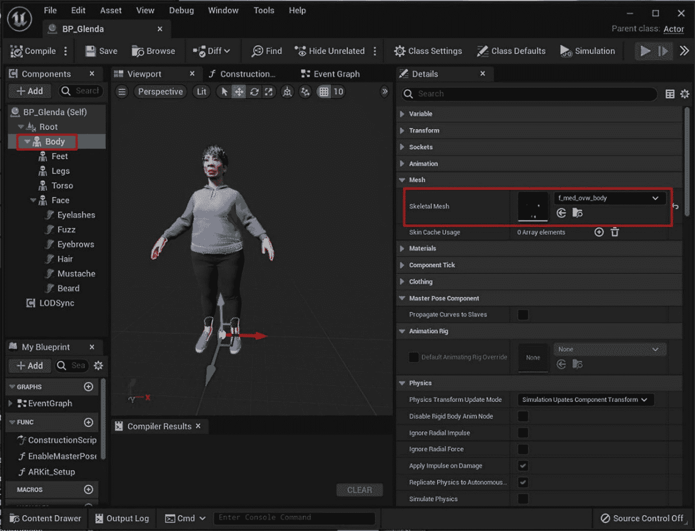

图 3.14：编辑 MetaHuman 的重定向选项

双击缩略图后，您将看到图 3.15 所示的界面（它与您之前在图 3.12 中编辑 `Mannequin` 骨架时看到的选项卡完全相同）。您只需遵循上一节中完全相同的步骤即可。因此，点击齿轮图标并选择 `Show Retargeting Options`。然后右键点击 `pelvis`，并选择 `Recursively Set Translation Retargeting to Skeleton`：

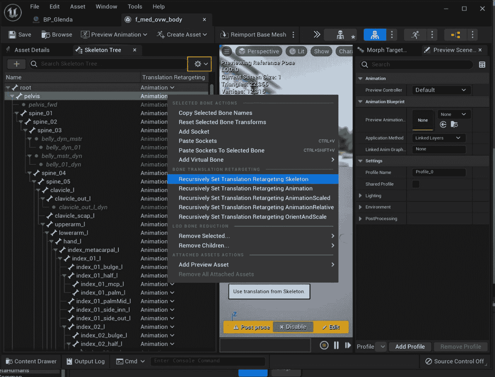

图 3.15：在 MetaHuman 蓝图中递归设置平移重定向为骨架

完成此操作后，保存蓝图。现在，我们已经编辑了 `Mannequin` 和 `MetaHuman` 两个骨架，调整了它们的重定向选项，以便两者可以协同工作。

### 总结

