## 重定向动画

在本章中，我们涵盖了大量内容。我们介绍了关于虚幻引擎中 `Blueprints`（蓝图）的一些关键概念，它们是什么，以及可以用来做什么。我们对虚幻引擎的 `Mannequin`（模型）角色和我们自己的 `MetaHuman`（数字人）角色进行了一些基本编辑，通过将两者的平移目标设置为 `Skeleton`（骨架），使它们能够有效地“对话”。我们还简要讨论了 IK（反向运动学）以及该解决方案如何与我们的角色配合工作。

在下一章中，我们将重新深入 `Blueprints`，将动画从一个角色重定向到另一个角色，并探索修复任何细微但常见问题的方法。我们将为 `Mannequin` 角色和我们的 `MetaHuman` 创建 `IK Rig`（IK 骨架/绑定），并使用 `IK Retargeter`（IK 重定向器）将动画数据导出到我们的角色上。

### 技术要求

要完成本章，您将需要第 1 章中详述的技术要求，以及我们在第 2 章中导入到 UE5 中的 `MetaHuman` 和虚幻引擎 `Mannequin`。

## 什么是 IK Rig？

要回答这个问题，我们实际上需要问两个问题：

*   什么是绑定？
*   什么是 IK？

现在让我们来回答它们。

### 什么是绑定？

在 3D 动画制作中，`rig`（绑定）是一种控制角色运动的简化手段，专为动画师量身定制。动画师不直接操纵角色的骨骼，而是通过绑定提供的控制器，动画师可以快速识别并选择它们。许多 3D 软件应用程序都自带专为人物和动物设计的绑定。在动画工作室中，绑定的复杂程度各异，取决于动画的复杂程度。归根结底，绑定的目的是简化动画制作过程。在本章中，我们将利用这些简化的绑定，以便将动画数据应用到它们身上。

`MetaHuman` 自带一个用于角色动画的内置绑定，称为 `IK Rig`。事实上，它附带一个 `IK Control Rig`（IK 控制绑定），允许动画师完全控制 `MetaHuman` 角色的所有动画。如图 4.1 所示，绑定是操纵骨骼的一种简化方式：

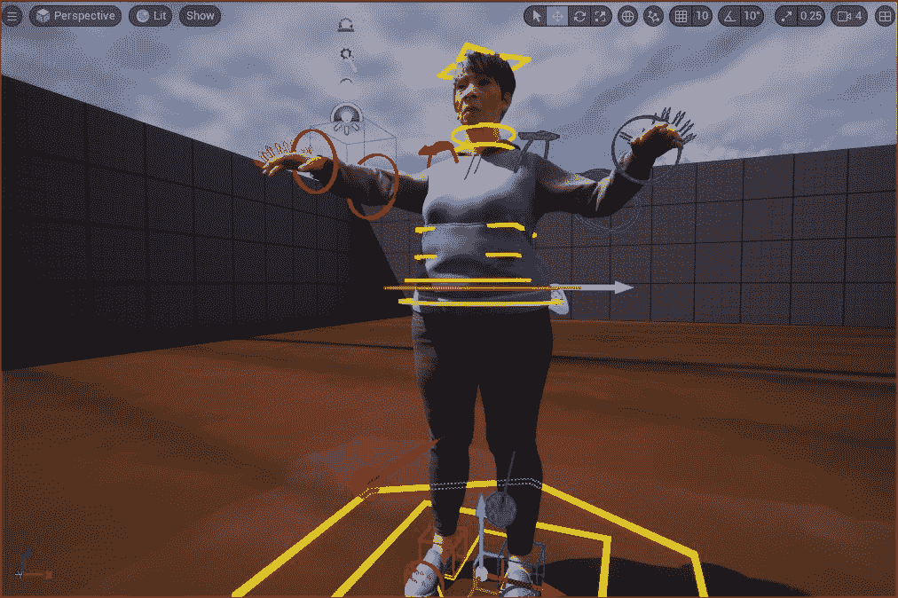

图 4.1：MetaHuman IK 控制绑定

既然我们了解了什么是绑定，现在让我们看看 IK 的含义。

### 什么是 IK？

要回答这个问题，我们需要了解在角色动画中，我们使用骨骼。这些骨骼在运动方式上彼此具有独特的关系；如果我们想用稍微专业一点的说法，这些骨骼在其运动学关系的定义方式上具有独特的关系。这些骨骼存在于骨骼层级结构中，它们如何运动取决于层级结构是采用 `Forward Kinematics` (`FK`，正向运动学) 还是 `Inverse Kinematics` (`IK`，反向运动学)。

说到人类骨骼，很少有骨骼能在所有轴上运动，且没有人类骨骼有自由在任何轴上移动 360 度。然而，与真实的人类骨骼不同，计算机生成的骨骼形状非常简单，可以显示为简单的线条、圆柱体、球体、金字塔或胶囊体。无论形状如何，它们都包含一到两个枢轴点，用于确定骨骼的旋转点。除了旋转点，我们还可以定义骨骼绕哪个轴旋转、绕哪个轴不旋转。让我们看看图 4.2，它演示了骨骼在 `UE5` 中的可视化方式。通过选择任意骨骼，我们会看到一个小工具，允许我们编辑每个骨骼的旋转；然而，用这个来制作动画很麻烦，因为难以选择或看清我们在做什么。

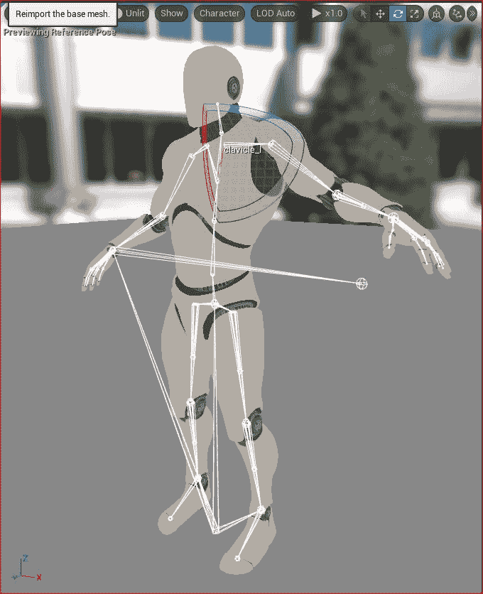

图 4.2：虚幻引擎中的模型骨骼系统

让我们以肩关节为例。我们知道我们可以向特定方向摆动手臂，但当我们尝试向其他方向移动时，很快就会遇到阻力。就关节而言，这种阻力被称为 `constraint`（约束）。

现在，请看图 4.3，它展示了 `MetaHuman` 上呈现的肩关节；你可以看到我们不必担心旋转约束：

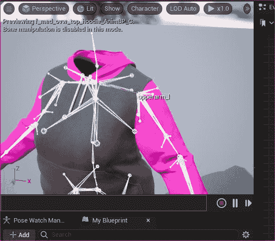

图 4.3：肩关节

你还会注意到，不太清楚选中了哪根骨骼，这表明直接操作骨骼在动画制作中并不实用。

无论如何，让我们回到 FK 和 IK 到底是什么这一点上。为了理解 FK，首先我们需要了解父级和子级之间的简单关系（我们在 3D 图形和机器人技术中经常使用这个比喻）。*子级会跟随父级去往任何地方，但父级不必跟随子级。*

#### FK

让我们将父子关系概念应用于关节，以肩膀为例探讨 FK。移动或旋转手关节对肩关节没有影响。事实上，我们必须先旋转肩关节，然后是肘关节，才能影响手的位置以获得期望的结果。换句话说，要定义手（末端执行器）的位置和旋转，我们必须先计算肩部和肘部的位置和旋转。

在图 4.4 中，我演示了通过旋转 `Joint 01`（左侧可见），然后可以旋转 `Joint 02`（右侧可见）：

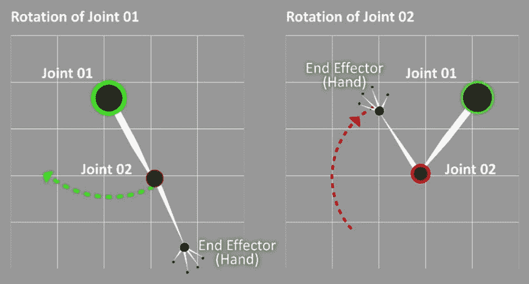

图 4.4：FK

在这里，我们通过对 `Joint 01`（父级）和 `Joint 02`（子级）应用旋转来计算手的位置。这被称为 FK，因为我们通过先计算父级的旋转来解决运动问题，所以我们沿着 *parent to child*（父级到子级）的方向解决这个问题。

#### IK

IK 之所以得名，是因为它通过首先计算子级的旋转来解决运动问题。再次以肩膀为例，当用户或艺术家影响手部末端执行器（层级中的子级）的位置时，IK 解决方案可以确定肩关节的旋转。因此，它与 FK 相反，沿着 *child-to-parent*（子级到父级）的方向解决运动问题。

在图 4.5 中，我演示了我只需要移动手，这反过来会自动计算出 `Joint 01` 的旋转，以及 `Joint 02` 的旋转和后续位置：

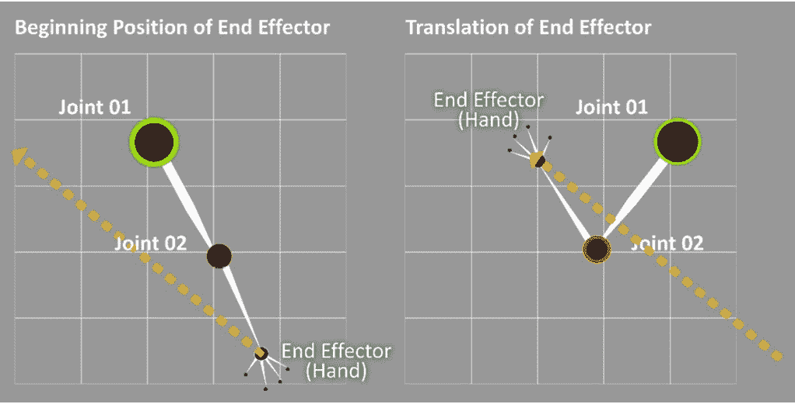

图 4.5：IK

从本质上讲，IK 比 FK 更动态，并为我们解决了许多问题。使用 IK，我们可以像移动真人的手一样有效地移动角色的手，所有其余的骨骼都会真实地跟随。

> **Note**
>
> 值得注意的是，在动画制作中，在 IK 和 FK 解决方案之间切换是常见做法。IK 常用于大部分工作，因为它为工作流程增加了一定程度的自动化，而 FK 则用于细微的调整和微调。

您会很高兴地知道，使用 MetaHuman 并不需要完全理解 FK（正向运动学）或 IK（反向运动学），尤其是在处理动作捕捉数据时，但了解这些概念确实能消除您在流程中经常遇到的那些术语的神秘感。

在下一节中，让我们开始创建我们自己的 IK Rig。

### 创建 IK Rig

您可能会问，既然 MetaHuman 已经自带 IK Rig，为什么我们还要创建一个？考虑到我们的目标是将为一个角色（作为源）设计的动画重定向并应用到我们的 MetaHuman 角色（作为目标）上，我们需要确保两个 Rig 具有正确的命名约定。例如，我们需要确保源角色的左臂与目标角色的左臂匹配；有些 Rig 将 `shoulder` 称为 `clavicle`，因此我们需要确保两个 Rig 的命名约定一致。

因此，我们实际上将创建一个新的 IK Rig，用于将信息从源转换到目标。随着章节的推进和对 IK 链的处理，这一点将变得更加直观。我们这样做的原因是源 Rig 的命名约定可能与目标 Rig 不同，因此我们为每个角色创建的 IK Rig 实际上只是一组简单的指令，旨在使转换更容易。这还有一个额外的好处，即防止我们编辑角色原始的 IK Rig。

那么，让我们为源角色创建一个 IK Rig：

1. 如果您还记得上一章，我们从 `Third Person Template`（第三人称模板）获取了一个角色。因此，在 `Blueprint` 文件夹内，再进入 `Third Person Template` 文件夹，在该文件夹内的任意位置右键单击并选择 `Animation`（动画）。

2. 选择 `IK Rig` 后，系统会提示您选择 `Skeletal Mesh`（骨架网格体）选项。此时，我们要选择与源角色相关的骨架。为此，我们要选择 `SK_Mannequin`，如图 4.7 所示：

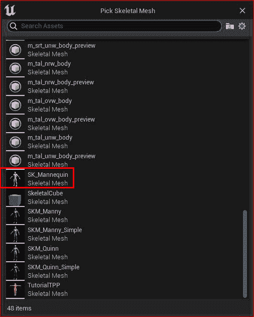

完成后，它会在您一直在使用的同一个 Blueprint 文件夹中创建 IK Rig，如图 4.8 所示。请注意，我已将此 IK Rig 明确标记为 `SOURCE_Mannequin`；这将帮助我们稍后查找，也是一种良好的习惯。

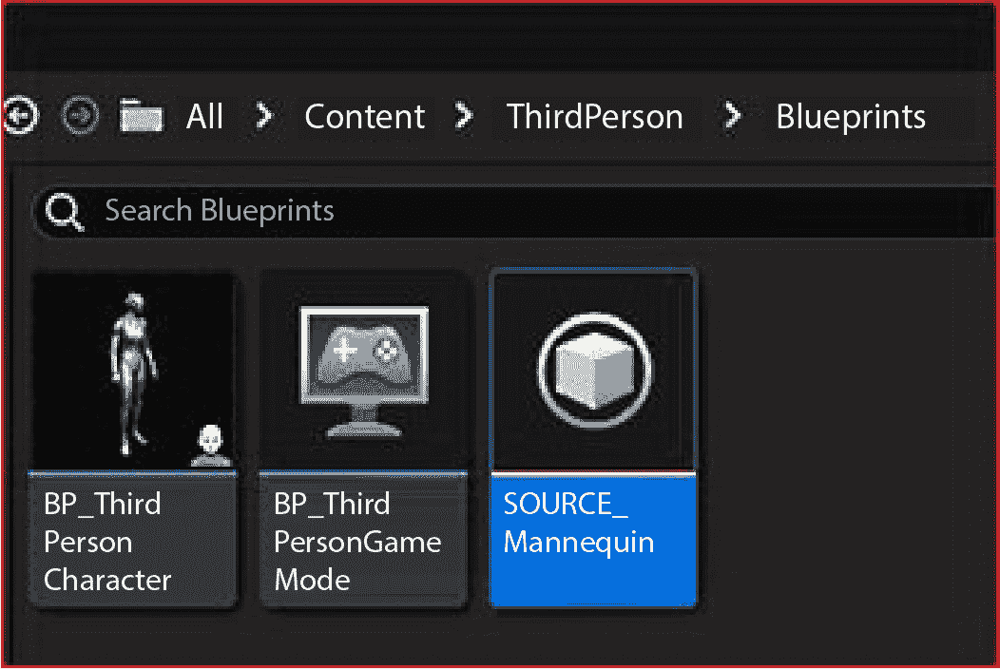

创建好源 IK Rig 后，下一步是创建目标 IK Rig。

1. 为此，我们需要进入 MetaHuman 的文件夹并重复刚才完成的步骤。因此，在文件夹内的任意位置右键单击，选择 `Animation`，再次选择 `IK Rig`：

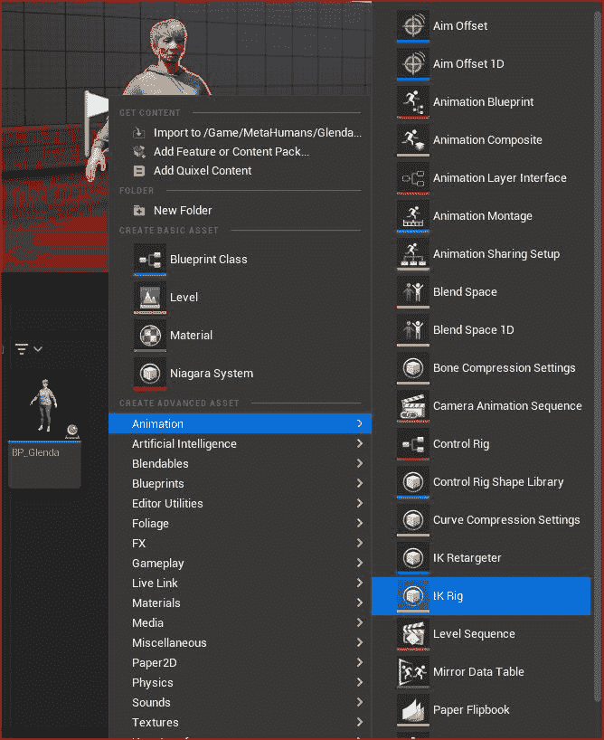

2. 现在，我们需要为目标选择一个骨架网格体。在本例中，我选择 `f_med_ovw_body` 网格体，它对应于 Glenda 作为一个中等身高、超重的女性角色（其中 `f` 代表 `female` 女性，`med` 代表 `medium` 中等，`ovw` 代表 `overweight` 超重）。选择正确的网格体非常重要，否则稍后会出现问题。

> **注意**
>
> 举另一个例子，您可能有一个男性、矮小且消瘦的角色；在这种情况下，正确的角色网格体将是 `m_srt_unw_body`。

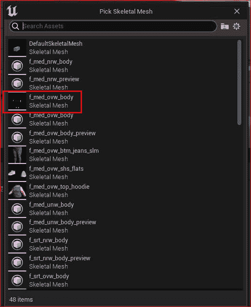

和之前一样，一旦我们选择了骨架网格体，现在就可以在角色文件夹中看到一个新的 IK Rig（我的文件夹叫 Glenda）。请再次注意，我花时间将其标记为 `TARGET`，如图 4.11 所示：

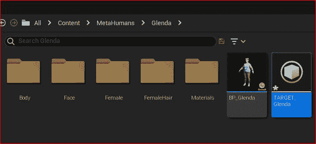

现在，我们将打开两个 IK Rig，从这里开始，我们将尝试将两个 Rig 并排放置。在图 4.12 中，我将两个 IK Rig 窗口（分别是源和目标）排列好，使界面尽可能靠近。我强烈建议您也这样做，因为这将有助于减少出错的几率，同时也能直观地呈现正在发生的一切。

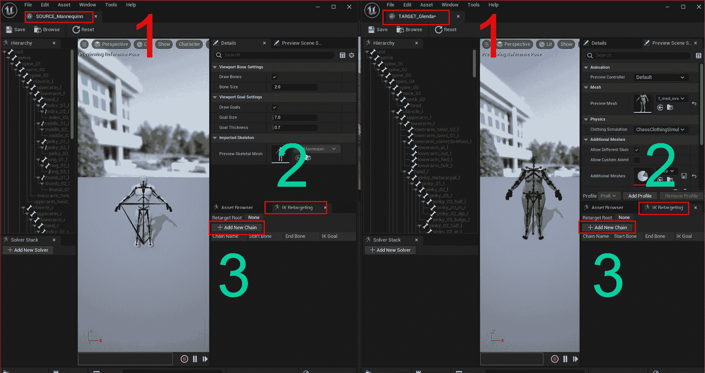

分屏是一种良好的习惯，因为它允许我们轻松地可视化源和目标在我们的更改方面是如何相互对应的。我已标记出您需要注意的界面关键部分：

1. 我们将源 IK Rig 界面放在屏幕左侧，目标 IK Rig 界面放在屏幕右侧。这种排列作为视觉辅助，帮助我们快速进行比较。
2. `IK Retargeting`（IK 重定向）选项卡处于激活状态。我们需要确保源和目标都选中此选项卡，因为我们将在那里进行大部分编辑工作。
3. 我们可以点击 `+Add New Chain`（+ 添加新链）按钮，因为我们将只是在两个界面中添加 IK 链并适当地为它们命名。

在每个 IK Rig 窗口左侧的 IK Rig 名称下，您将看到骨骼层级以列表形式列出。您还会注意到这些列表并不完全相同。例如，源 IK Rig 的骨骼有三节脊椎，而目标 IK Rig 更复杂，有五节脊椎。

您还会注意到，两个骨骼在其层级的最顶端都有一个 `root`。对于 3D 角色来说，骨骼层级顶端有一个 `root` 非常常见，但在许多情况下，3D 角色使用骨盆作为层级的顶端。对于 Unreal 和 MetaHuman，我们将骨盆作为层级的顶端，因此我们需要做一些微调。

操作方法如下：

1. 选择 `pelvis`，右键单击它，找到 `Set Retargeted Root`（设置重定向根骨骼）选项，如图 4.13 所示。将光标悬停在该选项上，您会注意到一个提示，显示**设置用于重定向的根骨骼。通常为“Pelvis”。**

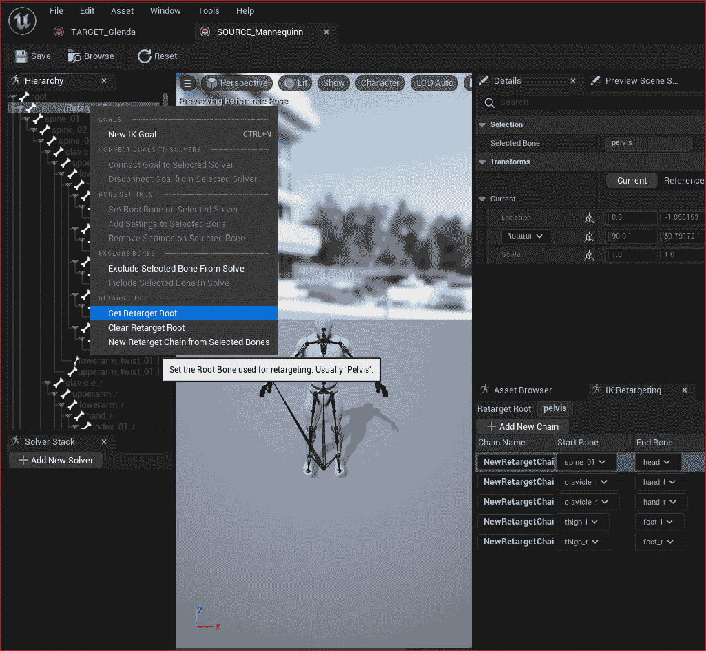

由此您可以得知，在大多数情况下，骨盆被设置为根骨骼，因此在本例中，我通过点击 `Set Retarget Root` 将 `pelvis` 选为根骨骼。

1. 接下来，您需要对目标执行相同操作。在本例中，它是 `TARGET_Glenda`。同样，根据引擎的提示，我们得知 `root` 骨骼通常是骨盆，因此我们将在源和目标 IK Rig 中都将目标的根骨骼设置为 `pelvis`，如图 4.14 所示：

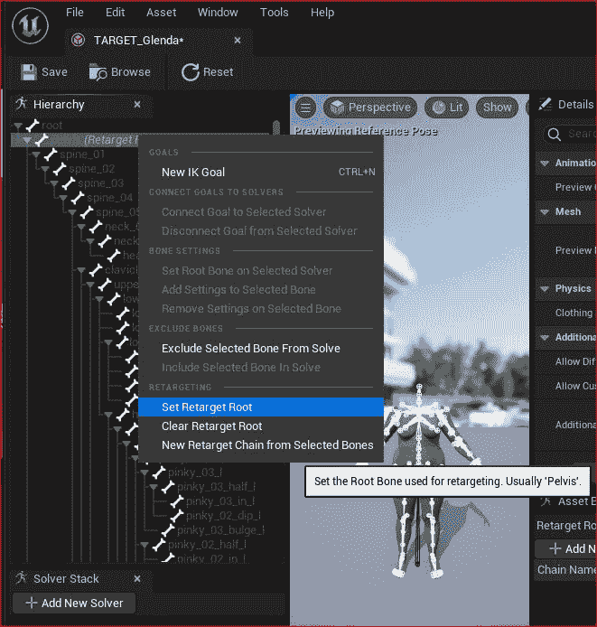

> **注意**
>
> 有些角色 Rig 使用单独的骨骼作为 `root` 而不是骨盆，因此动画出现的任何问题通常与 `root` 被更改为 `pelvis` 或 `root` 有关。

此时，您已经创建了两个 IK Rig（一个用于源，一个用于目标），并对两者进行了一些非常微小的编辑。现在，我们需要确保源和目标中的每个肢体都能有效地相互对应。为此，我们需要了解一下 IK 链。

### 创建 IK 链

#### 什么是 IK 链？

简单来说，IK 链就像任何其他链条一样，例如自行车链条，链条中的每个链节都与下一个链节有关系。这适用于身体的肢体，其中每根骨骼构成链条中的一个链节。因此，每个肢体，例如从肩膀到手，构成一条 IK 链。

`IK Rig` 所做的就是将每个 Rig 简化为以下五条 IK 链：

*   `Spine` 到 `Head`
*   `Left shoulder/clavicle` 到 `Left hand`
*   `Right shoulder/clavicle` 到 `Right hand`
*   `Left thigh` 到 `Left foot`
*   `Right thigh` 到 `Right foot`

> **注意**
>
> 请确保按照我在此处书写的顺序创建每条链，并且该顺序同时适用于源骨架和目标骨架。

#### IK 重定向选项卡

为此，让我们仔细看看 `IK Retargeting` 选项卡。在*图 4.15* 中，既然我知道只需要五条 IK 链，我就点击了五次 `+Add New Chain` 按钮：

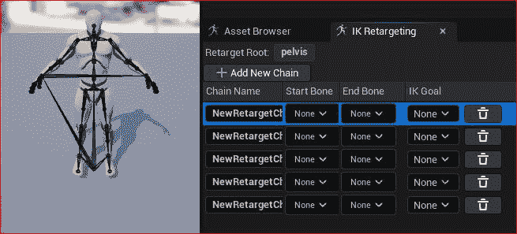

默认情况下，每条链的起始骨骼和结束骨骼都设置为 `None`。要更改此设置，请点击 `None`，然后输入 `Spine`。这将激活对所有可用骨骼的搜索；从结果中我们可以看到，此骨架有三个名为 `spine` 的可用骨骼。选择 `spine_01`。

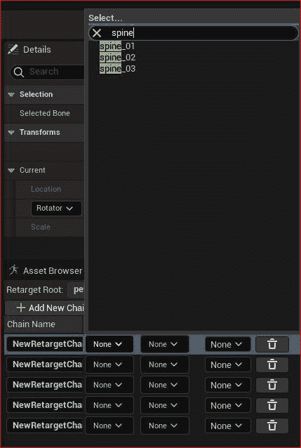

选择 `spine_01` 将使其成为给定的 `Start Bone`。对 `End Bone` 执行相同操作，但这次输入 `Head` 以完成链条。

并排显示两个 `IK Rigs` 后，我们就得到了第一条 IK 链的可视化指南，因为当我们选择一条 IK 链时，它会变成亮绿色。要选择一条链，请点击任意字段旁边的空白处（可以是 `Start Bone` 和 `End Bone` 字段之间，甚至只是垃圾桶图标旁边）。从*图 4.17* 中可以看到，我通过点击每个 Rig 的 `End Bone` 字段旁边，高亮显示了第一条 IK 链。这反过来会在两个视口中高亮显示该链条，这作为一个极好的视觉辅助工具。

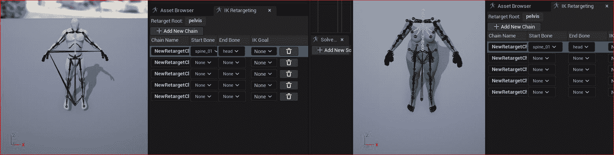

现在，即使骨架不同，我们也为两个骨架都有了 IK 解决方案。

参考本节开头的列表，让我们继续第二条 IK 链。对于源 `IK Rig`，选择 `Clavicle Left` 作为 `Start Bone`，选择 `Hand Left` 作为 `End Bone`。然后，对目标 `IK Rig` 执行完全相同的操作。

按照表格和之前的说明，您将能够自行创建第三、第四和第五条 IK 链，以便您的源和目标 `IK Rigs` 看起来类似于*图 4.18*。正如您所见，我选择了最后一条 IK 链，即 `Left Leg`。您可以在两个 Rig 中看到 `Start Bone` 是 `thigh_l`，`End Bone` 是 `foot_l`，它们被选中，并且这在两个视口中都有体现，每个角色中相关的链条都高亮显示为绿色：

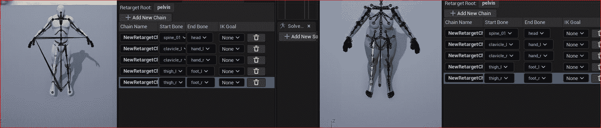

源和目标 Rig 之间的这种精确匹配对于动画能够正确转换至关重要。完成此步骤后，在下一节中，我们将创建一个 `IK Retargeter`。

### 创建 IK Retargeter

完成了艰苦的工作，现在是时候创建一个工具，让这两个 `IK Rigs` 能够相互“对话”了。这实际上就是 `IK Retargeter` 的作用，它将动画从一个角色的 IK 链转换到另一个角色上。在本例中，我回到了我的 `Glenda` 文件夹来创建 Retargeter。那么，让我们执行以下步骤：

1.  就像创建 `IK Rig` 时一样，在角色的 `Blueprint` 文件夹中的任意位置右键单击，选择 `Animation`，然后选择 `IK Retargeter`，就像*图 4.19* 所示：

    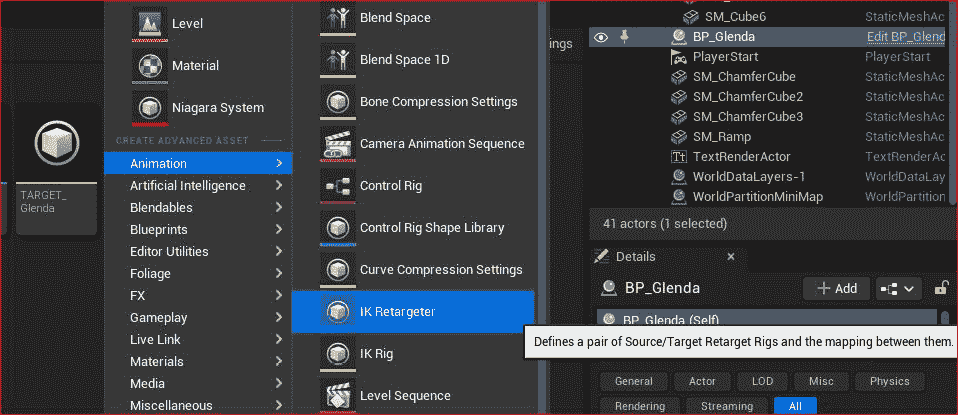

2.  创建 `IK Retargeter` 时，系统会提示您选择要从中复制动画的 `IK Rig`。为了方便我们自己，我们之前已经将 `IK Rig` 标记为 `SOURCE_Mannequin`，以便轻松识别它作为源。您可以在*图 4.20* 的列表中看到它：

    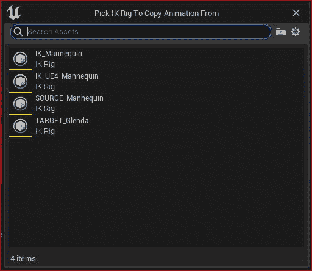

3.  选定后，我们将看到另一个显示源骨架的对话框。找到 `Target IKRig Asset` 选项，我在*图 4.21* 中用红色高亮显示了它（稍后我们会讨论用绿色高亮显示的选项）：

    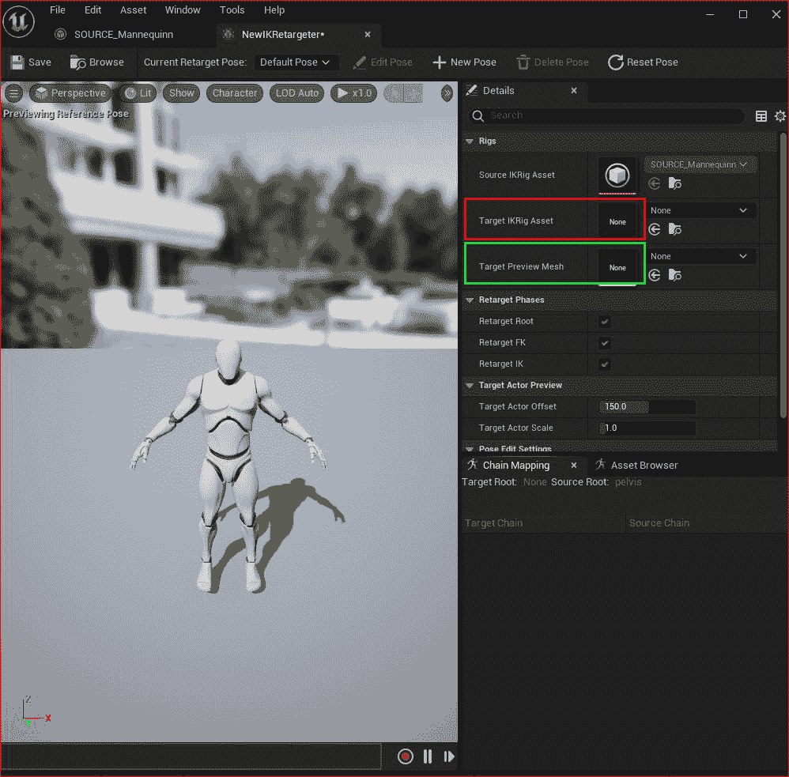

    其旁边的下拉列表将显示任何可用的 `IK Rigs`。我想要的目标 `IK Rig` 适当地标记为 `TARGET_Glenda`：

    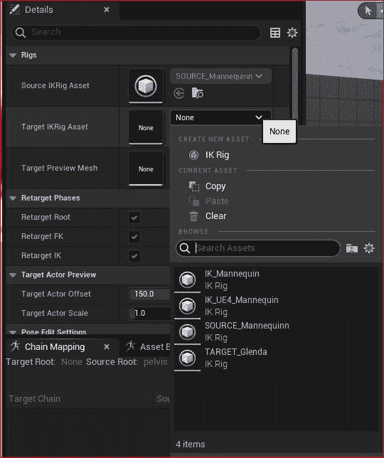

    选择 `Target IKRig Asset` 时，您应该会看到一个 `MetaHuman` 网格体出现在 `Mannequin` 旁边。如果没看到，请返回*图 4.21*，我在那里用绿色高亮显示了 `Target Preview Mesh` 选择框。

4.  现在，在*图 4.23* 中，您可以看到 `IK Retargeter` 为您提供了一个视口，其中 `Mannequin` 角色和 `MetaHuman` 角色并排在一起。此外，请注意屏幕底部有两个选项卡：`Chain Mapping` 和 `AssetBrowser`。确保您正在查看 `Chain Mapping` 选项卡，然后点击 `Auto-Map Chains` 按钮。

    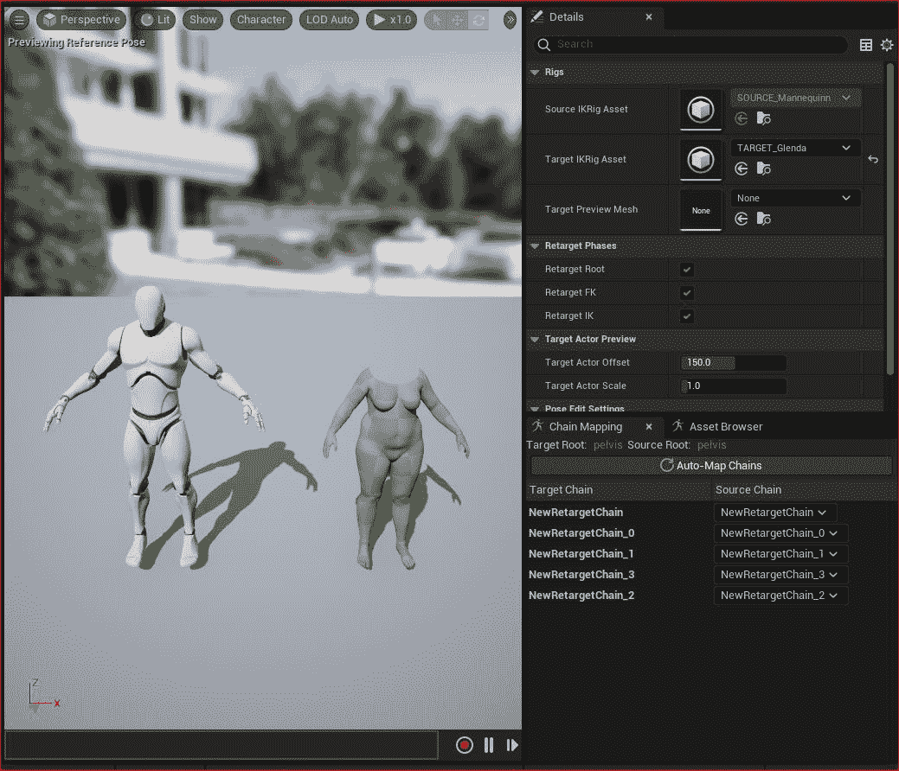

5.  接下来，切换到 `AssetBrowser` 选项卡，您将看到可用的动画。在我的例子中，我只有一个名为 `Jog_Fwd` 的可用动画（您可能有更多）。点击其中一个，视口将更新并将动画应用到您的 `MetaHuman` 上。

    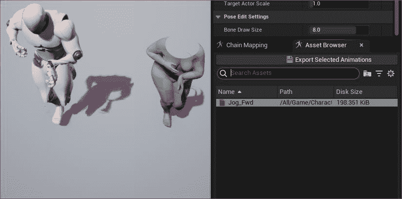

6.  现在您可以导出该动画，以便将其重定向到您的 `MetaHuman`。如果您有多个可用动画，也可以一并选择。要导出，请选择动画并点击 `Export Selected Animations`。此时将出现一个对话框，要求您选择导出路径。我建议您选择您的 `MetaHumans` 文件夹来导出重定向后的动画，就像我在*图 4.25* 中所做的那样：

    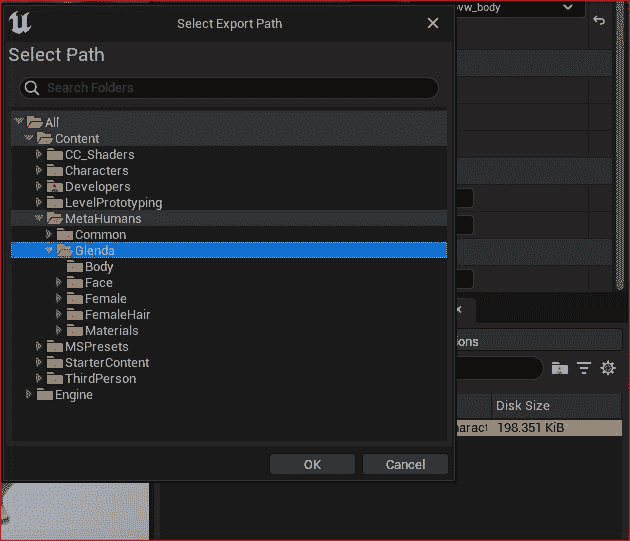

> **注意**
>
> 选择文件夹并按下 `OK` 后，`IK Retargeter` 将使用动画名称创建一个新文件。在我的例子中，是 `Jog_Fwd`。创建的文件将带有 `Retargeted` 后缀，这是区分原始动画文件和重定向动画文件的便捷方式。

在此阶段，您已经在 `IK Retargeter` 视口中看到了 `MetaHuman` 上的动画。要将动画放入场景中，一种方法是打开您的角色 Blueprint（在我的例子中是 `BP_Glenda`）。

7.  打开 Blueprint 后，您现在可以在 `Animation` 部分下的 `Anim to Play` 下拉菜单中选择重定向后的动画，或者像*图 4.26* 所示那样，直接将重定向后的动画拖放到其旁边的框中：

    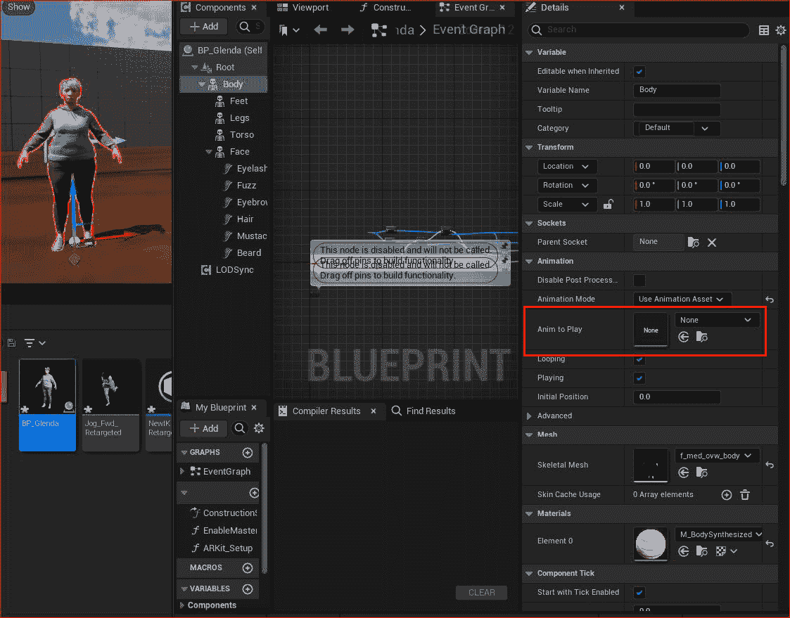

图 4.26：将重定向动画应用到角色蓝图

1. 与图 4.24 类似，我们可以运行搜索来查找动画，并且通过 `Retargeted` 后缀，我们可以确认已按照图 4.27 选择了正确的动画：

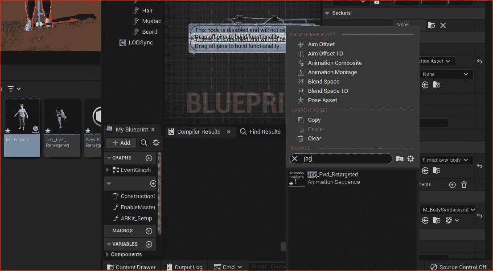

图 4.27：使用搜索功能查找重定向动画

1. 如果您尚未这样做，请将 `MetaHumans` 文件夹中的 `BP_Glenda` 文件拖放到 Unreal Engine 的主视口中。然后，点击**播放**以模拟游戏，并在视口中查看动画播放。

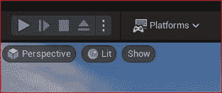

图 4.28：点击播放

我们已经完成了创建 IK 重定向器的步骤，使源 IK 骨架能够与目标 IK 骨架通信，但我们仅专注于一个动画。让我们看看当有额外动画时该怎么做。

### 导入更多动画数据

要查看更多动画的实际效果，您可以前往 Unreal Engine 市场并搜索“Animation Starter Pack”（动画入门包）。这是一个免费的动画包，适用于 Unreal Engine 5.0 版本，如果您的项目仍然打开，您可以将其添加到项目中。

那么，让我们看看使用动画入门包在不打开 IK 重定向器的情况下重定向动画有多容易吧。

1. 在项目打开的情况下，进入 Epic Games 并前往**市场**。

2. 在 **UE5** 下选择**动画**。然后在**筛选器**下，将**最高价格**选择为**免费**。

这应该会显示动画入门包，点击它后，您将看到如图 4.29 所示的页面：

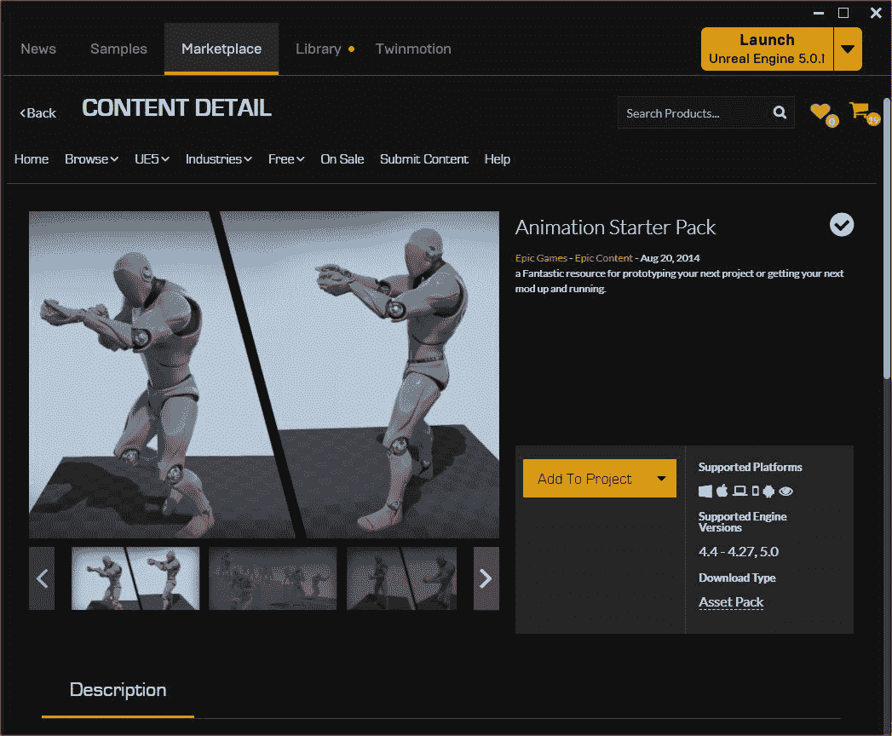

图 4.29：动画入门包

1. 点击**添加到项目**以将该包直接添加到您打开的项目中。

执行此操作后，`AnimationStarterPack` 文件夹将出现在您的项目内容文件夹中。

1. 导航到该处并右键点击其中一个动画文件，如图 4.30 所示。选择**重定向动画资产**，您将看到唯一的选项是选择**复制并重定向动画资产**：

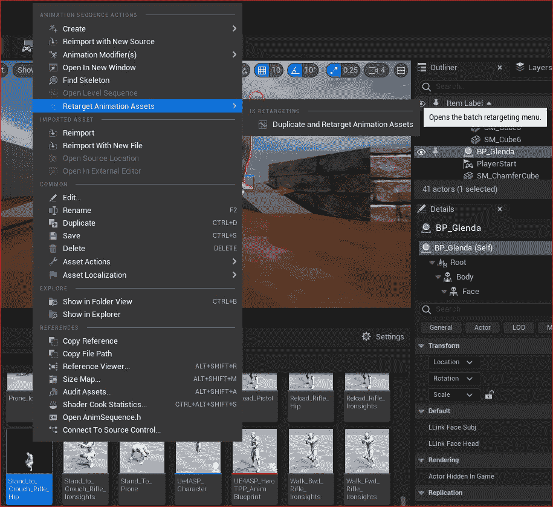

图 4.30：右键点击以重定向动画资产

选中后，您将进入如图 4.31 所示的对话框：

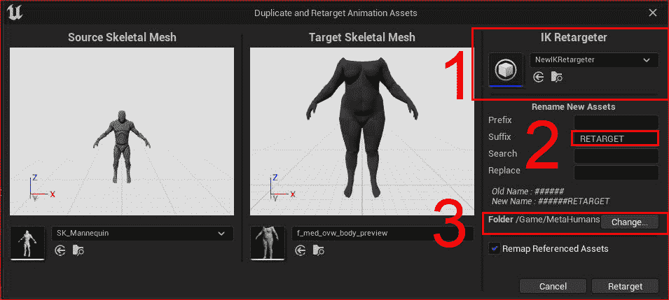

图 4.31：复制并重定向动画资产对话框

关于此图有三点需要注意：

* 在 `IK Retargeter` 下，我选择了 `NewIK Retargeter`。一旦您选择了正确的 IK 重定向器，两个视口将立即更新；在我的情况下，它将显示 `SK_Mannequin` 为源，`f_med_ovw_body_preview` 为目标。

* 我将 `Suffix` 选项更改为 `RETARGET`。这只是良好的管理习惯，以便您稍后能轻松找到它。

* 选择要将新资产保存到的目录，然后点击**重定向**。

**注意**

虽然仅用于预览，但请注意图 4.31 中每个视口下的下拉列表。在这里，您可以预览源骨架和目标骨架关联的网格体。

现在，我们成功导入了一个新动画并将其添加到我们的角色中，而无需再次使用 IK 重定向器。

### 总结

在本章中，我们了解了一些关于 IK 和 FK 的知识，并探索了 IK 骨架和 IK 重定向器工具。

更重要的是，我们揭示了 IK 链的原理、视觉辅助工具（如用于比较源和目标 IK 链的高亮功能），以及允许我们创建 IK 重定向器可使用的有效且准确的 IK 链的程序。

我们还使用 IK 重定向器有效地重定向了一个动画并将其应用到场景中，并应用了一种重定向动画资产的替代方法。

在下一章中，我们将介绍 Mixamo，以便我们可以使用庞大的身体动画库并将其应用到我们的 MetaHuman 角色上。我们还将探讨使用 IK 重定向器一次性重定向多个动画。
