## 第 5 章：使用 Mixamo 重定向动画

在上一章中，我们介绍了重定向动画的概念，并讨论了 IK 骨架、IK 链和 IK 重定向器。

在本章中，我们将走得更远，从第三方供应商 **Mixamo** 获取动画，Mixamo 是一个庞大的在线库，包含大量动作捕捉文件，您可以在网页浏览器中预览。您将学习如何使用 Mixamo 等外部资源，为您的动画提供更多样化的选择；这很重要，因为重复使用相同的动画会导致制作质量低下。本章我们将继续专注于仅处理身体动作。

因此，在本章中，我们将涵盖以下主题：

* 介绍 Mixamo
* 准备并将 MetaHuman 上传到 Mixamo
* 在 Mixamo 中定向您的角色
* 在 Mixamo 中探索动画
* 下载 Mixamo 动画
* 将 Mixamo 动画导入 Unreal

### 技术要求

要完成本章，您需要 第 1 章 中详述的技术要求，以及我们在 第 2 章 中导入到 UE5 的 MetaHuman 和 Unreal Engine 模特。这两者都需要保存在 UE 的同一个项目中，并且您需要为本章运行 UE。

您还需要稳定的互联网连接，因为我们将上传 MetaHuman 网格体并下载大量动画资产。我们实际上将重复 第 4 章 中的步骤，但这次我们将重定向来自第三方来源的动作捕捉数据。

## 介绍 Mixamo

对于许多计划在 Unreal 中使用 MetaHuman 的艺术家来说，Mixamo 很容易就能满足他们在身体动画方面的所有需求。Mixamo 是一个包含数千个 **动作捕捉 (mocap)** 文件的在线库，这些文件由动作捕捉演员历经数年创建。除了收容这个庞大的动作捕捉文件库外，Mixamo 还拥有许多预制角色。Mixamo 允许您上传自己的角色，它将自动运行应用带有蒙皮权重的 Mixamo 骨架的过程。这个自动化过程消除了通常在 Maya 或 3ds Max 等程序中完成的大量繁琐工作，这超出了本书的范围。

Mixamo 中的许多动画允许您进一步完善动作捕捉动画，并在在线会话期间解决问题，以避免在 Unreal 中进行进一步编辑。由于您已经有使用在线角色创建器（如 `MHC`）的经验，您会发现 Mixamo 使用起来简单得多，是快速为角色添加动画的一种非常快速高效的方式。

您需要做的第一件事是访问 [`www.mixamo.com`](https://www.mixamo.com)。您将在那里看到 Mixamo 的登录页面，如图 5.1 所示：

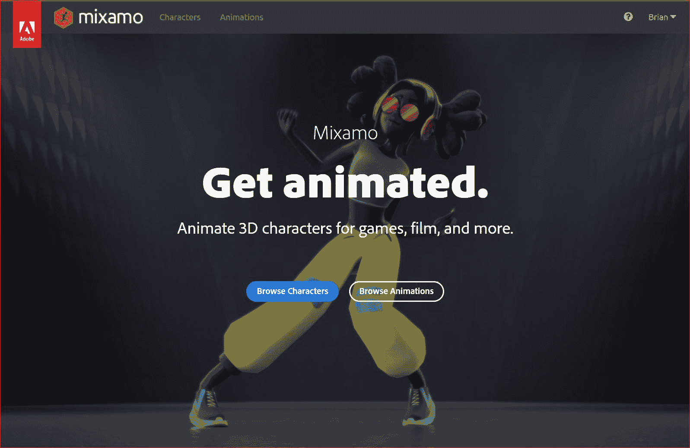

图 5.1：Mixamo 主页

在左上角，您将看到一个 Adobe 徽标。Adobe 是 Photoshop 和 After Effects（仅举几例）的制造商，它收购了 Mixamo 但保持其运行，因为它是角色设计师和动画师的绝佳工具。

您还会注意到右上角我已经登录。在登录之前，您需要创建一个 Mixamo 账户。如果您有 Adobe 账户，可以直接使用。如果没有，使用电子邮件并创建密码即可。

登录后，您将进入 Mixamo 主界面：

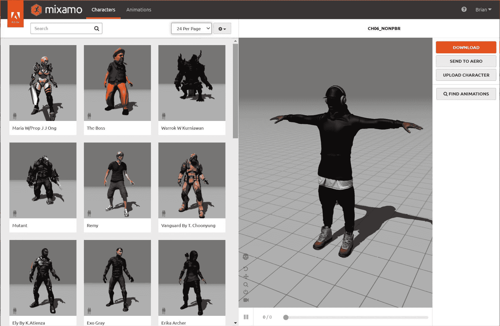

图 5.2：Mixamo 界面

在*图 5.2*中，你将看到界面由两个标签页组成：`Characters`和`Animations`。这两个标签页将显示相关资产的缩略图以及一个用于预览的视口。在本书中，我们只关注动画，因此你应该选择`Animations`（不过值得注意的是，无论我们在哪个标签页中，都可以随时上传自己的角色）。

选择`Animations`标签页后，我们看到的界面几乎相同，唯一的区别是左侧的缩略图现在显示的是动画资产而非角色资产。在大多数情况下，缩略图角色采用 Mixamo Mannequin 风格。

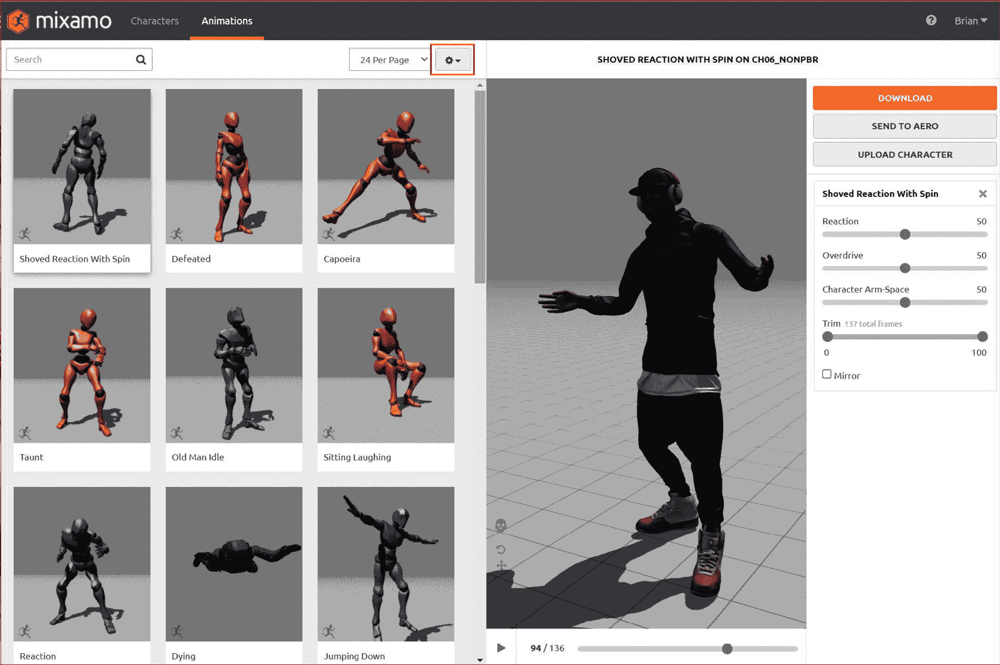

图 5.3：Animations 标签页

视口上方显示名称：`SHOVED REACTION WITH SPIN ON CH06_NONPBR`。`SHOVED REACTION WITH SPIN`是对应所选缩略图的动画名称，而`CH06_NONPBR`专门关联视口中的角色。

如果单击*图 5.3*中高亮显示的齿轮图标，将出现查看动画缩略图预览或静态图像缩略图预览的选项（第一个选项对网络连接要求较高；不过，动画预览很有帮助）。

在下载任何动画之前，我们首先需要将 MetaHuman 角色网格上传到 Mixamo 以提高兼容性。为此，我们必须先准备好 MetaHuman。

## 准备并将 MetaHuman 上传到 Mixamo

为了让 MetaHuman 适配 Mixamo，首先必须确保我们导出 MetaHuman 角色时使用了正确的身体类型。你可能还记得在*第 4 章* *重定向动画*中，当我们直接从动画资产重定向角色时，有一个预览 MetaHuman 网格的选项。这是一个重要步骤，因为我们需要使用预览网格来告诉 Mixamo 骨骼将产生多大影响。此外，这一步还能让我们直观地了解所选动作捕捉动画如何与我们选择的网格配合工作。

我的角色有特定描述：女性、中等身高、超重；这在命名中标记为`F_Med_Ovw_Preview`。我们需要确保导出的正是该网格。因此，开始准备 MetaHuman 的步骤如下：

1.  首先，我们需要找到正确的网格。为此，进入角色文件夹，然后导航到`Body`文件夹。在我的例子中，我需要进入`Glenda`文件夹，然后是`Female`文件夹，接着是`medium`文件夹，然后是`Overweight`，最后是`Body`文件夹。

2.  接下来，将角色拖入场景。你会注意到角色显示不正确。实际上，它很可能只显示整个角色的一部分。这是因为 MetaHuman 由以下网格组成：

    *   头部网格
    *   服装网格
    *   完整的裸体网格

3.  现在，非常重要的是，在`Details`面板的`Mesh`下，你会看到一个下拉菜单，允许你选择要为角色显示的网格。

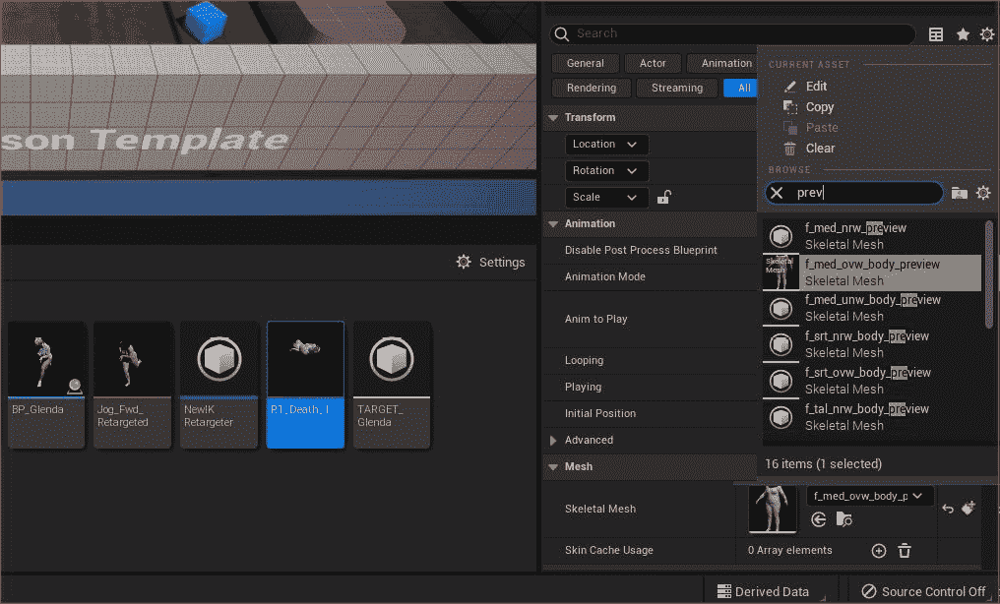

图 5.4：使用搜索查找预览网格

如果在搜索栏中输入`preview`，你将看到所有可用的`preview`网格列表。选择正确的网格很重要，因为我们即将导出该网格用于 Mixamo。对于 Mixamo，我们只关心身体，因为 Mixamo 不提供面部动画数据；因此，在我的例子中，我将选择`f_med_ovw_body_preview`。

选择网格后，视口中的网格将变为无头的裸体。尽管没有头部，这正是 Mixamo 所需的一切，因为我们只关心身体运动，而这也是 Mixamo 唯一能提供的。

1.  导出此网格之前，我们需要确保网格位于场景原点，换句话说，位于场景的正中心。从内容面板将网格拖入场景时，仅根据鼠标光标位置放置，通常会得到随机结果——但我们可以快速修复。

回到`Details`面板，在我们选择预览网格的位置上方，有一个`Transform`部分。在`Location`旁，你需要将`x`、`y`和`z`坐标均设置为`0.0`，这样角色就会位于场景中心，准备好导出。

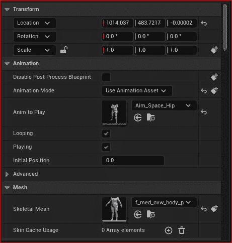

图 5.5：在 Transform 中将 Location 值设置为原点

1.  导出网格前，请务必在场景中选中预览网格，然后转到`File`，点击`Export Selected…`：

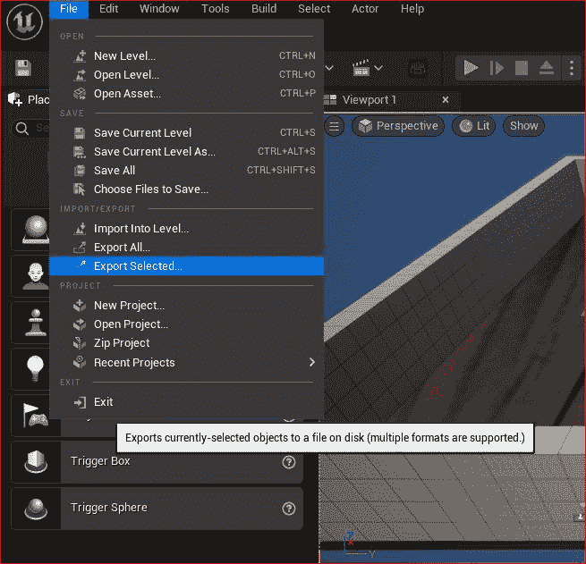

图 5.6：导出选中项…

> **注意**
>
> 我们需要场景中有预览网格才能将其导出为 FBX 文件。无法从内容面板内部导出资产。

1.  接下来，选择`FBX`作为文件类型，并给它一个容易记住的名称（如`GlendaToMixamo`）。

2.  确保未勾选`Map Skeleton Motion to Root`。保持所有设置为默认值，然后点击`Export`，如*图 5.7*所示：

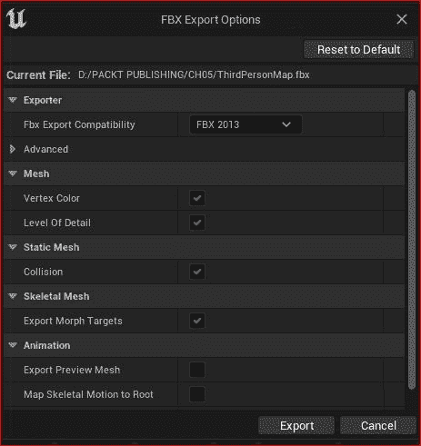

图 5.7：未勾选 Map Skeletal Motion to Root

接下来，我们将角色上传到 Mixamo 以应用动画。

1.  无论你在 Mixamo 中处于`Character`还是`Animation`模式，始终可以点击`Upload Character`按钮；这将打开以下界面：

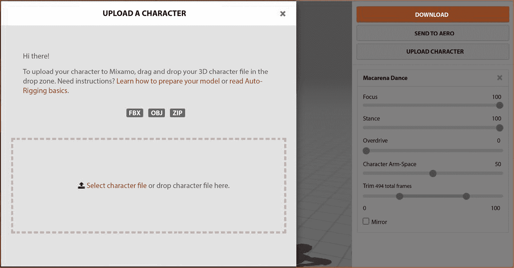

图 5.8：将 MetaHuman 预览网格上传到 Mixamo

1.  你可以选择将网格拖放到矩形区域，或点击`Select character file`。无论哪种方式，上传文件时请耐心等待，因为处理可能需要几分钟——此时屏幕将显示以下消息：

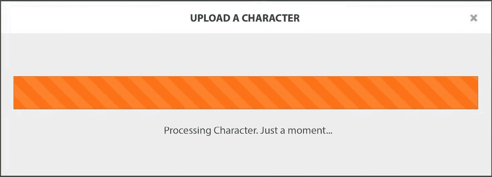

图 5.9：Mixamo 正在处理网格

Mixamo 处理完网格后，你应该会看到*图 5.10*所示的界面：

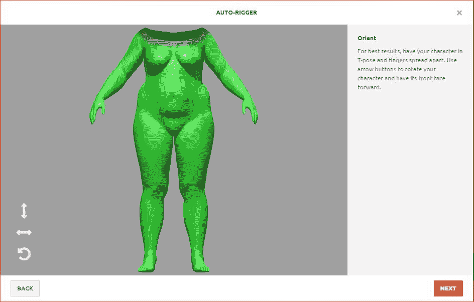

图 5.10：Mixamo 已完成处理阶段

现在我们的角色网格已在 Mixamo 中，接下来将为其应用动画，但在此之前，我们需要进行一些调整并定向角色。

## 在 Mixamo 中定向角色

下一步是定向角色，使其与所有 Mixamo 角色及其动画的朝向一致。幸运的是，Mixamo 提供了相关工具，避免了我们在导出阶段进行繁琐的试错过程。

查看*图 5.10*视口底部的三个箭头。每个箭头用于旋转角色，分别代表`x`、`y`和`z`轴。右侧还提供了定向角色的说明；我已按此操作，让角色面朝前并直立站立。

现在，你可能已经从屏幕上的说明中注意到，Mixamo 要求将角色置于 **T-pose**（T 字姿势）位置以获得最佳效果：T-pose 是指角色呈 T 字形——也就是说，他们的双臂向两侧伸直，旋转 90 度。在我的例子中，以及所有 MetaHuman 的情况下，默认姿势是 **A-pose**，即角色的双臂并未完全伸展，仅旋转约 45 度。然而，Mixamo 在两者之间插值的效果非常好，并成功将 Mixamo 角色骨架与我们的预览网格体对齐。

> **注意**
>
> 我们将在 *第 6 章* *使用 **DeepMotion** 添加动作捕捉* 中探讨如何将 MetaHuman 从 **A-pose** 修改为 **T-pose**。

尽管 Mixamo 完成了大部分工作，我们仍需给 Mixamo 的自动绑定工具一点“推力”。当你点击图 5.10 右下角的 **NEXT** 按钮时，你将进入以下页面：

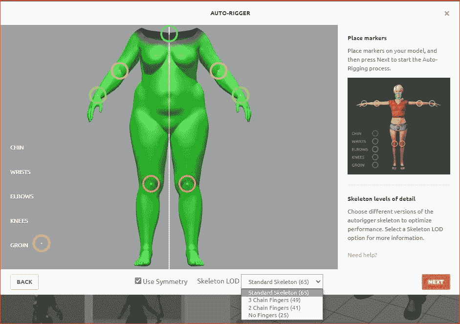

图 5.11：自动绑定标记放置

实际上，这是一个校准工具，我们可以借此确保 Mixamo 角色骨架的比例与我们的 MetaHuman 预览网格体相匹配。我们只需将屏幕左侧的标记拖动到其对应的身体部位，即可进行这些微调。保持开启 **Use Symmetry**（使用对称），你将能更快、更准确地完成此操作。同时将 **Skeleton LOD** 保留为默认设置 **Standard Skeleton (65)**（标准骨架 (65)），它拥有最多的骨骼数量；这在手指关节活动方面会产生明显的差异。

一旦你对标记的放置感到满意，选择 **NEXT**，你将看到角色正在处理中；这可能需要几分钟，在此期间你会看到角色在旋转。

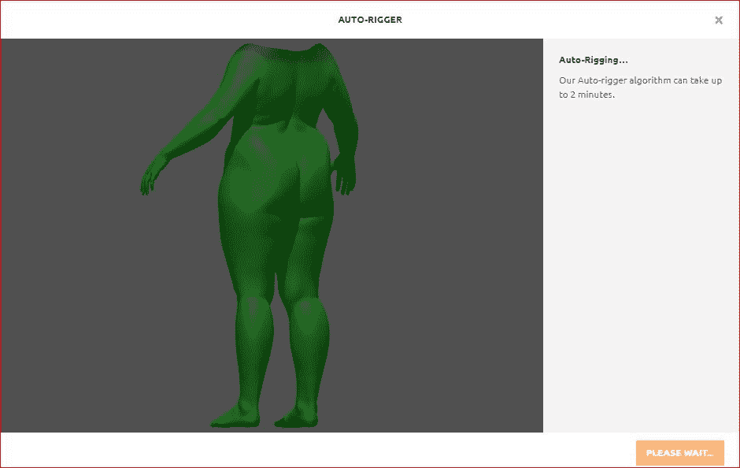

图 5.12：自动绑定处理中

这里在后台发生了两件事：

- *生成与角色预览网格体成比例的 Mixamo 角色骨架*：我们将在本章后面使用 Mixamo 角色骨架，因为它实际上类似于 Unreal 自带的 Mannequin Rig（人体模型骨架），但存在细微差别。不过，借助上一章介绍的 IK 重定向工作，我们将解决 Mixamo Rig 与 MetaHuman Rig 之间的差异。
- *调整蒙皮权重以使骨架与网格体比例对齐*：幸运的是，我们无需了解任何关于蒙皮权重的知识即可继续阅读本书，因为 Mixamo 会自动完成此过程。不过，对于那些有手动绑定角色经验的人来说，你们肯定深知绘制权重影响那略显痛苦的过程。

这意味着我们要告诉网格体的每一部分受每根骨骼影响的程度；例如，脚骨对手臂网格体没有蒙皮权重影响，但脚骨可能对覆盖小腿的网格体有一定程度的影响。

> **注意**
>
> 对于更有经验的 3D 艺术家，可以在 Maya、Blender 或 Houdini 等第三方应用程序中调整蒙皮权重。

当自动绑定过程完成时，你应该会看到你的骨架使用 Mixamo 提供的默认临时动画进行移动，如图 5.13 所示：

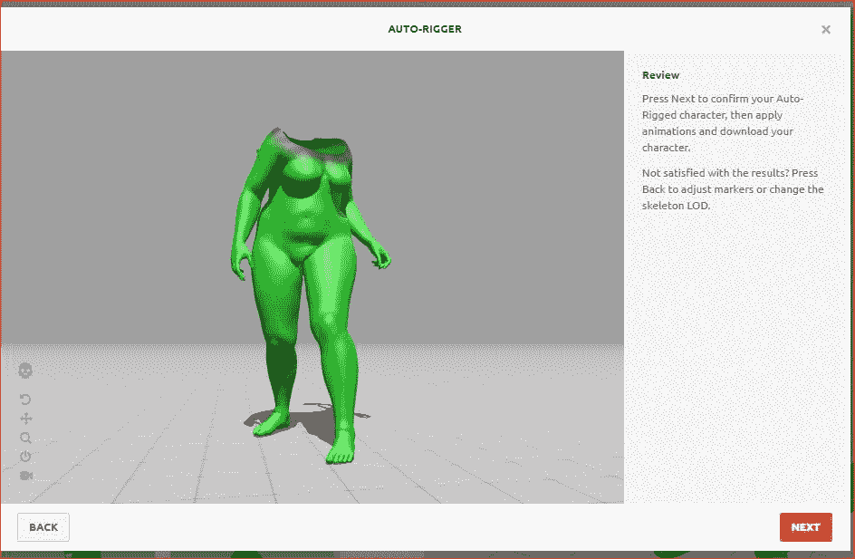

图 5.13：自动绑定完成

你还会注意到，虽然身体大部分是绿色的，但网格体顶部是灰色和黑色的。这意味着网格体的灰色和黑色区域受 Mixamo Rig 的影响不如网格体的其他部分大。这很好，因为我们希望 MetaHuman Rig 影响头部，而我们只对 Mixamo 的身体动画感兴趣。

当你对绑定结果满意时，点击 **NEXT**，现在我们可以准备从庞大的 Mixamo 动作捕捉库中应用动画了。

### 在 Mixamo 中探索动画

在 Mixamo 动作捕捉库中，你会看到所有动画都被分成了不同的类型，如图 5.14 所示：

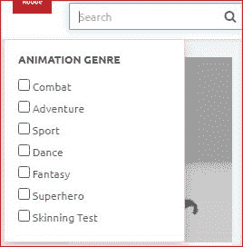

图 5.14：动画类型

这个类型列表非常有用，但也有一个方便的搜索功能。使用任一选项，找到 **Macarena Dance**（马卡雷纳舞）动画（我用这个是因为它时长较长，非常适合测试骨架与我的角色配合得如何）。一旦看到你所选动画的缩略图，只需左键单击缩略图即可将其应用到你的 MetaHuman 网格体上。

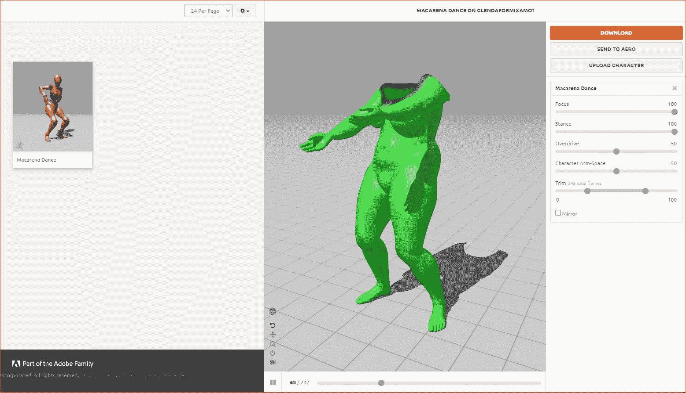

图 5.15：具有关节手指的完成绑定

注意右侧的滑块，你可以随心所欲地调整它们。参数因动画而异。例如，对于马卡雷纳舞，**Focus**（专注度）是第一个参数；然而，大多数 Mixamo 动画没有此参数。

当你将 **Focus** 设为最小值与最大值播放动画时，你会看到细微的差别。很可能你只是在两个独立的动作捕捉表演之间进行混合。在这种情况下，最小值对应舞者不太专注于跳舞，换句话说，他们跳得很烂，节奏和时机都很差。最大值则是另一组拍摄，他们跳得非常好，节奏感强且准确。通常，每个动作捕捉文件会根据表演性质拥有一个或多个专属参数。

你会发现自己经常编辑的所有动画中最有用的三个参数如下：

- **Character Arm-Space**（角色臂部空间）：这决定了角色双臂与躯干之间的距离。在 Mixamo 视口中查看网格体表现时，你可能会发现网格体与自身相交的时刻，例如手臂穿过腰部。当然，你需要加宽臂部空间来适应这种情况。对于马卡雷纳舞，动作捕捉演员可能是瘦削的舞者，而不是超重的 Glenda，所以这种相交很可能发生。话虽如此，也可能存在演员和模型相似的情况，但你仍需创建更宽的臂部空间以容纳厚重的衣物或盔甲，因此在调整时记住这一点很有必要。
- **Trim**（修剪）：这指的是我们想要修剪动画片段的程度。如果你使用默认设置，实际上就是在剪掉原始动画的一部分。根据经验法则，拥有更多动画帧总比帧数不足要好。
- **Overdrive**（超驱/加速）：这会影响速度。Overdrive 简单来说就是更快，所以如果你想加速，请在 **Overdrive** 设置中将动画滑块设为更高的值。

继续调整这些设置，直到你对效果满意。完成后，点击 **DOWNLOAD**。在下一节中，我们将探讨你将看到的一些设置。

### 下载 Mixamo 动画

承接上一节，当你点击 **DOWNLOAD** 时，Mixamo 将带你进入图 5.16 所示的对话框：

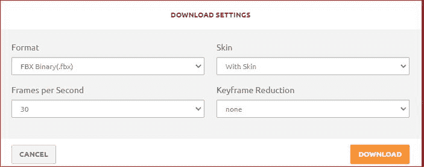

图 5.16：下载设置

让我们看看这些选项中的每一个：

- **Format**（格式）：**FBX** 是你从 Unreal Engine 导出时使用的相同格式；对于 Unreal-Mixamo 流程，我强烈建议你使用此预设。在 **Format** 下拉列表中，你会看到其他格式。它们大多是 FBX 的替代版本和旧版本。另一种可用格式是 **DAE**，但它与 Unreal 不兼容。

### Mixamo 导出设置

### 皮肤
默认设置为 `With Skin`；这意味着当你下载文件时，它将包含你的原始网格体，以及 Mixamo 骨架和动画，所有内容都在 FBX 文件格式内。如果你的角色有多个动画，你只需要在下载的第一个动画中包含皮肤。选择 `Without Skin` 将仅包含动画数据。

> **注意**
>
> 首次下载动画时，请保留所有默认设置。但是，一旦你下载了带有 `Skin` 的第一个动画，对于同一角色的后续动画下载，你就不再需要皮肤了。

### 每秒帧数
选项有 `24`、`30` 和 `60` fps。如果你希望在 Unreal Engine 中编辑动画的时序，特别是想要将其放慢，较高的帧率会更好。大多数动作捕捉都是以较高的帧率捕获的，从而允许对动作进行重新计时。拥有较高的帧率总比尝试在高级工作流中通过合成方式在 Unreal 中插值慢动作要好。如果你要导入非常长的动画并在配置较低的机器上运行，较低的帧率会比较合适。

### 关键帧缩减
最好保持默认。这些文件的数据大小和 Unreal 读取它们的能力不需要关键帧缩减或优化。如果不进行关键帧缩减，Mixamo 会在每一帧为每个关节旋转烘焙一个关键帧。进行关键帧缩减时，Mixamo 会增加一些数学计算以减小数据大小，但这可能会降低动画质量。最好让 Unreal Engine 获取这些数据进行处理。如果在 Unreal 中确实需要关键帧缩减，Unreal 内部有大量工具能提供更好且可控的结果。

## 下载动画
点击 `DOWNLOAD` 后，Mixamo 会询问你想将新的 FBX 文件下载到何处；选择一个你容易记住的位置，最好是在你的项目文件夹内，这样可以省去下一步操作。

如果你直接将其保存到项目 `Content` 文件夹内的某个位置，且 Unreal 正在运行，你将会收到如图 5.18 所示的提示（稍后你将看到），允许导入进行。

不过，让我们假设它保存在别处，以便我们现在可以在下一步中查看如何手动导入动画。

### 将 Mixamo 动画导入 Unreal

### 准备导入文件夹
如果你将 FBX 下载到了任意位置，你需要从该位置将其导入 Unreal。为此，首先在你的 Unreal 项目中创建一个新文件夹，并将其命名为 `MIXAMO_ANIMATIONS`。双击该文件夹进入内部，然后右键点击查看以下菜单：

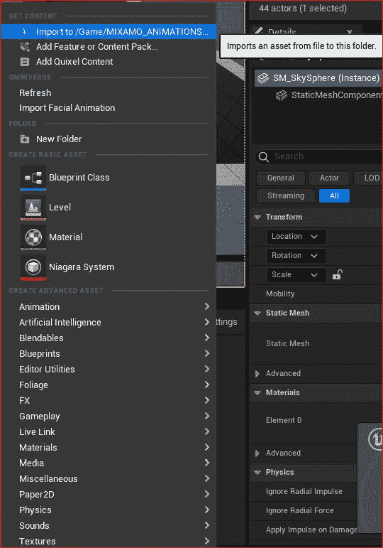

图 5.17：导入 FBX 动画

要导入动画和 Mixamo 骨架，请选择 `Import to`（导入到），以及你即将导入资产的文件夹。从图 5.17 中高亮的文本可以看出，我正将资产导入到 `Game/MIXAMO_ANIMATIONS`。

### FBX 导入选项
选中后，将弹出 `FBX Import Options`（FBX 导入选项），如图 5.18 所示：

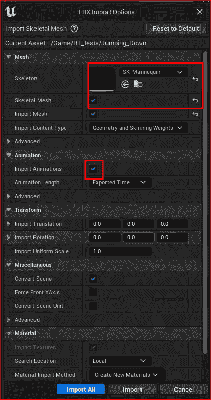

图 5.18：FBX 导入选项

在图 5.18 中，你可以看到有大量可编辑的选项。归根结底，`FBX Import Options` 对话框允许我们导入 Mixamo 骨架、Mixamo 动画、我们的 MetaHuman 角色几何体以及与之关联的蒙皮权重。将所有这些组件导入引擎对于我们正确地将动画重定向到 MetaHuman 角色至关重要。

然而，如果你遵循了本章前面提到的所有步骤，你会发现这里几乎不需要做任何操作。默认设置就足够了，除了以下两项例外：

*   **Mesh Skeleton（网格体骨架）**：你需要选择要在 Mixamo 骨架上使用的骨架。不幸的是，我们不能直接将 MetaHuman 骨架与 Mixamo 骨架一起使用，因为它太复杂了；相反，我们将使用次优选择 `SK_Mannequin`，点击下拉列表后即可看到，如图 5.18 所示。
*   **Import Animations（导入动画）**：这似乎显而易见，但是的，我们需要确保勾选 `Import Animations` 复选框，以便导入嵌入在 FBX 文件中的动画。

> **注意**
>
> 如果你已经完成了下载 Mixamo 骨架、蒙皮权重和动画的过程，你会发现你的 Mixamo 骨架现在已成为 `FBX Import Options` 中的一个可选项，而不是 `SK_Mannequin`。

### 配置导入设置
确保选择了正确的 `Mesh Skeleton` 并勾选了 `Import Animations` 后，点击 `Import All`。这将需要几分钟时间加载到你的项目中。导入完成后，你会发现新导入的资产，外观类似于图 5.19：

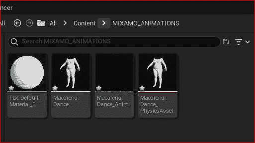

图 5.19：导入的资产

### 导入的资产
此时，我们已成功导入 Mixamo 动画，以及一个启用了所有蒙皮权重以正确操控 MetaHuman 身体网格体的骨架。从图 5.19 可以看到这些资产；从左到右依次为：

*   `Fbx_Default_Material_0`：这是从 Mixamo 导出的默认材质。既然我们只对 Mixamo 的动画感兴趣，可以忽略它。
*   `Macarena_Dance`：这是包含我们所需蒙皮权重的 Mixamo 骨架。
*   `Macarena_Dance_Anim`：这是每个关节的实际关键帧数据。
*   `Macarena_Dance_PhysicsAsset`：这是在导入过程中由 Unreal 自动创建的，包含超出本书范围的物理模拟。

> **注意**
>
> 要了解有关 UE 中 `PhysicsAsset` 的更多信息，可以查看以下链接：PhysicsAsset 文档。

### 为重定向设置 IK 骨架
目前，我们有了 Mixamo 骨架但没有骨骼，因此无法将 Mixamo 动画应用到我们的 MetaHuman 蓝图中。就像在 第 4 章 中一样，我们需要使用两个 IK 骨架，以便重新利用 Unreal `SK_Mannequin` 并将动画从其重定向到 MetaHuman。虽然这对你可能很熟悉，但我还是为我们的新 Mixamo 资产再次概述了该流程：

#### 创建 IK 骨架
1.  在新的 `Mixamo_Animations` 文件夹中，创建一个新的 IK 骨架并将其命名为 `Source_RigMixamo`。然后，创建另一个 IK 骨架并将其命名为 `Target_RigMeta`。

作为提醒，请看图 5.20；你可以看到，当你在 `Content`（内容）标签页的任意位置右键点击时，可以选择 `Animation`（动画），然后从列表中选择 `IK Rig`：

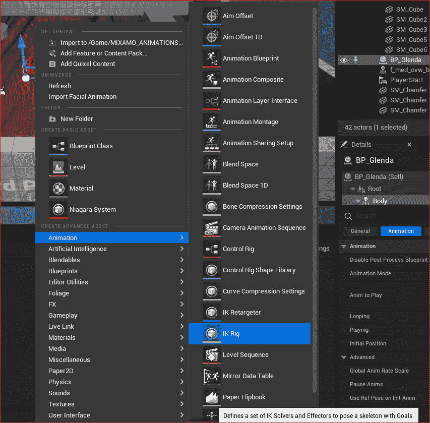

图 5.20：创建 IK 骨架

#### 定义 IK 链
2.  创建好两个 IK 骨架后，下一步是为每个骨架创建五个 IK 链，并确保完成以下链顺序：
    *   脊柱到头部
    *   左锁骨到左手
    *   右锁骨到右手
    *   左大腿到左脚
    *   右大腿到右脚

#### 分配骨骼
3.  使用 IK 骨架，我们需要将 `SK_Mannequin` 作为源骨骼，将 `Glenda_Med_Ovw` 骨骼作为目标骨骼。

就像上一章一样，我建议同时打开源和目标 IK 骨架并将它们并排放置，如图 5.21 所示。这样，你可以确保在 IK 链和 IK 链的创建顺序方面，让它们尽可能匹配。

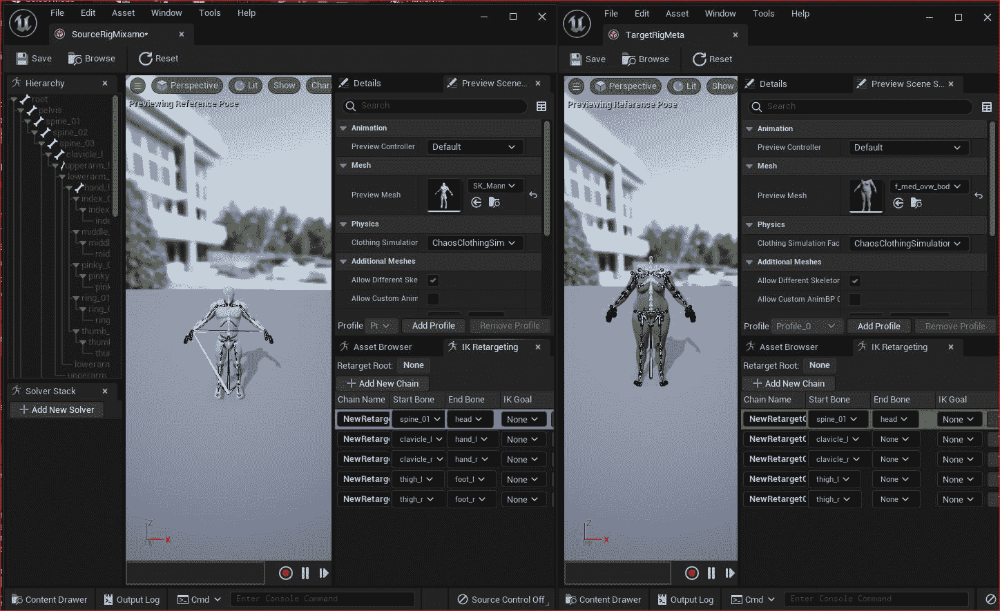

图 5.21：并排的 IK 骨架

### 处理后续动画

对于从 Mixamo 下载的任何后续动画，你应该选择**不带皮肤**下载（此选项在 Mixamo 下载动画时可用，如*图 5.16*所示）。然后，在将新动画导入 Unreal 时，你现在可以选择创建源 IK Rig 时生成的骨架（在我的例子中，它被称为 `MaceranaDance_Skeleton`）。Glenda 预览网格体跳 Macarena 舞的无头缩略图也可见，如下所示：

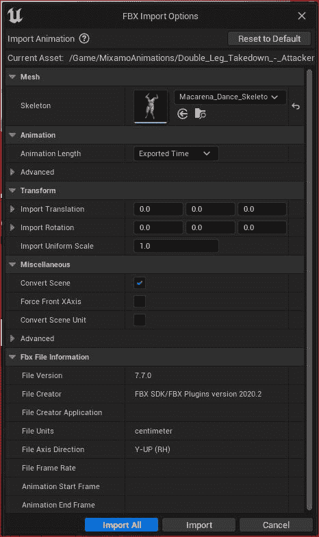

图 5.26：后续仅动画文件的 FBX 导入选项

最佳实践是从 Mixamo 批量下载不带皮肤的动画。然后，你可以直接将它们从外部文件夹拖放到你的 `Content` 文件夹中，或者使用 `文件导入` 选项并选择多个文件而非单个文件来导入。

导入多个动画 FBX 文件时，将出现*图 5.26*所示的对话框。点击 `全部导入`，相同的设置将应用于你正在导入的所有动画。因此，如果你有 100 个动画，只需单击一次即可将此骨架应用到所有 100 个资产中。

在我的例子中，我下载了五个足球动画并将它们导入到我之前在 Unreal 项目中创建的 `Mixamo_Animations` 文件夹中。为了批量重定向所有这些动画，我只需要打开 IK 重定向器。

打开我之前创建的 IK 重定向器，我现在可以看到这些动画及其骨架已准备好重定向到我的 MetaHuman 角色：

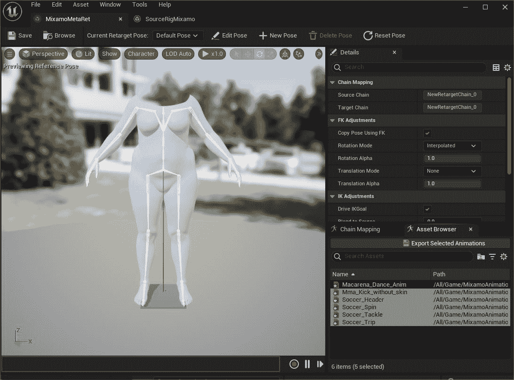

图 5.27：IK 重定向器中有多个可用于重定向的动画

因为我的新动画在导入时已设置为使用 Mixamo 骨架，所以它们会自动出现在 IK 重定向列表中。你可以在*图 5.27*底部看到该列表。我导入了五个足球动画并全选了它们。

使用 `导出选中动画` 按钮，我现在可以单击一次就批量转换多个动画。

导出这些动画时，IK 重定向器会保留动画名称，并自动在每个动画资产名称后添加 `Retargeted` 后缀。和以前一样，你可以进入角色蓝图，在 `Anim to Play` 下搜索你的新动画。在*图 5.28*中，你可以看到我搜索了 `soccer`，发现我的新重定向动画已经准备好应用到场景中的角色蓝图了：

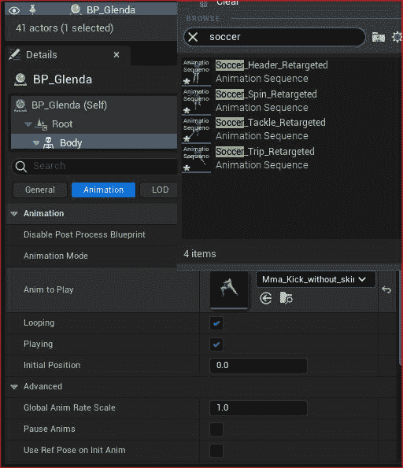

图 5.28：重定向动画可在 Anim to Play 下找到

得益于上一节完成的工作，在本节中，你能够批量导入多个动画并使用 IK 重定向器工具批量重定向它们。这是为你的 MetaHuman 角色创建完整动作库的一种非常高效的方法。

### 总结

在本章中，我们了解了这个极好的免费资源 Mixamo，以及如何将数百个动画引入你的项目。我们学习了如何最佳配置角色网格体以充分利用 Mixamo，并复习了 IK Rig 和 IK 重定向器。

此外，我们了解了角色比例的重要性、一些蒙皮权重知识，以及它们与角色比例和动画骨架的关系。

最重要的是，我们了解了功能强大的自动化工具，它们允许我们批量导入和批量重定向从 Mixamo 获取的动画文件。

在下一章中，我们将了解 DeepMotion，另一个在线资源，它允许我们仅使用摄像机创建自己的自定义动画。
