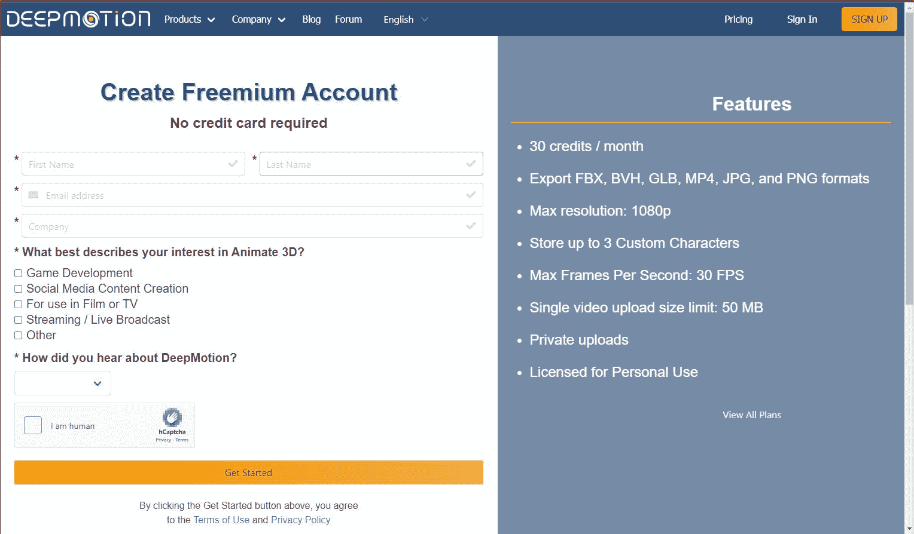
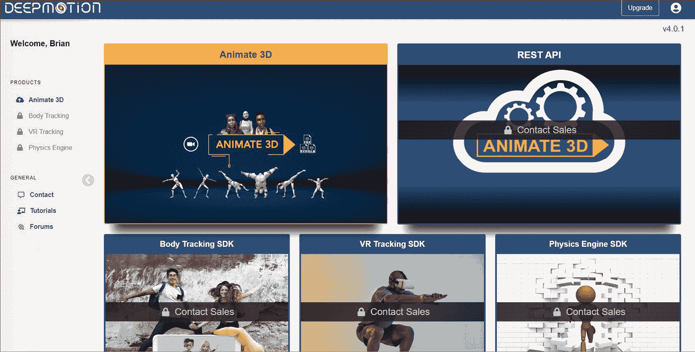
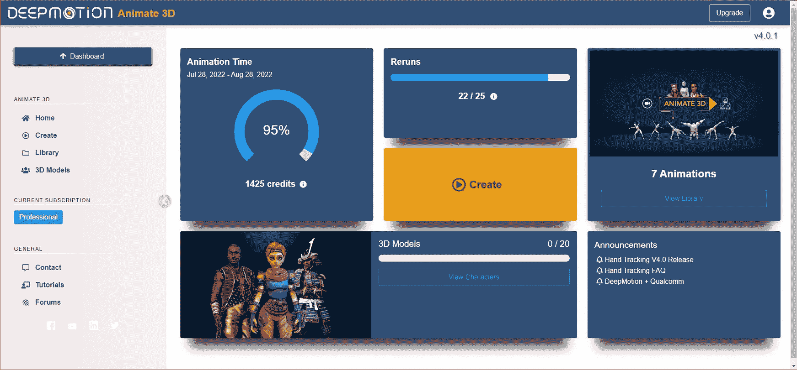
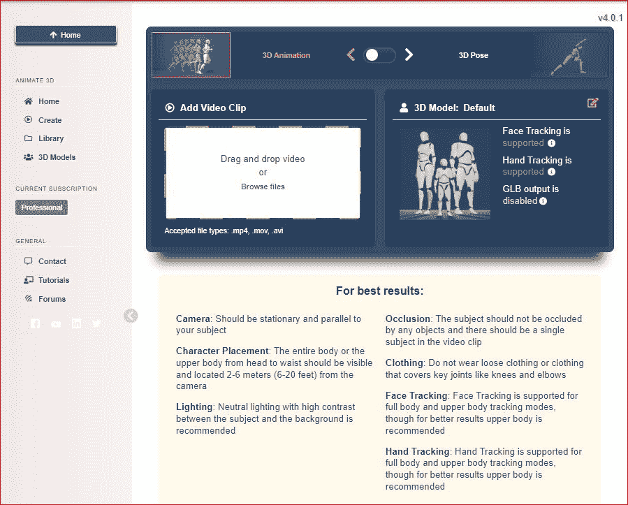
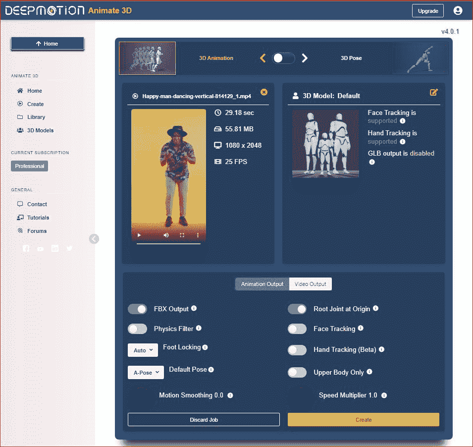
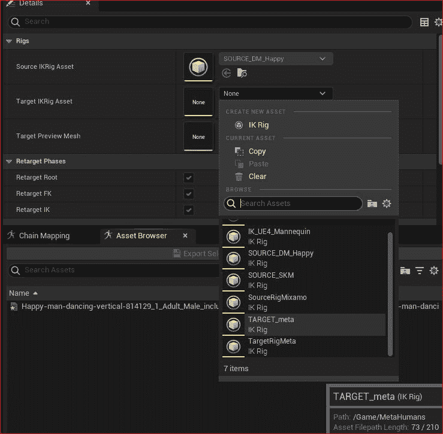
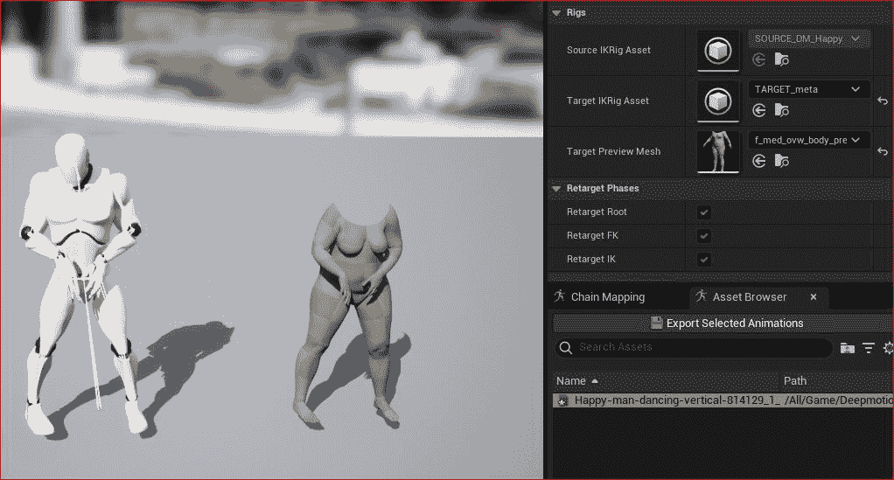
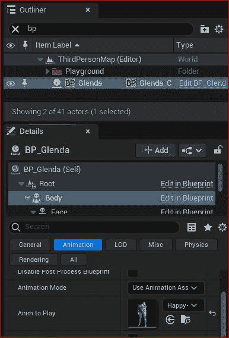
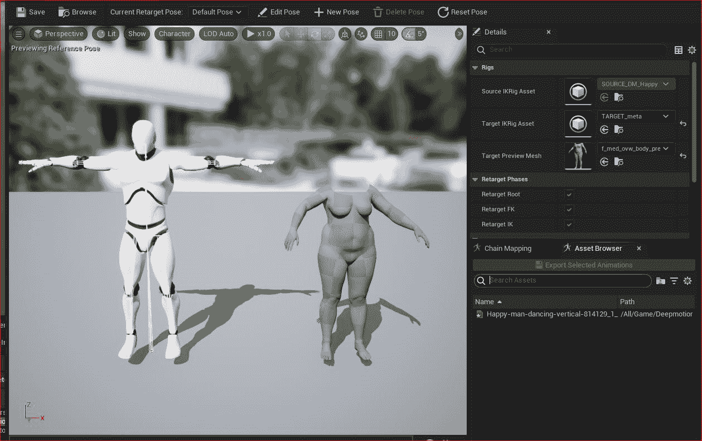
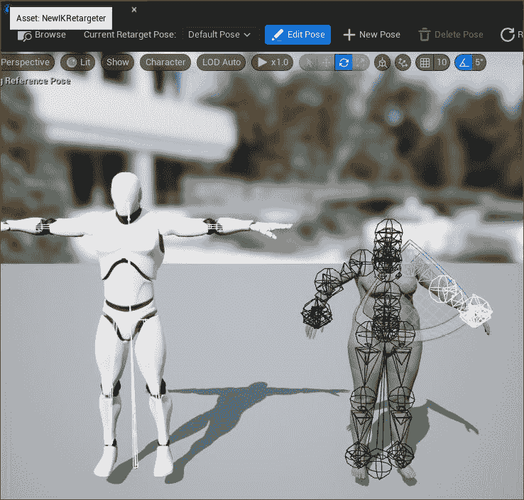

## 第 6 章：使用 DeepMotion 添加动作捕捉

在上一章中，我们介绍了 Mixamo 的动作捕捉库，以及如何让 Mixamo 动画在 Unreal 中工作。

在本章中，我们将建立在该知识之上，使用另一个名为 **DeepMotion** 的第三方在线工具创建我们自己的动画，该工具包含一个名为 **Animate 3D** 的功能，它分析人类表演的视频，并返回创建一个动作捕捉文件。我们将学习如何有效地使用摄像机录制表演，然后使用 DeepMotion 的 Animate 3D 功能创建你专属的动作捕捉文件，并用它在 Unreal 中为你的 MetaHuman 角色制作动画。

尽管 Mixamo 等素材动作库非常出色，但你仍需要拥有自己的定制动画，以获得创作自由。即使像 DeepMotion 的 Animate 3D 这样的解决方案效果可能不如昂贵的动作捕捉服所能获得的结果，但它也将远好于使用素材库现成动作时所做的妥协。

因此，在本章中，我们将涵盖以下主题：

*   认识 DeepMotion
*   准备视频素材
*   将视频片段上传至 DeepMotion
*   探索 DeepMotion 的动画设置
*   下载 DeepMotion 动作捕捉文件
*   将 DeepMotion 动作动画导入 Unreal
*   重定向 DeepMotion 动作捕捉
*   修复位置错位问题

### 技术要求

就计算机性能而言，你需要 *Chapter 1* 中详述的技术要求，以及我们在 *Chapter 2* 中导入 UE5 的 MetaHuman 角色和 Unreal Engine 模型。这两者都需要保存在 UE 的同一个项目中，并且本章需要运行 UE。

你还需要稳定的网络连接，因为我们将上传 MetaHuman 预览网格体和视频文件，并下载大量动画资产。你需要一台摄像机——网络摄像头、智能手机或专业摄像机/数字电影摄像机均可，但请注意，分辨率高于 HD 的视频并无额外优势。

## 认识 DeepMotion

直到最近，定制动作捕捉解决方案仍需要昂贵的设备和昂贵的软件；想想《阿凡达》、《指环王》或《加勒比海盗》等电影，演员必须穿着带有反光球或红外传感器棋盘标记的动作捕捉服。这项技术仅适用于能够承担此类投资的大型工作室，因此，独立工作室和自由艺术家只能将就使用动作捕捉库，如前所述的 Mixamo。

最近，随着越来越多价格亲民的解决方案可供艺术家使用，这一现状已有所改变。在为本书进行调研时，我特别关注成本因素，测试了多款动作捕捉工具。因为 **动作捕捉** (**mocap**) 服、红外传感器以及所有那些花哨的装备对我们大多数人来说实在太贵了，所以我考察了 DeepMotion 的 Animate 3D。

DeepMotion 的 Animate 3D 是 **无标记动捕解决方案** 的一个典型例子。该流程仅需用摄像机拍摄人体表演视频，无需特殊服装或标记。软件通过分析视频文件来识别和追踪每个身体部位。在机器学习的辅助下，该方案能够利用动作数据库或动作数据来规避错误。此外，还利用了 **反向运动学** 来进一步优化流程。这项技术在不断进步，且机器学习是其关键特性，进步速度确实非常快。

就 DeepMotion 而言，该在线工具允许我们上传表演视频，并为我们处理动作捕捉，以便在 Unreal（或任何其他兼容平台）中使用。虽然该过程包含机器学习，但幸运的是，DeepMotion 为我们处理了所有这些复杂工作。

在下一节中，我们将深入探讨如何有效录制视频的细节。

## 准备视频素材

在转向 DeepMotion 之前，关于录制表演视频，有一些关键因素我们需要了解。让我们现在来看看它们：

### 摄像机质量与位置

DeepMotion 能够处理从网络摄像头、旧智能手机等低端摄像机，一直到高端电影摄像机拍摄的素材，只要画面清晰、稳定，且具有合理的高帧率即可。许多低端摄像机的最低帧率为 30 fps，但如果你使用更高的帧率，对于快速移动的演员会获得更好的效果。

此外，摄像机最好保持静止，因为软件是基于固定的地面位置来计算演员的运动。摄像机的理想位置距离演员约 2 米。

### 高对比度拍摄

由于这种无标记动捕方案是追踪像素而非传感器，我们需要尽可能方便软件区分背景与演员。这就是为什么我们需要两者之间具有高对比度。如果你打算在深色背景（如窗帘）前拍摄，请确保演员穿着亮色衣服，反之亦然。此外，宽松的衣物可能会导致问题，因为衣物往往会被追踪；例如，如果演员穿着非常宽大的袖子，追踪器就很难分辨手臂和袖子的区别。

### 始终保持全身入镜

虽然 DeepMotion 仅凭上半身视频就能很好地推算角色动作，但根据经验法则，获取比所需更多的数据更好，因此请尽可能拍摄演员的全身镜头。捕捉演员的全身也很重要，因为即使演员的脚或头仅离开画面一秒，也可能导致整个动作捕捉过程的其余部分出现不良结果。

话虽如此，如果你的目的是捕捉全身表演，那么全身视频捕捉就是必须的。

### 校准时间

确保在表演前后让演员在镜头前停留几秒钟，最好摆 T 字姿势并面对摄像机。这给 DeepMotion 时间在表演*前*而非表演*中*将其骨架与演员身体对齐。

### 遮挡

在视频素材中，演员身体的某一部分遮挡另一部分的情况很少见。通常他们的手臂在身体前方，但因为 DeepMotion 能确定骨架脊柱的位置，所以这种遮挡不是问题。

然而，当身体遮挡肢体时，可能会出现问题。以手为例，当手移至身体后方或头部后方时，DeepMotion 因没有像素指示手的位置，只能猜测手应在何处。它要么尝试猜测，要么根本不给那些问题区域应用任何动画。

此外，演员与摄像机之间的物体也可能造成遮挡，从而引发问题。例如，树枝或路灯柱可能瞬间挡住视线，但可能会无意中导致比预期多得多的错误。

因此，不建议在前景有遮挡演员的物体的情况下拍摄。

### 表演速度

DeepMotion 不擅长检测片段中的极快动作。例如，对于踢踏舞或拳击，软件很难跟上快速的脚部动作，反而会给出非常差的结果。一个好的经验法则是：如果你在视频片段中看到任何动态模糊，则不太可能获得好结果。请务必以慢动作播放片段以进行妥善分析。

### 文件大小

如果你使用专业视频文件格式，除了能以更高帧率拍摄外别无裨益。MP4 等压缩或有损视频文件格式足以胜任，最好将文件大小控制在 200 MB 左右。文件过大上传和分析所需时间更长。虽然接受 MOV 文件，但我建议你改用 MP4 文件。

在本节中，我们介绍了录制演员视频时需要考虑的所有主要因素。鉴于视频的性质以及每个场景都会有所不同，这其中必然包含一定的试错过程，所以如果一开始没有获得理想的结果，请不要灰心。您随时可以回顾本节，以排查可能遇到的任何问题。

或者，如果您不想自己拍摄，可以去素材库下载一个符合前面提到的标准的片段。为了本书的目的，我从 [motionarray.com](https://motionarray.com) 获取了片段。

在下一节中，假设您已经拍摄了一些素材，您将把片段上传到 DeepMotion。

### 上传视频到 DeepMotion

在本节中，我们将访问 DeepMotion 网站，注册并上传我们的素材。

首先，您需要访问 [`www.deepmotion.com/`](https://www.deepmotion.com/)。从登录页面点击 `SIGN UP` 按钮，您将看到如 *图 6.1* 所示的表单。填写此表单以创建一个 `Freemium` 账户（并注意右侧的功能）：

图 6.1：使用 DeepMotion 注册

> **注意**
>
> DeepMotion 的 `Freemium` 账户允许您上传时长不超过 10 秒、分辨率不超过 1,080 像素、帧率不超过 30 fps 的片段。使用免费用户价格方案，您每月最多可获得 30 秒的动画时长。实际上这是一个试用服务，您需要付费才能获得更多使用量，但有各种付费计划提供更多功能，例如允许您上传帧率更高的片段。

填写完详细信息后，点击 `Get Started` 按钮。这将向您的电子邮件地址发送一个链接，或直接带您进入 DeepMotion Portal 页面，如 *图 6.2* 所示：

图 6.2：DeepMotion Portal 页面

使用 `Freemium` 账户，我们唯一可用的功能是 `Animate 3D` 功能（其他功能被锁定）。点击 `Animate 3D` 框，您将进入 Animate 3D 欢迎页面，如 *图 6.3* 所示：

图 6.3：Animate 3D 欢迎页面

在这里，您将看到拥有多少积分：1 积分等于 1 秒动画。下一个框标题为 `Reruns`，显示您优化捕捉过程的尝试次数。`Reruns` 允许您更改设置而不消耗任何动画积分。

现在，点击大大的黄色 `Create` 按钮，您将看到可以放置素材的仪表板，如 *图 6.4* 所示：

图 6.4：Animate 3D 仪表板

在 *图 6.4* 顶部，您可以看到两个缩略图：`3D Animation` 和 `3D Pose`。请务必切换到 `3D Animation`。

在下方，您可以选择将文件夹拖放到 DeepMotion 中，或浏览文件夹上传文件。它们还提供了接受的文件类型列表：`MP4`、`MOV` 和 `AVI`。如果您有其他格式，则需要使用编码器（如 `Adobe Media Encoder`、`VLC Player` 或 `QuickTime Pro`）转换文件。

> **注意**
>
> 除非原始 `MOV` 文件与 `MP4` 转换后的文件在质量上有显著差异，否则请使用 `MP4`，因为它可以减少上传和处理时间。

最后，您将看到一个关于如何获得最佳视频效果的提醒（我在本章前面对此进行了扩展），我建议您查看一下，以确保充分利用您有限的积分。

准备好后，通过您喜欢的任何方式上传视频；现在，您将能够查看视频设置。

### 探索 DeepMotion 的动画设置

上传视频片段后，您将进入 `Animate 3D` 仪表板，如 *图 6.5* 所示。如果您想使用与我相同的片段，我使用的是一个跳舞男人的片段，地址如下：[`motionarray.com/stock-video/happy-man-dancing-vertical-814129/`](https://motionarray.com/stock-video/happy-man-dancing-vertical-814129/)。

图 6.5：Animate 3D 仪表板

在 *图 6.5* 中，您可以看到视频片段的缩略图，以及片段的文件名 `Happy-man-dancing-vertical-814129_1.mp4`。片段的属性显示在缩略图的右侧，如下所示：

*   **时长**：用于监控片段的时长。如果片段长度超出您定价计划允许的范围，将报错；在这种情况下，您需要上传更短的片段。
*   **文件大小**：如果文件大小超出您的账户设置，将报错。您需要通过压缩器（如 `Adobe Encoder`）减小文件大小，然后重新上传。如果在上传过程中报错，很可能是因为您基于账户设置超过了这些属性中的一个或多个限制。
*   **分辨率**：每个账户设置都有最大分辨率。如果分辨率过大将报错，您需要使用转换器降低分辨率。例如，对于 `Freemium` 账户，4,096 x 3,112 的片段太大，您需要将其缩小到 1,920 x 1,080（使用 `Adobe Encoder` 或类似工具）。
*   **帧率**：如果您有 `Freemium` 账户，使用较高的帧率（如 200 fps）将报错。通常，网络摄像头生成的视频帧率约为 25 fps，因此使用网络摄像头可以降低此错误的发生几率。

在 *图 6.5* 所示界面的下半部分，您将看到两个选项：`Animation Output` 和 `Video Output`。为了本书的目的，我们忽略 `Video Output`，因此请确保选择了 `Animation Output`。

有 10 个功能可用，但并非所有功能都可用或与您的账户类型和您想要实现的动作捕捉复杂度相关。`Animation Output` 参数如下：

*   **FBX 输出**：您希望用于动画的文件类型。因为我们稍后只想在 Unreal 中使用 FBX 动画，所以请确保输出设置为 `FBX`。（只有当我们想创建静态姿势时才会提供其他选项，这与本书无关。）
*   **物理过滤器**：这会强制执行关节限制并尝试消除碰撞，例如手穿过躯干。如果素材没有明显问题，我建议您首先尝试在禁用 `Physics Filter` 的情况下处理动画，因为启用它可能会产生某种人为的结果。此外，请记住利用 `Rerun` 选项来尝试 `Physics Filter`，如果第一次没有获得好结果的话。
*   **脚部锁定**：这解决了动作捕捉中常见的一个问题，即脚离开地面然后又落回地面时的处理。对于穿着动捕服的捕捉，这不太成问题，但对于视频动作捕捉，很难确定脚何时接触地面。`Foot Locking` 提供四个选项：
    *   **自动**：这是最常用的模式，因为它会自动在将脚位置锁定到地面和让其移动之间切换。对于行走或跳舞的角色，这是最可能使用的模式，因为角色不可避免地会间歇性地抬起和放下脚。

> **注意**
>
> `Freemium` 账户中仅提供 `Auto` 设置。

### 动画输出设置

## 脚部锁定模式

*   `Never`：在涉及游泳或持续下落的动画中，我们知道角色的脚永远不会与地面接触，因此使用此模式以避免错误。

*   `Always`：最适用于角色脚部永不离地的情况。这似乎显而易见，但在 `Auto` 和 `Always` 之间选择时，如果我们知道角色脚不离地，最好使用 `Always`，因为 `Auto` 模式在这种情况下可能导致错误。

*   `Grounding`：实际上，这使脚保持在地面高度，但不一定将其锁定在固定位置。`Auto` 工作方式类似，但在快速移动时效果不佳；如果角色脚部做滑动运动，`Grounding` 模式是最佳选择。

## 默认姿势

`Default Pose`：指保存动画文件时的骨骼校准姿势。理想情况下，源动画的校准姿势应与目标角色的校准姿势匹配。此下拉菜单有四个选项：

*   `A-Pose`：最常用的校准姿势之一，也是 MetaHuman 在 UE5 引擎中出现的姿势。此姿势将手臂设置为 45 度角。

*   `I-Pose`：不太可能使用的姿势，手臂垂直向下。

*   `T-Pose`：另一个标准姿势，也是 Unreal Engine 模特的默认姿势。手臂向外伸直，与身体呈 90 度角，形成 T 形。

*   `Sitting`：另一个不太可能的姿势，手臂类似 `A-Pose` 但角色坐着。

## 运动平滑

`Motion Smoothing`：此选项使用 AI 通过查看每个关节的轨迹来确定角色应如何移动，并从动画中移除任何抖动或噪声，这些噪声来自持续的重新校准。虽然有助于消除不需要的抖动，但可能会引入一些看起来人为的运动；您可以调整平滑强度以获得想要的结果。

> **注意**
>
> 此功能在 Freemium 账户中不可用。

## 根关节位于原点

`Root Joint at Origin`：这对 Unreal Engine 艺术家特别有用，因为它在原点创建一个骨骼，位于双脚之间的地面上。该骨骼与髋部相连，对应角色的根位置。建议为打算在 UE 中使用的动作捕捉开启此功能，我们这里将确保开启。

## 面部追踪

`Face Tracking`：撰写本文时，此工具对于我们在本书章节中将达到的面部捕捉复杂度而言，并非实用解决方案。尽管使用了 ARKit 技术（这是 MetaHuman 底层面部动画控制技术），但 DeepMotion 的准确度远不如其他解决方案先进。我们将在 `第 8 章` 和 `第 9 章` 中探讨使用 iPhone 和网络摄像头的更精准面部追踪。

## 手部追踪

`Hand Tracking`：此功能仅追踪手部运动，但程度更高级，甚至尝试追踪手指。撰写本文时，此功能仍处于测试阶段。对于 Freemium 用户，值得考虑使用此功能的额外成本；除非您在手部运动中看到明显错误（如手以奇怪方式移动或穿透其他身体部位），建议保持默认设置（关闭）。

## 速度倍率

`Speed Multiplier`：这是 Premium 用户的高级功能，通过使用高帧率视频（即慢动作）来增加动作捕捉精度的好方法。`Speed Multiplier` 允许 0-8 倍范围。如果角色以半速移动（慢动作），将倍率调整为 `2.0` 将得到常规运动结果但精度更高。对于 Professional 和 Studio 计划，可使用高达 120 fps 的素材。该素材会非常慢，从而捕捉大量细节和微妙动作。120 fps 大约比实时慢 5 倍，因此您会使用约 5 的 `Speed Multiplier` 来获得实时动作捕捉结果，并从中受益于更高的精度。

---

现在，完成所有 `Animation Output` 设置后，您可以点击 `Create` 按钮（位于 `Figure 6.5` 底部）。点击后，您将看到确认对话框，如 `Figure 6.6` 所示：

图 6.6：确认新建动画对话框

从设置中可以看到，我启用了 `Root Joint at Origin`，将 `Foot Locking` 设为 `Auto`，并将 `Default Pose` 设为 `A-Pose`。其他均保留默认设置。我不打算下载额外视频，因此 `MPF Enabled` 选项已禁用，其他均标记为 `n/a`。

此时还值得注意的是，如果我们对结果不满意，可以重新运行此过程。话虽如此，是时候首次运行了，点击 `Start Job` 按钮。您将进入 `Starting job` 界面，如 `Figure 6.7` 所示：

图 6.7：开始作业

处理时间取决于视频剪辑的文件大小和长度。此外，如果视频包含大量运动，预期处理时间会更慢。

处理完成后，便可查看结果。在 `Figure 6.8` 中，您可以看到我所选片段的结果；当然，无法从这单张图像中看到结果，但我对结果印象深刻（毕竟，这是从单个摄像机而非昂贵的动作捕捉套装和传感器阵列获取的动作捕捉）：

图 6.8：动作捕捉结果

从此屏幕，您将看到一个交互式 3D 视口，可从任何角度查看结果，并以各种速度播放动画。

屏幕右侧，您将看到四种角色类型的简短列表；类似于 MetaHuman 预览网格，我们可以预览各种体型（如瘦、大、男、女），并选择它们随动画一起下载。为获得最佳结果，请选择最接近您 MetaHuman 角色的体型。在我的案例中，Glenda 略微超重，选择超重角色会更好。这会增加手臂与身体的距离，有助于解决手臂与躯干之间的碰撞（您可能记得 Mixamo 中名为 `Arm Spacing` 的功能；这与其工作方式类似）。

另请注意 `Figure 6.8` 界面底部有两个选项：

*   `Download`：允许我们下载带有所选骨骼网格的 FBX 文件。此时，我们可以选择除预览网格以外的其他网格。

*   `Rerun`：这是我们优化动画质量的另一次机会。例如，我们可能对整体动画满意，但略有抖动；这将是应用少量 `Motion Smoothing` 的好机会。另一个例子，我们可能对脚部未按预期锁定地面感到不满；或许 `Auto` 设置对快速移动反应不够灵敏，我们可以返回将 `Auto` 切换为 `Grounding`。

毋庸置疑，`Rerun` 是一个非常有效的工具，首次尝试不调整就获得理想结果的可能性很小。与其试图在 Unreal Engine 中修复，不如通过多次重运行尽可能接近期望结果。通过积累足够的重运行经验，您将通过实践和时间更高效地预测应使用哪些功能。

在 `Figure 6.9` 中，你可以看到 `Rerun Animation` 对话框：

图 6.9：重新运行动画对话框

此 `Rerun Animation` 框与 `Figure 6.6` 中的 `Confirm New Animation` 框的唯一区别在于，它会显示产生上一次结果的 `Current` 设置，以及你即将投入下一项作业的 `New` 设置。这使你能进行对比研究，从而为重新运行做出更明智的决定。

现在，当你浏览完所有设置并重新运行作业直到最终对结果满意时，就该下载动画了。

### 下载 DeepMotion 动作捕捉文件

要下载 DeepMotion 动作捕捉文件，请不要点击 `Rerun` 选项，只需点击 `Download` 按钮。这将弹出 `Download Animations` 对话框，如 `Figure 6.10` 所示：

图 6.10：下载动画

在下载动画前，对话框提供了切换或确认所需体型的选项：两个成年女性、两个成年男性和一个通用儿童供选择。当你对预览网格体满意后，请确保从下拉菜单中选择了正确的下载文件类型 `FBX`（`BVH` 和 `DMPE` 方案不适用于我们在 Unreal 中的操作）。然后，点击黄色的 `Download` 按钮，将文件保存到项目文件夹中的某个位置。

下载动画后，你将看到两个 FBX 文件和一个文件夹，如 `Figure 6.11` 所示：

图 6.11：DeepMotion 保存的文件和命名约定

文件名以 `TPose` 结尾的 FBX 文件（`Adult_Male_Alt(includeTPose)`）是指在动画开始处使用实际 T-pose 的文件。另一个文件 `Adult_Male_Alt` 在开头没有此类 T-pose，因此从第一帧直接开始动画。选择哪一个并不关键，因为你随时可以从动画中移除 T-pose 片段，但在需要为重定向目的对齐时，T-pose 可能会变得有用。我们将在本章末尾探讨这一点。

现在我们已下载相关文件，在下一节中，我们将把 DeepMotion 动作捕捉文件导入 Unreal，以便将其重定向到 MetaHuman IK Rig。

### 将 DeepMotion 动画导入 Unreal

正如本章开头所述，我们是在前几章所学基础上构建，但别担心，我们将把本节作为导入角色到 Unreal 过程的简要回顾。

首先，你需要在 Unreal 项目中创建一个名为 `Deepmotion` 的文件夹。确保你在上一章使用的项目中工作，该项目同时拥有 Mixamo 角色和 MetaHuman 角色的源 IK Rig 和目标 IK Rig。

创建 `Deepmotion` 文件夹后，在 `Deepmotion` 文件夹的 `Content` 浏览器中任意位置右键单击，查找你的新 DeepMotion FBX 文件。选择文件名包含 `TPose` 的那个。选中后，你将看到 `FBX Import Options` 对话框，如 `Figure 6.12` 所示：

图 6.12：FBX 导入选项

这里有两点需要注意：

*   首先，我们不想为此导入分配骨架；我们想使用即将导入的文件中嵌入的骨架。因此，在 `Mesh` 下，将 `Skeleton` 保留在默认位置 `None`，并确保选中 `Skeletal Mesh` 选项，以便它知道从文件中选择骨架网格体。
*   其次，虽然这听起来显而易见，但请确保在 `Animations` 下勾选 `Import Animations` 选项。

考虑完这些后，点击蓝色的 `Import All` 按钮。不要被提到平滑处理的错误弹窗吓到；你可以关闭它。

现在，当你查看 `Content` 浏览器中的 `Deepmotion` 文件夹时，应该会看到类似 `Figure 6.13` 的内容：

图 6.13：Deepmotion 内容文件夹

你在这里看到的大部分内容应该都很熟悉；从左到右，你将看到以下内容：

*   身体的材质着色器
*   无动画的 T-pose 骨架
*   带动画的 DeepMotion 骨架
*   DeepMotion 骨架物理资产
*   用于编辑的无动画 T-pose 骨架
*   上述用于身体的材质着色器所用的纹理文件

在本节中，我们已成功将 `Deepmotion` 文件导入 Unreal Engine。在下一节中，我们将结合角色使用 DeepMotion 动画。

### 重定向 DeepMotion 动作捕捉

与前几章一样，你需要创建一个 IK Rig 作为源。因此，在 `Deepmotion` 文件夹中，任意位置右键单击，选择 `Animation`，然后选择 `IK Rig`，如 `Figure 6.14` 所示：

图 6.14：创建 IK Rig

为避免混淆，将此 IK Rig 命名为 `Source_DM_Happy`（这将帮助我们稍后查找它）。

然后，像以前一样，遵循相同流程创建 IK 链。同样，我们需要创建六个独立的 IK 链，分别对应：

*   根骨骼到髋部
*   脊柱和头部
*   左臂
*   右臂
*   左腿
*   右腿

唯一不同的是命名约定，这在从不同来源导入动作捕捉时是意料之中的。DeepMotion 的命名约定可见于 `Figure 6.15`，它们对关节使用 `JNS` 缩写，并以前缀 `l_` 或 `r_` 开头表示左或右：

图 6.15：IK 链

请注意，这些链的顺序（从 `Root` 到 `hips_JNT`，以 `r_upleg_JNT` 到 `r_foot_JNT` 结束）与我的 IK 链列表一致；在 IK 源和 IK 目标中保持相同顺序可减少错误。

现在该创建一个新的 IK Retargeter，使用我们的新 IK Rig 作为源。仍在 `Deepmotion` 文件夹中，在 `Content` 浏览器任意位置右键单击，转到 `Animation`，然后选择 `IK Retargeter`，如 `Figure 6.16` 所示：

图 6.16：创建新的 IK 重定向器

创建新 IK Retargeter 后，双击打开它，你将看到一个潜在源列表供选择。在 `Figure 6.17` 中，你可以看到我项目文件夹中保存的所有 IK Rig 列表：

图 6.17：选择要复制动画的 IK Rig

你会看到我有一个名为 `SourceRigMixamo` 的源 IK Rig。随着你在 Unreal 中的练习，你很快会拥有多个源 IK Rig。你应该仍保留上一章使用的源 IK Rig。这就是为什么适当标记这些 IK Rig 很重要，以免无意中选择错误的一个。

你**不**想使用上一章的 Mixamo rig，所以请选择 `Source_DM_Happy`，因为那是我们要复制动画的 rig。然后点击 `OK`。

> **注意**
>
> 如果你选择了错误的 IK Rig，你将需要删除此 Retargeter 并创建一个新的，这就是为什么标记 IK 源 rig 很重要的原因。

创建好使用 `Source_DM_Happy` 骨架的 IK 重定向器后，双击打开它。这将弹出以下界面：

图 6.18：在 IK 重定向器中选择目标

现在，你需要选择 IK 目标以应用 DeepMotion 动作捕捉数据。从图 6.19 可以看出，`Source IKRig Asset`（源 IK 绑定资产）被锁定了，但 `Target IKRig Asset`（目标 IK 绑定资产）仍有一个下拉列表。选择你的 MetaHuman 目标绑定；在我的例子中，是 `TARGET_meta`。

此时，我们也可以选择合适的 `Target Preview Mesh`（目标预览网格体）。在我的例子中，目标预览网格体是 `Female Medium Overweight`（中等体型超重女性）网格体，标题为 `f_med_ovw_body_preview_mesh`，如图 6.19 所示：

I

图 6.19：目标预览网格体

在图 6.19 底部的 `Asset Browser`（资产浏览器）选项卡下，你可以看到 DeepMotion 动画现已可供导出。因此，如果你对动画满意，只需点击绿色的 `Export Selected Animations`（导出选中的动画）按钮。

提醒一下，点击 `Export Selected Animations` 按钮将创建一个动画文件，该文件现在可用于你的 MetaHuman 角色。系统会提示你选择动画的保存位置，请选择你的 `Deepmotion` 文件夹。

接下来，将你的 MetaHuman 角色从 `Content`（内容）文件夹拖放到视口中，将其添加到场景里。然后，确保在 `Outliner`（大纲视图）中选中了你的 MetaHuman 蓝图。

之后，前往 `Details`（详细信息）面板，选择 `Body`（身体），在 `Animation Mode`（动画模式）下选择 `Use Animation Asset`（使用动画资产）。搜索你新的重定向动画文件并点击它。在图 6.20 中，你可以看到我从下拉列表中选中了 `Happy Animation`（快乐动画）文件：

图 6.20：应用动画

选中文件后，在视口中点击 `Play`（播放），你就会看到你的角色“活”了过来。

既然你已成功完成从视频创建动作捕捉数据并将其重定向到 MetaHuman 角色的整个流程，我们将在下一节中探讨排查一个常见问题。

### 修复位置错位问题

你的动画不太可能与视频完美匹配，重定向过程也不太可能一帆风顺。源绑定和目标绑定之间总会存在细微的差异。最常见的问题之一是手臂位置，这主要归结于 `T-Pose`（T 姿势）和 `A-Pose`（A 姿势）的区别。

由于 MetaHuman 采用 `A-Pose`，而我们的 DeepMotion 绑定设置为 `T-Pose`，这就是问题所在。如果你在 DeepMotion 中选择了 `T-Pose`，有一个方便的小修复方法，可以省去你再次经历下载和重定向过程的麻烦。

正如图 6.21 所示的 `IK Retargeter`（IK 重定向器）界面，我们可以看到问题所在：源 DeepMotion 角色处于 `T-Pose`，而目标 MetaHuman 角色处于 `A-Pose`。在这种情况下，由于错位，手臂将无法正确动画化，极有可能与身体相交：

图 6.21：IK 重定向器 T 姿势对比 A 姿势

这里唯一的选择是更改目标的姿势，即 MetaHuman。为此，点击屏幕顶部的 `Edit Pose`（编辑姿势）按钮，如图 6.22 所示。这将允许你在 `IK Retargeter` 内部旋转 MetaHuman 角色的关节：

图 6.22：IK 重定向器中的编辑姿势

我强烈建议你使用旋转吸附功能，它在图 6.22 的右上角高亮显示。我发现 `T-Pose` 和 `A-Pose` 在手臂旋转方面的差异约为 45 度。目前，吸附增量设置为 5 度；不过，你可以根据喜好进行更改。

MetaHuman 的肘关节也有轻微的旋转，你需要将其拉直以匹配源角色；使用吸附工具可以让你获得更均匀的结果。在修正肘关节时，请务必从正面视角调整角度，以便看清操作效果。

调整满意后，再次点击 `Edit Pose` 按钮。这将允许你再次按下 `Play`，查看动画重定向的效果。你可以反复返回进行微调。

你可能还会发现，虽然导出了正确的姿势，但动画仍会导致细微问题，特别是碰撞方面。就 DeepMotion 而言，这很容易归因于你使用了预设预览网格体，而非特定的 MetaHuman 网格体。我们将在下一章探讨如何修复这些问题。

### 总结

在本节中，我们介绍了如何仅凭一个摄像头创建自己的动画。首先，我们探讨了拍摄时的主要注意事项、应避免的事项，以及可采取哪些步骤来进一步提高准确性。

随后，我们开始使用 DeepMotion，探索其提供的各种动画设置，包括一些人工智能功能。我们研究了使用这些功能和重新生成（reruns）的最佳实践，然后再提交最终动画。

基于前几章所学，我们再次将定制的动作捕捉数据重定向并应用到 MetaHuman 角色上，同时更深入地对比了 `A-Pose` 与 `T-Pose`。最后，我们介绍了针对这些姿势引发问题的有效变通方法。

在下一章中，我们将探讨 `Level Sequencer`（序列器）和 `Control Rig`（控制绑定），以及如何进一步优化我们的定制动作捕捉。
