## 第 7 章：使用序列器

在上一章中，我们学习了如何将自己的动作捕捉数据导入 Unreal 并重定向到 MetaHuman。然而，有时我们需要进行调整以修复问题，或为其表现增加额外的创意层次。

上一章遇到的一个问题是由使用 `A-Pose` 和 `T-Pose` 的差异引起的，我们通过在 `MetaHuman Blueprint`（MetaHuman 蓝图）中编辑 MetaHuman 的 `A-Pose` 解决了该问题。

在本章中，我们将探讨另一种更改角色姿势以修复小问题的方法，例如手臂与 MetaHuman 躯干发生碰撞，但也将探讨如何优化角色的动作。为此，我们将使用 `Level Sequencer`（关卡序列器），这是我们在 Unreal Engine 中为任何事物制作动画所用的工具，在许多方面，它的工作原理类似于视频编辑应用程序中的时间轴。

因此，在本章中，我们将涵盖以下主题：

*   介绍 Level Sequencer（关卡序列器）
*   创建 Level Sequencer 并导入我们的角色 Blueprint
*   将重定向动画添加到角色 Blueprint
*   添加和编辑 Control Rig（控制绑定）
*   向 Level Sequencer 添加摄像机
*   从 Level Sequencer 渲染测试动画

### 技术要求

就计算机性能而言，您将需要 *第 1 章* 中详述的技术要求，以及我们在 *第 2 章* 中导入到 UE5 的 MetaHuman 和 Unreal Engine 模型。这两者都需要保存在 UE 的同一个项目中，并且您需要为本章运行 UE。

对于本章，您还需要能够访问您在 *第 6 章* 中刚刚重定向的动作捕捉数据。

### 介绍 Level Sequencer

直到现在，您只能在角色 Blueprint 内部或视口中使用 `Play`（播放）按钮来预览动画。`Play` 按钮实际上是在模拟游戏过程，这纯粹是为了交互式体验。

`Level Sequencer` 可用于游戏过程中，但为了本书的目的，我们想专注于使用 `Level Sequencer` 来充分利用我们的动作捕捉动画。`Level Sequencer` 是我们关卡中的一个时间轴，我们可以在其中控制动画。它类似于编辑程序中的任何其他时间轴，不同之处在于我们不是添加视频片段，而是向场景中添加元素，然后应用可动画化的属性。

在使用 Unreal Engine 进行动画制作时，您想要制作动画的任何内容都需要添加到 `Level Sequencer` 中，包括灯光、摄像机、Actor、车辆，甚至音频，并且您可以在任何给定的项目中拥有多个 `Level Sequencer`。

`Level Sequencer` 的优势在于它允许您仅关注动画对象，还允许我们通过添加独立关键帧来有效地微调动画，而不会被动作捕捉数据自带的所有关键帧淹没。使用它，我们可以更改动作捕捉动画，而不必依赖于在使用 DeepMotion 等动作捕捉解决方案或 Mixamo 等动作捕捉库文件时获得绝对完美的镜头。

在下一节中，我们将介绍将角色放入 `Level Sequencer` 的过程。

### 创建 Level Sequencer 并导入我们的角色 Blueprint

那么，让我们开始创建 `Level Sequencer`（这没什么复杂的）。

首先，您需要在 `Content`（内容）文件夹中的任意位置右键单击；在我的示例中，我就在我的 `MetaHumans` 文件夹中执行了此操作，您可以在*图 7.1* 中看到。然后，转到 `Animation`（动画），并单击 `Level Sequencer`。

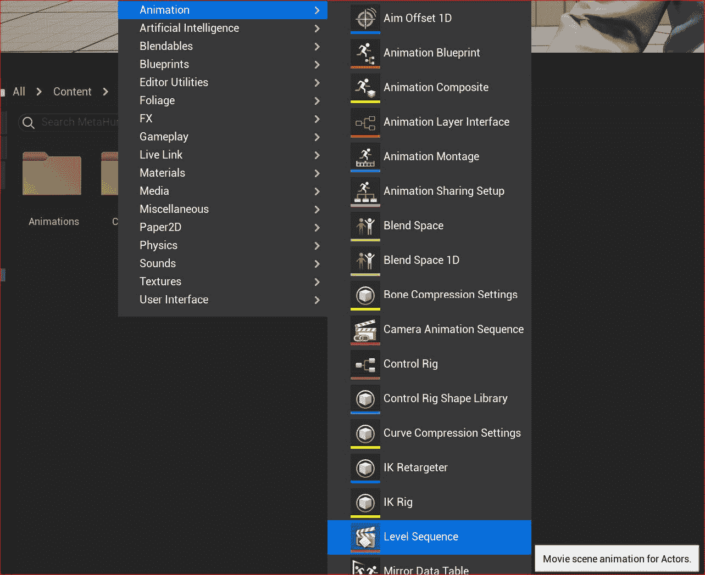

图 7.1：创建 Level Sequencer

创建 `Level Sequencer` 后，您将在 `Content` 文件夹中看到一个 `Level Sequencer` 场记板图标。双击 `Level Sequencer` 图标将其打开。您将看到一个空的 `Sequencer`，如*图 7.2* 所示：

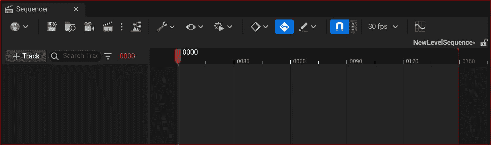

图 7.2：空的 Level Sequencer

为了使用 `Level Sequencer` 制作动画，您需要添加一个 Actor。Actor 可以是您想要制作动画的几乎任何东西。一旦将 Actor 添加到 `Sequencer`，就会创建一个动画轨道。

因为我们想为 MetaHuman 角色制作动画，所以我们需要将 MetaHuman Blueprint 作为我们的动画轨道添加进去。为此，只需单击 `+ Track`（+ 轨道），然后选择 `Actor To Sequencer`（Actor 到 Sequencer）：

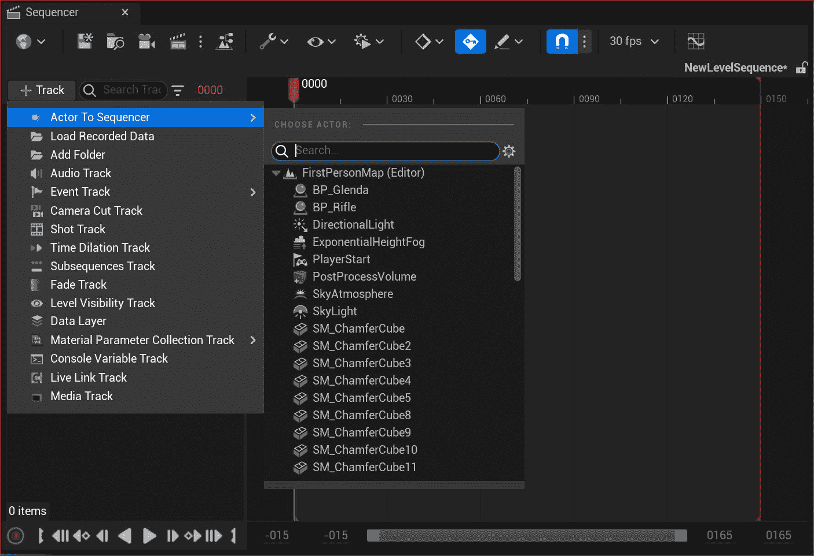

图 7.3：向 Sequencer 添加 Actor

在*图 7.3* 中，您可以看到可作为轨道添加的 Actor 列表。Actor 列表的最顶端是 `BP_Glenda`，这是我的 MetaHuman 角色。单击您的 MetaHuman Blueprint 将其作为动画轨道导入 `Level Sequencer`。

将 Blueprint 添加到 `Sequencer` 后，您将获得两条轨道：一条用于身体，一条用于面部。正如您从*图 7.4* 中看到的，这些轨道中的每一条都有一个 `Control Rig`。最初，应该选中 `Face`（面部）Rig，这将在视口中显示一个带有面部动画控件的黄色界面（尽管我们不会研究这些）。

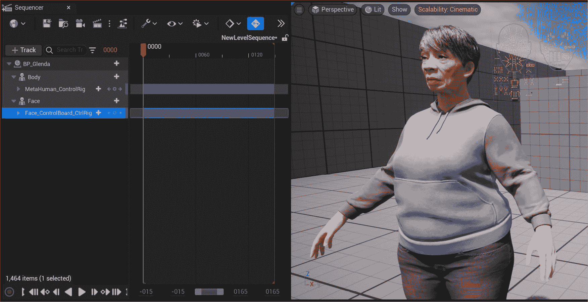

图 7.4：添加 MetaHuman Blueprint

另一个可用的绑定是 `Body`（身体）Rig。如果您在 `Sequencer` 中选择 `Body` 轨道，该绑定将在视口中变得可见，如*图 7.5* 所示：

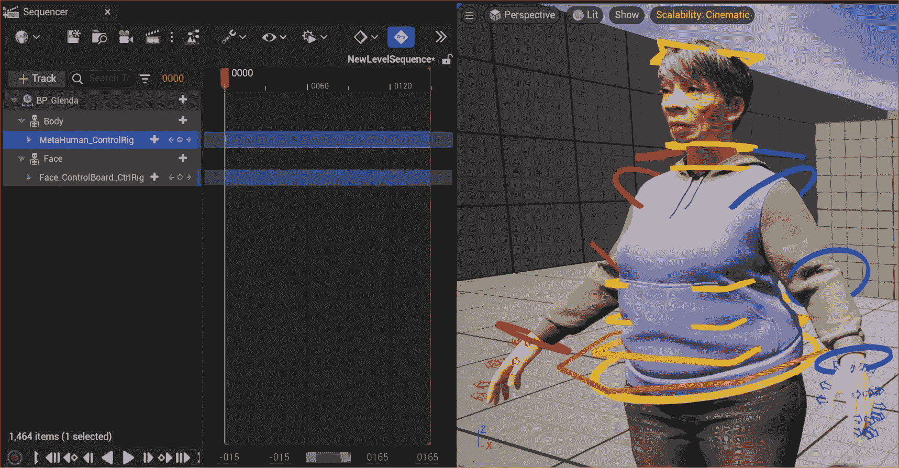

图 7.5：MetaHuman Control Rig

此时，您在动画方面刚刚获得了对 MetaHuman 角色的大量控制权。无论您是经验丰富的动画师还是新手，我都建议您尝试这些动画控件。特别是，在进入下一节之前，尝试旋转 `MetaHuman Control Rig` 的任意彩色组件，如*图 7.5* 所示。

将角色 Blueprint 作为 Actor 添加到 `Level Sequencer` 后，我们现在准备导入一些动作捕捉数据，这将在下一节中完成。

### 将重定向动画添加到角色 Blueprint

在我们继续将 DeepMotion 动画导入 `Sequencer` 之前，我需要警告您，我们将采取一个看似有些违反直觉的步骤：我们将删除身体和面部的 `Control Rig`，最后却又要添加一个身体 `Control Rig`。在本章中，我们的目标是添加动作捕捉数据，然后添加一个额外的关键帧动画轨道。然而，要做到这一点，我们需要将动作捕捉数据烘焙到 `control rig` 中，然后我们需要另一个 `control rig` 用于额外的动画。

那么，让我们删除这两个当前的 `Control Rig`。您可以通过在 `Sequencer` 中单击 `Metahuman Control Rig` 和 `Face_ControlBoard_CtrlRig`，然后按键盘上的 `Delete` 键来执行此操作。

现在，在 `Sequencer` 中选中 `Body`，单击 `+` 图标，然后从 `Animation` 中搜索 `Retargeted`。这应该会调用上一章中由 `IK Retargeter` 创建的重定向数据，您可以在*图 7.6* 中看到：

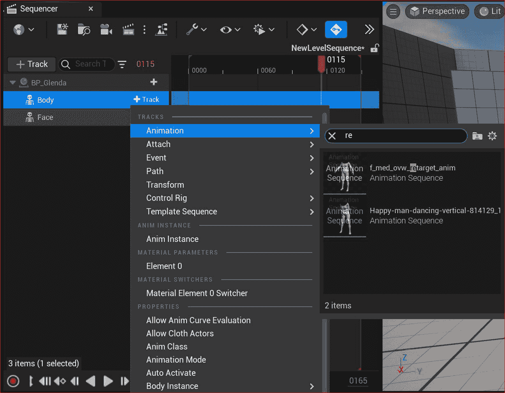

图 7.6：添加重定向的动捕数据

一旦您选择了重定向的动捕数据，它将出现在 `Sequencer` 的时间轴上。

> **注意**
>
> 动画将从您的 `play head`（播放头）所在的时间轴位置开始播放。`play head` 是 `sequencer` 时间轴上当前暂停的位置，也是动画开始的帧。在*图 7.6* 中，我的 `play head` 位于编号为 `0115` 的帧（由红色箭头指示）。

当您将动捕动画作为轨道导入后，只需向左或向右拖动轨道，即可重新定位该轨道以在任意时间开始。轨道本身包含其中显示的动画标题。在*图 7.7* 中，您可以看到水平蓝线下方的动画轨道。

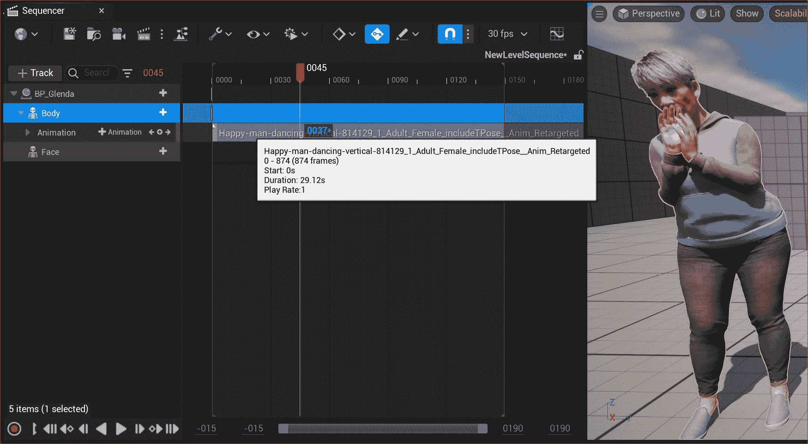

图 7.7：动画轨道

### 将动作捕捉烘焙到控制绑定

为了修改动画，我们必须将动作捕捉数据转换为 `Control Rig`（控制绑定）上的关键帧数据。这个过程称为**烘焙**，我们只需右键点击身体轨道，选择**烘焙到控制绑定**，并选择 `Metahuman_ControlRig` 即可完成，如*图 7.8*所示：

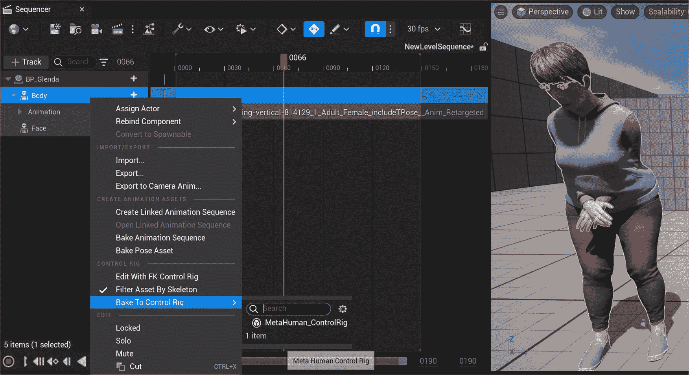

图 7.8：烘焙到控制绑定

开始烘焙过程后，你将看到**烘焙选项**对话框。因为我们不需要减少关键帧，可以保留默认设置，直接点击**创建**。

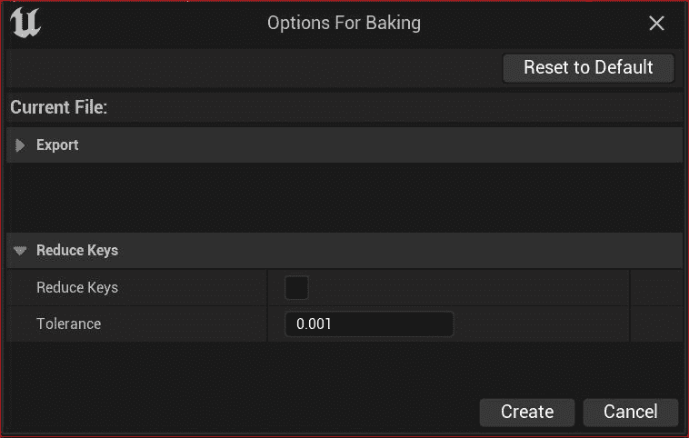

图 7.9：烘焙选项

在*图 7.10*中，你可以看到我导入的动捕动画现已烘焙到 MetaHuman 控制绑定中，视口里的角色现在已处于动画状态。

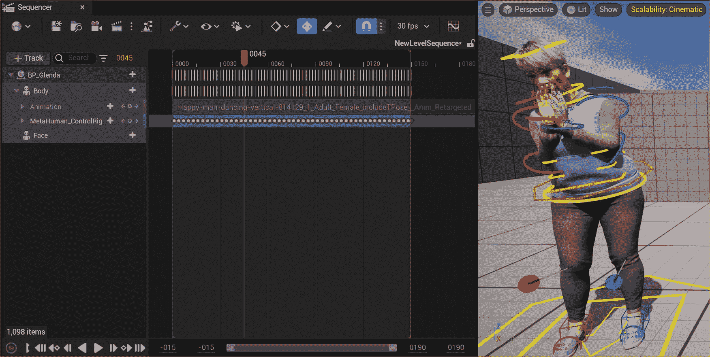

图 7.10：动捕烘焙进 MetaHuman 控制绑定

现在，你可以通过按下 `spacebar`（空格键）或使用 `Sequencer`（序列器）选项卡底部的**播放**按钮来激活播放功能。

随着动捕动画在视口中运行，下一步是设置一种方法来编辑动画。因为现在 MetaHuman 身体的每一根骨骼在每一帧上都有一个关键帧，试图对当前的 MetaHuman 绑定进行任何更改几乎是不可能的。例如，如果我们选择去到第** 100 **帧并更改该特定帧的姿势，只有第** 100 **帧会受到影响，因为所有其他帧的姿势都基于我们之前转换的动捕数据。让我们看看如何解决这个问题。

#### 添加和编辑控制绑定

为了解决关键帧问题，我们需要创建另一个没有关键帧的 MetaHuman 控制绑定，以便我们添加的任何关键帧都能产生**叠加**效果。

什么是叠加？例如，如果肩关节在 x 轴上的旋转因动作捕捉而为 100 度，那么使用叠加工作流，在 x 轴上再旋转肩关节 20 度，最终旋转将变为 120 度。之所以得到 120 度，是因为我们只是简单地将 100 + 20 度相加。

> **注意**
>
> 叠加部分的关键帧不会影响烘焙后的控制绑定的原始关键帧。但是，它们会影响最终结果。

为了获得叠加效果，我们必须在 Sequencer 中创建一个**叠加**片段，如*图 7.11*所示：

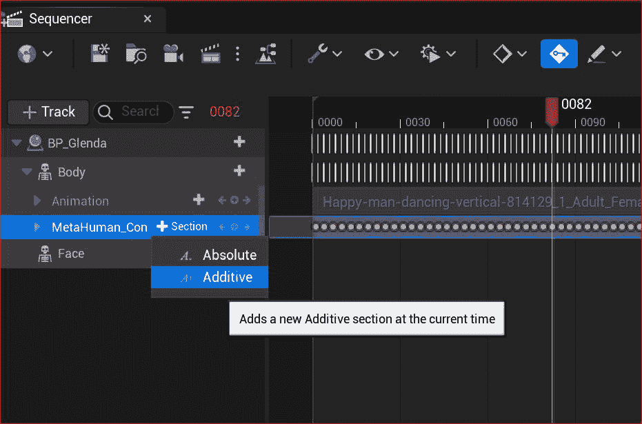

图 7.11：添加叠加片段

根据*图 7.12*，**叠加**轨道已添加，它是我们刚创建的控制绑定的子轨道。在这里我们可以解决动画问题或添加动画更改，而不会影响原始动作捕捉：

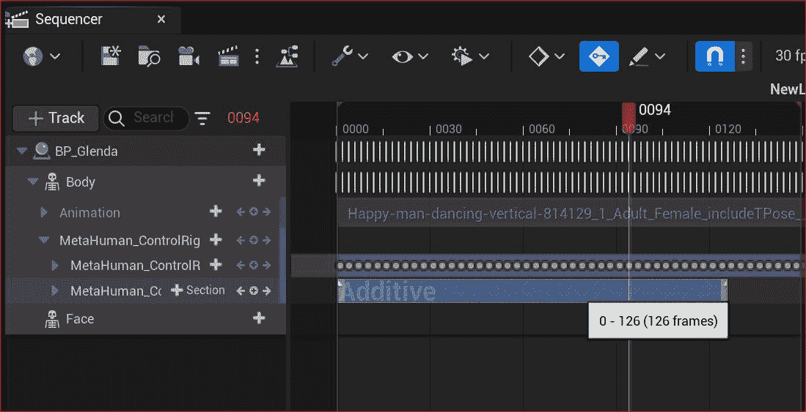

图 7.12：叠加片段轨道

此时，我们实际上拥有两个绑定，每个都有自己的轨道：一个轨道在每一帧上为每根骨骼都有关键帧，另一个则有零关键帧。在下一节中，我们将仅向叠加片段/轨道添加关键帧。即使我们在视口中对动画外观进行更改，也不会编辑动作捕捉的原始关键帧。从本质上讲，这是一种非破坏性工作流。

> **注意**
>
> 在添加**叠加**或绝对片段/轨道的情况下，"section"（片段）和"track"（轨道）这两个词是同义词。

要编辑**叠加**片段，请确保在 Sequencer 中选中了**叠加**片段，正如我在*图 7.13*中所做的：

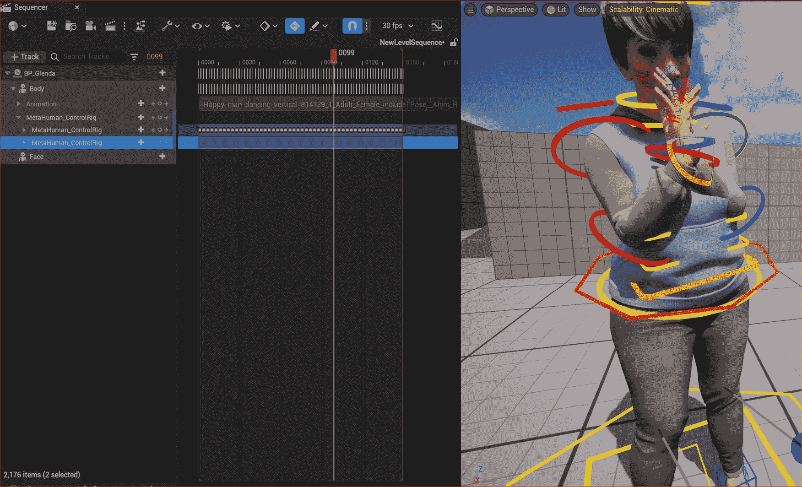

图 7.13：调整叠加控制轨道

你也可以看到这是一个有问题的片段，因为动捕数据导致 Glenda 的左臂与身体发生碰撞——它穿模进了身体内部，这很可能是因为源角色比目标角色瘦得多。然而，有了叠加工作流，我们只需关注修复出现该问题的时间范围。

*图 7.13*显示，在第** 0099 **帧，Glenda 的手臂与身体相交，所以我们需要修复该帧。我们可以通过旋转其中一个手臂关节来实现。

为此，按 `E` 键使用**旋转**功能。然后，点击 Sequencer 中 `Metahuman_Control Rig` 左侧的下拉箭头。在*图 7.14*中，你可以看到下拉列表，它允许我访问所有不同的骨骼。对于这个特定问题，我只想修改左上臂和左下臂。

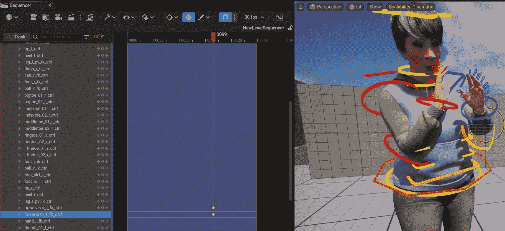

图 7.14：在叠加轨道上设置关键帧

默认情况下，一旦你做出更改，就会设置一个关键帧。你可以看到*图 7.14*中高亮显示的关键帧，在旁边的视口中，你可以看到该更改在视口中的效果。因为我在叠加轨道上没有设置其他关键帧，所以该更改的效果将在整个片段持续时间内显现。

如果我只想调整特定时间段（如 2 秒），我需要创建 3 个关键帧。第 1 个和第 3 个关键帧用于保留原始姿势，第 2 个（中间）关键帧则是发生更改的地方。

请看*图 7.15*，你将看到我是如何添加额外关键帧的：

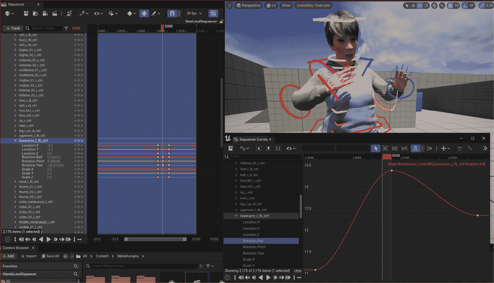

图 7.15：向叠加轨道添加额外关键帧

中间的关键帧是幅度最大的更改处，因为这是问题区域。正如你在*图 7.15*中所见，我对 `Location`（位置）、`Rotation`（旋转）和 `Scale`（缩放）设置拥有数值控制权，我就是用它来旋转肩膀，使手臂不再穿透躯干，从而修复了问题。你可以使用样条曲线进行编辑，如*图 7.15*右侧图表所示，但我个人觉得这很麻烦，尽管它有利于可视化变化。

在添加关键帧以修复动画或增加创意层面时，可能性是无穷的。你可能决定添加一个转头、眨眼、挥手，或是在动作捕捉阶段未获得的其他动作。所有这些现在都可以通过 Level Sequencer（关卡序列器）中的叠加选择来实现。

> **注意**
>
> 当你想编辑特定关节时，使用搜索选项查找该关节。这将只显示你搜索的关节，如果你觉得关节列表分散注意力，这能让你专注于该关节。

现在我们已将角色放入 Level Sequencer 并进行了一些调整，接下来需要做的是创建一个摄像机，以便渲染出电影。

### 向 Level Sequencer 添加摄像机

UE5 摄像机是一个强大的工具，因为它的运作方式就像真实的摄像机。我可以单独写一整本书来讲摄像机，但为了完成本章，你只将学习一些与 Level Sequencer 专门相关的非常基础的摄像机技巧。

为简单起见，我们将使用 Level Sequencer 创建一个摄像机。我们还需要一个**摄像机剪辑**；这就像一个主轨道，主要设计用于多摄像机的使用，但即使只有一个摄像机我们也需要它。只有当我们在 Level Sequencer 内部创建摄像机时，**摄像机剪辑**才会自动生成。

在我们这样做之前，首先需要创建一个播放范围。你可以通过在 Level Sequencer 的时间轴上任意位置右键点击，选择**设置开始时间**，然后点击你想开始动画的位置。接着，对**设置结束时间**做同样的操作。这两个时间之间的差值即为播放范围；然而，稍后渲染时，此范围也用于定义要渲染的帧范围。

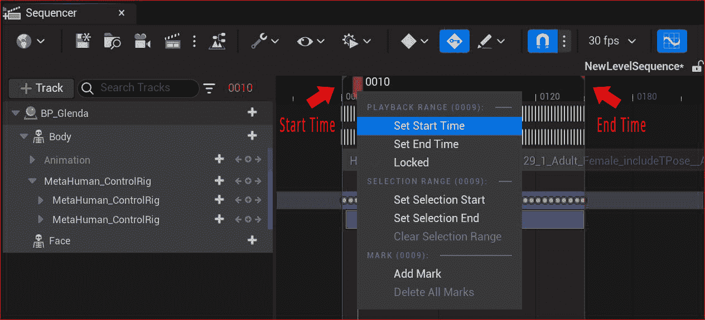

Figure 7.16: 设置播放范围的起始帧

你会知道何时创建了播放范围，因为你会看到一条绿线和一条红线，如图 7.16 所示——我选择的开始时间位于我之前烘焙的关键帧的开头，而结束时间则正好在关键帧结束的地方。这确保了我的播放范围长度与整个动画的长度相同。你随时可以通过简单地将红线拖动到时间轴的右端来延长播放范围。

创建好播放范围后，现在我们可以创建一个摄像机，它将自动创建一个 Camera Cut（摄像机剪切）来填充我们创建的播放范围。操作非常简单，点击 Sequencer 顶部的摄像机图标：

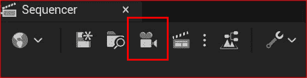

Figure 7.17: 摄像机图标

系统将创建一个摄像机，并且在 Sequencer 中会创建更多轨道：

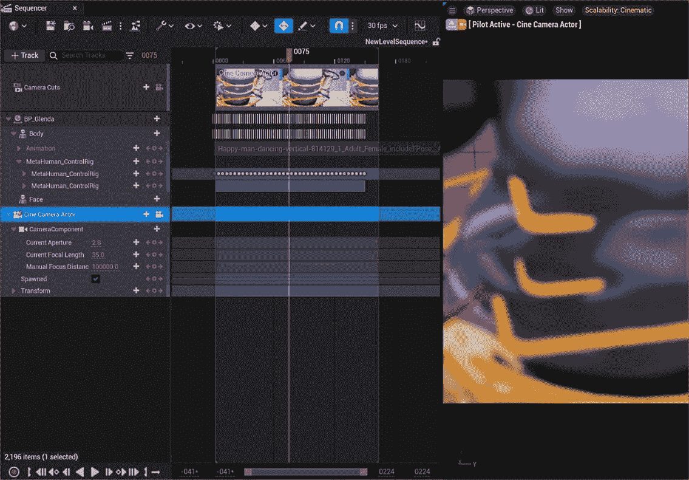

Figure 7.18: 创建的摄像机

从图 7.18 中可以看出，我们现在获得了一个 `Cine Camera Actor`（这是真实摄像机的虚拟版本）。连同摄像机一起，我们还拥有许多参数，例如以下几项：

*   `Aperture`（光圈）：这是镜头光圈的大小。数值越低意味着画面中失焦的部分越多，而数值越高则提供更清晰的图像。这在景深方面真实地模拟了摄像机的工作原理，但不包括曝光。
*   `Focal Length`（焦距）：就像真实摄像机一样，焦距以毫米为单位测量。数值越低产生广角镜头，数值越高产生长焦或远摄镜头。
*   `Manual Focus Distance`（手动对焦距离）：同样像真实摄像机一样，对焦区域被设定在距离摄像机给定距离的位置。例如，你可能只想对焦距离摄像机 5,000 毫米处的物体。
*   `Spawned`（生成）：一项面向游戏模拟的功能。如果勾选，游戏引擎将在游戏开始时生成该摄像机。
*   `Transform`（变换）：用于移动、旋转和缩放摄像机的可编辑参数。

在大多数情况下，你只想为以下参数制作动画：`Transform` 中的 `Moving`（移动）和 `Rotating`（旋转），以及 `Focus Distance`（对焦距离）。

在开始设置关键帧之前，一个有用的功能是驾驶摄像机来制作动画。换句话说，你可以通过视口观察，以确保获得最佳构图。在图 7.19 中，我高亮显示了 `CameraComponents` 轨道和 `Cine Camera Actor` 轨道上的摄像机图标。需要切换这些图标，直到出现 `Eject`（弹出）图标（三角形），我也将其高亮显示了。

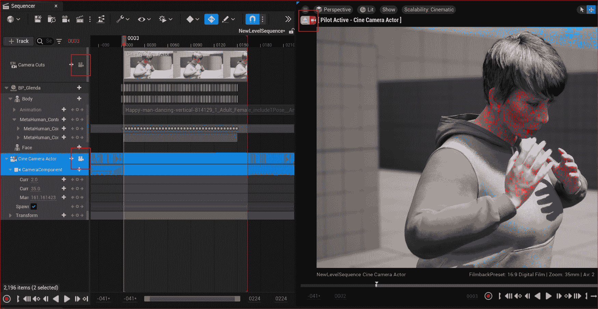

Figure 7.19: 创建的摄像机

图 7.19 演示了摄像机现在正处于驾驶状态，这是控制摄像机的一种更高效的方式。如果你熟悉 3D 软件或第一人称游戏，你会发现使用摄像机导航非常直观：

*   `Alt` + `左键点击` 进行环绕（移动视角）
*   `Alt` + `中键点击` 进行平移（左右和上下移动）
*   `Alt` + `右键点击` 进行推拉（前后移动）

当你熟悉了使用摄像机在场景中导航后，让我们创建你的第一个摄像机动画：

1.  点击 Sequencer 中 `CameraComponent` 下的 `Transform`。
2.  然后，确保播放头停靠在 `Play Range`（播放范围）的开头附近，按下 `Enter`。这将为所有变换参数创建关键帧，例如 `Location`（位置）、`Rotation`（旋转）和 `Scale`（缩放）。
3.  对 `Focus Distance` 属性执行相同操作，但首先要确保你的 MetaHuman 处于对焦状态，就像图 7.19 那样。你需要点击 `Manual Focus Distance`，更改数值，然后按下 `Enter` 来创建关键帧。
4.  当你对构图和对焦都满意时，将播放头停靠在另一帧上。
5.  一旦你重新定位摄像机，关键帧将自动放置。如果没有自动放置，就像之前那样点击 `Transform` 属性并按下 `Enter`。

你现在已经在拍摄 MetaHuman 时创建了你的第一个摄像机动画。你可能需要编辑 `Focus Distance` 属性，以确保你的 MetaHuman 在整个镜头过程中保持对焦。

规划摄像机移动需要一点时间，你可能会发现自己创建关键帧，然后不得不反复删除它们。这完全正常。一旦你觉得摄像机移动相当合理，就可以渲染一些动画了。

### 从 Level Sequencer 渲染测试动画

要渲染输出动画，首先点击 Sequencer 顶部的 `Movie Scene Capture` 按钮（这是场记板图标）：

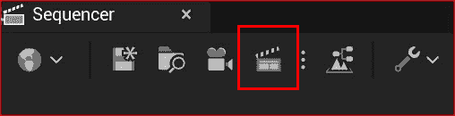

Figure 7.20: 场记板图标

> **Note**
>
> 如果你安装了 Movie Render Queue 插件，系统会让你选择使用哪种渲染器。如果是这种情况，请选择 `Movie Scene Capture (Legacy)`。

随后你将看到以下 `Render Movie Settings`（渲染电影设置）对话框：

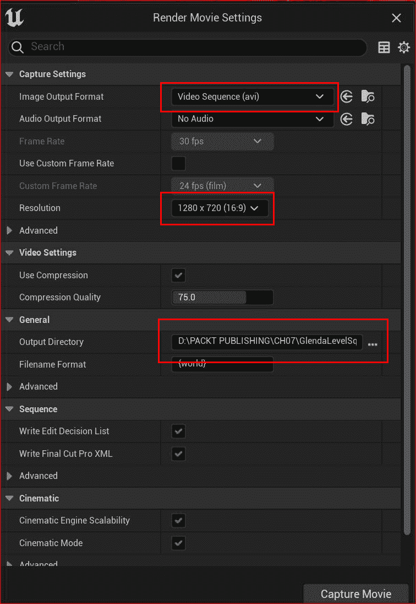

Figure 7.21: 渲染电影设置

在图 7.21 中，我保留了所有设置的默认值。有三个重要设置需要注意：

*   `Image Output Format`（图像输出格式）：你需要以系统可播放的格式渲染电影。默认是 `AVI`，但你可以将其更改为 `QuickTime Pro Res` 文件。

> **Note**
>
> 为确保能够渲染 Apple Pro Res，请转到 `Edit`（编辑），然后 `Plugins`（插件），搜索 `prores`，并勾选 `Apple ProRes Media` 复选框。然后，你需要重启 Unreal。

*   `Resolution`（分辨率）：默认分辨率为 `1280 x 720 (16.9)` 像素，但如果你愿意，可以将其更改为更高的分辨率。
*   `Output Directory`（输出目录）：默认情况下，`Render Movie` 渲染器会尝试将文件渲染到你的项目文件夹中作为输出目录。如果你愿意，可以选择其他目录。

对渲染设置满意后，点击 `Capture Movie`（捕获电影）。渲染文件需要几分钟时间——在等待期间，你可以看到渲染预览，如图 7.22 所示。你可以看到我的文件正被写入我为本书创建的一个专用目录中。

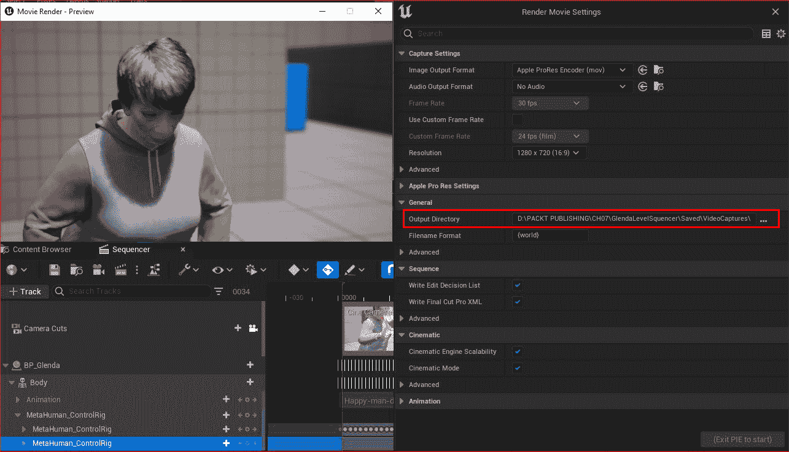

Figure 7.22: 电影渲染——预览窗口

要查看完成的视频，请转到你电脑上的输出目录，点击生成的 `MOV` 文件播放你的动画。

> **Note**
>
> 在较慢的系统上，当渲染看起来已经完成时，渲染预览窗口将保持打开状态。渲染器会经历一个写入所有帧的过程，然后再经历一个将帧封装进 QuickTime 文件的过程。在较高分辨率、文件较大且机器较慢的情况下，这个过程所花费的时间可能几乎与初始渲染一样长。

### 总结

在本章中，我们学习了如何创建 Level Sequencer 并将角色添加到其中。我们还学习了如何基于上一章的动作捕捉数据创建关键帧 MetaHuman Rig，以及如何添加 Additive（叠加）部分以应用额外关键帧来修复问题。

然后，我们简要介绍了 Level Sequencer 中的关键帧制作，接着创建了摄像机并在 Level Sequencer 中为其制作动画。最后，我们学习了如何从 UE5 导出视频文件。

在下一章中，我们将使用 iPhone 进行面部动作捕捉。
