## 第 8 章：使用 iPhone 进行面部动作捕捉


### 使用 MetaHuman 和 iPhone 进行面部动作捕捉

在上一章中，我们通过学习如何使用 `Level Sequencer` 调整动画和渲染视频，将身体动作捕捉提升到了一个新的水平。`Level Sequencer` 在管理动画方面发挥着不可或缺的作用，我们将在本章中再次使用它，探索面部动作捕捉。

在本章中，我们将专门针对我们的 `MetaHuman` 进行面部动作捕捉，利用 iPhone 的深度摄像头和面部追踪功能。`MetaHuman` 自带数十个复杂的面部控制器，可响应面部捕捉工具，赋予您创建极其逼真的面部表演（包括语音）的能力。它可以捕捉您自己的表演或演员的表演，甚至非常细微的细微差别也能反映出来，从而使整体结果极其逼真。

因此，在本章中，我们将涵盖以下主题：

*   安装 `Live Link Face` 应用
*   安装 Unreal Engine 插件（包括 `Take Recorder`）
*   连接并配置 `Live Link` 应用到 Unreal Engine
*   配置和测试 `MetaHuman Blueprint`
*   校准和捕捉实时数据

### 技术要求

就计算机性能而言，您将需要 *第 1 章* 中详述的技术要求，以及我们在 *第 2 章* 中导入到 UE5 的 `MetaHuman` 和 Unreal Engine 模特。

您还需要一部 iPhone 和稳定的 Wi-Fi 连接来安装插件。

让我们更详细地看看 iPhone 的要求。您需要拥有 iPhone X 或更新机型，或 iPad Pro（第 3 代）或更新机型。这是因为（与其他手机如 Android 手机不同）它们内置了深度摄像头，这是动作捕捉所必需的。

您还需要一根长约 2 米的长线，因为在动作捕捉过程中最好让 iPhone 保持充电状态，因为该过程非常耗电。

### 安装 Live Link Face 应用

`Live Link Face` 应用是一款免费应用，您可以直接从 App Store 下载到 iPhone 或 iPad 上。其唯一目的是利用 iPhone 内置的深度摄像头，结合面部识别和像素追踪技术，生成可在 `ARKit` 中工作的数据。除了实时收集面部动作捕捉数据外，它还通过 **互联网协议 (IP)** 经 Wi-Fi 连接将数据传输到您的台式电脑；这些数据随后由 Unreal Engine 中的 `Live Link` 实用程序拾取，我们稍后将深入探讨。

**图 8.1** 显示了 Apple App Store 中的 `Live Link Face` 应用：

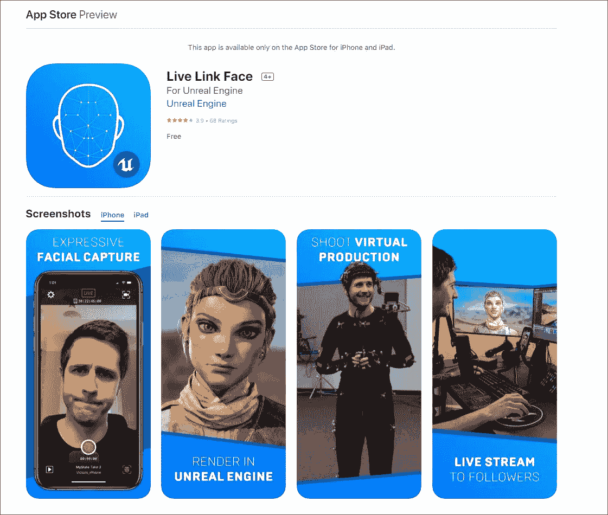

图 8.1：App Store 中的 Live Link Face 应用

下载安装后，打开应用测试其是否正常工作。注视屏幕时，您应该立即看到自己的脸。默认情况下，网格叠加层处于启用状态，如 **图 8.2** 所示，您会看到网格非常准确地追踪您的脸部。

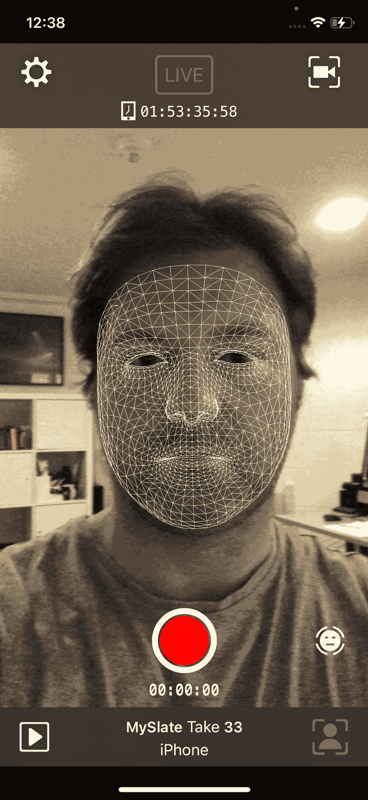

图 8.2：打开 Live Link Face 应用

一旦我们的面部被追踪，就知道应用正常工作了。暂时不需要对应用程序做更多操作。在下一节中，我们将安装许多 Unreal Engine 插件，例如 `Live Link`，它将允许我们从 iPhone 接收动作捕捉流数据。

### 安装 Unreal Engine 插件（包括 Take Recorder）

正如刚才提到的，您需要安装许多插件。好消息是，在下载并导入您的第一个 `MetaHuman` 角色时，您会在不知不觉中自动安装了它们。但是，您需要确保启用以下插件：

*   `Live Link`
*   `Live Link Control Rig`
*   `Live Link Curve Debug UI`
*   `Apple ARKit`
*   `Apple ARKit Face Support`
*   `Take Recorder`

要轻松找到插件，请转到 **编辑**，然后 **插件**，我们将开始安装所需的插件。

### Live Link、Live Link Control Rig 和 Live Link Curve Debug UI

要查找 `Live Link` 插件，请搜索 **Live Link**，如 **图 8.3** 所示。您可以看到我已启用以下插件，由复选框和蓝色勾号指示：

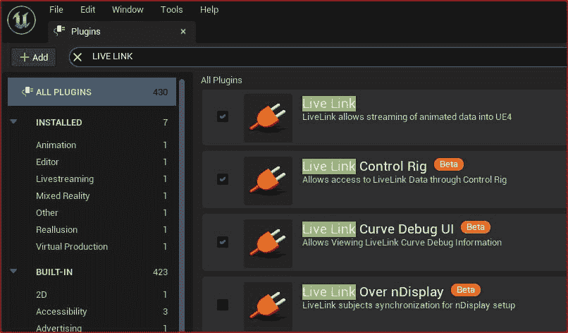

图 8.3：启用 Live Link 插件

其中一些插件对于使用该应用至关重要，我将简要概述它们的重要性。

#### Live Link

`Live Link` 是核心插件，允许第三方应用程序将动画数据直接流式传输到 Unreal Engine。`MotionBuilder` 和 `Maya` 等应用程序允许用户对这些应用程序进行更改，并实时在 Unreal Engine 视口中查看结果。在本书的语境下，此功能允许用户使用其他应用程序（如 `Live Link` iPhone 应用）将数据直接流式传输到 Unreal Engine。

#### Live Link Control Rig

`Live Link Control Rig` 允许来自第三方应用程序的传入数据与角色的动画控制器进行通信。例如，`MetaHuman` 拥有一个控制绑定，允许用户手动为其制作动画。`Live Link Control Rig` 利用相同的控制绑定协议。

#### Live Link Curve Debug UI

为了调试和查看从第三方动画数据源到 Unreal Engine 的连接，我们将使用 `Live Link Curve Debug UI` 插件。

> **注意**
>
> `Live Link Curve Debug UI` 虽然非必需，但它是一个方便的界面，用于排查高级细化时的问题；然而，详细讨论它超出了本书的范围，因为它会查看面部的每一个控制点。

### ARKit 和 ARKit Face Support

接下来，我们需要 `ARKit` 和 `ARKit Face Support`。`ARKit` 是一个专为 Apple iOS 摄像头设备设计的 AR 解决方案。它确保 Unreal 能够理解传入的数据。`ARKit Face Support` 专门通过 iPhone 上的深度和 RGB 摄像头连接到面部追踪解决方案。

因此，在 **插件** 选项卡中，运行搜索，但这次搜索 **ARKit**。您将看到需要启用的可用 `ARKit` 插件列表：

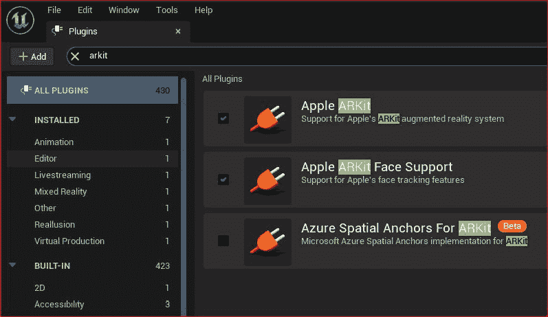

图 8.4：启用 Unreal Engine ARKit 插件

### Take Recorder

我们还有一个插件需要启用，即 `Take Recorder`。试着把 `Take Recorder` 想象成一台摄像机。实际上，它记录 `Live Link` 接收到的动作捕捉数据并存储以供播放，进而导入到 `Level Sequencer` 中。就像摄像机一样，我们可以录制多个镜头，直到我们满意得到了最好的一个（或者至少尽可能接近最好的！）。

要启用 **Take Recorder**，请按照 **图 8.5** 搜索该插件：

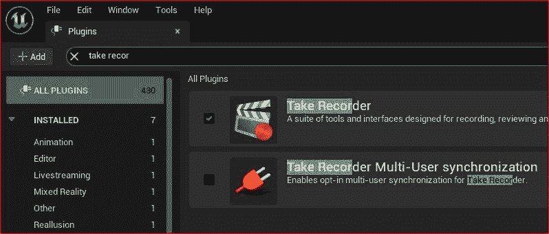

图 8.5：启用 Unreal Engine Take Recorder 插件

> **注意**
>
> 如果您启用了其中任何插件，可能需要重新启动 Unreal Engine 才能生效。

启用所有必要的插件后，我们现在可以进入下一节，配置 `Live Link Face` 应用，以便它能将数据发送到 Unreal Engine。

### 连接和配置 Live Link Face 应用到 Unreal Engine

安装好 iPhone 上的 `Live Link Face` 应用并在 Unreal Engine 中启用 `Live Link` 插件后，我们现在需要让它们相互“通信”（当然是比喻）。我们的目标是将动作捕捉数据从 iPhone 发送到 PC，和/或让 `Live Link` 应用将这些数据发送到 Unreal Engine。

为此，我们首先需要通过查找计算机的 IP 地址来配置应用：

1.  按下 Windows 键并搜索 **命令提示符**。


2. 在命令提示符中，输入 `ipconfig`。

3. 你将看到所有 IP 配置的列表。在第一行你会看到 `IPv4` 地址，它应该类似于以下内容：

```
192.168.100.155
```

记下该数字，它对于你的机器来说是唯一的。

1. 接下来，打开 Live Link Face 应用。

2. 在屏幕左上角，你将看到一个齿轮图标，如图 8.6 所示：

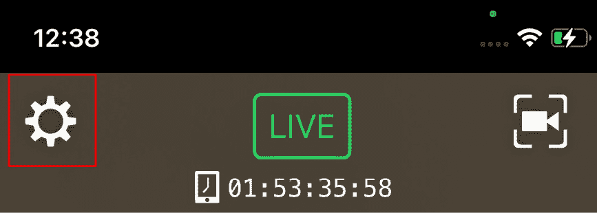

图 8.6：点击设置图标

1. 点击齿轮图标将进入 `Settings`（设置）页面。在那里，点击 `Live Link` 选项：

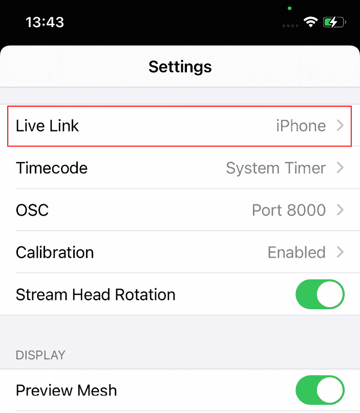

图 8.7：点击 Live Link iPhone

1. 现在点击 `Target`（目标）并输入你电脑的 IP 地址。

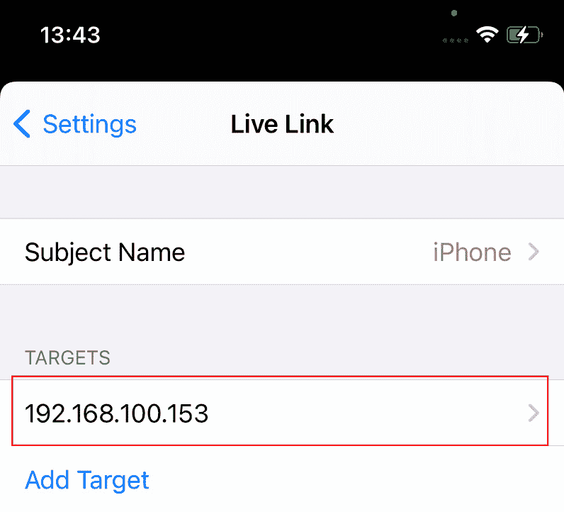

图 8.8：点击 IP 目标

在应用中设置好 IP 地址后，你需要切回 Unreal Engine 查看是否正在接收信号。

1. 在 Unreal Engine 中，依次转到 `Window`（窗口）、`Virtual Production`（虚拟制片），然后点击 `Live Link`，此时将打开以下 Live Link 界面：

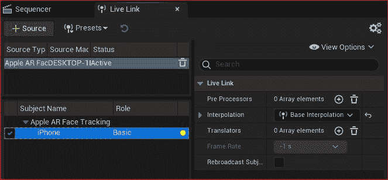

图 8.9：Live Link 界面

在图 8.9 中，你可以看到 Live Link 已自动捕捉到一个信号。它识别出该信号类型为 `Apple AR Face Tracking`（Apple AR 面部追踪），并显示信号来源主体的名称，在我的例子中是 `iPhone`。碰巧的是，`iPhone` 只是我购买手机后给它起的名字。无论你如何命名你的手机，该名称都将出现在主体名称下。

同样在图 8.9 中，在显示 `iPhone` 文字的旁边，你会看到 `Role`（角色）下显示为 `Basic`，其右侧有一个黄点。该点指示信号的状态，解读如下：

* 如果圆点为**红色**，表示没有数据传入，这可能是由不当的配置导致的，例如 Live Link Face 应用已关闭或手机已关机
* **黄点**表示两个应用程序正在相互 ping 通，但不存在活动的 ARKit 数据
* **绿点**表示来自 Live Link Face 应用的 ARKit 数据正在传入 Unreal Engine

知道两个应用能有效通信后，我们就可以进行下一步，配置 MetaHuman 以接收数据。

### 配置和测试 MetaHuman 蓝图

我们现在必须让 MetaHuman 蓝图接收来自 Live Link 的数据。碰巧的是，这非常简单：

1. 从 `Content`（内容）文件夹中打开 MetaHuman 蓝图。

2. 在左侧的 `Components`（组件）选项卡中，点击层级顶部显示 `BP_ (your MetaHuman Name)`（你的 MetaHuman 名称）的位置。在我的例子中是 `BP_Glenda`。这将让你在 `Details`（详情）面板中看到需要编辑的设置，如图 8.10 所示：

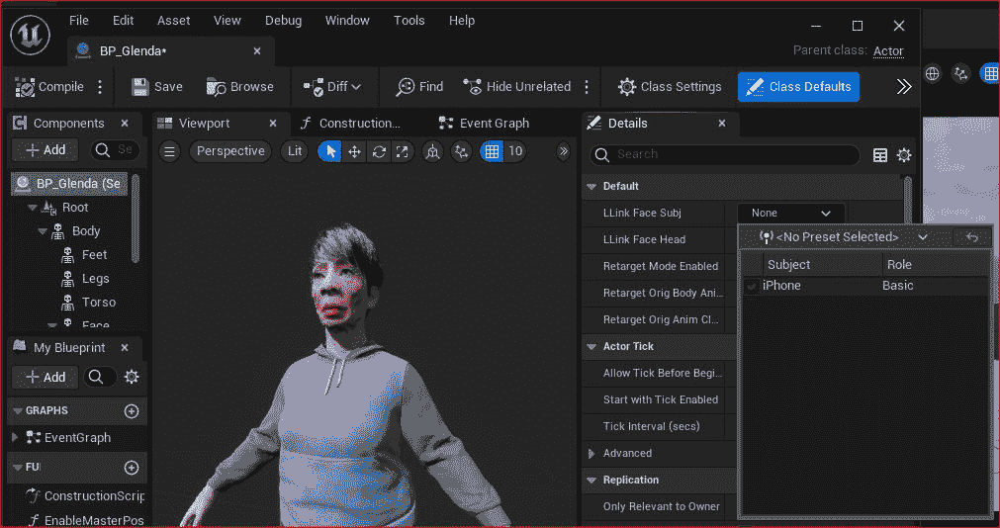

图 8.10：创建关卡序列器

1. 转到 `Llink Face Subject` 下拉列表并选择你手机的名称。同样，在我的例子中它只是叫 `iPhone`，但你的手机可能有更具体的名称。

2. 此外，勾选 `Llink Face Head` 选项，这将使蓝图能够接受头部运动数据。

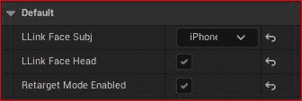

图 8.11：启用 Llink Face Head 选项

接下来，在 `Components` 选项卡中点击 `Face`（面部）。然后，在 `Details` 面板中转到 `Animation`（动画），如图 8.12 所示：

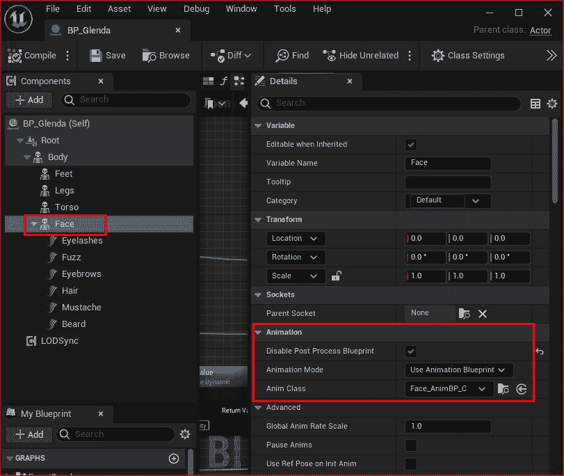

图 8.12：更改动画模式和动画类

1. 此处，确保 `Disable Post Process Blueprint` 保持其默认的勾选状态。如果该框未勾选，请勾选它。

2. 然后，将 `Animation Mode`（动画模式）更改为 `Use Animation Blueprint`（使用动画蓝图），并将 `Anim Class`（动画类）更改为 `Face_AnimpBP_C`。

3. 现在，务必点击 `Compile`（编译），然后保存蓝图，否则这些更改不会生效。

对蓝图进行这些更改后，是时候测试从 Live Link Face 应用流式传输到你的 MetaHuman 蓝图中的动作捕捉数据了。在测试之前，请确保完成以下检查清单：

* 应用中的 IP 地址正确
* Live Link 已启用并处于打开状态
* MetaHuman 蓝图正在接收 iPhone 信号，在 `Details` 面板中 `Default` 参数下的 `LLink Face Subj` 旁边
* MetaHuman 面部蓝图的 `Mode` 设置为 `Use Animation Blueprint`，`Anim Class` 设置为 `Face_AnimpBP_C`，如图 8.12 所示

如果你已遵循检查清单，接下来你需要做的是按 `Alt` + `P` 运行模拟。此时，你应该会在视口中看到角色的实时面部捕捉。

如果你延续了上一章的内容并打开了关卡序列器，你将在通过 DeepMotion Animation 3D 获取的角色身体动画之上，看到新的面部动画。请注意，你甚至可以在预览实时面部捕捉的同时，从关卡序列器播放身体动画。

很快你就会意识到 iPhone 动作捕捉的结果并不完美。然而，它是一个非常强大且复杂的工具，拥有巨大的空间来优化传入的数据，并在数据录制后再次优化。

> **注意**
>
> 如果你在面部动画方面遇到问题，例如头部旋转正常但其他部分不动，这是一个已知错误，已通过更新 Quixel Bridge 修复。如果你运行的是 Unreal Engine 5.0.3 或更高版本，请确保将 Quixel Bridge 插件更新到 5.0.0 或更高版本。然后你需要重新下载并重新导入你的角色。

在下一节中，我们将介绍校准 Live Link Face 应用以获得更好的结果。

### 校准和捕捉实时数据

为了获得更好的结果，ARKit 捕捉过程需要获取考虑到表演者特征的数据。正如你从图 8.13 所见，应用出色地捕捉了表演者的面部比例，清晰地勾勒出了眼睛、鼻子、嘴巴和下巴。然而，给应用提供基准信息（如中性姿势）将真正有助于优化整体结果。

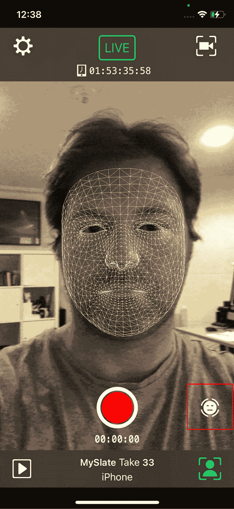

图 8.13：校准 Live Link Face 应用

为了理解基准和中性姿势如何及为何起作用，让我们以眉毛为例，使用任意计量单位来看一看。如果在静止或中性位置眉毛位于 0，皱眉时位于 –10，而惊讶表情将眉毛抬高到 +15，那么了解什么是中性姿势将使应用更好地确定皱眉或惊讶表情的位置，以配合其追踪能力。

Live Link Face 应用中的校准过程非常简单，因为它仅依赖中性表情。在图 8.13 中，我高亮显示了录制按钮右侧的面部图标——点击面部图标，点击 `Recalibrate`（重新校准），随后将开始简短倒计时，然后拍摄你的中性姿势照片用于校准。

校准完成后，就该准备捕捉面部表演了。为此，有三个主要考虑因素：


#### 先决条件

*   **系统性能**：我们需要尽可能精简，以便我们的系统和虚幻引擎只专注于以尽可能高的帧率获取尽可能多的数据。因此，诸如照片级真实感光照、高等级光照和摄像机特效等处理器密集型任务需要缩减。此外，确保没有着色器在后台准备编译，且没有其他应用程序正在运行。
*   **Take Recorder**：我们将使用 Take Recorder 插件来录制面部动作捕捉，因此你需要确保它已启用。
*   **Level Sequencer（关卡序列器）**：我们将使用 Level Sequencer 来导入和播放面部动捕数据，并在必要时利用它来优化动画。

我将逐步引导你完成使用手机捕捉面部动作的过程：

### 使用 iPhone 捕捉面部动作

#### 初始设置
1.  确保手机处于固定位置，光线充足，且前置摄像头正对表演者。
2.  确保 Live Link 正在接收信号（请记住，你希望在手机名称旁边看到一个绿点）。
3.  然后，确保所有渲染设置均调至 `Low`，且复杂的场景 Actor 要么隐藏要么从场景中移除。请参阅图 8.14，了解使用 `Unlit` 和 `Low` 设置的缩减版视口设置示例：

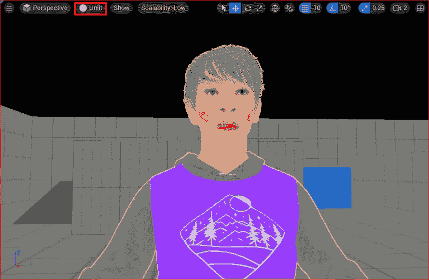

图 8.14：可扩展性设置为 Low 和 Unlit

#### 配置 Take Recorder
1.  通过 `Window`（窗口）> `Cinematics`（电影）> `Take Recorder` 打开 `Take Recorder`。
2.  然后，点击 `+ Source`（+ 来源）按钮添加角色蓝图。在 `From Actor`（来自 Actor）下搜索你角色的蓝图，并从 `From LiveLink`（来自 LiveLink）选项中添加你的手机，如图 8.15 所示。

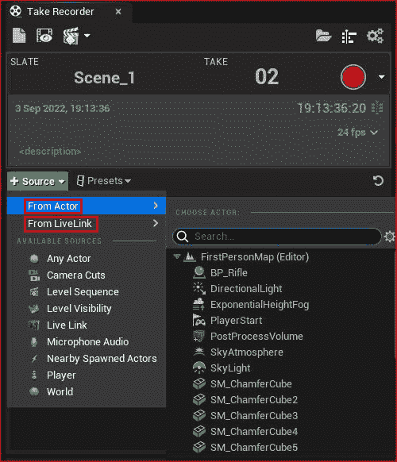

图 8.15：向 Take Recorder 添加来源

#### 录制会话
1.  准备就绪后，首先按 `Alt + P` 运行模拟，然后点击大的红色录制按钮。

一运行模拟，动作捕捉就会开始，伴随一个 3 秒倒计时，类似于图 8.16：

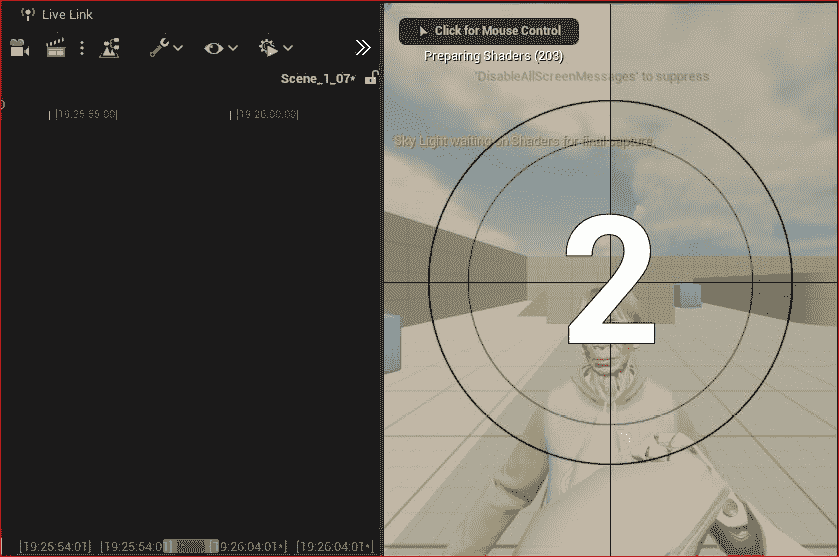

图 8.16：3 秒倒计时

录制开始后，蓝图轨道和 iPhone 轨道将被写入为一个 Take，并临时占用 Level Sequencer 以显示哪些轨道正在活跃录制：

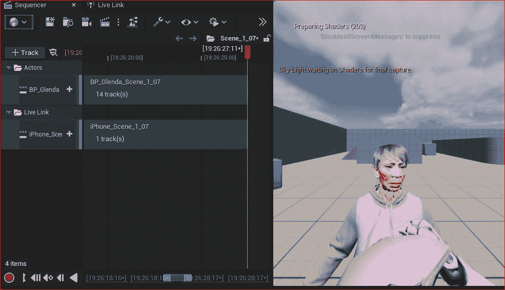

图 8.17：正在录制的轨道

当你对动捕会话满意时，点击 Take Recorder 上的停止按钮，并按 `Esc` 停止模拟。

#### 在 Level Sequencer 中回顾
1.  回到 Level Sequencer，你现在可以查看你的面部动捕数据。如果 Level Sequencer 中没有任何内容，你需要添加你的角色蓝图，点击 `+ Track`（+ 轨道），然后选择 `Actor to Sequence`（Actor 到序列），并搜索你的角色，如图 8.18 所示：

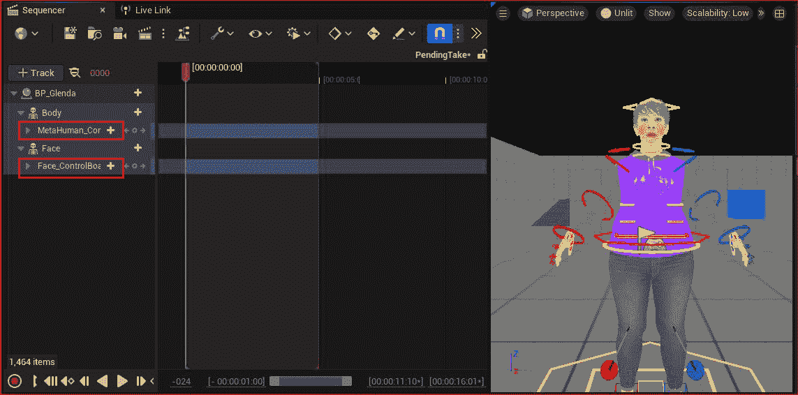

图 8.18：将角色蓝图导入 Level Sequencer

请注意，在图 8.18 中，当你引入角色时，也会同时引入一套面部绑定和一套身体绑定。然而，因为我们是用动捕驱动角色，所以需要删除这些绑定。

1.  一旦你从 Level Sequencer 中删除了绑定，点击 `Face`（面部），然后 `+Track`（+ 轨道），再选择 `Animation`（动画），最近的动捕会话将位于列表底部。在我的例子中，我选择的是第一个 Take，`BP_Glenda_Scene_1_01_0`。

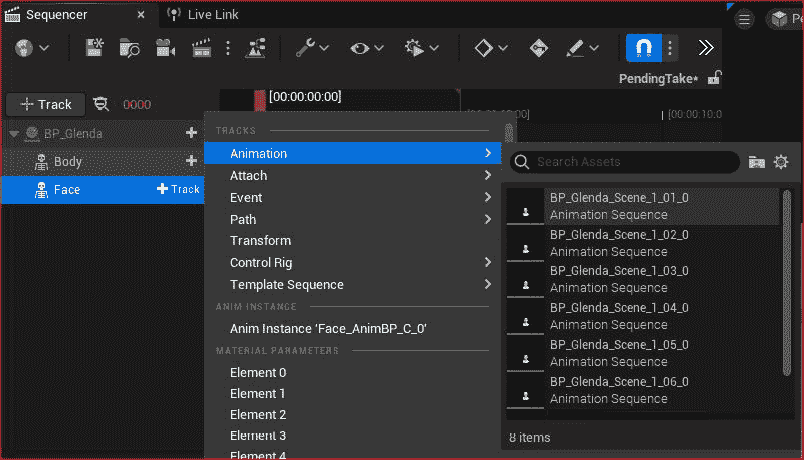

图 8.19：向 Level Sequencer 添加 Actor

1.  选择一个 Take 后，按下 Level Sequencer 上的播放按钮，即可实时观看你的动作捕捉回放。

如果你仍保留着上一章带有重定向动画的角色蓝图，可以导入身体动画。此外，如果你的表演需要语音，Level Sequencer 也能播放音频，以便你在虚幻引擎中测试表演。这在确保面部捕捉与录制的语音音频同步时非常有用。

> **Note**
> 建议你同时捕捉身体和面部，因为大多数表演者是以头部带动动作，头部再带动身体。只有在两个元素同时捕捉时，才能真正正确地让身体和头部保持同步。

iPhone 方案可以与 DeepMotion Animate 3D 同时工作。为此，你需要一个面部捕捉装置，以确保 iPhone 的深度摄像头始终对着你，且你的双手是自由的。理想情况下，摄像头始终需要保持一致的距离。任何独立于头部的摄像头移动都会被理解为头部移动，从而导致数据不准确。

MOCAP Design 等公司专门制作适配 iPhone 的头盔。你可以在 [`www.mocapdesign.com/m2-headcam`](https://www.mocapdesign.com/m2-headcam) 查看他们的一些 iPhone 和 GoPro 相机解决方案。

该方案对大多数人来说可能较贵，因此 DIY 方案或 3D 打印方案可能更具成本效益。此外，现在也有针对主播的解决方案，可保持手机摄像头在一致的距离。虽然不完美，但肯定比单手拿手机或架在三脚架上要好得多。

### 总结

在本章中，我们探讨了虚幻引擎中 MetaHuman 的 iPhone 面部动作捕捉解决方案。我们结合 Live Link 和 ARKit 插件使用 Live Link App 来捕捉实时数据。此外，我们还结合 Level Sequencer 使用了 Take Recorder 插件，作为录制和管理动捕的一种方式。

在下一章中，我们将继续进行面部动作捕捉，但会在一个更专业的层面上，使用 Faceware。
