## 第 9 章：使用 Faceware 进行面部动作捕捉

在上一章中，我们使用 iPhone 通过 Live Link Face App 捕捉面部数据。虽然这是一个很棒的解决方案，但它也有局限性。其中之一是我们在校准方面几乎没有控制权；我们只能校准到中性姿势。

在本章中，我们将介绍一个更专业的解决方案，它被用于 3A 游戏和电影项目。与 iPhone 的深度摄像头不同，我们将采用一种基于视频摄像头的解决方案，它为我们提供了更多的校准控制：该解决方案是 Faceware Studio。

我们不仅将利用改进的校准来为 MetaHuman 进行面部动作捕捉，还将探讨 Level Sequencer 中的加性工具。

因此，在本章中，我们将涵盖以下主题：

### 涵盖主题

*   在 Windows PC 上安装 Faceware Studio
*   安装虚幻的 Faceware 插件和 MetaHuman 示例
*   设置网络摄像头和流媒体功能
*   启用 Live Link 以接收 Faceware 数据
*   编辑 MetaHuman 蓝图
*   使用 Take Recorder 录制会话
*   将 Take 导入 Level Sequencer
*   在虚幻引擎中烘焙和编辑面部动画

### 技术要求

就计算机性能而言，你需要 第 1 章 中详述的技术要求，以及我们在 第 2 章 中导入到 UE5 的 MetaHuman 和虚幻引擎模特。

你还将需要：

*   一个网络摄像头和一个光线充足的房间
*   稳定的网络连接，因为你将下载插件
*   Faceware Studio

> **Note**
> 一句忠告：Faceware Studio 不是免费解决方案；不过，它比二手 iPhone X 便宜。对于个人用户，有一个 Indie 定价计划，即每月 15 欧元（撰写时）。或者，你可以申请免费试用。

### 在 Windows PC 上安装 Faceware Studio

要安装 Faceware Studio，请前往 [`facewaretech.com/`](https://facewaretech.com/) 并导航至**定价**页面。Faceware Studio 软件有两个可供下载的选项，具体取决于您的预算。第一个是 **Faceware Studio (Indie)** 版本，目前定价为每年 179 美元；第二个是 Faceware Studio 的免费试用版。

我们假设您选择后者——点击 **Faceware Studio** 下的**立即试用**，如*图 9.1*所示。

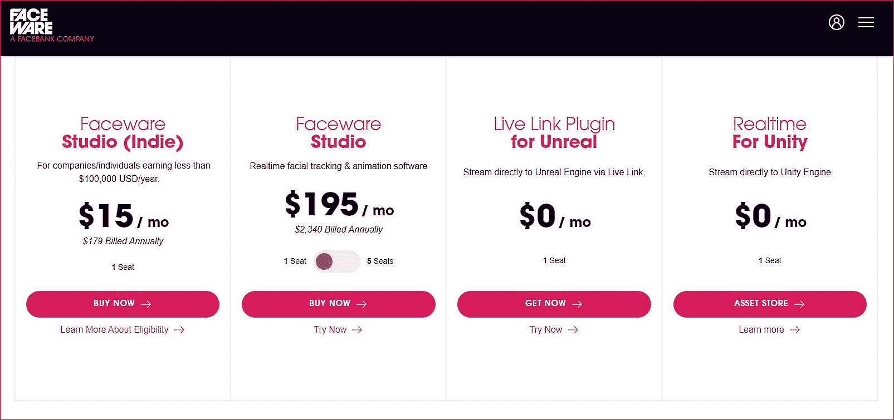

图 9.1：Faceware 定价选项

您将受邀注册 Faceware 账户，如*图 9.2*所示：

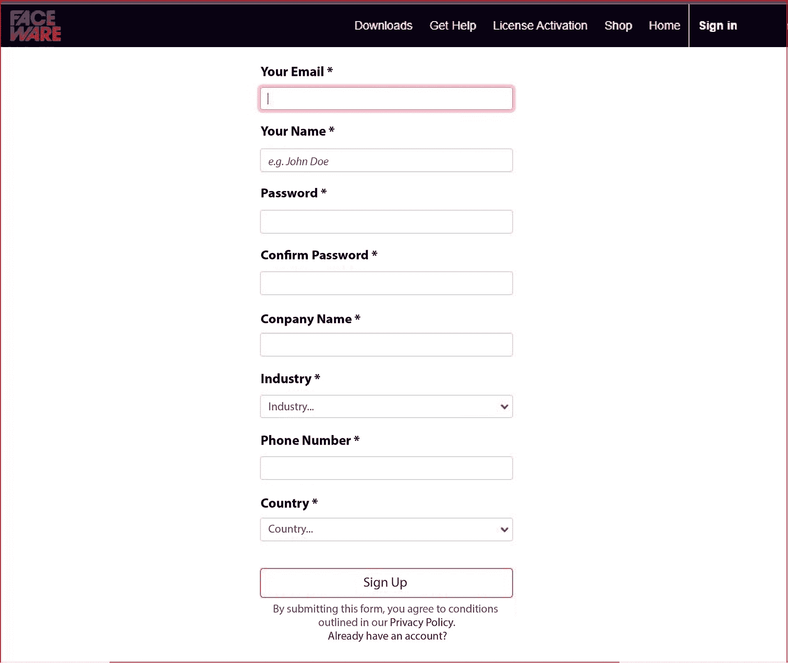

图 9.2：注册账户

设置好账户后，导航到页面顶部并点击**下载**。这将带您进入可用下载列表。从*图 9.3*中，您可以看到 Faceware Studio 可用（如果没看到，只需向下滚动页面）。在这里，您可以点击**下载**按钮。

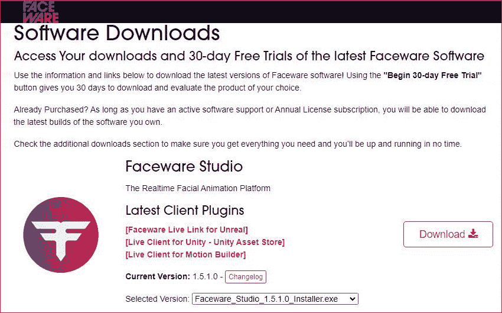

图 9.3：下载您的 30 天试用版

下载完成后，打开 `installer.exe` 文件并遵循简单的屏幕说明，随后 Faceware Studio 将完成安装！

在下一节中，我们将下载并安装 Faceware Live Link 插件，它允许 Unreal 从 Faceware 应用程序接收数据。我们还将从 Epic Games 下载一个设计用于配合 Faceware 工作的 MetaHuman 示例。

### 安装 Unreal 的 Faceware 插件和 MetaHuman 示例

要安装 Unreal 的 Faceware 插件，请打开来自*第 8 章*的项目，然后打开 Epic Games Launcher。搜索 **Faceware Live Link**，然后点击**安装到引擎**，如*图 9.4*所示：

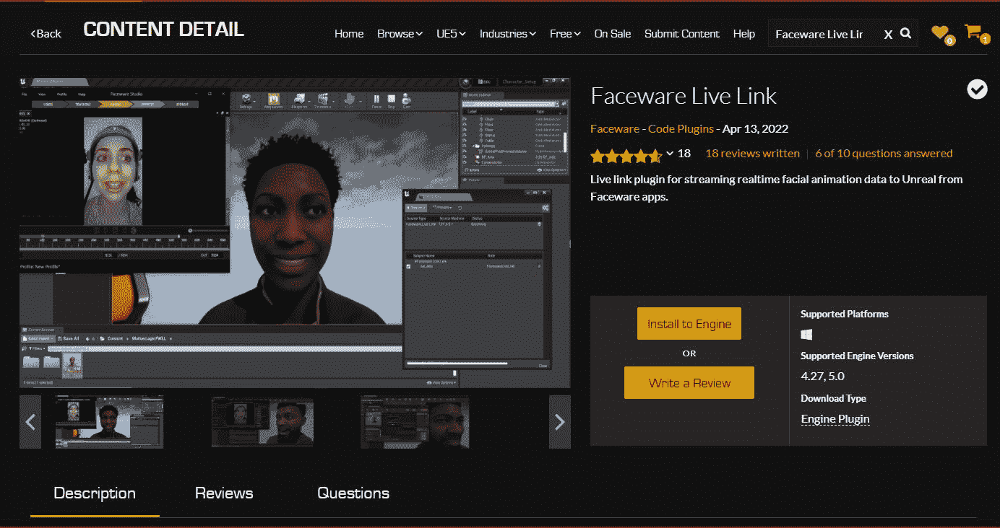

图 9.4：Epic Games Launcher Faceware Live Link 页面

插件安装完成后，在 Faceware 插件页面向下滚动，直到看到 Sample MetaHuman Blueprint 的链接，如*图 9.5*所示：

图 9.5：示例 MetaHuman 蓝图

点击**下载蓝图**链接。这将打开一个新的浏览器窗口，带您离开 Epic Launcher，您将看到以下消息：

图 9.6：继续前往外部网站按钮

点击**继续前往外部网站**。此时，系统会询问您要将示例 MetaHuman 蓝图下载到何处。

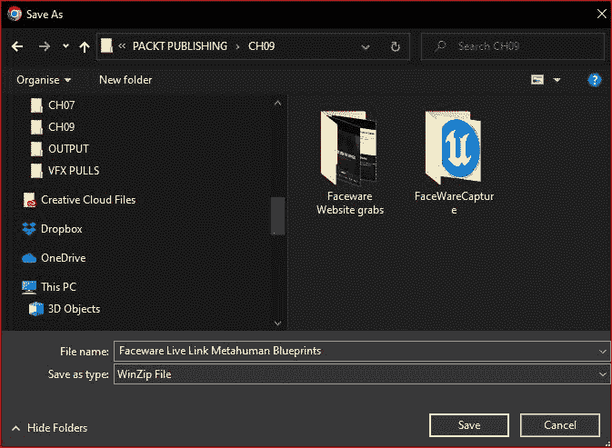

图 9.7：保存示例 MetaHuman 蓝图

您可以暂时将其下载到临时位置，或者直接下载到项目内的 `MetaHumans` 文件夹中。如果您不知道项目文件夹在电脑的何处，可以返回 Unreal 项目，前往内容浏览器查找。在那里，右键点击 `MetaHumans` 文件夹并选择 `在资源管理器中显示`，如*图 9.8*所示。

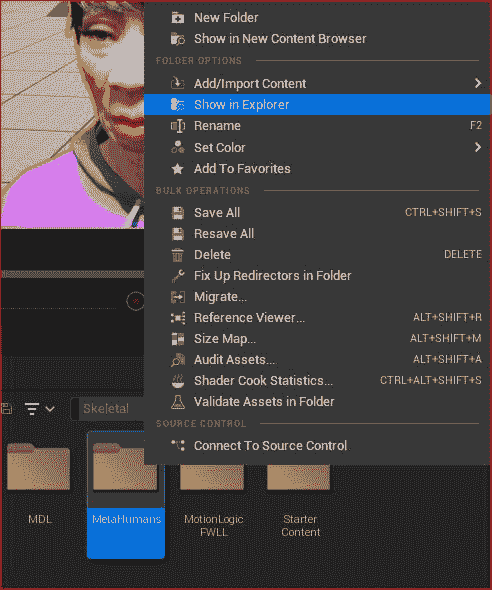

图 9.8：定位您的项目文件夹

点击 `在资源管理器中显示` 将打开 Windows 资源管理器，以便我们在 Unreal 之外独立查看项目文件的位置。类似于我在*图 9.9*中所做的，复制您机器上 `MetaHumans` 文件夹位置的文件路径。现在我们将把示例蓝图保存到上一章创建的项目 `MetaHumans` 文件夹中。

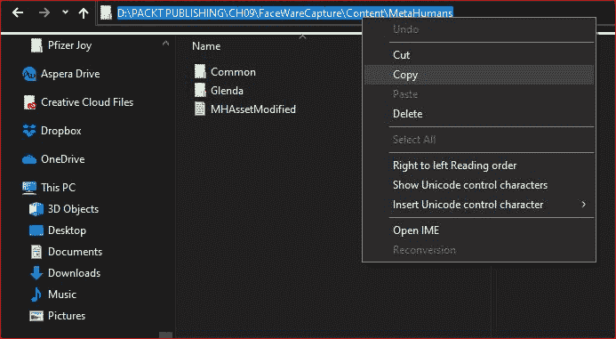

图 9.9：复制项目位置

这样做会将蓝图保存到您的项目文件夹中；但是，它将是一个压缩文件；您需要将其解压到同一文件夹中。完成后，重启 Unreal。重启期间，MetaHuman 示例将更新您的项目，以确保 MetaHuman 能与 Faceware 插件配合工作。

在下一节中，我们将转到 Faceware Studio 软件，使用网络摄像头追踪我们的面部。

### 设置网络摄像头和流式传输功能

下一步是确保您拥有一个正常工作的网络摄像头或其他与电脑连接正常的摄像头。如果您有在 Zoom 或 Teams 等应用程序中使用过的摄像头，它也能在 Faceware 中工作。

*   因此，启动 Faceware Studio 软件。您应该会看到一个类似于*图 9.10*所示的界面：

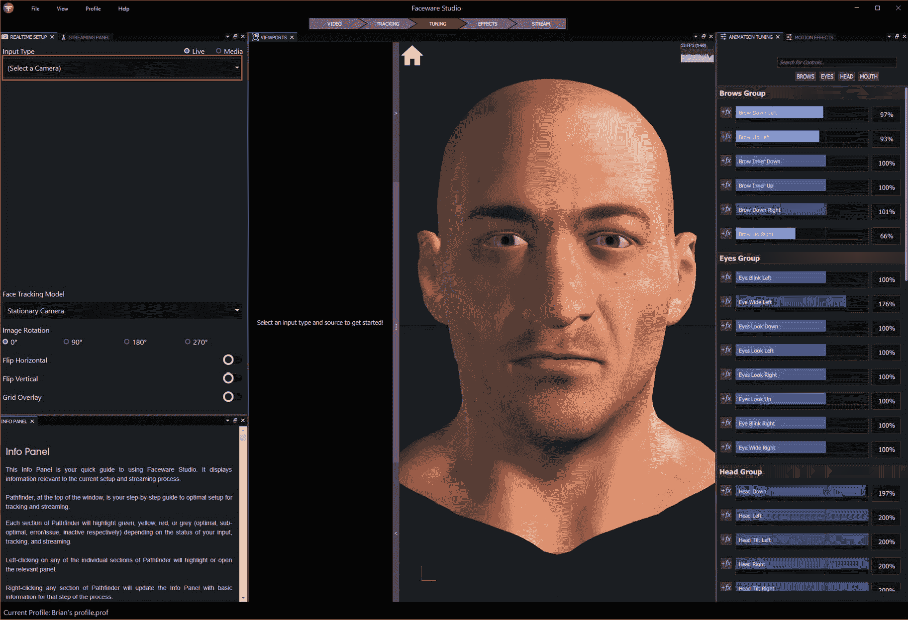

图 9.10：Faceware 界面

要设置我们的网络摄像头和流式传输功能，我们需要探索**实时设置**面板和**流式传输**面板。

### 实时设置面板

屏幕左侧是**实时设置**面板。在**输入类型**下，点击下拉菜单并选择您的网络摄像头。只要您选择一个正常工作的网络摄像头，就会获得更多选项，如*图 9.11*所示：

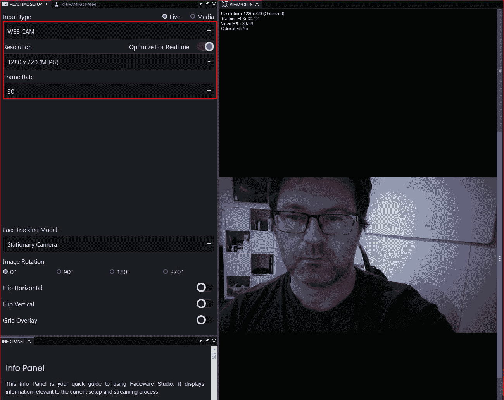

图 9.11：实时设置面板

让我们看看可用的选项：

#### 输入类型

**输入类型**面板允许您选择要使用的视频类型。因为我们的目标是将实时面部捕捉数据流式传输到 Unreal，所以我们将选择**实时**。如果您想使用位于机器上的预录制素材，可以选择**媒体**，但我们不会探讨该选项。

#### 分辨率

分辨率可以大到与输入的视频信号一致。因此，如果您的网络摄像头和电脑能够处理超高清网络摄像头，Faceware 不会有任何问题。在我的案例中，我的网络摄像头分辨率为 3840 X 2160。然而，这种高分辨率没有任何优势，实际上对我们不利，因为处理所有那些高分辨率数据需要大量资源。我将分辨率降低到了更实用的 **1280 X 720**，因为此分辨率包含良好追踪所需的所有信息，但不像我原来的选项那样数据量大。

您还可以选择 **(MPG)**，它使用 **Motion JPEG** (**MJPEG**) 压缩/解压缩编解码算法，或者 **(H264)**，它使用 H264 编解码算法。最终，就帧率而言，选择最适合您机器的那个，我将在下一节解释。

#### 帧率

帧率是精准动作捕捉的重要因素。您可能还记得在*第 5 章* *使用 Mixamo 重定向动画* 中，动作捕捉可在每秒 30 帧及以上的帧率下使用。我们的目标始终是达到每秒 30 帧或以上的帧率，您可以在*图 9.11*中看到我已做到这一点。

为进一步减少处理时间，您可以开启**针对实时优化**，这将降低分辨率，从而提高帧率。如果您再看一遍*图 9.11*，可以在显示网络摄像头信号的视口左上角看到分辨率的差异。我在*图 9.12*中也提供了该信号信息的两个示例：

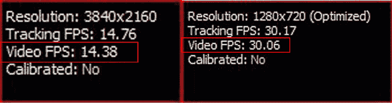

图 9.12：分辨率与帧率

您可以看到，左侧的 3840x2160 分辨率仅给我们 14.38 的视频帧率，这很差，而 1280x720 信号给我们 30.06 的视频帧率，这更好（考虑到我们 30 fps 的目标）。

您可能还会注意到，`Tracking FPS` 通常与 `Video FPS` 相同。如果 `Tracking FPS` 较低，则意味着软件出现了问题；可能是其他应用程序正在运行，导致 Faceware 资源不足。尝试关闭其他正在运行的应用程序以缓解此问题。

**注意**

`Tracking FPS` 和 `Video FPS` 之间的区别非常简单。`Tracking FPS` 是软件正确识别面部区域及其在画面中位置的速度，而 `Video FPS` 仅仅是软件每秒从网络摄像头接收的帧数。

### 面部追踪模型

回到 *图 9.11*，在 `Frame Rate` 下方，下一个字段是 `Face Tracking Model`。下拉菜单提供两个选项：

*   `Stationary Camera`（固定摄像机）：适用于摄像机固定但用户头部移动的网络摄像头。
*   `Professional Headcams`（专业头戴式摄像机）：适用于摄像机固定在头盔装置上、仅捕捉面部表情而非头部运动的专业解决方案。头戴式摄像机无法追踪颈部运动，因此如果用户点头或摇头，数据不会被记录。在这种情况下，依靠动作捕捉套装来捕捉身体运动，包括头部和颈部运动。通常，在使用专业头戴式摄像机时，身体和面部捕捉会同时进行，因为这样能产生更自然的结果。

在我们的案例中，我们选择 `Stationary Camera`。

### 图像旋转

如果您的摄像头倒置或侧放，您可以按 90 度的增量旋转视频信号来修正它。我不需要此功能，因此 `Image Rotation` 选项设置为 `0` 度。

### 水平翻转和垂直翻转

同样，如果您面对的是倒置的摄像头，或者您个人偏好镜像图像，可以选择水平或垂直翻转图像。我也不会使用这些功能。

### 网格叠加

这是一个有点用的工具，可确保您的面部位于画面中央。我没有启用它。

现在，在我们转到 `STREAMING` 面板之前，请确保已有视频信号输入 Faceware，您的输入设置为 `Live`，并且您的面部正在被追踪，追踪标记随面部移动同步运动。您可以从 *图 9.13* 的示例中看到，我的眉毛、眼睛、鼻子和嘴巴周围有橙色的追踪标记：

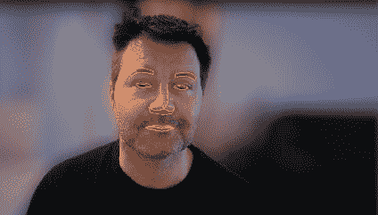

*图 9.13：追踪标记正常工作*

一旦您的面部被追踪，接下来您需要确保 Faceware 能够在 `STREAMING` 面板中发送数据。

### 流式传输面板

切换到 `STREAMING` 面板，您将看到 *图 9.14* 中显示的以下选项：

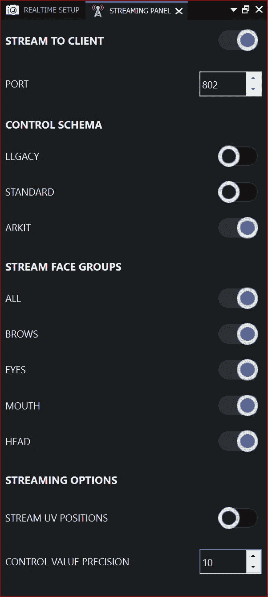

*图 9.14：流式传输面板*

让我们看看面板的每个部分。

#### 流式传输到客户端

`STREAM TO CLIENT` 中的第一个选项是 `STREAM TO CLIENT` 切换按钮本身，我已将其向右切换以开启它。实际上，该按钮只是一个开关。开启后，Faceware 将实时流式传输动作捕捉数据到客户端。此处的客户端是 Unreal Engine，它通过 Live Link 启用以接收流式传输数据。

请注意，如果没有实时视频信号，您将无法启用 `STREAM TO CLIENT`。

第二个选项是 `PORT`——安装 Live Link 插件时会自动设置这些端口。在安装 Faceware 期间，Faceware 会检测可用于流式传输的端口；但请记下端口号以防万一。您应保留 `PORT` 的默认值；在我的例子中，该值为 `802`。

现在您已准备好开始面部追踪。将面部摆成中性姿势，不要微笑或噘嘴，然后按照 *图 9.15* 左下角所示点击 `CALIBRATE NEUTRAL POSE` 按钮：

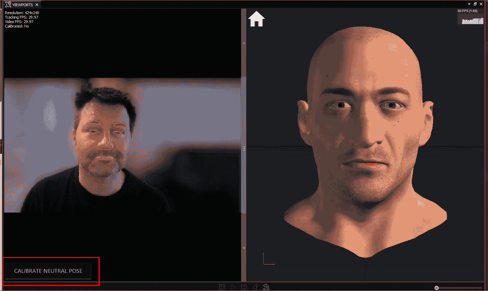

*图 9.15：校准中性姿势*

执行此操作时，请务必直视网络摄像头，并预计保持该姿势约 5-10 秒，以便 Faceware 重新校准您的面部。完成后，它将自动追踪您的面部。请看 *图 9.16*，您可以看到 CGI 角色正在跟随我自己的头部运动和面部表情。

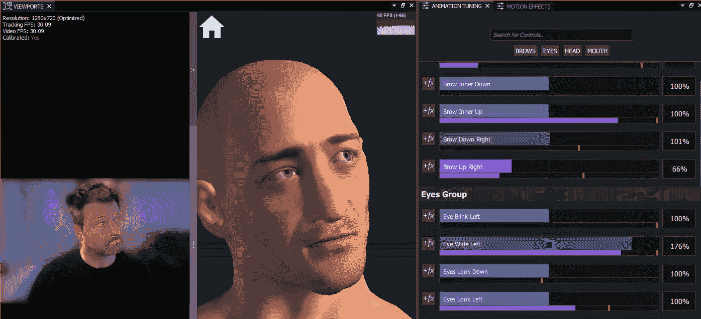

*图 9.16：动画调整面板*

您还会注意到屏幕右侧的 `ANIMATION TUNING` 面板；您会看到许多水平条随您的头部移动而运动。这些都是面部追踪产生的所有 ARKit 控制器正在被驱动。我们稍后将详细介绍这一点。现在，让我们进一步了解实时设置功能。

#### 控制架构

`CONTROL SCHEMA` 指的是 Faceware Studio 流式传输数据所使用的命名约定。因为我们使用的是 ARKit，请确保启用 `ARKIT`。`LEGACY` 和 `STANDARD` 虽然不错，但它们没有 ARKit 的保真度，而 ARKit 用于 MetaHuman 的设计，对于本书来说它们是多余的。

#### 流式传输面部组

`STREAM FACE GROUPS` 功能允许我们从流式传输中移除面部的特定部分。如果我们使用的专业头戴式摄像机不记录头部旋转，我建议在 `STREAM FACE GROUPS` 中禁用头部。在这种情况下，我们将使用身体动作捕捉解决方案来捕捉头部旋转。

在我们的示例中，假设我们要记录头部旋转和所有面部运动。为此，在 `STREAM FACE GROUPS` 下，确保启用 `ALL`。但是，如果您只想捕捉一个面部组，例如只想移动眉毛，则可以仅启用 `EYEBROWS` 选项。

此时，我们应该已经在流式传输了，但让我们再看看 Faceware 界面的最后一部分：状态栏。

### 状态栏

在 *图 9.17* 中，您可以看到顶部工具栏是一个颜色编码的标签列表，提供了一种在问题出现时快速排查和纠正问题的方法：

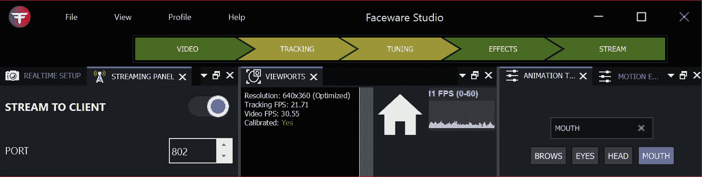

*图 9.17：顶部工具栏*

它们从左到右的顺序是：

*   `VIDEO`：这是 `REALTIME SETUP` 面板的快捷方式，我们刚刚介绍过。
*   `TRACKING`：这是视口的快捷方式，如 *图 9.17* 所示，以便我们可视化追踪效果如何。您可以在 *图 9.18* 中看到，不仅我的头部运动被追踪了，追踪器甚至能检测到我隔着眼镜眨眼。

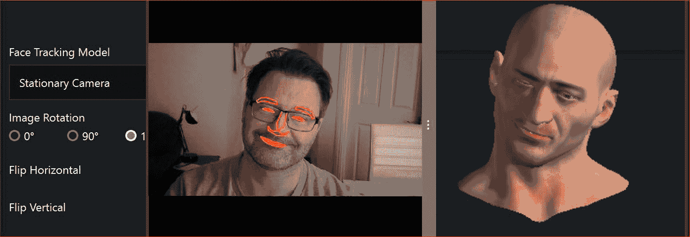

*图 9.18：视口*

*   `TUNING`：这是 `TUNING` 面板的快捷方式，我们将在其中进行大部分调整和修复。您可以看到我们对细化眉毛、眼睛、头部和嘴巴有很多控制权。尽管这看起来可能令人生畏，但这些控制器使用起来相对简单。

例如，如果您看 CGI 头部，其下颚张开程度不如您在网络摄像头中的下颚，您可以通过将蓝色滑块向右拖动，将 `Jaw Open` 参数增加高达 200%。我在 *图 9.19* 中通过将一些嘴部滑块向右拖动高达 200% 进行了类似的调整。

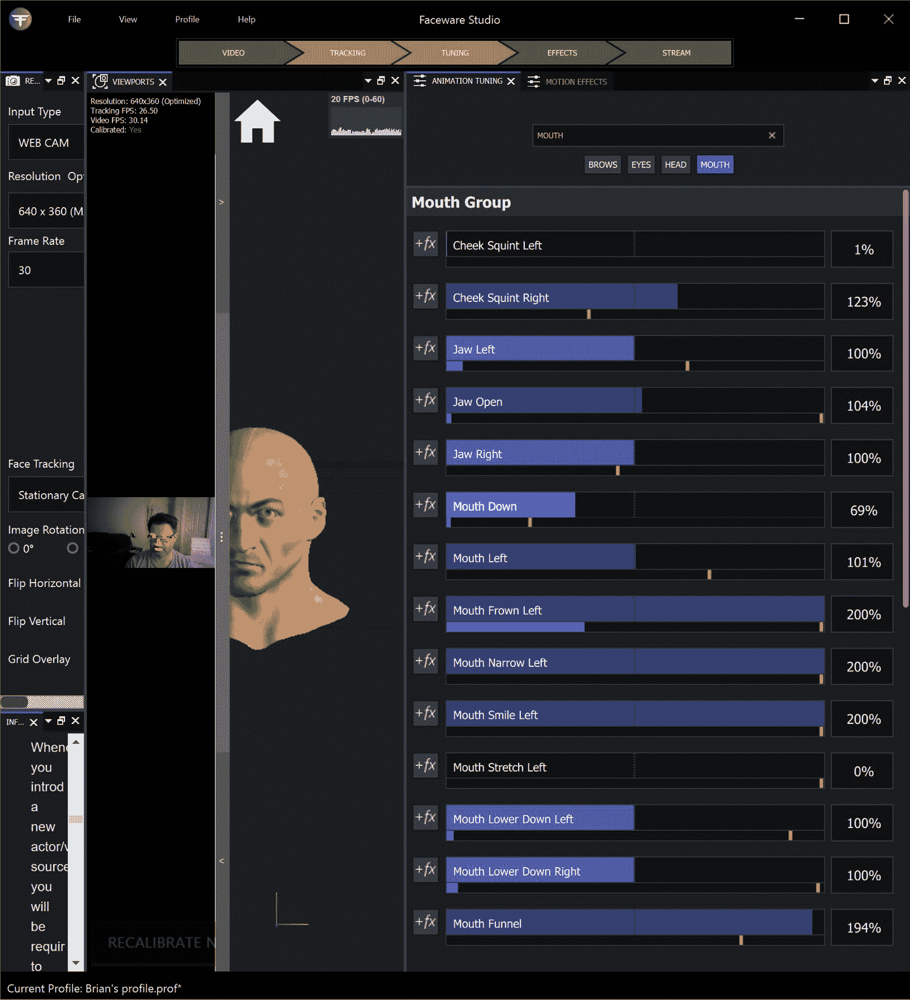

*图 9.19：调整*

如果 CGI 角色的下颚张开过度，超过了您的网络摄像头视频，则向左拖动滑块以减少幅度。`TUNING` 面板中的所有参数均适用相同原理。

### Faceware 面板：EFFECTS 和 STREAM

*   **EFFECTS**：虽然不是常用面板，但如果你发现仅使用 `TUNING` 无法获得理想效果，`EFFECTS` 就会派上用场。例如 `Mouth Smile Left`（左嘴角上扬）在 CGI 面部上显示的位置稍微有点高。要修复此问题，我们可以手动添加一个负值的 `Offset`（偏移量）来抵消它，如*图 9.20*所示：

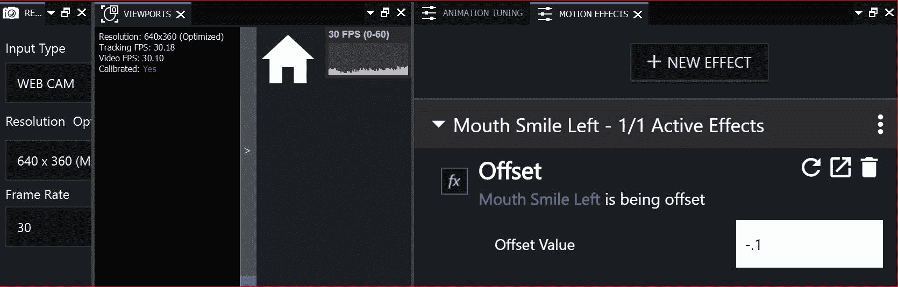

图 9.20：Effects

*   **STREAM**：这是通往 `STREAMING` 面板的快捷方式，我们之前也介绍过。

理想情况下，顶部菜单中的所有这些按钮都应显示为绿色。如果它们在黄色和绿色之间切换，说明设置已生效但并非最佳。如果变为红色，则肯定需要进行更改。

导致按钮变红的最常见情况是我们将脸部移出了网络摄像头的捕捉范围。人脸追踪通常表现很好，但一旦超出画面范围，它就无法追踪，并会立即给我们一个红色的追踪按钮。第二常见的红色按钮情况是帧率过低，这反过来会导致追踪效果不佳。

在深入了解这些附加面板（尤其是 `TUNING`）的更多细节之前，我们必须先返回 Unreal，确保我们正在接收实时面部捕捉数据，并且还需要进入我们的 MetaHuman 蓝图。原因在于，最好查看 MetaHuman 对面部追踪的响应情况，并根据该信息进行调整，而不是盯着 Faceware 里的默认头模看。

### 启用 Live Link 以接收 Faceware 数据

在进入 MetaHuman 蓝图之前，让我们再次确认 Live Link 是否正在接收信号。

要在 Unreal 中打开 Live Link 插件，请转到 `Window` > `Virtual Production` > `Live Link`，如*图 9.21*所示：

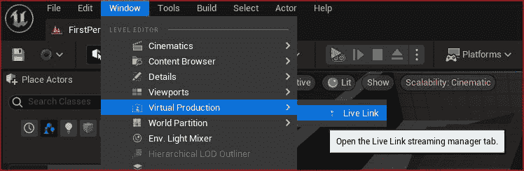

图 9.21：打开 Live Link

在*图 9.22*中，你可以看到我点击了 `Faceware Live Link` 以选择来自 Faceware 的传入信号。请记下 `Port Number`（端口号）：它与我在 Faceware `STREAMING` 面板中检测到的端口号相同，如*图 9.14*所示。如果 Live Link 的端口号与 Faceware 的端口号不同，你可以在任一应用程序中更改它以使其匹配。

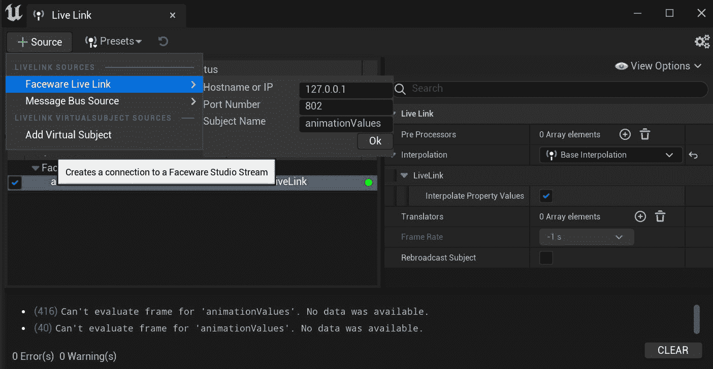

图 9.22：Live Link 端口号

现在，在 Faceware 中启用 `STREAM TO CLIENT` 后，我们应该获得良好的人脸追踪。良好的人脸追踪意味着没有红色警告。这也意味着我们在 Live Link 中接收到了实时信号，从而显示绿色按钮，如*图 9.22*所示。一旦获得该绿色按钮，我们就可以开始使用 MetaHuman 蓝图进行工作了。

### 编辑 MetaHuman 蓝图

首先，我们需要创建一个新的 Level Sequence（关卡序列），因为我们要将 MetaHuman 蓝图添加到 Level Sequencer（关卡序列器）中：

1.  就像上一章一样，从 `Outliner`（大纲视图）中拖放 MetaHuman 蓝图到 `Level Sequencer` 上。同样，你会注意到创建了一个 `Metahuman_ControlRig` 和一个 `Face_ControlBoard_CtrlRig`。删除这两个，因为我们不需要它们。

2.  接下来，在 `Level Sequencer` 中的蓝图里点击 `Face`。在*图 9.23*中，你将看到 `Details`（细节）面板为我提供了可编辑的参数，即 `Animation Mode`（动画模式）和 `Anim Class`（动画类）。

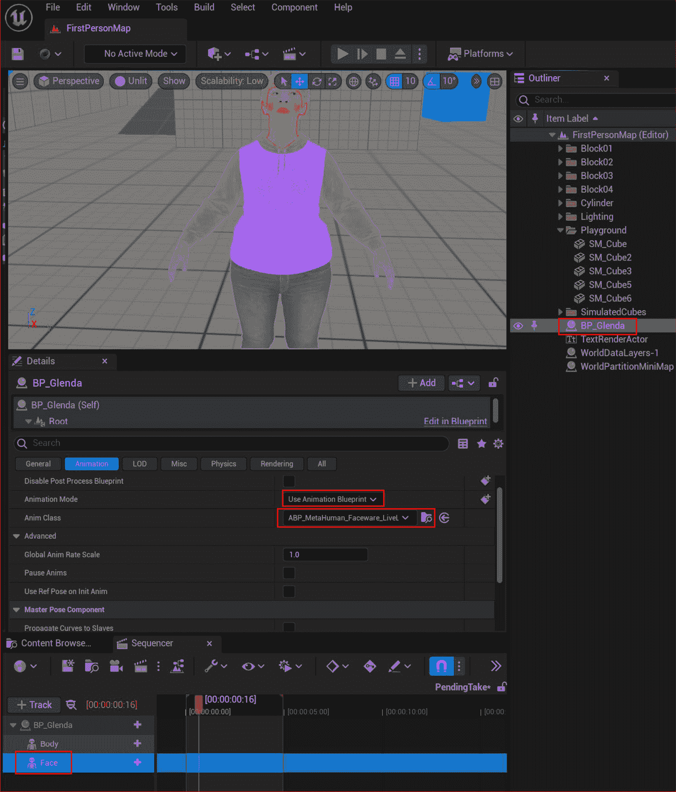

图 9.23：从 MetaHuman 蓝图中选择 Face

确保 `Animation Mode` 设置为 `Use Animation Blueprint`，且 `Anim Class` 设置为 `ABP_Metahuman_Faceware_LiveLink Face`。

3.  现在通过点击 Unreal Engine 界面顶部的 `Play`（播放）按钮来测试你的面部动作捕捉数据。这将运行一个游戏模拟，你可以在其中看到面部动画栩栩如生。

务必点击 `Stop`（停止）以停止模拟。你必须在启动 `Take Recorder`（我们将在下一节使用）之前执行此操作。

### 使用 Take Recorder 录制会话

在上一节中，我提到运行模拟以测试面部动作捕捉数据。这对于快速测试来说没问题，但对于动画制作，我们需要录制动作捕捉数据，为此 Epic Games 创建了 `Take Recorder`。它允许我们录制动捕会话并从 `Level Sequencer` 回放。

要使用 `Take Recorder`，请按以下步骤操作：

1.  转到 `Take Recorder` 选项卡并添加 MetaHuman 蓝图。你可以在*图 9.24*中看到，我是通过点击 `+ Source` 选项，然后选择 `From Actor` 来完成此操作的。

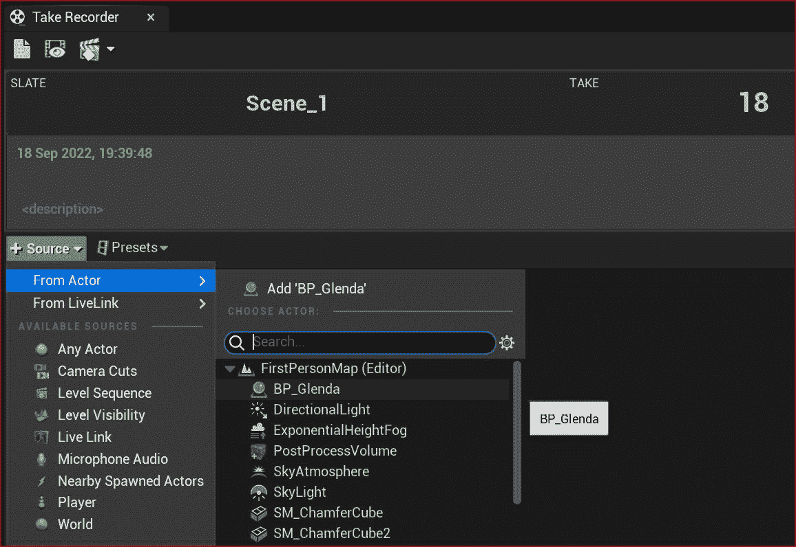

图 9.24：将 MetaHuman 蓝图添加到 Take Recorder

2.  仍在 `Take Recorder` 选项卡中，使用 `From LiveLink` 选项添加另一个资产，如*图 9.25*所示。在这里，我们将添加 `animationValues`。此处提到的值是指所有正从 Faceware 流式传输的 ARKit 数据值，例如头部旋转、眨眼和张嘴。

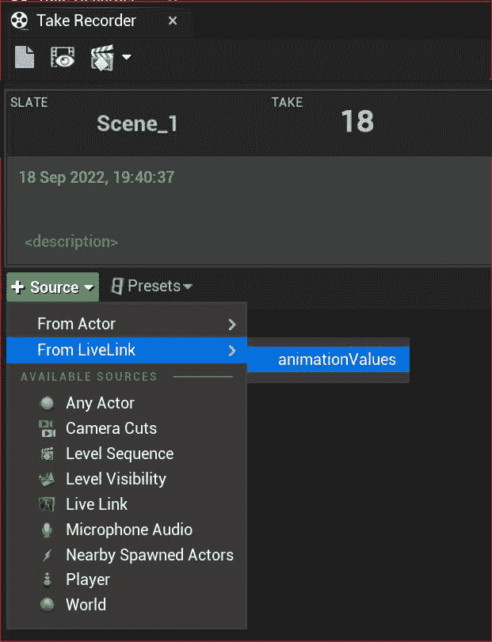

图 9.25：将 animationValues 添加到 Take Recorder

3.  注意 `Take` 编号。在我的例子中，是 `Scene_1 Take 18`。每当我们想要回放某个 take 时，提前知道哪个 take 是好 take 会非常方便。

4.  点击 `Take Recorder` 上的 `Record` 按钮（是的，就是那个大红按钮！）。

5.  再次按 `Play` 运行模拟。当你从 Faceware 向 Unreal 流式传输数据时，你的动画再次栩栩如生。

6.  点击 `Take Recorder` 上的 `Stop` 并记下新的 `Take` 编号。

7.  为了回放我们刚刚捕捉的 take，我们首先需要更改 `Animation Mode`。选择 `Face` 以编辑 `Animation Mode`。然后将模式从 `Animation Blueprint` 改为 `Use Animation Asset`，如*图 9.26*所示：

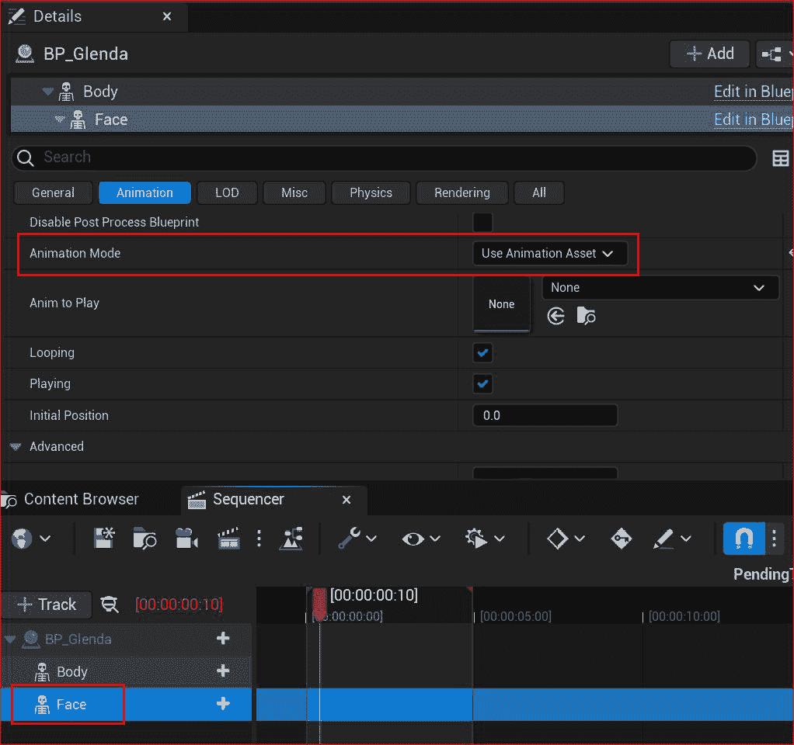

图 9.26：将动画模式更改为 Use Animation Asset

当我们想要回放 take 时，将动画模式更改为 `Use an Asset`；当我们想要录制 take 时，恢复为 `Blueprint`。

在下一节中，我们将返回 `Level Sequencer` 以回放我们的面部动作捕捉录制。

### 将 Take 导入 Level Sequencer

要回放我们的面部捕捉 take，我们需要将其添加到 `Level Sequencer`。为此，请按以下步骤操作：

1.  点击 `Face` 旁边的 `+` 图标以添加动画。在上下文菜单中，转到 `Animation` 并搜索你最近的 take。在我的例子中，我正在寻找 take 19，如*图 9.27*所示：

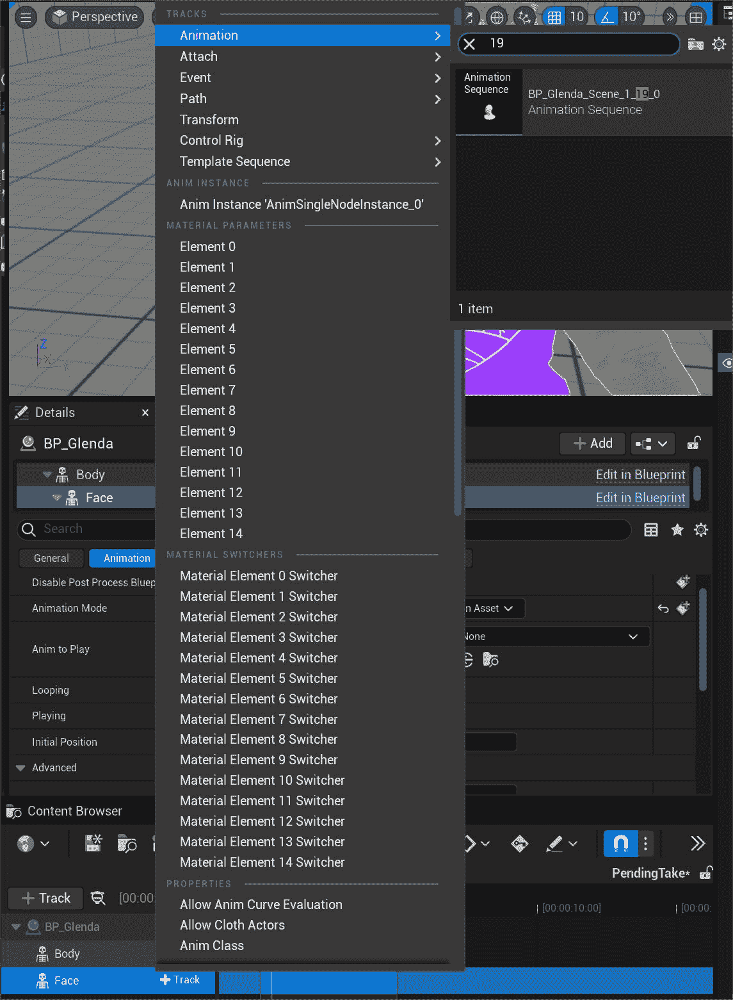

图 9.27：将动画资产作为轨道添加到 Face

2.  点击所需的轨道，它将自动填充 `Level Sequencer` 中的 `Face` 轨道，如*图 9.28*所示：

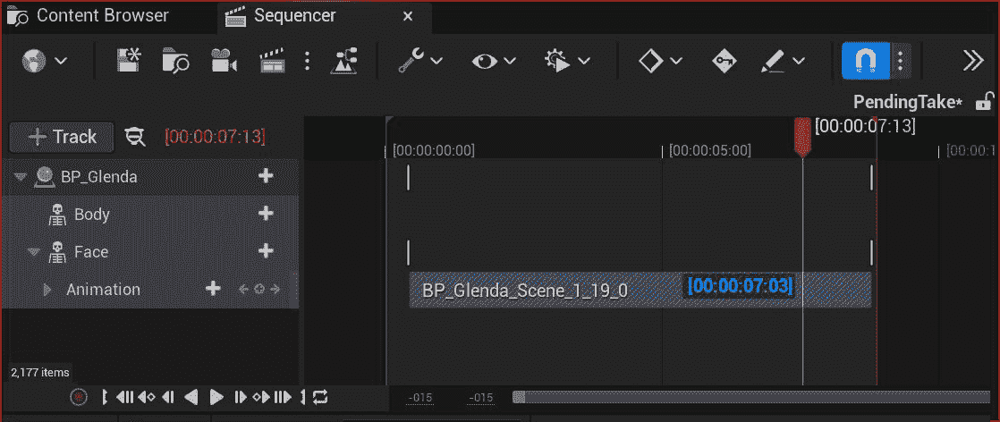

图 9.28：将 Take Recorder 轨道添加到 Level Sequencer

3.  要回放动画，请点击播放头所在的时间轴任意位置，然后按 `spacebar`（空格键）。

现在我们已将动作捕捉数据直接添加到 `Level Sequencer` 中。然而，这是原始数据，极有可能需要一些编辑。在下一节中，我们将探讨一些可以利用的 MetaHuman 控件，以进一步增强我们对角色的创作控制。

### 在 Unreal 中烘焙和编辑面部动画

#### 将面部捕捉烘焙到控制绑定

承接上一章（我们在其中使用 iPhone 添加了面部动作捕捉），我们将把烘焙动画关键帧的过程应用到 Faceware Studio 捕捉中。

类似于我们将动作捕捉数据烘焙到身体控制绑定的方式，我们将对面部绑定执行相同操作，然后创建一个加性片段以进行动画调整：

1.  选中 `Face`，右键单击并选择 `Bake to Control Rig`（烘焙到控制绑定），随后选择 `Face_ControlBoard_CtrlRig`，如 `图 9.29` 所示：

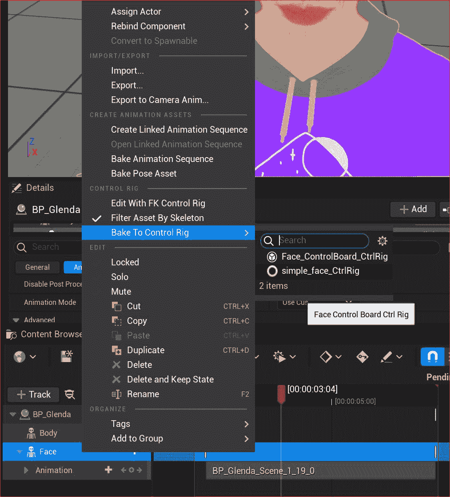

图 9.29：将面部捕捉动画资产烘焙到控制绑定

烘焙到控制绑定后，我们应该看到轨道外观类似于 `图 9.30`：

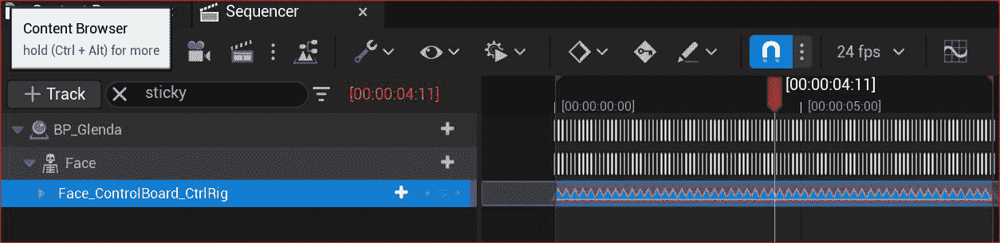

图 9.30：烘焙进控制绑定的动捕数据

1.  为安全起见，我们要锁定烘焙后的轨道，以免无意中对其进行编辑。方法是右键单击轨道并选择 `Locked`（锁定），如 `图 9.31` 所示：

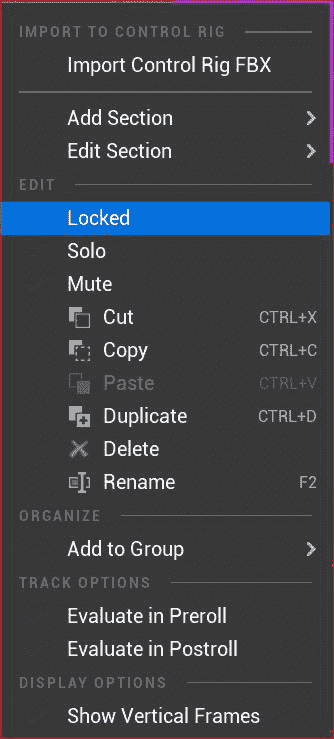

图 9.31：锁定烘焙后的轨道

1.  控制绑定轨道锁定后，我们可以创建一个加性轨道用于添加额外动画。它实际上是一个不带任何关键帧的副本轨道。为此，点击 `Face_CcontrolBoard_CtrlRig` 旁边的 `+ Section`（+ 片段）并选择 `Additive`（加性），如 `图 9.32` 所示。

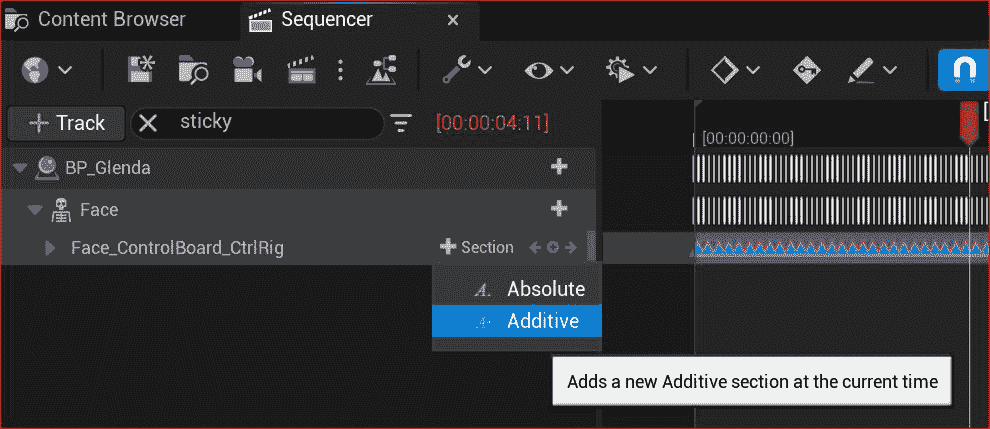

图 9.32：创建加性片段

1.  创建加性轨道后，下一步是向其中添加关键帧。但在此之前，你可能想再次确认原始动作捕捉轨道是否已锁定。如果已锁定，如 `图 9.33` 所示，它周围会有红色边框。

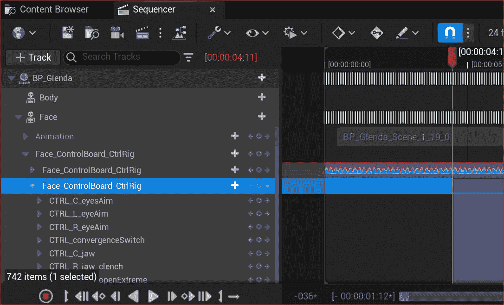

图 9.33：锁定的轨道和新轨道

另请注意，新加性轨道中所有控制器旁边都没有关键帧。这正是我们想要的。

现在让我们看看如何编辑面部。在 `Take Recorder`（录制采集）会话期间，以及在 `Level Sequencer`（关卡序列器）中播放动捕回放后，我注意到右眼偶尔会不同步眨眼或自行随机眨眼。这不是我写这本书的生理反应，而极有可能是因为录制时我戴着眼镜。

要微调此问题，你可以在 Sequencer 中搜索简单的内容，例如 `eye blink`（眨眼）。这将列出与该运动相关的参数列表：

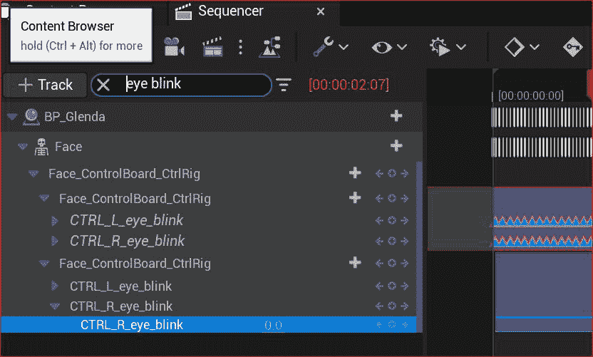

图 9.34：选择要编辑的控制器

使用 `Unreal MetaHuman 控制器`，我只需设置几个关键帧即可修复眼部问题。从 `图 9.35` 可以看出，我在动捕正确的位置设置了第一个关键帧，在动捕再次正确的位置设置了第三个关键帧，并在它们之间设置了第二个关键帧以修正有问题的帧。

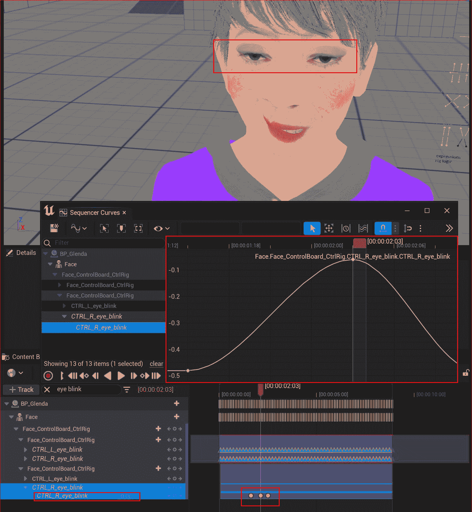

图 9.35：对动画控制器进行细微调整

如果我们只创建第二个关键帧，它会影响相关轨道上的所有动画。我们创建第一和第三个关键帧，是为了保护第一和第三个关键帧动画范围之外的动画。

我们只是触及了使用 `Level Sequencer` 编辑动作捕捉数据的表面。从我给出的示例来看，我只是使用加性片段修复了一个问题。这是一个非常值得掌握的功能，特别是在动作捕捉会话方面。原因在于，你将知道何时动捕会话质量足够好，以及后期调整动画是否划算，抑或继续拍摄以获得更好的采集。除了微调，你还可以使用本节描述的技术对动画进行彻底更改。

### 总结

在本章中，我们探讨了用于 `Unreal` 中 `MetaHumans` 的 `Faceware` 面部动作捕捉解决方案。本章涵盖的大部分内容与 iPhone 解决方案相似，但额外具备使用简单网络摄像头的优势，我们还研究了如何在 `Unreal` 接收数据之前对其进行微调。

此外，我们有时间复习了关于 `Take Recorder` 所学的内容，并学习了如何将面部动作捕捉数据烘焙到控制绑定中，这与我们烘焙来自 `DeepMotion` 的身体动作捕捉数据的方式类似。最后，我们发掘了将加性功能与 `MetaHumans` 众多的面部动画控制器结合使用以修复问题的威力。

在下一章中，我们将在此知识基础上，探讨如何在 `Level Sequencer` 中合并多个采集，并探索更多渲染视频的方法。
