## 第 10 章：使用关卡序列器混合动画与高级渲染

在前几章中，你已掌握多种面部动作捕捉方法，无论是使用 iPhone 还是配合 `Faceware` 的网络摄像头。你还学会了如何使用 `DeepMotion` 获取自定义身体动作捕捉。贯穿这一切的共同主线是 `Level Sequencer`。

在本章中，我们将回到 `Level Sequencer` 来管理我们的动捕动画数据。你将学习如何管理身体动作捕捉和面部动作捕捉，修复时序问题，并合并采集。

此外，我们将介绍一些更高级的行业标准渲染技术，并探索可与 `Level Sequencer` 配合使用的其他项目。

因此，在本章中，我们将涵盖以下主题：

*   将 `MetaHuman 蓝图` 和身体动捕数据添加到 `Level Sequencer`
*   将面部动捕数据添加到 `Level Sequencer`
*   探索高级渲染功能

### 技术要求

就计算机性能而言，你需要 *第 1 章* 中详述的技术要求，以及我们在 *第 2 章* 中导入到 `UE5` 的 `MetaHuman` 和 `Unreal Engine Mannequin`（虚幻引擎模型人）。

如果你一直跟随所有章节操作，你还将拥有来自 *第 5 章* 和 *第 6 章* 的 `Mixamo` 和 `DeepMotion` 数据。我们将在此处使用这些数据。

### 将 MetaHuman 蓝图和身体动捕数据添加到关卡序列器

在本节中，你将再次将 `MetaHuman` 添加到 `Level Sequencer`，以便将身体捕捉数据和面部捕捉数据应用到它身上。

#### 添加 MetaHuman 蓝图

首先，在内容浏览器的任意位置右键单击，在菜单中找到 `Animation`（动画），然后单击 `Level Sequencer`，创建一个新的 `Level Sequencer`。

创建新的 `Level Sequencer` 后，点击 `+Track`（+ 轨道）并添加你的 `MetaHuman 蓝图`，如 `图 10.1` 所示（如果看不到，请使用搜索功能并输入 `BP` 以查找 Blueprint）：

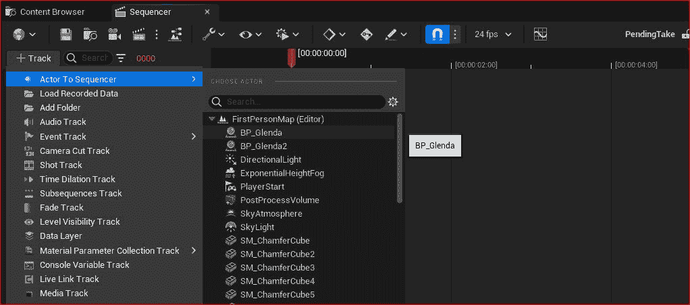

图 10.1：将蓝图添加到关卡序列器

一旦你的 `MetaHuman 蓝图` 进入序列，你会注意到 `Body`（身体）和 `Face`（面部）控制绑定都已存在，这是将 `MetaHuman 蓝图` 添加到 `Level Sequencer` 时的标准配置：

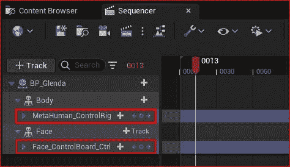

图 10.2：身体和面部控制绑定

暂时我们不需要控制绑定，因为我们只是在学习如何管理动画数据，这将在下一节中添加。因此，删除 `图 10.2` 中 `Level Sequencer` 里高亮显示的两个绑定。

`Level Sequencer` 保持打开状态，我们现在准备添加身体动捕数据。

### 添加先前重定向的身体动捕数据

如果你一直跟随所有章节的内容，你将已经使用 Mixamo 和 DeepMotion 创建了身体动作捕捉文件。

要添加身体动画，只需点击 `+Track`，然后选择 `Animation`，如图 10.3 所示：

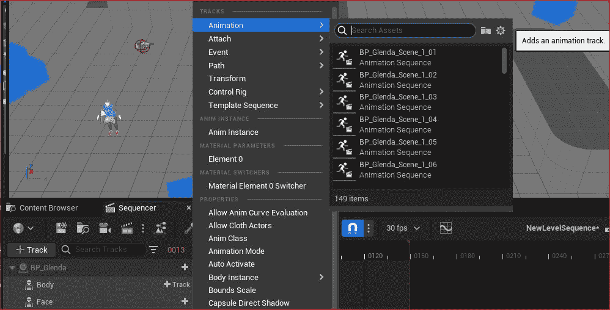
*图 10.3：添加动画*

如果在列表中看不到你的动画，请使用搜索功能。请记住，你添加的任何轨道都必须经过重定向，因此你在搜索时始终可以使用 `Retargeted` 后缀。这样，你就能看到项目中所有可用的动捕数据。

在图 10.4 中，你可以看到我已经添加了一个轨道。你甚至可以看到它有轨道标题，这可以让你一眼确认你使用的是正确的动捕轨道：

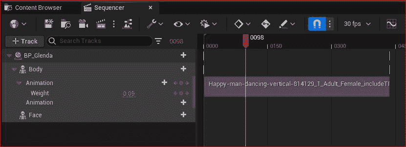
*图 10.4：已添加的轨道*

你在第 8 章末尾完成了这一步，但在下一节中，我们将探讨为身体引入额外动捕轨道的方法。

### 添加额外的身体动捕数据并合并动捕片段

引入额外动捕轨道有两种方法：

*   添加动画轨道
*   向现有轨道添加动画

现在让我们来看看它们。

#### 添加动画轨道

要在 Level Sequencer（关卡序列器）中将动画片段作为轨道添加，请点击 `Body` 旁边的 `+` 图标。这将创建一个额外的动画轨道，你可以沿时间轴重新定位它，并使用关键帧通过权重工具将其与第一个轨道混合。

在图 10.5 中，你可以看到我现在有两个动画轨道：

*   第一个轨道是我在 DeepMotion 中创建的 Happy Dance（快乐舞蹈）文件，我为它创建了两个关键帧。第一个关键帧有一个 `Weight` 值（即对角色的影响值）。默认情况下，`Weight` 值为 `1`，相当于 100% 的影响力；这意味着第一个动画轨道最为突出。对于第二个关键帧，我将 `Weight` 值设为 `0`，相当于 0%；这意味着没有快乐舞蹈了。我知道，这听起来很扫兴；不过 Glenda 还不至于绝望，因为我对新动画轨道做了相反的操作。
*   在第二个动画轨道中，即从 Mixamo 获取的 Macerena 文件，我为 `Weight` 值设置了关键帧，使其从 0% 开始过渡到 100%，从而利用关键帧有效地混合了这两支舞蹈：

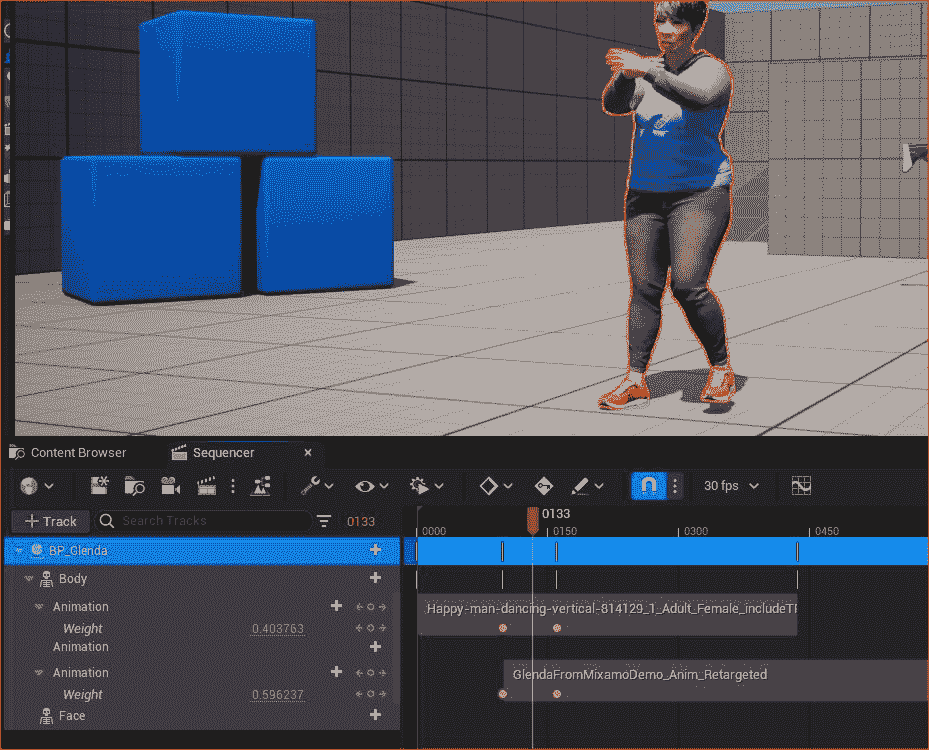
*图 10.5：添加另一个轨道*

#### 向现有轨道添加动画

向现有轨道添加动画不会创建额外的轨道，而是将新动画添加到同一轨道上。不要点击 `Body` 旁边的 `+Track` 图标，而是点击 `Body` 下方的 `+Animation`，如图 10.6 所示：

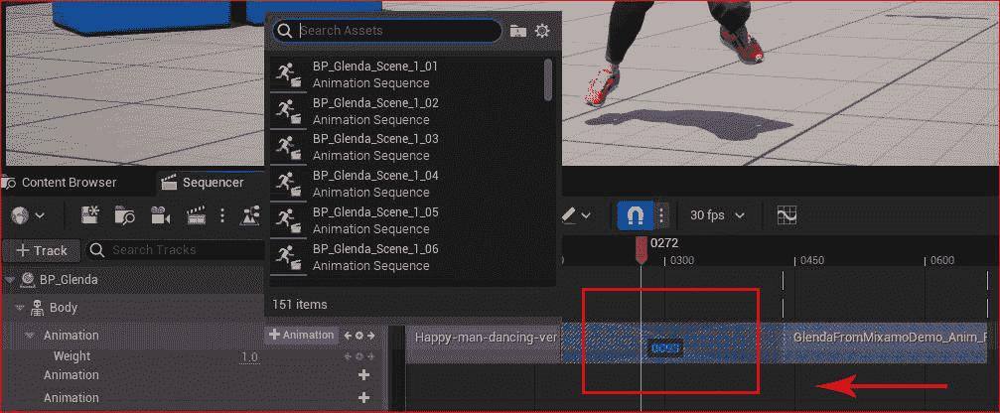
*图 10.6：将两个动画合并到一个轨道*

在图 10.6 中，我已经添加了动画。注意我用红框标出的两个轨道之间的过渡。实际上，我已将一个动画轨道合并到另一个轨道中，这由一条先下降后上升的曲线指示。

要以这种方式合并轨道，你必须将播放头移至 Level Sequencer 中第一个轨道的末尾。如果你的动画是 100 帧，请务必移至更高的帧数，例如 120 帧；否则，你将无法将动画合并到该轨道。然后，你必须将第二个片段向左拖动，使其与第一个片段相交。

请注意，它会在同一动画轨道上自动从第一个动画过渡到第二个动画。实际上，此方法已将两个动画合并为一个轨道。注意已合并的两个动画片段之间的数字（红框内）。它显示为 `0093`。这表示从一个动画过渡到下一个动画的过渡长度为 93 帧，约为 3 秒。

在下一节中，我们将介绍一个实用技巧，帮助对齐动画。

#### 使用“显示骨骼”功能实现更整洁的对齐

有时，当我们尝试合并动画时，效果并不理想。例如，如果第一个动画是角色行走，第二个动画是角色奔跑，角色往往会从一帧到下一帧剧烈地跳跃到新位置。

为了进行此类调整，我们需要在 Level Sequencer 中为身体添加一个 `Transform`（变换）轨道。你可以按照图 10.7 所示操作：

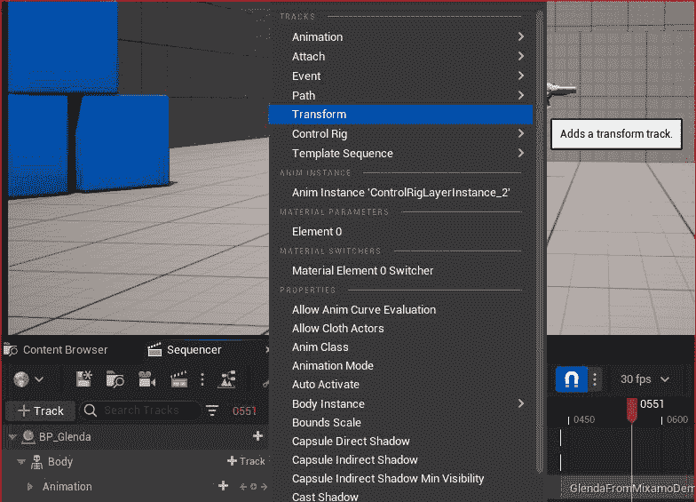
*图 10.7：添加变换轨道*

这将在 Level Sequencer 中创建一个新的变换轨道，允许我们在 `Location`（位置）参数中创建关键帧。现在，我们可以移动角色来修复任何角色位置问题，而不会影响任何整体动画属性。我们应用的任何角色移动将仅在新的变换轨道上设置关键帧，因此我们不会无意中丢失任何原始动作捕捉数据。

例如，想象一个角色站立挥手的动画。如果动捕数据有问题，导致身体随机向上升起，但我们对角色挥手的动作很满意，我们可以通过在 `Location` 参数添加关键帧来修复随机的向上移动。我们可以做到这一点，而不会对手臂挥动的动作产生负面影响。

然而，在将角色从 A 点移动到 B 点时，要看到细微的调整可能有点麻烦。为了解决这个可见性问题，Unreal 有一个功能可以让我们看到 MetaHuman 骨骼。这使我们能够专注于角色的确切位置，而不会被网格体干扰。

通过右键点击时间轴，你将看到 `Show Skeleton`（显示骨骼）选项。点击它将显示一个亮粉色的骨骼，有助于进行细微调整，如图 10.8 所示：

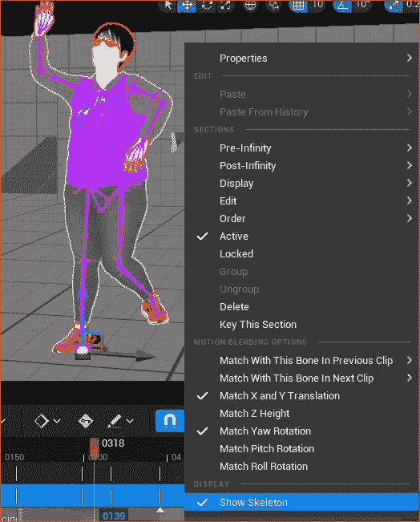
*图 10.8：显示骨骼*

**注意**：使用 `Show Skeleton` 功能时，两个动画将显示为不同颜色的骨骼，这使得对齐它们变得更容易一些。

使用 `Transform` 轨道和 `Show Skeleton` 功能的常见示例是当你想要循环动画时，例如行走循环。

然而，如果你有一个角色从位置 A 走到位置 B，并且你希望循环动画以使角色继续行走，我们会遇到一个问题。问题是，一旦角色到达位置 B，如果我们希望它循环，它就会返回位置 A。

使用 `Transform` 轨道，并在定位器上放置关键帧，你可以创建一个使用循环的持续动画：

1.  在 Level Sequencer 中为你的 `Animation` 轨道添加一个 `Transform` 轨道。
2.  转到轨道的最末端，在最后一帧为定位器位置（即 `X`、`Y` 和 `Z`）添加关键帧。如果你在 Level Sequencer 中选中了变换轨道，也可以通过按 `Enter` 键来执行此操作。我们这样做是为了锁定动画的位置，使其不受下一步的影响。
3.  现在，延长轨道使其重复。在重复部分的第一帧，添加一个新位置，使角色占据与原始轨道末尾相同的空间。你很可能只需要略微编辑 `X` 和 `Y` 轴的位置，如果角色不是直线行走，可能还需要在 `Z` 轴上旋转角色。每个片段都有显示其骨骼的选项，因此通过显示骨骼可以帮助略微编辑 `X` 和 `Y` 位置，因为你本质上只是对齐每个轨道的骨骼，使它们占据相同的空间。

**注意**

要进一步编辑角色的动作，你可以随时将动画烘焙到控制绑定，并添加 `Additive Section` 以进行进一步编辑。

除了可视化骨架这一便捷工具外，还有其他编辑动画片段的选项。通过在轨道任意处右键单击并转到属性，你会发现编辑片段时有更多选项：

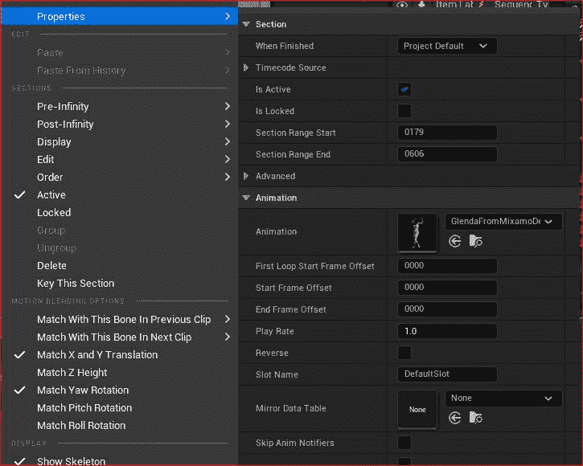

图 10.9：更多选项

说到合并动画，最重要的是帧率。你可能会发现你正尝试混合两个速度不同的动画。属性功能是解决此问题的好方法，通过更改帧率使它们匹配。你也可以尝试不同的帧率。

既然我们已经了解了如何添加与身体相关的动作捕捉数据，在下一节中，我们将介绍添加和合并动画轨道的相同原则，但这次我们将专注于面部。

### 向 Level Sequencer 添加面部动作捕捉数据

要添加和合并面部动画，你需要遵循与处理身体完全相同的步骤，即要么添加一个全新的 Faceware 轨道，要么将动画添加到现有动画轨道的末尾并移动轨道。让我们更详细地看一下。

#### 添加录制的 Faceware 片段

在本节中，我们将把 Faceware 面部动作捕捉文件添加到 Level Sequencer 中。如果你在定位 Faceware 面部捕捉文件时遇到困难，该文件是由 `Take Recorder` 在 *第 8 章* 中录制的，只需记住 Take Recorder 给角色蓝图的名称添加了 `_Scene` 后缀。因此，在我的例子中，我只搜索了 `BP+Glenda_Scene`，所有的片段都列了出来供我选择。

在图 10.10 中，你可以看到我将第 6 条片段 `BP_Glenda_scene_106_0` 与第 1 条片段 `BP_Glenda_Scene_1_01_0` 进行了合并：

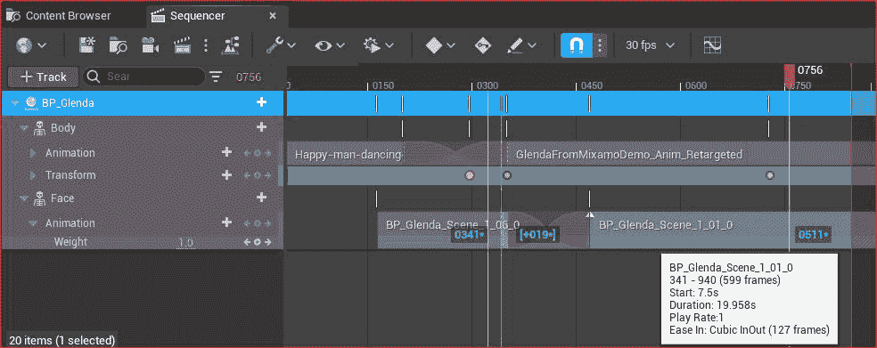

图 10.10：将面部动画添加到一个动画轨道

我选择了 `BP_Glenda_Scene_1_01_0`。你可以看到关键帧以蓝色出现，包括 `0341` 和 `+19`。注意 `+` 图标——这意味着我将片段向右移动了 19 帧，所以它将在 19 帧后开始。

### 编辑面部动作捕捉

编辑面部捕捉动画片段的过程与身体数据几乎完全相同，因此我们可以使用相同的工具并遵循上一节的相同步骤。

此外，我们可以将轨道烘焙为控制绑定中的关键帧，并添加一个 `Additive Section` 来微调动画，正如我们在 *第 8 章* 中所介绍的。从图 10.11 中可以看到，我采取了相同的步骤烘焙控制绑定，这由三角形关键帧指示：

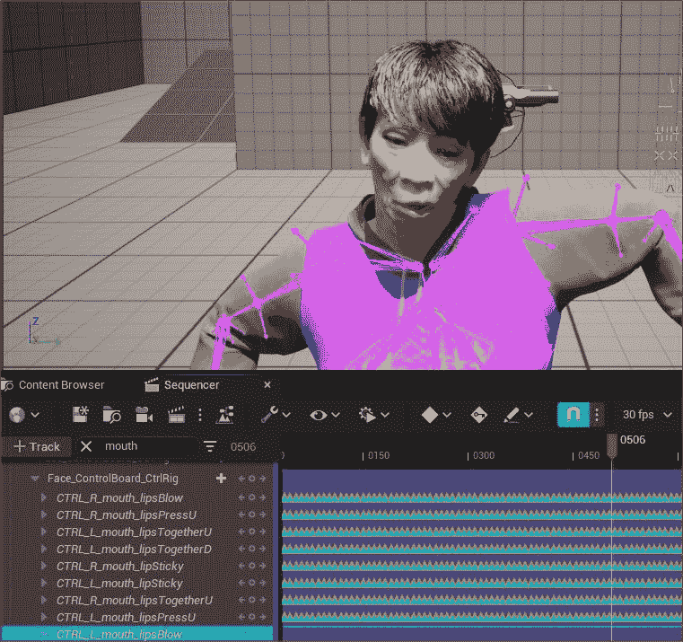

图 10.11：将轨道烘焙到控制绑定

让面部捕捉与身体捕捉配合工作的很大一部分在于时机。这可能只需要简单地将面部动作捕捉动画轨道向左或向右滑动；另一方面，你可能需要花费更多时间使用面部控制绑定，甚至身体控制绑定，以使两个动画匹配。熟练使用面部控制绑定的唯一途径就是多加实验。一个好的做法是尽可能充分利用原始面部动作捕捉数据，然后使用带有控制绑定的 `Additive` 片段来完善动画。

介绍了一些高级动画功能后，现在是深入探讨一些高级渲染功能的时候了。

### 探索高级渲染功能

我以前说过，现在再说一遍：Unreal Engine 是一个非常强大的工具，在渲染方面，它从不令人失望。Unreal 能够提供卓越的效果，可与 Mental Ray、Arnold、V-Ray 和 RenderMan 等传统路径追踪渲染器相媲美。Unreal 现在支持路径追踪，这是这些其他渲染器工作原理的基础。

在电影制作领域，Unreal 拥有实时渲染能力，应加以探索以释放其全部潜力。摄像机和灯光拥有我们在 Maya、Houdini 和 Blender 等使用路径追踪渲染器的 3D 程序中发现的功能。可以从这些应用程序中的任意一个导出完整场景，并保持摄像机和灯光设置完好无损且与 Unreal 兼容。

那么，废话不多说，让我们来看看这些很棒的渲染功能。

### 添加和制作摄像机动画

在 *第 7 章* 中，我们使用了一种直接从 Level Sequencer 创建新摄像机的方法；然而，在本章中，我们将在不使用 Level Sequencer 的情况下创建摄像机。

在图 10.12 中，我点击了 `Create Actor`（创建 Actor）按钮，以快速向场景中添加一个 Actor。从那里，我选择了 `Cinematic`（电影），然后选择 `Cine Camera Actor`（电影摄像机 Actor）。这会在我的场景视口中创建一个摄像机：

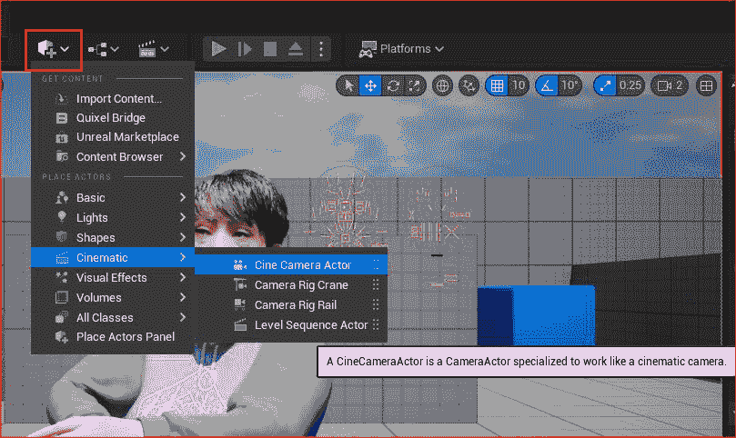

图 10.12：快速向场景添加摄像机

接下来，转到 Level Sequencer，通过点击 `+ Track`（+ 轨道）按钮并选择刚创建的摄像机来添加摄像机。

在图 10.13 中，摄像机切割具有网格背景，上方的视口也是如此。这使我们能够直接在视口中预览来自 Level Sequencer 的任何摄像机动画：

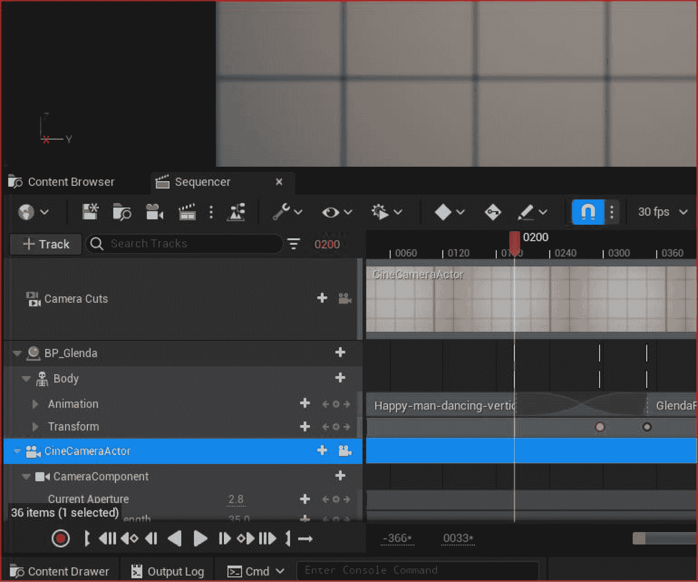

图 10.13：摄像机切割被自动创建

与 MetaHuman 蓝图的身体和面部不同，Cine Camera 会自动生成 Transform（变换）功能。这将允许你更改摄像机在 `X`、`Y` 和 `Z` 轴上的位置。你还可以更改摄像机在 `X`、`Y` 和 `Z` 轴上的旋转，它们分别改变 Roll（滚转）、Pitch（俯仰）和 Yaw（偏航）。

如图 10.14 所示，右侧有关键帧属性。通常，在制作摄像机动画时，你需要调整 `Location`（位置）设置并编辑 `Focus Distance`（焦距）设置，以确保主体对焦清晰：

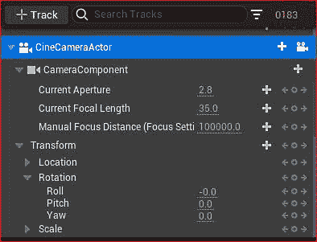

图 10.14：摄像机变换

与其每次想在 Level Sequencer 中设置关键帧时都在 Level Sequencer 的 Transform 功能中更改数值，不如直接在视口中驾驶摄像机，这很像使用键盘和鼠标玩第一人称游戏。

请务必启用自动关键帧，如图 10.15 所示，每次移动摄像机时它都会创建一个关键帧：

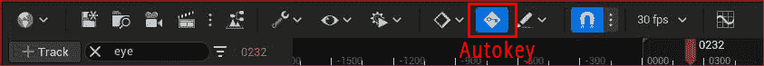

图 10.15：自动关键帧功能

除了制作摄像机位置动画外，你还可以制作摄像机焦点对象的动画。一个非常方便的对焦工具是 `Debug Focus`（调试对焦）工具，如图 10.16 所示。该工具为我们提供了清晰的视觉指示，显示什么在焦点上。选中摄像机后，勾选 `Draw Debug Focus Plane`（绘制调试对焦平面）选项；你会看到一个粉色平面出现。位于该粉色平面上的任何东西都将完美对焦：

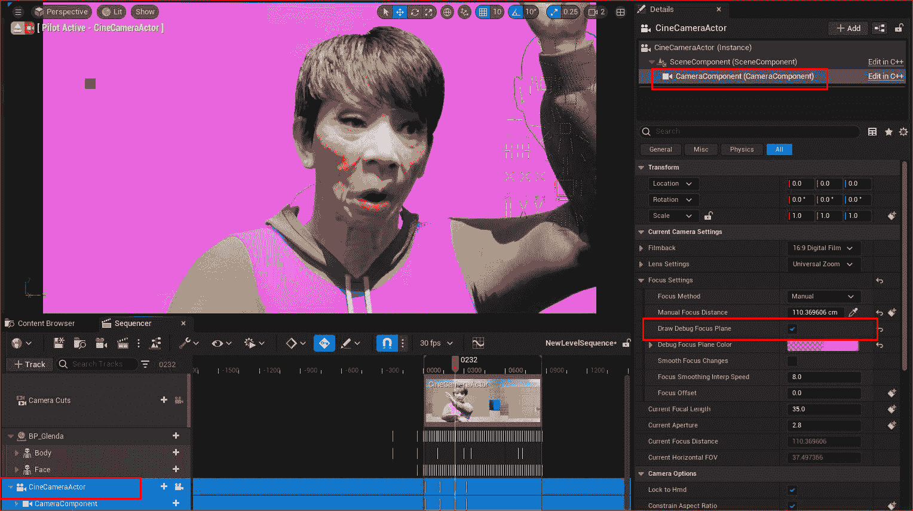

图 10.16：摄像机调试对焦

你可以在 Level Sequencer 中控制焦点并制作焦距动画，但请使用调试平面进行精确对焦。

现在，介绍了一些更高级的摄像机功能后，是时候转到灯光了。

### 添加和制作灯光动画

在大多数情况下，Actor 被添加到 Level Sequencer 时会带有一些可制作动画的属性。可以通过 Level Sequencer 制作更多属性的动画，但我们需要手动将它们添加到 Level Sequencer 中。

灯光也是可动画化的 Actor。我们可以将灯光添加到 `Level Sequencer` 中，方式与之前添加摄像机大同小异。这样做后，默认情况下唯一可动画化的属性是灯光强度。但 `Light Actor` 还有许多属性可供添加以用于动画制作。

在图 10.17 中，你可以看到通过点击 `Level Sequencer` 中摄像机组件旁的 **+ Track**，我可以访问 `Detail` 面板中几乎所有的属性以进行动画制作。点击列表中的任意属性，即可使其成为 `Level Sequencer` 中可动画化的组件：

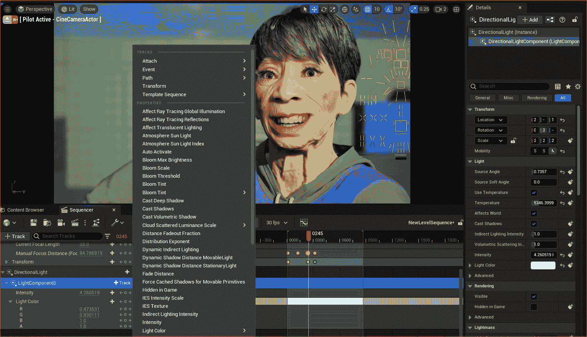

图 10.17：编辑灯光

一般来说，灯光动画化的情况很少见，就像在实拍中移动灯光很少见但并不罕见一样——也许你想要一辆警车的闪烁灯光或灯塔旋转的灯光，又或者想在角色走过灯光下时调整灯光强度。我可以写一整章关于 Unreal 中灯光的内容，甚至可以写一整本书，但我们必须继续介绍一个非常重要的功能：`Post Process Volume`。

### 使用后期处理体积

`Post Process Volume` 是一个有趣的工具，因为它赋予了我们对最终画面的巨大控制权。通常，`Post Process Volume` 会包围整个场景，它之所以被称为 Volume（体积），是因为它是场景中受美术输入影响的一个区域。

本质上，`Post Process Volume` 是一个特效和调色工具，其大部分工具集都针对摄像机。例如，我们可以控制眩光、辉光和色差，这些都是非常具体的镜头特性，此外还有胶片颗粒、曝光调整、白平衡等。如果你看看任何现代摄像机或数字电影摄像机的设置，`Post Process Volume` 几乎都有对应的功能。Epic Games 在为美术提供实时渲染场景的真实世界工具方面做了令人难以置信的工作。

在图 10.18 中，我使用了其中一些功能：

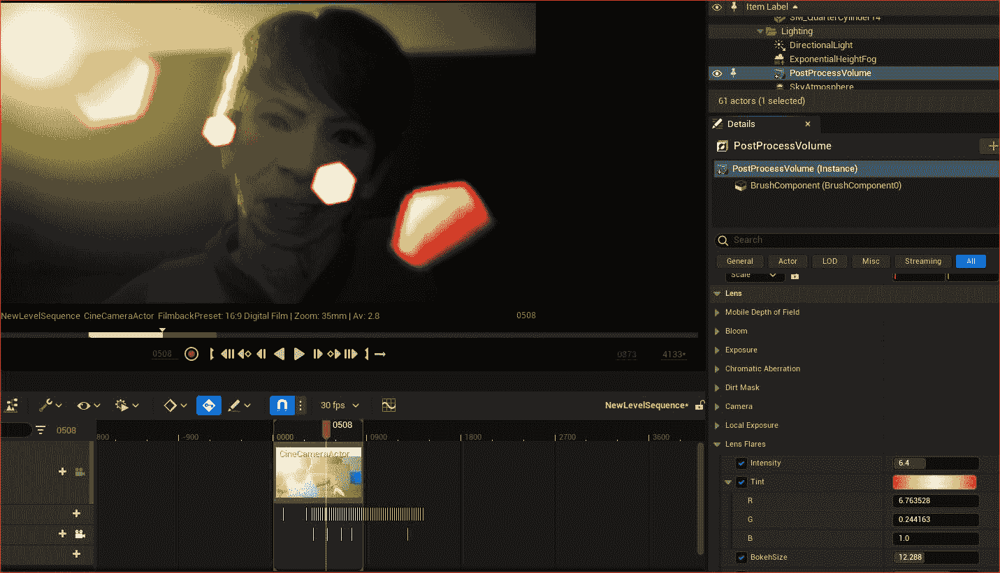

图 10.18：使用后期处理体积的镜头效果

让我们看看我使用的一些功能：

*   **镜头眩光** 显而易见。如果你不熟悉镜头眩光，它们是画面中穿过 Glenda 脸部的光斑——它们与光源（Glenda 身后的定向光）发生反应。我给镜头眩光添加了粉色色调并增加了 `Bokeh` 大小，这实际上增加了镜头眩光的尺寸。
*   我还添加了 **辉光** 效果，这让我们从她的头发上得到了真实的光晕。`Bloom` 效果模拟了真实镜头上使用的滤镜，如 Pro Mist 滤镜，可以柔化画面中的高光。
*   此外，我还添加了 **胶片颗粒**、**色差** 和 **暗角**，这些在这里太微妙而难以察觉，但常用于增强真实感：
    *   **胶片颗粒** 用于模拟胶片颗粒或数字噪点，这些存在于胶片或数码相机中
    *   **色差** 是摄影镜头中发现的一种自然现象，会出现非常微妙的彩虹效果，特别是在画面的高光部分
    *   **暗角** 是摄影镜头的常见伪影，画面边缘比中间更暗

顾名思义，`Post Process Volume` 是一个*后期制作*工具。就 Unreal Engine 而言，大多数困难的事情如灯光方向、阴影、皮肤着色、反射等已经设置完毕，但 `Post Process Volume` 在此基础上增加了一层额外的效果。在某种程度上，`Level Sequencer` 就像摄像机，而 `Post Process Volume` 就像 Photoshop。

经验法则：最好让所有灯光和摄像机工作尽可能接近最终外观，并依靠 `Post Process Volume` 实现其他方式无法达到的效果。

`Post Process Volume` 中有相当多的设置，遗憾的是在一本关于 MetaHuman 的书中无法全部涵盖。然而，它们会让你的 MetaHuman 在渲染时看起来惊艳无比。

> **注意**
>
> 如果你想了解更多高级灯光和渲染技术，我建议你查看以下视频教程，可从 Gnomon Workshop 购买：[Unreal Engine 5 电影级灯光教程](https://www.thegnomonworkshop.com/tutorials/cinematic-lighting-in-unreal-engine-5)。

这带我们进入下一节，我们将仔细研究如何从 `Movie Render Queue` 导出文件以进行合成和调色。

### 使用电影渲染队列

当我们从 `Level Sequencer` 设置渲染时，可以选择使用哪个渲染队列。要查看可用的渲染队列，请点击拍板图标旁边的三个点，如图 10.19 所示：

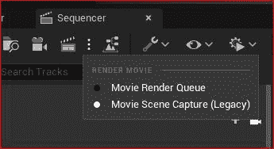

图 10.19：电影渲染队列选项

你很可能只会看到 **Movie Scene Capture (Legacy)**，但这已经有些过时且功能有限。另一个选项是 **Movie Render Queue**；不过在撰写本文时，它仍处于 Beta 阶段，因此默认未启用。

要启用它，你需要前往插件部分并搜索 **Renderer**。在图 10.20 中，你可以看到我已经启用了两者，你也应该这样做：

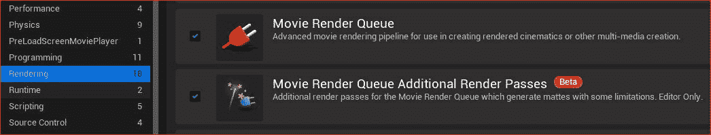

图 10.20：启用两个渲染队列插件

现在，当你点击 **Movie Render Queue** 时，如图 10.21 所示，你将看到以下界面：

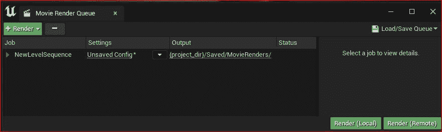

图 10.21：电影渲染队列对话框

绿色的 **+ Render** 按钮用于确定要渲染的序列。初始化 `Movie Render Queue` 会将当前的 `Level Sequencer` 分配用于渲染。但是，如果你的项目中有多个 `Level Sequencer`，可以使用 **+ Render** 按钮将它们添加到渲染队列中。在此对话框中，你将看到三列：

*   **Job**
*   **Settings**
*   **Output**

让我们逐一了解这些列。

#### Job

**Job** 是被选中用于渲染的 Sequencer 名称。默认情况下，它将被命名为 **New Level Sequence**。请记住，诸如 **Range**（动画时长）和 **Frame Rate** 等参数是在 `Level Sequencer` 中确定的。

如果你的项目中有多个 `Level Sequencer`，它们将出现在 **Job** 下，你可以选择要渲染的 `Level Sequencer`。

#### Settings

**Settings** 指的是你想要应用到序列上的渲染设置。

#### Output

**Output** 区域显示图像或视频将被渲染到的文件夹目录，这在输出设置中设定。

渲染设置有相当多的选项可供选择。归根结底，如果你已经决定使用 `Level Sequencer` 从 Unreal 导出电影，那么你不太可能关心 Unreal 的实时渲染能力，而是计划在后期制作中对渲染序列进行更多工作。

文件类型，无论是电影文件还是图像序列，都是一个重要的考虑设置。例如，如果你计划进行额外的后期制作，如高级调色，则应选择 **Open EXR** 等图像序列设置，它提供更高的色彩保真度。如果你只是计划进行测试渲染或直接从 Unreal 进行最终渲染，那么 **QuickTime ProRes** 等电影文件就足够了。

让我们看看默认设置，如图 10.22 所示：

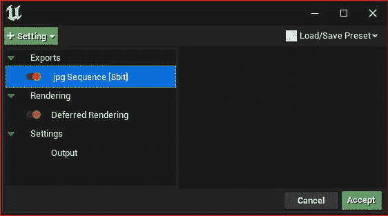

**图 10.22：Movie Render Queue（电影渲染队列）中的默认设置**

共有三种类型的默认设置：

*   `Exports (jpg Sequence 8bit)`（导出 [JPG 序列 8 位]）：导出允许我们选择想要的文件格式选项，从低保真和压缩格式（如 JPG，仅为 8 位）到高保真 Open EXR（浮点 16 位）。
*   `Rendering (Deferred Rendering)`（渲染 [延迟渲染]）：延迟渲染是在 Unreal 中渲染场景的一种优化且默认的方式。它分两遍渲染。主遍包含诸如 Z 深度和环境光遮蔽等计算。从主（基础）遍中，可以在第二遍中推导出在着色器方面需要按对象计算的内容。这是为了减少处理时间。
*   `Settings (Output)`（设置 [输出]）：当你点击 `+ Setting`（+ 设置）时，你会看到有更多设置可供选择：

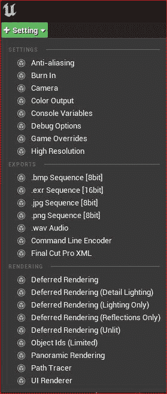

**图 10.23：Movie Render Queue 中的可用设置**

在将 Level Sequencer（关卡序列器）渲染到硬盘时，我们有各种选项可供选择以提升其质量：

*   `Settings`（设置）：从该列表中，你可以一次性选择多个选项。对于本书，我将添加 `Anti-Aliasing`（抗锯齿），以便提升动态模糊的质量。
*   `Exports`（导出）：我将把 `.jpg sequence [8bit]` 替换为 `.exr Sequence [16bit]`；这将显著提升渲染质量，特别是在稍后使用视频编辑软件精修画面时。`.exr Sequence [16bit]` 以 `Open EXR` 格式导出——它赋予我们在应用程序（如 After Effects、Nuke 或 DaVinci Resolve）中控制过曝和欠曝内容的更强能力。Open EXR 是电影和电视领域的全球视觉特效标准，因为它存储的颜色信息比其他格式多得多，且还存储元数据。
*   `Rendering`（渲染）：让我们看看一些可用的渲染选项：
    *   `Deferred Rendering`（延迟渲染）：默认渲染选项，使用多遍渲染。
    *   `Deferred Rendering (Reflections Only)`（延迟渲染 [仅反射]）：此渲染选项仅渲染反射。如果我们想在合成应用程序（如 Nuke）中控制反射强度，这非常方便。通常，你会将此选项作为 `Deferred Rendering` 的补充来选择。
    *   `Object IDs (Limited)`（对象 ID [有限]）：每个对象被分配一个对象 ID，由一种独特的颜色表示。启用此选项后，我们将获得一个对象 ID 视频通道作为 EXR 文件的一部分。在 Nuke 等应用程序中合成时，我们可以通过选择与之关联的颜色，利用对象 ID 单独操控对象。如果我们想在 Nuke 中更改对象颜色而无需在 Unreal 中修改，这非常方便。

你可以在*图 10.24*中看到我所选择的设置：

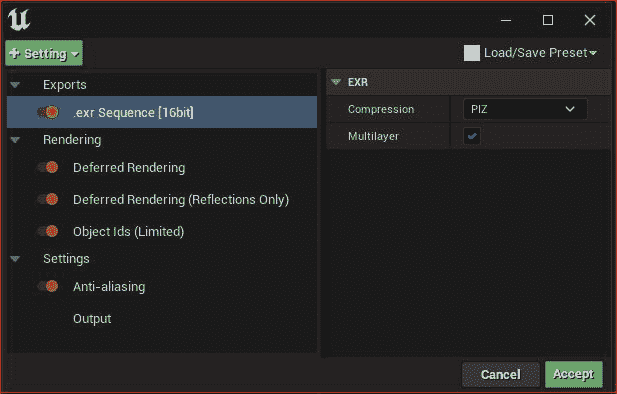

**图 10.24：设置选择**

> **注意**
>
> EXR 文件格式能够存储多个通道。大多数图像文件仅存储三个通道：红、绿、蓝，例如 JPEG 文件。PNG 文件可存储四个通道：红、绿、蓝和用于透明度的 Alpha 通道。

### Output（输出）

你的默认 `Output`（输出）设置将与 Level Sequencer 的默认设置相匹配。然而，`Output` 列是一种覆盖它们的手段，允许你控制最终的分辨率和帧率。

在*图 10.24*中，我使用了三个渲染设置，它们将渲染为单个 EXR 图像序列，作为独立的通道分别对应以下内容：

*   `Deferred Rendering`（延迟渲染）
*   `Deferred Rendering (Reflections Only)`（延迟渲染 [仅反射]）
*   `Object ID (Limited)`（对象 ID [有限]）

你可以在*图 10.25*中看到该渲染的结果。该图展示了已渲染并存储在 EXR 文件中的三个额外通道——左上角是 `Deferred Rendering`，看起来正常；右上角是 `Reflections Only`（仅反射）；左下角是 `Object ID`（在合成软件中，我可以通过操控这些额外通道进行进一步调整）：

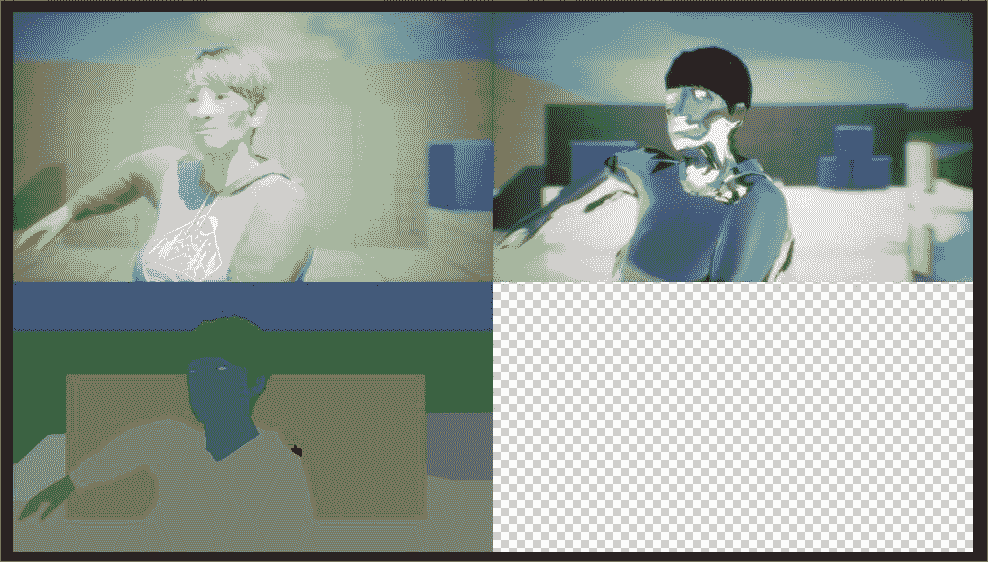

**图 10.25：渲染示例**

新版 Movie Render Queue 中的渲染设置非常强大，赋予艺术家对最终图像的控制力比实时渲染多一些。这符合传统 3D 动画制作的预期结果，即合成师获得对 3D 渲染结果同等或更多的控制权。随着 Unreal 的发展，我们预计越来越多的 3D 动画工作室将把 Unreal 融入其流水线。

在下一节中，我们将了解一些现在随 Unreal 附带的专业色彩标准，它们允许 MetaHuman 在专业工作室环境中工作。

### ACES 和色彩分级

正如上一节所述，`Open EXR` 是视觉特效和 3D 动画工作室用于 3D 渲染和合成的专业行业标准文件格式。原因之一是它能存储海量的像素数据，特别是颜色数据。

你可能记得看到过 `.jpeg sequence [8 bit]` 作为渲染选项。好吧，在专业领域这根本不够用，仅仅因为它甚至无法呈现人眼所能看到内容的一半。8 位图像分别只能存储 256 级红、绿、蓝阴影。总共仅约 1600 万种颜色，而 16 位图像则拥有 280 万亿种以上的颜色。

如果你看看*图 10.26*，其中最宽的色域区域由 `ACES colorspace`（ACES 色彩空间）表示，你会看到与 `sRGB` 相比有显著差异。8 位的 JPEG 格式只能在像 `sRGB` 这样较小的色彩空间内工作。因此，利用 EXR 文件格式巨大的数据空间和 ACES 巨大的色彩空间，Unreal Engine 能够实现令人难以置信的照片级真实感渲染，这也是为什么选择 `Exr Sequence [16bit]` 更可取的原因：

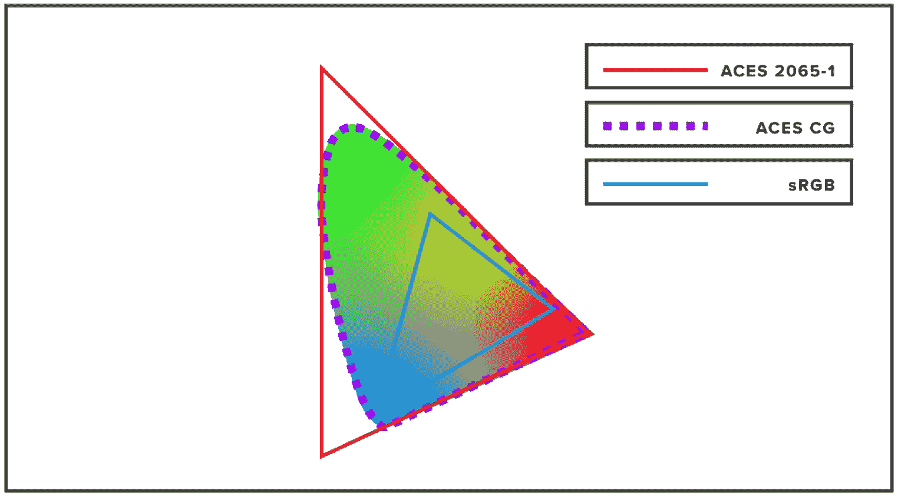

**图 10.26：ACES 色彩空间对比 sRGB**

> **注意**
>
> 关于 ACES 色彩空间的进一步阅读，请访问 [`acescolorspace.com/`](https://acescolorspace.com/)。

在本节中，我们揭示了一些与 `ACES colorspace` 与 `sRGB` 相关的高级色彩理论，以及它们如何帮助你改进 MetaHuman 渲染。

### 总结

在本章中，我们有机会复习一些让 MetaHuman “活”起来的关键要素，即将身体和面部动作捕捉应用到 Level Sequencer 中。我们探讨了编辑动作和修复常见动作问题的替代方法，例如循环动画时修复角色位置。我们还学习了如何使用 `Transform`（变换）、`Location`（位置）和 `Show Skeleton`（显示骨架）来帮助使用循环轨道创建更长的动画。

之后，我们介绍了摄像机、灯光和后期处理体积，回顾了 Unreal Engine 一些非常强大且专业的渲染能力。

在本书的下一章也是最后一章中，我们将介绍一项新功能（写作时），它允许我们使用自己的肖像或他人的肖像，围绕真实人类打造一个 MetaHuman！
