## 第 11 章 使用 Mesh to MetaHuman 插件

在上一章中，我们完成了创建 MetaHuman 并制作包含 MetaHuman 视频的流程。在撰写本书期间，Epic Games 发布了 Unreal Engine 5 版本——首先是抢先体验版，随后是完全支持的正式版。此外，Epic Games 还发布了一款开创性的插件，允许用户使用自定义面部网格作为其 MetaHuman 的面部。这款免费插件称为 `Mesh to MetaHuman`，其核心是 `MetaHuman Identity Asset`（MetaHuman 身份资产）。

这为艺术家们打开了机会之门，让他们能够在自定义面部雕塑或真实人物的数字扫描上使用所有很棒的 MetaHuman 相关工具和功能。因为我们可以使用真实人物的数字扫描，所以艺术家们能够创建出与演员甚至艺术家本人有着惊人相似度的 MetaHuman。

在本章中，我们将重点介绍如何创建和利用你自己的面部数字扫描，并将其应用到 MetaHuman 上。为此，我们将使用一款名为 KIRI Engine 的应用程序，它同时适用于 iPhone 和 Android。然后我们将导入数字扫描，以便与 Mesh to MetaHuman 插件配合使用。

因此，在本章中，我们将涵盖以下主题：

* 为 Unreal Engine 安装 Mesh to MetaHuman 插件
* 介绍并在智能手机上安装 KIRI Engine 应用
* 将扫描的网格导入 Unreal Engine
* 在 MetaHuman Creator 中修改面部网格

### 技术要求

就计算机性能而言，你需要满足 *第 1 章* 中详述的技术要求。

你还将需要：

* 一部至少有 200 MB 可用空间的 iPhone 或 Android 手机
* 稳定的网络连接，因为你将下载插件并向服务器上传数据
* 可访问用于安装 Unreal Engine 的 Epic Games Launcher
* KIRI 应用
* Mesh to MetaHuman 插件
* Unreal Engine 中的一个新项目

注意：你需要熟悉 *第 2 章* 中的 MetaHuman Creator 在线应用程序，但不需要打开前几章的任何项目。

### 为 Unreal Engine 安装 Mesh to MetaHuman 插件

要开始，请在 Unreal Engine 中创建一个新项目并保持打开状态。然后，要启用 Mesh to MetaHuman 插件，我们首先需要通过 Epic Games Launcher 从 Unreal Engine Marketplace 下载它。

当你找到 Mesh to MetaHuman 插件页面时，点击 **Install to Engine**（安装到引擎）按钮，如 *图 11.1* 所示：

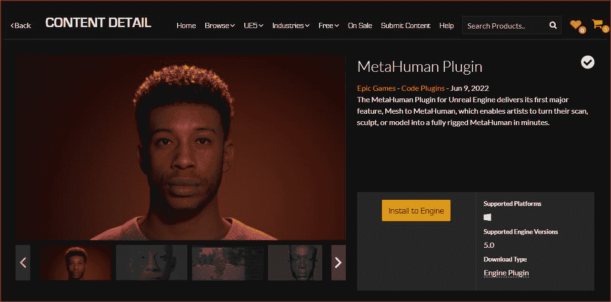

图 11.1：MetaHuman 插件

安装好 Mesh to MetaHuman 插件后，我们现在将进入下一节，开始使用 KIRI Engine 应用创建数字扫描的旅程。

### 在智能手机上介绍并安装 KIRI Engine

什么是 **KIRI** Engine？KIRI Engine 是一款属于 **摄影测量** 类别的应用程序。摄影测量是利用照片在 3D 应用程序中创建 3D 几何体的过程（在大多数情况下是自动完成的）。

在为 MetaHuman 创建面部扫描的背景下，摄影测量要求艺术家在 180 度的弧线范围内以及不同高度拍摄多张照片。从 *图 11.2* 中，你可以看到头部和肩膀的四个不同角度。

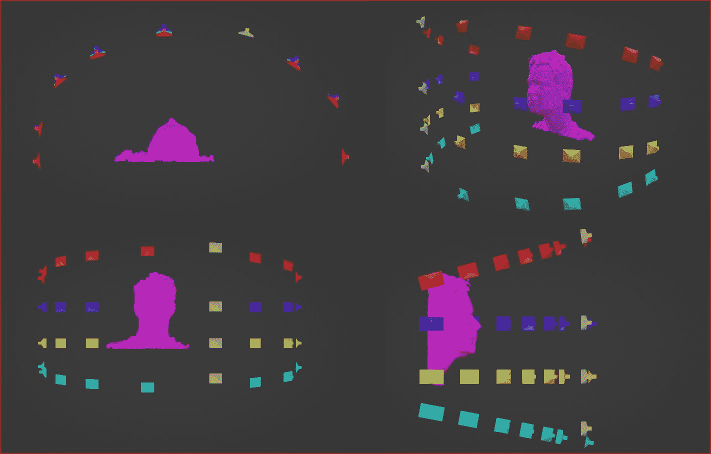

图 11.2：典型相机位置

我们只对面部正面感兴趣，这就是为什么我们只在 180 度的弧线范围内进行捕捉。获取高角度和低角度也很重要，以便我们获得下巴底部、鼻孔和额头的信息。

摄影测量拍摄技巧：

* 使用漫射（柔和）光照，使面部无阴影
* 让被摄对象保持静坐，下巴微微上抬
* 如果可能，使用偏振镜滤镜以最大程度减少皮肤上的反光

现在，让我们开始使用 KIRI。最近，KIRI Engine 在 macOS 或 Windows 上通过网页浏览器使用时已推出桌面版本，你可以在此下载：`https://www.kiriengine.app/web-version/`。然而，为了本书的目的，我将假设你拥有一部 Android 智能手机或 iPhone，并且你正在将 KIRI Engine 应用下载到智能手机上。

如果你有 Android 设备，可以免费从 Google Play 安装该应用，如下所示：

图 11.3：Google Play 上的 KIRI Engine

既然你们中的许多人在 *第 8 章* *使用 iPhone 进行面部动作捕捉* 中已经用过 iPhone，你们会很高兴地知道不必跑去弄个 Android。通过前往 App Store，你可以在设备上下载 KIRI Engine 应用：

图 11.4：App Store 上的 KIRI Engine

使用 KIRI Engine 非常简单，因为运行应用时可供选择的选项很少。当你首次打开 KIRI Engine 时，无论你使用的是 Android 还是 iPhone 设备，都会看到如 *图 11.5* 所示的简单界面：

图 11.5：KIRI Engine 欢迎屏幕

在这里，你将可以选择上传之前拍摄的照片，或使用 KIRI 应用拍照。选择后者，**Take photos**（拍照），屏幕将发生变化：

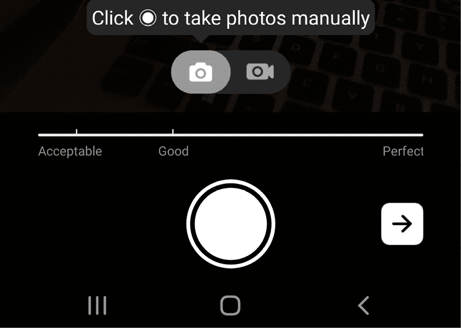

图 11.6：手动选项

手动捕捉设置是默认设置。它由 *图 11.6* 左上角的静态相机图标表示。这是一个手动捕捉选项，意味着每次想拍照时，你都必须点击屏幕底部的大白色按钮。问题在于，每次点击智能手机屏幕都会引入轻微的相机抖动，在特定光照条件下会导致照片模糊。

点击右侧的电影摄像机图标即可访问自动捕捉设置，如 *图 11.7* 所示。使用此设置，你只需点击一次红色按钮即可开始捕捉。此设置每隔几秒拍摄一张照片（多达 70 张），如果你移动相机过快，还会发出警告。

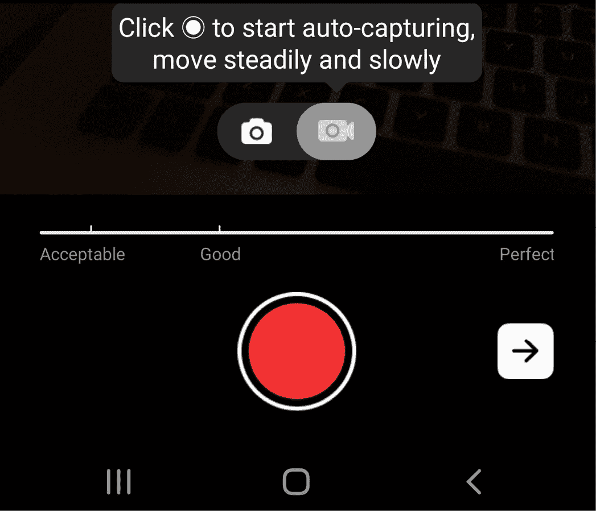

图 11.7：自动捕捉选项

注意录制按钮上方的进度线；这指示覆盖质量，即 **Acceptable**（可接受）、**Good**（良好）和 **Perfect**（完美）。**Acceptable** 结果将得到一个细节较少且容易出现块状感的 3D 模型，而 **Perfect** 照片结果将得到一个细节更丰富、更平滑的 3D 模型。

理想情况下，你应该让一张照片到下一张照片的重叠度尽可能高。前后相邻图像之间约 80% 的重叠度是一个好的经验法则。重叠是指每两三张连续图像应至少共享一个特征，例如眼睛或鼻子。

一旦你达到最大图像数量，并在面部周围达到了合理的覆盖程度，你将看到 *图 11.8* 所示的界面：

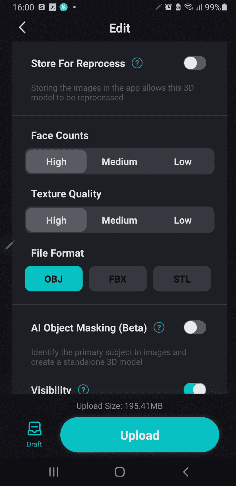

图 11.8：上传屏幕

在这个界面中，你将看到以下选项：

* **Face Counts**（面数）：用于创建 3D 模型的多边形数量。选择 **High**（高），以确保 MetaHuman 插件有足够的几何体可用（你不必担心生成过于稠密的几何体，因为 MetaHuman 设计用于处理多边形数量极高的高密度网格）。
* **Texture Quality**（纹理质量）：KIRI 不会生成超大的纹理贴图，如果你已在 Unreal Engine 中使用过 MetaHuman，则不会对 KIRI 创建的最高质量纹理贴图有任何问题。所以，再次选择 **High**（高）。
* **File Format**（文件格式）：虽然 Unreal Engine 可以导入 OBJ 和 FBX 两种文件格式，但据报告 FBX 格式的处理时间较长；Epic Games 建议使用 OBJ 以便插件快速工作，所以选择 **OBJ**。

完成选择后，点击那个大大的**上传**按钮。上传过程取决于你的网络连接速度；如果你的连接不稳定，可能会遇到问题，因为你可能需要重复上传过程。照片成功上传后，你将看到以下消息：

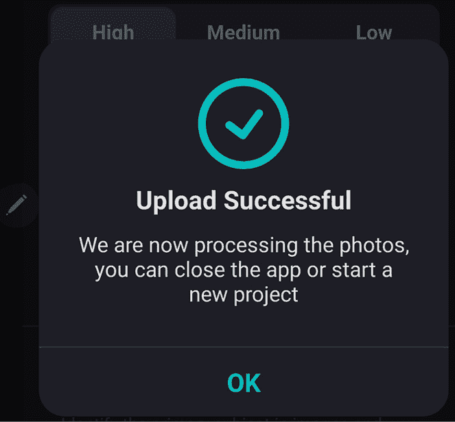

*图 11.9：上传成功通知*

有几个因素需要考虑进你照片的处理时间中。因为处理工作由云端服务器负责，你的上传任务极有可能被放入了队列中。所以，如果流量很大，你就得耐心等待几分钟。如果你的任务被放入队列或已开始处理，你会收到提示，并且可以在应用内查看其状态。

一旦流程启动，模型的创建速度会快得惊人。完成后，你可以打开它来检查模型。在*图 11.10*中，你可以看到我的一个模型。我知道你可能会被我天使般的外表分散注意力，所以我就简短地说一下：从拍照到获得可用的 3D 模型，整个过程从头到尾只花了大约 10 分钟。

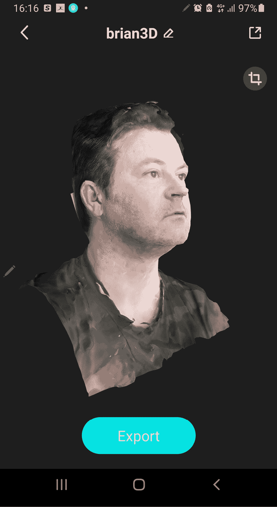

*图 11.10：3D 扫描结果*

下一步再简单不过了。只需点击**导出**按钮，即可进入此界面：

*图 11.11：发送你导出的模型*

在*图 11.11*中，你可以选择提供一个电子邮件地址。提供后，点击**发送**以接收模型的下载链接。它将以**.zip**文件夹的形式发送，其中包含网格的 OBJ 文件和用于纹理贴图的 JPG 文件。继续之前，请务必解压该文件夹。

在下一节中，你将把面部网格导入 Unreal Engine。

### 将扫描的网格导入 Unreal Engine

打开 Unreal Engine 后，前往**内容**文件夹，并在其中创建一个名为**FaceMesh**的新文件夹。在**FaceMesh**文件夹内，右键点击并选择**导入到 Game/FaceMesh**。这将弹出导入对话框，如*图 11.12*所示，你将看到 JPG 文件（图中左侧）和 OBJ 文件（右侧）：

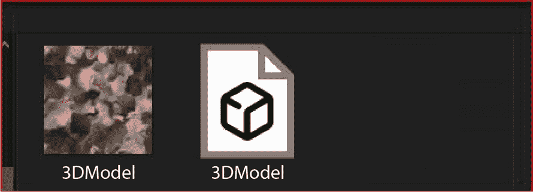

*图 11.12：JPG 和 OBJ 文件*

你只需点击**3DModel** OBJ 文件，然后点击**确定**。

这将打开**FBX 导入选项**，如*图 11.13*所示（这看起来可能有点奇怪，因为文件是 OBJ 格式，但这是正确的）：

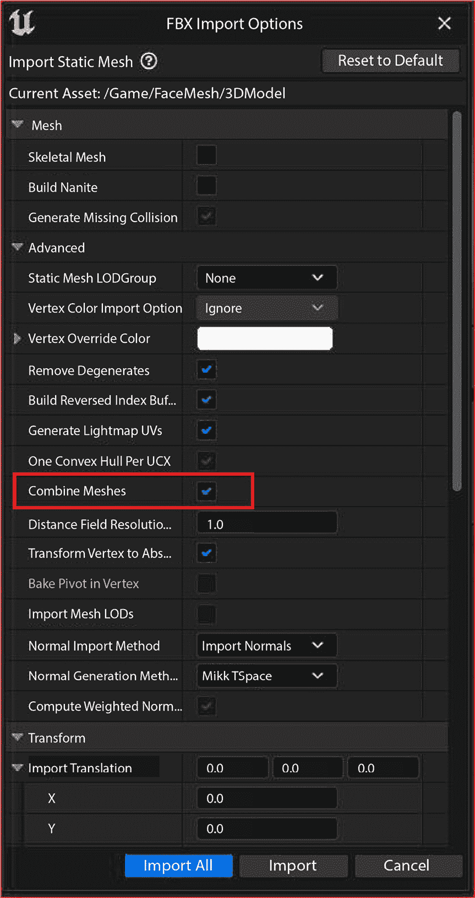

*图 11.13：导入网格选项*

确保勾选了**合并网格**，以确保模型作为单个网格导入。这是唯一需要更改的选项。然后，点击**全部导入**。

导入需要片刻时间。你很可能会收到一个错误日志对话框，提示平滑组存在问题，但这完全正常，不用担心。如果发生这种情况，它会在导入过程结束时出现，因此无需采取任何措施。

导入完成后，如*图 11.14*所示，**FaceMesh**文件夹中将有三个资产：模型、着色器和纹理贴图，后者会自动创建着色器。

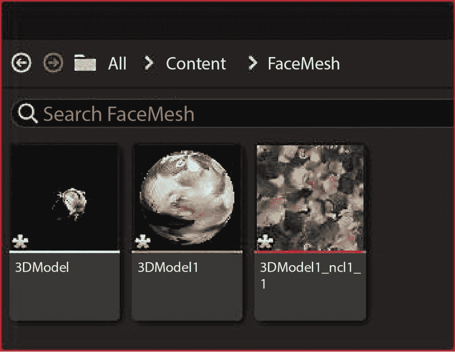

*图 11.14：导入的资产*

现在，在**FaceMesh**文件夹内右键点击，向下导航到**MetaHuman**，然后点击**MetaHuman Identity**。这将启用你在本章开头安装到引擎中的新 Mesh to MetaHuman 插件。

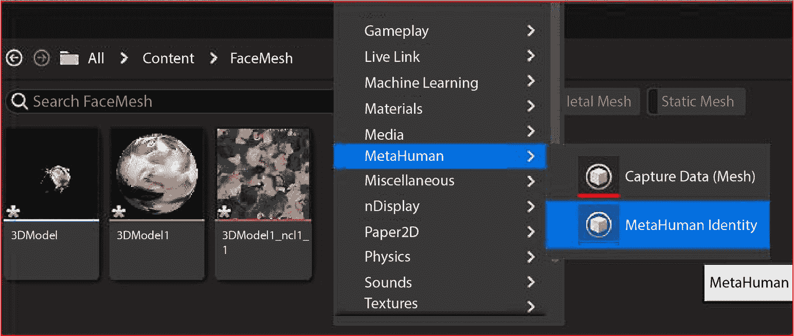

*图 11.15：创建 MetaHuman Identity 资产*

点击**MetaHuman Identity**后，将创建一个 MetaHuman Identity 资产，这是使用刚才导入的 3D 扫描所必需的。

现在，**MetaHuman Identity**图标在**FaceMesh**中创建好后，双击它。如*图 11.16*所示，MetaHuman Identity 拥有一个相对简单的界面，包含四个主要功能。

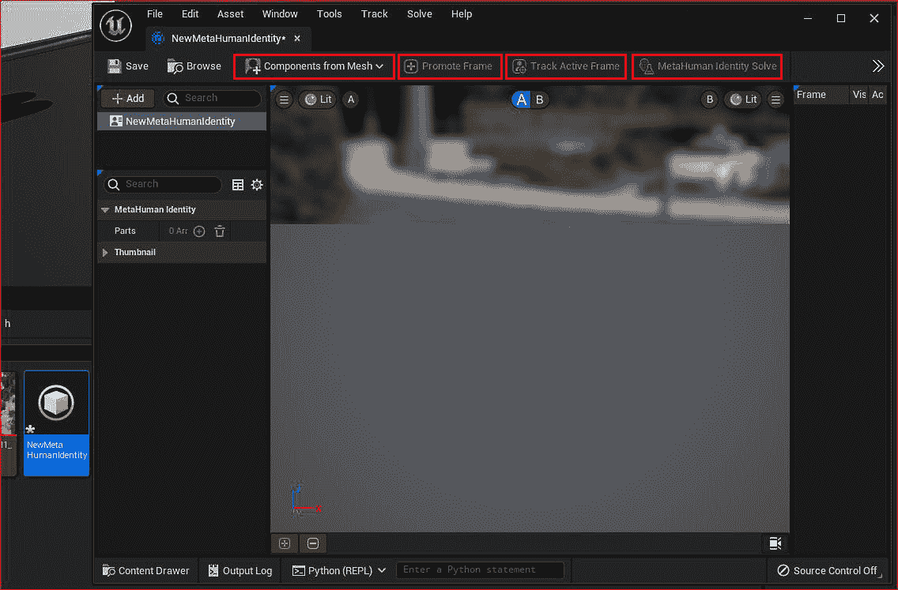

*图 11.16：MetaHuman Identity 界面*

从左到右高亮显示的 MetaHuman Identity 界面功能如下：

*   **来自网格的组件**：我们将之前导入引擎的网格引入此处
*   **提升帧**：我们在此设置网格的观察角度，供 MetaHuman Identity 用作参考，以确定眼睛、鼻子和嘴巴等关键特征的位置
*   **追踪活动帧**：MetaHuman Identity 使用面部识别算法从新的面部网格中确定关键面部特征
*   **MetaHuman Identity 求解**：奇迹发生的地方，创建一个与新面部网格比例对齐的 MetaHuman

请注意，我在*图 11.16*中高亮显示了这四个功能中的每一个。最左侧的功能**来自网格的组件**是唯一处于激活状态的功能。其余功能均处于非激活状态，因为每个功能都依赖于前一个功能才能工作，它们作为一系列必须按顺序遵循的步骤运作。

我们现在将逐步介绍这四个功能：

1.  点击**来自网格的组件**并选择你的模型：

    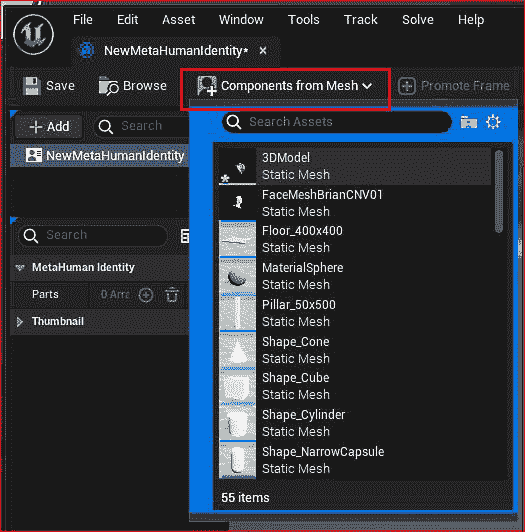

    *图 11.17：添加你扫描的网格*

    然后按 *F* 键将模型居中，并使用 *E* 键配合旋转小工具使模型面朝前方。

    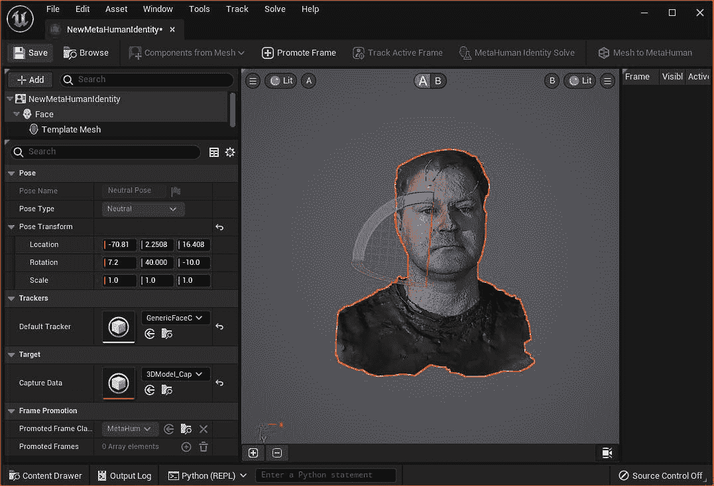

    *图 11.18：旋转模型*

2.  当你对面部网格的定位满意时，点击**提升帧**以保存角度。

    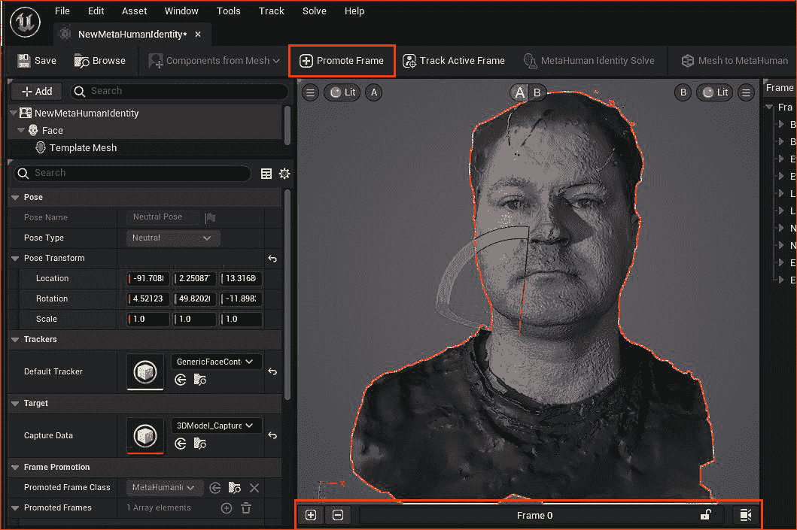

    *图 11.19：提升帧*

    如果你看一下*图 11.19*，可以看到视口下方现在有一个名为**帧 0**的提升帧。这表明已创建一个帧，将用作参考。你可以通过点击相机图标（右下角）来创建额外的帧，这将允许你获得一个新角度。然后，你需要再次点击**提升帧**按钮。不过，为了本章的目的，我们保持简单，只使用一次**提升帧**。

3.  接下来，我们需要确保面部网格能被正确追踪。点击**追踪活动帧**按钮，如*图 11.20*中高亮显示的那样。

    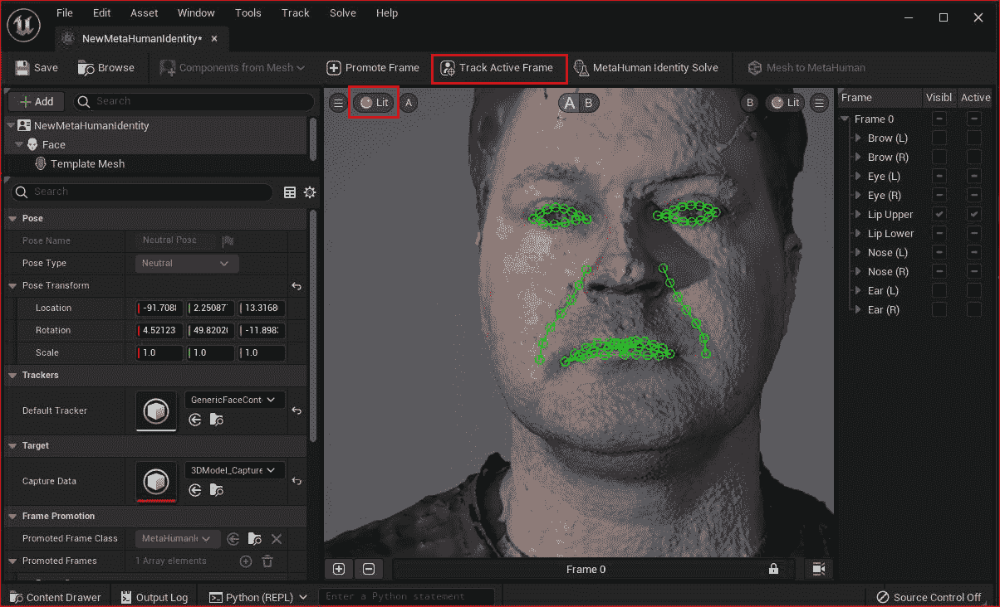

    *图 11.20：追踪活动帧*

    MetaHuman Identity 工具会追踪它所看到的面部特征。为了确保它工作良好，我建议你在*图 11.20*中标记的视口里切换**光照**和**无光照**模式。一般来说，它在识别眼睛和嘴巴方面做得很好，这足以让你获得一个与面部扫描高度相似的模型。

4.  接下来，我们需要为新的 MetaHuman 创建一个体型。请看*图 11.21*。选择**身体**，然后选择一个接近你自己的体型。

    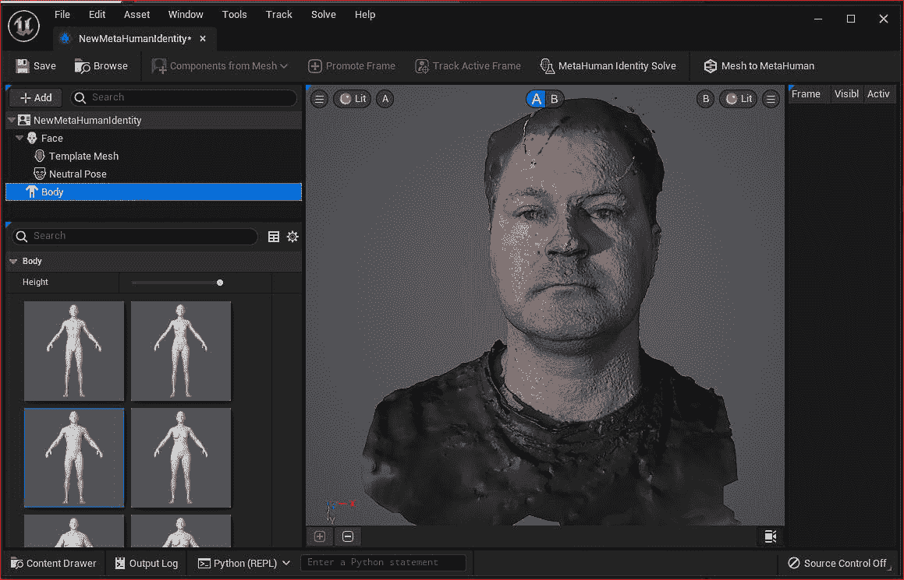

    *图 11.21：选择身体*

5.  现在，我们需要处理来自面部网格扫描的新网格形状。点击**MetaHuman Identity 求解**，如*图 11.22*所示。

    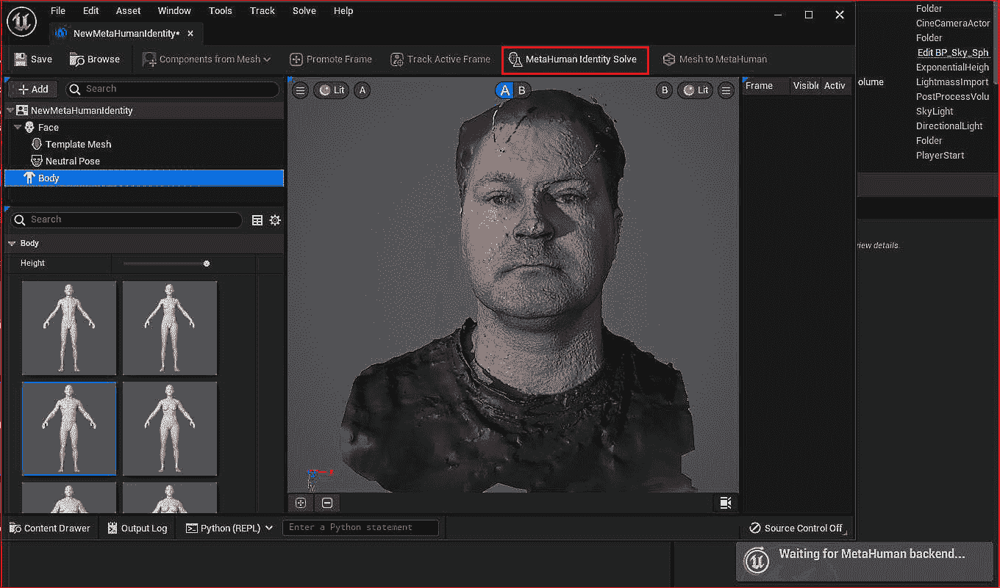

    *图 11.22：等待 MetaHuman 后端……*

    你会在屏幕右下角看到一条提示，显示**正在等待 MetaHuman 后端……**。这是因为处理将在 MetaHuman 云端进行，因为它要创建一个 MetaHuman 解决方案。

6.  等待后端的过程可能需要几分钟，但一旦完成，**网格转 MetaHuman**按钮将可供选择，如*图 11.23*所示。

    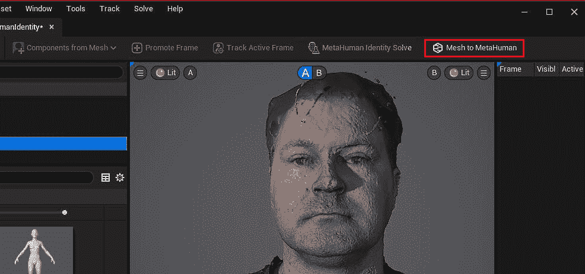

    *图 11.23：网格转 MetaHuman 按钮*

图 11.23：Mesh to MetaHuman 按钮

1. 选中后，你将获得一个 `Mesh to MetaHuman` 弹出对话框，如图 11.24 所示。只需点击 `OK`。

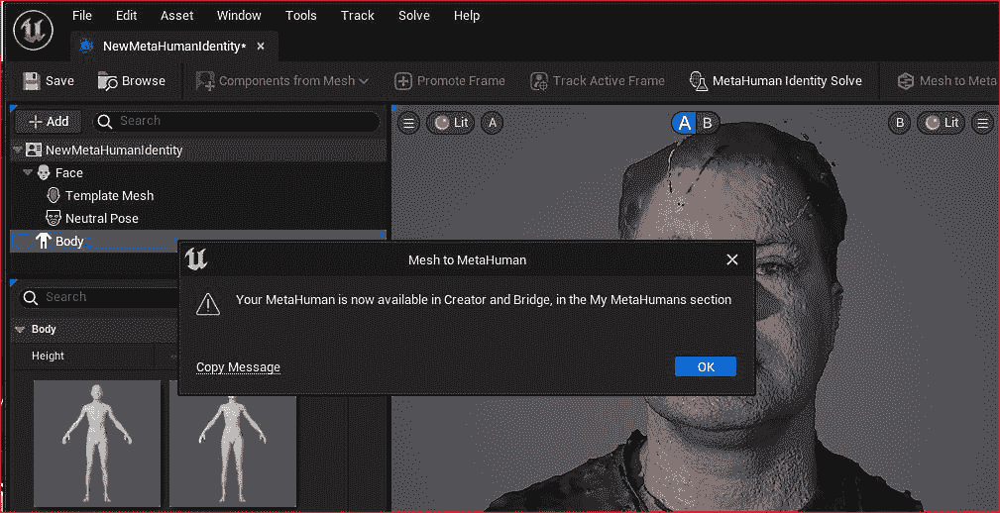

图 11.24：你的 MetaHuman 现已可用

此时，我们无法看到 Mesh to MetaHuman 插件的进度，因为处理过程在云端进行。更具体地说，我们需要前往 MetaHuman Creator 在线工具查看结果。

在下一节中，我们将转到 Quixel Bridge，可以从你的 `Content` 文件夹或独立的 Quixel Bridge 应用程序访问。我们使用 Quixel Bridge 来访问我们的新 MetaHuman，以便使用在线 MetaHuman Creator 进行调整。

### 在 MetaHuman Creator 在线工具中修改面部网格

打开 Quixel Bridge 后，导航到 `My MetaHumans`。在那里你会看到一个新的黑白图标。如图 11.25 所示，该图标表明此 MetaHuman 是使用 `Mesh to MetaHuman` 插件创建的。点击黑白图标并导航到 `Start MHC` 按钮。

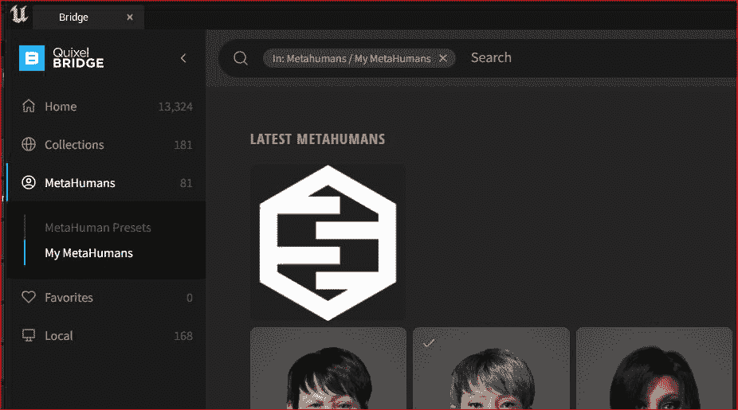

图 11.25：MetaHuman Identity 图标

你将被带到熟悉的 MetaHuman Creator 在线应用程序，该应用在 第 2 章 中介绍过。正如图 11.26 所示，MetaHuman 没有皮肤且有些变形。最显著的是，上半部分头部不自然地突出。原因是使用 KIRI Engine 应用创建的面部网格扫描也扫描了我的头发；MetaHuman Identity 求解器无法确定头发实际是什么，导致生成了皮肤组织而不是头发。

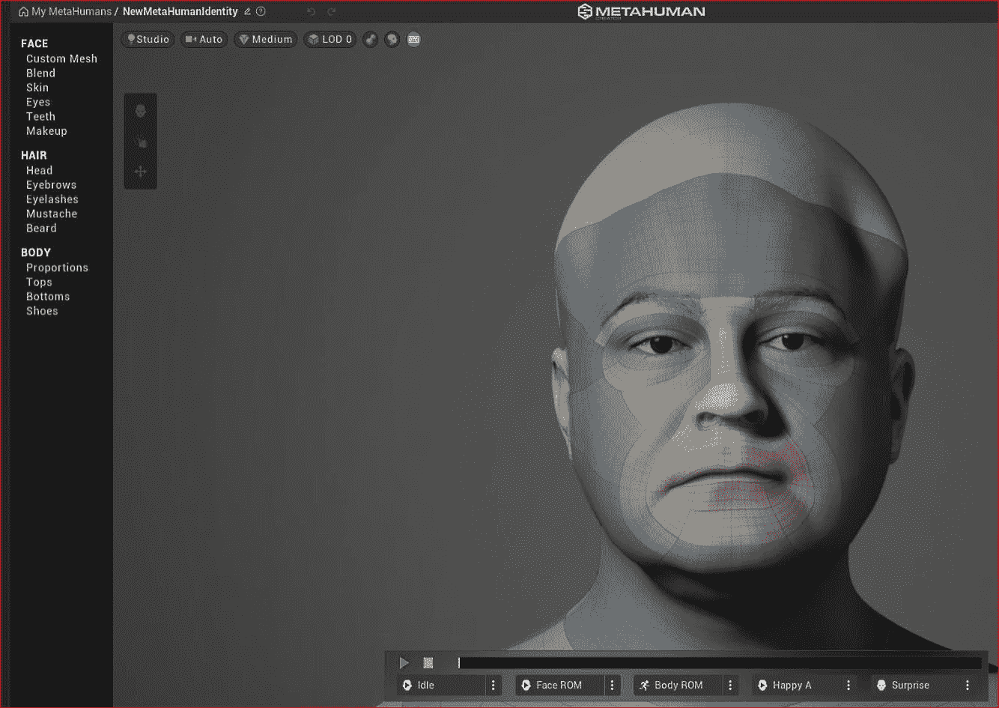

图 11.26：带有面部扫描的 MetaHuman Creator

头发问题有一个简单的修复方法。点击 `Face` 下的 `Custom Mesh` 选项，如图 11.27 所示。

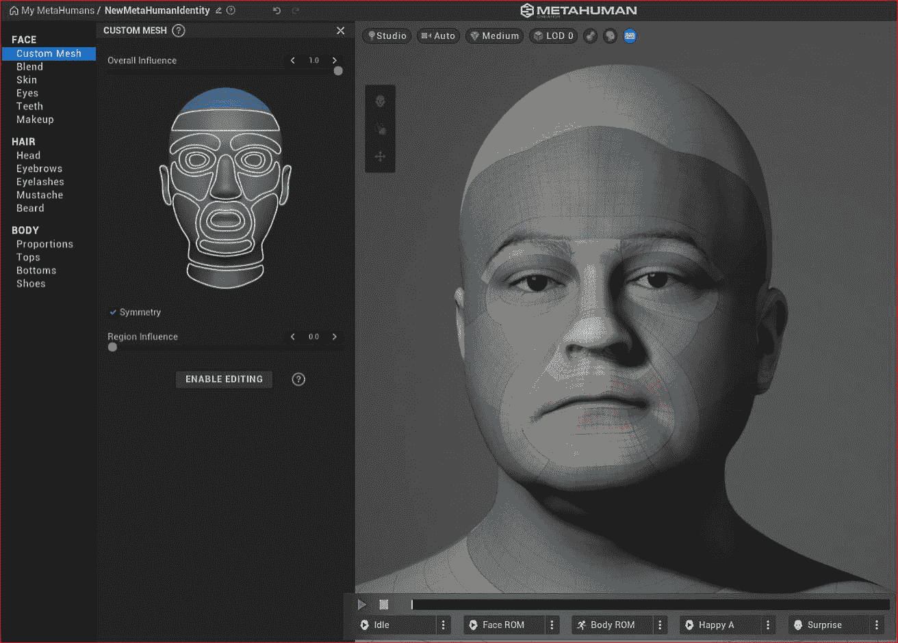

图 11.27：Custom Mesh 工具

如果你看左侧的面部缩略图，它被分割成各个组件，对应右侧我面部上色码的组件。

也要注意 `Region Influence` 滑块，我已将其降至 0。这意味着该部分网格的形状由 MetaHuman 模板决定，而不是由 KIRI Engine 扫描创建的面部网格决定。对比图 11.26 和图 11.27，你可以看到区别——前者的头部比后者块状得多。

如果你想进一步编辑，可以点击 `ENABLE EDITING` 按钮微调网格。不过，我建议你先改进扫描技术以获得更好的结果，将 `ENABLE EDITING` 选项作为最后的手段。

> **注意**
>
> 高质量照片能获得更好的结果。在本例中，光照条件不理想的智能手机导致了失真问题。在空白背景和非常柔和灯光的小型摄影棚中使用单反相机会获得更优的结果。此外，使用偏振滤镜进一步消除任何反光将是一个额外的加分项。

现在，让我们继续处理皮肤。我们从 KIRI Engine 扫描和随后导入 Unreal Engine 获得的纹理贴图和着色器已经丢失。这是一件好事。MetaHuman 拥有极其强大的皮肤着色器，能在 Unreal Engine 中非常真实地响应光照，我们将利用这一点。

因此，如图 11.28 所示点击 `Skin`，然后点击 `ASSIGN` 按钮分配肤色。

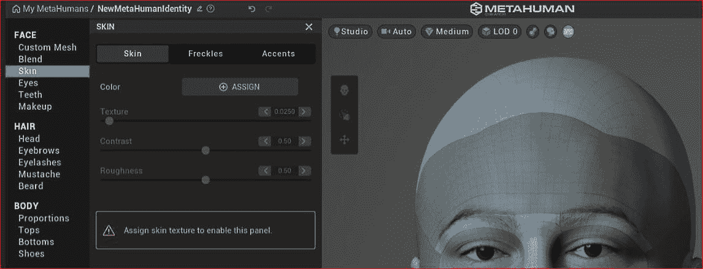

图 11.28：分配肤色

这将立即赋予我们带有 MetaHuman 所有着色器属性的肤色。我们现在对自定义面部扫描拥有的皮肤控制级别，与我们在 第 2 章 中首次创建 MetaHuman 时拥有的相同：

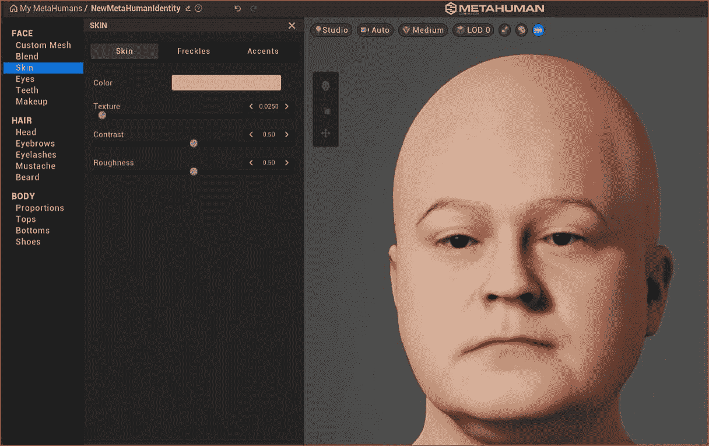

图 11.29：编辑皮肤

从图 11.29 也可以看出，默认光照给我们带来了相当柔和的光照结果。由于使用 KIRI Engine 在柔和光照下拍照是首选，在 MetaHuman Creator 中使用默认光照有助于匹配我们原始照片的肤色。

为了更好地判断模型是否工作正常，添加一些类似你自己的头发，就像我在图 11.30 中所做的那样：

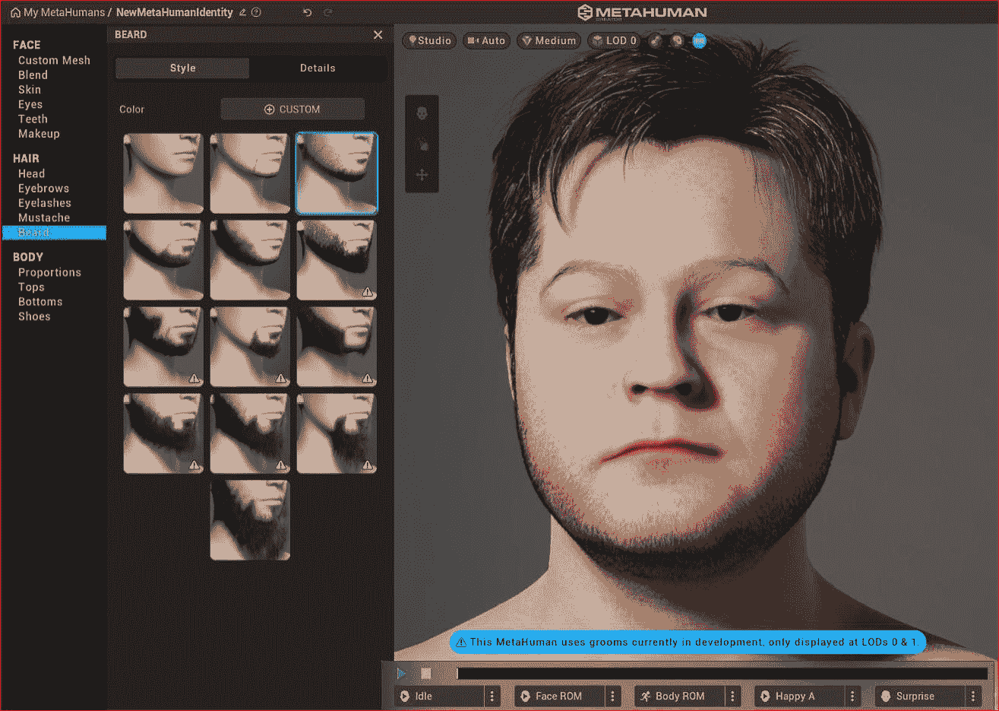

图 11.30：添加头发

因为 MetaHuman Creator 会持续自动保存你的 MetaHuman，你可以随时返回进行编辑。你也可以随时使用 Quixel Bridge 将带有自定义面部网格的新 MetaHuman 添加到项目中。

你可以花费大量时间修改自定义 MetaHuman，你应该花费的时间实际上取决于你的最终目标。如果你追求完美的相似度，你拥有 MetaHuman Creator 中所有的移动和雕刻工具，以及配合 KIRI 使用的所有照片作为参考，以实现更高的真实感。

### 总结

在本章中，我们了解了一个极好的额外功能，可用于创建与真人相似的角色。我们介绍了下载和安装 Mesh to MetaHuman 插件的过程，然后继续使用测量摄影学应用 KIRI Engine。之后，我们导入了 KIRI Engine 面部网格并利用 MetaHuman Identity 插件，学习了如何让自定义面部网格在 MetaHuman Creator 中工作，以及如何完善它并修复问题。

实际上，本章是一个额外章节，深入探讨了在撰写本书过程中推出的新工具。这是一个非常强大的新工具，不仅有潜力为数字角色替身创建合理的相似度，而且经过额外努力，还能为数字替身提供非常逼真的结果。

除了使用人物的 3D 扫描，你可能还会扫描雕塑，或重新利用其他 3D 模型，如奇幻角色甚至卡通风格角色。可能性是无限的。

这就是本书的结尾！我们涵盖了大量内容，考虑到我们在整本书中拥抱的技术和创新，这简直是轻描淡写。

作为一名艺术家和电影制作人，我的初衷是为其他艺术家和电影制作人汇编一份可供遵循和享受的指南。你们中的许多人精通 CGI 和动画，而许多人则处于旅程开始时的新手阶段。无论哪种方式，你现在都拥有一份分步指南，教你如何利用直到最近仍为大型动画工作室独有的技术，创造你自己的愿景、动画和娱乐作品！
