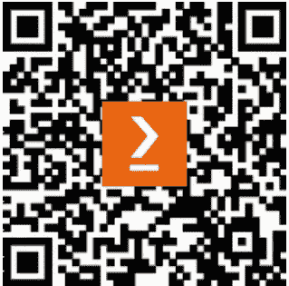

# Salesforce AppExchange 成功蓝图：将你的想法转化为盈利且可扩展的 Salesforce 应用

Dla mojej ukochanej żony, Aleksandry, która jest moim nieustającym źródłem inspiracji i siły.

Dla moich rodziców, którzy zawsze we mnie wierzyli i nauczyli mnie przekształcania marzeń w rzeczywistość.

Bez Was ta książka by nie powstała.

– Jakub

## 贡献者

## 关于作者

> “我认识的最好的 Salesforce 专家就是 Jakub，”Jakub 的妈妈说。

**Jakub Stefaniak** 是 Salesforce **认证技术架构师 (CTA)**，也是 Aquiva Labs（一家专家 PDO 公司）的技术战略与创新副总裁，在那里他协助 ISV 开发产品并在 AppExchange 合作伙伴关系中取得成功。Jakub 获得了计算机科学硕士学位，随后继续在斯坦福大学商学院以及麻省理工学院 (MIT) 首席技术官项目深造。在四个大洲（包括 Dreamforce）发表关于 AppExchange 的演讲后，Jakub 厌倦了重复自己，于是撰写了本书。他也是一个自出版的 AppExchange 应用的作者。

*致 Aquiva Labs 的同事们——你们的支持和见解对本书的开发至关重要。无论是通过我们对各种 AppExchange 项目的合作，还是宝贵的讨论，每一位你们都丰富了这些页面的内容。如果没有成为像我们这样顶尖产品开发外包商的一员的机会，我可能永远无法获得承担这一事业所需的经验。衷心感谢你们所有人。*

## 关于审阅者

**Marco Kuster** 拥有多元化的专业背景，曾担任建筑师、网页设计师和技术培训师。然而，当他成为 Salesforce ISV 团队的一员时，他发现了自己的真正热情。与 ISV 合作让他明白每个 ISV 都是独特的，而他的角色是帮助他们利用 Salesforce 技术开发出卓越的软件。

**Lawrence Newcombe，** Salesforce CTA 及 Cloud Sundial 的联合创始人，是 FormulaShare 的幕后推手，这是一款正在革新记录共享的应用。该工具为复杂的共享场景提供灵活的点击配置规则，消除了定制的需要。凭借免费版和企业版，FormulaShare 已被 100 多个生产组织采用，证明了其有效性。

除了应用开发之外，Lawrence 还担任 Giveclarity.org 的首席技术架构师，在那里他为国际非政府组织建立系统架构和治理。他的专业知识为有意义的项目做出了重大贡献，展示了他对产生影响工作的奉献精神。

他还是一名内容创作者，在 cloudsundial.com 上分享关于身份、OAuth 和云共享的见解。在数字世界之外，他喜欢攀岩，在阳光明媚的傍晚探索布里斯托尔的岩壁和悬崖。

**Krishna Tatta** 是一名 Salesforce 认证技术架构师 (CTA)，拥有超过 15 年的产品工程、企业架构、SaaS 产品交付以及人员和组织领导经验。在 Salesforce PDO 领域拥有超过十年的专注投入，她对平台和 ISV 生态系统有着深刻的理解。值得注意的是，她设计并开发了超过 55 个 Salesforce ISV 产品，并在塑造众多 Salesforce 顾问团队的技术战略方面发挥了关键作用。她的指导使这些团队成功构建并交付了超过 100 个面向 Salesforce AppExchange 的产品。目前，Krishna 在 Google 担任重要职位，领导 YouTube 全球合作伙伴关系系统的应用工程。除了职业成就外，她非常自豪于自己是两个女儿的母亲。

## 前言

我仍然记得多年以前，当我第一次着手创建自己的 AppExchange 应用时。我的脑海中充满了想法，但成为 ISV 合作伙伴的道路并不直接。你必须攀登的知识高山，而那些早期的日子充满了昂贵失误的机会。相信我——我是以艰难的方式学到了一些教训，这让我真正明白了打好基础并了解自己的盲点有多么重要。

这促使我把在这本指南中学到的所有内容写下来。把它当作你的 playbook——里面满是经验教训、专业提示，以及那些“我希望有人早点告诉我这些”的见解，全部旨在帮助你避开我曾面对的子弹，并从零打造出一个杀手级的 AppExchange 应用。

现在，别误会；这并不是关于我 AppExchange 冒险经历的回忆录。它完全关于你——无论你是经验丰富的 Salesforce 开发者、有志成为 AppExchange 新手、有远见的初创公司创始人，还是渴望在 Salesforce 世界中留下印记的产品经理。我相信，本书中的实用知识和独特见解将使你能够将想法变为现实，并使 Salesforce 生态系统变得更加充满活力、更具创新性。

在接下来的章节中，你将踏上一段激动人心的旅程，涵盖从 AppExchange 开发的基础到前沿的 AI 机遇等一切内容。在此过程中，我将分享我个人经历中的故事，突出我所面临的挑战和学到的经验。我希望你会发现这些轶事不仅有趣，而且富有洞察力。

最后，我衷心希望这本书能成为新一代 AppExchange 成功故事的起点。正如艾萨克·牛顿爵士曾经说过，“*如果我看得更远，那是因为我站在巨人的肩膀上。*”我很幸运能够站在 Salesforce 生态系统中许多伟大思想家的肩膀上，我渴望将这一特权传递给你。

好了，做好准备，兴奋起来吧！AppExchange 开发的未来比以往任何时候都更加光明，我无法更激动地欢迎你加入这段精彩的旅程。

那么，跳进来，享受即将到来的内容吧。阅读愉快，应用开发愉快！

## 本书适合谁

这本书是为多样化的读者群量身打造的，涵盖了在 Salesforce 生态系统中具有不同熟悉程度和专业知识的人士。我的主要目标受众包括以下角色：

-   **有远见的企业家和初创公司创始人**：如果你有大胆的想法和在 Salesforce 生态系统中创新产品和服务的愿景，这本书可以帮助你进入蓬勃发展的 AppExchange 市场并将你的愿景变为现实
-   **在 Heroku 或 AWS 上已有应用的企业家**：如果你是一位正在考虑扩展到 Salesforce AppExchange 的企业主，即使你对 Salesforce 只有有限的先前经验，这本书也提供了见解和指导，帮助你有效地驾驭该平台
-   **Salesforce 开发者和架构师**：如果你已经深耕 Salesforce 生态系统，并渴望扩展你在 AppExchange 开发方面的知识和技能，这本书是你宝贵的资源
-   **产品经理、首席产品官（CPOs）和其他利益相关者**：这个类别中并非每个人都是开发者，但如果你在塑造 AppExchange 应用的方向和战略方面发挥着关键作用，这本书提供了宝贵的见解来为你的决策过程提供信息

无论你在 Salesforce 生态系统中处于什么位置，这本书都能为你提供帮助。它是你提升专业知识并发挥 Salesforce 平台潜力的门户。

## 本书涵盖内容

第 1 章，*介绍 Salesforce 生态系统和 AppExchange*，是我们旅程的起点，我们将深入 Salesforce 生态系统。在本章中，我们将探索 Salesforce 的广阔性，发现为 AppExchange 创建应用的好处，评估 Salesforce 平台是否与你的应用想法相符，审查 ISV 合作伙伴关系选项，并权衡成为 Salesforce 生态系统合作伙伴的优势和责任。

第 2 章，*成为 AppExchange 合作伙伴*，讨论了 AppExchange 合作伙伴计划的结构和优势，有效利用 AppExchange 合作伙伴社区、关键合作伙伴协议、为 Salesforce 生态系统制定量身定制的商业计划，以及利用 AppExchange 合作伙伴工具包（合作伙伴业务组织、许可证管理应用、功能管理应用等等），帮助你在 Salesforce 生态系统中建立成功的合作伙伴关系的基础。

第 3 章，*设计以客户为中心的应用*，涵盖了创建真正满足客户需求并提供价值的应用的艺术。它强调理解客户痛点、协调价值主张、绘制客户旅程以及选择有效的定价模式。到本章结束时，你将拥有创建以用户为中心的应用所需的知识和见解，这些应用能在 AppExchange 市场中留下持久印象，帮助客户有效解决问题。

第 4 章，*探索 Salesforce 平台技术*，是对 Salesforce 中鲜为人知但极具价值的 ISV 专属功能的探索。它揭示

聚焦于托管包、Dynamic Apex、流程、自定义属性编辑器、Platform Cache 以及 Salesforce Lightning 设计系统，提供对其功能性的见解以及它们如何用于解决 AppExchange 开发中的特定问题。

第 5 章，*与外部系统无缝集成*，是一份全面的指南，可为您提供构建稳健桥梁所需的技能和工具，将您的 Salesforce 应用程序连接到外部系统。本章涵盖技术架构、集成模式、Salesforce API、Salesforce Connect、Canvas SDK 以及连接的应用，为您提供将应用程序与外部平台无缝集成并自信地驾驭 Salesforce 生态系统的知识。

第 6 章，*安全审查*，为您提供所需的知识和工具，以应对安全审查流程，保持高安全标准，遵守 Salesforce 安全要求，使用扫描工具，记录误报，并持续改进 Salesforce 应用程序的安全性。

第 7 章，*发布管理*，是对 Salesforce 生态系统中管理软件发布的关键方面的探索。它充当开发阶段与终端用户之间的重要桥梁，确保您的软件应用程序平稳、一致地交付。在本章中，我们将深入探讨诸如理解发布管理的核心原则、识别不同类型的软件版本、利用推送升级以实现无缝应用程序更新、保持最新软件包版本以及确定最佳发布和部署软件频率等主题。到本章结束时，您将获得将软件应用程序从开发阶段有效引导到终端用户手中的专业知识。

*第 8 章*，*欢迎新客户*，是我们学习在 Salesforce 环境中迎接和留住新客户的艺术的地方。我们将探讨打造引人注目的 AppExchange 列表的策略、引人入胜且有趣的入职体验技巧、制作电影级演示的秘诀、提供互动试用体验、提供清晰的安装说明，以及在确保顺利过渡到您软件世界的同时拥抱客户定制。到本章结束时，您将拥有创建有效入职流程的工具，鼓励潜在用户成为您软件之家中的长期居民。

*第 9 章*，*运营卓越*，踏上穿越 Salesforce 荒野的冒险之旅，以发现客户满意度和收入增长的宝藏。一路上，我们将探讨在追求运营卓越的宝藏过程中，**结账管理应用 (CMA)** 与 **渠道订单应用 (COA)** 之间的选择。

*第 10 章*，*利用分析和洞察*，踏上穿越 AppExchange 遗址的考古之旅，以发掘数据中隐藏的智慧，探索 Partner Intelligence、Marketplace Analytics 和 App Analytics 以优化 AppExchange 列表并增强用户体验。我们还将深入研究 CRM Analytics，结合内部数据与 Salesforce 洞察，并学习在通往 AppExchange 成功之路上的数据驱动决策方法。

*第 11 章*，*管理技术债务*，涵盖技术债务的概念，类似于财务债务，以及它对安全的影响、识别预警信号、管理工具和策略。我们还将学习如何始终为安全审查重新提交做好准备。

*第 12 章*，*通往成功的道路*，探讨创新作为竞争优势的重要性、与 Salesforce 协作的重要性、外部专业知识的影响、AppExchange 领域中人工智能的机会与挑战，以及在我们穿越 Salesforce AppExchange 生态系统之旅的 culmination 中，用于验证策略的基本成功指标。

**免责声明：** 本书中的说明性图片均使用 MidJourney 数字可视化工具生成。这些图像完全是人工的，不代表真实的人或事件。它们是旨在增强读者体验的艺术创作。

## 使用的惯例

本书通篇使用了多种文本惯例：

粗体：表示新术语、重要词语或屏幕上显示的词语。例如，菜单或对话框中的词语以粗体显示。以下是示例：“您的调试会话在您点击 **返回订阅者概览。** 时终止。”

*提示或重要说明*

*显示如下。*

## 联系我们

我们始终欢迎读者的反馈。

**一般反馈**：如果您对本书的任何方面有疑问，请发送电子邮件至 customercare@packtpub.com，并在邮件主题中提及书名。

**勘误**：尽管我们已尽一切努力确保内容的准确性，但错误难免。如果您在本書中发现错误，我们将不胜感激您向我们报告。请访问 [www.packtpub.com/support/errata](www.packtpub.com/support/errata) 并填写表格。

**盗版**：如果您在互联网上发现我们作品的任何形式的非法复制，我们将不胜感激您提供位置地址或网站名称。请通过 [copyright@packtpub.com](mailto:copyright@packtpub.com) 联系我们并附上材料链接。

如果您有兴趣成为作者：如果您擅长某个主题并且有兴趣撰写或为一本书做出贡献，请访问 [authors.packtpub.com](https://authors.packtpub.com)。

## 分享您的想法

读完 *Salesforce AppExchange 成功蓝图* 后，我们很想听听您的想法！请 [点击此处直接前往亚马逊评论页面](https://www.amazon.com) 为本书分享您的反馈。

您的评论对我们和技术社区都很重要，并将帮助我们确保提供优质内容。

## 下载本书的免费 PDF 副本

感谢您购买本书！

您喜欢在旅途中阅读但无法随身携带印刷书籍吗？您的电子书购买与您选择的设备不兼容吗？

不用担心，现在每本 Packt 书籍都免费提供该书的无 DRM PDF 版本。

在任何地方、任何地点、任何设备上阅读。从您喜爱的专业书籍中直接搜索、复制和粘贴代码到您的应用程序中。

好处还不止于此，您可以每天通过电子邮件独家获取折扣、新闻通讯和优质免费内容

按照以下简单步骤获取福利：

https://packt.link/free-ebook/978-1-83508-954-5

- 1. 扫描二维码或访问下方链接
- 2. 提交您的购买证明
- 3. 就这样！我们会直接将您的免费 PDF 和其他福利发送到您的电子邮件
