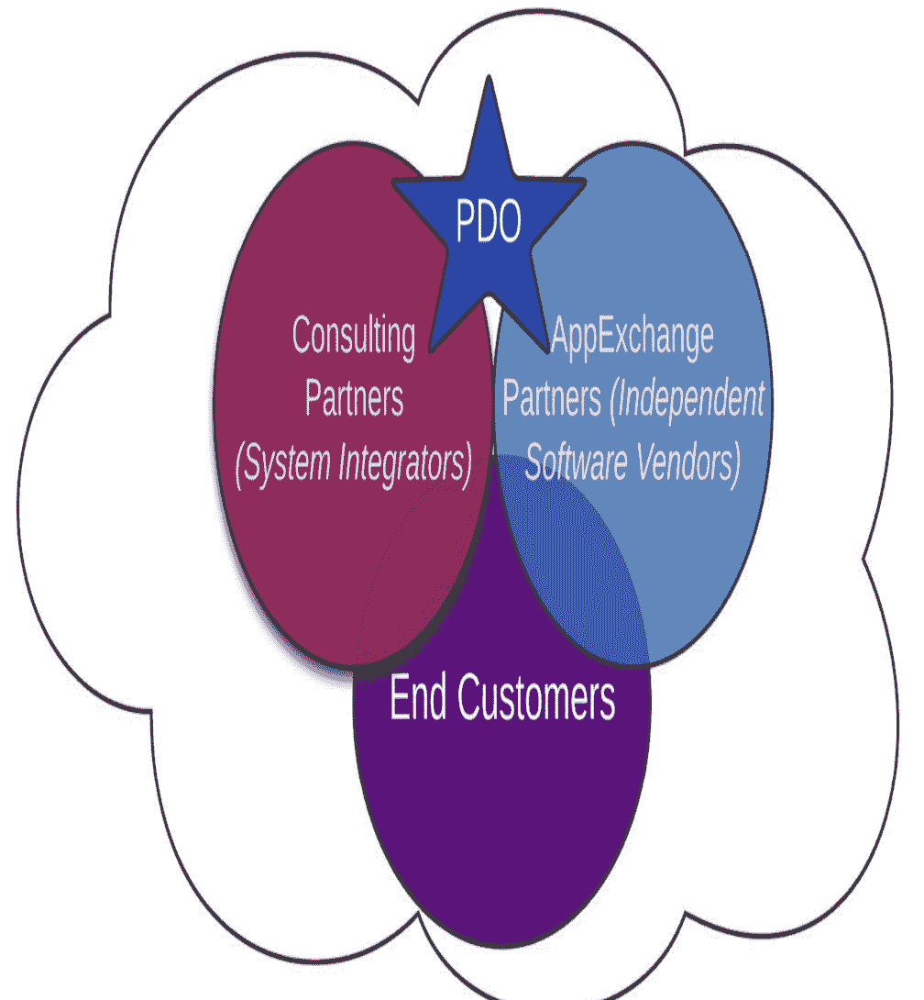

## 介绍 Salesforce 生态系统和 AppExchange


欢迎，探路者，踏上 Salesforce 及其 AppExchange 市场的激动人心冒险之旅！当你踏上 Salesforce 生态系统未知的领域之旅时，我将成为你值得信赖的向导，帮助你 navigating 曲折转折并沿途发现隐藏的宝藏。

风险很高，因为这次远征可能为寻求创建和分发解决现实世界挑战的创新应用的企业带来前所未有的机遇。所以，穿上你的隐喻式徒步靴，因为在本章中，我们将探讨以下主题：

- Salesforce 及其生态系统的广阔版图，让你充分理解平台的潜力
- 为 AppExchange 构建应用的未开发价值，使你能够就加入远征做出明智的决定
- 判断 Salesforce 平台是否为你的应用创意合适的基地，确保你的事业拥有坚实的基础
- 冒险进入 **独立软件供应商** (**ISV**) 合作伙伴关系的未知领域，使你能够为业务规划最佳路线
- 评估成为 Salesforce 生态系统合作伙伴所带来的回报和责任，包括各种合同安排 such as **原始设备制造商 (OEM)** 和 ISVforce，为你征服多样化的机会版图做好准备

这些主题对像你这样的每位探路者都至关重要，因为它们将帮助你就参与 Salesforce 生态系统做出明智的决定，并利用 AppExchange 提供的独特机遇。通过了解与 ISV 合作伙伴关系相关的角色和责任，你将能够为你的业务成功选择正确的道路。

现在，背上你的背包，为进入 Salesforce 和 AppExchange 的荒野做好准备，展开一次令人振奋的旅程。是时候开辟通往成功的道路了！让我们开始吧！

## Salesforce 及其生态系统

想象一下：1999 年，你正努力跟踪客户互动、管理销售渠道和监控销售团队绩效。你会怎么做？好吧，幸运的是，一群有远见的人创立了 Salesforce，一个基于云的 **客户关系管理** (**CRM**) 平台。而瞧！Salesforce 拯救了局面，成长为全球领先的 CRM 平台之一，拥有超过 150,000 名客户¹ 和高达 23%² 的市场份额。

1 https://www.salesforce.com/campaign/worlds-number-one-CRM/

2 https://www.salesforce.com/news/stories/idc-crm-market-share-ranking-2023/


如今，Salesforce 的生态系统就像一个自助餐式的产品、服务和功能集合，让企业可以混搭创建定制化的美味套餐。这一大杂烩的关键组成部分包括以下内容：

- **Sales Cloud：** 可以把它想象成 CRM 管家，帮助企业管理销售渠道、客户互动和销售团队绩效
- **Service Cloud：** 在各种渠道提供高效且量身定制的客户服务支持
- **Community Cloud：** 一个数字平台，客户、合作伙伴和员工可以在此协作、交流想法并解决问题，增强 Salesforce 环境内的参与度和忠诚度
- **Marketing Cloud：** 你专属的营销大师，像经验丰富的指挥家一样在电子邮件、社交和移动渠道中编排活动
- **Tableau：** 一个数据可视化和分析平台，让企业能够从数据中创建交互式仪表板和报告，从而深入了解客户数据以推动增长和创新
- **Slack：** 一个协作中心，简化沟通和文件共享，与 Salesforce 集成可提供实时通知和更新，实现跨平台的无缝团队协作
- **MuleSoft：** 一个集成平台，连接不同的系统和应用程序，简化工作流程，减少手动数据输入并自动化业务流程，与 Salesforce 的深度集成提供跨系统的客户数据统一视图
- **Commerce Cloud：** 电子商务精灵，赋予企业在多个渠道创建个性化购物体验的能力
- **Platform：** 一个 **平台即服务 (PaaS)** 游乐场，让开发人员在 Salesforce 之上构建和部署自定义应用程序
- **Trailhead：** Salesforce 的在线平台，为用户、开发人员和管理员提供互动培训

Salesforce 的关键特性之一是其云计算平台。现在，我知道你在想什么——“云计算？那不就是删除数据时数据去的地方吗？”但请不要害怕，亲爱的读者，云计算远不止于此。它允许企业通过互联网访问计算资源和软件应用程序，而无需在自己的物理服务器上安装和管理它们。这使企业能够降低 IT 成本、提高可扩展性并改善灵活性和可访问性。而且，说起来比“我把所有东西都存放在 USB 驱动器上”酷多了。

但 Salesforce 与其他云平台的区别在于其多租户架构。在这种设置下，多个客户共享相同的底层基础设施，就像生活在环保型公寓楼里一样。每个客户的数据和资源都得到安全隔离，就像在公寓里拥有独立的房间和个人物品一样。这种方法使 Salesforce 能够优化资源利用率并轻松扩展其平台以满足用户的多样化需求，同时保持严格的数据安全和隐私协议。

不要忘了 AppExchange——集成 Salesforce 的第三方应用程序和解决方案的市场。

## AppExchange

如果你已经拿到这本书的副本，很可能你对 AppExchange 并不陌生，并且已经渴望在这个平台上打造应用。但，如果这本巨著因你懂技术的奶奶的圣诞惊喜而落入你手中，她认为你可以用一个新爱好，让我详细说明 AppExchange 真正是什么。AppExchange 是一个市场，其中超过 91%³ 的 Salesforce 客户使用各种可用的数字工具。他们受益于 Salesforce Customer 360 平台的功能，该平台为他们提供实现数字成功的全部资源。AppExchange 市场提供各种各样的工具，显著影响 Salesforce 经济。根据 **国际数据公司** (IDC) 的研究⁴，预计到 2026 年将产生令人垂涎的 1.6 万亿美元新业务收入。锦上添花？Salesforce 今年每赚取 1 美元，生态系统将赚取 4.96 美元，到 2026 年，这一数字将上升至 6.19 美元。拥有超过 5,000 解决方案和超过 10 million⁵ 安装的记录，这个繁忙的市场证明了企业软件世界中协作的力量，是 100 个国家 150,000 名客户的重要组成部分。

3 https://www.salesforce.com/news/stories/link-appexchange-migration/

4 https://www.salesforce.com/content/dam/web/en_us/www/documents/platform/idc-platform-bv-report-2020.pdf

5 https://appexchange.salesforce.com/

创新是保持 AppExchange 令人兴奋的秘诀。ISV 正在投资开发新产品和增强现有产品，融入 **人工智能 (AI)**、自动化和数据分析等尖端技术，为用户创造卓越的体验。

展望未来，AppExchange 市场的增长潜力就像广阔的景观一样巨大。Salesforce 经济的持续成功表明，总有空间容纳新颖创新的想法，提供

无论是新成立还是已建立的 AppExchange 合作伙伴，都拥有一个独特的机遇，可以将自己卓越的产品添加到菜单中。

## 启程 AppExchange 之旅 – 熟悉界面

作为一名新的 AppExchange 合作伙伴，熟悉 AppExchange 界面至关重要。通过了解潜在客户如何浏览和搜索应用，你可以更好地为应用的成功定位。访问 AppExchange 市场，请访问官方链接 https://appexchange.salesforce.com 或在 Salesforce 平台内查找。

AppExchange 市场按多种类别组织，包括按类型、产品和行业的解决方案，使用户轻松找到所需内容。花时间探索这些类别并观察其他解决方案的展示方式，这将帮助你根据目标受众调整应用的列表。

通过沉浸在 AppExchange 体验中，你可以获得有关客户寻求和期望的宝贵见解。这些知识不仅有助于你开发具有竞争力的应用，还能确保其在市场中的可发现性和相关性。

## Salesforce Labs

在 AppExchange 市场的广阔版图中，Salesforce Labs 脱颖而出。该市场板块拥有由 Salesforce 员工开发的 260 多款应用，提供各种免费应用和解决方案，旨在满足各类 Salesforce 用户的需求。

6 https://appexchange.salesforce.com/category/salesforce-labs-apps

这些应用在复杂程度上各不相同，满足多样化的业务需求，从简单的工具到复杂的解决方案。Salesforce Labs 充当测试平台，让用户有机会尝试新功能，而无需定制开发或深入测试。此外，它是一个以社区为中心的举措，欢迎反馈和贡献以持续改进和完善应用。

## 探索构建 AppExchange 应用的价值和潜力

当你深入 Salesforce 生态系统的荒野时，是时候勘察地形并发掘在为 AppExchange 构建应用时等待的隐藏宝藏了。正如每位探险家在旅途中寻求财富一样，合作伙伴通过参与 AppExchange 计划发现了丰厚的回报。

Valoir 于 2022 年 8 月发布的 AppExchange 报告揭示了合作伙伴体验到的四项闪亮益处：销售周期加速、安全和尽职调查工作减少、基础设施管理成本降低，以及在更少内部营销资源的情况下营销覆盖面扩大。

7 https://valoir.com/blog-1/salesforceappexchange

想象一下发现通往目的地的捷径，在穿越 AppExchange 地形时将销售周期加速高达 20%。在 Salesforce 客户眼中，你的解决方案的验证就像拥有一个可靠的指南针，指引潜在客户找到你的产品。

当你穿越安全和尽职调查的险峻悬崖时，无需畏惧！AppExchange 列表所需的严格审查帮助合作伙伴将与这些挑战相关的时间和资源削减高达 80%。

Salesforce 平台正帮助 ISV 将基础设施管理成本降低高达 75%。通过利用其预建功能和组件，你可以将投资重点放在产品创新上，攀登成功的高度。

最后，Salesforce **AppExchange 营销计划 (AMP)** 和联合营销机会让你能够以更少的营销资源开辟道路，以 30% 更少的投入实现相似或更好的成果。我们将在 *第 12 章* 中更深入地探讨 AMP。

还不信服吗？让我们转向另一个来源：*《Salesforce 平台在应用开发中的业务价值》*，由 IDC 于 2020 年 10 月发布。该报告研究了在应用开发背景下 Salesforce 工具和技术价值。请记住，各位探险家，AppExchange 合作伙伴在穿越 Salesforce 荒野时使用的是同样的工具。

8 https://www.salesforce.com/content/dam/web/en_us/www/documents/platform/idc-platform-bv-report-2020.pdf

平台对 Salesforce 客户和 AppExchange 合作伙伴的关键益处令人印象深刻，如下所示：

- **在应用开发中提高效率：** 如同发现秘密捷径，Salesforce 平台将应用开发生命周期缩短 68%，生产力提升 56%，从而每年发布更多应用和功能
- **提高应用质量和可靠性**：平台就像可靠的探险装备，确保应用具有高可靠性，将非计划停机时间减少 89%，并提升业务终端用户的生产力
- **优化对关键业务应用的访问、采用和使用**：为更好的客户满意度、改进的业务成果和更高的收入指明航向，平均每年产生 570 万美元的额外新收入
- **提升应用管理团队效率**：如同组织良好的远征，Salesforce 平台使团队能够提高 63% 的应用管理效率，简化工作流程并削减开销

IDC 报告指出，35,086 名内部 IT 用户使用与 ISV 开发者类似的工具，这凸显了该报告对 AppExchange 合作伙伴的相关性。鉴于这一见解，很明显 Salesforce 平台为合作伙伴在应用开发领域提供了显著的业务价值。值得注意的是，虽然该报告主要关注 Salesforce 客户，但与 ISV 开发者共享的工具使用使其与 AppExchange 合作伙伴相关。


## ISV 在 AppExchange 上到底做什么？

想象自己漫步在繁忙的 Salesforce 社区，欣赏着业务功能的闪亮摩天大楼。街道上充满了 AppExchange 合作伙伴，这座大都市的超级英雄们，不懈努力让 Salesforce 变得更好。

那么，这些 ISV 合作伙伴在 AppExchange 上到底做什么呢？让我们来看看：

- **增强 Salesforce 的功能**：ISV 工作旨在增强 Salesforce 现有功能。他们专注于帮助客户通过扩展和完善其功能从平台中获得更多价值。
- **解决特定需求**：这些合作伙伴识别并解决 Salesforce 产品可能受限或缺乏的领域。通过为这些领域开发解决方案，他们确保用户与 Salesforce 拥有更全面、更无缝的体验。
- **提供行业特定解决方案**：ISV 专注于创建针对特定行业或市场细分的应用。他们提供有针对性的解决方案，使企业受益，无论其对 Salesforce 的熟悉程度如何。

但要在 AppExchange 上真正取得成功，合作伙伴必须专注于以下三个关键要素：

- **打造知识产权 (IP)**：通过与 Salesforce 合作，合作伙伴可以灵活地利用 API 创建创新应用，或仅使用 Salesforce 技术构建其应用
- **为成功包装应用**：如同精美包装的礼物，合作伙伴必须有效地营销和销售其应用，以推动客户采用
- **组建梦想团队**：加入合作伙伴计划后，合作伙伴需要分配资源和人员，以确保其应用发挥全部潜力，制定长期营销、销售和支持策略

最终，ISV 合作伙伴是 Salesforce 生态系统的生命线。

## 不同类型的合作伙伴

Salesforce 将其合作伙伴分为不同类型，因此让我们先理清一些术语。

首先，Salesforce 认可两种主要类型的合作伙伴：ISV 和咨询合作伙伴。在本书中，当我使用“合作伙伴”一词时，默认指的是 ISV。因此，如果你在网上遇到“Salesforce 合作伙伴”一词并发现信息似乎与你无关，这种区别很可能是原因。

这两个类别之间的界限很明确：ISV 专注于开发 AppExchange 产品，而咨询合作伙伴，通常被称为 **系统集成商 (SIs)**，则提供针对 Salesforce 客户的咨询和实施服务。

但还有另一种值得注意的合作伙伴类型：**产品开发外包商 (PDOs)**。PDO 为 ISV 提供专门的咨询服务。基本上，如果你是一家寻求产品开发专业知识的 ISV，那么 PDO 就是你需要联系的对象。




图 1.1：Salesforce Partners 格局

深入探讨协作动态，本书第 12 章将介绍你如何有效地与 PDO 和 SI 协作。

## 评估 Salesforce 平台对你的应用想法的适用性

Salesforce 平台是否是你应用想法的理想巢穴？毕竟，即使是超级英雄也需要完美的行动基地来发挥其能力。

Salesforce 是一个功能强大的平台，拥有构建和部署自定义应用程序的丰富工具和功能。然而，并非所有解决方案想法都能在 Salesforce 中找到完美的搭档。穿上装备，在评估 Salesforce 是否适合你时请考虑以下因素：

- **应用需求**：考虑你应用的具体功能，例如功能、可扩展性和集成需求。评估 Salesforce 的工具和功能 arsenal 是否能满足这些需求，还是需要寻求不同平台或技术的帮助。

- **用户体验 (UX)**：确定 Salesforce 平台能否提供你的应用拯救局面所需的 UX。Salesforce 提供了大量用于打造自定义 **用户界面 (UIs)** 的工具，但你可能需要借助额外技术来创建真正非凡且独特的 UX。另一方面，Salesforce 应用在外观和功能上与标准 Salesforce 界面相呼应时往往表现出色，提供无缝的 UX。

- **集成需求**：评估 Salesforce 是否能与你现有的系统和数据源形成无缝联盟。Salesforce 提供了各种集成选项，例如 API 和连接器，但你可能需要动用其他工具或技术来实现完全的集成和谐。

- **安全性和合规性：** 思考你应用的安全性和合规性需求。Salesforce 拥有强大的安全性和合规性措施，但你可能需要采取额外步骤以确保你的应用符合你所在行业或地区的特定要求。此外，你需要考虑应用在 Salesforce 认为安全的环境中运行的要求。这可能会导致某些应用想法被完全取消资格。

- **时间和资源限制：** 权衡在 Salesforce 上构建你的应用是否符合你的时间和资源限制。为 Salesforce 构建应用可能需要大量投资，因此必须评估它是否与你的业务目标和优先事项保持一致。

通过检查这些因素，你可以确定 Salesforce 平台是否是你想法的理想选择。

## AppExchange 应用及其用例示例

以下示例展示了 AppExchange 上应用的广度和多样性，包括电子签名解决方案、文档生成和报告工具、专业服务自动化解决方案、现场服务管理解决方案以及数据聚合和计算工具：

- **FormulaShare⁹：** FormulaShare 是 Salesforce 上一款高级动态共享规则应用，允许管理员根据公式、查找或文本字段中识别的角色、组或用户动态共享标准和自定义对象。有了 FormulaShare，管理员可以轻松创建共享规则，而无需编码或复杂配置。FormulaShare 提供免费增值模式，允许用户使用最多 3 条标准规则和 1 条跨对象规则，并共享最多 10,000 条记录。对于具有更复杂共享需求的大型组织，FormulaShare 提供两个高级版本：Enterprise 和 Unlimited。

9 https://appexchange.salesforce.com/appxListingDetail?listingId=a0N3A00000FR5TCUA1

- **Ask Your Document**¹⁰：你的 Salesforce 文档 AI - 就像 ChatGPT，但适用于你的文档、文件和附件。这款智能应用与 Salesforce 集成，便于在平台上进行文件处理和查询。利用 AI 就任何文件内容提问和回答，简化数据分析。凭借用户友好的界面、强大的数据安全性和从 AppExchange 快速安装，它非常适合希望简化文件任务的各规模企业。

10 https://askyourdocument.aquivalabs.com/

- **Kaptio Travel Platform**¹¹：Kaptio 是一款旅游管理解决方案。它提供了一套全面的功能，用于在 Salesforce 环境中管理旅行预订、预留和行程。Kaptio 使旅行代理和运营商能够简化工作流程、自动化流程并提供卓越的客户服务。有了 Kaptio，用户可以从一个统一平台管理整个旅行业务，从销售和营销到客户服务和支持。

11 https://www.kaptio.com/

- **IPfolio**¹²：IPfolio 是一款知识产权管理解决方案。它允许用户在 Salesforce 平台内管理、跟踪和协作其知识产权资产，例如专利、商标和许可证。IPfolio 通过提供集中且有组织的系统简化知识产权管理流程，使组织能够做出明智决策并保护其宝贵的知识产权资产。

12 https://ipfolio.com

- **Hapi**¹³：Hapi 将深厚的酒店业经验与 Salesforce 平台专业知识相结合。结果是在为酒店公司实施 Salesforce 解决方案时提供专家指导、最佳实践和经过验证的方法。

13 https://www.hapicloud.io/

这些应用为 Salesforce 用户提供独特的解决方案和优势，使他们能够简化业务流程、提高效率并改善客户满意度。通过利用 Salesforce 平台和生态系统，这些应用为各规模和行业的企业提供定制化解决方案。

## 认识你的新好朋友 – Formula Debugger

在接下来的章节中，我将参考我很久以前开发并自行发布的 Formula Debugger 应用，以提供 AppExchange 合作伙伴如何实现特定工具和功能的示例。这将让你深入了解开发过程以及在 AppExchange 上创建和发布应用的好处。

谁在使用它？通常是深陷公式字段的 Salesforce 管理员，试图理清一切。突然间，他们希望有一个神奇的助手来让生活更轻松。好吧，他们的愿望实现了！以下是 Formula Debugger 应用为（调试）带来的内容：

- **语法分析**：该应用像语法仙子一样突出显示匹配的括号，使理解和纠正公式字段语法变得更容易

- **轻松测试数据准备**：Formula Debugger 简化了准备测试数据的流程，消除了对任何 **数据操作语言 (DML)** 魔法的需求

- **AI 集成**：该应用利用 AI 的力量检测公式字段的潜在问题，并友好地提供修复建议

以下是该应用界面的外观：

### Formula Debugger

### 源

### 测试数据

*对象*
客户
*公式字段*
状态

使用现有记录

此公式字段旨在显示警告图像和文本，当续订日期在当前日期的 45 天内时。 此公式字段的问题在于它没有考虑到续订日期可能在过去的可能性。 要修复此问题，公式应修改为检查续订日期是否在过去，如果是，则显示不同的警告图像和文本。

续订日期（已弃用）

+ 添加字段

计算

### 公式

语法

```
IF((CHANNEL_ORDERS__Renewal_Date__c - TODAY()) <= 45 && (
CHANNEL_ORDERS__Renewal_Date__c - TODAY()) > 0),
IMAGE("/resource/CHANNEL_ORDERS__uiib/images/warning_60_yellow.png", "warning", 16, 16) & " Ends in " & TEXT(CHANNEL_ORDERS__Renewal_Date__c - TODAY()) & " Days", null)
```

函数

用于公式

- DAY
- IF
- IMAGE
- TEXT
- TODAY

DAY(date) 返回月份中的日期，介于 1 到 31 之间的数字

? 帮助

预先计算

填写测试数据（或选择现有记录），然后点击右上角的“Calculate”。

图 1.2：Formula Debugger


如果你愿意，可以在 AppExchange 上搜索“**公式调试器**”免费安装它，或使用以下链接直接传送到那里：
https://formuladebugger.jakubstefaniak.com.

快乐调试！

## AppExchange 的最佳定位 – 应用蓬勃发展的所在

基于本章的示例和讨论，AppExchange 的理想应用是那些执行以下操作的应用程序：

-   为 Salesforce 用户提供独特解决方案和优势。你不能仅仅构建 Sales Cloud 或 Service Cloud 的克隆！
-   简化业务流程，提高效率并改善客户满意度。
-   利用 Salesforce 平台和生态系统为各规模和行业的企业提供定制化解决方案。
-   符合 Salesforce 的安全、隐私和可用性标准。
-   与 Salesforce 平台的优势和局限性保持一致，例如基于 Web 的应用程序、与其他系统的集成以及基于云的解决方案。

通过构建符合这些标准的应用程序，你可以利用成为 ISV 合作伙伴的好处，并利用 AppExchange 的潜力来扩大客户群、产生经常性收入流，并在 Salesforce 生态系统中获得可见性和信誉。

## 不适合 Salesforce 平台的应用示例

虽然 Salesforce 提供了构建自定义应用程序的各种工具和功能，但某些应用类型可能与 Salesforce 平台的优势或局限性不一致。以下是一些示例：

-   **游戏应用：** Salesforce 平台主要为业务应用设计，可能不适合需要高性能图形和处理能力的游戏应用。
-   **资源密集型应用：** Salesforce 平台可能不适合需要大量计算资源或实时处理的应用，例如复杂的 **机器学习 (ML)** 或数据分析应用。AppExchange 产品不应尝试在平台上执行此处理，而应与更适合处理复杂处理用例的系统集成。顺便说一下，在 Salesforce 生态系统中，还有其他可用选项。例如，Heroku 提供了一个专门设计用于处理资源密集型计算任务的强大平台。此外，Salesforce 还提供自己的专有 AI 解决方案，能够有效应对高级数据处理需求。
-   **独立桌面应用：** Salesforce 平台基于云，主要为基于 Web 的应用设计。需要离线功能的独立桌面应用可能不适合 Salesforce 平台。
-   **定制硬件应用：** 需要定制硬件或与物理设备集成的应用可能不适合 Salesforce 平台，因为它主要专注于基于软件的解决方案。

通过了解 Salesforce 平台的局限性，你可以就你的应用创意是否适合做出明智的决定。如果你的应用超出了 Salesforce 平台的范围，你可能需要探索更符合你需求的替代技术或平台。

## 面向 Salesforce 客户的软件即服务产品

此外，AppExchange 市场接受与 Salesforce 集成并为 Salesforce 用户提供独特解决方案的 **软件即服务** (**SaaS**) 产品。这些 SaaS 公司也可以成为 AppExchange 合作伙伴，并在市场上列出其产品，突出其与 Salesforce 的合作伙伴关系以及其应用的安全性。然而，成为拥有付费应用列表的 AppExchange 合作伙伴需要与 Salesforce 分享 **净收入百分比 (PNR)**，这也是一些公司选择不成为合作伙伴的原因。公司需要在通过安全审查这一直接的技术方面之外评估成为合作伙伴的业务影响。虽然本书重点介绍在 Salesforce 平台上构建应用程序，但通过 SaaS 产品与 Salesforce 集成，为企业提供了各种解决方案和应用，既在平台上也在平台外，以根据其独特需求定制和扩展其 Salesforce 实例。

## 了解 ISVforce 与 OEM 的差异


Salesforce ISV 合作伙伴世界就像一家冰淇淋店，而你在这里为你的业务选择完美的口味。一边是 ISVforce 合同，另一边是 OEM 合同。两者都很美味，但哪一个最适合你的味蕾？让我们深入细节，帮助你做出正确的选择。

### 程序构建类型 – ISVforce

ISVforce 合作伙伴就像 Salesforce 甜点世界中的经典香草味。他们制作在 Salesforce 平台上构建的应用程序，准备在 AppExchange 菜单上品尝。ISVforce 合作伙伴可以撒上美味的配料（想想第三方集成）并提供愉快的客户体验。然而，他们必须与 Salesforce 分享一部分收入并遵守平台的开发指南。

ISVforce 涵盖了几个关键方面，包括以下内容：

-   在 Salesforce 平台上为 *现有* Salesforce 用户制作和销售美味的应用
-   在 Salesforce 生态系统中定制和扩展应用
-   与 Salesforce 分享 PNR
-   遵守 Salesforce 的开发指南和最佳实践

### 为什么选择 ISVforce？

ISVforce 就像 Salesforce 盛宴中深受喜爱的招牌主菜。这些应用通常以某种方式扩展 Salesforce 的功能——也就是说，它们是生态系统中与主菜相得益彰的美味配菜。许多应用创建者意识到，他们的众多客户和潜在客户已经在 Salesforce 的餐桌上用餐，他们希望将自己的烹饪创作带到目标市场所在的地方。通常，这涉及以有利于合作伙伴和 Salesforce 的方式增强 Salesforce Cloud 提供的服务（例如 Sales、Service、Community 或 Industry Clouds）。

ISVforce 的另一个诱人之处在于，ISVforce 的客户可以通过自定义对象扩展其应用，从而制作自己的创意混合物。这种额外的灵活性和可扩展性充当了秘密配料，显著扩大了你的总市场机会，提供了一种通常无法通过 OEM Embedded 解决方案实现的灵活性。虽然 OEM 客户可以为集成目的创建最多 10 个自定义对象，但这些自定义对象的使用受到严格监管，以确保 OEM 客户不会在既定边界之外构建自定义应用。

如果你正在制作一个依赖于特定许可证内功能的应用（例如 Customer Communities），客户必须先从 Salesforce 购买许可证，然后才能品尝你的应用。

### 程序构建类型 – OEM Embedded

OEM 就像一种独特的、可定制的曲奇面团冰淇淋。这些合作伙伴将 Salesforce 技术嵌入到自己的解决方案中，为客户创建定制品牌产品。OEM 合作伙伴关系的美妙之处在于可以自由创建独特的 UX 并直接销售解决方案，而无需在 AppExchange 上列出。然而，需要注意的是，虽然 ISV 合作伙伴没有义务在 AppExchange 市场上发布，但一些 OEM 合作伙伴确实选择将其应用列在 AppExchange 上。无论列出状态如何，OEM 合作伙伴仍需要与 Salesforce 分享其收入的一部分。

OEM Embedded 涵盖了几个关键方面，包括以下内容：

-   将 Salesforce 技术嵌入到定制品牌解决方案中
-   在 Salesforce 平台之上构建，*不提及* Sales、Service、Marketing、Commerce 或 Industry 云等其他产品
-   直接向客户销售（即使没有 AppExchange 上架！）
-   与 Salesforce 分享更高的 PNR

在品尝这两种口味时，请牢记您的业务目标和需求。例如，一些成功的 Salesforce 合作伙伴选择了 OEM 口味，从而获得了转售经典 ISVforce 不可用的额外技术和附加组件的机会。

## Why choose OEM Embedded?

OEM Embedded 应用主要专注于革新医疗、金融、制造等特定行业垂直领域的基础设施。这些应用能够吸引多样化的客户，无论他们是否正在使用 Salesforce 平台。需要强调的是，OEM Embedded 解决方案还能在现有 Salesforce 客户组织内部吸引新用户。例如，人力资源部门目前可能未使用 Salesforce，但可能会选择购买 OEM 产品以满足其特定需求，而销售等其他部门可能已经是 Sales Cloud 的常规用户。

OEM 嵌入式应用的好处在于可以自由地向现有 Salesforce 客户以及更广泛的受众销售。现有 Salesforce 客户可以像使用 ISVforce 应用一样，轻松地在 AppExchange 市场中发现、购买和安装 OEM Embedded 应用。此外，对于新客户，可以使用 Trialforce 技术为其配置新的 Salesforce 组织，而无需直接将他们连接到 Salesforce。需要注意的是，OEM 客户会获得 OEM Salesforce 平台许可，该许可专门用于 OEM 应用的使用。

与需要从 Salesforce 购买额外许可的 ISVforce 解决方案不同，OEM Embedded 应用仅有两种特定类型的许可可供客户使用，具体如下：

-   **Lightning 平台（必需）**：允许客户使用 Salesforce 平台，也称为 Salesforce Platform 许可。然而，需要注意的是，从 OEM 合作伙伴获得的许可专门用于访问和使用合作伙伴解决方案。为了扩展合作伙伴解决方案的功能，最终用户被允许为每个解决方案创建、访问和使用额外的 10 个自定义对象。然而，这些自定义对象仅限于与合作伙伴解决方案一起使用。请注意，这些合同限制不会自动执行。客户有责任确保他们没有设置超过 10 个自定义对象或以不允许的方式使用它们。
-   **客户社区（可选）**：使 OEM 客户的客户或合作伙伴能够访问 OEM 应用的指定部分，促进他们与其数据的交互。

最终，ISVforce 与 OEM 合同之间的选择取决于多种因素，包括您业务对定制的渴望、对额外技术的访问、收入分享以及您 **进入市场 (GTM)** 策略中的现有用户群。必须考虑目标用户是否已拥有 Salesforce 许可，因为这会显著影响任一选项与业务目标的适用性和一致性。然而，这一决定伴随着权衡：与 ISVforce 相比，OEM 合作伙伴需要与 Salesforce 分享更高的 PNR。

## Programs comparison

在下面的表格中，我们将探讨并比较 ISVforce 和 OEM Embedded 之间的关键特性和区别，涵盖概述、目标市场、定价、付款基础、产品、转售资格以及对 Salesforce 对象的限制等方面：

| Feature | ISVforce | OEM |
|---|---|---|
| Overview | 扩展 Salesforce 产品功能并与 CRM 对象集成 | 向当前 Salesforce 和非 Salesforce 客户销售的应用 |
| Target market | 仅向 Salesforce 用户销售 | 向 Salesforce 和非 Salesforce 客户销售 |
| Pricing | 默认 15% PNR* | 默认 25% PNR* |
| Products | 安装在 Salesforce 销售的许可之上（例如 Sales/Service Cloud）的软件包 | 以受限的 OEM Embedded 许可作为独立解决方案销售的应用 |
| Reselling eligibility | 合作伙伴无权转售 Salesforce 产品 | 合作伙伴可向非 Salesforce 客户转售某些附加产品 |
| Restrictions on Salesforce objects | 无 | 不能扩展或复制标准 Salesforce 对象 |
| Configuring and Maintaining Salesforce Orgs for Customers | 否 | 可能为是，特别是如果您提供专用的 Salesforce 组织 |
| Customers’ Training and Support Expectations | 仅您的应用 | 您的应用和 Salesforce 平台 |

*截至今天（FY24），PNR 费率如所述。重要的是要记住这些定价条款将来可能会发生变化。如需最准确和最新的信息，请访问 Salesforce Partners 网站 https://partners.salesforce.com。

## Marginal PNR Program

过去，ISV 为每种许可类型支付固定的版税费率：OEM 为 25%，ISVforce 为 15%。然而，2020 年带来了改变游戏规则的更新，奖励规模更大、更成功的应用开发者以降低的版税费率。通常，2020 年 3 月 1 日后加入 AppExchange Partner Program¹⁴ 的合作伙伴将自动获得此福利，而现有合作伙伴也可以申请。

14
https://partners.salesforce.com/s/education/appinnovators/AppExchange_Partner_Program?language=en

当合作伙伴的 **年度订单价值 (AOV)** 达到或超过 $1,000,000 时，他们有资格在未来的订单和附加订单上享受降低的 PNR 费率。随着合作伙伴在 AOV 区间中的进展，其 PNR 费率相应降低。截至今天（FY24），边际 PNR 计划在下面的表格中概述。然而，重要的是要注意 Salesforce 有权自行决定更新或更改边际 PNR 计划福利，而不一定提供事先通知。边际 PNR 计划福利是根据 **Salesforce 合作伙伴计划协议 (SPPA)** 提供的计划福利之一，您将在下一章中更全面地了解它：

| AOV band | OEM Program PNR rate | ISVforce Program PNR rate |
|---|---|---|
| <$1,000,000 | 25% | 15% |
| $1,000,001 - $2,500,000 | 23% | 14% |
| $2,500,001 - $5,000,000 | 21% | 13% |
| $5,000,001 - $10,000,000 | 19% | 12% |
| $10,000,001 - $20,000,000 | 17% | 11% |
| $20,000,001+ | 15% | 10% |

请注意，只有 AOV 超过 $1,000,000 的合作伙伴才会对其新业务和附加业务的 PNR 费率进行降低。某些非标准条款可能会使合作伙伴无法加入边际 PNR 计划福利。

## Choosing the right contract for your business


欢迎来到伟大的冰淇淋辩论：ISVforce 与 OEM 合同！现在您已经品尝了两种口味，是时候为您的业务选择完美的一勺了。让我们权衡每个选项的糖屑和樱桃，以便您做出明智的决定，选择最适合您的合同。

首先，让我们考虑您的应用的性质和目标受众。如果您的应用是 Salesforce 圣代上的樱桃，主要面向现有 Salesforce 客户，那么经典的 ISVforce 合同就是您的首选口味。作为 ISVforce 客户，您可以在 AppExchange 上制作和销售您的甜点创作，利用各种 Salesforce 技术和资源。此外，由于收入分享要求较低以及产品开发和支持方面的灵活性更高，ISVforce 路线是一个诱人的选择。

但如果您的应用并非严格的 Salesforce 配料呢？如果您的目标受众包括尚未品尝过 Salesforce 美味的人，那么 OEM——我们的可定制曲奇面团冰淇淋——可能就是适合您的选择。OEM 可以转售更广泛的技术和附加组件，制作定制品牌解决方案直接销售给客户。然而，这种独特的口味以收入分享要求和合同糖屑的形式带来了更高的价格标签。当针对尚未使用 Salesforce 的客户时，重要的是要考虑组织和环境设置与维护所带来的额外责任。

当您思考要采用哪种合作模式时，请考虑所需的定制和集成程度、支持和维护要求，以及 Salesforce 提供的营销和销售资源。仔细品尝每种模式的利弊以及收入分享义务和合同条款至关重要。


最终，理想的合作伙伴模式并非静态选择，而是一项根据您不断变化的业务目标、需求和资源量身定制的动态决策。随着您了解应用程序的性质、目标受众以及所需的定制和支持程度，您可以采用最能推动业务发展的合作伙伴模式。值得注意的是，合作伙伴关系并非僵化的结构。它们可以，并且有时确实会随着时间的推移而演变。有些合作伙伴被观察到会将其合同从一种模式转移到另一种模式，例如从 OEM 转向 ISVforce 或反之，甚至同时采用两种合同，以更好地与业务需求保持一致。正如在冰淇淋帝国中一样，成功成长和扩张的关键在于适应不断变化的口味和需求的灵活性。

## Blended model

有时，当您面临 ISVforce 与 OEM Embedded 合同之间的艰难抉择时，您可能会觉得必须在巧克力榛果酱和焦糖漩涡之间做出选择。但如果我告诉您，您可以在一个美味的冰淇淋筒中同时拥有两者呢？

事实上，ISVforce 和 OEM Embedded 合作伙伴关系可以和谐地协同工作，为您的业务提供全面的解决方案（如果您的应用程序的技术设计满足两种模式的限制）。通过利用两种合作伙伴模式的优势，您可以创建定制的解决方案，满足现有 Salesforce 客户和平台新用户的需求。

在做出决定之前，仔细考虑每种合作伙伴模式的技术影响非常重要。此外，强烈建议就此问题与 Salesforce ISV 销售团队进行对话，因为他们拥有宝贵的见解，并且在选择合同时可以提供有用的指导。最终，合适的合作伙伴模式将取决于您的业务目标、需求和资源，并且可能以独特的方式影响您的技术架构和应用程序设计。

## Summary


在本章中，同行的开拓者们，我们穿越了 Salesforce 及其 AppExchange 市场的广阔版图，发现为该平台构建应用程序可以为您的业务带来的价值和潜力。我们攀登了评估 Salesforce 平台对您的应用程序创意适用性的高峰，并穿越了 ISVforce 和 OEM 的曲折道路。

深入了解 Salesforce 生态系统以及成为 ISV 合作伙伴的益处和责任，对于做出有关您参与的明智决策至关重要，确保您能够在这片荒野中开辟成功的道路。凭借您所获得的知识，您现在更好地准备应对前方的挑战并利用 AppExchange 提供的独特机遇。

当我们进入下一章时，我将指导您成为成功 AppExchange 合作伙伴的过程。您将了解合作伙伴协议、制定全面的业务计划、浏览 AppExchange 合作伙伴门户以及利用 AppExchange 合作伙伴工具包。通过掌握这些工具和流程，您将为您的 AppExchange 探险奠定坚实的基础，并做好充分准备征服合作伙伴关系版图。

## Further reading

- IDC 报告： https://www.salesforce.com/content/dam/web/en_us/www/documents/platform/idc-platform-bv-report-2020.pdf
- Valoir 报告： https://valoir.com/blog-1/salesforceappexchange
