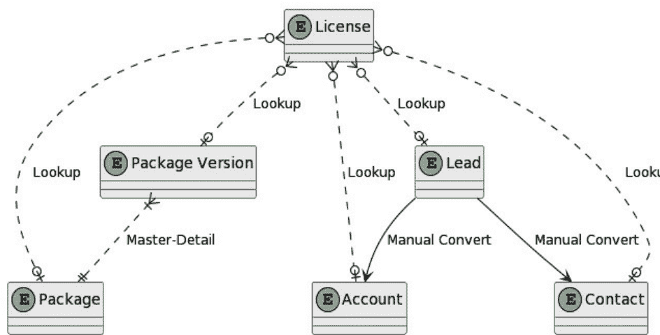
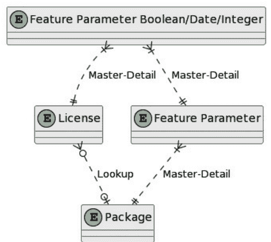

## Becoming an AppExchange Partner

围拢过来，同行的开拓者们！我们通过 Salesforce 生态系统和 AppExchange 市场的探险继续进行，我们将深入探讨成为成功 AppExchange 合作伙伴的过程。在本章中，我将引导您穿越合作伙伴协议、业务计划和合作伙伴门户的崎岖地形，确保您为 AppExchange 之旅奠定坚实的基础。

在本章结束时，您将了解到以下内容：

- AppExchange 合作伙伴计划的结构和优势，帮助您了解加入 Salesforce 探险的价值
- 如何有效探索和利用 AppExchange 合作伙伴社区来管理合作伙伴活动并获取有价值的资源
- 规范 AppExchange 合作伙伴关系的关键协议，如您将穿越的领土地图
- 如何制定针对 Salesforce 生态系统量身定制的全面业务计划，确保您作为 AppExchange 开拓者的成功
- 利用 AppExchange 合作伙伴工具包作为您可靠的指南针来支持和发展合作伙伴关系的重要性

掌握这些知识后，您将能够自信地驾驭 Salesforce 生态系统，并为繁荣的 AppExchange 合作伙伴关系奠定基础。那么，让我们继续踏上 Salesforce 和 AppExchange 的荒野之旅，发掘征服合作伙伴关系版图的秘诀！

## Overview of the AppExchange Partner Program

成为 AppExchange 合作伙伴提供了丰富的优势，可以帮助您的应用程序在竞争激烈的 Salesforce 生态系统中蓬勃发展。在本节中，您将找到加入 AppExchange 市场后可以期待的一些关键优势，如下所示：

- **访问庞大的客户群：** 作为合作伙伴，您的应用程序可接触到 Salesforce 庞大且多元的客户网络，增加销售和互动的潜力。
- **合作伙伴生态系统协作：** 加入 AppExchange 市场可开启与其他 Salesforce 合作伙伴的协作机会，让您拓展网络、分享知识并产生潜在客户。
- **全面的开发工具和资源：** Salesforce 提供多种工具和资源，支持平台上的应用程序开发、测试和部署。
- **平台安全与信任：** 通过在 Salesforce 平台上构建应用程序，您可受益于其强大的安全基础设施并赢得客户信任。
- **上市支持（GTM）：** Salesforce 提供资源和支持，帮助合作伙伴有效营销其应用程序，包括营销最佳实践、联合营销机会以及参加 Salesforce 活动。
- **技术支持和培训：** AppExchange 合作伙伴可访问 Salesforce 的技术支持资源，如文档、网络研讨会和专属支持团队，帮助他们保持最新并克服技术挑战。
- **收入分成机会：** 在 AppExchange 市场上销售您的应用程序可在利用广泛的 Salesforce 生态系统的同时产生额外收入。
- **应用知名度：** Salesforce 提供各种提升应用程序可见度的机会，如 AppExchange 列表、赞助和客座博客投稿，帮助您触达更广泛的受众并建立品牌声誉。
- **业务管理**：Salesforce 提供一系列工具和资源，包括 Environment Hub、**Channel Order App (COA)**、**License Management App (LMA)**、**Partner Business Org (PBO)** 和 Marketplace Analytics，帮助您有效管理 AppExchange 业务。
- **需求生成**：通过成为 AppExchange 合作伙伴，您可获得资源和项目，如 **AppExchange Marketing Program (AMP)**，支持您为应用程序创造需求并推动转化。我们将在 [第12章](Chapter 12) 中讨论 AMP。

作为 ISV 合作伙伴加入 AppExchange 市场可提供众多优势，有助于您的应用程序在 Salesforce 生态系统中取得成功。从获得庞大的客户群访问权限到利用 Salesforce 的品牌声誉和全面的支持资源，与 Salesforce 在 AppExchange 市场上合作的好处是显著的，可为您的应用程序的成长和成功铺平道路。

## Navigating the AppExchange Partner onboarding lifecycle

成为 AppExchange 合作伙伴可能看起来像一场令人望而生畏的舞蹈，但我在这里引导您完成三个主要轨道，以确保您作为 ISV 合作伙伴的成功：技术轨道、GTM 轨道和业务轨道。将这些轨道视为您的舞蹈教练，引导您完成通往 AppExchange 明星之路的每一步。

## 技术轨道

穿上你的编程鞋，深入了解应用的开发和安全方面。本轨道中的关键里程碑包括以下内容：

- **发现**：揭开您应用和 Salesforce 平台技术要求的神秘面纱
- **制定策略**：编排您的开发和安全流程，以创建和谐的应用
- **启动安全审查**：启动安全审查流程，确保您的应用符合 Salesforce 的严格标准
- **通过安全审查**：通过成功完成安全审查并解决任何已识别问题来赢得金星

## GTM 轨道

准备好用您应用的营销和销售策略惊艳众人。本轨道通常由 Salesforce 合作伙伴客户经理主导，涉及以下两个里程碑：

- **制定整体 GTM 策略**：制定推广和向渴望的客户销售应用的主计划
- **实施营销计划**：执行营销举措，例如在线推广、活动以及与 Salesforce 的联合营销，让您的应用成为焦点

## 业务轨道

最后，专注于成为 AppExchange 合作伙伴的运营和合同方面，确保您的业务像舞蹈动作一样顺畅。本轨道中的关键里程碑包括以下内容：

- **合作伙伴机会注册**：通过注册并提交申请，使您成为 Salesforce 合作伙伴的意向正式化
- **加入合作伙伴社区**：获得 Salesforce 合作伙伴社区的独家访问权限，在那里有资源、支持和网络机会等待着您
- **签署协议**：审阅并签署必要的合同，例如 **Salesforce 合作伙伴计划协议 (SPPA)** 和 **合作伙伴应用分发协议 (PADA)**
- **起草技术策略**：规划您的技术路线图和未来演出的开发计划
- **在 AppExchange 市场发布应用**：通过在 AppExchange 市场发布您的应用并使其可供 Salesforce 客户使用，从而成为焦点

虽然入职流程可能并不总是遵循此确切顺序，但这些里程碑将作为导航您作为 Salesforce 合作伙伴旅程的实用指南。通过专注于成为 AppExchange 合作伙伴的技术、GTM 和业务方面，您可以在 Salesforce 生态系统中建立成功且蓬勃发展的业务——同时看起来像一名舞蹈专业人士。下面的图表提供了三个主要轨道的视觉表示，以确保您作为 ISV 合作伙伴的成功：

## 技术轨道

- 发现
- 制定策略
- 启动安全审查
- 通过安全审查

## Go-to-Market 轨道

- 制定整体 go-to-market 策略
- 实施营销计划

## 业务轨道

- 合作伙伴机会注册
- 加入合作伙伴社区
- 签署协议
- 起草技术策略
- 在 AppExchange 上发布应用
- AppExchange 合作伙伴关系

图 2.1：AppExchange 合作伙伴入职流程

## 加入 AppExchange 合作伙伴社区

加入 AppExchange 合作伙伴社区就像为 Salesforce 爱好者获得一张通往威利·旺卡巧克力工厂的金色门票一样。成为 AppExchange ISV 合作伙伴始于这个神奇的中心，它为您提供资源、支持案例、活动和论坛的访问权限。

那么，你如何获得这张通往 Salesforce 世界的门票呢？请按照以下简单步骤操作：

- 访问 [partners.salesforce.com](partners.salesforce.com) 并点击 **成为 Salesforce 合作伙伴**——这里无需购买糖果棒。
- 继续注册流程。即使您已经是 Salesforce 用户，也建议避免使用您的 Salesforce 客户凭据。相反，为您的合作伙伴实例创建一个全新的用户名。填写表格，点击 **提交**，然后等待那封甜美的确认邮件。
- 点击邮件中的链接设置永久密码并验证您的账户，从而解锁您的 12 个月 PBO 试用期。
- 返回 [partners.salesforce.com](partners.salesforce.com)，使用 Salesforce 登录，并授予身份 URL 服务访问权限，就好像您正在打开通往全新世界的大门一样。

就这样——您已获得对 PBO 的访问权限，即 Salesforce 企业版，享有 12 个月试用期。

再说明一点——您需要激活 PBO 许可证。这是通过在合作伙伴社区中记录案例来完成的，并且您需要在签署 PADA 后执行此操作（不用担心；我们将在下一节中介绍）。如果不这样做，您的试用 PBO 将在 12 个月后过期，而您不希望这种情况发生。最简单直接的规避这种潜在麻烦的方法是在日历中为几个月后设置提醒。这样，您就可以检查以确保您的 PBO 试用期仍然有效，并且没有因试用期到期而被停用。现在您已成为合作伙伴社区的一员，准备好最大化您与 Salesforce 和 AppExchange 生态系统的合作伙伴关系吧。

值得强调的是，加入 AppExchange 合作伙伴社区完全免费，并且附带无与伦比的好处——免费获得 PBO——这与行业典型的高许可费用形成鲜明对比。

## 合作伙伴协议 – 有趣的部分（说真的）

欢迎来到激动人心的 Salesforce AppExchange 合作伙伴计划法律世界！虽然想到法律协议可能会让您想蜷缩起来狂看最喜欢的电视节目，但我保证让本节尽可能有趣且信息丰富。所以，拿一杯咖啡（或者如果你讲究的话来杯茶），让我们深入到合作伙伴协议的愉悦领域吧！

## SPPA

将 SPPA 想象成您 Salesforce 合作伙伴成功的藏宝图。它不仅仅是任何点击即同意协议——它是引导您穿越 Salesforce 合作伙伴计划和合作伙伴社区迷宫的协议。别忘了令人兴奋的搭档——Salesforce 合作伙伴计划政策，为每种合作伙伴计划类型提供具体的指导。

## 开始您的 Salesforce 合作伙伴冒险

作为新的 Salesforce 合作伙伴，您的激动人心的冒险始于您首次登录合作伙伴社区时接受 SPPA。您需要公司的一名授权代表来审阅并接受 SPPA，但不用担心——他们不需要法学学位就能完成工作。

## SPPA – 通往合作伙伴社区的单程票

SPPA 就像一张授予您访问合作伙伴社区的金色门票。但请记住，它是不可协商的。就像您无法改变重力规则一样，您也无法更改 SPPA 的条款。

## 导航合作伙伴地形

SPPA 为访问合作伙伴社区和加入合作伙伴计划奠定了基础，而政策则充当可靠的指南针，为特定合作伙伴计划提供更详细的指导。务必彻底阅读两份文件——毕竟，您不会在没有地图和方向感的情况下开始公路旅行，对吧？

## 您 AppExchange 解决方案的业务审批

启动您的 AppExchange 解决方案的下一个关键阶段涉及提交业务审批。此流程要求计划将新应用推向市场的每个 ISV 合作伙伴提交一份商业计划。

## 为 AppExchange 市场制定商业计划 – app-tastic 成功配方

如果 AppExchange 市场是一块美味的蛋糕，您的商业计划就是使其成为焦点亮点的秘密成分。为了在竞争激烈的市场中脱颖而出并确保您符合 Salesforce 对道德和诚信的高标准，让我们一起烘焙一份令人垂涎的商业计划。本节将作为您的配方，指导您了解 AppExchange 定制商业计划的基本要素以及如何使用 AppExchange 发布控制台制作一份能给 Salesforce 留下深刻印象的计划。

## 商业计划提交和审批流程 – 厨房准备

在您的杰作登陆 AppExchange 市场的货架之前，Salesforce 需要品尝一下您的商业计划。商业计划包括

三个部分，[content]
三个部分，如下所示：

- **业务详情**：力求简洁而全面的回答。作为新合作伙伴，提供详尽细节可能很诱人，但 Salesforce 通常更欣赏直接、切中要点的回复。
- **产品架构**：同样，清晰是关键。提供清晰的概述，而不要深入技术术语。
- **合规认证**：仅在付费 AppExchange 列表时才需要。

一旦您的商业计划准备就绪，请提交审核。Salesforce 将提供反馈以完善您的方案，要么批准，要么提出改进建议。如有需要，您可以在处理意见后重新提交。

## 业务详情 – 基础层

本部分是您蛋糕的基础，帮助 Salesforce 了解您的公司如何融入其产品生态系统。它包括以下方面：

- **市场调研和分析**：了解您的目标市场、竞争对手以及 AppExchange 市场中现有的解决方案。这些知识将帮助您识别市场空白并有效定位产品。
- **应用开发策略**：解决开发您的应用并将其与 Salesforce 集成的技术方面、挑战和解决方案。在 *第 4 章* 中，您将掌握 ISV 专属技术。
- **定义您的价值主张**：是什么让您的应用成为点睛之笔？阐明使您的应用区别于竞争对手的独特功能和优势。*第 3 章* 中涵盖的策略将助您完成此项工作。
- **收入模式和定价策略**：选择适合您应用和市场的收入模式，并确定有竞争力的定价策略。这也在 *第 3 章* 中有所涉及。
- **营销和销售策略**：制定全面的计划，在 Salesforce 生态系统中推广您的应用，包括创建引人注目的 AppExchange 列表。我们将在 *第 8 章* 深入探讨这一点。
- **客户支持和成功计划**：通过提供各种支持渠道和资源来保持客户满意，帮助他们充分利用您的应用。在 *第 9 章* 中，您将探索一些选项。
- **财务预测和关键绩效指标 (KPI)**：估算潜在收入、支出和盈利能力，并定义 KPI 以跟踪应用的成功情况。*第 12 章* 深入探讨最常见的 KPI。
- **实施时间表和里程碑**：规划开发、发布和维护时间表，包括关键里程碑和截止日期。

## 产品架构

秉承蛋糕隐喻，让我们将产品架构部分视为隐藏在糖霜下错综复杂的蛋糕结构。是时候戴上安全帽，深入您应用构建的技术细节了。就像任何优秀的建筑师一样，您需要向 Salesforce 提供产品设计的全面蓝图。

本部分应涵盖以下方面：

- **您的应用如何存储凭据、密码和其他敏感数据：** 将其视为蛋糕城堡内的秘密金库，保持所有重要宝藏的安全无虞
- **产品的架构和设计：** 如果您愿意，这是您应用的平面图，包括技术栈、编程语言、框架以及任何第三方库或服务
- **与其他系统和应用的集成：** 它就像将您的应用连接到更广阔 Salesforce 景观的管道和线路
- **处理安全和数据隐私问题：** 保护您应用领域的不懈警卫

本部分的目的在于证明您的应用遵循 Salesforce 在架构和设计方面的最佳实践——就像一座设计精良、抗震的蛋糕塔。

## 合规认证

对于付费 AppExchange 列表，现在是说服 Salesforce 您的公司是可靠且合乎道德的业务合作伙伴的时候了。将合规认证部分视为应用世界的米其林之星。要获得这一享有盛誉的荣誉，您需要以最佳方式展示公司的业务实践和关系。

包括以下要素：

- **法律结构、所有权和财务稳定性：** 您应用烘焙坊的基础支柱。
- **任何过去的法律或监管问题：** 如果厨房里发生过任何失误，现在是时候解决它们并展示您如何改进。
- **数据隐私和安全实践：** 您如何保护客户数据并遵守适用法律和法规。这就像为您的烘焙坊获得顶级卫生评级。
- **第三方关系或合作伙伴关系：** 展示这些合作如何与 Salesforce 的价值观和政策保持一致，例如与镇上最好的糕点师合作。

总体而言，合规认证部分应证明您的公司是 Salesforce 及其客户值得信赖且可靠的合作伙伴——毕竟，事实胜于雄辩。

Voilà！一份精心制作的商业计划已准备就绪！通过解决商业计划的每个部分，您将确保您的应用符合 Salesforce 的标准并促进您业务的增长。通过周密的规划和执行，您的应用可以成为 Salesforce 生态系统的 pièce de résistance。Bon appétit！

## 与 AppExchange ISV 合作伙伴团队的通话

提交商业计划后，ISV AppExchange 合作伙伴团队将仔细审查您的提案。审查后，他们可能会联系您以获取反馈或请求额外信息。这就是初步非正式讨论发生的时候。此通话不仅仅是审查；它也是您提问、探索机会并了解团队如何在您作为潜在合作伙伴的旅程中提供帮助和支持的宝贵机会。

在对话期间，ISV AppExchange 合作伙伴团队可能会发现需要您关注的领域。如果出现任何问题，您将有机会纠正并重新提交计划。经过此次讨论，在充分了解您的提交内容和开发时间表后，团队如有必要可能会安排进一步的通话，并将指导您进入下一步。

此流程的下一阶段涉及 PADA 的执行。该协议规定了您与 Salesforce 的合作伙伴关系的具体内容以及通过 AppExchange 市场分发您的应用。

## PADA

将 PADA 视为 Salesforce AppExchange 合作伙伴计划三明治中的秘密酱料。它规范参与 ISVforce 和 OEM 类别的合作伙伴，并概述分发应用的条款和条件。PADA 就像厨师特选，将所有食材融合在一起，使其在与 Salesforce 生态系统分享您的应用之前必不可少。

## 一点灵活性 – 先安全审查，后签署

PADA 有其独特的风味——它允许合作伙伴在签署协议之前就提交应用进行安全审查。这就像在吃完开胃菜之前先偷看甜点。然而，合作伙伴在与 Salesforce 完成 PADA 流程的每一口之前都不能开始销售。

以下是 PADA 的三个关键要素：

- **净收入百分比 (PNR)**：它是合作伙伴与 Salesforce 分享的收入金额和类型，就像在豪华晚餐后分摊账单
- **合作伙伴应用描述（或组合解决方案描述）**：它是合作伙伴应用的法律描述，有助于计算 PNR，就像阅读菜单以了解您订购的内容一样
- **产品目录**：它是合作伙伴在 Salesforce 生态系统中提供的产品和服务清单，就像您 Salesforce 储藏室的购物清单

了解这些要素可以帮助合作伙伴烹制与 Salesforce 的成功合作，即使他们不是直接谈判 PADA 的人。

## ISVforce 补充协议

当合作伙伴决定使用 ISVforce 应用分发模式为 AppExchange 市场构建应用时，他们需要在 PADA 中添加 ISVforce 补充协议。此额外要素涵盖各种方面，例如合作伙伴关系、客户关系、费用和营销。

## PADA 的保质期

PADA 连同其 ISVforce 补充协议，最初为期 3 年，就像美酒一样，会自动续期 1 年，除非任一方决定是时候推出新年份或提前终止协议。

## 利用 AppExchange 合作伙伴工具包

作为 AppExchange 合作伙伴，拥有合适的工具对成功[content]
## 利用 AppExchange 合作伙伴工具包

作为 AppExchange 合作伙伴，拥有合适的工具对成功[content]
## 利用 AppExchange 合作伙伴工具包

作为 AppExchange 合作伙伴，拥有合适的工具对成功[content]
## 利用 AppExchange 合作伙伴工具包

作为 AppExchange 合作伙伴，拥有合适的工具对成功导航您的旅程至关重要。正如经验丰富的冒险家不会没有可靠的指南针、结实的靴子和装满物资的背包就进入荒野，您也不希望在没有自己的工具集的情况下深入 AppExchange 市场这个动态的格局。

在本节中，我们将揭开 AppExchange 合作伙伴工具包的面纱，这是一套旨在赋能像您这样的合作伙伴的资源。其目的是让您熟悉可用的关键工具，每个工具都有其独特用途，帮助您简化运营、管理客户并有效部署您的应用程序。

掌握了这些工具的知识后，您将能够充分装备自己，攀登 AppExchange 生态系统的顶峰。那么，让我们踏上这段激动人心的探险之旅，发现 AppExchange 合作伙伴工具包吧。

## PBO 功能与能力

亲爱的读者，欢迎登上 PBO 的神奇神秘之旅，您的专属 Salesforce 命令中心，在这里管理业务运营的梦想成真。无需掐自己——这是真实的，现在是时候探索 PBO 的功能了。

您的 PBO 是多功能的得力助手，准备执行以下操作：

- 使用 Salesforce CRM 应用吸引新客户
- 使用 **Developer Hub (Dev Hub)** 高效管理 scratch org 和第二代托管包
- 使用 Environment Hub 创建测试组织
- 使用 **License Management App (LMA)** 控制线索和许可证
- 使用 **Feature Management App (FMA)** 有效管理应用程序功能
- 使用 **Channel Order App (COA)** 轻松搞定订单提交
- 使用 Checkout 无缝管理付款
- 成为客户需要的超级英雄，使用 Subscriber Support Console

## Environment Hub – 您用于应用测试和打包的秘密实验室

想象一下：您是一位疯狂科学家（以最可爱的方式，当然）在调配完美的 AppExchange 秘药。您的实验室？Environment Hub。在这里，您可以通过创建测试组织、简化打包、促进协作以及跟踪所有实验来完善应用的配方。让我们深入了解您这个奇妙实验室的好处。

以下是使用 Environment Hub 的一些好处：

- **轻松创建测试组织：** 就像主厨测试不同食材一样，Environment Hub 允许您为各种 Salesforce 版本和配置制作测试组织。这可确保您的应用在落地的每个厨房（咳，环境）中都完全兼容并发挥最佳性能。
- **简化应用打包：** 无论是您的秘密酱料还是应用打包，一致性都是关键。Environment Hub 有助于确保您的应用在各环境中统一打包，使部署和分发变得轻而易举。
- **改善协作：** 烹饪总是有朋友一起更有趣。Environment Hub 允许您与团队成员共享环境，使测试过程成为协作且高效的努力。您将比舒芙蕾升起的速度更快地识别和解决问题。
- **集中跟踪：** 使用 Environment Hub 对所有环境的集中视图来保持实验室井然有序。轻松跟踪创建日期、版本和到期日期等重要信息，确保您的环境保持最新并符合 Salesforce 要求。

## 访问 Environment Hub – 找到通往实验室的路

准备好戴上实验室外套和护目镜了吗？以下是访问 Environment Hub 的方法：

- 1. 登录您的 PBO。
- 2. 单击左上角的 **App Launcher** 图标。
- 3. 搜索 **Environment Hub** 并从搜索结果中选择它。

现在您已经找到了通往这个秘密实验室的路，是时候发挥您内心的疯狂科学家精神开始实验了。

## LMA – 您应用许可证的私人保镖

您将成为繁忙 AppExchange 街上独家俱乐部（您的应用）的主人。LMA 是您值得信赖的保镖，跟踪所有进入和离开您场所的客人（许可证）。在本节中，我们将了解将 LMA 作为保镖的好处，带您参观 **License Management Org (LMO)**，并解释 LMO 与 PBO 之间的关系。

## LMA 概述

LMA 旨在控制您俱乐部的客人名单（许可证），使用 LMA，您可以执行以下操作：

- 1. 监控和管理您的客户群，包括试访客户和拥有付费访问权限的 VIP。
- 2. 通过像天鹅绒绳一样启用或禁用许可证来控制客人名单。
- 3. 跟踪客户出席情况和应用受欢迎程度。
- 4. 使用 Subscriber Support Console 访问客户组织以进行支持目的。

LMA 包含三个自定义对象：Package、Package Version 和 License。Package 对象作为基础实体，涵盖所有 LMA 数据。每个 Package 对象可以包含多个 Package Versions，而每个 Package Version 又可以与多个 License 相关联。每个 License 直接对应一个 Lead。值得注意的是，当 Lead 手动转换为 Account 和 Contact 时，相关 License 会无缝链接到新转换的记录。以下 **实体关系图 (ERD)** 提供了自定义和标准 Salesforce 对象之间这些错综复杂连接的可视化表示：

图 2.2：LMA 系统实体及其关系的实体关系图

## LMO

LMO 就像您 Salesforce 组织的专属后台区域，您可以在此跟踪在 Salesforce AppExchange 上安装您托管包的所有 Salesforce 用户。每当用户安装或卸载您的包时，LMO 都会收到一条线索记录，就像每个客人的一张签名。LMO 跟踪在 Salesforce AppExchange 上上传的每个包，可以是安装了来自 AppExchange 的免费 LMA 的任何 Salesforce Enterprise 或 Unlimited 组织。

最佳选择是在您的 PBO 中安装 LMO。这意味着您的 PBO 充当与您的应用安装相关的所有许可证信息的中央存储库，使所有内容在幕后井然有序。

## 用于管理应用功能的 FMA

您可以将 FMA 视为一位准备为俱乐部每位客人编排难忘体验的指挥家。我们将探讨核心概念、用例以及两个 FMA 参数：LMO-to-Subscriber 功能参数和 Subscriber-to-LMO 功能参数。

## 了解 FMA

FMA 不是必须使用的，但它可以成为您应用的幕后推手，为每个客户编排功能和功能的完美融合。FMA 建立在 LMA 之上，允许您通过控制用户看到的内容以及他们与应用的交互方式来微调 **用户体验 (UX)**。将 FMA 视为您应用交响乐的指挥，引导每一个音符创造和谐的体验。

以下是实体关系图，说明了 FMA 中各种实体之间的关系：

图 2.3：FMA 实体及其关系的实体关系图

## FMA 用例

FMA 可以演奏各种曲调来满足您客人的偏好。
以下是一些示例：

- **Freemium 模式：** 根据客户拥有付费或免费许可证类型来自定义功能
- **试点测试：** 在不影响当前用户的情况下，将新功能发布给选定的客户群进行测试
- **简化开发：** 通过使用 FMA 管理多个应用程序，减少开发时间和开销，并战略性地调整功能以利用现有代码库

## 使用 LMO-to-Subscriber 功能参数启用和禁用功能

LMO-to-Subscriber 功能参数就像指挥家的魔杖，只需轻轻一挥即可启用或禁用功能。这些参数在您这边可写，对订阅者只读，可用于控制对某些功能的访问或设置资源使用限制。想提供新功能的一瞥吗？没问题！为其启用有限的试用期并观看兴奋的展开。只需在您的 LMO 中更新相关功能参数，让魔术在您的代码中发生即可。

## 使用 Subscriber-to-LMO 功能参数跟踪偏好和激活指标

Subscriber-to-LMO 功能参数是指挥家细心的耳朵，倾听订阅者的功能激活偏好。通过由订阅者分配并发送到您 LMO 的值，您可以收集洞察并根据他们的喜好调整性能。只需使用 Apex 代码在订阅者的组织中更新功能参数，您就可以开始了。

## FMA 考虑事项

设计 FMA 策略时，需要牢记以下几点：

- 使用 FMA 无法隐藏或显示完全受管理的包。但是，您可以提供一个 **号召性用语 (CTA)** 让用户访问功能。
- 测试可能具有挑战性，因为没有测试 LMO，且文档可能不明确。开发人员需要对打包环境进行暗启动以进行测试。
- 制定功能策略时，请牢记每个托管包 200 个功能的限制。
- 仅有三种 FMA 标志类型可用：**布尔**、**整数** 和 **日期**。
- 您可以在 LMO 中手动调整功能参数。但是，如果您的解决方案在安装后需要为付费客户更改许多功能参数的默认设置，那么自动化此过程可能是一个好主意。考虑在 License 对象上设置记录触发流以使其更顺畅。

## 解锁 PBO 的全部潜力

正如您所知，您的 PBO 是一个标准的 Salesforce 组织，这意味着它可以通过本地开发或安装托管包来定制和扩展以满足您的特定需求。为了帮助您释放 PBO 的全部潜力，让我们讨论扩展它的三种主要方式：安装 AppExchange 应用（通用或专门针对 ISV，如 Package Visualizer）、使用开源项目（如 ISV Cockpit）或自定义开发。

## Package Visualizer

由 Salesforce Labs 创建的 Package Visualizer¹ 应用是一个免费的托管包，通过为您提供便捷的方式查看您的包、版本继承关系和订阅者数据来改善您的 AppExchange 体验。您可以直接从 AppExchange 安装它。凭借与 LMA 的无缝集成，Package Visualizer 可让您轻松高效地管理应用。此外，Package Visualizer 简化了获取包使用详细日志的过程。它提供有价值的见解，使包开发和管理中的决策更具依据。我们将在 *第 10 章* 进一步探讨此内容。

1 https://appexchange.salesforce.com/appxListingDetail?listingId=a0N4V0000FNBc0UAH

Package Visualizer 应用采用拆分视图设计，简化了导航，让您以图形方式探索包详情、版本和订阅者。借助升级计划功能，高效规划和执行升级可确保您的客户始终能够访问应用的最新版本。

## Salesforce ISV Cockpit

Salesforce ISV Cockpit² 应用是一个开源的原生 Salesforce 应用，可扩展您 PBO 中 LMA 的功能。它允许您监控应用的健康状况并为遇到错误的订阅者提供主动支持。当托管包中发生错误时，您的应用可以向指定的电子邮件地址发送错误通知。ISV Cockpit 通过接收和解析这些电子邮件来利用此功能。通过将这些信息与 LMA 的数据结合，ISV Cockpit 应用可以准确地将每个传入错误分配给客户账户、包、包版本和许可证。此外，它还会提取有关错误类型和位置的信息。

2 [https://github.com/rsoesemann/salesforce-isv-cockpit](https://github.com/rsoesemann/salesforce-isv-cockpit)

所有这些数据都存储在单个自定义对象中，便于报告和创建复杂的支持工作流。

## 自定义开发

使用 PBO 的一个重要优势是灵活地定制和扩展其功能。在您的 PBO 中，一切都建立在 Salesforce 对象之上，包括标准对象（如 Accounts、Leads 和 Contacts）以及与 LMA 相关的自定义对象（如 Licenses、Packages 和 Package Versions）。这种灵活性使您能够创建支持业务目标的定制。

让我们看两个本地定制的示例，这些示例可以改善您的客户保留和销售流程。

## 在许可证到期前提醒销售代表

为确保客户的许可证及时续订并防止潜在损失，您可以设置一个流程，在许可证到期前自动向团队中的销售代表发送电子邮件。操作如下：

- 创建通知的电子邮件模板。
- 使用 Salesforce Flow 的 **获取记录** 元素获取即将到期的许可证。设置条件以在到期日期前指定足够的时间来讨论续订选项。
- 在流程中使用 **发送电子邮件** 元素发送电子邮件通知。在此，选择第一步中创建的电子邮件模板并指定销售代表或团队成员作为收件人。
- 激活流程以开始在许可证到期前通知销售代表。

## 在产品被卸载时通知客户保留专员

了解客户卸载产品的原因可以帮助改进产品或恢复业务关系。通过设置另一个流程，您可以在产品被卸载时通知团队中的客户保留专员。操作如下：

- 1. 创建通知的电子邮件模板。
- 2. 在 Salesforce Flow 中，创建一个新的记录触发流。为触发器选择 **记录已更新** 选项。指定产品对象并设置条件，当 **许可证状态** 字段等于 **已卸载** 时触发流程。
- 3. 在流程生成器中，添加 **发送电子邮件** 操作。对于此操作，选择第一步中创建的电子邮件模板并指定客户保留专员作为收件人。
- 4. 保存并激活您的流程。现在，每当产品被卸载时，客户保留专员将自动收到通知。

许多 ISV 主要专注于构建托管包，但经常忽视定制 PBO 以支持其业务目标的潜力。通过利用 Salesforce 对象的强大功能并结合 AppExchange 应用、开源解决方案和自定义开发，您可以创建功能强大、灵活且符合特定需求的 PBO。因此，您将更好地推动更好的客户体验并改进业务流程。不要重蹈他人的覆辙；利用 Salesforce 提供的定制机会，最大化 PBO 的潜力。

## 摘要

在本章中， fellow trailblazers，我们深入 Salesforce 生态系统，探索成为成功的 AppExchange 合作伙伴的秘诀。我们穿越了制定定制业务计划的荒野，并破译了关键合作伙伴协议的地图。

我们一起 navigated AppExchange 合作伙伴社区，并学习如何使用其资源来增强我们的探险。我们还发现了 AppExchange 合作伙伴工具包的价值，它是我们值得信赖的指南针，引领我们在 Salesforce 领域走向成功。

但是，冒险者们，不要还沾沾自喜！我们的旅程远未结束。前面我们看到的是设计以客户为中心的应用的绿色山谷。我们将深入客户需求的生机勃勃的动植物群，绘制他们的旅程，并打造与他们隐藏需求相符的应用。此外，我们将学习战略定价模型的来龙去脉。这不仅仅重要；它是我们以客户为中心的应用与客户本身之间的纽带。继续前进，trailblazers！

## 延伸阅读

- *AppExchange ISV 入门指南:* https://www.appexchange.salesforce.com/e/appexchange-isv-onboarding-guide-jcvehuiiqzjsr/g9IpAtAM
- *管理托管包的许可证:* https://developer.salesforce.com/docs/atlas.en-us.workbook_lma.meta/workbook_lma/lma_intro.htm
