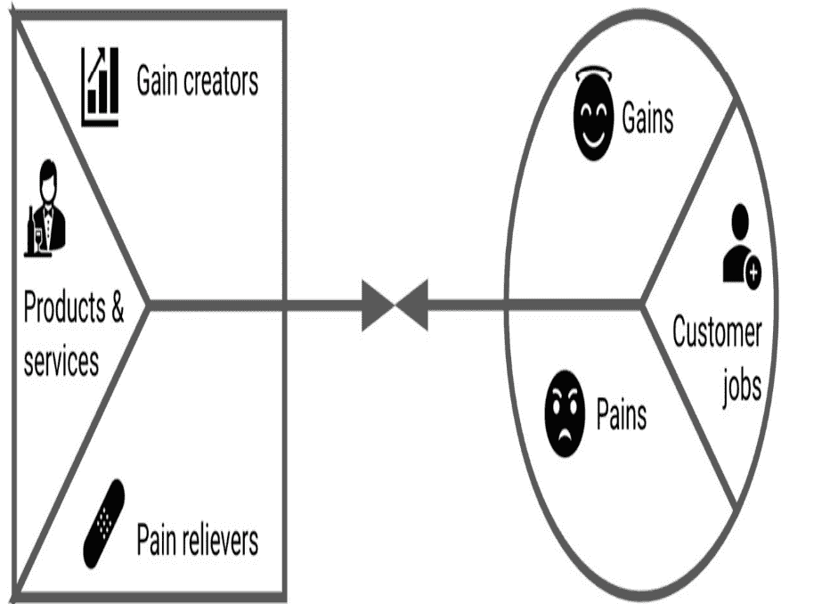

## 设计以客户为中心的应用

Welcome back, steadfast pioneers! As our thrilling journey through the winding Salesforce ecosystem and bustling AppExchange marketplace unfolds, we focus on the exciting challenge of designing customer-centric applications and optimal pricing strategies.

You might be wondering, “Why is all this so important?” Well, let’s lean on the wisdom of two thought leaders. Harvard Business School marketing professor Theodore Levitt famously said, “People don’t want to buy a quarter-inch drill. They want a quarter-inch hole!” He was stressing that people don’t buy products; they buy solutions to their problems. Similarly, Clayton Christensen asserts, “People buy products and services to get a job done”. Their insights underline our direction in this chapter— understanding what job your customer needs done and how your application can be the drill to achieve it.

In this exploration, we’ll cover the following:

- Identifying customer needs and pain points to truly understand the “hole” your customers need
- Creating value propositions aligned with customer needs to design the “drill” that makes the perfect “hole”
- Mapping customer journeys to visualize and improve the path your customers take to get their job done
- Unravel the ancient art of selecting the right pricing model for your AppExchange application, an endeavor rivaling the thrill of a treasure hunt
- Learn the wisdom of understanding customer willingness to pay, a talent as vital as brewing the perfect cup of coffee on a Monday morning
- Decode the cryptic process of identifying your app’s core value and aligning pricing with customer segments, a task as intricate and exciting as assembling IKEA furniture without the manual

With the acumen gathered from this chapter, you’ll be well-prepared to devise applications that deliver not just solutions, but memorable user experiences. Use this newfound knowledge to create standout applications that resonate with customers in the AppExchange marketplace. So, put on your explorer hats, fellow pioneers, as we delve deeper into the Salesforce ecosystem and unearth strategies for crafting captivating user-centric applications!

## 识别客户需求和痛点

Picture this: you’ve spent countless hours brainstorming, designing, and developing an application that you believe is the next big thing on the AppExchange. You’re confident that it will revolutionize the way people do business. But then, when you finally launch it, you’re met with... crickets. What went wrong?

### 创新项目失败的原因

Innovation is a crucial aspect of any business that wants to remain competitive and relevant in today’s fast-paced world. However, despite the importance of innovation, many companies struggle to come up with successful innovation projects. One of the main reasons why innovation projects fail is because there is no agreement on what a “need” even is. Different people have different definitions of what constitutes a need, and this can lead to confusion and miscommunication within an organization. For example, some people might define a need as something that solves a specific problem, while others might define it as something that fulfills a desire or want. This lack of clarity can make it difficult for companies to identify unmet customer needs and develop solutions that address those needs.

Another reason why innovation projects fail is that many companies take an “ideas-first” approach to innovation. In this approach, companies brainstorm or come up with product or service ideas and then test them with customers to see how well the ideas address their needs. While this approach may seem logical at first glance, it has several flaws.

First, generating more ideas does not meaningfully improve the probability that someone will come up with the optimal idea to satisfy unmet customer needs. People are in effect brainstorming ideas without ever knowing what all the customers’ needs are or which of those needs are most important.

Second, when companies start with an idea rather than a need, they risk developing solutions that don’t actually solve any real problems for customers. This can result in wasted time and resources, as well as missed opportunities for growth.

In contrast to the “ideas-first” approach, some companies take a “needs-first” approach to innovation. In this approach, companies first learn what customers’ needs are by conducting research and gathering data from various sources. They then identify which needs are unmet and devise a solution that addresses those unmet needs. This approach is more effective because it ensures that companies are developing solutions that actually solve real problems for customers.

To implement a “needs-first” approach to innovation, companies need to have a clear understanding of the different types of customer needs. The **jobs-to-be-done (JTBD)** framework is useful for categorizing, defining, capturing, and organizing the six types of customer needs. These are functional needs, emotional needs, social needs, situational needs, supporting needs, and epistemic needs.

## 你的理想客户画像

Before delving into the nuances of designing customer-centric applications, it’s imperative to establish a foundational understanding of the ideal customer profile (ICP). The ICP isn’t merely an introductory concept; it’s the cornerstone upon which successful, customer-focused designs are built.

### 什么是 ICP？

An ICP is a detailed description of the most suitable customer for a particular product or service. It’s not just a target market or a buyer persona; it’s a precise profile of the company or individual that would get the most value from your product and, in turn, provide the most value to your business.

There are several reasons why it’s beneficial to have a well-defined ICP:

- **Focused marketing and sales efforts**: With a clear ICP, ISVs can direct their marketing and sales resources more efficiently, ensuring that they’re reaching out to prospects that are more likely to convert
- **Higher conversion rates:** When you know who your ideal customer is, your messaging resonates better, leading to higher conversion rates and shorter sales cycles
- **Improved product development:** Understanding your ICP can provide insights into feature development, ensuring that the product evolves in a direction that continues to serve and delight the ideal customer
- **Better customer relationships:** When you’re serving your ideal customers, they’re more likely to be satisfied and become long-term, loyal users of your product

A meticulously defined ICP ensures that the product or service being offered resonates and aligns with the desires and needs of those who stand to derive the most benefit from it.

However, there’s a common trap that many fall into, especially during the early stages of a product’s lifecycle: the allure of the “sell to all” approach. While it might seem advantageous to cater to a broad spectrum of potential customers, this strategy often backfires. It can dilute the core value of the product, leading to wasted resources and a scattered focus.

Moreover, the clarity of a product’s strategy is closely tied to the ICP. Without a clear understanding of and focus on the ICP, the product’s strategic direction can become convoluted. While the idea of serving a vast audience has its appeal, it often poses challenges in maintaining the product’s market positioning and evolutionary path.

Beyond just conceptualizing the ICP, it’s crucial to document it. A mere mental image or abstract idea of the ideal customer isn’t sufficient. Having a written representation of the ICP serves as a beacon for the entire team, ensuring a unified understanding and approach toward the target audience.

By defining and understanding your ICP, you’re now in the position to effectively apply the JTBD framework to define jobs related to the right customers. This approach ensures that you cater to the actual needs of your target group, rather than trying to please everyone and running the risk that your app doesn’t truly resonate with any specific audience.

## Navigating the JTBD framework

JTBD 理论就像冒险者的指南针，指引我们找到客户需求的隐藏宝藏。它提供了一个用于分类、定义、捕捉和组织六种客户需求类型的框架，这对于创造创新且成功的产品和服务至关重要。

## 核心功能性 JTBD

将核心功能性工作想象成我们在地图上寻找的宝藏。它是客户希望通过您的 AppExchange 应用完成的主要任务，或希望克服的主要挑战。例如，任务管理应用可能解决高效管理任务的核心工作。把握这一核心功能性工作使我们能够创建直接解决客户主要需求并提升其用户体验的应用。

## 核心功能性工作的期望成果

找到我们的宝藏，即核心功能性工作后，我们关注期望成果。将它们想象成镶嵌在宝藏上的宝石——这些是客户在执行核心功能性工作时用来衡量成功的标准。例如，有一些 AppExchange 应用有助于提升销售业绩——这是以销售为驱动的组织的期望成果。认识并满足这些期望成果有助于我们打造不仅满足而且超越客户期望的应用。

## 相关工作

相关工作类似于客户在核心功能性工作之前、期间或之后进行的支线任务。识别这些任务，例如在任务管理应用中跟踪每个任务花费的时间，并将其纳入应用设计中，可以丰富我们的产品，使其更全面、更有价值且更具吸引力。

## 情感和社会性工作

除了纯粹的功能性之外，客户在使用您的应用时还存在情感和社会需求。情感和社会性工作说明了客户在执行核心功能性工作时希望感受到或被他人感知的状态。能够增强文档生成的应用可以让客户感到更高效、更有生产力，从而满足其情感性工作。满足这些需求可以培养稳固的情感连接并培育客户忠诚度。

## 消费链工作

消费链工作是指您的支持团队在应用生命周期内执行的任务，从安装到维护，再到最终处置。关注这些工作，例如 Ask Your Document 通过其工具的简易设置和集成所做的，就能提升整体客户体验，营造持久满意感。

## 财务期望成果

最后，财务期望成果充当客户在选择安装哪个 AppExchange 应用时所依赖的货币和绩效指标。通过理解这些成果，我们可以构建与目标受众产生共鸣的有说服力的价值主张，确保我们的应用是他们在 AppExchange 地图上一直在寻找的宝藏。

## 为什么有人会雇用你的产品？

JTBD 框架帮助您理解客户“雇用”产品或服务来在其角色中完成工作。这些工作可以是功能性、社会性或情感性的。理解客户试图完成的工作，而不是仅仅关注其人口统计信息或偏好，可以帮助 ISVs 创新并改进其产品。

该框架鼓励您提出以下问题：

- 客户试图解决的根本问题或需求是什么？
- 客户在生活中试图取得什么进展？
- 客户在实现其期望进展时面临哪些障碍或挑战？

通过深入理解客户试图完成的工作，合作伙伴可以开发更符合这些需求的产品、服务和体验。这种方法可以带来更成功的创新、客户满意度，并最终实现业务增长。

## 为那些（此刻）没有雇用任何产品的客户创新

在考虑那些不雇用任何产品来完成工作的客户时，JTBD 框架在以下几个方面仍然很有价值：

- **识别潜在需求：** 有时客户可能不了解现有解决方案，或认为现有产品无法满足其需求。通过理解他们试图完成的工作，您可以挖掘潜在需求并发现创新机会。这使他们能够开发新的产品或服务，更好地解决这些未满足的需求。
- **市场细分：** 检查目前没有雇用任何产品来完成特定工作的客户，可以提供有关未开发市场细分的信息。通过了解这些客户为何尚未找到合适的解决方案，您可以调整其产品以满足这些细分市场并抓住新的市场机会。
- **颠覆性创新：** JTBD 框架对颠覆性创新特别有帮助。颠覆性创新通常通过解决传统产品或服务无法充分解决的工作而出现。通过理解客户难以完成的工作，合作伙伴可以开发更有效地满足这些需求的颠覆性解决方案，并可能颠覆现有市场。
- **产品迭代和改进：** 即使客户目前正在使用产品来完成工作，JTBD 框架也可以帮助识别改进领域。通过更详细地了解工作，您可以完善其产品或服务，使其更好地与客户需求保持一致，增强用户体验并创造更多价值。

## 利用 JTBD 实现核心功能

在当今快节奏且竞争激烈的商业环境中，保持产品精简并专注于其核心目的至关重要。添加众多功能和功能的诱惑可能令人难以抗拒，但它往往会导致不必要的复杂性和产品价值主张的稀释。为了避免这一陷阱并确保产品保持专注于其核心思想，利用 JTBD 框架至关重要。

该框架提供了一种以客户为中心的方法，强调理解客户试图通过产品完成的基本工作。通过专注于这一核心工作，您可以识别有效解决客户需求所需的核心功能。这种方法有助于您优先考虑并简化开发流程，避免纳入可能分散产品核心目的的非必要功能。

通过采用保持产品精简和专注的思维方式，您可以增强其对客户的可用性、相关性和价值。这种方法不仅可以防止不必要的功能过载，还可以使您提供一个精简且有目的的产品，直接解决客户需求。它使您能够避免功能蔓延的陷阱并保持清晰且有说服力的价值主张。

JTBD 框架可以帮助企业专注于产品的核心意义并避免添加非必要功能的有力工具。以下是它在这一方面的帮助方式：

- **以客户为中心的方法**：该框架将客户及其工作置于产品开发的中心。相反，基于假设或内部偏好添加功能，使用 JTBD 框架的合作伙伴积极寻求理解客户试图完成的核心功能性工作。这种以客户为中心的方法有助于优先考虑直接有助于完成核心工作的功能，避免不必要的添加。
- **期望成果聚焦**：在该框架内，强调理解客户在试图完成核心工作时所期望的成果。通过深入理解这些期望成果，您可以将产品开发工作与客户真正关心的事情保持一致。这使您能够专注于开发

直接支持这些成果的功能和特性，同时剔除那些可能无法为产品核心目的做出贡献的非必要功能。

- **清晰的问题解决视角：** JTBD 框架鼓励合作伙伴将产品视为解决客户面临的特定问题的方案。这种问题解决视角有助于保持专注，高效有效地解决核心问题。它帮助你持续质疑和评估额外的功能或特性是否必要来解决当前问题，还是只是增加了不必要的复杂性。
- **最小化范围蔓延：** 范围蔓延指的是项目超出其原始边界的倾向，往往导致功能过载。通过使用 JTBD 框架，你可以根据客户需要完成的核心理由来界定其产品的边界。这种明确定义的范围有助于防止包含可能稀释产品的价值主张并分散其主要目的的非必要功能。
- **持续验证：** JTBD 框架提倡迭代且以客户为中心的产品开发方法。通过在产品生命周期中持续收集客户反馈和洞察，你可以验证和完善他们对核心工作和所需必要功能的理解。这种持续的验证有助于确保产品保持对其核心意义的关注，并避免添加可能与客户需求不一致的不必要功能。

总之，采用精简且专注的产品开发方法有助于 ISV 创建与客户产生共鸣并提供真正价值的应用程序。通过利用这种方法，你可以确保你的产品保持对其核心目的的关注，避免添加不必要的功能。随着我们过渡到下一节，我们将探讨功能冲击的概念，并讨论防止其对你的应用程序的工作规范产生负面影响的策略。

## 避免功能冲击

在我们探索以客户为中心的应用设计艺术时，解决功能冲击这一潜在陷阱至关重要。功能冲击发生在应用程序因功能过多而臃肿，导致用户复杂和困惑时。为了创建与客户产生共鸣并提供真正价值的应用程序，我们必须专注于直接解决客户需求的基本功能。

### 优先考虑核心功能

首先确定客户需要用你的应用程序完成的主要工作。专注于开发直接有助于解决该核心问题的功能，避免添加可能稀释价值主张或让用户困惑的不必要功能。

### 理解期望成果

分析客户在执行核心功能工作时期望的成果。将你的应用程序的功能与这些期望保持一致或超越，确保你的产品提供价值并提升用户体验。

### 保持精简和专注

抵制向你的应用程序添加众多功能的诱惑。相反，采用精简且专注的产品开发方法，优先考虑直接解决客户需求并有助于产品核心目的的功能。

### 迭代和验证

在产品开发过程中持续收集客户反馈。利用这些反馈验证你对客户需求的理解，并相应地完善你的应用程序的功能。这种迭代方法有助于确保你的产品对客户保持相关性和价值。

### 监控和调整

定期审查你的应用程序的功能和性能，寻找简化、精简或增强用户体验的机会。准备好根据需要进行调整，以保持你的应用程序专注于为客户提供价值的核心目的。

## 创建与客户需求一致的价值主张

现在，我们将深入探讨一个强大的工具——价值主张画布。价值主张画布使 ISV 能够发掘和设计与客户需求一致的价值主张。通过将 JTBD 框架与价值主张画布连接，我们可以更深入地了解客户的期望并创建引人注目的产品。在本节中，我们将提供一步一步的指南，帮助你为你的 AppExchange 应用量身定制价值主张画布。

### 价值主张

### 客户画像

图 3.1：价值主张画布模板示例

通过遵循下一小节中的说明，你将更深入地了解你的目标客户、他们的需求以及你的应用如何提供独特价值。

### 第一步：定义你的目标客户细分

在确定了你的 ICP 后，现在是时候在 Salesforce 平台上对其进行更深入的细分。认识到客户细分本质上是更广泛 ICP 的子集。通过考虑行业、公司规模、职位角色以及你的应用解决的具体挑战等变量，你可以识别并满足这些细微的细分。这种方法不仅能 sharpen 你的焦点，还能为每个细分提供量身定制且有影响力的价值主张。

对于产品开发初期的那些人，拥有一个与 ICP 镜像的单一细分是常见的。这是因为，最初的重点是更通用的目标以获得 traction。然而，随着你的产品成熟并旨在进入新市场，重新审视本章至关重要。随着增长，定义多个细分的需求变得明显，使你能够满足初始 ICP 的不断演变和多样化的子集。这种迭代过程确保你的产品保持相关性，并继续满足更广泛受众的需求。

### 第二步：了解客户的 JTBD

深入了解目标客户试图用你的应用完成的工作。进行访谈、调查或市场研究以深入了解他们的具体挑战、目标和期望成果。通过了解 JTBD，你可以更好地使你的应用的功能和特性与这些需求保持一致，从而有效解决这些需求。

### 第三步：创建客户画像

基于 *步骤 1* 中确定的特定细分，你现在可以创建详细的客户画像，概括这一更窄受众的独特特征、动机和偏好。虽然你的 ICP 提供更广泛的概述，但此画像深入细分细节，提供人口统计、行为倾向、心理特征和其他相关细节的洞察。这种深入的理解有助于真正同理他们的特定需求。确保此丰富信息在价值主张画布的客户画像部分中可视化并记录，强调其对源自你整体 ICP 的细分量身定制的关注。

### 第四步：识别痛点和期望收益

确定目标客户在尝试完成工作时经历的痛点。这些痛点代表他们面临的挑战、挫折或低效率。同时，识别客户在使用你的应用时希望实现的目标收益。这些收益可以包括提高生产力、节省成本、改善决策或增强用户体验。在价值主张画布中记录这些痛点和期望收益。

### 第五步：设计价值地图

现在，将你的焦点转向画布的价值地图部分。识别你的应用的核心功能和特性，这些功能直接解决前几步中确定的痛点和期望收益。突出你的应用能力如何缓解特定痛点并为客户提供期望收益。此外，考虑任何可以增强你的应用提供的价值的附加功能、痛点缓解因素或收益创造因素。

### 第六步：验证和迭代

通过寻求潜在客户的反馈、进行用户测试或与 AppExchange 用户进行对话来验证你的价值主张。收集有关你的应用与其需求契合程度的洞察，并根据此反馈完善你的价值主张画布。持续迭代和改进你的价值主张，以确保它与目标受众产生共鸣。

如果你已经有一些用户，你可以简单地使用你的 LMA 中的联系方式与他们取得联系。联系他们并询问他们是否有兴趣参与调查或访谈。

现在，如果我们关注产品发布前的时期，有两种主要方法需要考虑。如果你的产品是基于你的咨询背景或在某个领域的专业知识开发的，机会是你已经有一个潜在客户网络可以直接联系。

另一方面，如果你进入的是一个全新的市场，我建议在产品存在之前就创建一个登陆页面。这作为不存在产品的占位符。然后，开展营销工作以说服潜在客户注册。之后，你可以跟进他们以进行进一步的参与。

如果你在寻找这些初始潜在客户时遇到困难，这可能意味着在后续找到实际付费客户会更加具有挑战性。在这种情况下，值得考虑是否真正可行地追求这个想法。

通过遵循本分步指南，你可以有效地为你的 AppExchange 应用量身定制一份价值主张画布。该画布将提供一个视觉呈现，展示你的应用如何与客户需求保持一致，突出其独特价值，并使其与竞争对手区别开来。

其核心在于，定义良好的价值主张应回答以下基本问题：

-   **目的和功能**：你的应用设计用来做什么？这是产品的基石方面，其主要功能所在。
-   **解决问题**：你的应用为企业解决了哪些具体挑战？每个产品都应解决一个切实的问题或填补市场空白。
-   **清晰和直接**：为了有效地营销和销售你的应用，清晰、直接地阐述其价值至关重要。这种清晰度不仅针对潜在客户，也针对内部团队和 Salesforce 等合作伙伴。
-   **独特性**：在充斥着类似产品的市场中，你的应用有何与众不同？这种独特性可能源于创新功能、卓越性能，甚至是出色的客户支持。
-   **竞争优势：** 为什么任何人会选择你的应用而不是其他应用？必须明确指出你做得比任何人都好的地方。理想情况下，你的产品应比市场上任何其他解决方案更好地解决一个独特问题。
-   **功能和优势：** 除了功能之外，你的应用提供了哪些关键功能和优势？这些可能是技术方面、用户友好的设计，甚至是成本效益。
-   **差异化：** 什么独特的价值使你的产品与市场上类似的应用区别开来？这种差异化是你价值主张的核心，应突出展示。

总之，定义良好的价值主张是你产品旅程的叙述。它是你告诉潜在客户、合作伙伴甚至团队的故事。随着进展，这一叙述将塑造你的营销和销售策略，确保你的产品不仅能找到受众，而且能在竞争环境中蓬勃发展。

请定期根据 AppExchange 用户提供的新见解和反馈审查和更新你的价值主张画布。通过持续完善你的价值主张，你将提高应用成功的机会并最大化其在 AppExchange 平台上的影响力。

## 绘制客户旅程

在理解了客户的 JTBD 并使用价值主张画布制定了引人注目的价值主张之后，下一步是绘制客户旅程。绘制客户旅程使 ISV 能够深入了解客户在与你的产品互动过程中的互动、情感和接触点。本节将探讨绘制客户旅程的过程，以及它如何帮助阐明客户体验、塑造产品路线图并为整体业务战略提供信息。

### 绘制客户旅程的重要性

绘制客户旅程为合作伙伴提供了客户端到端体验的全面视图。它超越了单个接触点和互动，使组织能够理解客户的整体旅程以及他们在整个过程中所经历的情感。

### 理解完整的客户体验

客户旅程映射使 ISV 能够深入了解完整的客户体验。它有助于识别所有接触点，从最初的认知到售后支持，涵盖各种渠道和平台。通过绘制此旅程，你可以可视化整个客户生命周期，并深入了解客户与产品或服务的互动。

### 识别痛点和机会

绘制客户旅程有助于识别痛点和改进机会。通过了解客户在每个接触点的情感、挑战和挫折，你可以 pinpoint 体验不足的领域。对痛点的识别为设计满足客户需求并提升整体体验的解决方案提供了宝贵见解。

### 增强以客户为中心

客户旅程映射是培养组织以客户为中心思维的关键工具。通过全面了解客户旅程，你可以调整策略、流程和运营以更好地满足客户需求。它有助于将焦点从内部流程转移到客户视角，从而提高客户满意度和忠诚度。

### 推动持续改进

绘制客户旅程使组织能够持续改进客户体验。通过可视化整个旅程，你可以识别优化和创新的机会。从绘制客户旅程中获得的见解可为决策提供信息，使组织能够优先考虑对客户满意度和业务成果影响最显著的举措。

### 使跨职能团队保持一致

客户旅程映射促进组织内部的跨职能协作。它将营销、产品开发、销售、客户支持和其他部门的团队聚集在一起，以整体了解客户体验。通过围绕客户旅程使这些团队保持一致，你可以打破信息孤岛、改善沟通并共同努力实现提供卓越客户体验的共同目标。

### 识别客户接触点和互动

为了有效地绘制客户旅程，你必须识别并记录客户与你的产品或服务的所有接触点和互动。识别这些接触点对于全面了解客户旅程至关重要。

### 定义关键客户接触点

首先识别客户与你的产品或服务互动的关键接触点。这些接触点可以是线上也可以是线下，例如网站访问、社交媒体互动、客户服务电话、会议期间参观你的展台或电子邮件通信。考虑客户与你的业务互动的所有渠道和平台。

### 绘制客户旅程流程

一旦确定了关键接触点，就绘制客户旅程的流程。这包括了解接触点的顺序以及客户在它们之间转换的情况。可视化客户从最初接触到转化以及后续互动的路径。这种映射有助于揭示客户旅程的自然进展以及体验中的潜在差距或重叠。

### 记录每个接触点的客户互动

对于每个接触点，记录客户与你的产品或服务具体的互动。这包括他们采取的行动、他们寻求的信息以及他们遇到的挑战。考虑功能方面，例如产品使用或网站导航，以及情感方面，例如客户在每次互动中的感受。这种记录有助于识别每个接触点的优势和弱点。

### 考虑跨渠道互动

在当今全渠道环境中，客户通常通过多个渠道与 ISV 互动。考虑不同接触点如何连接和相互影响。例如，客户可能通过在线研究开始旅程，然后在会议期间与你联系，最后联系客户支持。了解这些跨渠道互动可提供对整体客户体验的见解，并有助于确保接触点之间的一致性。

### 分析每个接触点的客户期望和需求

对于每个接触点，分析客户的期望和需求。考虑客户在旅程每个阶段希望实现或完成什么。他们是在寻求信息、做出购买决定、寻求支持还是体验售后满意？了解客户期望有助于定制接触点以有效满足这些需求。

### 可视化客户旅程地图

一旦确定了接触点、互动、情感和痛点，就该可视化客户旅程地图了。视觉呈现使利益相关者能够整体把握客户体验并促进组织内部的沟通和协作

organization. 以下是如何有效可视化客户旅程地图：

## 选择合适的可视化格式

选择最适合您需求并能有效传达客户旅程地图的可视化格式。常见选项包括图表、流程图、信息图，或专门为客户旅程映射设计的数字工具。考虑您希望展示的详细程度，以及与地图互动的利益相关者理解起来是否容易。

## 绘制客户旅程阶段

首先绘制客户旅程的不同阶段，例如认知、考虑、购买和购买后。这些阶段提供了客户进展的高层次概览，使利益相关者能够理解旅程的整体流程。使用泳道或列等视觉元素来分隔每个阶段。

## 绘制客户触点和交互

在每个阶段内，绘制客户与您的产品或服务互动的已识别触点和交互。将这些触点表示为地图上的视觉标记或符号。连接触点以显示客户的路径和交互顺序。这种可视化提供了客户旅程的清晰图景，以及他们在旅程中遇到的各种触点。

## 描绘客户情绪和痛点

将客户情绪和痛点整合到可视化中以增强理解。使用视觉提示，如颜色编码或图标，来表示每个触点处的积极和消极情绪。同样，使用符号或标注来指示痛点，以突出需要关注或改进的区域。这种视觉表示为地图增加了深度，并有助于识别改进领域。

## 包含支持数据和洞察

用与客户旅程每个触点和阶段相关的支持数据和洞察来补充视觉表示。这可以包括客户反馈、分析数据或调查结果。通过纳入定量和定性信息，利益相关者可以更全面地了解客户体验并做出数据驱动的决策。

## 分享和协作

在组织内部跨不同部门与相关利益相关者分享客户旅程地图。鼓励协作和讨论以获得多样化的观点和洞察。这种协作方法促进了对客户旅程的共同理解，并在整个组织中推广以客户为中心的思维方式。

## 更新和完善客户旅程地图

请记住，客户旅程是动态的且会发生变化。随着收集新的洞察和反馈，不断更新和完善客户旅程地图。定期重新审视地图以识别新兴触点、修改现有触点，并根据不断变化的客户需求和市场趋势完善可视化。

可视化客户旅程地图是传达和理解客户体验的有力方式。通过选择合适的可视化格式、绘制阶段和触点、描绘情绪和痛点、包含支持数据以及促进协作，您可以获得对客户旅程的全面视图。这种可视化有助于识别改进领域、协调利益相关者并推动以客户为中心的策略。定期更新和完善客户旅程地图可确保您与客户需求保持一致，并在整个旅程中提供卓越体验。

## 分析和优先考虑改进

在创建客户旅程地图后，下一个关键步骤是分析结果并优先考虑改进。此分析有助于识别痛点、机会领域以及对客户最重要的时刻。通过根据影响和可行性优先考虑改进，您可以将工作重点放在能够有效提升客户体验的举措上。以下是如何基于客户旅程地图分析和优先考虑改进的方法：

## 识别痛点和摩擦时刻

审阅客户旅程地图并识别客户在整个旅程中遇到的痛点或摩擦时刻。这些可能是客户面临挑战、感到沮丧或遇到阻碍其进展的障碍的实例。优先解决这些痛点，因为它们直接影响客户体验。

## 评估愉悦时刻和差异化

识别客户旅程中客户体验愉悦或您的产品能够区别于竞争对手的时刻。这些是唤起积极情绪、超出客户期望或提供独特价值的实例。通过理解这些时刻，您可以进一步增强它们并将其作为竞争优势加以利用。

## 评估客户需求和期望

分析旅程每个触点和阶段的客户需求和期望。考虑当前产品是否能有效满足这些需求和期望。寻找差距或可以改进以更紧密地与客户要求保持一致的领域。优先考虑直接解决重要客户需求和期望的改进。

## 评估影响和可行性

评估每个改进机会的潜在影响和可行性。考虑所需资源、技术可行性以及与业务目标的一致性等因素。识别那些在组织约束范围内可行实施，同时能够为客户体验带来显著益处的改进。

## 基于重要性和紧迫性优先排序

根据重要性和紧迫性对已识别的改进进行排序。考虑对客户满意度、收入产生、保留或竞争优势的影响。优先考虑影响大且时间敏感的改进，以确保及时解决关键问题和机会。

## 制定行动计划

制定明确的行动计划，概述优先改进事项、时间表和负责的利益相关者。将每个改进分解为可执行的步骤并分配责任。制定明确的目标和**关键绩效指标 (KPIs)**以衡量已实施改进的影响。

## 持续监控和迭代

实施优先改进并持续监控其有效性。收集客户反馈、跟踪相关指标并评估对客户体验的影响。基于获得的洞察迭代和完善方法，确保行动与不断变化的客户需求和业务目标保持一致。

基于客户旅程地图分析和优先考虑改进对于有效提升客户体验至关重要。通过识别痛点、评估愉悦时刻、评估客户需求和期望并考虑影响和可行性，您可以优先考虑带来最显著益处的改进。制定行动计划并持续监控已实施的改进可实现持续优化并与客户需求保持一致。通过根据重要性和紧迫性优先考虑改进，您可以做出战略决策，从而提高客户满意度、忠诚度和业务成功。

## 定价模式选项

选择合适的模式可以将您的应用程序从默默无闻的实体提升为“街谈巷议”的焦点，就像一家不知名的餐车一夜成名一样。在我们可靠的冒险者工具包中，我们拥有多种选择，在定价方面类似于瑞士军刀。让我们拿出来仔细看看，怎么样？

## 基于许可的定价

您选择的许可结构对您的定价模式有直接影响。总体而言，您可以考虑两种类型的许可：按用户计费和按公司计费。

- 按用户许可：采用按用户模式时，您根据使用该应用的个人数量来制定价格。这种模式的可扩展性和简易性使其在众多应用开发者中广受欢迎。
- 网站/按公司许可：与按用户模式不同，按公司许可授予客户企业内所有用户的访问权限。这种模式可能更适合提供公司范围层面收益的应用。

对于运营多个 Salesforce 组织的客户而言，确定许可的适用方式至关重要。许可可能具有灵活性，可覆盖单个组织或客户的所有组织。因此，您必须在《条款和条件》（Ts&Cs）中提供明确的规范，说明针对多组织客户的许可覆盖范围。这确保双方对许可范围有共同的理解。

## 付款条款和频率

在决定应用价格的同时，确定付款频率也至关重要。有两种常见的付款条款可供考虑：月度和年度订阅。

Monthly subscriptions: 对于提供定期更新并提供持续支持的应用而言，月度订阅可能是确保持续收入的最佳方式

Annual subscriptions: 如果您的应用需要较少的支持频率或为客户提供较慢的投资回报率，则年度订阅可能更合适

## 免费元素和试用期

即使您的应用免费或提供试用期，了解应发放的适当许可也至关重要：

- 免费许可：如果您的应用免费，您仍需要发放许可。通常在这种情况下会发放标准网站许可。
- 免费试用许可：提供免费试用是向客户介绍您应用的好方法。然而，设定免费试用的时长并了解试用期结束后如何收费至关重要。

当我们 navigating 这些曲折的道路时，请记住您选择的定价模式必须与应用的服务类型和目标受众和谐一致。正如合适的钥匙适配完美的锁一样，AppExchange 使您能够通过撤销未支付约定费用的任何人的许可来控制应用的使用。

## 了解客户的付费意愿

深入了解客户付费意愿的复杂性，这项任务的平衡精妙程度堪比在周一早晨冲泡一杯完美的咖啡。 不，我们不是在谈论把硬币扔进许愿井然后寄希望于最好的结果。 相反，我们谈论的是这门精细的艺术——弄清楚您的客户愿意为您的应用从钱包里掏出多少钱。

把定价想象成您早晨的一杯咖啡。如果您忘记将其加入早晨例行（应用设计流程）中，您就会像咖啡因缺乏的僵尸一样到处游荡。定价不是您拍打走的讨厌苍蝇；它是您应用 DNA 的一个组成部分，其重要性堪比咖啡豆对咖啡的重要性。

在开始您的一天（或您的设计流程）时考虑定价因素，确保您的应用不仅仅是一个闪亮的新玩具。它是一个人们想要购买并且有能力购买的闪亮新玩具。您不仅仅是在创建一款功能出色的应用；您是在打造一个为特定市场、特定价格点而设计的工具。

通过及早将定价纳入其中，您与客户的期望保持一致，就像咖啡师知道您的拿铁中需要多少泡沫一样。这种一致性不仅有助于您设计一款与客户感知价值相得益彰的应用，而且还能使其被视为物有所值。

所以，穿上您的咖啡师围裙，启动意式咖啡机，让我们深入探讨了解客户付费意愿的艺术。一旦掌握，这项技能可以让您的应用相当于完美的周一早晨咖啡——绝对不可或缺。

## 将定价纳入设计流程

成功的 AppExchange 应用之路始于概念阶段，定价作为应用设计和开发的基石之一。定价不仅仅是您附加在应用上的标签；它是一个战略性方面，影响从开发决策到应用在市场中的定位的一切。

## 了解客户重视什么

此流程的第一步涉及了解客户最重视哪些特性和功能。在 AppExchange 应用的背景下，这可能涉及市场研究、客户访谈、调查，或与一小群用户进行 Beta 测试。在此阶段，识别应用提供的核心价值以及在客户眼中如何转化为美元金额非常重要。

## 围绕定价制定假设

基于从市场研究中收集到的见解，您随后可以围绕定价制定假设。例如，如果您发现客户对应用的某个特定功能赋予了很高的价值，您可能会假设他们愿意为包含此功能的版本支付更多费用。

## 测试假设并迭代

一旦您制定了假设，下一步就是在市场上进行测试。这可能涉及以假设的价格发布应用版本并衡量反应。根据市场的反应，您可以相应地调整假设和定价策略。这可能涉及添加、删除或修改功能，或调整价格本身。

通过这一流程，定价成为指导原则，指导您的设计决策并帮助您专注于为客户提供最大价值的功能。此外，通过将定价纳入应用的设计流程，您确保最终产品是客户愿意付费的产品，从而最大化您在 Salesforce AppExchange 上应用的财务可行性和成功。

## 识别产品的核心价值

确定 AppExchange 应用的核心价值是制定成功定价策略的基础步骤。您应用的核心价值是使其与众不同并为用户提供切实或重大价值的独特主张。

以下是帮助您识别应用核心价值的几个步骤：

- 1. 了解您的客户。使用本章第一部分的技术来了解客户的需求和痛点。您的应用解决了他们哪些问题？它如何让他们的生活或业务变得更好或更轻松？这些问题的答案通常直接指向应用的核心价值。
- 2. 定义独特功能。识别客户在其他地方无法获得的应用的独特功能或特性。这些独特功能通常承载着应用价值的很大一部分。
- 3. 评估影响。考虑应用对客户业务的切实影响。这可以用收入增加、成本降低、节省时间或其他可量化指标来衡量。影响越大，应用提供的价值就越大。
- 4. 进行调查并获取反馈。获取客户的直接反馈。使用调查、访谈或其他形式的直接沟通，了解客户对应用最重视的内容的看法。

已识别的核心价值为您的定价模式提供了坚实的基础，因为它直接与客户愿意为之付费的内容相关。这一价值越清晰、可量化，客户就越容易理解并接受您 AppExchange 应用的定价。牢记这一核心价值，您可以相应地调整定价策略，确保您设定的价格反映客户所获得的价值。

## 了解客户对价值的感知

识别应用的核心价值至关重要，但了解客户如何感知这一价值更为重要。他们的感知直接影响其付费意愿，从而塑造定价策略的有效性。

以下是获得客户价值感知见解的几种策略：

- **客户访谈和调查**：进行访谈和调查使您能够收集客户的直接反馈。通过这些

通过互动，你可以了解客户最看重应用的哪些功能或方面，以及他们如何看待这些功能的价值。

- **竞争对手分析：** 通过查看市场上类似应用的定价方式以及客户对它们的反应，你可以推断客户可能会如何看待你的应用的价值。这在你向市场推出新应用或考虑对现有应用进行价格调整时尤其有帮助。
- **使用数据：** 分析使用数据可以提供有关客户最频繁使用或花费最多时间的功能的洞察。这些数据可以表明客户认为应用的哪些部分最有价值。我将在 *第10章* 中详细阐述这一点。
- **Beta 测试和早期采用者反馈：** Beta 测试人员和早期采用者可以提供有关他们如何看待应用价值的宝贵反馈。他们的反馈可以指导你设定初始价格或调整定价策略。

通过了解客户如何看待应用的价值，你可以更好地将定价策略与他们的期望保持一致。这种一致性有助于确保客户认为你的定价公平且与所获得的价值相称，从而提高他们的满意度和付费意愿。记住，客户愿意支付的价格最终反映的是他们认为自己所获得的价值。通过仔细理解并与这种认知保持一致，你可以有效最大化定价策略的成功。

## Using pricing as a strategic tool

定价不仅仅是产生收入的机制；它是一种强大的战略工具，可以影响客户行为，推动应用采用并最大化收入。为了以这种战略方式利用定价，了解它如何以不同方式影响你的业务目标和客户行为非常重要。以下是一些战略性运用定价的方法：

- **Pricing to drive adoption:** 特别是在推出新应用时，设定较低的入门价格可以有效推动采用。一旦应用拥有用户基础，价格就可以逐步提高。这种策略有助于克服尝试新应用的初始抵触。
- **Tiered pricing:** 提供具有不同功能集的定价层级是一种流行策略，可以满足具有不同需求和付费意愿的广泛客户。仅需要基本功能的客户可以选择价格较低的层级，而需要更高级功能的客户则可以选择价格较高的层级。
- **Freemium model:** 在此模式中，应用的基本版本免费提供，而高级功能仅在付费版本中可访问。这种策略可以帮助吸引大量用户基础，其中一些用户日后可能会升级到付费版本。
- **Volume discounts:** 为批量购买许可证提供折扣可以鼓励客户购买更多，从而可能带来更高的总收入。
- **Pricing for customer retention:** 为长期合同提供折扣可以鼓励客户忠诚度和留存，确保稳定的收入流。
- **Dynamic pricing**: 根据需求、客户细分或市场状况调整价格可以最大化收入并确保竞争力。

通过了解这些策略，你可以将定价作为引导客户行为并实现特定业务目标的工具。记住，定价远不止设定一个数字；它是一项战略决策，需要对各种因素进行深思熟虑。最终，关键是设定一个反映应用价值的价格，同时与你的业务目标和市场动态保持一致。

## Aligning pricing with customer segments

了解不同客户细分市场的独特需求、价值观和购买力对于制定有效的定价策略至关重要。在本节中，我们将深入探讨如何将定价与客户细分市场保持一致，确保每个细分市场都认为你的应用有价值且价格合适。

- **Identify your customer segments**: 你的客户可能在行业、公司规模、角色和需求方面有所不同。例如，小型初创企业可能与大型企业不同地使用你的应用。了解这些不同的细分市场及其独特需求。
- **Understand value perception**: 每个客户细分市场可能对应用功能的价值感知不同。对一个细分市场至关重要的功能对另一个细分市场可能并不重要。了解每个细分市场最看重哪些功能以及原因。
- **Assess willingness to pay**: 不同客户细分市场可能拥有不同的预算和对应用的付费意愿。大型公司可能愿意为可扩展的应用支付更多费用，而小型企业可能对价格更敏感。
- **Develop segment-specific pricing**: 基于你对每个细分市场价值感知和付费意愿的理解，制定针对每个细分市场的定价策略。这可能涉及分层定价，其中每个层级针对特定细分市场，或提供细分市场特定的折扣或套餐。
- **Communicate value effectively**: 对于每个细分市场，用他们理解并关心的术语传达他们将从应用中获得的具体价值。向他们展示为什么你的应用值得你要求的价格。

通过将定价策略与客户细分市场保持一致，你可以确保你的应用在所有细分市场中都被视为有价值且价格合适。这将最大化应用的采用率和收入潜力，同时提高客户满意度。记住，定价方面没有一刀切的方法。你的定价策略应与你的客户群一样多样化和量身定制。

## Validating willingness to pay through customer feedback

倾听客户的意见对于确认他们的付费意愿至关重要。
在本节中，我们将讨论收集客户对应用定价反馈的重要性以及如何有效地进行。

- **Engage in direct conversations:** 尽可能与客户进行直接对话。这可以通过客户访谈、调查或焦点小组进行。询问有关他们对应用的感知价值以及他们认为它值多少钱的开放式问题。
- **Observe behavioral cues:** 客户可能不会总是明确表达他们对定价的看法，但他们的行为可以提供重要线索。监控使用模式、功能采用率和流失率。客户是否降级或取消订阅？这可能表明他们认为价值不足以匹配价格。
- **Beta testing and early adopters:** 利用 Beta 测试和早期采用者收集定价反馈。特别是早期采用者可以提供宝贵的见解，因为他们通常代表高度参与的用户，他们认为应用具有显著价值。
- **Analyze feedback and adjust:** 仔细分析你收集到的反馈。如果许多客户认为你的应用价格过高，可能需要调整价格或更好地传达所提供的价值。另一方面，如果客户表示他们很乐意为你的应用支付更多费用，你可能有提高价格的空间。
- **Continuous iteration:** 验证付费意愿的过程不是一次性事件。持续征求和分析反馈，根据需要调整定价策略。

通过客户反馈验证付费意愿可以显著提高你正确定价应用的机会。通过了解客户的感知价值和价格敏感度，你可以设定一个价格，在最大化客户满意度和应用收入潜力方面取得平衡。

## Developing a comprehensive pricing plan

Brace yourselves for a journey into developing a comprehensive pricing plan that’s as thrilling and intricate as piecing together IKEA furniture without the manual. If you’ve ever wrestled with the FJÄLLBO or navigated the enigma that is the BILLY bookcase, you know what I’m talking about.

Where do we start? With the pricing strategy, of course. The first step in developing a comprehensive pricing plan is to determine the appropriate pricing strategy for your app. Do you prefer to use value-based pricing or competitive pricing? Your decision should be based on your understanding of your customers, the value your app provides, and your market position.

## Value-based pricing

Value-based pricing focuses on the perceived value your app provides to customers rather than the cost of production. This pricing strategy requires a deep understanding of your customers and their needs, as well as the value your app brings to their business processes. Value-based pricing can result in higher profits, as customers are often willing to pay more for a solution that addresses their specific pain points.

For example, imagine a Salesforce AppExchange partner developing a sales analytics app that helps sales teams identify and prioritize high-value leads. They determine that their app can save an average sales rep $10,000 per year in lost revenue. Based on this value, they decided to price their app at $5,000 per user per year.

## Competitive pricing

Competitive pricing involves setting your app’s price based on the prices of similar apps in the market. This strategy requires a thorough understanding of your competitors, their offerings, and their pricing structures. Competitive pricing can help you position your app effectively in the market, but it may not always capture the unique value your app provides.

Now imagine a Salesforce AppExchange partner developing a customer support app with features similar to those of other apps on the market. They analyze the pricing of their competitors and decide to price their app at a slightly lower price point to attract price-conscious customers.

In conclusion, choosing the right pricing strategy for your app depends on several factors, including your understanding of your customers, the value your app provides, and your market position. It’s essential to carefully consider each pricing strategy and choose the one that best aligns with your app’s unique value proposition and target audience.

## Understanding the product–market fit

Whoever said decoding the core value of your app and aligning pricing with customer segments was as easy as pie, well, they probably never tried to assemble IKEA furniture without the manual. Oh, yes. You heard that right. Think of it as a thrilling escapade that requires both a discerning eye and the precision of a master craftsperson.

In the world of AppExchange, understanding your product–market fit is akin to standing in a room with a flat pack of unassembled furniture and an Allen wrench in your hand, with the picture on the box as your only guide. You have a vision of the final product and your target customers, and it’s your job to piece together the various parts, or features of your app, in a way that fits their needs and pain points.

“Does this widget go here or there?” you might wonder, much like pondering which customer segment values which feature of your app. It’s a tricky business, aligning the nuts and bolts, or should I say, the features and the pricing. But when the last bolt is tightened and you stand back to behold your masterpiece, you realize the process was worth it.

Understanding the product–market fit, dear reader, isn’t just about putting a price tag on your app. It’s about ensuring that the price reflects the true value of your app to your target customers, just like that stylish and functional IKEA bookshelf sitting pretty in the corner of your room. There’s satisfaction in that, isn’t there?

## Evaluating your app’s value proposition

Your app’s value proposition is the unique combination of features, benefits, and pricing that sets it apart from competitors and makes it attractive to your target customers. To evaluate your app’s value proposition, consider the following questions:

- What unique features does your app offer?
- How do these features address your target customers’ needs and pain points?
- How does your app’s pricing compare to competitors’ and the value it provides?

By understanding your app’s value proposition, you can develop a pricing plan that accurately reflects the value your app delivers to your target customers.

For example, a Salesforce AppExchange partner develops a sales forecasting app that uses artificial intelligence to provide more accurate predictions than other apps in the market. Their app’s value proposition includes the unique AI-driven forecasting feature, the time and revenue savings it provides, and its competitive pricing.

## Designing product bundles

Product bundling is a powerful strategy that can significantly enhance the perceived value of your app. This section will explore the concept of product bundling and how you can use it in your pricing strategy. It will discuss different types of bundles (such as feature-based bundles and customer segment bundles), their benefits, and how to design them effectively.

### Feature-based bundles

Feature-based bundles group together specific features or functionalities of your app into different packages. This allows customers to choose the package that best meets their needs and budget. To create feature-based bundles, consider the following steps:

- 1. Identify the core features of your app that address your customers’ primary needs.
- 2. Group additional features based on their value and relevance to specific customer segments.
- 3. Create tiered packages that include different combinations of core and additional features.
- 4. Set the pricing for each package based on the value it provides to customers.

### Customer segment bundles

Customer segment bundles tailor your app’s features and pricing to specific customer segments, such as different industries, company sizes, or job roles. To create customer segment bundles, consider the following steps:

- 1. Identify your primary customer segments and their unique needs and pain points.
- 2. Determine the features and functionalities that are most relevant to each segment.
- 3. Create customized packages that cater to the specific needs of each segment.
- 4. Set the pricing for each package based on the value it provides to the segment.

For example, a Salesforce AppExchange partner develops a document management app. They create customer segment bundles for legal, finance, and human resources departments, each with features tailored to the unique needs and workflows of those industries.

Product bundling offers the following benefits for your app and your customers:

- Enhanced perceived value: Bundling features together can make your app appear more valuable and comprehensive, increasing its appeal to customers
- Simplified decision-making: Offering a limited number of well-defined bundles makes it easier for customers to choose the package that best fits their needs, reducing decision fatigue
- Increased revenue: By offering tiered packages with different pricing levels, you can capture more value from customers who are willing to pay more for additional features
- Customization and flexibility: Bundles allow you to cater to different customer segments and needs, making your app more versatile and adaptable

In conclusion, product bundling is a powerful pricing strategy that can help you enhance the perceived value of your app, simplify decision-making for your customers, and increase your revenue. By designing feature-based or customer segment bundles, you can create tailored offerings that cater to the specific needs and preferences of your target customers.

## Understanding and leveraging price sensitivity

Price sensitivity, or elasticity, is a crucial concept to understand when setting prices. This section will explain what price sensitivity is, how to measure it, and how to leverage this understanding to optimize your pricing plan.

### What is price sensitivity?

价格敏感度指的是价格变化对产品或服务需求的影响程度。当客户价格敏感度很高时，价格的微小变化可能会显著影响他们购买您应用的意愿。相反，当客户价格敏感度较低时，他们可能更愿意为您的应用支付更高的价格，从而让您获取更多价值。

## Measuring price sensitivity

测量价格敏感度

To measure price sensitivity, you can use the following techniques:
测量价格敏感度，您可以使用以下技术：

- Surveys and interviews: Ask customers directly about their willingness to pay for your app at different price points
- 调查和访谈：直接询问客户在不同价格点下对您应用的支付意愿
- Conjoint analysis: Use statistical methods to estimate customer preferences and price sensitivity based on their choices among different product options
- 联合分析：使用统计方法根据客户在不同产品选项中的选择来估计客户偏好和价格敏感度
- Price experiments: Test different prices for your app and observe the impact on demand and sales
- 价格实验：为您的应用测试不同的价格并观察对需求和销售的影响

By understanding your customers’ price sensitivity, you can optimize your pricing plan to maximize revenue and customer satisfaction.
通过了解客户的价格敏感度，您可以优化定价方案以最大化收入和客户满意度。

## Leveraging price sensitivity in your pricing plan

利用价格敏感度制定定价方案

Once you have a clear understanding of your customers’ price sensitivity, you can use this information to inform your pricing plan:
一旦您清楚了解客户的价格敏感度，您就可以利用这些信息来指导您的定价方案：

- Set prices that capture maximum value: If your customers are less price-sensitive, you may be able to set higher prices without negatively impacting demand. This allows you to capture more value from your app.
- 设定能够获取最大价值的价格：如果客户价格敏感度较低，您可能可以在不负面影响需求的情况下设定更高的价格。这使您能够从应用中获取更多价值。
- Offer discounts and promotions strategically: If your customers are highly price-sensitive, offering limited-time discounts or promotions can help drive demand and increase sales.
- 战略性地提供折扣和促销：如果客户价格敏感度很高，提供限时折扣或促销可以帮助推动需求并增加销售。
- Adjust pricing for different customer segments: Different customer segments may have different levels of price sensitivity. By adjusting your pricing for each segment, you can capture more value from customers who are less price-sensitive while still appealing to those who are more price-sensitive.
- 为不同客户细分调整价格：不同客户细分的价格敏感度可能不同。通过为每个细分调整价格，您可以从价格敏感度较低的客户那里获取更多价值，同时仍然吸引价格敏感度较高的客户。

In conclusion, understanding and leveraging price sensitivity is crucial for developing an effective pricing plan for your AppExchange app. By measuring price sensitivity and using this information to inform your pricing strategy, you can optimize your pricing plan to maximize revenue and customer satisfaction.
总之，了解并利用价格敏感度对于制定您 AppExchange 应用的有效定价方案至关重要。通过衡量价格敏感度并利用这些信息来指导定价策略，您可以优化定价方案以最大化收入和客户满意度。

## Setting prices for different market segments

为不同市场细分设定价格

Your customers are likely diverse, and different customer segments may have different perceived values and price sensitivities. This section will explain how to segment your market and set different prices for different segments, a strategy known as price discrimination.
您的客户可能各不相同，不同客户细分可能具有不同的感知价值和价格敏感度。本节将解释如何细分市场并为不同细分设定不同价格，这是一种被称为价格歧视的策略。

### Segmenting your market

细分您的市场

Market segmentation involves dividing your customers into distinct groups based on shared characteristics, such as industry, company size, or job role.
市场细分涉及根据共同特征（如行业、公司规模或职位角色）将客户划分为不同的群体。

To segment your market effectively, consider the following steps:
为了有效细分市场，请考虑以下步骤：

- 1. Identify the key characteristics that differentiate your customers
- 1. 确定区分客户的关键特征
- 2. Analyze the needs, preferences, and price sensitivities of each group
- 2. 分析每个群体的需求、偏好和价格敏感度
- 3. Determine the features and pricing that best align with each segment’s needs and willingness to pay
- 3. 确定最符合每个细分需求和支付意愿的功能和定价

For example, a Salesforce AppExchange partner develops a sales enablement app. They segment their market into small businesses, mid-sized companies, and large enterprises, each with different sales team structures, workflows, and budgets.
例如，Salesforce AppExchange 合作伙伴开发了一款销售赋能应用。他们将市场细分为小型企业、中型公司和大型企业，每个细分具有不同的销售团队结构、工作流程和预算。

### Setting prices for different segments

为不同细分设定价格

Once you have segmented your market, you can set different prices for each segment based on their unique needs and price sensitivities. This approach, known as price discrimination, can help you capture more value from customers who are willing to pay more while still appealing to price-sensitive segments. To set prices for different segments, consider the following steps:
一旦您细分了市场，您就可以根据每个细分的独特需求和价格敏感度为其设定不同价格。这种被称为价格歧视的方法可以帮助您从愿意支付更多费用的客户那里获取更多价值，同时仍然吸引价格敏感的细分。设定不同细分的价格时，请考虑以下步骤：

- 1. Determine the value your app provides to each segment and their willingness to pay.
- 1. 确定您的应用为每个细分提供的价值及其支付意愿。
- 2. Set prices that reflect the value that your app delivers to each segment and align this with their price sensitivities.
- 2. 设定反映应用为每个细分提供的价值的价格，并将其与他们的价格敏感度保持一致。
- 3. Communicate the benefits and pricing of your app clearly to each segment, highlighting the features and value that are most relevant to their needs.
- 3. 明确向每个细分传达应用的优势和定价，突出与其需求最相关的功能和价值。

For example, a Salesforce AppExchange partner offers a customer support app with three pricing tiers: a basic tier for small businesses, a professional tier for mid-sized companies, and an enterprise tier for large organizations. Each tier is priced based on the value it provides to the respective segment and their willingness to pay.
例如，Salesforce AppExchange 合作伙伴提供了一款客户支持应用，包含三个定价层级：面向小型企业的基础版、面向中型公司的专业版以及面向大型组织的企业版。每个层级的定价均基于其为相应细分提供的价值及其支付意愿。

In conclusion, setting prices for different market segments can help you optimize your pricing plan and capture more value from your AppExchange app. By segmenting your market and setting prices based on the unique needs and price sensitivities of each segment, you can appeal to a broader range of customers
总之，为不同市场细分设定价格可以帮助您优化定价方案并从 AppExchange 应用中获取更多价值。通过细分市场并根据每个细分的独特需求和价格敏感度设定价格，您可以吸引更广泛的客户群体

## Discounting for nonprofits

非营利组织折扣

Nonprofit organizations are an important segment to consider. Nonprofits often have unique needs and budget constraints that may not align with traditional business models. Given this, offering special nonprofit discounts can be a valuable strategy to cater to this segment.
非营利组织是一个需要考虑的重要细分。非营利组织通常具有独特的需要和预算限制，可能与传统商业模式不一致。因此，提供特殊的非营利折扣可以成为满足该细分的宝贵策略。

To effectively offer nonprofit discounts, consider doing the following:
为了有效提供非营利折扣，请考虑执行以下操作：

- Identify and understand the specific needs of nonprofit organizations
- 识别并了解非营利组织的特定需求
- Design special packages or tiers tailored to nonprofit requirements
- 设计针对非营利需求量身定制的特殊套餐或层级
- Clearly communicate the availability and benefits of nonprofit discounts to attract this segment
- 明确传达非营利折扣的可用性和优势以吸引该细分

It’s worth noting that on the Salesforce AppExchange, it’s possible to filter apps that offer such nonprofit discounts, making it easier for these organizations to identify solutions that cater to their needs.
值得注意的是，在 Salesforce AppExchange 上，可以筛选提供此类非营利折扣的应用，从而使这些组织更容易找到满足其需求的解决方案。

## Reviewing and revising your pricing plan

审查和修订您的定价方案

As you already know, pricing your AppExchange app is a complex, ongoing process, similar to assembling a piece of IKEA furniture. It’s not a one-off task, but a recurring one that requires regular adjustments to align with your evolving business strategy and the competitive landscape. This involves revisiting your pricing strategy, which can be likened to adding a fresh coat of paint or tightening a few screws on your IKEA furniture.
正如您所知，为您的 AppExchange 应用定价是一个复杂且持续的过程，类似于组装一件 IKEA 家具。这不是一次性任务，而是一个需要定期调整以符合您不断发展的业务战略和竞争格局的反复任务。这涉及重新审视定价策略，这可以比作为您的 IKEA 家具重新涂上一层新漆或拧紧几个螺丝。

Actively seek customer feedback about your app’s pricing, value, and overall satisfaction. This can be done through surveys, customer interviews, or monitoring online reviews and social media discussions. For instance, if users find your pricing structure too complicated, consider simplifying it.
积极寻求客户对应用定价、价值和整体满意度的反馈。这可以通过调查、客户访谈或监控在线评论和社交媒体讨论来完成。例如，如果用户认为您的定价结构过于复杂，请考虑简化它。

Keep an eye on changes in the competitive landscape, including new entrants, competitor pricing changes, and market trends. If new competitors enter the market with similar offerings at lower prices, you may need to re-evaluate your pricing strategy or highlight your unique value proposition to justify your current pricing.
关注竞争格局的变化，包括新进入者、竞争对手价格变化和市场趋势。如果新竞争对手以更低的价格进入市场提供类似产品，您可能需要重新评估定价策略或突出您的独特价值主张以证明当前定价的合理性。

As your business evolves, your pricing plan may need to be revised to align with new strategic objectives, such as expanding into new markets, targeting new customer segments, or launching new product features. For instance, when Salesforce started, they had one product with multiple editions and a single price per user. Now, Salesforce offers multiple products addressing diverse user needs, with various editions and pricing structures that include per-user and transactional costs.
随着业务的发展，您的定价方案可能需要修订以符合新的战略目标，例如拓展新市场、瞄准新客户细分或推出新产品功能。例如，Salesforce 起步时只有一个产品，包含多个版本和单一的每用户价格。现在，Salesforce 提供多种产品来满足多样化的用户需求，具有各种版本和定价结构，包括按用户和交易成本。

Regularly analyze your app’s performance and usage data to identify trends or patterns that may indicate the need for pricing adjustments. If you notice a high churn rate among users who have signed up for the highest pricing tier, this could be a sign that the value delivered at that price point is not meeting customer expectations, prompting you to re-evaluate the features and pricing of that tier. You are going to learn how to do this in Chapter 10.
定期分析应用的性能和使用数据，以识别可能表明需要调整定价的趋势或模式。如果您注意到订阅最高定价层级用户的流失率很高，这可能是该价格点提供的价值未达到客户期望的迹象，促使您重新评估该层级的功能和定价。您将在第 10 章学习如何做到这一点。

Finally, establish a regular schedule for reviewing and revising your pricing plan, such as quarterly or semi-annually. This helps ensure that your pricing remains relevant, competitive, and aligned with your business objectives. For Salesforce, while they don’t alter their prices frequently, they showcase innovation in their approach; new features might be launched as free additions in a new release or initially as paid features that may later become free.
最后，建立定期审查和修订定价方案的时间表，例如每季度或每半年一次。这有助于确保您的定价保持相关性、竞争力并与业务目标保持一致。对于 Salesforce 来说，虽然他们不经常更改价格，但他们在方法上展示了创新；新功能可能作为新版本中的免费增项推出，或最初作为付费功能推出，后来可能变为免费。

By regularly reviewing and revising your pricing plan, you can ensure that it remains aligned with your customers’ needs, the competitive landscape, and your business strategy. This proactive approach to pricing management will help you capture the maximum value from your app, ensure fair pricing for your customers, and contribute to your app’s long-term success in the Salesforce AppExchange ecosystem.
通过定期审查和修订定价方案，您可以确保其与客户需求、竞争格局和业务战略保持一致。这种积极的定价管理方法将帮助您从应用中获取最大价值，为客户提供公平的定价，并促进应用在 Salesforce AppExchange 生态系统中的长期成功。

## Summary

总结

因此，我们关于理解客户需求、识别他们希望完成的任务，并据此打造 AppExchange 应用的探索之旅即将结束。本章使我们具备了将应用与客户需要完成任务相契合的能力，使我们的产品不仅相关，而且必不可少。如今，显而易见的是，我们对客户需求、他们的痛点以及他们所经历的旅程的理解，构成了我们在 AppExchange 平台上成功的生命线。我们深入了解了客户的付费意愿，并设计了与感知价值一致且最大化收入的定价策略。最终，我们学会了从产品设计的早期阶段就纳入定价考量。这种知识不仅仅是至关重要的——它是连接我们以客户为中心的应用与客户本身的桥梁。

在我们为冒险的下一阶段做准备时，我们将深入探讨 AppExchange 开发必不可少的独特 Salesforce 功能和技术。我们将掌握 Flow、**Lightning Web Components** (**LWC**)、带依赖注入的 Apex 以及 Platform Cache 的艺术，确保我们拥有征服前方挑战并构建创新、稳健的 AppExchange 应用所需的技能。向前进吧，开拓者们！

## Further readings
为了更深入地理解以客户为中心的应用设计，你可以阅读 Clayton M. Christensen、Taddy Hall、Karen Dillon 和 David S. Duncan 合著的 *《Competing Against Luck: The Story of Innovation and Customer Choice》*。

如果你有兴趣了解为 AppExchange 应用定价的复杂性，Madhavan Ramanujam 和 Georg Tacke 所著的 *《Monetizing Innovation: How Smart Companies Design the Product Around the Price》* 可以成为你在这一激动人心的旅程中的向导。
