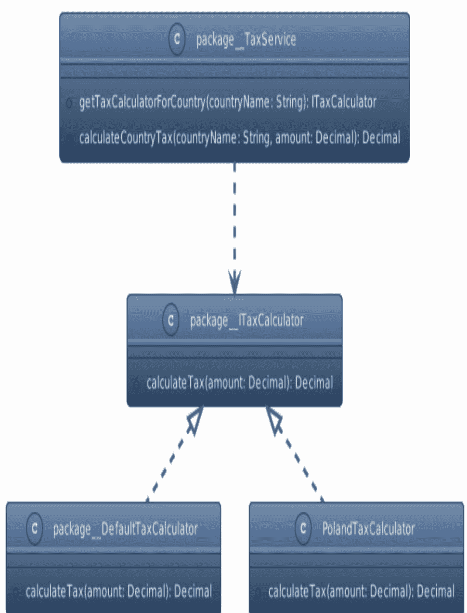
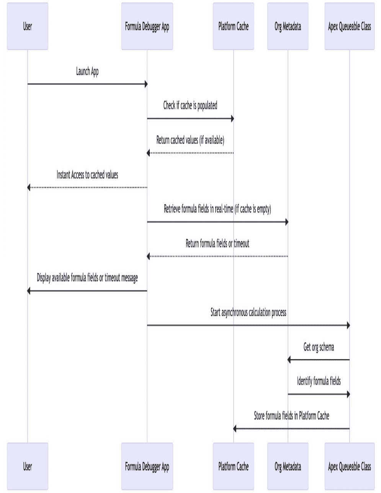

## Exploring Salesforce Platform Technologies


再次问候， fellow trailblazers！我们穿越 Salesforce 生态系统的激动人心之旅继续进行，因为我们将踏上探险，去发掘塑造 AppExchange 格局的鲜为人知却极其宝贵的 ISV 专属功能。别担心，本章并不是关于学习如何成为一名开发者——这不是本书的目标。相反，我想强调 Salesforce 开发者和架构师经常忽视的独特功能和技术。

当我们遍历本章时，我们将阐明特定技术的工作原理以及它们能够解决何种问题。即使你不是开发者，也不要回避这场冒险——只要确保你的 Salesforce 架构师和主导开发者也加入阅读本章。

在这段旅程中，我们将深入探讨以下主题：

- 揭开托管包这一神秘世界的面纱，以及它们在保护和分发你的应用方面发挥的关键作用。
- Dynamic Apex，是使可定制的 Salesforce 应用能够满足独特业务需求的强大支柱。
- Flow 的艺术，在其中流程的简化以及应用内 **用户体验 (UXs)** 的提升得以实现。
- **自定义属性编辑器 (CPEs)** 的领域，为 **用户界面 (UIs)** 提供了无限的灵活性和定制性。
- 攀登 Platform Cache 的高峰，在那里在托管包中优化性能成为一项掌握的技能。
- 使用 **Salesforce Lightning Design System (SLDS)** 打造 UI 和 UX，以为你的应用创建引人入胜且直观的界面。即使你不是设计师，也不要退缩于这场冒险——只要确保你的 UI/UX 专家也随行参加本章的远征。

通过本章获得的见解，你的团队将精通 Salesforce 和 AppExchange 开发的独特方面。利用这份新获得的知识，创建在 AppExchange 市场中脱颖而出的创新、稳健且安全的应用程序。那么，召集你的 fellow explorers，让我们继续穿越 Salesforce 生态系统的非凡冒险，掌握 AppExchange 成功所需的核心技术！

## Unraveling the mystery of packages
想象托管包就像装有珍贵宝石——你的 **知识产权 (IP)** ——的锁住的宝箱。这些宝箱允许你安全地将有价值的创作交付给客户，同时保护其中的宝藏免受窥探。在本节中，我们将探讨包的概念，突出它们在 AppExchange 市场上交付和保护你的应用方面的作用。我还将指导你从 **第一代 (1GP)** 到 **第二代 (2GP)** 托管包的演变，并探讨使用 **Developer Hub** (**Dev Hub**) 管理 2GP 包的好处。

## Managed packages – safeguarding your IP


托管包充当保护层，确保在将 Salesforce 应用交付给客户时你的 IP 保持安全无虞。它们帮助你做到以下几点：

- **隐藏你的 Apex 代码：** 就像隐藏宝箱的钥匙一样，托管包隐藏了你的 Apex 类和触发器的源代码，确保订阅者无法查看或修改它
- **保护自定义设置和自定义元数据：** 托管包为自定义设置和自定义元数据提供额外的安全层，保护应用程序数据的保密性和完整性
- **控制组件可见性**：就像可定制的锁一样，托管包允许你定义组件（如对象、字段和 Visualforce 页面）的可见性和可访问性，防止订阅者进行不必要的修改

## 1GP managed packages
1GP 托管包是 Salesforce 打包技术的先驱。虽然它们为应用的安全交付奠定了基础，但它们缺乏现代开发实践所需的灵活性和效率。因此，新项目应使用并拥抱 2GP 托管包改进的功能。

## 2GP managed packages
2GP 托管包代表了 Salesforce 打包的下一代，提供了一种更敏捷、更精简的方法来开发和分发 Salesforce 应用。它们能够为客户提供无缝的更新和升级，同时保留保护你的 IP 的核心功能。

## Namespace – the unique identifier of your treasure chest
把命名空间想象成宝箱外部的精美雕刻，使其在无数其他宝箱中易于区分且独一无二。在 Salesforce 托管包的世界里，命名空间充当唯一标识符，确保你的应用组件不会与客户 Salesforce 组织中的其他组件发生冲突。

在托管包的整体架构中，命名空间发挥着至关重要的作用。它们充当你应用的结构、组织和保护的蓝图。让我们看看它们是如何实现的：

- **组件隔离：** 命名空间通过为每个组件的名称添加唯一前缀，为你的组件（如对象、Apex 类和 Visualforce 页面）提供额外的隔离层。这可防止命名冲突，并确保你的应用组件与客户组织中其他托管包或自定义组件和谐共存。
- **代码保护：** 命名空间通过使他人在未明确允许的情况下直接在代码中引用你的组件变得更加困难，从而有助于保护你的 IP。这种额外的保障有助于维护你的应用程序及其组件的完整性。
- **品牌和识别：** 命名空间，就像宝箱上的精美雕刻一样，也可作为品牌元素，为你的应用在庞大的 Salesforce 生态系统中提供独特的身份。通过选择有意义且独特的命名空间，你可以使你的应用脱颖而出，并让客户易于识别。


## 包扩展 – 为多个产品和版本定制应用程序

包扩展为 AppExchange 合作伙伴提供了一种灵活的方法，用于构建面向使用不同 Salesforce 产品（如 Health Cloud 和 Financial Services Cloud）以及不同 Salesforce 版本（如 Professional）的客户的应用程序。通过使用基础托管包和扩展包，您可以创建一个模块化应用程序，满足多样化的客户需求，而无需维护多个代码库。

将您的应用程序视为一个多面拼图，其中基础托管包构成中心拼块，形成适用于所有客户的核心功能。另一方面，扩展包就像专门的拼图块，可以通过附加功能和功能增强基础包，并针对特定的 Salesforce 产品或版本进行定制。

在 2GP 的上下文中，您可以创建一个包含核心功能的 2GP 基础包，然后开发一个或多个依赖于基础包的扩展 2GP 包。根据组织结构和需求，这些扩展包可以包含分层功能，从数据模型和逻辑到 UI。这些包还可能包含特定于某些 Salesforce 产品或版本的功能，使合作伙伴能够有效地探索和扩展其产品。这种模块化方法使您能够维护单一代码库，同时为不同客户提供定制解决方案。

在设计应用程序和包之间的接口时，请考虑整个应用程序生命周期。必须确保对基础包的更新不会破坏扩展包。在添加新功能时，将其包含在适当的包中，并在扩展包引用的情况下使必要的组件成为 `@namespaceAccessible` 组件。

利用 2GP 中的包扩展，您可以创建可扩展且模块化的应用程序，以满足多样化客户的需求，同时简化升级过程。随着客户需求的增长，您可以通过引入适当的扩展包来增强其应用程序体验，从而轻松地向他们进行 upsell。

## 包扩展与功能参数

在 Salesforce AppExchange 市场上开发时，您可能会经常面临两难选择：应该构建扩展包还是使用 **功能管理应用 (FMA)**，所述于 *第 2 章*？这两种方法各有其优势和用途。以下是实用的比较：

| Criteria | Package extensions | Feature parameters |
|---|---|---|
| Scope | These are designed to extend the functionality of a base package. They have a dependency on the base package and can’t be installed independently. | This is more about controlling the visibility and access to specific features within a package. It doesn’t add new functionality but rather manages existing ones. |
| Flexibility | This approach provides a great deal of flexibility because it enables you to add new objects, fields, logic, and dependencies on Salesforce features that are not required by your base package. It’s like building a new app but with a dependency on the base package. | Limited to toggling features on or off. New components must be added to the base package. |
| Use case | Ideal for scenarios where you have different versions of your app for different industries or when you have add-on modules that not every customer might need. | This approach is ideal for beta testing features or for gradually introducing new features to your customers. It also allows for control over usage allowance allocations and the disabling of features in a freemium or tiered-access model. |
|  | Requires more development and testing effort as you’re essentially building a new (albeit smaller) app. | Easier to implement as you’re just controlling access to existing features. |
| Complexity |  |  |
| Technical debt | Can reduce technical debt due to better **separation of concerns** (**SoC**). | Can increase technical debt due to added complexity in the core code base. |

功能参数特别适合于渐进式功能部署，通过 A/B 测试获得洞察，允许最终用户动态自定义产品功能，并在增强与核心产品紧密相关时确保高效维护。重要的是，它们不会引入维护和发布单独包的开销，使其成为在核心包内管理功能的简化解决方案。然而，这种方法虽然在功能演进方面提供了灵活性，但会增加核心代码库的复杂性。

相反，包扩展旨在通过创建单独的包来增强现有产品的功能。当需要模块化功能、管理可能干扰核心产品的复杂性，或新功能需要不同的版本和发布节奏时，它们是首选。包扩展虽然促进了更好的 SoC 并由于其模块化特性而减少了技术债务，但也带来了一些挑战。它们需要创建、维护和发布单独的包，这可能会带来额外的开销。其隔间化设计确保了更干净的代码库，但需要更严格的管理。

在做出决定时，您应权衡产品的性质、其战略目标和技术挑战。虽然包扩展适用于模块化和复杂的增强，但功能参数具有适应性和多功能性。最终决定应与您的独特轨迹和目标产生共鸣。

## Dev Hub

Dev Hub 是 Salesforce 开发人员和 AppExchange 合作伙伴的重要工具，提供集中环境来管理、开发和部署 Salesforce 应用程序，特别是 2GP 托管包。在本节中，我们将讨论 Dev Hub 与 2GP 托管包之间的关系，强调您需要了解的关键信息。

2GP 打包模型中的托管包由 Dev Hub 拥有，但打包的元数据并不存储在其中。要使用 2GP 包，建议在您的 **合作伙伴业务组织 (PBO)** 中启用 Dev Hub。在 2GP 打包模型中，单个 Dev Hub 实例可以拥有一个或多个包，从而简化多个应用程序的管理流程。

建议在单独的 Developer Edition 组织中注册命名空间，然后将其链接到您的 Dev Hub 实例。此过程允许您使用命名空间并将多个命名空间与单个 Dev Hub 实例关联，从而增强组织和灵活性。要实现此目的，您需要执行以下操作：

- 1. 如果您还没有带有已注册命名空间的组织，请创建一个单独的 Developer Edition 组织。
- 2. 在 Developer Edition 组织中注册命名空间。选择命名空间时要谨慎，因为一旦与组织关联，就无法更改或重用。
- 3. 以系统管理员或具有 Salesforce DX 命名空间注册权限的用户身份登录到您的 Dev Hub 组织。
- 4. 在 Dev Hub 组织的 **App Launcher** 菜单中，选择 **Namespace Registries**。
- 5. 单击 **Link Namespace** 并使用系统管理员凭据登录到 Developer Edition 组织。

请注意，在您可以链接命名空间之前，有必要在 Dev Hub 组织中定义并部署 **My Domain** 名称（如果尚未完成）。

## 托管包的本地化最佳实践

在动态的 Salesforce ISV 开发世界中，一切都应实现本地化。这包括从屏幕流文本、自定义选项卡、对象和字段到可能向用户展示的异常消息的所有内容。

## 管理冗余和依赖关系

您可能会在标签中遇到冗余，尤其是在应用程序较大时。然而，不必对此过于担心。同一短语在不同语言中可能有不同的含义，而在一种语言中似乎冗余的内容在另一种语言中可能并非如此。因此，将每个标签视为唯一并为其提供适当的上下文是有益的。

## 模块化标签和版本控制

标签理想情况下应保存在每个包的单个 `CustomLabels` XML 文件中，按 API 名称按字母顺序维护。您应手动将新标签合并到包元数据中，具体在 `CustomLabels.labels-meta.xml` 文件中。这需要使用 **集成开发环境 (IDE)**，而不是依赖 Salesforce UI。

在每个标签 API 名称上使用前缀来定义其所属的模块，并使用类别对标签进行分组，可以进一步帮助组织。

## 翻译工具

翻译过程可以外包给专业的翻译服务。将标签导出为 XLF 格式可以简化他们的流程，他们将维护已翻译内容的目录，使每次识别新条目或修改条目变得更容易。

## 允许订阅者调整您的翻译

在命名空间包中，最终客户可以覆盖自定义对象的元数据翻译。例如，他们可以使用 Translation Workbench 覆盖自定义字段或工作流任务上的标签。如果他们这样做，对应用程序的更新将不会覆盖本地翻译。虽然您

can’t restrict subscribers from providing translations, this feature allows them to tailor your app to their specific context and needs.

## Apex – 可定制 Salesforce 应用的支柱

Apex 是一种功能强大、强类型的编程语言，用于在 Salesforce 平台上开发自定义业务逻辑。它旨在执行服务器端操作，使开发人员能够创建动态且多功能的 Salesforce 应用，以满足特定的业务需求。

AppExchange 合作伙伴面临的挑战之一是创建能够满足客户独特需求的应用。作为受管包，Salesforce 应用的核心在安装后无法由订阅者修改。然而，最终客户可能有不同的需求，从而需要定制和可扩展性。Forbes 报道称，71% 的客户对应用缺乏定制选项感到沮丧。

为解决这一复杂性，Salesforce 平台即使在受管包中也提供了大量的定制机会。最终客户可以通过 Salesforce 平台广泛调整合作伙伴应用以符合其业务需求。他们可以利用自定义字段、流程、Apex 和其他工具来个性化应用。此外，Dynamic Apex 使开发人员能够创建具有固定核心但提供额外定制空间的应用，从而提升最终用户的体验并满足其特定需求。

## Dynamic Apex – AppExchange 应用中适应性的力量

Dynamic Apex 是 Apex 编程的一个关键方面，为 Salesforce 开发人员提供了一套工具，用于构建高度可定制和可适应的应用。它包括 **动态 Salesforce 对象查询语言** (**动态 SOQL**)、**动态 Salesforce 对象搜索语言** (**动态 SOSL**)，以及 **动态数据操作语言** (**动态 DML**)，所有这些都是解决 AppExchange 开发中独特业务需求和复杂性的关键。

### What is Dynamic Apex?

Apex 是 Salesforce 的专有强类型编程语言，主要用于构建自定义业务逻辑。传统的 Apex 提供了用于开发应用的强大功能集，但通常不支持基于动态条件的运行时更改。Dynamic Apex 正填补了这一空白。

从本质上讲，Dynamic Apex¹ 允许开发人员构建能够在运行时引用 SOQL、SOSL 和 DML 字符串的应用，从而实现可适应的查询、搜索和数据操作的创建。

1 https://developer.salesforce.com/docs/atlas.en-us.apexcode.meta/apexcode/apex_dynamic.htm

The components of Dynamic Apex are set out here:

- **动态 SOQL**：动态 SOQL 允许您使用 Apex 代码在运行时构建 SOQL 字符串。这允许根据特定的运行时条件或参数创建复杂、灵活的查询，从而使应用能够以多变和适应性强的方式与数据交互。
- **动态 SOSL：** 与动态 SOQL 类似，动态 SOSL 允许您使用 Apex 代码在运行时创建 SOSL 搜索字符串。此功能有助于根据用户输入或其他动态参数创建搜索策略，从而实现更定制化、更强大的搜索功能。
- **动态 DML：** 动态 DML 操作允许开发人员动态构建和执行数据操作任务。这可以包括 insert、update、delete 和 upsert 操作。因此，动态 DML 支持 Salesforce 应用中的高度自适应数据处理。

### The importance of Dynamic Apex in AppExchange development

为 Salesforce AppExchange 市场开发应用通常需要高度的定制以满足不同的客户需求。在此，Dynamic Apex 的固有灵活性和适应性具有极大价值。

Dynamic Apex 可帮助您构建应用，使其根据客户组织的具体配置支持各种 Salesforce 功能。例如，一些组织可能启用了 Person Accounts，而其他组织可能未启用。基于 Dynamic Apex 构建的应用可以动态检查 Person Accounts 的存在情况并相应调整其功能。

这种灵活性不仅限于标准的 Salesforce 功能。Dynamic Apex 为应用与订阅者的本地自定义对象和字段无缝集成打开了大门。这意味着，与其受预定义配置限制，您的产品现在可以构建为与组织在受管包之上构建的独特定制和谐协作。

同样，像 Advanced Currency Management 这样的功能，可能在某些组织中启用而在其他组织中未启用，可以使用 Dynamic Apex 动态支持。应用可以检测组织中此类功能的状态并修改其操作以与可用功能保持一致。

### Dynamic SOQL example

LookupController 类是 Formula Debugger 受管包的一个组件，体现了 Dynamic SOQL 的多功能性。此控制器使用户能够使用动态查询从标准 Salesforce 对象和本地自定义对象中搜索和检索记录。您可以在此处看到其使用示例：

```
public with sharing class LookupController {
    public static List<sObject> search(String searchTerm, string searchObject) {
        String searchCondition = '%' +
String.escapeSingleQuotes(searchTerm) + '%';
        String searchQuery = 'SELECT Id, Name FROM ';
        searchQuery+=String.escapeSingleQuotes(searchObject);
        searchQuery+=' WHERE Name LIKE :searchCondition ';
        searchQuery+='WITH SECURITY_ENFORCED ORDER BY Name LIMIT 5';
        return Database.query(searchQuery);
    }
}
```

必须注意的是，虽然使用 Dynamic SOQL 增加了灵活性，但也引入了潜在的漏洞，尤其是 SOQL 注入。此攻击允许恶意行为者将其 SOQL 代码“注入”到查询中。为防止这种情况，LookupController 类使用 `String.escapeSingleQuotes` 方法确保用户输入得到清理，转义单引号并防止潜在的 SOQL 注入威胁。您将在 *第 6 章* 中了解更多关于此漏洞的信息。

## Dynamic Apex or extension package?

Salesforce ISV 开发人员经常面临将特定功能集成到并非所有客户组织中都启用的挑战。在这些情况下，一个重要的决策是是否在核心包中利用 Dynamic Apex，还是开发额外的扩展包。这两种方法各有其独特的优点和缺点，选择取决于各种因素，例如具体用例、可扩展性预期和应用复杂性。

### The need for this decision

让我们以同时支持 Person Accounts 和 Business Accounts 为例。Person Accounts 是主要用于 B2C 场景的特定 Salesforce 功能，而 Business Accounts 适用于 B2B 关系。并非所有 Salesforce 组织都启用 Person Accounts 功能。

如果您的解决方案需要同时满足这两种账户类型，一个关键挑战是避免在 Person Accounts 上创建包依赖，因为这会限制包的兼容性。因此，您必须开发一个无论 Person Accounts 功能是否启用都能有效运行的包。这就是在 Dynamic Apex 和创建扩展包之间做出决策变得至关重要的时刻。

Let’s look at the pros and cons of each option in a tabular format, as follows:

| Method | Advantages | Disadvantages |
|---|---|---|
| Extension packages | Clear segregation of business logic<br>Facilitates standard SOQL queries<br>Allows incremental updates specific to the added feature<br>A single security review can include one base | Additional security reviews are required if more than four extension packages are created<br>Extra security reviews may be required for extension packages developed after the initial review of the base package<br>Increased management effort due to separate packages |

|  | 包和最多四个扩展包 |  |
|---|---|---|
| Dynamic Apex | 支持核心包内的附加功能<br>单次安全审查<br>提供动态 SOQL、动态 SOSL 和动态 DML 的灵活性 | 无法创建动态声明式组件<br>随着功能增长而出现的可扩展性问题<br>由于动态 SOQL 查询缺乏预编译而可能导致性能影响<br>与 SOQL 注入和 SOSL 注入相关的风险，详见 *第 6 章* |

在特定需求和情况下仔细考虑后，应在动态 Apex 或扩展包之间做出选择。务必通过尝试在未启用附加功能（例如 Person Accounts）的组织中安装你的包来测试依赖关系。如果安装成功，你就成功避免了对特定功能的包依赖。这种决策过程是 Salesforce ISV 开发的一个不可或缺的部分，可显著影响解决方案的兼容性和适应性。

## 依赖注入模式 – 自定义的灵活方法

**依赖注入 (DI)** 模式是一种流行的软件设计模式，可促进 Apex 应用中的定制和可扩展性。此模式允许开发人员解耦应用程序的不同组件，使客户更容易修改应用的特定部分，而不会影响其核心功能。

例如，假设你有一个托管包应用程序，可与外部系统集成以获取数据。默认情况下，你的应用程序连接到一个公开可用的基于云的现成系统，但你的某个客户可能需要与其内部系统集成。使用 DI 模式，你可以创建一个接口来定义与外部系统交互的通用方法，然后为基于云的系统开发默认类，并让你的新客户为其内部系统开发新的本地类。两个类都实现相同的接口，这样客户就可以选择要集成的系统，而无需修改核心应用程序代码。

另一个例子是为客户计算税费的应用程序。不同客户可能有不同的税费规则和计算方法。通过实现 DI 模式，你可以创建税费计算接口，然后为每个客户的特定税费规则开发单独的类。这使客户能够使用其自定义税费逻辑，同时保持核心应用程序的完整性。

## 接口、虚拟基类和自定义元数据在 DI 中的作用

为了在 Salesforce 应用程序中有效实现 DI，使用了某些构造和功能，例如接口、虚拟基类和自定义元数据。这些元素各自具有独特的属性和功能，在将客户特定的定制注入托管包中发挥着重要作用。让我们在下表中阐明它们的作用：

| 功能 | 角色 |
|---|---|
| 接口 | 接口允许代码与一组定义好的方法进行交互，而这些方法的实际实现可以因客户而异。这使得托管包在开发期间可以依赖接口，但不会对客户的具体实现产生直接依赖。 |
| 虚拟基类 | 这些类允许开发人员定义一组可被客户覆盖以自定义应用程序行为的基础方法。通过使用虚拟基类，客户可以在不修改其源代码的情况下扩展托管包的核心功能。 |

## 自定义元数据

自定义元数据为 Salesforce 应用程序存储配置数据提供了一种便捷的方式。当与 Apex 反射结合使用时，自定义元数据可用于动态实例化接口或虚拟基类的客户特定实现，从而允许客户在不直接修改包源代码的情况下将其自定义逻辑注入托管包。

需要考虑的一个重要方面是订阅者可编辑和开发人员控制的自定义元数据之间的区别，如下所述：

- **可由订阅者编辑的自定义元数据**：这允许订阅者（即客户）在部署后修改元数据记录。当你希望授予客户根据其独特需求调整配置的灵活性而无需重新部署时，这尤其有用。
- **开发人员控制的自定义元数据**：相比之下，此类型严格由包开发人员控制。部署后，订阅者无法修改这些记录。这对于应保持在所有订阅者组织中一致的配置而言是理想的。

## 实现税费计算 – 分步示例

让我们深入研究我们的税费计算场景。我们将看到如何使用 Apex DI 来支持用户定义的地方规则。

### 1. 接口

首先，我们将按如下方式定义一个用于税费计算的全局接口：

```
global interface ITaxCalculator {
    Decimal calculateTax(Decimal amount);
}
```

### 2. 默认类（托管包的一部分）

接下来，我们将创建一个实现接口的默认类。此类将是托管包的一部分：

```
public class DefaultTaxCalculator implements ITaxCalculator {
    public Decimal calculateTax(Decimal amount) {
        return amount * 0.05; // 5% default tax
    }
}
```

### 3. 自定义元数据

在你的托管包中，引入一个新的订阅者可编辑自定义元数据文件，名为 TaxCalculatorMapping__mdt。为了本示例的简单性，我们将使用默认字段，如下所示：

- MasterLabel 用于存储国家代码（例如 US）
- DeveloperName 用于捕获类名（例如 DefaultTaxCalculator）

在实际场景中，更合适的做法是创建针对这些特定需求量身定制的自定义字段。

### 4. DI 实际应用

现在，让我们看看如何使用 DI 为给定国家/地区获取适当的税费计算器：

```
global class TaxService {
    public static ITaxCalculator getTaxCalculatorForCountry(String countryName) {
        // Fetch the tax calculator class name from Custom Metadata
        String taxCalculatorClassName = [SELECT DeveloperName FROM TaxCalculatorMapping__mdt WHERE MasterLabel = :countryName LIMIT 1].DeveloperName;
        // Use dynamic Apex to instantiate the appropriate tax calculator
        ITaxCalculator taxCalculator = (ITaxCalculator) Type.forName(taxCalculatorClassName).newInstance();
        return taxCalculator;
    }
    global static Decimal calculateCountryTax(String countryName, Decimal amount) {
        ITaxCalculator taxCalculator = getTaxCalculatorForCountry(countryName);
        return taxCalculator.calculateTax(amount);
    }
}
```

### 5. 适应本地需求

假设你已成功将应用程序销售给在波兰的第一位客户。凭借应用程序提供的灵活性，客户现在可以开发自己的自定义税费类，以适应当地税费法规，如下所示：

```
public class PolandTaxCalculator implements ITaxCalculator {
    public Decimal calculateTax(Decimal amount) {
        // Custom tax logic for Poland
        return amount * 0.23; // 23% VAT for Poland
    }
}
```

此设置的灵活性在于，借助 DI，他们的自定义类可无缝集成到你的核心包中，而无需对原始代码进行任何更改。他们只需配置一个新的自定义元数据类型（将 **MasterLabel** 设置为 **PL**，将 **DeveloperName** 设置为 **PolandTaxCalculator**），你的 **TaxService** 类就会自动运行本地代码。下面的图表说明了该过程：



图 3.1：此 UML 图展示了 DI 的实际应用。TaxService、ITaxCalculator、

和 DefaultTaxCalculator 类是托管包的组成部分。另一方面，PolandTaxCalculator 是一个定制类，在客户组织内部本地创建。

你可能会想，“为什么不直接将波兰税规则纳入包中呢？”首先，波兰的税务法规相当复杂。跟上每个国家的税务计算逻辑是一项繁重的工作。如果你没有计划在某个特定地区扩张，这可能无法证明时间和资源的投入是合理的。

最重要的是，这只是一个示例场景。除了税务计算之外，请考虑每个应用用户可能拥有的独特业务流程。这关乎提供灵活性以满足那些不同的需求。

## 警告 – 全局意味着永久

在 Salesforce 托管包中实现 DI 时，有一个至关重要的方面需要注意：全局类的永久性。

为了使您的接口或虚拟基类能够在托管包外部访问，它们必须声明为 global。这确保了它们可以在订阅者组织中进行扩展或实现，从而实现所需的灵活性和定制性。然而，这种可访问性带来了重大影响，如下所述：

- **稳定性承诺：** 一旦您将类或接口指定为 global，这就是一项具有约束力的承诺。您之后无法将其访问级别更改为 public 或 private。这意味着任何全局组件都成为您包的公共 API 的一部分。
- **设计定稿：** 鉴于 global 的不可逆性，在发布之前完成设计至关重要。虽然您可以在未来版本中向全局类或接口添加内容，但不能删除或更改现有的方法或变量。任何更改都可能破坏依赖它们的实现。
- **删除不在选项中：** 一旦发布，全局类或接口将永久存在。它不能从托管包的后续版本中删除。

初看之下，这些似乎像是严格的限制。但请考虑更广阔的图景：想象一下订阅者基于您的全局接口构建了一个本地类的场景。如果您更改或删除该接口，它将直接影响并可能破坏订阅者的本地定制。global 的刚性本质上是一种保护措施，确保所有相关方的稳定性和可靠性。

鉴于这些考虑，请以极大的尊重对待 global 关键字。在规划 DI 时，请确保在将其标记为 global 之前，您的接口和类是健壮且经过深思熟虑的。这不仅仅关乎灵活性；这是对订阅者的一致性和可靠性的承诺。

## 确保对自定义实现的无缝支持

当允许客户纳入其自定义扩展时，提供默认实现和强大的支持以确保顺畅的体验至关重要。在客户遇到与性能、 governor 限制或其他实现问题相关的问题时，支持人员应能够帮助他们恢复到已知、可靠且受支持的默认实现。快速识别问题源自 ISV 还是客户，是保持客户满意度的关键。

通过利用接口、虚拟基类和自定义元数据，AppExchange 合作伙伴可以构建灵活且可定制的 Apex 应用程序，以满足客户的独特需求。提供强大的支持和可靠的默认实现可确保客户能够充分利用定制选项，而不会损害应用程序的整体性能和稳定性。

## 使用 ISV 客户调试器进行故障排除


哦，调试的乐趣！这从来不是轻松的散步，尤其是当路径带你进入由客户控制且具有其独特本地定制的 Salesforce 组织时。这就像在大海捞针，不同的是干草堆由代码组成，而针是一只拒绝露面的狡猾的 bug。

但别怕，亲爱的开发者！ISV 客户调试器来拯救这一天了，这是一款改变游戏规则的工具，赐予那些勇敢通过安全审查流程的优秀 AppExchange 合作伙伴。这款强大的调试器，一个值得信赖的副手，使您能够直接在客户的领地内诊断和调试托管包中的问题，同时保持安全并保护您珍贵的 IP。

你可能会问，“这神奇的 ISV 客户调试器是什么？”让我告诉你！这个调试器无非是 Apex 调试器的扩展，专门为你这位非凡的 AppExchange 合作伙伴量身定制。它使您能够在客户组织内调试 Apex 代码，而无需暴露托管包的源代码或损害安全。

## ISV 客户调试器的主要优势

对于通过安全审查的 AppExchange 合作伙伴，ISV 客户调试器提供以下几个优势：

- **实时调试：** 直接在客户组织中调试 Apex 代码，从而更快地识别和解决问题
- **上下文分析：** 深入了解客户特定的配置和数据如何影响您的托管包，帮助您解决客户特定的问题
- **安全性和 IP 保护：** 在不向客户透露托管包源代码或 IP 的情况下调试 Apex 代码
- **增强的客户支持：** 为客户提供更快、更有效的支持，提升他们对托管包的整体体验

## 保护客户的知识产权

尊重和保护客户的知识产权至关重要。请始终注意，调试日志可能不仅包含元数据，还包含客户的数据。完成调试后，请从设置过程中存储它的位置删除整个项目。切勿将客户的数据或元数据存储在您的 **version control system (VCS)** 中。

## ISV 客户调试器注意事项

使用 ISV 客户调试器时，请牢记以下额外注意事项：

- 您只能调试沙盒组织。
- 您一次只能调试一个客户，但购买 Apex Debugger 许可证后，您可以同时调试多个客户，还可以在沙盒和 scratch 组织中进行调试。
- 当您点击 **Return to subscriber overview** 时，调试会话将终止。在调试期间保持登录到客户的组织，仅在完成调试后返回您的 **License Management Org (LMO)**。

的确，这些注意事项构成了有效利用 ISV 客户调试器的基石。虽然此工具被证明非常有帮助，但其正确使用需要意识到并理解这些关键点。因此，在进行调试会话时，请始终牢记这些准则。

## 使用 Flow 增强您的应用程序

Salesforce Flow 为 ISV 提供了一种强大而灵活的方式来扩展其应用程序的功能并使客户能够定制业务流程。在本节中，我们将探讨 ISV 可以在其应用程序中支持流程的各种方式，并讨论最佳实践和限制。

## 使您的功能和功能支持 Flow

作为 ISV，您可以使应用程序的功能和功能在客户的自定义流程中可用。通过使您的 **Lightning Web Components (LWC)** 和 Apex 方法支持 Flow，您可以将它们集成到客户的自定义流程中，使您的应用更具价值和粘性。

为此，请考虑客户可能希望在其自定义流程中包含哪些功能或功能。例如，提供信用检查功能的 AppExchange 解决方案既可用于交互式屏幕流程，也可用于无头记录触发流程。

## 提供流程模板和可覆盖流程

流程模板和可覆盖流程使您能够提供通用业务流程，客户可将其用作自定义流程逻辑的起点。通过将行业专业知识打包到流程模板中，您可以帮助客户启动自己的自定义流程。

流程模板和可覆盖流程之间的主要区别在于，流程模板要求客户更新对模板的所有引用

创建新流程时，可覆盖的流程会在创建“覆盖流程”时自动更新引用。

## 最佳实践提示

*在流程模板或可覆盖流程中包含对您打包的 LWC 或可调用 Apex 方法的引用，以指导客户如何使用您的功能和函数构建自己的流程。*

## 提供受 IP 保护的流程

受 IP 保护的流程既不可覆盖也不是模板，有助于防止客户查看或编辑流程、保护知识产权，或防止对应用程序行为进行更改。客户仍可停用这些流程，因此请考虑对必须始终运行的逻辑采用基于代码的方法。

## 控制流程的执行顺序 – 触发顺序功能的优势

您可以使用 **触发顺序** 功能为记录触发流程设置执行顺序，从而更好地控制自动化流程。此功能不适用于 Apex 触发器，这可能会导致问题，当您的包在某个对象上有一个触发器且客户也在该对象上编写触发器时，就会出现这种情况，因为触发器的运行顺序变得不确定。

## 在流程上设置触发顺序

**触发顺序** 选项允许您为特定对象优先执行记录触发流程。保存流程时，您可以设置 **触发顺序** 数字字段以确定执行顺序。您可以输入 1 到 2,000 之间的数字，这决定了具有相同对象的流程被触发的顺序。

例如，您可以优先让 Account 对象的 after-save 流程在其他 after-save 流程之前运行。但是，您无法将 after-save 流程优先于任何 before-save 流程或 Apex 触发器之前运行。

## 打包触发顺序功能

**触发顺序** 功能完全可打包，这意味着最佳做法是为客户在您的打包流程之间创建自己的流程并插入其中留出空间，如果他们愿意的话。这种灵活性使客户能够更好地控制其自动化流程。

## 使用流程触发器资源管理器进行自定义

**流程触发器资源管理器** 是一种独特的用于确定流程触发器运行顺序的功能。如果客户克隆您的模板或可覆盖流程，他们可以编辑克隆上的触发顺序，从而进一步根据其特定需求定制应用程序。

## 最佳实践和限制

打包流程时，请考虑以下几点：

- 每个流程在组织中最多只能有 50 个版本，这会影响客户和开发人员。对于客户，请将他们引导至有关从包中安装的流程版本删除的帮助页面。对于 ISV，请根据使用 1GP 或 2GP 打包流程来不同地管理版本。

2 https://help.salesforce.com/s/articleView?id=sf.flow_considerations_limit.htm&type=5

- 客户可以停用托管包中的流程。如果在下一个版本中包含了一个新的活动流程版本，它将在客户的组织中创建并执行，可能导致意外行为。如果您有不能被停用的逻辑，请考虑使用基于代码的方法。
- 如果客户有可能决定停用流程，最好不要将其设为 IP 受限。当这些流程在升级后自行重新打开时，可能会让客户感到困惑。此外，这还会使实施稳健的发布管理策略变得复杂，我们将在 *第 7 章* 中深入探讨。

通过提供流程模板和可覆盖流程，ISV 可以让客户进行自己的自定义并满足其特定的业务需求，从而增强 ISV 应用程序的价值。

## 融合 Flow 与 Apex


啊，永恒的问题：Apex 还是 Flow？这就像在选择一把可靠的锤子和一把多功能的瑞士军刀。在上一节中，我们进入了 Apex 的世界，见证了它通过 DI 模式、接口、虚拟基类和自定义元数据实现可定制 Salesforce 应用程序的原始力量。Apex 就像一把强大的锤子，为打造定制化应用程序提供了稳健的解决方案，但需要一定的编程专业知识才能有效发挥其力量。

现在，让我们谈谈 Flow，Salesforce 定制的瑞士军刀。Flow 为终端客户提供了一种更简单的方式来自定义业务流程，而无需掌握 Apex 代码的艺术。这就像从锤子切换到一个多功能的工具，拥有各种功能。

你知道那句老话：“如果你只有一把锤子，一切看起来都像钉子”吗？在 AppExchange 开发的世界里也是如此。如果你只知道 Apex 或只知道 Flow，你可能会做出次优的决策，例如用锤子切割木头或用刀钉钉子。要真正精通 Salesforce 定制的领域，必须同时拥有 Apex 和 Flow 在你的工具箱中，掌握每项技术并知道何时使用合适的工具。就像一位熟练的工匠一样，你将能够自信而精确地应对任何定制挑战。

所以，亲爱的读者，让我们踏上探索 Flow 与 Apex 和谐融合的旅程，其中一种工具的优势弥补了另一种工具的不足。一起，这些强大的工具将帮助你构建量身定制的应用程序交响曲，完美契合客户的独特需求。

## 作为更易自定义的 Apex 替代方案的 Flow

Flow 允许终端客户克隆并使用流程模板和可覆盖流程，使他们能够在不为 DI 编写 Apex 代码的情况下轻松修改业务逻辑。这为客户根据其独特需求定制应用程序提供了一种更易访问的方式。

## 优先使用流程和可调用操作而非 Apex 触发器

在自动化领域，流程相比 Apex 触发器具有显著优势，得益于其灵活性和适应性。虽然流程无法涵盖触发器处理的每个场景，但它们通过使客户能够排查、停用和自定义其应用程序中打包的自动化，从而赋予客户权力。这种灵活性对于标准对象的自动化尤其重要，因为客户的自动化项目设置超出其控制范围。

必须认识到，您的自动化代码可能在一个组织中无缝运行，但与其他触发器、流程和验证规则结合时，可能在不同组织中导致错误。托管触发器的挑战在于其代码隐藏且不可编辑，使其难以调试且无法停用。此外，触发器代码会为实施需要自定义样板代码的触发器框架的组织带来额外的麻烦。

随着每次 Salesforce 版本的发布，Flow 变得更加强大，可调用操作为复杂操作提供了访问 Apex 的途径。谈到打包自动化时，我的初始建议是倾向于使用流程和可调用操作作为首选选择。然而，必须牢记指定部分中详细说明的限制，特别是关于停用和升级行为。这些考虑因素将有助于确定使用此默认建议是否存在任何障碍。

在最佳情况下，流程和可调用操作为客户的管理员提供了一个多功能工具包，也是解决方案架构师根据其特定需求定制您的应用的宝贵资源。通过优先使用流程和可调用操作而非触发器，您将增强 AppExchange 应用程序的适应性和易用性，进一步满足客户的独特需求。

## 自定义属性编辑器 (CPEs)

某些操作和组件可能相当复杂，需要管理员参考文档进行正确配置。CPE 提供了解决方案，用于为管理员处理自定义 Flow 屏幕组件和 Apex 操作创建量身定制的 UI。要充分了解 CPE 的好处，我们必须首先检查它们是什么以及它们如何工作。

CPE 是 LWC，可与自定义 Apex 操作或 Flow 屏幕组件集成。这些编辑器可以根据要求和设计愿景复杂到所需的程度。

ISV 可以利用 CPE 为复杂的屏幕组件和 Apex 操作创建动态、紧凑、响应迅速、用户友好且视觉上吸引人的 UI。可以使用 CPE 强制执行自定义验证，这对于实现基于输入的条件验证特别有用。这减少了因设置不完整和数据不足而导致的错误，从而减少了 Flow 元数据错误。在 CPE 的帮助下，终端用户主要是管理员，配置组件或操作变得更容易。


CPE 可以被设计为创建自文档化 UI，消除了用户查阅单独参考文档的需求。

## 构建 CPE

构建 CPE 的过程包含三个主要步骤：创建 Apex 操作、创建 CPE 本身，以及将 Apex 操作连接到属性编辑器。以下是每个步骤的简要概述：

- 1. **创建 Apex 操作：** 使用 Apex 代码定义自定义操作的逻辑，包括输入和输出变量。
- 2. **创建 CPE：** 开发一个 LWC 作为配置 Apex 操作的自定义 UI。这涉及为 UI 结构创建 HTML 文件、为处理用户交互创建 JavaScript 控制器，以及为元数据配置创建 XML 文件。
- 3. **将 Apex 操作连接到属性编辑器：** 使用指定 CPE 的 LWC 的 `@InvocableMethod` 注解更新 Apex 操作。此连接允许自定义 UI 覆盖 Apex 操作的默认编辑器、UI 和输入参数。

## 利用 Platform Cache 提升托管包的性能


想象一下你回到老式个人电脑的时代，坐在笨重的机器前，拼命寻找那个难以捉摸的涡轮按钮。你知道的——那个承诺只需一次点击就能神奇地提升电脑速度和性能的按钮。但这里有一件事会让你微笑：就 Salesforce 中的 Platform Cache 而言，你不需要寻找按钮或寄希望于某种古老的电脑巫术。哦不，我亲爱的读者——它比那简单得多。你只需将 Platform Cache 添加到你的托管包中，瞧！你的应用程序就被注入了性能提升的涡轮增压。无需点击按钮。

Platform Cache 是 Salesforce 提供的一项强大功能，允许开发人员快速高效地存储和访问数据。它提供了一种优化 Salesforce 应用程序性能的方法，通过减少数据检索操作所花费的时间。作为 AppExchange 合作伙伴，在你的托管包通过 Salesforce 安全审查后，你可以将 3 MB 的免费 Platform Cache 包含在其中。在本节中，我们将讨论如何在托管包中启用和利用此免费缓存分配，并通过一个具体用例来说明。

## Platform Cache – 概述

Platform Cache 是 Salesforce 平台内的一个内存层，存储频繁使用的数据，使开发人员能够比查询数据库更快地访问它。它运行在两个层级：Org Cache 和 Session Cache。Org Cache 存储组织内所有用户共享的数据，而 Session Cache 存储特定于单个用户会话的数据。通过在这些层级缓存数据，开发人员可以显著减少访问常用信息所需的时间和资源。

值得注意的是，Platform Cache 可在从 Enterprise Edition 及以上版本的 Salesforce 版本中使用。将 Platform Cache 整合到包中会引入版本依赖性，导致使用 Professional Edition 的组织无法使用该包。

## 在托管包中启用免费 Platform Cache

要在托管包中利用 Platform Cache，请在包中定义命名空间的缓存分区，并在代码中引用它们。将免费缓存分配给所需的分区并上传应用程序的新版本。对于在 Spring ’21 发布之前已通过安全审查的现有包，当在托管包中设置分配时，缓存将在安装时自动配置。

## 使用 Platform Cache 提升托管包性能

Platform Cache 对于严重依赖数据检索操作的托管包尤其有益，因为它可以帮助减少延迟并改善整体性能。例如，考虑一个频繁访问配置数据或经常使用的元数据的托管包。通过将此数据存储在 Platform Cache 中，托管包可以比每次需要数据时查询数据库更快地访问它。这可以带来更快的响应时间、改进的应用程序性能以及更好的客户 UX。

## 案例研究 – 使用 Platform Cache 提升 Formula Debugger 的性能

如果你仍对如何使用 Platform Cache 感到困惑，不必担心！我们即将通过深入探讨 Platform Cache 在 Formula Debugger 中的应用来阐明这个问题，该应用我们在 *第 1 章* 中曾介绍过。这是为了解决在大型 Salesforce 组织中审查元数据架构时出现的性能问题。

Formula Debugger 应用旨在帮助用户识别和解决 Salesforce 组织中公式字段的问题。该工具面临的主要挑战之一是高效地找到组织内的所有公式字段，这需要分析大量的元数据。在非常大的 Salesforce 组织中，此操作可能耗时且可能对 UX 产生负面影响。

为克服这一挑战，Formula Debugger 应用利用 Platform Cache 来增强性能并提供无缝的 UX。以下是其工作原理：

- **即时访问：** 如果在应用启动期间平台缓存已填充，存储的值会立即提供给用户。这使得应用可以即时使用，消除了通常与繁重计算相关的等待时间。
- **缓存为空时的实时检索：** 如果平台缓存未填充，Formula Debugger 会尝试实时检索所有公式字段。然而，随着元数据的增多，可能会发生超时。如果发生这种情况，Formula Debugger 仅会显示初始可用的公式字段。用户将看到一条消息，内容为：**由于您组织元数据的庞大，仅初始公式字段可立即用于调试。我们正在后台处理元数据。请稍等片刻并刷新页面，如果您需要调试当前未列出的字段。**
- **异步缓存更新：** 每次启动应用时，都会在后台启动一个异步计算过程（以 Apex `Queueable` 类实现）。此过程可确保缓存值使用最新数据进行更新。
- **在平台缓存中存储公式字段：** 在异步过程识别出公式字段后，它们会被存储在平台缓存中。此方法可确保更快访问，因为后续对公式字段的请求直接从缓存获取，消除了持续元数据分析的需求。这有助于避免在元数据量大的情况下达到 Apex 超时限制。
- **无缝 UX：** 由于公式字段已随时可用在 Platform Cache 中，Formula Debugger 应用的用户可以在使用该工具时享受流畅、无中断的体验。缓存数据使应用程序即使在具有大量元数据的大型 Salesforce 组织中也能最佳运行。

下图说明了该过程：



图 3.2：流程图展示 Formula Debugger 如何使用 Platform Cache 提升性能

需要注意的是，缓存每次启动应用时都会重新计算。这意味着如果用户添加了新的公式字段并希望立即在应用中看到它，他们可能需要等待缓存完成重新计算。在 Formula Debugger 的上下文中，这不是一个重要问题。如果你刚刚创建了一个公式字段，很可能你还没有问题，因此立即调试可能不是必要的。然而，这种关于缓存刷新方面的权衡可能会影响你的设计决策。

总之，Platform Cache 是 ISV 优化其托管包性能的宝贵资源。通过利用此功能，该功能对通过 Salesforce 安全审查的应用免费提供，你可以显著减少数据检索时间并增强整体 UX。

## 使用 SLDS 打造 UI 和 UX

从上一章开始，你现在知道你的应用应该做什么。随着我们开始将这一愿景变为现实，请记住这不仅仅是功能问题。视觉上吸引人且流畅的 UX 同样重要。

记住——精心设计的 UI 和卓越的 UX 是成功应用的心跳。它们不仅满足用户的需求和痛点；我们准备将我们的应用构建为不仅仅是一个工具，而是用户实现目标道路上的伴侣。


本节的重点在于打造一套 UI 和 UX，能够将我们的用户需求与 SLDS 精致、一致的美学无缝结合。这一全面的设计框架将使我们的应用程序与 Salesforce 生态系统熟悉、用户友好的外观和感觉产生共鸣，确保用户在浏览您的应用程序时感到宾至如归。

## 了解 Salesforce Lightning 设计系统 (SLDS)

SLDS 是一个全面的设计框架，为在 Salesforce 应用程序中创建一致且引人入胜的 UI 提供了丰富的指南、组件和资源。由 Salesforce 开发，SLDS 允许开发人员和设计师使用一套遵循 UX 和可访问性最佳实践的预建 UI 组件和模式来构建自定义应用程序。通过利用 SLDS，您可以确保您的应用程序与 Salesforce 平台保持一致的外观和感觉，使用户能够更直观地导航和与您的应用程序交互。

## SLDS 的关键组件和功能

SLDS 包含多个关键组件和功能，可促进顺畅高效的开发流程，同时确保高质量的 UX，具体如下：

- **设计指南：** SLDS 提供了详细的 UI 设计指南，涵盖颜色、排版、布局和图标等各个方面。这些指南有助于在整个应用程序中保持一致性，并与整体 Salesforce 生态系统保持一致。
- **预建组件：** SLDS 提供了一个全面的预建、可重用 UI 组件库，遵循 UX 和可访问性的最佳实践。这些组件可以轻松定制并集成到您的应用程序中，在开发过程中为您节省时间和精力。
- **设计令牌：** 设计令牌是存储设计相关值的变量，例如颜色、字体和间距。它们使您能够更高效、一致地管理应用程序的设计，使您能够轻松地在多个平台和设备上更新设计。
- **可访问性：** SLDS 在设计时充分考虑了可访问性，确保您的应用程序可供残疾人士使用。通过遵循 SLDS 指南并使用预建组件，您可以创建符合可访问性标准和最佳实践的包容性应用程序。

## 利用设计原则实现一致性和效率

SLDS 建立在一套核心设计原则之上，促进所有应用程序的一致性、效率和可用性，具体如下：

- **清晰性：** SLDS 通过使用简洁的布局、简洁的语言和适当的视觉提示来强调简单性和清晰的沟通
- **效率：** 该系统旨在帮助用户通过最小化点击次数、优化工作流程并在上下文中提供相关信息来快速高效地完成任务
- **一致性：** SLDS 通过提供统一的设计指南和组件集，确保应用程序之间的一致外观和感觉，使用户能够轻松理解和与 Salesforce 平台上的不同应用程序交互
- **灵活性：** SLDS 旨在灵活且可适应，允许您自定义和扩展设计以满足特定的应用程序要求，同时保持与 Salesforce 生态系统的一致性

通过采用这些设计原则，您可以创建不仅满足客户需求的 UI，而且还能提供与 Salesforce 平台一致的卓越 UX。

## LWC 标准组件库

在深入 SLDS 时，了解 LWC 标准组件库³ 也至关重要。该库是一套全面的预建组件，可轻松集成到任何 LWC 开发中。

3 https://developer.salesforce.com/docs/component-library/overview/components

为什么优先考虑 LWC 标准组件而不是 SLDS 标签？让我们看看这样做的原因：

- **一致性和最佳实践：** 使用标准组件可确保您遵循 Salesforce 对 UI 和 UX 的最佳实践。这些组件以最终用户为出发点设计，确保所有 Salesforce 应用程序的一致体验。
- **快速开发：** 借助预建组件，开发人员可以加快开发流程。当合适的组件已经可用时，就无需从头开始构建。
- **维护和更新：** Salesforce 不断更新和维护 LWC 标准组件库。通过使用这些组件，您可以确保您的应用程序始终保持最新功能和最佳实践。
- **兼容性：** 标准组件旨在与其他 Salesforce 服务和工具无缝协作。这可确保在您扩展或集成其他服务时，您的应用程序保持兼容。

虽然 LWC 标准组件库应成为大多数开发任务的首选，但在以下情况下 SLDS 标签可能更合适：

- **自定义：** 如果您需要标准库中不可用的组件或需要大量自定义，SLDS 标签可以提供更大的灵活性
- **高级功能：** 对于超出标准组件功能的功能或设计，SLDS 提供了打造独特 UX 的工具

总之，虽然 SLDS 提供了构建独特 UI 的强大工具集，但 LWC 标准组件库应成为大多数前端开发任务的首选。这种方法可确保应用程序一致、可维护且用户友好。

## 构建卓越的应用程序

创建出色的 UX 并不是一个人的工作，也不会在部署后结束——它是一个协作的、持续的过程，从构思到实施及以后都体现了用户的声音。UI 和 UX 设计师以及研究人员确保这种声音在产品开发的各个阶段都能得到体现，将用户需求与业务目标和技术要求相协调。

捷豹路虎首席执行官 Ralf Speth 博士曾名言，“如果你认为好的设计很昂贵，你应该看看糟糕设计的成本。” 这种智慧与我们的旅程高度共鸣。忽视 UX 可能会产生巨大的成本，从增加客户支持到额外的开发工作（和返工），甚至可能导致产品失败。这就像在没有检查泄漏的情况下下水——风险很大，很可能灾难性。

## 摘要


亲爱的读者，随着我们穿越 Salesforce 生态系统的精彩旅程继续，我必须强调本章是掌握关键 Salesforce 技术的关键。我们刚刚结束了对塑造 AppExchange 格局的鲜为人知却极其宝贵的 ISV 专属功能的激动人心的探索。我们揭示了托管包、Apex、Flow、Platform Cache、CPEs 以及打造 UI 和 UX 的深层奥秘。我邀请您在积累经验的过程中定期重温本章，确保这些见解保持新鲜和相关。您不必记住所有技术的实现细节，但能够解释它们的功能以及最适合的场景，将使您在规划即将到来的开发工作时能够做出明智的技术选择。

您现在手握解锁这些强大技术全部潜力的钥匙，这些技术在传统的 Salesforce 开发中常被忽视，却对 ISV 至关重要。您在这段旅程中积累的智慧对于熟练实施您的托管包至关重要。您对这些不同方面的掌握将使您能够打造创新、量身定制且高效的应用程序，精美地满足客户需求的多样性。将您新获得的技能作为垫脚石，助您迈向我们冒险的下一个激动人心的篇章。

在下一章中，我们将深入探讨与外部系统的无缝集成。我们将探索各种技术架构和一系列集成模式。我们将穿越 Salesforce APIs、Salesforce Connect、Canvas SDK 和 Connected Apps。想象一下成为集成巫师，创建满足客户需求并提供顶级 UX 的应用程序。

所以，准备好吧，读者。我们 Salesforce 之旅的下一章甚至更加令人兴奋，因为我们将进一步深入 Salesforce 宇宙，磨练我们的技能以实现 AppExchange 成功！


## 进一步阅读

如果您渴望深入了解托管包的技术细节，我建议您查阅由 Andrew Fawcett 所著的书籍 *Salesforce 平台企业架构*。该资源有助于培养对 Salesforce 平台所提供功能更深刻的理解，并发掘有效利用这些功能进行应用程序开发的方法。
