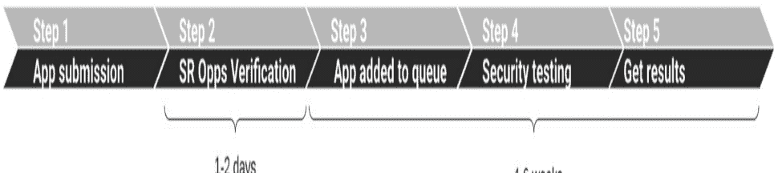
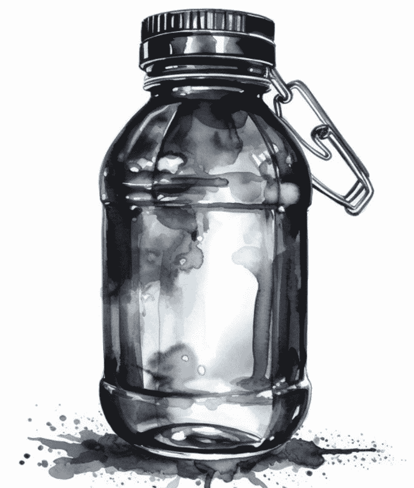
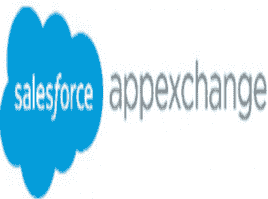

## Security Review


问候，数字领域的勇敢冒险者们！当我们穿越不断发展的 Salesforce 格局时，我们面临一个关键挑战——被称为“安全审查”的凶猛巨龙。啊，这是一只可怕的野兽，但不必害怕！我们高尚的使命，凭借正确的知识和工具，是驯服这条巨龙，赢得它的信任，并最终确保我们珍贵宝藏——客户数据的安全。

为以下领域的旅程做好准备：

- 安全审查流程的重要性及其在维护 Salesforce 应用高安全标准中的作用
- 确保符合 Salesforce 安全要求并避免常见陷阱
- 扫描外部系统和端点的工具和技术
- 准备误报文档以实现更顺畅的安全审查流程
- 作为 AppExchange 合作伙伴，拥抱持续安全改进的旅程

在本章结束时，你将成为安全审查流程的熟练导航者，能够与你的 Salesforce 用户建立信任，并确保你的应用程序在 AppExchange 的宏大王国中蓬勃发展。

紧紧系好靴子， fellow 探险者们！我们的旅程继续，动力来自 Salesforce 首席技术官 Parker Harris 的名言，“没有什么比我们公司客户数据的隐私更重要。”因此我们前进，迈向安全的 Salesforce 冒险的未来！

## Understanding the security review process


欢迎来到开发你的第一个 AppExchange 应用程序的激动人心的马拉松！你正系紧鞋带，站在起点线上，在这里创新的冲刺与安全的耐力携手并进。Salesforce，作为 **客户关系管理** (**CRM**) 平台马拉松中的世界级赛事组织者，将其声誉押在了一件事之上——信任。而在这场信任马拉松中的一个重要补给站？安全审查流程——每个应用程序必须通过的详尽审查，类似于我们马拉松的严格检查点，然后才能抵达 Salesforce AppExchange 市场的终点线。

将安全审查流程想象成你的个人马拉松教练，深入研究你应用程序的设计、架构和数据处理实践的细节。它的使命？发现那些狡猾的潜在安全抽筋，并确保你的应用程序足够健康，能够跑完 Salesforce 高安全标准马拉松。这是在起跑线上的彻底搜身，从应用程序的跑步装备（源代码）和能量胶（数据存储）到其补水策略（传输方法）无所不查。

作为这场 AppExchange 比赛中的坚定马拉松选手，了解安全审查流程及其比赛规则不是“锦上添花”——它是你的比赛日策略。它不仅仅是一座令人望而生畏的山丘，而是配速指南，帮助你避免那些残酷的撞墙时刻。它的工作？帮助你在训练周期早期发现潜在的安全侧刺，给你充足的时间调整步伐、补水或做任何必要的事情，以防止这些问题拖慢你的速度。这种对安全的战略性方法不仅是你安全成功比赛日（读作：应用程序）的门票，也是你在与用户建立信任的比赛中个人的最佳成绩。

将安全放在首位进行训练，就像勤奋地遵循一个精心规划的马拉松训练计划——它很艰难，需要奉献，但回报巨大！它让你远离那些讨厌的、耗时的伤害（读作：修订），并提高你在第一次尝试时轻松通过安全审查检查点的几率。此外，它向你的用户表明，他们的安全对你来说不是最后一刻的碳水化合物加载尝试，而是你训练计划中深思熟虑的一部分。谁知道呢，这可能是促使他们在比赛日为你的应用程序加油的秘密调味料！

## Fees and timeline

安全审查流程涉及以下几个关键步骤：

- 1. 你通过 Partner Community 提交应用程序进行安全审查。
- 2. 安全审查运营团队验证你的提交，该过程通常需要 1-2 天。
- 3. 你的提交随后被添加到产品安全队列中。
- 4. 产品安全团队对你的应用程序进行测试并验证结果。
- 5. 最后，安全审查运营团队通知你结果。

*步骤* 3-5 的时间线通常跨度为 4-6 周。然而，值得注意的是，大多数 ISV 在第一次尝试时无法通过安全审查。虽然一些应用程序可能在第一次或第二次尝试时获得批准，但其他应用程序可能需要第三次尝试甚至更多。因此，你可以乐观地预计你的应用程序在初始提交后至少 4 周内上线 AppExchange 市场。然而，

整个流程也可能延长至 3 个月或更久。哦，顺便提醒一下！如果您计划在高峰期发布应用，例如在 *Dreamforce*（你知道的——那场大规模的年度 Salesforce 大会）前后，可能会有一些额外的提交截止日期需要您留意，以便及时获得结果。



图 6.1：安全审查时间线

就费用而言，对于 Freemium、付费或需要付费附加组件的解决方案，安全审查费用为每次 999 美元，具体适用于以下情况：初始安全审查、解决前次安全审查发现的问题后的重新提交、对之前已批准解决方案的定期复审，以及合作伙伴请求对其解决方案新版本进行审计时。您可以在一次提交中提交最多四个具有相同命名空间的软件包，每次尝试只需支付一次 999 美元。

鉴于提交通常需要两次尝试才能通过，使您的应用程序通过安全审查流程的平均总成本为 1,998 美元。

然而，需要注意的是，免费解决方案的安全审查费用将被免除。这意味着无论是初始安全审查、解决前次安全审查中发现的问题后的重新提交、列出之前已获批准的解决方案的新版本，还是对之前已获批准的解决方案进行定期复审，均不收取费用。

费用可能会发生变化，且所列数据截至 2023 年有效。您可以在 https://developer.salesforce.com/docs/atlas.en-us.packagingGuide.meta/packagingGuide/security_review_fees.htm 查看最新费用。

## 测试您的应用程序

在提交 Salesforce 安全审查之前，确保您的应用程序安全至关重要。此流程不仅涉及对应用程序架构和组件的审查，还涉及其潜在漏洞。在以下小节中，您将了解一些指导您测试应用程序的关键实践。

### 预评估

在提交应用程序进行安全审查之前，请对解决方案进行内部评估，以确认其架构安全。评估所有方面，例如对象权限、包含的组件、自定义代码、使用的 Web 服务和第三方服务。目标是保护所有可能被利用以访问数据的入口点和漏洞。

您的应用程序应具有健壮性，遵循 Salesforce 最佳实践，例如在触发器中处理记录时对 Apex 代码进行批量处理，并在 **Salesforce 对象查询语言 (SOQL)**、Apex 或跨脚本中避免代码注入。

### 对抗性测试

在解决所有已知安全问题后，尝试寻找更多问题！鼓励您的测试团队像黑客一样思考，攻击您的产品以尝试窃取其数据。这种对抗性测试方法在与团队安全倡导者协调下进行，可能揭示被忽视的漏洞。*OWASP Web 安全测试指南* 是帮助您制定对抗性测试计划的优秀资源。您可以在 **开放世界应用安全项目 (OWASP)** 网页上找到它：https://owasp.org/www-project-web-security-testing-guide/。

通过遵循这些策略，您可以满怀信心地提交应用程序进行安全审查，确信您已尽一切可能确保应用程序安全。您对潜在漏洞的细致关注不仅能确保更顺畅的安全审查流程，还将为用户带来更安全、更可靠的产品。

## AppExchange 安全审查流程所需的组件

在 AppExchange 上运行成功的安全审查流程就像为一场大城市马拉松做准备——它需要合适的装备、对赛道的透彻理解，当然还有坚持到底的韧性。本章是您的私人健身教练，规划这场马拉松必备的组件，同时解释为什么您需要系紧鞋带、穿透气面料、携带能量棒。或者用 AppExchange 的术语来说，为什么您需要可靠的测试环境、组织良好的文档、有效的静态代码分析结果以及清晰的误报文档。

### 使用已安装和配置的管理软件包准备测试环境

您的测试环境就像这场马拉松中的跑鞋。正如经验丰富的跑者需要提供支撑并防止受伤的合适鞋子一样，一个良好的测试环境为您的应用程序奠定了坚实的基础，有助于识别任何错误或漏洞。


一个准备充分的测试环境对于安全审查流程至关重要。请使用 *第 2 章* 中描述的 Environment Hub 创建测试环境，然后安装您的管理软件包并进行配置。此环境应为完全配置并经过身份验证的演示组织，包含示例数据以帮助审查员了解您的应用如何工作。拥有适当的测试环境可确保审查员能够有效评估您应用的安全性和功能。

Salesforce 的 Environment Hub 为创建和配置新的 Salesforce 组织提供了一种简化解决方案，您可以将其用作安全审查测试环境。

您可以使用 Salesforce Trialforce 模板 ID 0TT3t000002nvUr¹ 创建预配置的安全审查测试组织。设置完成后，在测试组织中安装并配置软件包的最新版本。

1 https://salesforce.quip.com/pfqeA8kRTraY

另外，您也可以利用 Environment Hub 创建一个空组织并手动配置它。为了实现无缝访问和操作，至关重要的是将 Salesforce 的 IP 范围列入安全列表。虽然您可以在配置文件级别设置这些登录范围，但如果在网络级别设置，可能会限制您允许设置的 IP 范围大小。为了确保您组织的 安全性和可访问性，请将官方文档² 中提供的 Salesforce IP 范围列入安全列表。此外，为了让 Salesforce 员工能够无缝登录您的组织，请包含以下特定 IP 和范围：

2 https://salesforce.quip.com/XaCHAb5Yo15Y

- 13.108.0.0 - 13.111.255.255
- 62.17.146.0 - 62.17.146.255
- 85.222.134.0 - 85.222.134.255
- 104.161.246.0 - 104.161.246.255
- 122.15.249.154, 59.144.126.115
- 182.71.125.154 - 182.71.125.155
- 182.72.29.238 and 136.232.119.246

如果启用了 **双因素身份验证 (2FA)**，您还应在审查流程中将其禁用。

请记住——您安装的软件包必须与您提交进行安全审查的版本相匹配，并且不应处于 Beta 状态。如果使用您的应用需要额外的组织设置，请确保也进行该设置。

如果您的测试组织未正确配置，安全审查运营团队将通过电子邮件通知您并说明下一步操作：

Dear Partner,

感谢您最近提交的 Formula Debugger 安全审查。在我们开始审查之前，您的提交中存在一些必须解决的问题：

### 关于您的提交：

- **您的组织已启用身份验证挑战。**
  - 您需要将 Salesforce IP 范围列入安全列表。您可以在配置文件级别设置登录范围（也可以在网络级别设置，但它会限制您可设置的 IP 范围大小。
  - 请将以下 Salesforce IP 范围（https://help.salesforce.com/articleView?id=000321501&language=en_US&type=1&mode=1）以及以下内容列入安全列表：
  - 182.72.29.238, 182.71.125.154,
    182.71.125.155, 136.232.119.246, 13.110.78.8
  - 范围：1>13.108.0.0 - 13.111.255.255
    2> 62.17.146.0 - 62.17.146.255
    3>85.222.134.0 -85.222.134.255


图 6.2：有关测试环境中遇到问题的电子邮件截图，强调了需要关注和解决

## 文档



接下来是文档。这相当于你的补水策略。你会不带水瓶去跑马拉松吗？一份文档完善的应用可确保你用重要信息为评审者解渴，帮助他们更好地理解你的应用。准备以下文档：

- **应用说明**：撰写一份全面的应用说明，帮助评审者了解其目的和功能。
- **解决方案架构**：提供应用的概述，包括 Salesforce 评审团队应了解的有关解决方案和架构的任何相关信息。
- **用例文档**：概述应用的主要用例，重点说明用户如何与之交互。该文档应引导评审者了解应用的功能并帮助他们理解其工作原理。

Salesforce 不为这些文档格式提供具体的模板或要求。相反，建议你遵循行业标准。你的 Salesforce 架构师应指导你完成此流程。如果你发现记录架构具有挑战性，这可能表明你的设计能力存在差距。在这种情况下，建议与 **产品开发外包商 (PDO)** 合作伙伴合作，以避免在应用开发阶段出现可能代价高昂的错误。我们将在 *第 12 章* 中更详细地探讨这一选项。

准备充分的文档使评审者能够全面了解你的应用及其架构，确保评审过程高效。

## 静态代码分析结果

把静态代码分析结果想象成你的能量胶。就像这些能量胶提供即时能量提升一样，你的静态代码分析结果可立即洞察应用代码的性能及其安全态势。使用扫描器自行审查以识别潜在漏洞并改善应用的安全性。Salesforce 推荐以下四种扫描器：

- **Salesforce Code Analyzer**³：使用多个规则引擎扫描你的代码，包括 Apex、Visualforce、JavaScript 和 TypeScript。它可以集成到你的 **持续集成 (CI)** 流程中以定期监控代码健康状况。由 Salesforce CLI 提供支持，此插件是安全评审流程的强制性要求。**Security** 类别中的任何发现都应解决或记录为误报。
3 https://developer.salesforce.com/docs/atlas.en-us.packagingGuide.meta/packagingGuide/security_review_code_analyzer_scan.htm
- **Checkmarx**：扫描托管在平台上的解决方案，包括 Apex 代码、Visualforce 元素和 Lightning 组件。截至 2023 年，我撰写本书时，它是安全评审流程的强制性组成部分。因此，任何发现都应解决或记为误报。展望未来，Salesforce Code Analyzer 完全取代其角色是完全可能的。
- **Chimera**：将最佳开源扫描技术集成到一项服务中，由 Heroku 提供支持。如果你的解决方案的部分位于你控制的另一平台上，请使用。如果你的解决方案连接到你不控制的外部端点，请改用 Burp Suite 或 **OWASP Zed Attack Proxy (OWASP ZAP)** 而不是 Chimera。
- **ZAP**：由 OWASP 创建的免费在线扫描器，需要安装在本地系统上。如果你的解决方案的一部分部署在你不控制的域上，请使用。

这些扫描器帮助你识别和解决潜在漏洞，确保应用更安全，安全评审流程更顺畅。

## Force.com 源代码扫描器结果

**作业类型：** Portal
**描述：** N/A
**安全问题：** 43
**质量问题：** 76

**预设：** PortalAll
**服务版本：** v3.2
**CxEngine：** 8.9.0.210 HF7

**扫描 ID：**
**电子邮件地址：** user@email.com
**扫描开始：** 2021-07-21 01:46:56
**扫描结束：** 2021-07-21 03:22:53

如对本服务有任何疑问，请查阅我们的扫描器帮助页面 https://security.secure.force.com/security/tools/forcecom/scannerhelp

| 查询 | 组 | 问题 |
|---|---|---|
| SOQL SOSL 注入 | Apex 关键安全风险 | 11 |
| 共享 | Apex 严重安全风险 | 28 |
| URL 重定向攻击 | Apex 严重安全风险 | 3 |
| FLS 创建 | Apex 严重安全风险 | 1 |
| 使用集合批量化 Apex 方法 | Apex 代码质量 | 25 |
| Visualforce 页面中的多个表单 | Apex 代码质量 | 14 |
| 没有 Where 或 Limit 子句的查询 | Apex 代码质量 | 2 |
| 循环内的异步 Future 方法 | Apex 代码质量 | 3 |
| 没有断言的测试方法 | Apex 代码质量 | 29 |
| 循环内的 SOSL SOQL 语句 | Apex 代码质量 | 1 |
| 硬编码 ID | Apex 代码质量 | 1 |
| 循环内的 DML 语句 | Apex 代码质量 | 1 |

图 6.3：Checkmarx 扫描结果的快照显示了包中存在的众多漏洞，突出了解决这些问题所需的广泛工作

## 误报文档

最后，误报文档就是你的比赛日号码布。就像号码布在马拉松中标识你一样，误报文档将真正的威胁与误报区分开来。它就像那块写着“不，我不是迷路跑上赛道的观众。我正在跑这场比赛！”的号码布。

如果静态代码分析结果识别出任何误报——被标记为潜在漏洞但并非实际风险的问题——请准备文档解释为何这些问题不是真正的漏洞。该文档应涵盖与你的提交相关的所有扫描器的发现。

此外，记录任何可能让评审者觉得不安全的有意实现用例。该文档应阐明被标记问题的上下文和理由，证明它们不会对应用的安全构成风险。

## 误报

### CRUD 创建

### Logger.cls (line 67)

一个名为 Logger.cls 的辅助类使得创建和检索用于存储应用日志的 Log__c 实体成为可能。CRUD/FLS 强制执行被省略，因为应用日志应在系统上下文中创建。

### CRUD 读取

### Util.cls (lines 377)

此查询应在系统上下文中检索并缓存 RecordTypes。

### Env.cls (lines 41-44)

借助该查询，你可以获取 IsSandbox、LanguageLocalKey 等基本组织配置。对于此操作应使用系统上下文。

### 使用集合批量化 Apex 方法

### TestDataFactory.cls

方法未在测试上下文之外使用；它们仅用于自动实例化单元测试的测试数据。

### 没有断言的测试方法

### Path 1 (Test_HttpSvc.cls)

相关方法使用了 HttpCalloutMock 类，该类在响应方法中包含断言。

图 6.4：来自误报文档的部分摘录，对 Checkmarx 报告中的特定发现作出回应，包括发现类型、精确位置以及对每个识别问题的澄清

现在你已熟悉准备误报文档的过程，让我们直接进入提交流程。

## 提交流程

在规划和准备方面的辛勤工作之后，你现在已准备好提交你的应用！前往 Salesforce Partner Community，登录并导航至 **Security Review Wizard**。你会在 Partner Community 的 **Listing** 部分的新标签页（恰如其名地命名为 **Security Review**）中看到该向导。

如果你是首次提交应用进行评审，你需要将上传的包连接到一个列表，这在 **App** 标签页进行。在这里，你还将回答一些基本问题；然后，你可以启动提交。

以下是需要在向导中完成的必要步骤：

- 1. **联系信息：** 在此指定将就更多信息或失败/通过通知联系的对象。确保你的联系选项之一是分发列表。
- 2. **合规性：** 在此部分，你将提供有关公司安全就绪情况的信息。如果你的应用与 **支付卡行业 (PCI)** 交互，信用卡信息（如果你集成信用卡网关），**健康保险可移植性和**

《问责法》（**HIPAA**）等，在此提供此信息。如果这些方面均不适用于您的应用，只需勾选 **N/A** 即可继续。

- 3. **Questionnaire:** 在此，您将详细介绍打包解决方案的架构以及其集成的任何第三方服务。基本上，您是在描述打包应用程序所需的通用架构环境。
- 4. **Docs:** 在此您将上传代码扫描、误报、解决方案架构以及您准备的使用案例文档。
- 5. **Test Environments:** 在此，您将提交演示环境以及任何集成的平台外服务、客户端、移动或桌面应用程序的凭据。您需要提交打包解决方案的完全配置的代表性演示环境。

## 安全审查操作验证

安全审查操作验证阶段是 Salesforce 安全审查流程中的关键步骤。此阶段包括检查演示组织中相关包的存在性和正确性，确保提交的版本准确，验证使用案例文档的完整性，并评估扫描和误报文档的有效性。这些方面的任何差异都可能导致审查过程延迟。一旦验证完成，您将收到一封电子邮件，确认您的应用程序已进入安全审查队列，或详细说明需要解决的任何问题：

## Formula Debugger 已提交安全审查

Osobiste/AppExchange Success Blueprint x

noreply@salesforce.com <no.reply@salesforce.com>

wt., 25 maj 2021, 17:33

do mnie


尊敬的合作伙伴，

您已准备就绪！Formula Debugger 已成功提交给我们的产品安全团队进行审查——感谢您对信任的承诺！

## 以下是有关下一步的需要了解的信息：

- 我们力求在几周内提供结果，但实际时长可能会因多种内部和外部因素而有所不同（即队列中其他应用的数量、测试人员的带宽、您应用的复杂性等）。

图 6.5：显示电子邮件确认的屏幕截图，表明您的应用程序已成功进入安全审查队列

## 使用试用 PBO 提交安全审查申请

对于有意提交 **second-generation package** **(2GP)** 进行安全审查且仍在试用 PBO 上运行的 Salesforce 合作伙伴，需要遵循某些指南和做法。这是为了确保顺利的安全审查流程并防止潜在的延迟或运营问题。

在 *Chapter 2* 中描述的 **Partner Application Development Agreement** **(PADA)** 和 **Salesforce Partner Program Agreement (SPPA)** 的背景下，需要注意的是，完成 PADA 是将 PBO 从试用模式激活的关键要求。然而，新的安全审查程序允许在未先完成 PADA 的情况下提交应用程序。

为避免使用试用 Dev Hub 组织进行安全审查时可能出现的问题，安全审查团队实施了默认政策，阻止在试用 Dev Hub 组织上构建的 2GP 进入安全审查。该政策旨在防止因试用 Dev Hub 组织过期和清除导致 2GP 成为孤立而可能发生的并发症。

对于面临此限制的合作伙伴，可以选择与 Salesforce 专家预约补救会议以审查其提交的内容。在这些会议中，会解释使用非活跃 Dev Hub 组织相关的风险，并提供明确的指导以纠正发现的任何问题。如果在补救会议中确认合作伙伴计划在执行 PADA 后激活其 PBO，则可能授予“禁止试用 Dev Hub 组织”政策的例外。这使合作伙伴能够在与 Salesforce ISV 销售团队同时完成合同的同时推进安全审查流程。

为了优化安全审查流程，没有 PADA 的合作伙伴可在提交安全审查前主动安排补救会议。

## 未通过安全审查


好吧，亲爱的读者，深呼吸，让我们来一次推心置腹的聊天。想象一下你正走在 AppExchange 明星的红毯上，然后……你绊倒了。用更专业的说法，你的应用程序未通过安全审查。但在你将其视为小报丑闻之前，我希望你跟我一起重复：“这不是世界末日。”

当然——重新提交你的应用程序意味着你必须支付费用（准确来说是 999 美元），并且你需要再等待几周，但把它想成是为了更宏大的亮相而推迟你的出场。关键是，这段通往 AppExchange 成名的旅程中的这个小挫折可能会影响你的 **go-to-market (GTM)** 时间表，但远非致命打击。

现在，关于“失败”。这个词听起来相当戏剧化，不是吗？让人联想到末日和阴郁。但等等——让我们把这种心态抛诸脑后。不要把它想成失败，而更像是……学习。Salesforce，AppExchange 的仁慈教父，真正希望你蓬勃发展。然而，它也必须考虑到其客户的利益，而他们正是你精彩应用的潜在观众。

那么，如果在你最终通过之前需要对你的包进行几次迭代怎么办？不要把 Salesforce 想成才艺秀上严厉的评委，对你的表现做出裁决。它更像是一位友好的导师，给你建设性的批评，希望你改进并闪耀。如果你挣扎，他们准备在办公时间与你坐下来给你需要的帮助。

安全审查流程？好吧，让我们称之为它真正的名字：安全加固冲刺。你从 Salesforce 获得的反馈基本上就是你的私人教练，帮助你把你的应用雕塑成完美的形状。所以，拍拍灰尘，准备再来一轮——每一个障碍都是迈向更安全应用的一步。

为什么安全审查不能在第一轮就发现所有漏洞？好吧，每次审查就像电视剧的一集——有时间限制且结构化。优势？它能让你保持成本可控并减少审查队列时间。但就像任何优秀的系列一样，也可能有一些悬念。并非所有问题都能在一集内被发现或完全解决。

为什么你的应用可能通过了初始扫描却未能通过更深入的审查？把初始扫描想成一般的健康检查，而更深入的审查更像是全面的医学检查。后者需要更详细的评估和人工专业知识，能发现更细微的问题。

如果你已修复了所有发现但仍未通过安全审查怎么办？想象你烤了一个蛋糕，食谱要求你去除面糊中的结块。你找到了并移除了一些，但并非全部。安全审查报告指出了结块（安全问题），但可能不会突出显示每一个。毕竟，制作光滑的面糊（安全代码）是你食谱（开发流程）的一部分。

记住——这段旅程不是关于勾选框。安全不是你待办清单上的一项任务。它是一种心态，一种哲学——如果愿意的话，一种生活方式。所以，准备好全心全意地拥抱它，不久之后，你就会迎来你的盛大亮相。

以下屏幕截图中显示的电子邮件包含一份报告，其中描述了在未通过的安全审查中发现的漏洞：

## Formula Debugger：安全审查 - 您的应用未通过



尊敬的合作伙伴，

我们已完成对您应用程序的安全审查。不幸的是，我们发现了一些令人担忧的问题，因此目前我们无法批准您的应用程序最终上市。

信任和安全是 Salesforce 的核心价值观，我们致力于与您合作解决这些问题。以下漏洞需要解决：

- Lightning：CSP 不兼容的 Javascript

为了将 Formula Debugger 公开列在 AppExchange 上，报告中的漏洞必须得到修复。


图 6.6：一个示例电子邮件通知，说明安全审查失败，展示了漏洞列表以及随附的详细报告

您可以在以下截图中查看详情：

## 目录
- 1. Lightning：与 CSP 不兼容的 JavaScript 漏洞
- 1. lwc/formulaDebugger/formulaDebugger.js

## Lightning：与 CSP 不兼容的 JavaScript
### 发现 1 / 1
### 文件
lwc/formulaDebugger/formulaDebugger.js
### 代码
```
const container = this.template.querySelector(".container");
container.innerHTML =
  '<span style="fontSize:medium">' + res.join('') + "</span>";
```
### 备注
在 Lightning 应用程序中不允许使用 innerHTML。请审查您的所有解决方案并确保解决所有出现的情况。

图 6.7：一个示例报告，揭示了 Salesforce 在全面安全审查期间发现的漏洞

## 应对挑战并推进开发
首次安全审查失败并不 uncommon 且不应被视为灾难。相反，开发人员应将其视为学习经验，认真对待安全审查团队的反馈，以对应用程序进行必要的改进。快速分拣已识别问题、在团队成员之间明确分配任务，以及在审查失败后迅速修复问题，都是至关重要的步骤。与管理层保持沟通渠道畅通很重要，以确保每个人都了解纠正问题所需的计划和行动。为了避免潜在的失误并保持顺利流程，我建议在安全审查获得绿灯之前，将任何新代码与主分支分开。这种分离确保通过打包组织时通道清晰有序，并促进安全问题的有效有序解决。

## 合作伙伴办公时间
合作伙伴办公时间是 Salesforce 免费提供给 AppExchange 合作伙伴的有用机会，帮助他们理解和 navigating 安全审查流程。提供两种格式，运营和技术，这些会议提供直接访问 Salesforce 安全审查团队成员的途径，提供从提交后勤到解决特定技术问题的指导。让我们仔细看看：

- **运营办公时间：** 这些会议专门用于回答有关安全审查后勤和要求的问题。如果您不确定解决方案的哪些组件属于审查范围、需要您提供哪些报告和扫描结果，或如果您的解决方案未通过审查会发生什么情况，则这些会议尤其有帮助。
- **技术办公时间：** 这些会议旨在提供具体的与安全相关的技术帮助。当您需要帮助 navigating AppExchange 安全要求、在解决方案中实施安全设计元素、理解和处理自动安全扫描工具检测到的问题、解释安全审查报告中的发现、区分真正问题和误报，以及弄清如何在安全审查报告中解决被标记的问题时，它们非常宝贵。

鉴于其受欢迎程度，建议尽早安排您的办公时间。您可以通过 Partner Security Portal 预订这些会议。在 intake 表单中提供有关您的问题或疑虑的详细信息将使会议更具成效和针对性。

## 安全要求


当您作为 AppExchange 合作伙伴计划的一部分踏上令人兴奋的旅程时，您必须遵循一个基本路线图——安全要求。这些义务不仅适用于所有 AppExchange 合作伙伴及其应用程序，而且还针对与某些技术或行业特定用途密切相关的应用程序量身定制。

每次您创建或修改 AppExchange 列表时，就相当于签署了一份虚拟契约，表明您已遵守这些要求。尽管本文档力求全面，但它并不能涵盖每一种可能的安全场景。因此，合作伙伴始终被敦促遵守适用于他们的行业安全规范。

在您的解决方案进入 AppExchange 市场之前，有一份待勾选的清单。它包括以下项目：

- 1. **指定安全专家：** 安全不是事后考虑，而是开发生命周期的一个组成部分。在团队中拥有专职安全专家不仅能确保遵守安全指南，还能防止在编码期间发生不必要的安全漏洞。
- 2. **实施安全策略：** 创建一个健全的安全策略，阐明贵公司如何保护客户数据。同时告知客户他们在保护解决方案方面的作用。
- 3. **盘点第三方库：** 维护所有第三方库及其版本清单，这些库对于您的解决方案正常运行是必要的。
- 4. **创建架构图：** 提供描绘数据接触点、信息流、身份验证、授权和其他安全控制的图表。
- 5. **列出认证**：分享所有相关认证，例如 HIPAA、**支付卡行业数据安全标准 (PCI DSS)**、**系统和组织控制 2 (SOC 2)**，以及 **国际标准化组织 (ISO)** 27001。
- 6. **记录安全保证活动**：记录活动，包括软件开发生命周期方法、漏洞管理、补救 **服务等级协议 (SLAs)**、供应商和依赖项安全计划、安全意识培训以及安全漏洞响应程序。
- 7. **列出敏感数据**：提供您的解决方案处理或存储的敏感数据的全面清单。
- 8. **披露数据存储位置和提供商**：如果您处理受监管数据，请披露数据存储位置，提及国家和提供商，例如 **亚马逊网络服务 (AWS)**、Azure 和 **Google 云平台 (GCP)**。
- 9. **识别第三方数据共享**：列出您与之共享客户数据的所有第三方供应商。
- 10. **共享联系信息**：发布无缝客户支持和事件报告的联系信息。

当您履行这些要求时，请记住它们是您 AppExchange 之旅的信任建立工具。

## 开发安全应用程序
构建安全应用程序是每个开发人员的关键责任。本节提供了安全应用程序开发实践的高层次概述，借鉴了 Salesforce 的 *安全编码指南* 和 OWASP 提供的资源。然而，这些准则仅触及应用程序安全的表面。有关深入信息和详细指导，开发人员应深入研究 OWASP 和 Salesforce 全面的 *安全编码指南* 提供的资源。

## 安全控制概述
Salesforce 提供了强大的内置安全控制，例如对象级（**创建、读取、更新、删除—CRUD**）、**字段级安全 (FLS)** 和共享规则。开发人员应熟悉这些控制并利用它们在不同层级上强制执行访问限制并保护数据。

## 使用 HTTPS 进行安全通信
从您的 Salesforce 应用程序到外部端点的所有连接都应使用 HTTPS。这可确保在您的应用程序与端点之间交换的所有数据都已加密，提供防止数据拦截和篡改的基本安全级别。

## 实现安全的 JavaScript 和 CSS
安全地使用 JavaScript 和 CSS 至关重要，以防止常见的 Web 漏洞。建议使用现代框架，例如 Salesforce 的 Lightning 用于 JavaScript，并在 CSS 中避免内联样式以符合 Salesforce 的 **内容安全策略 (CSP)**。

## 了解 CSP


Salesforce 在 Lightning Framework 中采用 CSP 来缓解 **跨站脚本攻击 (XSS)** 和其他代码注入攻击。开发人员应了解 CSP 并遵守其安全应用程序开发的指南。

## 避免常见的 Web 漏洞

开发人员需要警惕常见的 Web 漏洞，例如 XSS、**跨站请求伪造 (CSRF)** 和不安全的会话 Cookie 处理。对这些漏洞及其预防技术的深入理解对于开发安全应用程序至关重要。

## 采用安全编码实践

Salesforce 建议采用安全编码实践，例如在 Apex 中使用 **WITH** **USER_MODE** 并避免在 **FOR** 循环中使用 SOQL 查询。

将这些实践纳入开发流程可以帮助防止安全漏洞。

## 处理敏感数据

处理敏感数据时应格外谨慎。切勿以明文存储敏感信息；不要将其输出到调试日志、写入平台缓存或存储在 Cookie 中。始终使用 Salesforce 提供的安全存储机制

## XSS

XSS 是一种广泛存在的漏洞，其中攻击者向网页注入未经授权的 JavaScript、VBScript、HTML 或其他活动内容，从而影响查看该页面的其他用户。这些未经授权的脚本可以劫持用户会话、提交未经授权的交易、窃取机密信息或破坏网页。开发人员可以通过验证输入数据、编码输出数据以及利用安全库和框架来抵御 XSS 攻击。

## SOQL/SOSL 注入

**Salesforce 对象查询语言 (SOQL)**/**Salesforce 对象搜索语言 (SOSL)** 注入是一种攻击形式，其中恶意的 SOQL 或 SOSL 语句被插入到输入字段中然后由数据库执行。这可能会暴露敏感数据或修改数据库内容。

SOQL/SOSL 注入攻击通常由于输入数据验证不足以及开发人员使用动态 SOQL/SOSL 语句而成功。为了缓解这种情况，开发人员应使用参数化查询或存储过程而不是动态 SOQL/SOSL 语句。

## 跨站请求伪造 (CSRF)

CSRF 是一种攻击类型，其中攻击者欺骗用户在未经其同意的情况下在网站上执行操作。这使得攻击者能够执行诸如更改密码或进行未经授权的购买等操作。

CSRF 攻击之所以经常成功，是因为开发人员没有充分验证请求或使用反 CSRF 令牌。为了抵御 CSRF 攻击，开发人员应实施反 CSRF 令牌并确保在处理请求之前验证所有请求。

## 任意重定向

任意重定向是一种漏洞，攻击者可借此在用户不知情或未同意的情况下将用户重定向到恶意网站。这可能导致敏感信息被窃取，例如登录凭据，或在用户计算机上安装恶意软件。任意重定向攻击通常由于输入数据验证不足或开发人员未使用 URL 白名单而成功。为了避免任意重定向攻击，开发人员应使用 URL 白名单并验证所有输入数据。

## 不安全通信

不安全通信是一种漏洞，其中敏感信息通过未加密的通道传输。这为攻击者拦截和读取数据打开了窗口，导致诸如登录凭据或信用卡号码等敏感信息被窃取。此类攻击之所以经常成功，是因为开发人员要么不使用加密，要么采用了弱加密算法。为了防止不安全通信攻击，开发人员应采用诸如 **安全套接层/传输层安全 (SSL/TLS)** 之类的强加密算法，并确保所有敏感数据通过安全通道传输。

## 避免常见陷阱

在整个开发过程中，可能会出现某些陷阱。了解这些问题可以帮助防止它们发生并增强应用程序的安全性。在以下小节中，我们将探讨在开发过程中可能出现的潜在陷阱的应对方法。通过了解这些问题，您可以有效防止它们并提高应用程序的整体安全性。

### 在生产环境中使用示例代码

互联网上可用的示例代码可以是极好的学习工具，但绝不应直接包含在生产包中。重用此类代码可能会在整个包中传播漏洞，即使是示例代码作者无意为之。因此，请始终为生产环境编写自己的代码。

### 不安全地存储敏感数据

不安全地存储敏感数据，例如 API 密钥、加密密钥、密码等，可能会使您的应用程序暴露于潜在威胁之下。

在从 Salesforce 平台导出客户数据并在平台内存储敏感数据时，请遵守企业安全标准。由您解决方案中的漏洞导致的数据泄露或丢失可能会危及您与 Salesforce 的关系。

### 如果包安装访问组织的元数据则通知用户

可能存在您的包需要在安装或更新期间获取或修改元数据的情况。Apex 中的 **Metadata** 命名空间配备了象征元数据类型的类。此外，它还提供类以便于直接向订阅组织检索和部署元数据组件。以下是有关 Apex 中元数据的一些关键注意事项：

- 使用 Apex 代码可以创建、检索和更新元数据组件。但是，不支持删除这些组件。
- 目前，自定义元数据类型和页面布局的记录可在 Apex 中访问。
- 未获得 Salesforce 批准的管理包被限制访问订阅组织中的元数据。例外情况是当订阅组织激活 **Allow metadata deploy by Apex from non-certified Apex package version** 组织设置时。此设置在管理包的测试阶段或 Beta 版本中很有用。

如果您的包在安装或更新期间与元数据交互，或如果它包含一个利用元数据的自定义设置界面，则必须通知用户。对于涉及元数据的安装，应在包描述中通知用户。该通知应透明地告知客户，您的包具有修改订阅组织元数据的能力。

寻求通知模板的人，Salesforce 提供了一个示例⁴：

4 https://developer.salesforce.com/docs/atlas.en-us.packagingGuide.meta/packagingGuide/packaging_metadata_in_apex.htm?q=metadata

```
This package can access and change metadata outside its namespace in the Salesforce org where it's installed.
```

### 包含未压缩的源文件

在静态资源中包含与所有压缩文件对应的未压缩源文件，以便审查自定义 JavaScript。确保这些文件具有相同的名称（除 .min 外），以便扫描。此外，为所有转译为 JavaScript 的语言提供源文件，例如 JSX。

### 确保静态资源没有已知漏洞

确保静态资源中包含的所有库都没有已知漏洞。这可以通过搜索 **通用漏洞和暴露 (CVE)** 数据库或使用 Snyk 或 RetireJS 等安全工具来实现。

### 版本控制

提交应用程序进行安全审查时，请提交点发布（例如，8.5 → 9.0 等），而不是补丁发布。安全审查系统设计用于处理主要和次要版本；不支持补丁发布。

### 在调试语句和 URL 中泄露敏感信息

避免在调试语句和 URL 中泄露敏感信息。敏感信息，例如 **个人身份信息 (PII)**、密码、密钥和堆栈跟踪，可能会暴露潜在的攻击向量。URL 可能无意中在服务器日志、浏览器历史记录或搜索引擎索引中存储敏感信息。

### TLS/SSL 配置

确保您的服务器支持并配置为使用安全加密选项。不应支持 SSLv2/SSLv3/TLSv1.0 等弱密码。在撰写本文时，低于 TLSv1.2 的版本应被禁用。

### 注释代码

虽然在注释中允许少量片段和示例，但应删除被注释掉的完整函数和类。

### 密码回显

避免在应用程序的源代码中存储敏感信息。任何有权访问的人都可以轻松以明文访问此信息

源代码。

通过意识到这些陷阱并采取必要的措施来避免它们，您可以显著提高 Salesforce 应用程序的安全性和完整性。

## 扫描外部系统和端点

如果你以为 Salesforce 解决方案构建的马拉松只是关于 Salesforce 赛道，那就准备好拥抱那些绕路吧。想象一下——你的应用程序在比赛中途，转向外部应用程序或与第三方服务集成。令人兴奋？绝对是的。具有挑战性？绝对如此。这就是外部应用程序扫描发挥作用的地方。它就像你信赖的地图，确保你的应用程序即使偏离主路线也能保持在安全的路径上。

因此，你已经集成了外部应用程序或使用了第三方服务。所有涉及的端点都需要像顶级跑鞋一样安全。并且每个连接都必须经过身份验证，就像在比赛日核实马拉松号码布一样。存储 Salesforce 凭据，例如刷新令牌和访问令牌？它们必须像你最珍贵的马拉松奖牌一样安全地存放在加密数据库中。

更进一步说，假设你的应用程序与一个网站联动，也许在比赛途中重定向到另一个网站。正如你必须了解马拉松路线上的每一个转弯、弯道和坡度一样，你需要扫描网站上的所有页面。发现坑洼或急转弯？修复它就是你的责任。毕竟，没有人喜欢在比赛日遇到意外的惊喜！

这些外部应用程序扫描类似于为大赛做准备的那些艰苦的爬坡训练——它们很艰难，但它们在增强应用程序的耐力和持久力方面大有帮助，从而带来更安全的用户体验。正如马拉松一样，训练越艰苦，你变得越强壮，比赛日表现就越好。所以，让我们做好准备，拥抱这些绕路——它们不仅仅是旅程的一部分；它们正是让比赛变得值得的原因。

## 扫描外部系统和端点的工具

Salesforce 鼓励你使用特定的工具来扫描你的应用程序。Chimera 扫描器是 Partner Security Portal⁵ 上直接提供的工具之一。其他工具是你可能需要在某些场景下使用的独立工具。以下是快速概述。

5 https://security.my.salesforce-sites.com/sourcescanner/

### Chimera

Chimera 检查你解决方案的外部端点中的安全漏洞。它从 Salesforce IP 地址扫描解决方案，并且不需要下载。如果你使用的是你不拥有的域上的端点，你需要使用 OWASP ZAP 或 Burp Suite，因为 Chimera 要求将令牌上传到外部服务器的根目录。


### CHIMERA 汇总报告

https://appexchange.successblueprint.sh/

下文报告概述了通过自动扫描发现的漏洞和信息性发现。可能存在在自动扫描期间未发现的其他漏洞，因此未包含在此报告中。你应始终用手动安全测试补充自动扫描。也有可能这些发现中的一些或全部是误报。因此，所有报告的项目都应手动验证。

每个项目的攻击向量和漏洞证据都列出了漏洞的描述。还提供了每类漏洞的建议修复步骤和额外的教育资源。

请注意，这不是你应用程序中漏洞的全面列表。此报告之外可能存在类似的和额外的漏洞。请检查你的整个代码库以查找额外的安全问题。

### 目录

- 1. 未完整设置或未设置 Cache-control 头
  - 1. https://appexchange.successblueprint.sh/dashboard.html
  - 2. https://appexchange.successblueprint.sh/robots.txt
- 2. CSP：通配符指令
  - 1. https://appexchange.successblueprint.sh/dashboard.html
  - 2. https://appexchange.successblueprint.sh/assets/vendor-4f0d2d94506a73a18dec5d6f7d38151d.js
  - 3. https://appexchange.successblueprint.sh/assets/vendor-4f0d2d94506a73a18dec5d6f7d38151d.js

图 6.8：由 Chimera 扫描器生成的示例安全报告，突出显示系统或应用程序中已识别的漏洞和潜在安全风险

### OWASP ZAP

ZAP 是一个免费的、由社区驱动的 Web 应用安全测试代理。它用于扫描外部端点并需要下载。由于 ZAP 不需要在外部服务器的根目录上传令牌，因此可用于你不拥有的域上的端点。

### Burp Suite

Burp Suite 是用于扫描外部端点的另一款工具。它需要下载，并且 Salesforce 不为安全审查提供 Burp Suite 许可证。如果你需要使用它，你将需要独立购买许可证。

然而，请记住，不同的工具可能会为已识别的漏洞分配不同的严重级别。任何标记为 High+ 严重级别的漏洞都应得到解决或记录，解释为何它不会作为误报文档的一部分得到修复。

## 使用商业 API 的挑战

在为安全审查准备托管包时，使用 Chimera、ZAP 或 Burp 等工具评估外部系统是惯例。然而，如果你不拥有外部系统而使用其中一个商业 API，此过程会带来几个挑战。首先，嵌入 Chimera 令牌或获得扫描的明确许可通常不可行。其次，许多商业 API 提供商被认为已具备严格的安全措施。最后，要求这些提供商解决个人开发人员指出的安全问题可能不切实际，尤其是当这些 API 对于增强 Salesforce 应用的功能至关重要时。

根据 Salesforce 的 *安全审查概述*⁶，即使 ISV 不直接拥有其应用集成的外部端点或服务，它们仍在安全审查的范围内。Salesforce 采用整体方法，确保提供的每个组件都经过测试以保护客户及其数据。这包括与应用链接的任何第三方 Web 应用程序或服务。此外，ISV 必须获得第三方的书面同意，授权 Salesforce 测试其端点。

6 https://partners.salesforce.com/pdx/s/learn/article/isv-security-review-overview-MC4QVWO6S2FVFD5MNRMLIEF3UBGQ?language=en_US#media

对于这种方法似乎过于严格的情况，建议合作伙伴直接联系 Salesforce，也许通过一次办公时间通话。这可以促进讨论，关于可能将某些外部系统排除在审查范围之外，并在提交中提供声明。

## Salesforce 的受信任列表

Salesforce 维护着一份非官方的公共 API 名单，这些 API 基于之前的评估被认为安全。如果应用集成了其中一个 API，则在安全审查期间无需提供 Chimera/ZAP 扫描证据。Stripe 和 Google 等 API 提供商是包含在此列表中的示例。例如，如果你的应用利用 Google API 进行地址验证，你就无需对 Google 的端点执行安全扫描。

然而，此列表不公开。鼓励 ISV 与其技术解决方案团队成员、**合作伙伴客户经理** (**PAM**)，或 **技术顾问** (**TA**)，沟通以确定特定 API 是否在此名单上。或者，启动安全审查支持案例也可以提供明确性。

## 准备误报文档

在为你的应用程序进行安全扫描的过程中，你可能会遇到所谓的“误报”。这些是安全工具报告潜在漏洞的情况，但在进一步调查后，发现已识别的问题在你的应用程序的上下文中并不构成实际安全风险。

彻底记录这些误报至关重要。文档应为你归类为误报的每个报告的漏洞提供详细解释。你的解释应提供明确的原因，说明已识别的问题为何不代表你的应用程序的安全风险。它还应包括任何缓解因素或已实施的安全措施，这些措施可防止报告的漏洞被利用。

误报文档在安全审查过程中作为参考。它为 Salesforce 安全团队提供你的观点，并帮助他们理解你将某些报告的漏洞归类为误报的理由。

以下是准备误报文档时应遵循的一些步骤：

- **识别潜在误报**：首先在安全扫描报告中识别潜在的误报。并非所有报告的漏洞在您的特定环境中都是实际的安全风险。
- **分析和确认**：彻底分析每个潜在的误报。确认所报告的问题在应用程序的实际使用中不会构成安全风险。
- **记录您的发现**：对于每个已确认的误报，请在文档中提供详细的解释。包括有关报告问题、您的分析和为何它不是安全风险的信息。
- **包含缓解因素**：如果存在防止利用所报告问题的缓解因素或安全措施，请将其包含在文档中。
- **审查和验证**：审查您的误报文档以确保其清晰、简洁且准确。请由安全专家或有知识的团队成员进行验证。

通过提供详细且准确的误报文档，您可以帮助加快安全审查流程，并提高首次通过安全审查的机会。

## Chimera 发现

| 风险等级 | 扫描器 | 状态 |
|---|---|---|
| 缓存控制头不完整或未设置 | Chimera | 误报 |
| Unix 时间戳泄露 | Chimera | 误报 |

## Chimera 安全警报的详细调查

### 缓存控制头不完整或未设置

平台已在全范围内正确设置了缓存控制头。扫描期间发现的两个文件使用了 Cache-Control 头，允许它们仅缓存 1 小时（或 3600 秒）。如果 'robots.txt' 缓存一小时，完全没有影响。另一个文件 "dashboard.html" 是一个静态资源，可以在不造成损害的情况下缓存长达一小时。此外，我们规定客户端必须在 1 小时后重新验证其资源，导致它们持续检查更新版本。

### Unix 时间戳泄露

因为 ChimeraReport.html 显示的是 CSS z-index 值 99999999 的结果，而这不是 Unix 时间戳，因此这是误报。

其他发现仅由数学计算组成，例如 1?NaN:e>94906265.62425156? Math.log(e)+ Math.LN2。Salesforce Chimera 扫描器将数字 62425156 的第二位小数标记为可能泄露 Unix 时间戳。这不是 Unix 时间戳。

图 6.9：随 Chimera 综合安全报告附带的误报文档示例，旨在解决和澄清任何不准确识别的漏洞或风险

## 确保您没有遗漏任何内容

阅读本章后，您了解了为安全审查做准备所需的事项。在继续提交之前，您还可以额外验证是否已处理了每个细节。即使遗漏一个小方面也可能导致审查流程延迟。考虑使用安全审查提交要求清单构建器以确保不会遗漏任何内容。根据您应用的技术架构，此工具将生成在提交前需要准备的所有必要步骤的全面清单。

您可以在此处找到清单构建器：

[https://checklistbuilder.herokuapp.com/](https://checklistbuilder.herokuapp.com/)

## 安全审查提交要求清单构建器

### 告诉我们关于您的应用

### 您的清单

选择所有适用项

- 在 Salesforce 平台上
- 受管软件包
- Quip 应用
- Marketing Cloud 应用
- 外部于 Salesforce 平台
- 网站
- API 端点
- 移动应用
- 浏览器扩展
- 桌面/客户端应用

编译清单

## Force.com 源代码 (Checkmarx) 扫描器结果

- 您可以通过合作伙伴安全门户访问扫描器
- 请为任何高于“代码质量”严重性的问题也添加相应的误报文档。
- 如果需要修复任何问题，请解决它们并重新运行扫描以显示干净的结果。
- 注意：如果您的软件包不包含任何可扫描代码，则无需运行此扫描。相反，在提交时，上传一份文件确认您的产品不包含任何自定义代码。

## 代码分析器结果：

- 我们现在要求合作伙伴除了 Checkmarx 外还运行 Salesforce Code Analyzer。这是因为我们希望您使用与我们的安全审查团队使用的相同工具，他们更倾向于 Code Analyzer 而非 Checkmarx，因为它能够捕获更多问题（特别是 CRUD/FLS 违规，这是失败的最常见原因）。
- 按照以下简单步骤运行扫描。
- 注意：我们目前不会因缺乏 Code Analyzer 结果而阻止提交，因为我们知道该工具对许多人来说是新的，但使用它可以真正最大化您通过审查的机会。

## Salesforce 测试环境：

- 按照此快速指南使用我们的试用模板创建已禁用 2FA 的安全审查测试组织。
- 或者，您可以创建 Developer Edition 组织（通过此链接），然后按照这些说明禁用 2FA。
- 在组织中安装您的受管软件包（确保它是与提交安全审查的版本相同）
- 提供管理员级别用户的登录凭据。

## 确保您的 Dev Hub 组织不是试用组织

图 6.10：安全审查提交要求清单构建器界面的屏幕截图，该工具旨在简化安全审查提交的准备流程

## 跨越安全审查终点线。


太棒了！你像一位经验丰富的马拉松选手一样跨过了安全审查终点线！让我们花点时间沉浸在掌声中，享受挂在你的应用周围的完赛奖牌的光辉。这是你在 Salesforce 阳光下应得的时刻——你的应用刚刚通过了严格的安全审查，已准备好在 AppExchange 市场上进行胜利巡游

你能走到这里意味着你不仅仅是在起跑的几英里中冲刺；你控制了节奏、补充水分、坚持度过了抽筋，并始终注视着终点线。通过 Salesforce 安全审查不仅仅是你的收藏中又一个比赛日号码布；这是你所投入的严格训练计划和辛勤工作的证明。所以，去享受一顿庆祝性的高碳水化合物餐或赛后冰浴吧。你值得拥有！

但让我们不要忘记，即使在比赛日的狂喜之后，真正的马拉松选手也知道比赛在终点线并未结束。它是一种生活方式。同样，这只是你应用旅程的开始。随着你的应用现在步入正轨，保持节奏并继续努力工作至关重要，确保它保持健康、安全，并准备好迎接下一场比赛——无论是更新还是升级。

所以，当你沉浸在荣耀中时，请记住保持跑鞋准备就绪。让我们继续训练，保持水分，并备好能量棒，因为维护和增强应用的安全性是一场马拉松，而不是短跑。毕竟，马拉松最令人满意的部分是旅程，而不仅仅是终点线。而且请记住——用户群体总是会为以耐力和奉献精神奔跑安全竞赛的应用欢呼！


尊敬的合作伙伴：

恭喜！您的应用程序已通过我们的安全审查流程。

现在您的应用程序已获批准，您可以将其列表公开在 AppExchange 上供全世界查看。请按照下面概述的步骤操作，使您的应用程序可在 AppExchange 上进行测试、购买或下载。我们已在下面提供了一些赞助详情作为推广产品的选项。

感谢您加入我们的合作伙伴计划。我们致力于您的持续成功！

祝好，

安全审查运营


图 6.11： 一封宣布安全审查成功完成的电子邮件截图，传达积极的结果并确保符合所需的安全标准

## 定期安全复审

在 Salesforce AppExchange 的世界里，生活并非全是风平浪静。偶尔，你会被邀请进行安全复审。把它想成是对你的应用程序进行例行检查，以确保其保持健康和安全。

当你升级一个已经通过安全审查的管理型包时，你很幸运。无需进行另一次全面审查。只需将新版本链接到你的 AppExchange 列表即可。

Salesforce 密切关注 AppExchange 格局。它评估潜在风险以及解决方案上架以来的时间，以确定是否需要复审。不过无需恐慌。这只是确保持续安全的标准程序。

为了确定哪些已列出的解决方案需要复审，Salesforce 会评估潜在风险并考虑解决方案上架以来的时间长短。会生成风险因素报告以评估潜在威胁。如果你的解决方案发生重大变化，更可能接受复审。然而，如果风险因素较低，你的解决方案可能不会被标记为需要复审。根据我的经验，大多数应用程序在初始安全审查后的前 2 年内不会被标记为需要复审，但官方来说，这可能发生在 6 个月到 2 年之间的任何时间。

你的解决方案需要复审吗？只需在 Salesforce Partner Console 中查看 **Listing Readiness** 区域。如果显示 **Security Review Required**，那么是时候重新审视了。如果显示 **Ready to List**，复审不是强制性的，但如果你愿意，可以随时请求一次。

如果你的解决方案未达到 Salesforce 的安全标准，Salesforce 会联系你。通常会给你 60 天时间解决这些问题。在极端情况下，你的 AppExchange 列表可能会被暂时移除。修复安全问题，通过后续审查，你很快就会重返公众舞台。

要提交定期安全复审，只需在 Salesforce Partner Console 中按照之前的相同步骤操作即可。

## 总结


恭喜，勇敢的 Salesforce 探索者！你与安全审查巨龙搏斗并取得了胜利，掌握了其巢穴的复杂之处。从理解其重要性到躲避常见陷阱的陷阱，你英勇地确保你的 Salesforce 应用程序符合最高安全标准。

你已熟练掌握使用外部系统和端点的扫描工具，并巧妙掌握了记录误报的微妙艺术，平滑了安全审查流程的崎岖地形。通过[content]
图 6.11： 一封宣布安全审查成功完成的电子邮件截图，传达积极的结果并确保符合所需的安全标准

## 定期安全复审

在 Salesforce AppExchange 的世界里，生活并非全是风平浪静。偶尔，你会被邀请进行安全复审。把它想成是对你的应用程序进行例行检查，以确保其保持健康和安全。

当你升级一个已经通过安全审查的管理型包时，你很幸运。无需进行另一次全面审查。只需将新版本链接到你的 AppExchange 列表即可。

Salesforce 密切关注 AppExchange 格局。它评估潜在风险以及解决方案上架以来的时间，以确定是否需要复审。不过无需恐慌。这只是确保持续安全的标准程序。

为了确定哪些已列出的解决方案需要复审，Salesforce 会评估潜在风险并考虑解决方案上架以来的时间长短。会生成风险因素报告以评估潜在威胁。如果你的解决方案发生重大变化，更可能接受复审。然而，如果风险因素较低，你的解决方案可能不会被标记为需要复审。根据我的经验，大多数应用程序在初始安全审查后的前 2 年内不会被标记为需要复审，但官方来说，这可能发生在 6 个月到 2 年之间的任何时间。

你的解决方案需要复审吗？只需在 Salesforce Partner Console 中查看 **Listing Readiness** 区域。如果显示 **Security Review Required**，那么是时候重新审视了。如果显示 **Ready to List**，复审不是强制性的，但如果你愿意，可以随时请求一次。

如果你的解决方案未达到 Salesforce 的安全标准，Salesforce 会联系你。通常会给你 60 天时间解决这些问题。在极端情况下，你的 AppExchange 列表可能会被暂时移除。修复安全问题，通过后续审查，你很快就会重返公众舞台。

要提交定期安全复审，只需在 Salesforce Partner Console 中按照之前的相同步骤操作即可。

## 总结


恭喜，勇敢的 Salesforce 探索者！你与安全审查巨龙搏斗并取得了胜利，掌握了其巢穴的复杂之处。从理解其重要性到躲避常见陷阱的陷阱，你英勇地确保你的 Salesforce 应用程序符合最高安全标准。

你已熟练掌握使用外部系统和端点的扫描工具，并巧妙掌握了记录误报的微妙艺术，平滑了安全审查流程的崎岖地形。通过[content]
图 6.11： 一封宣布安全审查成功完成的电子邮件截图，传达积极的结果并确保符合所需的安全标准

## 定期安全复审

在 Salesforce AppExchange 的世界里，生活并非全是风平浪静。偶尔，你会被邀请进行安全复审。把它想成是对你的应用程序进行例行检查，以确保其保持健康和安全。

当你升级一个已经通过安全审查的管理型包时，你很幸运。无需进行另一次全面审查。只需将新版本链接到你的 AppExchange 列表即可。

Salesforce 密切关注 AppExchange 格局。它评估潜在风险以及解决方案上架以来的时间，以确定是否需要复审。不过无需恐慌。这只是确保持续安全的标准程序。

为了确定哪些已列出的解决方案需要复审，Salesforce 会评估潜在风险并考虑解决方案上架以来的时间长短。会生成风险因素报告以评估潜在威胁。如果你的解决方案发生重大变化，更可能接受复审。然而，如果风险因素较低，你的解决方案可能不会被标记为需要复审。根据我的经验，大多数应用程序在初始安全审查后的前 2 年内不会被标记为需要复审，但官方来说，这可能发生在 6 个月到 2 年之间的任何时间。

你的解决方案需要复审吗？只需在 Salesforce Partner Console 中查看 **Listing Readiness** 区域。如果显示 **Security Review Required**，那么是时候重新审视了。如果显示 **Ready to List**，复审不是强制性的，但如果你愿意，可以随时请求一次。

如果你的解决方案未达到 Salesforce 的安全标准，Salesforce 会联系你。通常会给你 60 天时间解决这些问题。在极端情况下，你的 AppExchange 列表可能会被暂时移除。修复安全问题，通过后续审查，你很快就会重返公众舞台。

要提交定期安全复审，只需在 Salesforce Partner Console 中按照之前的相同步骤操作即可。

## 总结


恭喜，勇敢的 Salesforce 探索者！你与安全审查巨龙搏斗并取得了胜利，掌握了其巢穴的复杂之处。从理解其重要性到躲避常见陷阱的陷阱，你英勇地确保你的 Salesforce 应用程序符合最高安全标准。

你已熟练掌握使用外部系统和端点的扫描工具，并巧妙掌握了记录误报的微妙艺术，平滑了安全审查流程的崎岖地形。通过[content]
图 6.11： 一封宣布安全审查成功完成的电子邮件截图，传达积极的结果并确保符合所需的安全标准

## 定期安全复审

在 Salesforce AppExchange 的世界里，生活并非全是风平浪静。偶尔，你会被邀请进行安全复审。把它想成是对你的应用程序进行例行检查，以确保其保持健康和安全。

当你升级一个已经通过安全审查的管理型包时，你很幸运。无需进行另一次全面审查。只需将新版本链接到你的 AppExchange 列表即可。

Salesforce 密切关注 AppExchange 格局。它评估潜在风险以及解决方案上架以来的时间，以确定是否需要复审。不过无需恐慌。这只是确保持续安全的标准程序。

为了确定哪些已列出的解决方案需要复审，Salesforce 会评估潜在风险并考虑解决方案上架以来的时间长短。会生成风险因素报告以评估潜在威胁。如果你的解决方案发生重大变化，更可能接受复审。然而，如果风险因素较低，你的解决方案可能不会被标记为需要复审。根据我的经验，大多数应用程序在初始安全审查后的前 2 年内不会被标记为需要复审，但官方来说，这可能发生在 6 个月到 2 年之间的任何时间。

你的解决方案需要复审吗？只需在 Salesforce Partner Console 中查看 **Listing Readiness** 区域。如果显示 **Security Review Required**，那么是时候重新审视了。如果显示 **Ready to List**，复审不是强制性的，但如果你愿意，可以随时请求一次。

如果你的解决方案未达到 Salesforce 的安全标准，Salesforce 会联系你。通常会给你 60 天时间解决这些问题。在极端情况下，你的 AppExchange 列表可能会被暂时移除。修复安全问题，通过后续审查，你很快就会重返公众舞台。

要提交定期安全复审，只需在 Salesforce Partner Console 中按照之前的相同步骤操作即可。

## 总结


恭喜，勇敢的 Salesforce 探索者！你与安全审查巨龙搏斗并取得了胜利，掌握了其巢穴的复杂之处。从理解其重要性到躲避常见陷阱的陷阱，你英勇地确保你的 Salesforce 应用程序符合最高安全标准。

你已熟练掌握使用外部系统和端点的扫描工具，并巧妙掌握了记录误报的微妙艺术，平滑了安全审查流程的崎岖地形。通过[content]
图 6.11： 一封宣布安全审查成功完成的电子邮件截图，传达积极的结果并确保符合所需的安全标准

## 定期安全复审

在 Salesforce AppExchange 的世界里，生活并非全是风平浪静。偶尔，你会被邀请进行安全复审。把它想成是对你的应用程序进行例行检查，以确保其保持健康和安全。

当你升级一个已经通过安全审查的管理型包时，你很幸运。无需进行另一次全面审查。只需将新版本链接到你的 AppExchange 列表即可。

Salesforce 密切关注 AppExchange 格局。它评估潜在风险以及解决方案上架以来的时间，以确定是否需要复审。不过无需恐慌。这只是确保持续安全的标准程序。

为了确定哪些已列出的解决方案需要复审，Salesforce 会评估潜在风险并考虑解决方案上架以来的时间长短。会生成风险因素报告以评估潜在威胁。如果你的解决方案发生重大变化，更可能接受复审。然而，如果风险因素较低，你的解决方案可能不会被标记为需要复审。根据我的经验，大多数应用程序在初始安全审查后的前 2 年内不会被标记为需要复审，但官方来说，这可能发生在 6 个月到 2 年之间的任何时间。

你的解决方案需要复审吗？只需在 Salesforce Partner Console 中查看 **Listing Readiness** 区域。如果显示 **Security Review Required**，那么是时候重新审视了。如果显示 **Ready to List**，复审不是强制性的，但如果你愿意，可以随时请求一次。

如果你的解决方案未达到 Salesforce 的安全标准，Salesforce 会联系你。通常会给你 60 天时间解决这些问题。在极端情况下，你的 AppExchange 列表可能会被暂时移除。修复安全问题，通过后续审查，你很快就会重返公众舞台。

要提交定期安全复审，只需在 Salesforce Partner Console 中按照之前的相同步骤操作即可。

## 总结


恭喜，勇敢的 Salesforce 探索者！你与安全审查巨龙搏斗并取得了胜利，掌握了其巢穴的复杂之处。从理解其重要性到躲避常见陷阱的陷阱，你英勇地确保你的 Salesforce 应用程序符合最高安全标准。

你已熟练掌握使用外部系统和端点的扫描工具，并巧妙掌握了记录误报的微妙艺术，平滑了安全审查流程的崎岖地形。通过[content]
图 6.11： 一封宣布安全审查成功完成的电子邮件截图，传达积极结果并确保符合所需安全标准

## 定期安全复审

在 Salesforce AppExchange 世界里，生活并非全是风平浪静。偶尔你会被邀请进行安全复审。可将其视为对应用的例行检查，确保其保持健康和安全。

当你升级已通过安全审查的管理型包时，你很幸运。无需另一次全面审查。只需将新版本链接到 AppExchange 列表即可。

Salesforce 密切关注 AppExchange 格局。它评估潜在风险和解决方案上架以来的时间以确定是否需要复审。无需恐慌，这是确保持续安全的标准程序。

为确定哪些已列出解决方案需复审，Salesforce 评估潜在风险并考虑上架时长。会生成风险因素报告以评估潜在威胁。若解决方案有重大变化，更可能被复审。若风险因素低，可能不会被标记。根据经验，大多数应用在初始审查后前 2 年内不会被标记，但官方可在 6 个月至 2 年间发生。

你的解决方案需复审吗？查看 Salesforce Partner Console 中的 **Listing Readiness** 区域。若显示 **Security Review Required**，则需重新审视。若显示 **Ready to List**，复审非强制，但可自行请求。

若解决方案未达 Salesforce 安全标准，Salesforce 会联系你。通常给予 60 天解决。极端情况下 AppExchange 列表可能暂时移除。修复问题并通过后续审查，即可迅速重返公众舞台。

提交定期安全复审，只需在 Salesforce Partner Console 中按之前相同步骤操作即可。

## 总结


恭喜，勇敢的 Salesforce 探索者！你与安全审查巨龙搏斗并获胜，掌握了其巢穴的复杂之处。从理解其重要性到躲避常见陷阱，你确保了 Salesforce 应用符合最高安全标准。

你已熟练使用外部系统和端点的扫描工具，并掌握记录误报的微妙艺术，平滑了安全审查流程的崎岖地形。通过[content]
图 6.11： 宣布安全审查成功完成的邮件截图，传达积极结果并确保符合所需安全标准

## 定期安全复审

在 Salesforce AppExchange 世界里，并非全是风平浪静。偶尔会被邀请进行安全复审，可视为应用的例行检查，确保其健康安全。

升级已通过安全审查的管理型包时无需另行全面审查，只需将新版本链接到 AppExchange 列表即可。

Salesforce 密切关注 AppExchange，会评估潜在风险和上架时间以决定是否复审。无需恐慌，这是确保持续安全的标准程序。

Salesforce 通过评估风险和上架时长确定需复审的解决方案，并生成风险因素报告。若解决方案变化大，更可能复审；风险低则可能不标记。经验上多数应用在初审后 2 年内不会被标记，但官方可在 6 个月至 2 年间发生。

是否需复审？查看 Salesforce Partner Console 的 **Listing Readiness**。显示 **Security Review Required** 则需复审；显示 **Ready to List** 则非强制，可自行请求。

若未达安全标准，Salesforce 会联系你，通常给予 60 天整改。极端情况下列表可能暂时移除。修复问题并通过后续审查即可恢复。

提交定期复审，只需在 Partner Console 按之前步骤操作。

## 总结


恭喜，勇敢的 Salesforce 探索者！你战胜了安全审查巨龙，掌握了其巢穴的复杂之处，从理解重要性到规避常见陷阱，确保应用符合最高安全标准。

你已熟练使用外部系统和端点的扫描工具，并掌握记录误报的技巧，平滑了审查流程。通过[content]
图 6.11： 宣布安全审查成功完成的邮件截图，传达积极结果并确保符合所需安全标准

## 定期安全复审

在 Salesforce AppExchange 世界里，并非全是风平浪静。偶尔会被邀请进行安全复审，可视为应用的例行检查，确保其健康安全。

升级已通过安全审查的管理型包时无需另行全面审查，只需将新版本链接到 AppExchange 列表即可。

Salesforce 密切关注 AppExchange，会评估潜在风险和上架时间以决定是否复审。无需恐慌，这是确保持续安全的标准程序。

Salesforce 通过评估风险和上架时长确定需复审的解决方案，并生成风险因素报告。若解决方案变化大，更可能复审；风险低则可能不标记。经验上多数应用在初审后 2 年内不会被标记，但官方可在 6 个月至 2 年间发生。

是否需复审？查看 Salesforce Partner Console 的 **Listing Readiness**。显示 **Security Review Required** 则需复审；显示 **Ready to List** 则非强制，可自行请求。

若未达安全标准，Salesforce 会联系你，通常给予 60 天整改。极端情况下列表可能暂时移除。修复问题并经后续审查即可恢复。

提交定期复审，只需在 Partner Console 按之前步骤操作。

## 总结


恭喜，勇敢的 Salesforce 探索者！你战胜了安全审查巨龙，掌握了其巢穴的复杂之处，从理解重要性到规避常见陷阱，确保应用符合最高安全标准。

你已熟练使用外部系统和端点的扫描工具，并掌握记录误报的技巧，平滑了审查流程。[content]
图 6.11： 宣布安全审查成功完成的邮件截图，传达积极结果并确保符合所需安全标准

## 定期安全复审

在 Salesforce AppExchange 世界里，并非全是风平浪静。偶尔会被邀请进行安全复审，可视为应用的例行检查，确保其健康安全。

升级已获批安全审查的管理型包时无需另行全面审查，只需将新版本链接到 AppExchange 列表即可。

Salesforce 密切关注 AppExchange，会评估潜在风险和上架时间以决定是否复审。无需恐慌，这是确保持续安全的标准程序。

Salesforce 经评估风险和上架时长确定需复审的解决方案，并生成风险因素报告。若解决方案变化大，更可能复审；风险低则可能不标记。经验上多数应用在初审后 2 年内不会被标记，但官方可在 6 个月至 2 年间发生。

是否需复审？查看 Salesforce Partner Console 的 **Listing Readiness**。显示 **Security Review Required** 则需复审；显示 **Ready to List** 则非强制，可自行请求。

若未达安全标准，Salesforce 会联系你，通常给予 60 天整改。极端情况下列表可能暂时移除。修复问题并经后续审查即可恢复。

提交定期复审，只需在 Partner Console 按之前步骤操作。

## 总结


恭喜，勇敢的 Salesforce 探索者！你战胜了安全审查巨龙，掌握了其巢穴的复杂之处，从理解重要性到规避常见陷阱，确保应用符合最高安全标准。

你已熟练使用外部系统和端点的扫描工具，并掌握记录误报的技巧，平滑了审查流程。凭借持续安全改进的理念，你证明了自己作为负责任 AppExchange 合作伙伴的实力和奉献。

旅程远未结束，亲爱的开拓者。虽然你对安全审查兽的胜利咆哮仍在 Salesforce 领域回荡，但新视野在召唤——发布管理世界。下一阶段是掌握部署与发布艺术，学习包版本、补丁发布以及推送升级 API 的精妙。目标？确保所有客户始终拥有应用的最新最安全版本。新挑战在等待，带来更深知识、令人兴奋的发现和更大的 AppExchange 荣耀。系好安全带，抓紧帽子，冒险继续！

## 进一步阅读

- Salesforce 的 *Secure Coding Guide*：
  https://resources.docs.salesforce.com/244/latest/en-us/sfdc/pdf/secure_coding.pdf
- OWASP 的 *Web Security Testing Guide*： https://owasp.org/www-project-web-security-testing-guide/
