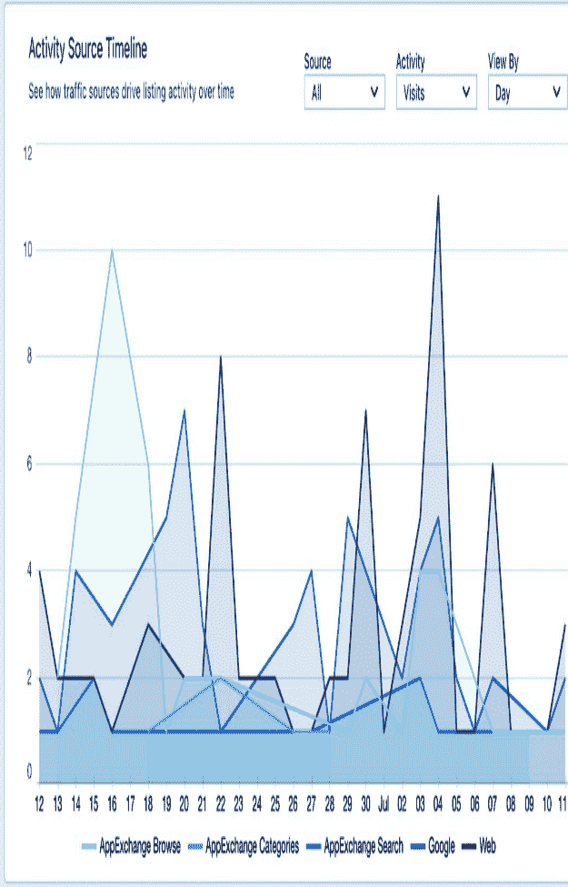
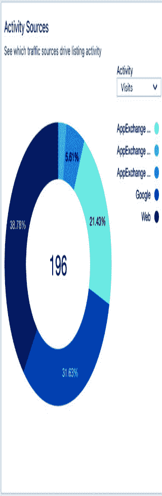
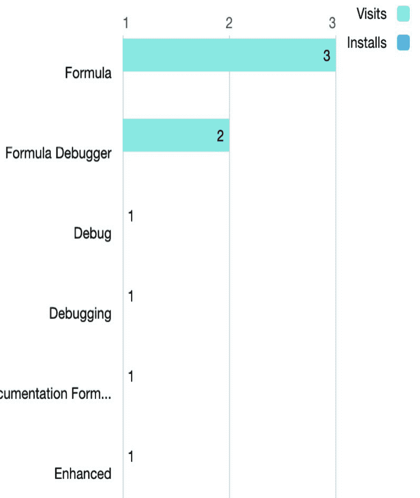
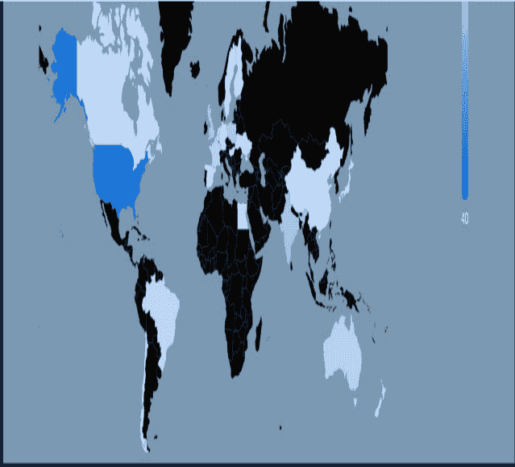
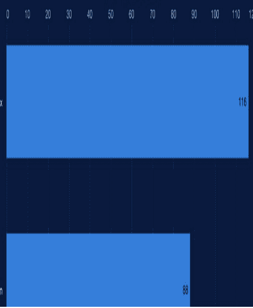

## 利用分析和洞察


围拢过来，我的 fellow 开拓者们！我们正深入 AppExchange 废墟，发掘隐藏在数字海洋中的古老智慧。

将数据视为您的考古工具包：重点不在于刷子的大小（虽然数据越大，刷子越大！），而在于如何扫去晦涩的沙粒，揭示下面的金色象形文字。这些象形文字不是随意的鸡爪划痕；它们是您产品成功的脉搏。有一点神秘，我同意，但没有什么是一个 *Indiana Jones* 式的数字专家无法处理的。

现在，我们的挖掘现场分为几个区域：

- **Partner Intelligence 的纸莎草卷轴：** 就像一件古老的羊皮纸一样，Partner Intelligence 层层展开智慧——从揭开用户模式到揭示隐藏趋势，并在 AppExchange 沙尘地平线上发现迫近的竞争对手。
- **Marketplace Analytics：** 一套优化您的 AppExchange 列表的工具。
- **App Analytics：** 您将导航 AppExchange 应用分析的领域，以理解功能使用情况、改善 UX 并评估新功能接受度，从而使销售、客户成功和软件开发等领域受益，进而让您自信地掌控应用的成功。
- **CRM Analytics 的绿洲：** 在这里，我们将内部数据与 Salesforce 的洞察绿洲相结合。期待一次令人耳目一新的知识爆发！
- **数据驱动决策的商队：** 在洞察地图的指引下，我们将驾驶商队穿越竞争的沙漠，一路前往 AppExchange 成功的应许之地。

在我们的考古学会中有一句话——我们不仅仅是发现者，我们还是历史学家，一粒数据一粒数据地书写着 AppExchange 的故事。地形可能看起来炎热多沙，但只要撒上一点幽默，再带上一桶数据，就没有我们不能探索的金字塔。

那么，让我们掸去刷子上的灰尘，装满水袋，为这次远征做好准备。 fellow 数据考古学家们，我们即将深入数据驱动决策的沙海。让挖掘开始吧！

## AppExchange 合作伙伴情报


将导航 AppExchange 生态系统想象成在古埃及的沙尘景观中跋涉，只是没有鞋子里沙子的不便。你不会想在没有地图的情况下在沙漠中漫无目的地游荡吧？同样，在不利用数据的情况下穿越 AppExchange 景观，就像蒙着眼睛驾驶骆驼——对旁观者来说很有趣，但对骆驼及其骑手来说并不那么有效。


AppExchange Partner Intelligence 概念在此发挥核心作用。
超越传统的 **商业智能 (BI)**，Partner Intelligence 精准聚焦 AppExchange 合作伙伴的特定数据需求，提供以下内容：

- 您 AppExchange 列表的详细性能指标
- 对潜在客户和客户行为的洞察
- 对托管包及其内容的消费情况的全面了解

您可以使用多种工具来利用 Partner Intelligence 的优势：Marketplace Analytics、AppExchange App Analytics 和 CRM Analytics。每种工具都有其特定的功能和用例，让我们更详细地了解一下：

- **Marketplace Analytics**：此工具可让您了解潜在客户和线索如何与您的 AppExchange 列表互动。要访问它，只需登录 Salesforce Partner Community，导航至 **发布** 选项卡，然后点击 **分析**。所有在合作伙伴社区中拥有已列出解决方案并具备 **管理列表** 权限的 AppExchange 合作伙伴均可使用此工具。
- **AppExchange App Analytics**：此工具可深入了解客户如何使用您的托管包及其内容。此工具适用于通过安全审查并注册到 **许可证管理应用 (LMA)** 的包。
- **CRM Analytics**：这是将贵公司内部数据与解决方案的 App Analytics 数据在您的 Salesforce org 中整合的首选工具。CRM Analytics 许可证可以直接在您的 **合作伙伴业务组织 (PBO)** 中启用。

虽然您可以使用任何报表工具进行数据可视化，但使用 CRM Analytics 将提供增强且集成的体验。

借助 Partner Intelligence 及其工具组合，您可以赋能业务做出明智的数据驱动决策，推动您的 AppExchange 产品取得更大成功。还记得考古学家如何细致地刷去数个世纪的尘土以发掘罗塞塔石碑吗？好吧，这正是我们在本章中要做的事情。我们将细致地清理这些工具的细节并揭示它们所提供的诸多益处。

那么，系好安全带，抓紧你的礼帽吧，因为我们即将踏上 AppExchange 生态系统中的激动人心的数据驱动决策之旅。希望我们途中不会遇到任何木乃伊！

## AppExchange Marketplace Analytics


在 AppExchange 合作伙伴的旅程中，您会经常发现自己的角色并不局限于名片上的描述。对于领导成熟初创公司的您，可能有一名 ISV 数字营销专家或 ISV 数字营销总监在引领您的 AppExchange 之旅。如果您刚刚启航 AppExchange 之旅，您可能会发现自己的创始人帽子经常被换成“Marketing Specialist”帽子。这有点像角色扮演，只是赌注更高，而服装是比喻性的。

无论您 LinkedIn 资料上的头衔是什么，在本节中，让我们假设您就是我们的营销专家，我们无畏的英雄，踏上优化 AppExchange 列表的征程。无需畏惧，勇敢的冒险者——Salesforce 为您准备了合适的装备。认识一下您的新搭档——AppExchange Marketplace Analytics。

### Mastering marketing impact

将您的 AppExchange 列表想象成您正在举办的派对。作为我们的营销专家，您的职责是确保您的客人（潜在转化）找到派对（您的列表）并在那里玩得开心（转化！）。AppExchange Marketplace Analytics 是您的派对策划助手，为您提供举办镇上最佳派对所需的洞察。

您是否树立了正确的路标来引导客人参加您的派对？您的派对主题是否足够吸引人以吸引合适的群体？Marketplace Analytics 为您提供优化列表性能并使其成为众人谈论焦点所需的数据。

### Understanding your guests

想象一下，如果您能了解客人最喜欢您派对的哪些部分以及跳过了哪些部分。那正是 Marketplace Analytics 所做的。它帮助您了解列表中哪些方面是派对的亮点，哪些方面可能需要稍作润色。

### Making data-driven decisions

您的工作是确保派对持续进行并不断改进。您可以使用 Marketplace Analytics 提供的可操作数据，根据渠道、活动和关键词搜索数据改进您的列表。

### Key features

AppExchange Marketplace Analytics 允许 Salesforce 合作伙伴深入了解客户与其列表互动的各个方面。包括以下内容：

- 客户在 AppExchange 首页和搜索结果页面查看您的列表磁贴的频率
- 流量来源（如 Google Ads）对您列表客户活动的贡献
- 引导客户访问您列表的热门 AppExchange 搜索词
- 客户参与的列表资源，例如截图和白皮书
- 您的 **AppExchange 营销计划 (AMP)** 推广活动表现，我们将在 [第12章](Chapter 12) 中详细讨论

这些洞察可以帮助塑造您的 AppExchange 业务战略并识别增加线索、安装和购买的机会。在此背景下，我们将检查以下截图，其中展示了 Formula Debugger Marketplace Analytics 的快照：

趋势相对于前 30 天的数据

| 磁贴浏览 | 磁贴悬停 | 访问者 | 线索事件 | 安装 |
|---|---|---|---|---|
| 395<br>1.5% | 15<br>36.3% | 130<br>-30.2% | 30<br>42.8% | 26<br>30% |

### Activity Source Timeline

查看流量来源如何随时间推动列表活动



### Activity Sources

查看哪些流量来源推动列表活动



图 10.1：Formula Debugger 实际运行的截图，提供 Marketplace Analytics 数据的详细视图，以实现 AppExchange 列表性能优化

### Activity summary

AppExchange Marketplace Analytics 中的活动摘要部分提供有关您列表的关键指标。它包括磁贴浏览、磁贴悬停、访问者、线索事件和安装的摘要。趋势指标将指标表现与之前的时间段进行比较。默认情况下，Marketplace Analytics 显示过去 30 天的指标，但您可以选择其他固定时间段或定义自定义日期范围。

### Filters

AppExchange Marketplace Analytics 提供全局和本地过滤器以聚焦相关数据。全局过滤器适用于活动摘要和所有可视化中的数据，而本地过滤器仅适用于单个可视化中的数据。您可以选择特定列表或固定时间段进行分析，选择要在可视化中显示的流量来源，选择要显示的活动指标、要显示的线索事件类型或要显示的 AMP 推广活动。

### Visualizations

AppExchange Marketplace Analytics 提供各种可视化以跟踪趋势并为您的列表识别机会。其中一种可视化是活动来源时间线，它显示在指定时间段内内部和外部流量来源如何为您的列表活动做出贡献。

### Accessing and navigating AppExchange Marketplace Analytics

访问 AppExchange Marketplace Analytics 通过 Salesforce Partner Community 授予。为了让您的团队获得访问权限，必须在 Salesforce Partner Community 中分配 **管理列表** 权限。此权限不仅启用对 AppExchange Marketplace Analytics 的访问，还可访问所有 Partner Console 功能，包括创建、编辑和发布列表的能力。

一旦分配了必要的权限，导航到 AppExchange Marketplace Analytics 非常简单。登录 Salesforce Partner Community 后，您应前往 Partner Console。从那里，选择 **发布**，然后 **主页** > **分析**。这将向您展示一个列表列表，您可以从中选择要查看的列表。

### Exporting data for further analysis

AppExchange Marketplace Analytics 允许您导出数据以在 Salesforce 或其他工具中进行进一步分析。数据以 **逗号分隔值 (CSV)** 格式导出，并应用全局和本地过滤器。

AppExchange Marketplace Analytics 提供的数据适用于 2019 年 8 月起在您的列表上发生的活动。它仅

提供与您已发布列表相关的数据。虽然 AppExchange Marketplace Analytics 没有 API，但您可以以 CSV 格式导出原始数据以供其他工具处理。

AppExchange Marketplace Analytics 不支持导入外部数据。但是，您可以导出数据并使用其他工具将其与外部数据合并。还需要注意的是，安装、演示和试用次数的总和可能与 AppExchange Marketplace Analytics 中的潜在客户数量不匹配。这种差异可能是由于贵组织中 **Web-to-Lead** 设置存在问题所致。

## 自定义可视化

尽管仪表板的布局以及单个可视化的样式或格式无法修改，但 AppExchange Marketplace Analytics 仍允许进行一些自定义。从全局筛选菜单中，您可以调整可视化中显示的时间段。在可视化内部，您可以选择要显示的活动指标，并且对于某些可视化，还可以更改时间尺度。

## 了解客户互动

AppExchange Marketplace Analytics 在客户安装您的解决方案时会记录多个互动。例如，当客户在您的列表上点击 **立即获取** 时，这会被记录为一次 **立即获取** 点击。客户选择软件包的目标位置并同意条款和条件后，点击 **确认并安装** 会被记录为一次安装。然而，LMA 中的许可证记录数量可能并不总是与 AppExchange Marketplace Analytics 中显示的安装次数一致，因为这取决于客户是否完成安装过程。

## AppExchange 搜索机制

可发现性对您在 AppExchange 上的产品成功至关重要，而这通常始于对搜索机制的充分理解。AppExchange 搜索由关键词相关性、参与度、列表体验和 **机器学习**（ML）驱动，提供符合客户需求的搜索结果。理解这些因素可以帮助您优化列表并提高可见性。

## 关键词相关性

列表中的文本与客户搜索词的匹配程度决定了其关键词相关性。匹配度越高——尤其是在标题、标语和简短描述中——列表的可见性就越高。适当使用反映潜在客户需求的关键词至关重要。

## 参与度

参与度是根据客户活动（如查看屏幕截图、试用和安装应用）衡量的列表受欢迎程度。参与度更高的列表，由于客户互动更多，在搜索结果中的排名会更高。

## 列表体验

列表体验考虑了关键词相关性和参与度之外的因素。这些包括您与 Salesforce 合作的各个方面，例如参与特定计划、评论的数量和质量，以及解决方案更新的及时性。

要充分利用 AppExchange 搜索机制，您可以使用 AppExchange Marketplace Analytics。该工具提供有价值的数据，可帮助您了解列表在搜索结果中的表现，从而做出明智的改进。以下屏幕截图展示了该工具，展示了 Formula Debugger Marketplace Analytics 的快照：

## AppExchange 热门搜索

查看哪些搜索词推动列表活动

活动

访问次数、安装次数



图 10.2：Formula Debugger Marketplace Analytics 的屏幕截图，展示其在 AppExchange 热门搜索中的位置

## 提升列表的可发现性

在优化列表时，请牢记上述因素的重要性。对于关键词相关性，重点关注您的应用解决的业务问题并选择相关关键词。通过确保列表包含屏幕截图、视频和演示来增强参与度，鼓励用户互动。通过及时回复反馈、定期更新列表内容并紧跟 Salesforce 的发布来改善列表体验。

总之，在 AppExchange 上取得稳固的搜索排名并非一蹴而就，而是需要承诺和持续努力，不断审查和调整列表元素以符合 ML 和客户偏好。

## AppExchange 应用分析

在 AppExchange 领域中导航通常意味着尝试各种角色，这证明了 AppExchange 合作伙伴所需的灵活性。在成熟的企业中，称职的 ISV 产品经理可能会承担解码应用程序使用情况和用户流程的责任。然而，如果您正在领导一家蓬勃发展的初创公司，您可能会发现“产品经理”的徽章经常别在您的创业绶带上。

在本节中，让我们换上新的角色扮演服装。再次忘记您指定的职位头衔或您在 LinkedIn 上认可的角色；我们将化身为产品经理。如果您选择接受任务，您的使命涉及发掘功能使用的细微差别、优化 UX 以及评估新功能的接受度。听起来要求很高？别担心——Salesforce 已通过先进的 AppExchange App Analytics 平台为您提供支持。

作为我们的驻场产品经理，您将探索的关键领域如下：

- **了解采用情况：** 识别应用的低使用（潜在流失风险）和过度使用（可能的合同重新谈判机会）模式
- **跟踪使用情况：** 了解哪些功能被用户接受或被忽视，从而指导未来的开发和优先级排序
- **优化您的应用：** 分析应用内的用户旅程，突出 UX 改进领域，并确定产生最佳结果的行为

为了支持此处概述的领域，App Analytics 数据可以在功能级别使用，以为与团队和订阅者关于功能的对话提供信息。数据围绕 `custom_entity` 概念展开，它代表了托管软件包中包含的组件。

例如，如果您引入了管理新闻通讯订阅的新功能，您的开发人员可能添加了新的自定义对象、新的 Lightning 页面、新的 Lightning 组件和新的 Apex 类。随着用户与这些组件互动，App Analytics 将捕获数据，提供宝贵的见解，可指导未来的功能增强。这种在细粒度级别分析和理解应用使用情况的能力是使用 AppExchange App Analytics 成功进行产品管理的基石。

开始这段旅程，您还会发现 App Analytics 可以在产品管理之外发挥作用，以惠及组织的各个领域，例如以下内容：

- **销售和试用**：App Analytics 可以跟踪试用使用情况，了解潜在客户测试了哪些功能，并提供量身定制的建议，以获得更优质的试用体验，从而提高交易达成率。
- **客户成功**：使用 App Analytics 推广功能采用并最大限度地减少订阅者流失。通过提供全面的使用数据，App Analytics 让您了解用户如何使用您的解决方案，从而能够提供个性化建议以推动功能采用、识别交叉销售机会并预测流失风险。
- **软件开发**：App Analytics 提供关键的 Apex 使用数据。通过单独或与其他来源结合使用这些数据，您可以优化代码，增强其性能和可靠性。

在此过程中，您将享受值得信赖、安全且 Salesforce 认可的工具带来的好处，这些工具可精确洞察客户如何与您的应用程序互动。道路可能看起来充满挑战，但有了 AppExchange App Analytics 作为您的指南针，您完全有能力掌舵您应用程序成功的航船。

## 启用 AppExchange 应用分析

无论您刚刚踏上 AppExchange 之旅还是已在途中，您可以做出的最明智的举措之一就是申请 AppExchange App Analytics。“为什么这么急？”您可能会问。好吧，您的应用程序通过安全审查后越早申请，您就越快开始积累有关应用使用情况的宝贵信息。

请记住，某些日志仅从客户的组织中收集，因此最初，您的资料库可能看起来像一张空白画布。但请记住——罗马不是一天建成的。随着时间的推移和使用的增加，画布将被各种数据填满，为您提供丰富的分析信息。

要激活对 AppExchange App Analytics 软件包使用日志和订阅者快照的访问权限，请运行 SF CLI 命令：

```
sf package update --package "Your Package Alias" --enable-app-analytics
```

您可以随时通过 SF CLI 命令停用这些日志：

```
sf package update --package "Your Package Alias" --no-enable-app-analytics
```


你只能开启套件使用日志和订阅者快照。套件使用汇总会自动提供。

一旦启用 App Analytics，你将拥有触手可及的丰富可操作数据。现在，这对你的应用在 AppExchange 市场上的成功来说是朝着正确方向迈出的一步！

## AppExchange App Analytics 中的数据类型

在 AppExchange 领域，数据就像指南针，指引你穿越决策过程的迷宫。AppExchange App Analytics 提供了三大主要数据类型类别，揭示了你的应用程序的性能和用户交互情况，帮助你优化策略。这些数据类型包括以下内容：

- 套件使用日志
- 套件使用汇总
- 订阅者快照

让我们深入探讨每个类别。

### 套件使用日志

套件使用日志为你提供了有关用户在应用程序内的行为和交互的全面数据。这些日志封装了用户与应用程序中每个打包组件交互的信息，包括每一次 UI、基于 API、基于 Lightning 和 Apex 的操作。此外，它们还会记录对套件中组件和自定义对象的每次 **创建、读取、更新、删除** (**CRUD**) 操作。这不包括来自 scratch 组织的事件。有了套件使用日志，你可以分析用户交互和采用率，从而就功能开发做出明智的决策。

这些数据从日志事件发生之日起仅可保留 45 天的短暂窗口。如果组织希望归档或分析这些数据，则需要迅速行动。

然而，读取套件使用日志数据需要特定方法。日志中的每一行都描述了用户与其中一个打包组件的交互。因此，要理解该交互，需要仔细检查每一行日志，识别被访问的打包组件、与其交互的人员以及交互的性质。

### 套件使用汇总

套件使用汇总是按日历月组织的顶层指标的首选。它们为你提供了对用户访问套件以及所执行操作的了解。这些汇总捕获 UI、基于 API、基于 Lightning 和 Apex 的操作，记录套件中组件和自定义对象的每次 CRUD 操作。然而，它们排除了来自沙盒、scratch 和试用组织的事件。

套件使用汇总从汇总文件日志日期起可下载长达 10 年之久。这一较长的时间段确保组织能够进行纵向研究并跟踪套件使用趋势。

这些汇总通常在次月开始时即可供合作伙伴和订阅者访问。例如，你可以在六月初获取五月的用量汇总。作为 AppExchange 合作伙伴，你可以使用拥有该套件的 LMO 在 SOAP API 中使用 **AppAnalyticsQueryRequest** 对象请求月度使用汇总。

### 订阅者快照

订阅者快照为你提供了订阅者活动的即时概览。它们提供了在 00:00 UTC 记录的组织、套件和自定义实体数据的每日快照，并可立即下载。你可以请求特定日期和时间或日期时间范围的快照，每个有效请求日期和时间将获得一个快照。

通过检查这些快照，你可以按组织和套件识别使用趋势。这些数据使你能够了解订阅者的倾向，并做出明智的决策以改进你的套件。与套件使用日志类似，快照数据可在快照日期起 45 天内下载。鉴于其性质，及时捕获和分析这些数据对于了解特定时刻的订阅者行为和属性至关重要。

还有一件事。并非所有 App Analytics 数据都会在每种类型的 Salesforce 环境中收集。数据收集的具体情况会根据组织类型和状态而有很大差异，如下表所示：

| 数据类型 | 生产环境 | 沙盒 | Scratch 组织 | 试用 |
|-----------|------------|---------|-------------|-------|
| 套件使用日志 | 是 | 是 | 否 | 是 |
| 套件使用汇总 | 是 | 否 | 否 | 否 |
| 订阅者快照 | 是 | 否 | 否 | 是 |

表 10.1：不同组织类型的 App Analytics 数据收集

## 如何请求数据

在 AppExchange App Analytics 中处理数据时，效率是关键。虽然手动数据请求可能适用于临时需求，但从长远来看可能会变得繁琐。Package Visualizer 是此类即时数据请求的实用工具，详情请参阅本指南第 2 章。然而，为了简化操作并确保持续获得洞察，你应考虑安排自动化查询。

### 安排和自动化你的查询

自动化的核心是编写代码，按计划创建查询请求记录、监控它们、检索数据并存储你的 AppExchange App Analytics 数据以便轻松访问。例如，你可以将数据存储在 PBO 中的自定义对象中。

你可以使用多种自动化选项，包括以下内容：

- 使用 REST 或 SOAP API 调用的自定义 API 集成
- 使用 CLI 的 Salesforce DX 自动化
- Salesforce 流程
- Apex

例如，你可以使用 Apex 计划作业自动检索套件使用汇总。在起步阶段，使用 Apex 在 PBO 组织中存储日志是一种足够的方法。然而，当你决定自动化套件使用日志数据的检索时，其数据量会随时间显著增加，你应考虑更可扩展的存储解决方案，例如 Heroku 或 **亚马逊网络服务 (AWS)**。

### 使用 Apex 自动化日志下载

为了简化下载日志的过程，你可以使用 Apex 创建一个自动流程。这需要你开发一个简单的解决方案，能够完成以下任务：

- **定期发出 AppAnalyticsQueryRequest 请求：** 这可以通过实现一个可调度 Apex 类来实现。该类允许你指定这些请求应发出的时间，从而帮助自动化流程。
- **下载日志**：这涉及执行 **HttpRequest**。这将从服务器检索日志并将其下载到你指定的位置。
- **解析检索到的 CSV 文件**：一旦包含日志的 CSV 文件被下载，下一步就是解析它们。这涉及解释数据并将其转换为更易管理的格式。
- **创建 PackageUsageSummary__c 记录**：解析 CSV 文件后，你将使用这些信息创建 **PackageUsageSummary__c** 记录。然后这些记录可以存储并用于进一步分析。
- **编写 Apex 单元测试**：在 Apex 中编写单元测试对于确保解决方案的健壮性和可靠性至关重要。这有助于你及早发现和解决问题，从而提高软件质量。

为了帮助你启动此开发，以下 GitHub 仓库提供了上述步骤的示例：
https://github.com/developerforce/partner-intelligence-basics。 在这里，你可以找到示例和指南，用于设置自动日志下载的 Apex 实现。

### 管理数据存储和使用外部解决方案

随着数据量的增长，将所有数据存储在你的 PBO 中可能会变得具有挑战性。在你的基础 Salesforce 设置中，不购买任何额外许可证或附加组件，你将获得 10 GB 的数据存储空间。这听起来很多，对吧？好吧，为了说明问题，这大约允许 500 万条记录。那算很多吗？让我们想一想。仅考虑来自单个大客户的 1 年套件使用汇总日志

可能累积到超过 100 万条记录。请记住，软件包使用日志的粒度要细得多。此外，你很可能不止有一个客户。因此，虽然 500 万听起来像是一个很大的数字，但在整体来看，它填满的速度可能比你想象的更快！

在这种情况下，你应该考虑使用外部解决方案。例如，你可以利用 AWS 来存储和管理数据。AWS 提供了可扩展且安全的环境用于数据存储，在处理大量数据时尤其有用。

**PI-Labapp**，也称为 **Partner Intelligence Starter Pack**，是通过 Salesforce Labs 计划提供的免费应用程序。它为 ISV 合作伙伴提供有关用户如何与其 AppExchange 解决方案交互的使用数据。这些数据对于做出有关功能开发的明智决策和识别潜在流失风险至关重要。你可以在 AppExchange 上找到它：https://appexchange.salesforce.com/appxListingDetail?listingId=a0N4V00000GmRaNUAV。

要使用 PI-LabApp 应用程序，你需要一个启用了 API 的 Salesforce PBO 用户名以及现有的 AWS 账户。该应用程序包含一个用于存储日志拉取配置的 **Log pull Config** 对象和一个用于跟踪日志拉取活动的 **Log pull Activity** 对象。

设置 PI-LabApp 的过程涉及在你的 PBO 组织中安装软件包、向用户分配权限集以及配置日志拉取记录。设置完 Salesforce 后，你需要配置 AWS，其中包括安装堆栈并使用 PBO 登录凭据更新密钥。

设置完成后，你应进行手动测试以确保一切按预期工作。这涉及在 Salesforce 中手动创建日志请求记录并在 AWS 中运行步骤函数。测试成功后，你可以启用 Daily Log Pull 作业，该作业可自动将每日日志文件拉取到 AWS **Simple Storage Service** **(S3)** 存储桶中。

最后，要可视化数据，你需要设置 AWS Athena。这涉及运行 Glue 爬虫以从 S3 存储桶中检测 Parquet 表、运行 Athena 查询并创建视图。

## 规划你的 App Analytics 查询策略

你的查询策略的具体细节在很大程度上取决于业务的规模和范围，以及你查询的数据类型。你选择的策略必须与业务需求和目标保持一致。它应高效地为你提供所需的洞察，以便就改进用户体验、优化用户流程和增强功能采用做出数据驱动的决策。最终目标是从 AppExchange App Analytics 中提取最大价值，而一个规划良好且自动化的查询策略是实现这一目标的关键步骤。

## 如果 App Analytics 不够用怎么办？

随着业务的增长，其数据和分析需求也在不断演变。Salesforce 的 App Analytics 是所有旨在了解其应用程序性能和用户行为的 ISV 的绝佳起点。然而，总有一天，开箱即用的分析工具可能无法提供所需的粒度深度和洞察深度。

在这种情况下，你可以设想制定自己的精细粒度产品使用分析，深入挖掘传统工具无法提供的深度。但打造定制的分析解决方案总是答案吗？

确实，有一些知名的大型 ISV 选择创建自己的日志机制，利用外部系统。这样的举措很有雄心壮志，可以开启详细的洞察宝库。然而，它们也伴随着自身的一系列挑战：

- **复杂性和耗时：** 打造定制的分析解决方案绝非小事。设计、开发和实施定制系统可能耗时且充满不可预见的挑战。
- **安全审查顾虑：** Salesforce 拥有严格的安全审查协议。定制的分析解决方案需要遵守这些协议，而通过安全审查可能是一个严格的过程。
- **数据隐私和合规：** Salesforce 强调数据隐私。ISV 需要谨慎并了解数据隐私方面的规则，尤其是在详细跟踪用户行为时。

鉴于这些考虑，在着手开发定制解决方案之前，权衡收益与成本和潜在风险至关重要。

如果你正在考虑定制解决方案，一个有价值的第一步是寻求外部专业知识。与 **Product Development Outsourcer (PDO)** 合作伙伴合作可以提供一个全新的视角，判断 App Analytics 是否真的无法满足你的需求。有关与 PDO 合作的更多细节将在第 12 章中探讨。

## CRM Analytics


作为 ISV 合作伙伴，你常常感觉自己像是在 AppExchange 沙丘中独自穿行的贝都因人，每一堆沙子都代表着你的应用程序产生的数据堆积。说实话：原始日志对数据科学家来说可能像是隐藏的宝藏，但对我们大多数人来说，它们更像是沙漠中的海市蜃楼——绝不是我们所追求的兴奋绿洲。

但 Salesforce 出现了，你值得信赖的向导，骑着骆驼穿越这片数据沙漠。认识你在本次旅程中的新夏尔巴人——面向 AppExchange App Analytics 的 CRM Analytics。手握这枚指南针，你之前令人望而生畏的原始数据堆现在可以转变为可导航的小径，通向充满洞察力和可操作智能的泉源。

CRM Analytics 不仅仅是沙漠中的一粒沙；它建立在 Salesforce 的 AI 驱动分析平台之上，是一个强大的海市蜃楼粉碎者。有了 CRM Analytics，你不仅仅看到 AppExchange 应用使用数据的表面；你正在发掘隐藏的文物，追踪关键指标的足迹，并获得客户行为的全景视图。

要加入这支商队，只需向星星发出信号，或者在我们这里，向 Salesforce 合作伙伴社区提交一个案例。Salesforce 以两张免费的 CRM Analytics 许可证奖励你的主动性，就像在你的行囊中发现两个冰凉的水壶一样，方便地提供在你的 PBO 上。

## 了解 CRM Analytics

CRM Analytics 是一款复杂的 BI 产品，有助于将原始数据转化为可操作的洞察。本指南不会让你成为 BI 或 CRM Analytics 专家，但它会让你一窥 CRM Analytics 能为你作为 ISV 合作伙伴提供的功能。在深入了解流程之前，让我们先熟悉一些重要的 CRM Analytics 术语：

- **Analytics Studio**：这是你的 CRM Analytics 控制中心，你可以在此管理和创建数据集、透镜、仪表板和数据流
- **Dataset**：你导入 CRM Analytics 的相关数据集合，数据集可以源自 Salesforce 数据或外部文件
- **Dataflows**：用于准备数据集的一系列转换，能够连接、过滤和增强来自多个数据集或数据流的数据
- **CRM Analytics dashboard**：由小部件组成的数据可视化显示，小部件由透镜创建
- **Lens**：数据集的已保存探索，提供数据的特定视图，可用于构建仪表板小部件

## 集成和可视化你的数据

在收集了你的 App Analytics 数据后，下一步涉及在 CRM Analytics 中将其与你的 LMA 数据集成。这要求你在 **License Management Org (LMO)** 中建立一个权限集，授予 CRM Analytics 集成用户访问 LMA 数据的权限。

## 创建 CRM Analytics 应用

为了高效组织并控制数据集、透镜和仪表板的共享，你应该在你的 LMO 中创建一个 CRM Analytics 应用。

## 将 App Analytics 数据导入 CRM Analytics

要存储你的 App Analytics CSV 文件，你可以创建一个专用数据集。接下来，可以构建一个 CRM Analytics 数据流来连接你的 LMA 软件包与 App Analytics 日志。

## 使用 CRM Analytics 可视化你的数据

CRM Analytics 使你能够创建透镜、**key performance indicators** (**KPIs**)，和仪表板用于数据可视化。透镜提供对数据集中数据的图形化探索，并构成仪表板查询的构建块。

## 创建 CRM Analytics 仪表板

可以使用你的数据集和透镜创建仪表板，提供数据的可视化表示，简化解释和理解。

## 将仪表板添加到软件包记录页面

为了方便访问和概览，可以将仪表板添加到 LMA 中的软件包记录页面。这提供了从软件包的详细信息记录页面直接查看仪表板及其所有相关指标的视图：

## 公式调试器



## 组织类型

user_id_token 的唯一性



## 组织版本

user_id_token 的唯一性


Figure 10.3: 公式调试器 LMA 的屏幕截图，展示了集成的 CRM Analytics 仪表板——用户交互和应用性能数据的清晰简洁的视觉呈现，有助于为改进应用做出明智的决策

通过使用 CRM Analytics 集成和可视化数据，您可以深入了解用户与应用程序的交互情况。这反过来使您能够做出数据驱动的决策来增强应用程序并更好地为客户服务。

## 推动数据驱动的决策


想象一下你自己是 AppExchange 商队的老板。你的货物？一款需要与你在旅途中遇到的用户旅行者产生共鸣的软件产品。你看，这些旅行者不仅仅是在寻找普通的软件；他们寻求的是能触动他们需求并在心弦上奏出悦耳旋律的解决方案。而作为商队老板，使你的产品符合他们的合唱团做出决策是你的神圣职责。

在软件开发的世界里，创建不仅满足用户需求而且能与他们深度共鸣的产品至关重要。作为 AppExchange ISV 合作伙伴，你的决策和产品开发流程始终应建立在对用户及其需求的深刻理解之上。采用这种以用户为中心的方法不仅能保证产品得到稳健采用，还能将你的用户转变为你解决方案的热情倡导者。

虽然一开始就大张旗鼓很有吸引力，但从小规模开始往往能带来更有效的结果。这种方法允许有机账户增长，虽然可能需要更长时间，但最终会带来更广泛、更投入的用户群。这种方法本质上延长了销售周期，但同时也促进了用户冠军的培养，并解决了组织范围内的采用前提条件，如合规性、支持和基于指标的 **价值证明 (PoV)**。

数据驱动的决策构成了以用户为中心战略的基石。通过利用 AppExchange App Analytics 等工具，你可以深入挖掘使用指标，了解用户认为哪些功能令人愉悦，哪些方面需要改进，以及将产品改进工作集中在何处。

例如，如果用户对特定功能的参与度较低，这可能是需要增强应用内指导或重新考虑功能设计的信号。相反，功能使用量的激增可能意味着用户接受度积极，表明类似的更新或功能可以进一步推动参与度。

在推出新产品后，保持与用户开放的沟通渠道至关重要。将 App Analytics 日志与他们的反馈一起解读以完善产品并调整路线图，不仅使你的产品与用户需求保持一致，还能培养用户之间的投资感和掌控感。重要的是，推动数据驱动决策的这些策略与 *第3章* 中详细阐述的设计以客户为中心应用程序的原则相辅相成。两种方法都将用户置于决策过程的中心，并利用数据不断迭代和改进产品。

正如 Netscape 前首席执行官 Jim Barksdale 所说，“*如果我们有数据，让我们来看数据。如果我们只有观点，那就听我的。*”这种感受完美地概括了数据驱动决策的本质——通过持续的数据驱动改进，将你的用户转变为产品的拥护者。

## 深入探讨

在数据驱动决策的领域中，有一个基本真理脱颖而出：没有灵丹妙药。对一个 ISV 有效的方法可能不是另一个 ISV 的最佳解决方案。每个组织都必须内省地分析其独特需求、用户群和目标，以决定跟踪哪些指标以及如何解读它们。

然而，成功的 App Analytics 实施有一些反复出现的模式。虽然不 exhaustive，但以下是对许多 ISV 证明有益的几种经时间考验的衡量标准和技术：

- **新客户整体使用趋势**：跟踪该指标可以帮助主动识别需要额外客户支持或培训的领域，确保更稳健的产品采用
- **平台使用指标**：了解是否有更多用户访问特定功能可以帮助你决定在何处分配开发资源，同时考虑传统支持与新功能集成之间的平衡
- **流失率监控**：通过预测流失，你可以制定保留计划，确保主动解决可能导致用户或组织流失的任何问题或疑虑
- **增长机会**：识别哪些账户或用户显示出使用量增加，可以成为潜在的向上销售或交叉销售机会的指标
- **面向 DevOps 和合规性的运营洞察**：简化服务器事件管理并监控许可证分配可以帮助提高运营效率
- **面向销售和客户成功团队的协作分析**：为这些团队配备实时用户指标可以帮助制定更个性化的销售推介或支持解决方案，培养与用户和客户的更好关系

总之，虽然这些示例对许多 ISV 证明有效，但必须记住分析是一个不断发展的领域。基于实际结果和不断变化的用户需求进行定期审查、迭代和调整将始终是当务之急。此外，如果你对优先考虑哪些指标缺乏方向，请转向内部团队。咨询你的产品团队、开发团队和销售团队。提出一个简单问题：“*什么信息能让你更好地履行你的职责？*” 通常，这些见解可以指导你的分析工作，并且通过利用 App Analytics 等工具，你可以提供所需知识，为整个组织增加价值。

## 总结


我们已穿越 AppExchange 市场的古老废墟，发掘智慧的遗物，并踏上数据分析广阔沙漠的探险。我们导航了 Partner Intelligence 的纸莎草卷轴，破译了 Marketplace Analytics 的智慧，并探索了 App Analytics 网站。在 CRM Analytics 的绿洲，我们刷新了知识，并凭借我们的数据驱动决策商队，我们已为成功绘制了航线。

在本章中，你已学会精确地使用我们的数据考古工具包，刷去模糊的沙子，揭示洞察的金色象形文字。这些曾经晦涩的象形文字开始讲述一个故事——我们产品的故事。我们不仅仅是探险家，更是历史学家，一点一点地拼凑我们 AppExchange 产品的叙事，一粒数据一次。这知识，我们的考古宝藏，指导我们做出明智的数据驱动决策，与我们的受众产生共鸣并确保我们在市场上的成功。

当我们收起画笔和数据探铲时，我们为地平线上即将到来的下一个挑战做准备——古老而相关的技术债务问题。不要害怕， fellow 数据考古学家，因为我们的下一章将指导我们穿越管理 AppExchange 解决方案技术债务的迷宫。我们将了解其起源、迹象和影响，并学习在保持产品质量、安全性和性能的同时有效驾驭这一领域的策略。所以，收好你的考古装备，为另一次探险做好准备。是时候进入技术债务这一未被探索的领域了。让旅程继续！


