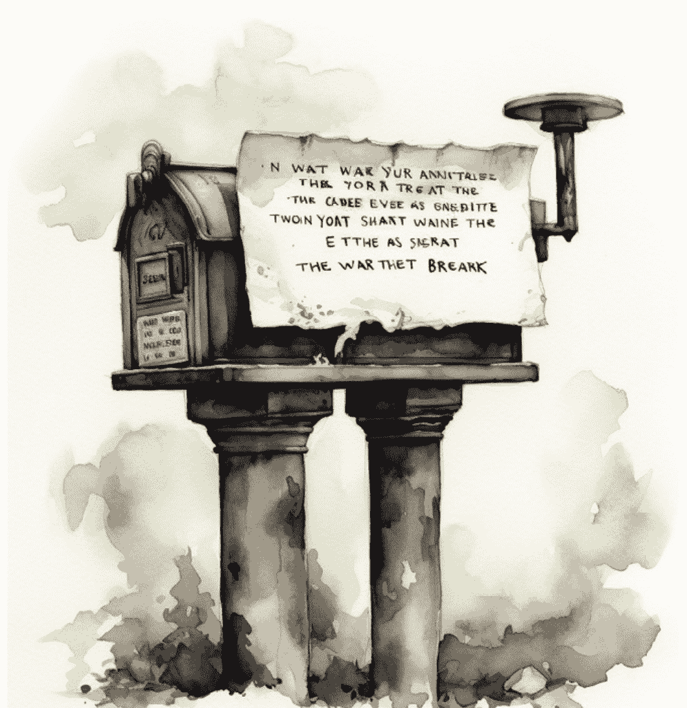

## 管理技术债务

亲爱的冒险开拓者们，我们已告别数据荒漠中闪烁的沙丘，将其换成了文明的繁华摩天大楼。当我们把考古学家帽子换成闪亮的商务西装时，我们正踏入一个处于技术与金融交汇处的世界。
欢迎来到无处不在却又引人入胜的技术债务宇宙。

请记住，技术与金钱交汇之处，债务也紧随其后。
为这段新旅程做好准备。本章将带来以下内容：

- **什么是技术债务？** 正如信用卡债务在你超出承受能力消费且未立即偿还余额时累积一样，技术债务也是在代码在没有适当规划或质量保证的情况下快速实现时产生的。两种情况在短期内可能看起来可以管理，但如果不及时处理，可能会迅速升级。
- **对定期安全复审的影响：** 正如错过付款或高信用卡使用率会负面影响你的信用评分一样，技术债务也会影响安全复审。
- **技术债务的早期预警信号：** 与收到透支通知是财务压力的明显迹象一样，某些迹象也暗示着技术债务的累积。
- **管理技术债务的工具和技术：** 正如将债务合并为一笔利率更低的贷款可以成为管理财务债务的有效方法一样，也有工具和策略来管理技术债务。
- **通过优化你的 AppExchange 应用来减少技术债务：** 有时，如果技术债务变得过于沉重，你可能需要考虑激进的措施，例如对你的 AppExchange 应用进行大规模改造。

所以，收拾行囊系好安全带。这段旅程将带我们经历一些陡峭的转弯和棘手的十字路口，但请记住，我们是开拓者！从现在开始，我们就像科技世界的财务分析师，在代码与成本交织的世界中航行。

### 什么是技术债务？

技术债务一词最初由软件工程师、*敏捷宣言*的作者之一 Ward Cunningham 提出，是软件开发人员和 IT 专业人士用来传达在软件开发过程中某些必要工作被推迟这一想法的隐喻。这可能涉及权宜的短期解决方案，这些方案日后可能会阻碍未来的开发或导致软件不稳定。

与财务债务一样，技术债务也会随时间累积“利息”——在这种情况下，利息是指日后修复问题或重新设计系统所需额外的时间和资源。技术债务未解决的时间越长，累积的“利息”就越多，表现为生产力下降、出现错误的可能性增加，以及对新需求或业务环境变化的响应变慢。

在 Salesforce ISV 的背景下，当合作伙伴实施快速修复或变通方案以加快在 Salesforce AppExchange 上发布应用，而未充分解决或考虑这些选择的长期影响时，就可能产生技术债务。

在我多年与成熟 ISV 合作的经验中，我经常发现技术债务是合作伙伴寻求帮助的最常见原因之一。成功的初创公司在经历了快速客户获取的初始阶段后，往往会遇到瓶颈，开发周期放缓、创新停滞，无法保持最初的步伐。这通常是累积的技术债务开始成为重大阻碍的节点。

但请记住，并非所有技术债务都是负面的。明智管理时，它可以作为一种战略工具，使团队能够快速交付并满足关键的业务需求。这里的关键在于“管理”债务，这意味着将其保持在不会压垮开发流程或损害应用对客户长期价值的水平上。

本章的目标是让你全面了解技术债务，帮助你采取主动的方法来管理它，而不是让它来管理你。我们将探讨其成因、对软件开发和业务成果的影响，以及有效管理与减少它的策略。

### 技术债务随时间的累积

技术债务并不总是仓促编码或缺乏远见的结果。它也可能是不断变化的技术环境的有机产物，即使你的团队遵循最佳实践。这对于 Salesforce 等不断发展的平台尤其相关，它们每年提供三次主要更新，带来新功能和修改。

Salesforce 逐步淘汰旧版 API 的策略就是一个典型例子¹。该公司系统地淘汰旧版 API，敦促使用提供更高效率和安全性的新版本。作为 ISV，这需要保持警惕，确保使用已弃用版本的应用组件及时更新。虽然 Salesforce 通常会提前很久通知此类停用，但过渡到新版 API 并非易事。它可能涉及重大的代码重构、测试修改以及潜在的功能变更，所有这些都会增加你的技术债务。

1 https://help.salesforce.com/s/articleView?id=000381744&type=1

进一步促成这种有机累积技术债务的是 Salesforce 对其技术栈的持续升级。从 Workflows 和 Process Builders 向更强大的 Flows 的技术转变，以及从 Aura Components 向 **Lightning Web Components (LWC)** 的转变，都是此前最优解决方案现在可能不再有效的例子。

此外，Salesforce 从 Salesforce Classic 用户界面向 Salesforce Lightning Experience 的过渡是需要考虑的关键技术演进。这种界面设计的转变极大地影响了应用的可用性和美观性，要求对应用的 UI/UX 设计进行重大改造。这是满足用户期望和 Salesforce 标准所必需的演进，但也增加了应用的技术债务。

所有这些例子都强调了不仅要引入新功能，还要持续重新审视和更新现有功能以保持与 Salesforce 不断发展的标准和技术一致的重要性。未能跟上这些变化可能会增加你的技术债务，损害应用的性能和可维护性，并减缓你的创新能力。因此，主动管理技术债务的方法对于你在 Salesforce 平台上应用的可持续成功至关重要。

### 导致技术债务的外部因素

虽然 Salesforce 的演进确实会促成技术债务，但重要的是要记住，应用所依赖的任何第三方库或技术也会显著影响这一点。与这些资源相关的更改、更新甚至停用事件都可能导致你的技术债务增加。

这种情形的一个显著案例涉及几家知名 ISV，它们在 Salesforce 上引入 LWC 之前数年就开始开发用户界面。当时，鉴于该库的功能和流行度，选择使用 AngularJS 进行 UI 设计是合理的决定。

然而，当 AngularJS 于 2021 年 12 月 31 日达到生命周期结束里程碑时，情况发生了变化。这本质上意味着 AngularJS 团队不再提供更新、补丁或安全修复，导致依赖 AngularJS 的应用暴露于潜在的安全漏洞以及与新浏览器更新或其他技术不兼容的风险中。

使用已超过生命周期结束日期的技术风险极高，因为它会使你的应用容易受到未修补的安全问题以及因缺乏兼容性更新而导致的潜在故障的影响。这些问题不仅直接威胁到应用的安全性和性能，还会影响用户对产品的信任和信心。

因此，这些 ISV 被迫对应用的大部分内容进行重建，以应对 AngularJS 的生命周期结束事件。这一劳动密集且耗时的过程显著增加了他们的技术债务，凸显了监控和为此类外部因素进行战略规划的必要性。

因此，管理技术债务不仅限于你的内部开发实践和 Salesforce 的更新。它还需要在

跟上应用程序所交互的更广泛技术生态系统的变化，确保应用程序在长期内保持安全、高性能且可维护。

## AppExchange 开发中的技术债务类型

AppExchange 开发中的技术债务以多种方式表现出来，每种都有独特挑战和解决方案。我们可以将技术债务归类为以下几类：

-   **设计或架构债务：** 设计债务发生在设计阶段采取的捷径在长期内成为负担时。例如，如果你的解决方案最初将月度汇总信息存储在单条记录上，起初看起来可能很高效，节省了数据存储。但随着每月所需字段的增加，这一设计选择会迅速演变成重大的技术债务。此类情况需要定期评估和必要的重新设计来缓解此类债务。
-   **代码债务：** 这种债务源自代码库本身。它可能是由于代码编写不佳、文档不足或偏离 Salesforce 开发最佳实践所致。定期进行代码审查、遵守 Salesforce 的编码标准以及使用静态代码分析是管理代码债务的一些方法。
-   **一致性债务：** 在追求采用最新技术或方法的过程中，开发团队可能会引入不同设计模式、框架和编码风格的混合。例如，一个随意混合了 Visualforce、Aura 和 LWC 的应用程序可能会变得难以维护和调试。虽然改进或现代化应用程序的某些部分可能很诱人，但确保整体一致性至关重要。即使被认为较旧，Aura 的一致且结构良好的使用，也比最新工具和风格的零散组合更易维护和高效。
-   **缺陷债务**：有时，由于迫在眉睫的截止日期，解决错误或缺陷可能会被推迟。虽然这在当时似乎是合理的权衡，但处理这些被推迟问题的累积工作量会随时间增加，导致重大的技术债务。重要的是要为修复错误分配时间，不要让这些问题堆积起来。
-   **基础设施债务**：鉴于 Salesforce 对其开发工具和平台的频繁更新，保持最新状态以防止基础设施债务很重要。例如，如果你的 **持续集成/持续部署 (CI/CD)** 流程不足，它会减慢软件开发生命周期并成为技术债务的来源。组织良好、保持更新的基础设施和高效的部署流程对于防止此类债务至关重要。
-   **人员或技能债务**：由于人员流动导致知识或技能的流失可能会造成重大的技术债务。例如，如果唯一了解安全审查流程的团队成员离职，Salesforce 的重新审查请求可能会暴露出严重的知识差距。为了管理这种债务，投资持续培训、全面文档和团队内部的知识共享至关重要。

掌握了 AppExchange 开发特有的技术债务类型后，你已具备在 ISV 之旅中识别和缓解其出现的知识。然而，尽管看起来很复杂，技术债务并不总是故事中的反派。当得到有效管理时，它可能成为意想不到的盟友。因此，让我们转换视角，学习如何战术性地利用技术债务为自己带来优势。

## 技术债务的战术性累积

它听起来可能违反直觉，但并非所有技术债务都是坏事。有时，累积技术债务可以是一种战术性决策，以更快地实现某些目标。

技术债务可以被视为一种工具，让你在短期内更快推进。在竞争激烈的商业环境中，速度往往至关重要。也许存在需要你迅速行动的市场机会，或是需要立即响应的客户需求。在这种情况下，为了快速将产品或功能推向市场，累积一些技术债务可能是明智的决定。

需要记住的重要一点是，这样的决策应有意识地做出，并充分了解其影响。这意味着要尽快偿还债务的计划。你通过重构或改进代码“偿还”技术债务的速度越快，就越少以维护和后续故障排除所花费的额外时间、精力和资源的形式累积“利息”。

然而，你应谨慎考虑何时以及承担多少技术债务。承担过多的债务可能会减慢开发速度，并使系统越来越难以维护。它还可能导致产品质量下降并影响客户满意度。

请记住，关键不是完全避免技术债务——那几乎是不可能的——而是有效地管理它。这需要清楚了解所涉及的权衡，以及在债务变得难以承受之前解决它的纪律。

## 技术债务可以推动你的销售

面对技术债务的概念可能令人不知所措：其中潜在的复杂性和成本可能会让你犹豫。但这里有一个独特的视角——技术债务可以成为你的盟友。理解并有效管理技术债务是客户可能选择你的 AppExchange 应用而不是自行构建解决方案的原因之一。

将自己置于潜在客户的 **首席信息官 (CIO)** 的立场上。每当他们面临“自建还是购买”的决策时，就需要考虑技术债务的影响。他们必须评估与其管理相关的成本，以及维持一个开发团队来处理它的需求。

这正是 Salesforce 和 AppExchange 真正精神的体现：你管理技术债务和创新，这样客户就无需自己承担。

作为 CIO，AppExchange 提供了一个机会，可以更快地为用户带来创新能力，同时减少技术债务负担。当然，债务并没有真正消失；它只是从客户转移到了 ISV。这种转移使客户的 IT 团队能够腾出时间，以前所未有的速度专注于为其业务提供高价值的创新解决方案。

## 对定期安全重新审查的影响

还记得我们在第 6 章深入探讨安全审查时吗？那就像你第一次潜入代码海洋的深海潜水一样令人兴奋。现在，是时候再次痛快地潜入了。Salesforce 就像你勤勉的信用监控服务一样，进行例行安全重新审查。但问题是：如果你的代码库的技术债务比黑色星期五手持信用卡的购物狂还要高，这些重新审查就开始感觉像总是带来坏消息的意外信用评分检查。

现在，想象一下。你打开电子邮件，就像收到银行的信说你的信用评分需要在 3 个月内进行审查。如果你的开发团队正翘着二郎腿悠闲地吹着“甜蜜的佐治亚布朗”，那就很容易。但我们都知道，这和在你的菜园里找到独角兽一样不可能。

他们正在穿梭于不断演变的路线图中，就像在所有街道名称都是外语的城市中导航一样。他们在处理新客户，类似于处理活手榴弹（当然是比喻的），并像在倒计时游戏节目中一样逐一勾选现有客户承诺的功能。

但就像维护健康的信用评分一样，管理技术债务并不是一次性的春季大扫除——它更像是一项日常的家务工作。它和早上刷牙一样常规。将这些任务纳入日常流程，重新审查就会显得和每月信用评分检查一样平常，而不是萦绕在开发流程中的幽灵。

## 技术债务的早期预警信号

好了，各位，把这当成你的警钟，就像你在邮箱里发现透支通知时收到的那种。它们刚开始出现时可能很容易被忽视，但长期忽视下去，你的银行账户就会变得像沙漠景观一样——满是滚草和蟋蟀声。

这与技术债务有什么关系？很高兴你问了！以下是一些可能表明技术债务问题正在增长的红旗的简化指南：

- **开发进度放缓**：你团队创建新功能的速度是否明显下降？这可能意味着花费在处理复杂或有问题的代码上的时间越来越多，暗示着技术债务的存在。
- **错误报告上升**：你是否看到错误报告激增？这可能意味着你的代码库，由于仓促的修复或过时的技术，导致错误更频繁。
- **代码库复杂**：如果开发人员表示难以理解或修改你的代码库，这可能是由于结构复杂或缺乏文档——技术债务的明显迹象。
- **重复返工**：开发人员是否经常重新审视并修复旧代码？高质量的代码不应需要不断返工，这表明可能存在技术债务。
- **依赖特定个人**：你的代码库是否只有少数开发人员能理解？对代码库的共同理解是避免瓶颈和简化新开发人员入职流程的关键。
- **技术集成困难**：如果整合新技术或更新现有技术是一项挑战，这可能是大量技术债务的迹象。

通过保持对这些迹象的警惕，你将更能主动识别和解决技术债务，保持产品健康的开发流程。

## 技术债务的成本

虽然技术债务可能让公司更快实现短期目标，但必须明白这是有代价的。就像财务债务一样，技术债务会随着时间推移产生“利息”，表现为维护、重构和故障排除所需的额外资源。而且，债务未偿还的时间越长，利息累积越多，使其变得越来越难以偿还且成本更高。

除了在时间和资源上的直接成本外，技术债务还可能产生间接成本。它会降低产品的整体质量，导致用户体验不佳。这反过来会负面影响客户满意度，可能损害品牌声誉并导致业务流失。

技术债务还会使代码库更复杂、更难理解，这增加了引入新 bug 的风险，并使新开发人员的入职变得更加困难。

债务存在的时间越长，纠正它就越昂贵。其原因与两个因素有关——对代码库的熟悉程度以及系统复杂性随时间的增加：

- **对代码库的熟悉程度：** 当在新功能或系统开发过程中累积技术债务时，正在工作的开发人员对代码的上下文和细微差别非常熟悉。立即解决债务可以让他们将新鲜的知识应用于任务，使过程更高效、成本更低。
- **系统复杂性**：随着时间的推移，你的系统会增长——新功能被添加，现有功能被更新或删除。每一次更改都会引入依赖关系和交互，在解决特定区域的技术债务时可能会受到影响。随着系统复杂性的增加，解决债务的难度和成本也会随之增加。

本质上，解决技术债务的成本并非恒定不变。然而，就像管理财务混乱可以采取战略性方法一样，处理代码库的技术债务也需要一套深思熟虑的数字财务工具箱。

## 管理技术债务的工具和技术

想想你上一次决定清理财务混乱的时候。你仔细审视了各种贷款、信用卡账单等等，然后决定正面应对，也许采用一个稳固的债务整合策略和一些精明的财务规划。现在，如果我告诉你，管理技术债务也可以采用同样的方式呢？

别这么惊讶！让我们花一分钟深入我们的数字财务工具箱。就像整理你的实体债务一样，处理代码库的技术债务需要一个战术性游戏计划，其中包括常规健康检查、优先处理最具破坏性的债务以及果断行动。

## 技术设计评审

在深入代码评审之前，强调技术设计评审的重要性至关重要。这些评审通常在编写任何代码之前进行，重点关注整体技术方法、组件架构以及大型复杂功能的高层设计。通过在实施开始前评估技术方向，团队可以确保自己走在正确的道路上。这降低了因设计缺陷而累积技术债务的风险。

在技术设计评审中，利益相关者和团队成员共同协作讨论潜在挑战、依赖关系和风险。通过主动解决这些问题，团队可以做出明智的决策，确保设计不仅功能完善，而且可扩展、可维护，并与更广泛的系统架构保持一致。技术设计评审对于托管包开发尤其重要，因为在将元数据添加到包并安装到订阅者组织后，某些决策无法撤销。

## 代码评审

代码评审是开发流程的重要组成部分，在管理技术债务方面尤其重要。在代码评审期间，开发团队成员会检查彼此的代码。此过程有助于发现初始开发期间可能遗漏的任何问题。

代码评审是捕获错误、确保代码一致性以及防止引入新的技术债务的有效方法。正是在这些评审中，可以识别并解决诸如代码异味、设计不良的算法或低效流程等问题。

当持续进行时，代码评审可以促进更高质量的代码、改进的团队协作以及更低的技术债务水平。它们营造了一个学习和改进的环境，所有团队成员都能从彼此的见解和观点中受益。

以下是代码评审的一些关键好处：

- **代码质量改进：** 当代码由同行评审时，可以提高可读性和可维护性。这很重要，因为它可以显著减少技术债务的发生。
- **共享代码所有权：** 代码评审可以培养共同责任感和所有权。这有助于防止关键团队成员离职或更换角色时出现单点故障。
- **知识共享：** 代码评审是团队成员分享知识和专业知识的绝佳平台。这可以带来更好的解决方案，有助于防止可能成为技术债务来源的次优设计选择。
- **指导和学习：** 对于初级开发人员，代码评审提供了向更有经验的团队成员学习的机会。这可以帮助他们避免常见陷阱并更快地提升技能。

记住，代码评审的目标不是找出某人编程能力的缺陷，而是确保找到并实施最佳解决方案。因此，以协作和持续改进的心态进行代码评审很重要。这将不

不仅有助于减少技术债务，还能营造积极高效的工作环境。

## Static code analysis

静态代码分析是增强代码质量和管理技术债务的强大方法。它是一种用于检查代码中潜在错误、效率低下以及与编码标准偏差的机制，而无需实际执行代码。该过程涉及将源代码与一组预定义的编码规则进行匹配，从而能够及早识别并纠正代码库中的各种问题。

利用静态代码分析可以大幅简化代码审查流程，因为它能够快速检测各种错误和漏洞。这种优势使开发人员能够在等待人工审查者的反馈之前立即修复这些问题。此外，问题的早期识别和解决可大幅降低开发成本。

静态代码分析工具既有免费版本也有付费版本。这些工具提供不同程度的定制，以符合特定的编码标准，并提供不同深度的分析。

以下是采用静态代码分析时需要考虑的一些关键点：

- **Error detection:** 静态代码分析工具可以发现各种潜在问题，包括语法错误、竞态条件和未使用变量等。这种早期检测能力有助于主动解决问题。
- **Coding standards**: 这些工具可以配置为符合特定的编码标准，从而在整个代码库中促进一致性并遵守最佳实践。
- **CI/CD pipeline integration**: 为了最大化其效用，静态代码分析工具应嵌入到 CI/CD 流水线中。这种包含允许在每次新的代码提交时自动检查代码，在代码合并前向开发人员提供即时反馈。
- **Code quality metrics**: 除了检测潜在错误外，静态代码分析还可以提供有价值的指标，例如圈复杂度，对代码复杂性进行定量分析并指出可能需要重构的区域。
- **Complement to human code review**: 虽然静态代码分析显著提高了代码审查流程的效率，但它并不能取代人工审查的需求。处理许多常见问题使人工审查者能够将精力集中在更复杂、面向设计的代码审查方面。这种方法带来了更彻底、更有效的审查流程。

虽然静态代码分析是识别技术债务和增强代码质量的非常有价值的工具，但不应将其视为独立解决方案。相反，它应作为管理技术债务的全面、均衡策略的一部分，与严格的测试和人工代码审查并行。

## Salesforce Code Analyzer

Salesforce 创建并提供 Salesforce Code Analyzer，它是源代码分析的强大工具。作为全面的静态代码分析工具，由于其在捕获可能在 Salesforce 安全审查期间被标记的大多数错误方面的熟练程度，它尤为重要。正如你所知，AppExchange 上列出的软件包需要通过安全审查，并且作为此过程的一部分，你还必须上传你的 Salesforce Code Analyzer 扫描报告。

该工具目前支持 PMD 规则引擎、PMD Copy Paste Detector、ESLint、RetireJS 和 Salesforce Graph Engine。这些不同的引擎增加了其在分析代码库各个方面的多功能性和强大能力，从通用编码问题到安全漏洞。

对于使用 VS Code 的开发人员，我强烈建议安装并使用 Code Analyzer 插件²。这种主动方法允许个人开发人员在开发过程早期识别并纠正问题，显著提高代码质量和效率。此外，你还应将 Salesforce Code Analyzer 集成到你的 CI/CD 流程中。这种集成允许你强制执行定义的规则并促进高质量代码的生产。通过在 CI/CD 流水线中设置 Salesforce Code Analyzer，每次代码提交都会触发分析，确保代码质量持续且一致。

2 https://marketplace.visualstudio.com/items?itemName=salesforce.sfdx-code-analyzer-vscode

## Automated testing

自动化测试是管理技术债务的另一个关键实践。它确保你的代码按预期运行，并有助于防止在对代码库进行更改时引入新的错误。

自动化测试可以从单元测试开始，单元测试测试单个函数或方法，到集成测试，确保系统的不同组件正常协同工作。更高级别的测试，例如端到端测试，可以模拟用户与应用程序的交互并验证整个系统按预期运行。

自动化测试的关键优势包括以下内容：

- **Faster feedback:** 自动化测试可对代码更改的影响提供快速反馈，使开发人员能够在问题变得严重之前尽早捕获并修复问题。
- **Increased efficiency:** 一旦编写完成，自动化测试可以随时运行，提供代码按预期运行的持续保证。这为开发团队节省了时间，因为他们不必每次更改时都手动重新测试功能。
- **Reduction in human error:** 手动测试容易出错，尤其是在重复进行时。自动化测试确保质量标准一致。
- **Documentation:** 编写良好的测试用例可以作为一种文档形式，帮助新团队成员了解系统的不同部分应如何运行。

在强大的自动化测试框架上投资可以极大地帮助管理和减少技术债务。它使重构和改进代码的风险降低，因为你可以快速验证更改是否无意中破坏了任何功能。此外，它鼓励开发人员从一开始就编写可测试的（因此通常更简单、更干净的）代码，有助于防止技术债务在最初积累。

不同类型的测试使用不同的工具和框架，选择合适的工具可以极大地影响测试策略的有效性。你可能想要考虑以下几种自动化测试类型：

- **Apex unit testing:** Apex 是 Salesforce 提供的一种专有语言，用于为 Salesforce 应用程序编写业务逻辑。Apex 中的单元测试对于验证此逻辑的正确性至关重要。这些测试在粒度级别上执行，有助于在开发过程早期识别问题。它们更容易编写和执行，并且由于更接近源代码，因此使查找和修复错误成本更低。这些测试是强制性的；AppExchange 上托管软件包中的 Apex 代码在提交安全审查前必须至少有 75% 的测试覆盖率。
- **LWC Jest tests:** Salesforce 的 LWC 框架为 Salesforce 开发带来了现代网络标准。Jest 是一个流行的 JavaScript 测试框架，推荐用于测试 LWC。这些测试可对单个组件的功能提供快速反馈，并使在组件级别识别和修复问题变得更容易。
- **End-to-end tests with UI Test Automation Model (UTAM³):** **End-to-end (E2E)** tests simulate the complete user interaction with an application, from start to finish. This kind of testing is typically more challenging to set up and maintain but provides the most comprehensive coverage. Salesforce provides a solution to these challenges with UTAM. UTAM is an open-source tool developed by Salesforce for writing and maintaining E2E tests. Unlike traditional E2E tests, which are often brittle and hard to maintain due to their tight coupling with the Document Object Model (DOM), UTAM uses a page object model to decouple the test code from the DOM, making the tests easier to write and maintain.

3 https://developer.salesforce.com/blogs/2022/05/run-end-to-end-tests-with-the-ui-test-automation-model-utam

- **Acceptance testing with the Robot framework**: 另一个值得考虑的选项是 Robot⁴ 框架，该框架包含在 CumulusCI 中。这提供了 UTAM 的替代方案，并为测试 Salesforce 应用程序提供了多功能且强大的方法。

4 https://cumulusci.readthedocs.io/en/stable/robot.html

- **Click and Configure test tools**: 市场上有几家供应商提供专门为 Salesforce 客户设计的“Click and Configure”测试工具。这些工具允许用户通过简单地导航和与应用程序交互来设计测试用例，在操作过程中捕获步骤，而无需广泛的编程知识。

选择合适的测试策略和工具集取决于多个因素，包括应用程序的复杂性、团队的专业知识以及项目的具体需求。

然而，请记住测试代码也可能积累技术债务。测试应保持干净、可读且可维护。它们也应像代码库的其余部分一样根据需要进行审查和重构。它是

也值得注意的是，虽然自动化测试是一项强大的工具，但它并不能完全取代手动测试的需求，尤其是在更复杂的用户交互或应用程序的视觉方面。

## Refactoring

重构是管理技术债务的另一个重要工具。重构涉及在不改变其功能的情况下更改代码的结构，以提高可读性、降低复杂性并使其更易于维护。

尽管概念听起来简单，重构需要谨慎和系统的方法。以下是涉及的几个步骤和技术：

- 1. **识别代码坏味道：** 代码坏味道是指源代码中可能表明存在更深层次问题的任何特征。这些可能包括长方法、重复代码、大类、长参数列表或过度使用全局变量。识别代码坏味道是重构的第一步。
- 2. **理解代码：** 在开始重构过程之前，彻底理解代码至关重要。开发人员应了解代码为何以这种方式编写以及它应该做什么。
- 3. **规划重构：** 并非所有代码坏味道都需要立即处理，也并非都需要相同程度的努力来修复。根据其对代码质量的潜在影响、重构的难易程度以及所涉及的风险水平来优先考虑重构任务。
- 4. **使用合适的工具：** 许多现代 **集成开发环境（IDEs）** 提供内置的重构支持，包括重命名、移动以及更改方法和类的签名的功能。自动化重构工具可以准确高效地执行这些操作。
- 5. **重构后测试：** 由于重构会改变代码的结构，因此在重构后重新运行测试至关重要，以确保功能保持不变。强大的单元测试套件在这方面尤其有帮助，因为它们可以快速反馈重构是否无意中改变了代码的行为。
- 6. **频繁提交：** 为了跟踪更改并在出现问题时轻松回滚，建议在重构过程中频繁地将更改提交到版本控制。
- 7. **持续重构：** 重构不是一次性操作，而是一个持续的过程。随着代码库的演进和新功能的添加，重构的机会将会出现。定期重构有助于控制技术债务，使代码更易于使用。

请记住，重构的目标不仅仅是让代码“看起来更好”，而是使其更易于理解、维护和将来扩展。通过定期重构代码，您可以显著减少软件项目中技术债务的积累。

## Documentation

文档是管理技术债务的重要工具，因为它提供了软件设计决策、功能和操作程序的可访问、全面的记录。通过提供对软件操作的清晰见解，文档有助于开发人员维护、更新和重构系统。

在处理遗留系统或开发团队变动时，适当文档的重要性变得更加明显。它充当知识转移的渠道，确保新加入的团队成员理解系统的架构、业务逻辑以及开发阶段做出的选择。没有这些，新人可能需要更长时间来理解系统，甚至引入错误，从而无意中增加技术债务。

文档可以有不同的形式。让我们详细讨论这些：

- **代码注释**：罗伯特·C·马丁，也被称为叔叔鲍勃，曾说过，“好的代码就是它自己的最佳文档。当你即将添加注释时，问问自己，‘我如何改进代码以便不需要这条注释？’改进代码，然后再记录它，使其更清晰。” 这一说法强调，编写良好、清晰且富有表现力的代码不应过度依赖注释。不要通过注释来解释代码的作用，而应努力使代码自解释。这种方法导致一个更易于维护的代码库，开发人员可以在不依赖可能随着时间推移而过时或具有误导性的注释的情况下理解和修改它。
- **系统文档**：此类文档提供系统的高层次视图，详细说明其设计、架构和组件交互。它还应概述任何第三方依赖项、配置和安装程序。
- **用户手册：** 虽然与代码库没有直接关系，但用户手册是有价值的文档资源，阐明系统的预期功能，有助于开发人员在软件更新或修改期间。
- **架构图：** 这些视觉辅助工具有助于开发人员更轻松地掌握复杂系统。

有效的文档可以显著减少系统理解所需的时间，简化软件维护和增强，并对管理技术债务发挥关键作用。然而，这种文档必须与软件开发同步持续维护和更新。过时或不准确的文档会引入混淆和错误，无意中加剧技术债务。

## Prioritization

在处理技术债务时，优先级是一个至关重要的过程。鉴于并非所有债务的影响都相同，确定需要立即处理的内容和可以推迟的内容是一个战略决策，可以极大地影响项目的进展、质量和整体成功。

优先级取决于几个因素，对这些因素的透彻理解可以指导有效的债务管理策略：

- **对业务的影响：** 需要考虑的最重要因素之一是债务对业务的影响。会破坏核心功能或对用户体验产生负面影响的问题应列在优先列表的首位。这些可能包括性能问题、安全漏洞或影响关键功能的问题。
- **代码使用频率：** 另一个关键因素是问题代码的使用或修改频率。如果某个具有高债务的特定组件经常更新或构成应用程序的核心部分，那么优先考虑其重构以防止债务升级可能是明智的。
- **重构难易度：** 解决债务所涉及的复杂性是另一个需要考虑的方面。一些债务可以通过小的代码调整来解决，而另一些可能需要对系统架构进行重大改造。快速解决几个较小的债务可能比陷入一个大型、复杂的债务更有效。
- **累积风险：** 如果不加以解决，技术债务会以额外复杂性的形式累积利息，使未来的更改更困难、更易出错。识别并优先考虑此类债务以避免这一陷阱非常重要。

优先级过程应涉及所有利益相关者，包括开发人员、测试人员、产品负责人，如果可能的话，还包括业务利益相关者。必须记住，解决技术债务不仅仅是“修复”问题——而是持续改进代码库以实现长期可持续性。优先级是一个动态过程，因此应作为开发周期的一部分定期重新审视。通过战略性地优先考虑最关键的问题，团队可以有效地管理其技术债务，提高代码的可维护性、功能和整体质量。

## Technical debt as part of your product roadmap

虽然本章的重点是技术债务，但值得认识到其管理在更广泛的背景下发挥着不可或缺的作用——产品开发路线图。产品路线图概述了产品随时间的愿景、方向和进展。它对于协调团队、设定期望以及就产品开发做出明智决策至关重要。

产品路线图通常包含多个元素，每个元素都有其自身的优先事项和目标。以下是通常考虑的四个关键类别：

- **创新：** 这涉及识别并利用行业内的重大趋势或转变。通过了解新兴技术或新产品创新，您可以使产品保持领先地位并抓住新的机会。
- **竞争：** 在这种情况下，您必须了解并应对竞争对手拥有的而您没有的功能。在产品路线图中识别并解决这些差距可以提高您赢得交易和占领更大市场份额的机会。
- **客户：** 此类别强调确定客户当前未被产品或路线图满足的需求或痛点的 importance。积极征求客户反馈并进行用户研究可以揭示新的产品开发途径，以满足这些需求，增强客户价值。
- **技术债务：** 最后，技术债务类别侧重于识别和解决可能阻碍产品开发工作的任何质量问题或累积的技术债务。通过

解决这些问题并提升产品的整体质量，你就能增强客户满意度并降低未来技术挑战的风险。

本质上，管理技术债务不仅仅是一项独立任务。它应该是产品路线图不可或缺的一部分。通过将技术债务归类为路线图的关键组成部分，你确保它得到应有的关注。这种系统性的关注有助于防止债务变得难以管理，并提升整体产品质量。

## 持续学习与改进

技术领域始终在不断演进，软件开发的最佳实践也是如此。因此，团队必须致力于持续学习和改进，以有效管理技术债务。

持续学习涉及紧跟技术栈的最新趋势和进展，了解领域的不断演变的细微差别，并在流程中融入新工具和方法。通过掌握这些变化，团队可以就所编写的代码和所产生的债务做出更明智的决策。

在 AppExchange 开发环境中，团队中至少拥有一名资深技术人员是极其有益的，最好是 Salesforce 认证技术架构师 (CTA)⁵。CTA 可以在监督产品架构和做出最大限度降低产生技术债务风险的关键决策方面发挥关键作用。他们丰富的知识和经验可以引导团队走向最佳实践，避免陷阱，并应对复杂的架构挑战。

5 https://trailhead.salesforce.com/en/credentials/technicalarchitect

此外，你团队中的所有开发人员都应争取获得 Certified Platform Developer II⁶ 认证。该认证不仅验证了开发人员对 Salesforce 平台高级编程能力的技能和知识，还表明了他们致力于掌握 Salesforce 开发复杂性的决心。

6 https://trailhead.salesforce.com/en/credentials/platformdeveloperii

整个使用 Salesforce 技术进行开发的团队应定期关注 Salesforce 的更新和新功能发布。培养团队内部成长文化的重要性不言而喻。通过鼓励团队成员争取这些认证并持续提升技能，你为代码质量的高标准、高效的开发实践和有效的技术债务管理奠定了基础。培育这种文化不仅促进个人成长，还能打造出更强大、更有能力的团队，能够熟练应对技术债务带来的挑战。

## 通过优化你的 AppExchange 解决方案来减少技术债务

把技术债务想象成你一直回避的那张信用卡账单。它起初似乎可以管理，但突然间，你就负债累累，利息也在滚雪球般增长。这景象令人望而生畏，但别急着按下恐慌按钮。

总有那种核选项——申请破产。而在 AppExchange 的语境中，这意味着对你的解决方案进行彻底改造。这就像终于承认你不该买那艘喷气式滑水艇并重新开始。但请记住，就像现实生活一样，这是一种激进的措施。它付出高昂的代价，而且不，我说得不是法律费用或糟糕的信用评分。

近二十年前，软件工程师 Joel Spolsky 在他的有影响力的文章 *Things You Should Never Do.*⁷ 中批评了 Netscape 决定重写其代码库。根据 Spolsky 的说法，从头重建系统低估了现有系统的复杂性和细微差别。他认为这一决定是一个战略性错误，导致主要版本之间出现了 3 年的空档，并造成了显著的市场份额损失。

7 https://www.joelonsoftware.com/2000/04/06/things-you-should-never-do-part-i/

从头开始的诱惑是软件开发人员常见的陷阱。认为当前代码是一团糟，最好完全替换掉的想法往往是误导性的。Spolsky 强调了编程的一个基本法则：“*It’s harder to read code than to write it.*” 这种信念导致开发人员想要打造自己的解决方案，而不是理解并改进现有方案。

但正如 Spolsky 指出的那样，旧代码库是知识、修复和真实世界测试的宝库。它体现了产品的历史、它所遇到的各种问题以及为解决这些问题而演进的方式。抛弃旧代码，你不仅抛弃了多年的工作，也抛弃了其中蕴含的宝贵经验教训。

从头开始还会造成时间和创新的空档，让竞争对手得以迅速超越。它还会导致同时维护旧代码库并开发新代码库的危险局面，阻碍你快速响应市场变化的能力。

对于 ISV 合作伙伴而言，其影响更为严重。彻底重建意味着将解决方案作为新的托管包发布，进而意味着将现有客户迁移到这个新包。Salesforce 平台并不便于进行此类迁移。该过程涉及安装新包并迁移与你的包相关的所有客户数据。鉴于客户可能实施的本地定制，此任务充满困难。

此外，你的产品并不存在于真空中。正如我们在下一章中将讨论的那样，持续创新是必要的。在支持现有客户使用当前版本的包的同时开发新包，意味着你实际上将注意力和资源一分为二。在这种情况下，很容易忽视对现有产品的必要更新和改进，从而负面影响客户流失率。

这是否意味着从头开始新包总是糟糕的决定？不一定。以 Salesforce 为例。他们选择淘汰原始托管包 B2B Commerce for Visualforce，转而创建全新的产品：B2B Commerce on Lightning Experience。

在采取重建整个解决方案这样激进的措施之前，请考虑寻求第三方专家的意见。对你当前包的全面审计可能会揭示解决技术债务问题的替代且干扰更小的方案。我们将在下一章中讨论更多关于 **产品开发外包商 (PDO)** 合作伙伴的帮助，他们可以帮助应对此类挑战。这样，你就可以做出最适合产品需求、更重要的是最适合客户需求的明智决策。

## 总结

在本章中，我们踏入了技术债务的繁忙城市景观，片刻间化身为科技界的财务分析师。在这个新角色中，我们与技术债务的概念搏斗，将其比作在缺乏适当规划或质量保证的情况下仓促实施代码而累积的悬而未决的信用卡余额。我们看到，当这种无声且隐形的威胁得不到控制时，它会迅速升级并产生重大影响，例如在安全复审期间造成障碍，就像错过信用卡付款会负面影响你的财务信用评分一样。

掌握了早期预警信号的知识，类似于在财务事务中收到透支通知，我们学会了检测和应对技术债务的悄然蔓延。此外，我们还探索了管理这种债务的实用工具和技术，类似于将财务债务合并为一笔利率更低的贷款所带来的缓解。

甚至有时候技术债务的重量如此沉重，以至于必须考虑与宣布破产相类似的激进措施，需要对我们的 AppExchange 解决方案进行彻底改造以获得全新开始。

但探险并未到此结束， fellow trailblazers。随着我们继续前行，我们将在下一章踏上成功的道路。那里，我们将深入持续创新的世界，并利用外部专业知识来增强我们 AppExchange 解决方案的成功。我们将发现将人工智能融入应用的前景与挑战，并讨论成功指标。我们已经穿越了技术债务的艰难地形，但现在，是时候利用这段经验为成功规划航向了。系好安全带，敬请期待我们下一次激动人心的探险！

## 进一步阅读

如果你正在与技术债务作斗争，Robert C. Martin 所著的 *《代码整洁之道：敏捷软件工艺手册》* 是一本必读之作。Martin 提供了实用的策略，将混乱的代码转变为干净、高效且可维护的软件，有效减少技术债务并提升系统性能。
