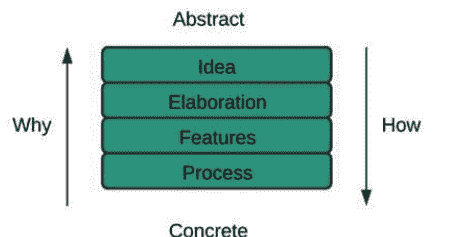

## 数据架构师角色与职责

本章中，我们将首先定义 **架构** 这一术语，以建立对该术语含义的基础理解。这将帮助我们界定其含义，让其他利益相关者达成一致，并防止角色与职责范围蔓延。随后，我们将探讨架构师的类型、他们的角色，以及他们协同工作以同时制定连贯的架构策略并为企业创造价值的重要性。通常，人们可能会提到需要解决方案架构师，但事实上，他们需要完成的工作可能更适合数据架构师，因为所需的技能集不同。因此，了解不同类型的架构师非常重要。

本章还将探讨数据架构师的职责以及在该角色中取得成功所需的软技能和硬技能。涵盖这些主题将帮助您更有效地与架构师沟通，以便为您的项目聘请合适的资源。从一开始就理解这一点将帮助您看到数据架构师和解决方案架构师技能之间有时存在的重叠，并理解何时任务可能更需要其中一个角色的技能。

本章将通过讨论数据架构师的典型一天工作来结束，这将使我们了解他们的工作以及他们面临的潜在挑战。

具体而言，我们将涵盖以下主题：

- 定义架构
- 探索架构师角色
- 为什么数据架构很重要？
- 数据架构师职责
- 数据架构师技能
- 数据架构师的一天

### 定义架构

架构是一个广泛使用的术语，对不同的人可能有不同的含义。因此，首先定义它很重要，以便在继续之前我们可以就该术语达成共同理解。术语 *架构* 被定义为设计系统、建筑物或事物的实践。在技术背景下，它指的是使用单个组件设计结构或系统的实践，目的是优化整体结构的功能、成本和性能。

从物理角度思考，设计住宅的建筑师将确定每个房间的大小，以及决定窗户的数量及其在房间中的位置。这还可能包括规划每个房间的位置以最大限度地利用空间，以及窗户应朝向哪个方向以最大限度地利用阳光。简而言之，建筑师旨在最大限度地利用空间，同时牢记最佳功能和成本。

同样，技术架构师通过利用可用组件设计解决方案，考虑每个组件的优缺点、总成本以及系统的整体性能。当然，整体系统所需的所需功能及其满足业务目标的能力也将是确定系统使用哪些单个组件的关键因素。物理架构与技术架构之间的关键区别在于，大多数技术架构过去基于瀑布方法论，因此需要大量的前期规划、需求收集和文档编写。瀑布方法论是一种线性项目方法论，其中项目被分解为阶段，在大多数情况下，下一阶段不能开始，直到上一阶段完成并签署交付物。随着敏捷和其他方法论的出现，重点现在转向设计可扩展且可以快速适应不断变化的市场条件的解决方案。这一点很重要，因为为了在全球经济中保持竞争力，企业不能花费数周甚至数月来更新其系统。

对于企业而言，架构需求因企业试图解决的问题的需求和阶段而异。多年来，技术专业人士已认识到这一点，并将架构划分为多个领域。鉴于我们的讨论主题是数据架构师的角色，有必要讨论架构的各个领域，因为它们相互关联并相互施加约束。

在后续章节中，我们将探讨数据架构的重要性，以及不同类型的架构师、他们的角色以及他们负责生成和维护的一些交付成果。这将使我们更好地理解职责差异，并体会架构师类型如何融入企业的架构拼图中。

### 探索架构师角色

架构师与业务系统一样历史悠久。多年来，他们的头衔可能有所不同，例如系统分析师、技术分析师等，但从根本上说，他们始终在设计可扩展且高效的系统。今天，头衔变得更加细化，出现了多种专注于各自领域的架构师。理解每种类型非常重要，因为这将帮助我们与他们更好地沟通，并使我们能够让其他利益相关者也达成共识。

### 业务架构师

**业务架构师**关注如何为企业内部和外部利益相关者创造价值。这通常涉及制作战略文档、流程图、能力图谱，以及企业或其所在行业中常用的业务术语。

### 数据架构师

**数据架构师**是本书的关键主题。当然，他们主要关注数据：数据如何组织、数据如何在内部或外部移动，以及数据在需要时如何为用户提供访问。数据架构师创建数据模型，并决定数据如何存储、消费和存档。一些数据架构师还会分析并传达如何从数据中得出对利益相关者有用的洞察和情报。典型交付成果包括数据模型、数据定义、数据流和集成。

### 解决方案架构师

解决方案架构师负责设计为利益相关者提供商业价值的系统。他们与业务架构师（BA）紧密合作，确保解决方案能够提供业务所需的商业价值。解决方案架构师的关键职责之一是识别最能满足业务需求的最佳技术。这可以包括Salesforce等打包软件，或从头开始设计定制解决方案。此类架构的交付成果包括功能和技术设计文档、系统全景图，以及与架构师提出的设计一致交付的实际软件。

### 领域架构师

这些是拥有特定技术领域专业知识的架构师。例如，信息安全（IS）架构师、技术架构师和云架构师在其各自领域拥有非常具体的专业知识，被视为领域架构师。Salesforce认证技术架构师（CTA）虽然需要具备某些领域的广泛知识，但在实施Salesforce解决方案方面是专家。

### 信息安全架构师

随着系统间数据集成变得普遍，网络安全对于企业保护其数据及由此延伸的声誉变得至关重要，IS架构师的重要性日益凸显。IS架构师负责设计、实施和维护能够保护组织网络和硬件的安全解决方案。他们定期进行不同类型的测试以识别漏洞，并在安全事件发生前主动修复。在组织安全被攻破的情况下，他们进行根本原因分析，并识别修复措施以修复这些漏洞。

### 技术架构师

技术（或基础设施）架构师关注组织向其利益相关者交付软件应用程序所需的物理基础设施。服务器、网络和基于云的基础设施即服务（IaaS）均属于此类。他们的职责包括：

- 设计和实施组织所需的基础设施解决方案
- 支持企业项目的硬件需求
- 监控生产环境，确保其通过监控吞吐量、延迟、冗余等属性以最佳状态运行

交付成果包括网络图、服务器互连图等。随着云的兴起，另一种正在兴起的架构师类型是云架构师。

### 云架构师

这些架构师主要关注企业的云战略及其实施。与技术架构师一样，他们关注实施能够支持在云上运行的软件的云解决方案。技术架构师与云架构师的关键区别在于，传统上，前者更侧重于本地系统，而后者主要侧重于云解决方案。例如，Salesforce完全运行在云上，尽管客户不必关心云的实现方式、维护计划和安全补丁，但Salesforce拥有专注于维护云基础设施的内部资源，确保其能够满足客户的需求。云架构师也是变革推动者，因为他们必须能够有效地传达使用云的好处，并具备足够的知识来解答不太熟悉云技术的人们的问题和顾虑。

让我们来看看数据架构为什么重要以及其有哪些好处。

### 数据架构为什么重要？

初级软件开发人员常见的错误是直接开始编写代码，认为设计以后可以修改以符合需求。有时，他们可能将此称为敏捷思维和方法。然而，这是一种谬误，因为一旦数据模型被定义，它将作为构建其他所需业务功能的基础；通常不能快速对其进行更改。

让我们举个例子：一个集成将数据从外部网络研讨会系统推送到Salesforce的活动成员对象中。在这里，网络研讨会系统记录某人观看直播网络研讨会的时间，并将其记录为百分比。开发人员在活动成员对象上创建了一个名为“Webinar % Attended”的数字类型自定义字段。该字段仅接受数字，因此会拒绝任何字母或特殊字符。

当集成第一次运行时，会报错，因为网络研讨会系统发送带有特殊字符% 的出席率，而Salesforce因此拒绝了它。这是一个简单的示例，用来说明数据模型需要经过深思熟虑并精心设计，不仅要考虑业务需求，还要了解系统功能和局限性。在此案例中，业务不需要**网络研讨会已完成**字段中的值进行任何计算，因此将字段类型更改为**文本**即可。然而，在大多数情况下，此类更改需要彻底分析对现有功能和集成的影响，这可能是一项耗时的工作。

此外，由于组织现在使用了大量系统，这些系统之间的数据共享（即集成）变得至关重要。合理的数据架构可以避免代价高昂的错误，例如集成两个系统，却在项目后期才发现两个系统之间数据移动频率存在技术限制。

> 重要提示
>
> 在架构中，早期的决策会影响后续决策。例如，旨在记录处理线索的团队成员的“Team Member”相关列表，应该是查找关系还是主从关系？这些是需要在前期考虑的重要设计决策，因为在构建期间，更不用说应用程序投入生产后，更改可能代价高昂。例如，当应用程序投入生产时，决定将多选下拉列表更改为单选下拉列表可能导致数据丢失。因此，我们早期的决策会影响我们后来必须做出的关于随之而来的数据丢失的决策。

数据架构的另一个考虑因素是**数据安全**。不法分子或国家赞助的行为体了解数据的价值，并试图利用漏洞谋取私利。数据架构确保在数据静止或传输过程中应用适当的安全流程和技术。现代数据架构还需要符合数据保护法规，例如**通用数据保护条例（GDPR）**和**加州消费者隐私法案（CCPA）**。

组织认识到数据的价值并从中得出洞察。将数据从一个系统移动到另一个系统并非徒劳，而是旨在实现明确的业务目标。其中最常见的目标是基于硬数据进行决策。合理的数据架构将考虑如何将众多系统的数据整合在一起，以满足业务的运营和分析需求。目前备受关注的一个热门话题（我们将在即将到来的章节中讨论）是如何实现通常称为“客户360”的单一、统一的客户视图，而数据架构在这其中起着关键作用。

### 数据架构的好处

讨论了数据架构的重要性之后，让我们来看看它带来的一些好处：

- 它为与不同利益相关者的讨论和轻松沟通奠定了基础：创建数据架构图可以促进与解决方案架构师和业务分析师（BA）的讨论。它还可以促进获得安全团队的批准，这些团队关心数据的使用方式以及数据将要跨越的边界；例如，拥有多个遗留客户关系管理（CRM）系统的跨国组织需要考虑如何在遵守通用数据保护条例（GDPR）的前提下处理数据跨大陆的移动和存储方式。

- 它在推动非功能性需求（NFR）方面发挥着至关重要的作用：NFR 与所设计系统的质量相关，例如性能、可用性和可维护性。以可维护性为例，如果架构定义明确，与存在重大缺陷的架构相比，我们可以相对轻松地增强应用程序；而在某些情况下，后者可能需要对应用程序进行彻底重新设计，这是一项成本高昂且耗时的工作。

- 它支持变更管理：变更是不可避免的。如今，内部和外部力量正以前所未有的速度推动变更。内部方面，增强请求、新业务流程和技术变革推动着这种变化；而外部方面，竞争、地缘政治变化和监管政策等原始市场力量也可能推动这种变化。拥有文档齐全、使用通用语言和标准的明确数据架构，能够帮助利益相关者快速响应变更。

- 它支持快速上手：我们在上一点中讨论的部分变更也适用于资源变动，即公司人员的流动。建立良好的架构对培训新人员非常有帮助。以一名加入销售热门招聘应用程序的 AppExchange 合作伙伴支持团队的新雇员为例。拥有数据模型并与新雇员一起审查，可以缩短资源上手所需的时间，从而为客户提供高质量的支持。

- **它是可重用的**：如果某个架构曾为某个应用程序成功使用过一次，那么它可以轻松地被企业中的其他领域采用，或用于未来类似性质的项目。架构工作既密集又耗时，对于大型项目，需要与多个利益相关者进行大量协作。重用架构可以消除或减少像第一次一样投入同样精力的需求，仅这一点就能为企业带来实实在在的美元节省。

质量方面也是如此：当你第二次或第三次重用架构时，你会思考如何进一步改进它，而不是从头重新思考架构。随着时间的推移，这种持续改进的循环会导致一种架构，这种架构会开始在公司内部作为参考架构被接受。越来越多的项目将开始采用它，或者**企业架构师（EA）**可能会将其规定为设计其他项目的起点。

了解了数据架构的重要性及其好处后，我们将在下一节中详细讨论数据架构师的职责。

### 数据架构师职责

企业架构是最高层级，也是设定指南、最佳实践和整体企业参数的起点。例如，所有集成，只要可能，都将使用企业中间件，并避免紧密耦合的点对点接口。或者，在集成两个系统时，接收系统必须从发送系统拉取数据，而不是由发送系统按固定计划将数据推送到接收系统。这直接影响数据架构师，因为在设计接口时，数据架构师需要意识到 EA 设定的这些限制。同样，如果一个系统无法直接使用点对点设计进行集成（点对点集成模式通常不鼓励使用，在其他可行选项可用时不应使用），解决方案架构师则需要考虑有哪些其他集成选项可用。

在本节中，我们将重点介绍数据架构师的职责。但是，在讨论数据架构师的角色和职责之前，了解数据架构的目标非常重要。在当今的任何企业中，通常都有大量数据生成或流入或流出企业。数据架构师的目标是设计蓝图，以安全地满足企业的短期和长期数据需求。这需要了解企业的长期愿景（业务战略），以便数据架构师可以提出和实施将数据管理与业务战略相一致，并最大限度地提高企业数据计划投资回报率（ROI）的流程。数据架构师的职责包括以下内容：

- 了解、评估和记录组织的当前状态：这是数据架构师的第一步，可能也是最重要的一步，确保他们彻底了解当前状态。这有助于识别数据流中的当前问题和集成痛点，并制定未来计划。此外，记录当前状态有助于与其他利益相关者（如 EA、解决方案架构师和业务架构师）进行沟通。这有助于从高管领导层获得项目资金。

- 为整个组织开发数据字典：数据架构师定义和维护数据字典。数据字典是数据项的清单，用于传达有关数据的信息，例如元数据。

- 将数据架构活动与企业架构保持一致：数据架构师与 EA 密切合作，以确保数据架构师采取的举措与 EA 建立的政策和指南保持一致。

- 为数据的长期存储、归档、处理和传输制定数据需求计划：数据架构师持续致力于确保组织数据在较长时间内保持可行性。他们还需要预见行业和技术变化，以确保当前采取的举措不会阻碍未来使用更新的技术，并且组织能够继续发展以应对新的市场现实。

- 指导领域架构师和外部合作伙伴以最佳方式访问数据：数据架构师协助并为可能试图访问组织数据的领域架构师和其他利益相关者提供指导。他们应围绕集成设计提供指导，并确保这些举措与 EA 的政策和指南保持一致。

- **评估应用程序**：通常，数据架构师会被要求从数据角度参与评估商用现成（COTS）应用程序。他们会查看数据流以及新应用程序将如何与数据交互。在应用程序可以与现有数据或组织正在生成的数据协同工作之前，需要进行哪些更改（如果有的话）？

- **数据治理**：数据架构师也是组织数据治理活动的重要组成部分。他们负责记录和维护与技术数据治理相关的流程，以及主数据主题领域和参考主数据的数据模型。

- **辅导和指导**：首席数据架构师可能还有专门负责某些领域的团队成员向他们汇报。这些个人，以及其他团队的个人或架构师，可能需要在数据架构相关事宜上接受辅导和指导。

- **作为供应商的主要联系人**：数据架构师还充当供应商在数据方面的主要技术联系人，特别是**主数据管理（MDM）**解决方案或其产品组合中其他以数据为中心的应用程序。

- **交付创新解决方案**：随着数据量和数据来源的快速增加，监管要求和政策也在增加，组织需要创新解决方案来解决其与数据相关的业务问题。数据架构师需要维护一个广泛的知识库，涵盖行业趋势、最佳实践以及市场上可用的工具，以提出最佳解决方案。

- **合规性**：合规性是数据架构师将花费大量时间的另一个领域。明确地说，许多组织都有数据隐私官员，他们了解隐私法律并制定要求以遵守这些法律。而数据架构师则负责技术实施，并确保数据流、存储和检索符合这些法律和组织政策。

现在我们已经了解了数据架构师的职责及其在组织中的作用，让我们来看看数据架构师需要具备哪些软技能和硬技能才能有效履行职责。

### 数据架构师技能

要在数据架构师岗位上取得成功，需要同时具备技术技能和软技能。这两类技能同等重要；如果缺少其中任何一类，就很难成为一名成功的数据架构师。但请不要担心，这些技能是可以学习的，一旦经过实践，随着时间的推移，它们会让你成为一位非常高效且成功的数据架构师。在本节中，我们将介绍成为成功数据架构师所需的技能。让我们先从技术技能开始。

### 技术技能

我们将讨论成为成功数据架构师所需的一些技术技能。请记住，这些都是高层次的技能，这是有意为之，因为否则，我们就需要列出所需的各个具体技能：

- 数据建模：定义数据模型的能力是成为成功数据架构师的必备技能。这在项目沟通或组织日常运营中，是与不同利益相关者进行沟通的非常实用的工具。了解常见且广泛使用的数据厂商模型、应用模型和行业参考模型也是一项优势。
- 数据集成：能够使用多种工具设计有效、安全且可扩展的集成，并了解各种集成概念，例如 pub/sub、request/replay、批处理和发送即忘。
- 数据处理：理解和设计输入数据并输出有意义信息的流程，是一项对数据架构师日益重要的技能。随着组织多年来存储的海量数据不断涌现，了解如何最好地利用这些数据为决策者提供深刻洞察，对数据架构师来说至关重要。

这些是数据架构师需要的一些高层次技术技能，但通常，他们还需要具备编程技能，例如使用 Python 或其他语言，有数据挖掘和建模工具的经验，并理解操作系统。

### 软技能

在本节中，我们将讨论卓越数据架构师的性格特质。这里可能没有列出所有特质，但这些是优秀数据架构师应具备的一些关键个性特质：

- **问题解决**：数据架构师面临着大量的数据问题。因此，他们必须能够运用初学者心态来解决这些问题。包括积极倾听以及清晰阐述问题及解决方法的沟通技巧，也是塑造成功数据架构师的特质。了解如何使用系统思维解决问题也是一项非常宝贵的技能。简而言之，系统思维是指理解系统中的各个部分与它们各自独立时表现出的行为不同。利用系统思维，并能够以足够细节和传达建模者意图的方式对系统进行建模，是解决问题时的一项关键优势。

- **讲故事**：这是一项基本技能，能够轻松地与不同的技术和非技术利益相关者沟通。能够使用故事和隐喻向受众传达信息，使非技术受众容易理解主题内容，这有助于快速与利益相关者建立良好关系。

- **客观性**：在保持情绪受控并使其排除决策过程之外的同时，能够客观地思考和行动，是数据架构师的一项重要技能。通常，你将与其他技术资源人员互动，他们可能更偏好某个解决方案而非另一个。能够客观地分析每个选项，并在考虑每个选项后提出建议，将赢得利益相关者的尊重和信任。

- **战略思维**：数据并非只存在一两个月，而是企业最关键的资产之一，应该被如此对待。这需要理解当前和未来的业务需求以及组织正在采取的方向。它还涉及预测行业及其最佳实践的未来趋势。

- **适应性**：数据架构师应该灵活；他们应该能够适应变化并在快节奏的环境中工作。许多组织没有建立必要的纪律和治理流程，从数据角度来看，这会导致非常混乱的环境。数据架构师必须能够梳理这些情况，理解所需内容，并交付能为业务增加价值的成果。

- 领导力：作为架构师，你将被期望负责设计和开发最佳解决方案，如果你独自完成所有工作，这倒也没什么，但现实世界并非如此。在许多项目中，你将与一支由架构师、开发人员、业务分析师和其他利益相关者组成的团队合作。你的决策可能会受到挑战，某些决策的依据也会被质疑。你该如何应对？利用你的技术或职位权威来强推你的决策？这在短期内可能有效，但从长远来看，你将面临团队更多的挑战，并且在这个过程中可能会失去尊重。拥有能够通过激励人们做正确的事来让他们追随你决策的领导力，是更好的长期方法。这需要通过*言行一致*并与同事保持透明来建立信任。请记住，你不需要正式职位才能成为领导者；相反，无论你在公司担任什么职位或头衔，都可以影响他人。

- 分析能力：数据架构师需要善于观察，并具备及时高效地调查问题并找到最优解决方案的能力。这项技能非常重要，因为能够从各种来源收集数据、筛选无关信息并分析其余部分以找到问题根本原因，这可能意味着提出能够解决问题的方案与浪费时间和精力之间的区别。

我想进一步探讨的一件事是**沟通**：有效沟通的障碍以及可用于高效沟通的著名七个 C。这些的重要性无论如何强调都不为过，因为除非你是一名高效的沟通者，否则你成为成功数据架构师的成效将不尽相同，并且你将面临挑战。现在，让我们在下一节中了解这些内容。

### 有效沟通的障碍

从醒来到入睡，我们大多数人都在与生活中的人进行沟通。沟通不仅限于口头表达，如今还可以通过肢体语言甚至社交媒体进行。

著名的公关公司 PRvoke Media 估计，在美国和英国接受调查的 400 家公司（员工 10 万+）中，损失了惊人的 370 亿美元，根据报告，这可能只是冰山一角——实际损失可能要多得多。让我们来看看一些主要的沟通障碍。识别这些障碍将有助于你在下次进行演示、进行全球团队通话、与孩子讨论或在工作中辅导下属时更加意识到并更加谨慎。

### 物理障碍

这些是由物理条件引起的沟通障碍，例如，如果你的车在高速公路上抛锚，你正在与拖车司机交谈。除非你大声说话，否则你可能是在告诉司机把你的车拖到你家，但他们可能听错了，把车拖到了修车厂。另一个例子是，当你有一场重要的演示需要进行，而你的老板在演示前 5 分钟给你发邮件，要求你删除一张幻灯片，但没有说明是哪一张。你试图给他们发送即时消息，但服务已中断。你以为他们指的是图表太多的那张幻灯片，于是把它删除了，但在会议结束后才发现，实际被删除的其实是另一张。

当人们无法进行面对面交流时，这种障碍感尤为明显；例如，在 COVID-19 大流行期间，人们只能通过电话、短信、电子邮件或视频会议进行沟通。尽管视频会议非常有效，但与非语言线索（如肢体语言、眼神交流和手势）相关的重要信息仍可能丢失，而所有这些都是沟通不可或缺的组成部分。

### 心理障碍

这是一种由于心理问题导致沟通无法有效进行的障碍类型。一种相对常见的表现是，当你注意到同事工作表现不佳，并发现他们正面临债务问题或更糟的是离婚时。或者，当你在会议中，与会者之一似乎心不在焉，并且在被提问时感到有些尴尬。事后与他们交谈时，你得知他们那天开车去办公室时目睹了一起可怕的事故。

### 语言障碍

这种障碍类型与说话者和听话者的语言有关。假设说话者是以英语为母语的人，而听话者英语水平不高；说话者可能说了一件事，而听话者可能理解成另一件事。这也可能受到不同方言的影响，因此语言可能相同，但方言之间的差异可能非常大，以至于一种方言的说话者可能很难理解另一种方言的说话者。

### 语义障碍

此障碍与词语的含义和解释有关。说话人和听话人对所使用的词汇或术语拥有相同的理解很重要。如果学校辅导员正在辅导一名学生，并说“你需要在人生中翻开新的一页”，除非学生知道这个习语的含义，否则说话人使用这个习语的意图就会丧失。另一个常见的例子是使用流行语或短语，这些在技术领域尤其普遍。使用“吃你自己的狗食”这个短语，指的是在内部使用你自己销售给客户的软件。除非得到适当解释，否则对于不知道这个短语的听话人来说，这听起来可能令人反感且可恶。这就是为什么你应该尽可能避免使用流行语和习语，以确保你的听话人不会感到困惑，沟通也不会丢失。

### 信息过载障碍

当施加在一个人身上的信息处理需求超过其妥善处理这些信息的能力时，就会发生这种障碍。当我们收到电子邮件、Slack 消息、短信和会议提醒，并感到工作量让自己快要被淹没时，许多人都能感同身受。这在组织不够好的项目中也会发生，例如，BA 可能会通过电子邮件、刚刚结束的会议、即时消息，或者有人在他们工位旁停留 2 分钟口头传达，收到类似的需求。这可能导致重要信息要么被完全遗漏，要么与另一个需求混淆。

### 文化障碍

这些障碍与不同文化有关，随着工作场所多样性的增加，你很可能会与来自不同文化背景的人打交道。这就是为什么识别这些障碍很重要，以确保你的沟通被理解且有效。文化障碍的例子包括严格遵守组织层级，以及对经理上司的问题谨慎地回答，因为你之前在另一个国家工作时的文化规范是，所有向上或向下的沟通都应通过你的直接经理进行。另一个例子是，在某些文化中，任何比你职位高的人都应该被称为先生或女士。第三个例子是，在某些文化中，与异性交谈时进行眼神交流是失礼的，而在另一些文化中，不进行眼神交流则被视为失礼，并可能被解读为撒谎或试图隐瞒某事。

现在我们已经了解了这些障碍，让我们来看看什么构成了有效的沟通，这些沟通可以用来缓解这些障碍，并使我们的信息易于理解并被采取行动。

### 有效沟通的七个 C

沟通的七个 C 为我们提供了一种有效沟通的方式，并提供了具体的指标来评估我们是否沟通有效。七个 C 也是管理上一节讨论的沟通障碍的有效工具。把它们当作检查清单，以确保你的下一次演示、演讲、电子邮件，甚至是发给孩子的一条简单短信都能被理解。请记住，沟通最重要的目标是将你的信息传达给受众。

### 清晰性

为你的信息设定明确的目标和目的。想想斯蒂芬·柯维的一句名言可能会有所帮助：以终为始。思考你希望听话人在信息结束时做什么。鉴于人类大脑一次只能理解有限的信息量（想想之前讨论过的信息过载障碍），尝试将你的信息分解为听话人容易理解的部分。

### 简洁性

保持你的信息简洁简短。如果你写了一封包含 3 段和 19 行的电子邮件，是否可以用 1 段和 5 行传达相同的信息？以下是一些啰嗦句子的例子：

*大流行病在社会上引起了大量的焦虑和频繁的心理健康问题。*

*内城社区儿童通常遭受的贫困导致安娜深入思考如何在她所在的社区带来改变。*

以下是简洁句子的例子：

*大流行病在社会上引起了强烈的焦虑和健康问题。*

*看到内城社区孩子们的痛苦，安娜想到了可以改善她社区的方法。*

### 具体性

这涉及所传递信息的精确程度。避免歧义有助于受众理解信息并据此行动。你还可以在此提供事实和数据，以确保信息被理解。举个例子：根据研究公司 IDC 的数据，Salesforce 及其生态系统将在 2019 年至 2024 年间创造 420 万个新就业岗位。提供这个研究参考，比说未来几年 Salesforce 生态系统将产生大量就业岗位要好。

### 连贯性

这涉及信息的开头、主体和结尾彼此对齐的程度。这可能是公司高层管理层层层传递的沟通信息原本意图是一回事，但到达底层时很容易被误解的原因之一，因为原始信息不连贯，其中存在矛盾，或者观点之间没有相互关联。

### 礼貌性

在沟通中表现出尊重和礼貌，将有助于你顺利传达信息，并使受众更愿意接受和采纳你的信息。他们会更愿意采取行动或批准你的提案。尝试在沟通中做到包容，使用体现包容性并被认为在文化上可接受的词语。

### 完整性

这涉及信息的完整程度。它是否包含受众采取行动所需的信息？你是否在话题之间跳跃，让听话人不清楚对他们的期望是什么？

### 体谅性

考虑你的受众并相应地呈现材料。事先尝试了解你的受众：他们的观点、意见或限制是什么？尝试设身处地为他们着想，并试着表现出同理心。这可以帮助你构建信息，使其更容易被受众理解和接受。许多人在呈现适量信息方面存在困难。抽象阶梯是一个可用于确定呈现适量信息的心智框架。如下图所示，你在阶梯上的位置越高，想法就越抽象；你在阶梯上的位置越低，想法就越具体：

图 1.1 – 抽象阶梯

该图描绘了你如何在抽象阶梯上移动，并为你的受众量身定制信息。通常，C 级高管希望了解原因，并将实施细节留给他们的直属下属。

让我们看一个例子：

- 想法：我们希望改善客户服务。
- 详细阐述：向客户提供全渠道体验。必须满足客户服务水平协议 (SLAs)，系统应促进满足 SLAs。产品开发团队需要知道进入的案件性质，以了解故障排除工作应集中在哪里。
- 特性：无论客户使用哪个渠道联系支持，都会向客户发送反馈调查。可以直接从 Facebook 等社交媒体应用程序创建案例。系统应能够存储客户权利，并在适当的时间发送提醒和升级通知。产品开发团队可以运行报告和仪表板，以评估正在打开的案件性质以及解决问题所花费的平均时间。
- 流程：客户可以发送电子邮件或在网站上填写表单来创建案例。这将在 Salesforce 中创建一个案例，并使用案例分配规则将其分配给相关团队。权利流程有助于确保你的团队遵循有条理的流程来解决客户案例并满足他们的 SLAs。

我们已经了解了沟通的七个 C 和抽象阶梯，以便量身定制我们的沟通，使其更加有效。在下一节中，我们将探讨成为数据架构师的道路。

### 成为数据架构师

成为数据架构师可能有不同的路径，很难定义一套固定的步骤来成为一名数据架构师，但以下是大多数人在成为数据架构师的道路上所采取的路径：

- 教育：绝大多数数据架构师工作要求计算机科学或信息技术专业的学士学位，侧重于与数据分析、数据建模和分析相关的课程。学习期间的实习非常有益，有助于开启你作为数据架构师的职业生涯。商业智能与分析硕士学位可以进一步加深你对学科内容的理解。

- 经验：这或许是成为一名出色的数据架构师所需的最重要组成部分之一，但这可能具有挑战性。原因是，大多数公司在你成为初级数据架构师或分析师之前，都要求具备一定的实际工作经验。可以打个比方：先有鸡还是先有蛋？如果你没有经验，大多数公司不会考虑你，而如果你找不到工作，你就不会有经验。在大学期间尽可能多地做实践项目并参与合作教育项目，在一定程度上可以缓解这一问题。

- 培训：报名参加专注于数据相关功能的培训项目，也有助于加深你对学科内容的理解。参加由 DAMA（数据管理协会）举办的培训课程或研讨会，能为你的职业发展或进入数据领域打下良好基础。

- 认证：数据架构师有许多可供选择的认证，但由于本书主要面向 Salesforce 数据架构师，数据架构与管理认证考试对理解 Salesforce 数据建模和设计基础、在 Salesforce 中管理数据、数据迁移以及各种其他数据相关主题非常有帮助。不过，我建议先参加 Sharing and Visibility Designer 考试，因为它包含一些有用的数据相关方面，并能帮助你逐步深入前者所涵盖的更广泛、更深入的主题。

在下一节中，我们将了解数据架构师一天的生活。

### 数据架构师的一天

在本节中，我们将探索数据架构师一天的生活。正如我们在简介中所述，这可以帮助我们理解并把数据架构师所做的一些事情放在语境中。它还可以帮助我们以实用的方式阐述他们的职责。请记住，这只是关于数据架构师如何度过一天的一个大致概念，不应被视为他们完成职责的确切步骤：

早晨可能如下：

- 为与订单履行相关的增强项目记录拟议的数据模型。为企业架构师、IS 架构师、集成架构师及其他技术利益相关者准备演示文稿。
- 与企业架构师（EA）和其他领域架构师每周开会，以使现有政策和指南以及可能正在考虑的新政策和指南保持一致。
- 与集成架构师和 System, Applications, and Products (SAP) 解决方案架构师一起参加项目会议，旨在将工作订单和发票与 SAP 和 Salesforce 集成。

下午可能如下：

- 分析运营部门的需求，这些需求涉及访问数据仓库中用于报告的机会（Opportunity）和机会产品（Opportunity Products）数据。机会数据超过 500 万行。
- 处理归档机会（Opportunity）和机会产品（Opportunity Products）数据的请求。研究使用大对象、Heroku 或其他可用选项的优缺点。
- 了解 Einstein Analytics 的功能，探索其用例以及它如何满足组织的分析需求。同时，探索 Salesforce Tableau 及其报告功能，以满足使用原生报告和仪表板功能难以实现的报告需求。
- 展示订单履行项目的拟议数据模型。回答问题并寻求团队反馈。

在本节中，我们了解了数据架构师的一天，以便更好地理解该角色、他们与组织中其他利益相关者的互动，以及在该角色中取得成功所需的研究和原型设计的一点概况。

### 摘要

在本章中，我们回顾了不同类型的架构师，然后重点介绍了数据架构师、他们的职责，以及在该角色中取得成功所需的技术技能和软技能。希望你对数据架构师是什么、他们的角色在当今组织中有多么关键，有了更深刻的认识。我们还回顾了架构的一些好处，这应该能让你（如果尚未相信的话）确信，为项目拥有合适的架构是成功的关键要素。

我们随后回顾了有效沟通的障碍以及沟通七要素的运用，以帮助我们进行有效沟通。这应能为你提供一种客观的方式来构建你的回应，并评估可以提升沟通技能的领域。根据我的经验，技术人员面临的一个关键挑战是根据受众定制他们的沟通方式。抽象阶梯是一个极好的工具，可以帮助你了解受众，从而根据受众调整沟通方式，提高其可理解性和可接受性。请记住，沟通的最终目标是按预期传达信息，并让接收信息的受众予以接受。

数据架构师的角色日益重要和令人兴奋，并伴随着许多挑战和成长机会。我鼓励你加入当地的 DAMA 分会，这是一个致力于推进信息和数据管理理念的全球非营利组织。他们中立不偏任何厂商，涵盖了影响数据的各种主题。

在下一章中，我们将回顾与 Salesforce 中对象相关的基本概念以及不同的字段类型和关系。接下来，我们将回顾 Salesforce 中的数据建模，以及为什么如果你之前使用过关系型数据库，就应该 *摒弃已有认知* 一些你所学的内容。最后，我们将了解 Salesforce 架构以及协同工作的不同组件，这些组件共同提供最佳用户体验。

### 问题

- 1. 精密印刷公司（Precision Printing, PP）在过去几年中呈指数级扩张。随着扩张，企业中使用的系统列表越来越长，业务用户获得可操作洞察也变得越来越具有挑战性。企业架构师（EA）办公室（由业务架构师和首席架构师组成）已被指派解决分析问题。立即，EA 办公室应聘请哪种类型的架构师？
  - a) 云架构师
  - b) 技术架构师
  - d) 数据架构师
  - c) 业务架构师

- 2. 数据架构师应定义组织中所有数据的安全标准，包括遵守组织所受的数据相关法规（正确/错误）。

- 3. 钴太空探索公司（Cobalt Space Exploration Inc.）正在招聘一个角色，以帮助他们围绕数据治理制定标准，从而提高数据质量和数据管理。哪个角色可以帮助实现上述目标：
  - a) 解决方案架构师
  - b) 业务架构师
  - c) 云架构师
  - d) 数据架构师

### 延伸阅读

- 糟糕沟通的代价，https://www.provokemedia.com/latest/article/the-cost-of-poor-communications
