## 2 理解 Salesforce 对象和数据建模

在本章中，我们将探讨数据建模和 **规范化** 的概念。这将为我们理解 Salesforce 与过去我们可能使用过的传统关系型数据库的不同之处奠定基础。我们将回顾 Salesforce 为何违背数据规范化的惯例，以及数据为何是 **非规范化** 的，以及在 Salesforce 平台上这样做的好处。我们还将介绍 Salesforce 中的不同关系类型以及与数据建模相关的其他 Salesforce 功能。扎实的理解将为即将到来的章节打下基础，届时我们将讨论 API 和 **大数据量（Large Data Volumes, LDVs）**。

### Salesforce 平台

在整本书中，我会在多个地方将 Salesforce 称为 Salesforce 平台或平台。当我这样做时，我指的是 Salesforce Cloud 或 Service Cloud 使用的包括硬件和软件在内的核心 Salesforce 服务。这一点很重要，因为还有其他 Salesforce 服务是基于不同基础设施提供的，例如 Heroku、Mulesoft 等。


在本章中，我们还将回顾 Salesforce 平台架构。本章学到的内容将帮助我们理解平台架构之所以这样设计的原因。如果我们想要以高效且可扩展的方式利用平台，理解这一点至关重要。

本章结束时，我们将回顾 Salesforce 中可用的不同对象类型以及何时使用它们，同时回顾可用的不同字段类型。这将有助于了解平台在对象和字段方面的深层功能，以及可以在平台上定义的关系。

总之，我们将重点介绍以下主题：

- 探索数据建模
- 理解 Salesforce 平台架构
- Salesforce 对象简介

让我们开始了解数据建模。

### 探索数据建模

**数据建模**是分析组织信息系统中支持业务需求所需数据需求的过程。这涉及分析各种数据对象及其之间的关系。数据建模提供数据及其元素之间关联的可视化表示。让我们更详细地了解什么是数据模型，以及不同类型的数据模型和数据建模的优势。

### 什么是数据模型？

数据模型是数据元素、其关系及其属性的可视化表示；例如，笔记本电脑是一个数据元素，主板是另一个数据元素，RAM 是另一个示例，依此类推。笔记本电脑有一根或多根 RAM 条将被定义为两者之间的关系。在大多数笔记本电脑中，只有一块主板，这既是主板与笔记本电脑之间的另一种关系，也是一种约束，表明一台笔记本电脑只能有一块主板。在下图中，我们有三个相互关联的对象：


图 2.1 – 一对一和一对多关系示例

主板和笔记本电脑之间具有一对一关系，而笔记本电脑和 RAM 实体具有一对多关系，这意味着一台笔记本电脑可以拥有一个或多个 RAM。

数据模型很重要，有助于与利益相关者沟通，但让我们更深入地了解数据模型的优势。我需要提醒一点：这里提到的优势具有通用性，可能不完全适用于 Salesforce。这是因为 Salesforce 具有自己管理数据库的复杂方式，我们将在稍后提及。

- 估算复杂性：数据模型提供了一种估算软件复杂性的良好方法，并能有助于理解开发或增强应用程序所涉及的工作量和相关风险。考虑一个拥有 5 个数据库表的应用程序与拥有 35 个表的应用程序。可以合理地认为，拥有 35 个表的应用程序会更复杂，增强它需要谨慎的方法和一些分析，以减少在最终产品中引入回归的风险。

- 最优设计：数据模型还有助于构建尊重系统边界的应用程序。这里的系统边界是指以最佳方式放置元素来设计组件；例如，开发人员可能尝试使用应用程序代码来强制字段唯一性，而使用数据模型，您可以轻松地在数据库级别强制执行。这会带来更少的代码和系统维护。

- 标准化：数据模型提供了一种标准化的方式来记录您的应用程序，可以便于长期维护并协助培训新人员。

- 风险管理：在少数资历深的人员对应用程序及其数据库结构有更深入了解的情况下，数据模型可降低对企业的风险。拥有最新的数据模型可以保持企业的竞争力并快速响应变化。

- 成本：数据模型通过捕获稍后在最终应用程序中会显现的错误和问题来降低成本。在软件开发生命周期中，早期修复问题的成本始终更低且更容易，而不是在应用程序开发完成后再修复。一旦应用程序开发完成，对数据模型进行根本性更改可能非常昂贵、耗时，并且需要进行大量的影响分析，以确保现有集成和功能不会中断。

- 质量保证：数据模型能产生高质量的应用程序，因为它避免了直接开始编码这一典型错误，这是许多软件项目失败的根源。经过深思熟虑的数据模型提供了考虑实体之间不同关联方式并设计最优数据模型的机会。

- 解决方案认可：一个与不同利益相关者协作开发的定义明确的数据模型，能在团队内部创造认可和信任，这直接影响团队的参与度和积极性。所有参与者都觉得自己有所付出并为自己的任务负责，这也带来了更高质量的工作。

- 上市时间：数据模型可以缩短新应用程序的上市时间。在 COVID-19 大流行期间，许多开发医疗应用程序的软件公司纷纷赶紧开发可供卫生部门用于接触者追踪或使公司能够促进员工返岗工作的应用程序。上市时间是一个明显的差异化因素，如果开发了应用程序但没有完善的数据模型，它将面临许多问题并导致公司错失收入机会。

- 促进集成：随着公司的发展，它们使用的系统数量也在增加，因此集成这些系统的需求也随之增加。拥有数据模型可以大幅缩短集成不同系统所需的时间。

如上所述，数据建模与众多优势相关联，可以帮助组织保持对不断变化的市场条件的响应能力。沟通始终是组织内部的一个持续挑战，数据建模可以帮助缓解部分挑战，同时提供一个可用于从不同利益相关者那里获得认可的平台。

在下一节中，我们将了解不同类型的数据模型及其目的。

### 数据模型类型

有三种数据模型，每种都有其独特的特征和目的：

- 概念数据模型
- 逻辑数据模型
- 物理数据模型

了解这些可以帮助我们确定使用哪个级别来最佳满足我们的需求。让我们逐一了解。

### 概念数据模型

这种数据模型是应用程序中实体及其之间关系的最抽象的可视化表示。它通常用于与业务用户沟通，因为它简单直接，且不与任何特定数据库或技术相关联。使用第 1 章“数据架构师 - 角色和职责”中介绍的招聘应用程序示例，实体代表 Job 或 Candidate 对象，而关系定义了实体之间的关联方式。在我们的示例中，Candidate 实体通过 Applicant 对象与 Job 实体相关联。Applicant 是一个连接对象，我们将在后续章节中讨论。下图显示了一个显示连接对象的概念数据模型示例：


图 2.2 – 显示连接对象的概念图示例

如前图所示，在概念数据模型中，只列出实体的名称。

### 逻辑数据模型

这是概念数据模型的下一个级别，因为它包含更多细节，包括属性及其类型。例如，使用我们的招聘应用程序示例，Candidate 实体（对象）将为每个候选人拥有 Name、Email、Phone 和其他属性。

同样，Job 实体可以拥有 Job Description、Job Title 和 Grade 作为属性。有时，每个属性的数据类型和长度也会被定义；例如，Name 可以是 100 个字符，Phone 可以是 10 个字符长度，等等。这有时也由数据架构师或业务分析师开发，并可用于轻松与业务利益相关者沟通。与概念模型类似，这种类型的数据模型也与数据库无关。下图显示了一个逻辑数据模型示例：

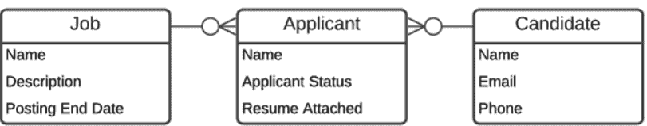

图 2.3 – 逻辑数据模型示例


如前图所示，逻辑数据模型包含更多细节，包括属性（Salesforce 中的字段）的名称。有时，也会列出每个属性的数据类型和长度。

### 物理数据模型

这是数据建模中最详细的层次，主要用于实际构建数据库。在物理层级，实体实际上是表，而属性是这些表中的列。在可视化表示这种数据模型时，惯例是使用表和列的实际数据库名称，以及每个属性的数据类型。此级别还包括索引、触发器（与我们在 Salesforce 中构建的触发器不同，尽管理念相似）和约束。我不会展示此类示例，以避免造成混淆，因为当你在 Salesforce 的前端创建对象时，你实际上是在向数据库发送命令，以创建带有其列、主键和约束的表。我们将在本章后面了解所有这些是如何工作的。下面是我们招聘应用的一个物理数据模型示例：

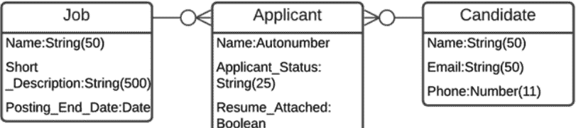

图 2.4 – 物理数据模型示例

如前图所示，物理数据模型显示每个属性（字段）的实际名称以及数据类型和长度。既然我们了解了数据模型，让我们来看看规范化和反规范化的概念。

### 规范化

**规范化**是一种用于组织数据的数据库技术，其中大表被分成较小的可管理的表，并使用关系将它们链接起来。这样做的原因是维护数据完整性并消除数据冗余。规范化理论涵盖了从第 1 范式（1NF）、2NF、3NF 到 5NF 的不同规范形式，但对规范化的详细讨论超出了本书的范围。

然而，我想看看为什么这种方法被广泛使用的一些示例，大多数应用程序将在 3NF 达到最佳规范化。理解这一点将使你深入了解 Salesforce 架构，并领会平台的强大功能。

### 范式

数据库中重复数据效率低下，会导致数据库大小增加，并且在插入、删除等数据库操作期间可能导致数据不一致。数据库范式是解决此问题的答案，其核心是尝试尽量减少数据库中的数据冗余。

在采用范式时，理念是一个事实只存在一个位置，该事实只需插入一次，然后在单个位置进行更新或删除，而无需在整个数据库中重复它。

3NF（第三范式）是一种数据库设计方法，其目标是减少数据重复并实现数据完整性。3NF 方法定义表中的任何属性都不应依赖于非主键。要了解有关 3NF 的更多信息，请参阅数据管理知识体系（DMBOK）或在互联网上搜索。

要理解这个示例，我们需要在非 Salesforce 的上下文中查看它，以便可以应用一些规范化原则。使用我们的招聘应用示例，假设你有以下 Job 表，其中包含已发布工作的详细信息：

| 唯一 ID | 职位名称 | 雇佣经理 | 雇佣经理电话 | 雇佣经理位置 |
| --- | --- | --- | --- | --- |
| 123 | SQL 架构师 | James Murthy | (232) 232-2323 | 芝加哥 |
| 345 | .NET 开发人员、技术主管、首席顾问 | James Murthy | (232) 232-2323 | 芝加哥 |
| 897 | UI 开发人员 | James Murthy | (232) 232-2323 | 芝加哥 |
| 231 | 业务分析师 | Grant Simpson | (301) 545-4454 | 纽约 |

图 2.5 – 反规范化示例

如前表所示，**雇佣经理**、**雇佣经理电话**和**雇佣经理位置**的值在前三条记录中重复。这是数据冗余，在最佳规范化的数据库中是不可取的。它还会导致插入、更新和删除相关的异常，并存在造成数据丢失的真实风险。让我们详细了解这些不同的异常，并理解它们在规范化数据模型中为什么不可取：

- **插入异常**：假设在前面的示例中，James Murthy 又发布了一个职位，但新招聘人员没有输入雇佣经理的电话和位置。除非这些字段在数据库级别或应用程序级别是必填的，否则你现在会有一行包含两个空白列。还要注意，如果 James 有 20 个新职位发布，我们将重复最后三列（雇佣经理、雇佣经理电话和雇佣经理位置）20 次，这明显是资源浪费。

- **更新异常**：假设 James Murthy 离开公司，那么我们现在需要使用新雇佣经理及其详细信息更新 23 条记录。如果我们错过任何记录，就会出现数据质量问题。

- **删除异常**：如果我们在 7 年后从 Job 表中删除记录，我们不仅会丢失职位详细数据，还会丢失与雇佣经理相关的详细信息。

我们已经了解了规范化及其使用原因。现在让我们花一些时间来理解反规范化以及为什么在 Salesforce 中使用它。

### 反规范化

如果你曾在关系型数据库中工作过，你就知道数据冗余是不可取的，而范式用于确保数据库没有冗余数据和我们之前讨论的异常。与之形成对比，**反规范化**是在数据库中提高读取性能而非写入性能的过程。正如我们稍后将看到的，这是通过以有组织的方式向数据库添加冗余数据来提高读取性能实现的。

例如，客户的电子邮件将在表中只存储一次，然后，使用所谓的 **连接**，它将与其他表的行合并。然而，在 Salesforce 中，**Email** 字段在对象之间被复制。这是故意为之，因为 Salesforce 针对读取操作进行了优化，因此当你运行 **Salesforce 对象查询语言 (SOQL)**、打开列表视图或打开联系人时，这些都是在查询数据库。针对读取操作进行设计主要会导致数据加载速度快，而通常其他数据库是针对写入操作进行优化的。并且，因为在 3NF 数据库上的读取操作需要大量连接，这在性能方面代价高昂，所以 Salesforce 采用了扁平数据库结构。

扁平数据库的特征是你会有数据元素被复制——这明显违反了规范化原则。Salesforce 实现这一点的方式确实令人印象深刻，但我们将把该讨论推迟到本章后面的部分。

延续我们关于 **Email** 字段的示例，你将在以下截图中看到，它存在于 **Lead** 对象上，然后另一个单独的 **Email** 字段在 **Contact** 对象上，还有一个单独的 **Email** 字段在 **Campaign Member** 对象上。但现在这一切都应该说得通了，因为请记住，我们希望快速读取数据，为了实现这一点，应尽可能避免表之间的连接，而像这样扁平化数据库是一种有效的方法。在以下几个截图中，我们将看到 **Email** 字段是如何在多个对象上复制的——这明显违反了规范化原则：

### Lead 字段

此页面允许你指定可以出现在 Lead 页面上的字段。你最多可以创建 500 个 Lead 自定义字段。

请注意，删除自定义字段将删除使用该自定义字段的任何筛选器。它还可能更改依赖于自定义字段数据的分配或升级规则的结果。

| 操作 | 字段标签 | 字段名称 | 数据类型 | 控制字段 | 已编入索引 |
| --- | --- | --- | --- | --- | --- |
| 编辑 | 地址 | Address | 地址 | | |
| 编辑 | 年收入 | AnnualRevenue | Currency(18, 0) | | |
| 编辑 | 活动 | Campaign | Lookup(Campaign) | | |
| 编辑 | 清洁状态 | CleanStatus | 选取列表 | | ✓ |
| 编辑 | 公司 | Company | Text(255) | | ✓ |
| 编辑 | 公司 D-U-N-S 编号 | CompanyDunsNumber | Text(9) | | |
| 编辑 | 创建者 | CreatedBy | Lookup(User) | | |
| 编辑 | D&B 公司 | DandbCompany | Lookup(D&B 公司) | | ✓ |
| 编辑 | Data.com 密钥 | Jigsaw | Text(20) | | |
| 编辑 | 描述 | Description | 长文本区域(32000) | | |
| 编辑 | 不要来电 | DoNotCall | 复选框 | | |
| 编辑 | 电子邮件 | Email | 电子邮件 | | ✓ |

图 2.6 – Lead 对象上的 Email 字段


注意，线索对象上带有电子邮件字段。在以下截图中，联系人对象上也带有电子邮件字段：

### 联系人字段

此页面允许您指定可出现在“联系人”页面上的字段。您最多可创建 500 个联系人自定义字段。

请注意，删除自定义字段将删除使用该自定义字段的任何筛选器。它还可能更改依赖于自定义字段数据的分配规则或升级规则的结果。

| 操作 | 字段标签 | 字段名 | 数据类型 | 控制字段 | 已索引 |
| :--- | :--- | :--- | :--- | :--- | :--- |
| 编辑 | 账户名称 | Account | 查找(账户) | | ✔ |
| 编辑 | 助理 | AssistantName | 文本(40) | | |
| 编辑 | 助理电话 | AssistantPhone | 电话 | | |
| 编辑 | 出生日期 | Birthdate | 日期 | | |
| 编辑 | 清理状态 | CleanStatus | 选择列表 | | ✔ |
| 编辑 | 联系人所有者 | Owner | 查找(用户) | | ✔ |
| 编辑 | 创建者 | CreatedBy | 查找(用户) | | |
| 编辑 | Data.com 密钥 | Jigsaw | 文本(20) | | |
| 编辑 | 部门 | Department | 文本(80) | | |
| 编辑 | 描述 | Description | 长文本区域(32000) | | |
| 编辑 | 拒绝来电 | DoNotCall | 复选框 | | |
| 编辑 | 电子邮件 | Email | 电子邮件 | | ✔ |


前面的截图中的联系人对象带有电子邮件字段。到此，您将注意到电子邮件字段被重复了两次。在以下截图中，电子邮件字段再次出现，这次出现在活动成员对象上：

### 活动成员字段

此页面允许您指定可出现在“活动成员”页面上的字段。您最多可创建 500 个活动成员自定义字段。

请注意，删除自定义字段将删除使用该自定义字段的任何筛选器。它还可能更改依赖于自定义字段数据的分配规则或升级规则的结果。

| 操作 | 字段标签 | 字段名 | 数据类型 | 控制字段 | 已索引 |
| :--- | :--- | :--- | :--- | :--- | :--- |
| 编辑 | 活动 | Campaign | 查找(活动) | | ✔ |
| 编辑 | 城市 | City | 文本(40) | | |
| 编辑 | 公司(账户) | CompanyOrAccount | 文本(255) | | |
| 编辑 | 联系人 | Contact | 查找(联系人) | | ✔ |
| 编辑 | 国家 | Country | 文本(80) | | |
| 编辑 | 创建者 | CreatedBy | 查找(用户) | | |
| 编辑 | 创建日期 | CreatedDate | 日期/时间 | | |
| 编辑 | 描述 | Description | 长文本区域(32000) | | |
| 编辑 | 拒绝来电 | DoNotCall | 复选框 | | |
| 编辑 | 电子邮件 | Email | 电子邮件 | | |


前面的截图中的活动成员对象又有一个电子邮件字段。到目前为止，我们已在三个不同的对象（线索、联系人和活动成员）上看到三个 **电子邮件** 字段。在规范化数据库中，三次重复 **电子邮件** 字段会被视为不可接受，但由于 Salesforce 针对读取操作进行了调优，因此设置冗余字段是有意义的，这样只需最少数量的连接即可返回查询结果并提高查询性能。

反规范化的另一个优势是，尽管数据重复，但数据可用于报告。考虑线索映射过程的示例。简而言之，我们在线索对象上拥有数据，这些数据映射到账户、联系人和机会，因此当线索记录转换时，数据会从线索对象复制到账户、联系人和机会对象。这使我们能够对线索对象中的数据进行报告。例如，哪些线索来源（关键字广告、网站、博客和其他）的线索记录在机会上带来了最高收入？营销资格和销售资格流程有多有效？等等……

### 数据建模设计原则

设计原则构成了您必须遵守且除非有明确且充分的理由否则不得违反的规则。这是因为它们构成了您设计系统的基础。它们通常基于行业经验、最佳实践和经验教训，为构建数据模型提供坚实基础。由于 Salesforce 针对读取操作进行了优化，因此了解设计原则将有助于我们从长远来看交付可扩展且易于维护的解决方案。在设计数据模型时，以下是一些需要考虑的关键原则。

### 用户体验

您希望用户使用您设计或构建的应用程序。如果用户发现他们需要导航到五个不同的屏幕才能检索一条数据，这可能会影响客户认可度并降低系统使用率。一个常见错误是在对象上创建太多字段并将其放置在页面布局上。您希望以精简的方式设计数据模型并仅创建所需的字段。如果您确实需要对象上有许多字段，请考虑使用记录类型（我们将在后面讨论）。您也可以使用动态表单来控制在满足特定条件时出现在 UI 上的字段。

### 分析

报告是一项重要要求，您需要确保数据模型能够支持高性能报告、仪表板和列表视图。由于您无法在 SOQL 中执行连接，因此需要编写 Apex 来拉取所需数据并将其整合在一起。

### 安全

设计数据模型时，安全性是另一个需要考虑的因素。谁将有权访问您的数据？数据在内部可访问，还是外部用户通过 Salesforce 社区访问数据？如果拥有过多没有关系的对象，您将需要定义需要 Apex 的复杂安全规则。此外，您是否在解决将 `Account` 对象设为私有的问题（以便销售用户只能看到自己的账户），但却无意中鼓励数据重复？

### 关系

旨在设计对象之间具有关系的数据模型。我们将在后面的部分讨论关系，但未连接良好的复杂数据模型将导致编写非常复杂的查询，然后需要内存中的 Apex 操作来连接和使用。

如果您确定无法建立关系（例如，在引入外部数据时），可以使用允许高效 SOQL 查询和 **数据操作语言 (DML)** 操作的外部字段。

### 性能

关系是设计性能良好的数据模型的好方法，但需要注意的是，随着数据量的增长，您将开始注意到性能下降。这是因为查询数据时数据库中需要更多连接。可以使用多种技术来处理这一问题，例如，使用瘦表、在某些字段上创建索引（瘦表和创建索引可通过联系支持实现），或使用会自动创建索引的某些字段类型。

### 可扩展性

随着业务的增长和演变，您需要扩展数据模型。在设计数据模型时牢记可扩展性，可确保在扩展数据模型时不会遇到问题。在设计数据模型时，请问自己这个问题——为了在 5 年后扩展此数据模型，我需要做什么？

### 避免对象泛滥

当想要创建新对象时，请考虑 *原因*。问问自己是否可以使用具有类似功能的现有对象。也许可以在现有对象上使用记录类型并为增强请求扩展它？如果不再需要某个对象，请考虑归档数据并将其从系统中删除。例如，用于跟踪公司不同部门报价请求的自定义应用程序有自己的自定义对象。可以通过为每个部门创建带有记录类型的单个对象来轻松避免这种情况。让我们在下一部分了解记录类型及其作用。

### 记录类型

在我们在 *第 1 章，数据架构师-角色和职责* 中使用的招聘应用程序示例中，我们有工作对象，其中包含有关工作的详细信息、描述、级别、也许还有招聘经理等信息。招聘应用程序由公司基于其进行的招聘类型的两个招聘团队使用。一个团队专注于聘用高管和办公室岗位，另一个团队负责工会职位。每种类型的角色的工作要求不同；例如，工会职位需要提及工作所属的当地工会、时薪、票务要求等等。这些不适用于高管聘用部门发布的工作。这是利用记录类型的一个好用例，记录类型基本上根据业务用途划分对象。您可以轻松为高管创建一个记录类型，为工会创建另一个记录类型，并将它们链接到不同的页面布局。这样，您可以控制高管聘用团队将看到的字段与工会团队将看到的字段。它们还允许您控制选择列表值字段。

### 点击配置与代码

一种行之有效的策略是，您可以轻松使用 Salesforce 创建和扩展业务应用程序以服务客户。这得益于 Salesforce 的点击配置模式，该模式鼓励使用 UI 工具构建应用程序。要在您的组织中使此策略取得成功，关键在于您的数据模型简单、合理且衔接良好。如果您有通过适当关系类型相互关联的对象，则工作流规则、Lightning 流程构建器和 Lightning 流等工具将优雅地工作。


相反，如果您的数据模型中充斥着大量缺乏关系的对象，您将需要编写大量代码甚至无法对数据运行查询，更不用说使用点击式配置来构建业务功能了。

我并不是说您应该尽量减少对象数量并且它们必须相互关联，而是鼓励您从多个角度深入思考，以确保您拥有充分的理由来构建一个关系很少的非常复杂的数据模型。

在我们已经了解了设计原则并多次提到关系之后，让我们深入探讨 Salesforce 中的不同类型的关系，以及如何在数据建模期间利用它们。

### 回顾对象关系

在关系型数据库中，您会定义主键和外键来关联两个表；例如，在订单管理应用程序中，您将有订单和订单行项目表，其中订单行对象将带有引用订单表的外键。在 Salesforce 中，由于我们无法访问底层表，因此必须使用 Salesforce 提供的关系类型显式建立关系。在以下截图中，显示了三种不同的关系类型：

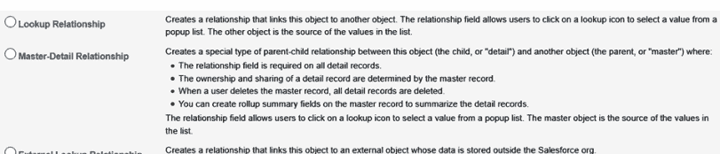

图 2.9 – Salesforce 中的三种常见关系类型

正如前面的截图所示，**查找关系**创建松散耦合的关系，**主从关系**对于紧密关联两个对象很有用，而**外部查找关系**允许将外部系统的数据与 Salesforce 中的数据关联起来。

### 查找关系

与**父子字段**类似，**查找字段**也建立父子关系，但两者在许多方面有所不同。该关系是松散耦合的，因此记录级安全性不会从父级继承，但子级可以拥有自己的独立记录级访问权限，这意味着访问父级的用户未必能访问子级记录，除非配置允许。除非配置强制要求，否则您可以留空**查找**字段。这是**查找**和**父子**字段之间的关键区别，因为在后者中，您没有留空该字段的选项。

**查找字段**的一个缺点是它们不开箱即用支持汇总**汇总**字段。您需要编写 Apex 来执行汇总类型的操作，或使用 AppExchange 插件来实现该功能。查找关系不支持级联删除。相反，您有两个选项——允许**查找**字段保留空白，或禁止删除父级记录。这两种设置均可通过 UI 进行配置：

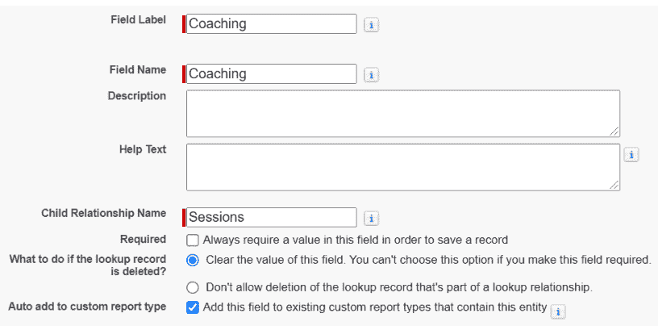

图 2.10 – 创建查找关系

请注意，由于查找创建的是松散耦合关系，您可以将其设置为必填，也可以设置为可选，在此情况下字段可以留空。另外，您可以可选地指定查找值被删除时的行为。

### 自关联关系

这是一种查找关系类型，但父子关系不在不同对象上，而是在同一对象上。一个很好的示例是 Job 对象，用于存储我们招聘应用中发布的职位。如果招聘团队想要记录与正在发布的职位类似的其他职位，他们可以创建一个**自查找**字段，从而记录另一个类似的职位。

### 外部查找关系

顾名思义，这种类型的关系用于关联组织外部的数据，是另一种查找类型，但用于外部对象。当查找对象是外部对象时，请使用此字段。

### 间接查找关系

这种类型的查找关系用于将外部子对象链接到标准或自定义父对象。您必须指定父对象字段和子对象字段，这两个字段彼此匹配。假设对通过面试初期阶段的每位候选人进行背景调查。然后，外部提供程序（子对象）可以使用间接查找字段与 Candidate 对象关联。

### 层次关系

这是一种特殊的查找关系，适用于 User 对象，用于将一个用户与另一个用户关联。例如，当您开发一个使用审批的应用程序，但审批不基于 User 对象上已存在的直接经理字段，而是需要指定不同的用户作为审批人时，这种字段非常有用。这时您将使用这种类型的字段：


图 2.11 – 层次关系示例

正如前面的截图所示，只有在链接到 User 对象时才提供这种类型的关系。

### 主从/父子关系

这种关系定义了父对象和子对象之间的紧密耦合关系，这意味着，其中之一是该字段必须填充，不能留空。该字段在子对象上创建，并从其父对象继承记录级安全性。这意味着访问父级记录的用户也可以访问子级记录。您还可以在父对象上创建汇总字段，这是主从字段的一大优势。

汇总字段允许您从子记录中获取汇总数据；例如，如果您想了解账户记录上的已赢得机会总数，可以使用汇总字段并统计已赢得的机会。同样，如果您有兴趣计算账户产生的总收入，可以创建一个汇总字段，将所有已赢得机会的金额相加。汇总字段还带有过滤器，可让您限制感兴趣的数据范围。

默认情况下，字段上也会设置级联删除，这意味着当父级记录被删除时，子级记录也会自动删除。子级上的组织范围默认值 (OWD) 基于父级设置，且不可编辑：

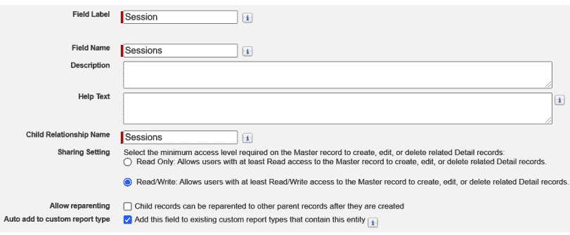

图 2.12 – 创建主从关系

如上所述，我们可以通过指定创建、编辑或删除详细记录所需的主记录访问级别，来定义具有不同选项的主从关系。

### 连接对象

请记住，父子关系和查找关系允许我们定义一对多关系，即一个父记录对应多个子记录，但如果我们需要定义多对多关系，即多个父记录与多个子记录相关联，该怎么办呢？这时就需要用到接点对象。

接点对象是一种特殊的对象类型，允许我们使用对象上的两个父子关系来定义多对多关系。在我们的招聘应用程序中，我们有 Job 对象和 Candidate 对象。Job 对象用于发布新职位，Candidate 对象用于存储申请职位的候选人信息。如果使用父子关系或查找关系，候选人一次只能申请一个职位，这不切实际。

我们的业务要求是候选人必须能够同时申请多个职位。为此，我们需要另一个对象，称为 Applicant，它将是 Job 和 Candidate 对象的子对象。Applicant 对象将允许候选人同时申请多个职位。换句话说，多个职位可以关联多个候选人，多个候选人可以通过 Applicant 对象关联多个职位：


图 2.13 – Applicant 是接点对象。在用户界面 (UI) 中，您会注意到在 Applicant 记录上各有一个字段用于输入 Job 和 Candidate 数据


如前图所示，候选人每次申请工作时都可以创建一个应聘者记录，从而申请多个工作。

在定义联接对象时，仔细考虑将与哪个对象创建第一个父子关系非常重要。这是因为，联接对象的外观和体验由第一个父对象决定。这里的外观和体验是指联接对象的详细信息和编辑页面的颜色及图标。

记录所有权也从第一个父对象继承，因为联接对象没有自己的所有权。另一个影响是记录访问。对于任一父对象，您可以在创建联接对象上的字段时定义共享设置。共享设置可以是只读或读/写。这两个选项都允许对子记录进行完全访问。但是，如果任一父对象上的 OWD 为公共只读，且联接对象上的共享设置定义为读/写，则用户将无法访问该记录。

如果任一父记录被删除，子记录也会被删除；但如果两个父记录都被删除，子记录将被永久删除。在前一种情况下，记录可以从回收站中恢复，但在两个父记录都被删除后则无法恢复。

如果在稍后阶段，您决定删除主父关系或将其转换为查找关系，则第二个父对象将成为主对象。基于所有这些影响，仔细考虑哪个对象将成为主父对象非常重要。

现在我们已经回顾了 Salesforce 中的各种关系类型，下一节将介绍 SQL 和 SOQL 之间的一些差异。

### SQL 与 SOQL 的区别

我们已回顾了 Salesforce 中的不同字段类型以及可以创建的关系。通常，您需要使用开发者控制台、开发者工作台或其他某些工具通过 SOQL 提取数据。SOQL 是一种非常容易学习的语言，可用于轻松从 Salesforce 查询数据。如果过去使用过 SQL，则会更加容易。您会注意到 SQL 和 SOQL 之间有显著相似之处，但它们在本质上是不同的。我们将在下一节讨论 Salesforce 平台架构，但目前，请牢记以下几点：

- Salesforce 客户无法访问 Salesforce 数据库的底层表。
- 您可以在 SOQL 中*间接*为字段编制索引，而无需像在 SQL 中使用 DML 语句那样*直接*操作。
- 某些字段类型会自动为您编制索引，例如外部字段，且使用 SOQL 无法创建新索引。
- 也可以编写触发器，就像对数据库表操作一样，但 Salesforce 触发器的不同之处在于，您基本上是向应用程序层发送指令来处理 Apex 代码。

SQL 和 SOQL 之间的一些差异如下：

- 在 SOQL 中不能发出 `select * from SObject (SObject referring to a Salesforce object)`。
- SOQL 是只读的，不能用于操作数据，这与 SQL 不同。
- 在 Apex 中使用 SOQL 时，它还可以防止意外的架构更改，因为 SOQL 不能用于即时更改数据类型或字段名称。您可以通过 UI 执行此操作，或使用特定的元数据 API 对底层架构进行更改。

现在我们已回顾数据建模和反规范化的基础知识，让我们深入了解 Salesforce 架构，了解其底层运作方式。

### 了解 Salesforce 架构

由于我们将讨论 Salesforce，因此我们来尝试了解 Salesforce 架构，这将帮助我们在正确的上下文中思考，并理解 Salesforce 中事物之所以如此做的原因。

信任是 Salesforce 的首要价值，这从 Salesforce 核心架构的设计方式中可以看出。考虑到平台上有数十亿笔交易正在发生，确保客户数据得到妥善保护并免受恶意行为者使用的众多攻击媒介的侵害，绝非易事。

在本节中，我们将熟悉 Salesforce 平台的突出特性，例如多租户和主要版本。然后，我们将更详细地审查构成平台引擎的主要组件。让我们从多租户开始，深入了解它是什么以及它如何使用户受益。

### 多租户

Salesforce 采用 SaaS（软件即服务）模式，客户为其使用的 Salesforce 提供的服务支付订阅费。如果您使用过 Hotmail 等电子邮件服务，幕后并没有专用的数据库服务器或应用程序服务器。相反，Microsoft 设计该系统，使数十万用户可以使用相同的硬件和软件。

在 SaaS 模式下，不是面向单个用户，而是有多组用户访问 Salesforce。可以将这些用户组视为订阅 Salesforce 的单个公司，他们在 Salesforce 上访问的是一个恰当地命名为“组织”的 org。SaaS 的关键特性是多租户，这意味着用户组共享资源。幕后，它们使用相同的硬件和存储，但其数据由软件保持隔离。

多租户的另一个方面是，由于资源是共享的，不允许任何单个租户垄断系统，从而危及可能影响性能或更糟的是导致整个实例瘫痪的资源。Salesforce 采用总督限制和一般最佳实践，鼓励用户编写高效的查询和代码。我刚开始在该平台工作时想念的一件事是使用以下 SOQL 查询：

```
select * from TABLE_NAME
```

直到我真正深入了解多租户的工作原理后，我才明白为何不允许这样做。如果您想知道，上述查询在典型关系数据库中会返回所有列和所有行，但在 Salesforce 中无法运行，因为它希望您命名所需的字段（列），仅返回这些字段，并限制返回的行数。

数千家客户将业务关键数据交给 Salesforce，确保客户 A 无法访问另一家客户的数据并非易事。这是通过 org ID 完成的，org ID 是分配给每个 Salesforce 客户组织的唯一 ID。每当向平台发出数据库调用以访问数据时，org ID 会自动包含在内，以防止未经授权的访问。

Salesforce 客户还享有随产品发布版本保持最新的优势。所有 Salesforce org 上始终运行着单一版本的平台。这意味着客户无需担心升级或回归测试，因为所有这些繁重工作都由 Salesforce 完成。

Salesforce 平台架构很复杂，包含许多数据库和应用程序服务器，以及执行不同功能的众多服务，例如搜索、业务逻辑执行、缓存和事件管理。我们不会讨论这些，而是将注意力集中在平台上运行在关系数据库上的数据管理方面。

让我们简要了解一下 Salesforce 中底层架构是如何无缝协同工作的。

### 元数据驱动架构

像 Salesforce 这样的基于云的多租户平台，在可扩展性、可靠性和安全性方面面临着自身必须克服的挑战。最重要的是，如何确保一个租户的数据无法被其他租户访问。此外，由于生产环境中只有一个软件版本，在不导致平台显著停机的情况下应用更新是另一个挑战，尤其是每年进行三次更新时。我们讨论过测试类，并将在本章后面讨论 Salesforce 如何运行 Hammer，但是当租户自定义其构建的应用或自定义开箱即用的销售应用以满足业务需求时会发生什么情况？当 Salesforce 更新生产实例时，他们的自定义是否会被保留？租户是否需要重新应用其自定义？当客户在平台上存储大量数据时会发生什么情况？系统会对其他客户变慢吗？为了回答这些及其他相关问题，我们将了解什么是 **元数据驱动架构**。


如下图所示，Salesforce 采用了一种在系统内核（即负责虚拟化的主引擎，我们稍后会讨论）、数据库和租户应用程序之间划清界限的架构，租户应用程序本质上必须是多态的，换句话说，是动态的，以满足不同客户的不同需求：

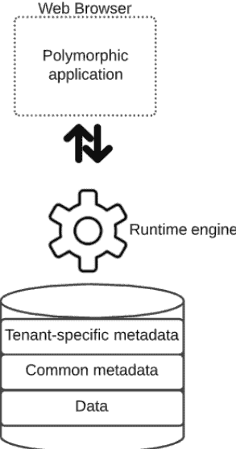

图 2.14 – Salesforce 元数据驱动架构

如上图所示，运行时引擎在运行时使用属于租户的元数据和数据生成应用程序。

对内核应用的任何更新都不会影响架构的其他层。同样，当对公共元数据进行更改时，租户特定的元数据不受影响，租户的数据也不受影响。在运行时，内核或运行时引擎使用公共元数据、租户特定元数据和数据来构建租户的应用程序。在接下来的小节中，我们将介绍元数据驱动架构的关键组件。这不是一篇详尽的讨论，而是从数据架构角度了解关键组件的指引。

> **重要说明**
> 我在此处使用 *自定义* 这个词是泛指，意指对平台的任何更改，无论是通过点击还是代码完成的。

### 内核

**内核**，或称运行时引擎，是平台的核心，由多个协同工作的服务组成，用于提供服务。

由于元数据是运行时生成客户端应用程序的关键组件，因此平台使用元数据缓存来提高性能，否则系统将无法在高负载下扩展。元数据缓存将经常使用的元数据存储在内存中，从而减少对影响性能的昂贵数据库调用的需求。

批量数据处理引擎处理大量数据，并用于执行批量数据修改。该引擎具有内置的容错功能，允许它自动重试可成功处理的记录的批量操作。

该平台还具有一个功能齐全的搜索引擎服务，用于优化对全文搜索功能的访问。该服务在后台异步处理数据更新。当您上传大量数据并随后立即搜索数据时，可能会注意到这一点。由于引擎是异步运行的，您可能需要等待最多 15 分钟才能获得搜索结果。这与传统数据库不同，在传统数据库中，后台进程在实际数据库表上运行并更新索引。

当您打开页面或发出 API 调用以查询数据时，在传统数据库中，会创建查询计划，并由优化器确定并执行执行查询的最佳方法。这种类型的优化器不适用于 Salesforce，因为其多租户特性，换句话说，数据库中的物理表拥有数万个客户的数据，查询优化器的结果将不准确或不高效。这时，多租户查询优化器就派上用场了，它是一个 *了解* Salesforce 多租户特性的智能优化器。它通过考虑执行查询的用户来确定最有效的查询路径，然后使用 UDD 中维护的租户特定元数据以及其他一些关键表，在数据库上执行优化的数据操作。

### 通用数据字典 (UDD)

Salesforce 的物理数据库与您在 **设置** 中查看对象元数据或从后端运行 `describeSObject` 方法时所看到的内容截然不同。

这是因为 Salesforce 在应用服务器中采用了一个抽象层，该层在运行时从数据库读取数据并应用其他逻辑，从而形成您组织的结构，换句话说，即对象、字段、关系、列表视图等。

这个层被称为 **通用数据字典**（简称 **UDD**），它是声明式的，这意味着对象名称、其属性和关系是存储的，而不是通过代码生成的。

您在组织中看到的内容是内核对 UDD 作用的结果，因为内核充当 UDD 与您在组织中看到的内容之间的映射层。

以下是 UDD 及其组件的图示：

共享数据库
枢轴表
元数据表 (UDD)
数据表

元数据缓存
批量数据处理引擎
运行时应用生成器
查询优化器
全文搜索引擎

租户特定屏幕
通用应用屏幕
对象（表）
运行时虚拟应用组件

如这里所示，UDD 拥有多个不同的组件，它们共同协作在运行时交付应用程序。

当您在 Salesforce 中创建对象时，您并不是在创建数据库表，将对象的属性作为列，将存入表中的数据作为行。

如果您曾使用过数据库，您会使用 **数据定义语言 (DDL)** 来创建表、添加列/行、删除行等。

在 Salesforce 中创建对象时，情况并非如此，因为您是在与中间层交互，而不是直接与数据库交互。

当然，数据库中会存储一些与对象相关的数据，但是如前所述，一个将列作为对象字段的物理表会被创建。

这样做的原因之一是为了扩展系统并使这种多租户模型能够高效运行。

另一个原因是防止表的数据库锁定，这种锁定在为保证数据完整性而运行 DDL 时会发生。

这就是为什么您无法直接在数据库上运行 DDL，例如 `create table as APPLICANT`。

由于这个中间层，您在 SOQL 查询中将没有索引、外键或运行查询计划的能力，因为这不会返回可操作的数据，所有这些都由中间层处理。

请记住，UDD 存储了租户定义的所有元数据，无论是通过 UI 还是使用 API。

由于元数据是运行时生成客户端应用程序的关键组件，因此平台使用元数据缓存来提高性能，否则系统将无法在高负载下扩展。元数据缓存将经常使用的元数据存储在内存中，从而减少对影响性能的昂贵数据库调用的需求。

所有应用程序数据都存储在平台的几个非常大的表中，内核在运行时实例化虚拟表。我们将在接下来的部分中查看一些关键表，但前提是，当租户在其组织中创建（例如）自定义对象时，字段、它们之间的任何关系以及其他属性都存储在 UDD 中。

这些元数据，以及数据表（存储租户事务型数据的表）和一些专用的枢轴表，将数据以非规范化格式维护。

这使得架构经过优化，并能够非常高效地快速呈现我们可以从 UI 中查看的虚拟结构。

以下是一些关键表：

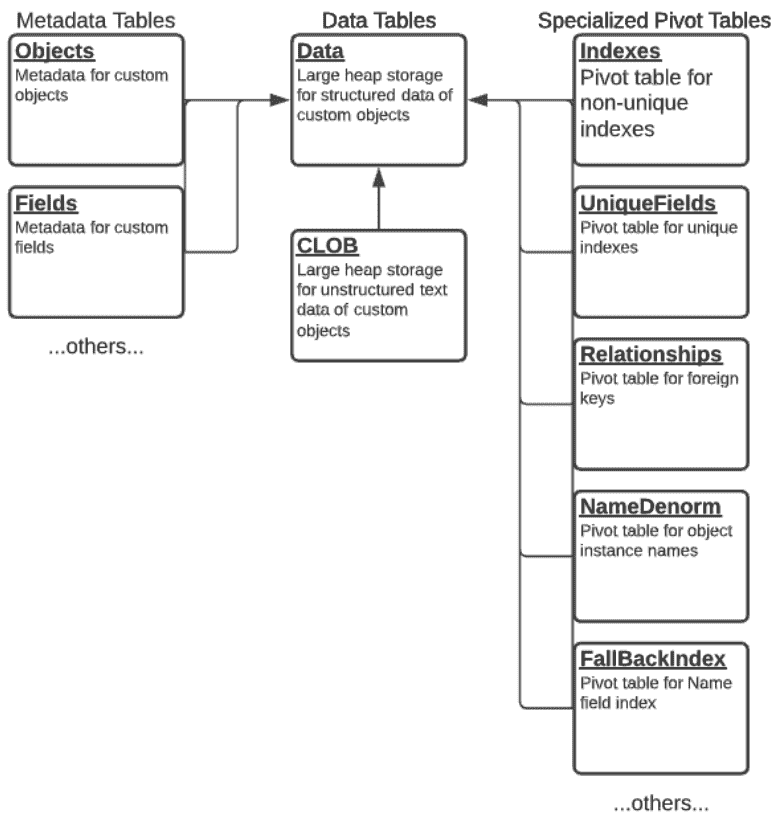

图 2.16 – UDD 中的关键表

如上图所示，所有自定义对象和自定义字段都在表中定义，并且没有创建物理数据库表。接下来我们来看看构成这种架构的关键专用表。

### 对象元数据表

此表存储在组织中定义的自定义对象。此表的关键属性如下：

- ObjID: 对象的唯一标识符
- OrgID: 组织的唯一标识符
- ObjName: 对象名称

### 字段元数据表

此表包含为自定义对象定义的自定义字段相关的数据：

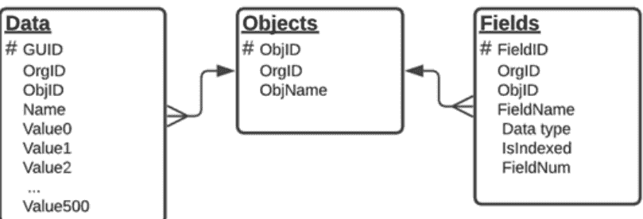

图 2.17 – 字段元数据表

所有自定义字段元数据都存储在上述表中。另请注意，所有表中都存在 OrgID，以确保每个租户的数据分区和安全性。

关键字段包括：

- FieldID: 自定义字段的唯一标识符
- ObjID: 对象的唯一标识符
- OrgID: 拥有自定义字段的组织
- FieldName: 自定义字段的名称


- **数据类型** (例如，string, number): 自定义字段的数据类型
- **是否已编入索引**: 指示字段是否已编入索引的布尔值
- **字段编号**: 字段在对象中的位置

接下来，我们将查看数据表。

### 数据表

如图 2.18 所示，此表包含为自定义对象定义的所有自定义字段的数据：

| GUID | OrgID | ObjID | ...其他列... | Val0 |
| :--- | :--- | :--- | :--- | :--- |
| a01...1 | Org1 | a01 | ... | Up |
| a01...2 | Org1 | a01 | ... | Flat |
| a02...1 | Org1 | a02 | ... | 20201201 |
| a02...2 | Org1 | a02 | ... | 20210101 |
| a03...1 | Org1 | a03 | ... | 91.23012 |
| a03...2 | Org1 | a03 | ... | -10.35 |

图 2.18 – 存储自定义字段数据的数据表

请注意，此表的列数限制为 500 列，这也是自定义对象上自定义字段的限制。

关键字段包括以下内容：

- **GUID**: 每个字段的全局唯一标识符
- **ObjID**: 对象的唯一标识符
- **OrgID**: 拥有自定义字段的组织
- **字段名**: 字段的自然名称

托管包还允许另外 300 个字段。这些列（称为 flex 列）可以存储来自多种数据类型的数据，因为最终所有数据都将作为字符串数据类型存储。对象中的所有字段都存储在不同的列中，且没有两个字段存储在同一列中。此表还包含四个审核字段（我们将在本章后面讨论），以及一个 IsDeleted 列（未显示），用于指示数据何时被删除。

### 长字符对象 (CLOBs) 表

这是一个 CLOB 表，用于存储定义为长文本字段（最多 32,000 个字符）的字段。该平台还在数据库外部存储 CLOB，以实现高效搜索。

### 索引枢纽表

关系数据库在发出搜索请求时使用索引来定位数据。但是，考虑到在数据表中，不同类型的数据可以存储在 flex 列中，为绕过这一限制，平台使用一个名为 Indexes 的独立表，该表存储在数据表中被标识为已编入索引的字段的值。它通过将标记为编入索引的字段数据同步复制到数据表中的适当列来实现这一点。下图显示了 Indexes 表：

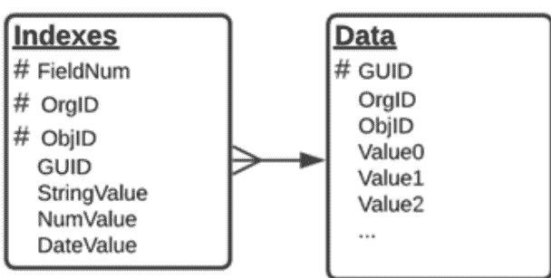

图 2.19 – 索引表

如我们所见，Indexes 表存储对象上定义的索引。某些字段类型会自动编入索引，例如，外部字段，以及查找或主从关系字段。

### 唯一字段枢纽表

出于与索引无法存储在数据表中相同的原因，此表用于存储对象中定义的唯一字段，因此当你在 Salesforce 中将字段指定为唯一时，该字段会存储在此表中。运行时的元数据架构会检查此字段，并强制跨对象数据的唯一性。

### 关系枢纽表

此表存储在对象上定义的关系。当使用前一部分讨论的一种关系类型创建字段时，平台会将字段映射到数据表中的一个值，并使用此字段存储相关对象的 Obj ID。下面显示了关系表：

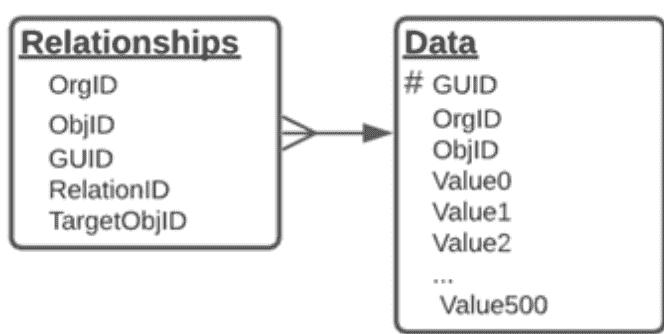

图 2.20 – 关系表

在上图中，请注意关系类型字段是如何存储在此表中的，这些字段引用了我们之前查看的数据表。

### FallbackIndex 表

如果外部搜索引擎未能返回结果，则使用此方法。随后将执行回退搜索。这通过实现引用目标应用程序对象名称的直接数据库查询来完成。为启用此类搜索，此表中定义了所有对象名称，因此数据库可以访问最新信息。

### NameDenorm 表

此表存储数据表中每个字段的 Obj ID 和名称。这主要用于为处于父子关系中的对象的记录提供超链接。

### HistoryTracking 表

此表存储租户为审计目的而识别的字段更改。它存储字段的旧值和新值，以及更改的时间和人员。

在了解了核心架构后，让我们简要探讨 Salesforce 的创新方面，以及它如何成功每年发布三个版本。

### 新版本

Salesforce 一直被评为全球最具创新性的公司之一。造成这一现象的原因之一是其卓越的创新步伐。这种创新的一种体现是 Salesforce 每年发布 **三个主要版本**。这些版本每年引入数十种，有时数百种新功能。那么，问题在于 Salesforce 如何确保数千个客户组织的配置/自定义不会随着每个新版本而中断。

这时便用到了 **大锤**。大锤 是指在每个版本发布前的一段时间，Salesforce 在将沙箱更新为新版本前几周实施内部变更冻结。大锤 会对客户组织中存在的所有单元测试运行两次——一次是在应用版本之前，另一次是在版本应用到测试环境之后。然后将结果进行比较，预期是发布前通过或失败的所有测试，在应用版本后仍应给出相同结果。

当然，软件世界中的事情并不总是按计划进行，任何被识别为回归问题的差异都必须快速修复。一个自动化应用程序会分析前后结果，以确保在将结果发送给 Salesforce 团队采取措施之前，已将其中的任何机密数据清除干净。此练习统称为 *大锤*，因为它需要付出巨大的努力，考虑到不仅涉及 Apex，还涉及 Visualforce 和其他元数据组件。现在我们可以看出，编写真正测试代码的测试类为什么很重要，因为 Salesforce 在每个版本之前也会使用它们来运行这些数百万个组合测试，以确保版本不会中断任何内容。这意味着，如果在新版本中你的代码中断，Salesforce 会在运行大锤时检测到并修复代码。但是，如果测试类编写质量差，或者仅旨在通过 75% 的测试覆盖率要求，那么当 Salesforce 团队运行测试时，这些问题可能不会被检测到，届时你需要投入资源来修复代码。

了解 Salesforce 架构简介后，让我们深入探讨 Salesforce 对象。

### Salesforce 对象简介

在本节中，我们将探讨 Salesforce 中的基础数据结构——对象。这包括了解 Salesforce 对象是什么、它们的属性和用法。我将建议在使用标准对象、自定义对象和平台上可用的其他类型的对象时应牢记的最佳实践和原则。在处理对象时应用这些最佳实践，将帮助我们保持组织的可扩展性，以便进行下一次增强或重大项目，并为最终用户提供更好的可用性。在此，我们旨在简要回顾 Salesforce 中的不同对象和字段类型，然后再进行数据建模的详细讨论。这将使理解和掌握数据模型概念变得更加容易，并为何时使用不同的关系类型提供良好的基础。

我们将从标准对象开始，它们是最常用且最熟悉的对象，然后还将回顾 Salesforce 中的其他对象。

### 标准对象

这些是随 Salesforce 一起开箱即用的对象。常见的包括 Account、Contact、Opportunity 和 Lead 等。你的许可证类型和正在使用的 Salesforce 版本将定义你可以在组织中使用哪些对象。

### 自定义对象

这些是为支持公司业务需求而创建的对象。示例包括我们在上一章的招聘应用中查看过的 Job、Applicant 和 Candidate 对象。AppExchange 应用程序中也将包含自定义对象。

### 大对象

这是一个独特的对象，因为它可以容纳从数亿行到数十亿行的海量数据。它们非常适合归档数据或从外部来源导入数据。但是，与标准对象和自定义对象相比，它们也有局限性。以下是大对象区别于常规对象的一些关键特性：

- 只能使用元数据创建。
- 以 __b 开头。
- 不能有触发器，也不能进行报告。


- 它们支持有限数量的数据类型，例如 **文本**、**数字**、**日期/时间**、**查找** 和 **文本区域**。

- 它们无法跟踪记录字段历史记录，也不能用于跟踪活动。

> **重要提示**
> 
> Salesforce 正在持续更新其大对象功能，因此请参考最新发布文档以获取最新信息。

### 外部对象

这些是用于将外部数据引入 Salesforce 的对象。假设在我们的招聘应用中，我们使用外部服务进行候选人背景调查。我们可以不将这些结果导入 Salesforce，而是简单地使用外部对象，并根据需要让我们的用户使用它们。

在下一部分，我们将探讨 Salesforce 中的一些特殊字段类型及其用例。父子关系和查找关系将在下一部分中更详细地处理，因此我们不会在此介绍它们。

### Salesforce 中的字段

Salesforce 中有多种不同类型的字段可用。在本节中，我们将介绍 Salesforce 中的特殊字段。

### 名称字段

这是记录的名称，与记录 ID 不同。这可以是自动编号或文本字段。该字段通常较短，由用户用于引用记录，而不是使用长 15 字符或 18 字符 (char) 记录 ID。大多数对象都有此字段，除了 Case 对象（没有此字段）。Case 对象只有自动编号字段。

> **自动编号字段**
> 
> 这是一个特殊字段，使用系统生成的唯一编号，每次创建新记录时该编号递增。您可以定义字段的格式及起始编号，例如，对于发票，您可以定义字段以 INV-012345 格式生成发票号。
> 
> 这也是在列表视图、搜索结果和报告中显示为可单击选项的字段。Salesforce 也允许此字段基于文本，这意味着多个记录可以具有相同的值，因为系统不再递增数字序列。

### ID 字段

这是对象的主键（关系型数据库术语），用于唯一标识 Salesforce 记录。这是一个完全唯一的字段，且没有两个记录可以具有相同的 ID。记录 ID 可以是 15 字符或 18 字符长，前者区分大小写；例如，如果 0030000000000BcA 更改为 0030000000000bCa，Salesforce 将抛出错误。在外部应用程序中使用 18 字符 ID 非常重要，因为它们可能将这两个 ID 视为相同，而 Salesforce 则将其视为不同。

### 审计字段

这些审计字段用于合规性、记录和报告对数据所做的更改，以及用于 Salesforce 的流程自动化工具，例如工作流规则、Lightning 流程构建器、流程和集成。最常用的审计字段如下：

- CreatedBy
- CreatedDate
- LastModifiedByID
- LastModifiedDate

还有一个名为 SystemModStamp 的字段，当自动化流程更新记录时会对其进行更新。此处的自动化流程指的是 Salesforce 内部代码。无论何时，当用户、自动化工具（如工作流规则、Lightning 流程或流程构建器）、API 或 DML 语句更新记录时，LastModifiedDate 和 SystemModStamp 日期都会被更新。这意味着这两个日期可能不同，且最佳实践是不要将 SystemModStamp 日期用于集成目的。除了 SystemModStamp 字段外，所有四个审计字段都可以使用 Data Loader 或类似工具进行更新。在迁移数据时使用审计字段很有帮助，以免丢失重要的审计信息，并应谨慎使用以保护数据完整性。

### 复合字段

这些是通过将多个原始数据类型分组在一起而创建的复杂数据类型。这样做是为了简化处理这些字段的代码。如果您使用过 Account 对象，Address 字段是一个复合字段，由 Street、StateCode、State、PostalCode、City、Country 和其他一些字段组成。复合字段是只读的，更改只能对底层单个字段进行。字段的复合版本仅可通过 SOAP 或 REST API 访问。

复合字段的另一个示例是 Geolocation，它是纬度和经度字段的组合。这些字段默认可用于 Account、Contact、Quote 和 User 对象，并且在填充地址时，Salesforce 会自动填充 Geolocation 字段。在以下截图中，您可以看到 Billing Address 字段的数据类型为 Address：

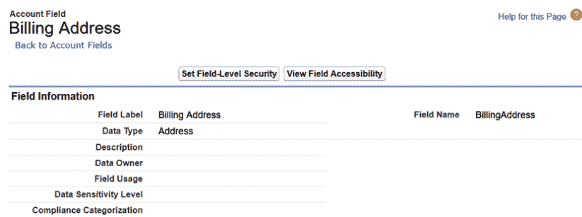

### 图 2.21 – 账单地址字段

在以下截图中，我们已使用 SOQL 查询了相同的复合字段：

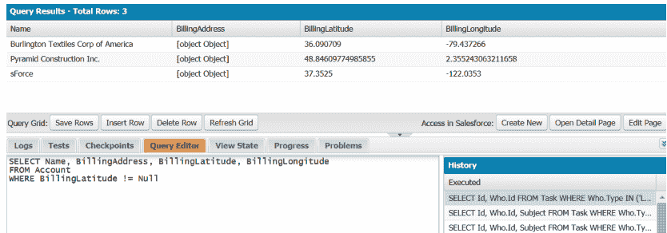

### 图 2.22 – 账单地址复合字段

BillingLatitude 和 BillingLongitude 字段构成 BillingAddress 复合字段，该字段也可被查询。请注意它在 BillingAddress 下显示 [object Object]，这表明这是一个复杂数据类型。

### AnyType 字段

这些是多态字段，返回字符串、布尔值、日期、数字、URL、电子邮件或其他数据类型。这些字段用于通过 API 查询数据时，并通常用于历史记录对象。多态字段可用于获取相关对象的信息，而这些相关对象可以是不同类型。

Owner、Who 和 What 字段是 AnyType 字段的示例。以下示例显示 Who 可以是 Lead 或 Contact 类型：

| Id | Who.Id | Who.Type | Subject |
|---|---|---|---|
| 00T5A000005M2xAUAB | 0035A000003MtdeQAD | Contact | 他在回来时给 Tim 打电话 |
| 00T5A000005M2XgUAl | 00Q5A000001UKLgZUAX | Lead | 合同后续跟进 |

### 图 2.23 – 指向多个对象的 Who.Type 字段

请注意，在上述截图中，Who.Type 同时引用了 Contact 和 Lead 对象。

还可以通过在 Developer Workbench 中检查字段属性来确认：

- aggregatable: true
- aiPredictionField: false
- autoNumber: false
- byteLength: 18
- calculated: false
- caseSensitive: false
- createable: true
- custom: false
- defaultedOnCreate: false
- deprecatedAndHidden: false
- digits: 0
- filterable: true
- groupable: true
- idLookup: false
- label: Name ID
- length: 18
- name: WhoId
- nameField: false
- namePointing: true
- nillable: true
- permissionable: true
- polymorphicForeignKey: true
- precision: 0
- queryByDistance: false
- relationshipName: Who
- restrictedPicklist: false
- scale: 0
- searchPrefilterable: true
- soapType: tns:ID
- sortable: true
- type: reference
- reference to: Contact

### 2.24 – Developer Workbench 中同时引用 Contact 和 Lead 对象的 Who.Id 元数据（在图中，Reference To 字段未显示 Lead 对象）

请注意，当使用 Developer Workbench 查看 Task 对象上字段的元数据时，polymorphicForeignKey 设置为 true。

### 货币字段

这些用于存储货币数据，例如 Opportunity 对象上的 Amount 字段。当组织中启用多货币功能时，对象上的另一个字段 CurrencyIsoCode 决定字段将以何种货币显示。例如，如果 CurrencyIsoCode 为 GBP，则所有货币字段的值都将以 GBP 显示。

Salesforce 具有多货币功能，允许您使用组织默认货币以外的货币。您可以启用您开展业务的选定货币，然后组织管理员可以维护这些货币的转换率。另一个功能是高级货币管理，允许您在 Salesforce 中管理带日期的汇率。此功能存储历史汇率，从而实现准确报告。高级货币管理有一些限制，应在仔细审查其功能和业务要求后启用。

### JunctionIdList 字段

此字段类型用于查询，并可选择在 Apex 中使用返回的结果以直接修改多对多关系。当通过设置启用共享活动时，将启用此字段类型。

### 摘要

在本章中，我们了解了 Salesforce 中的不同类型的对象，并查看了它们的用途和限制。然后我们回顾了一些特定的字段类型，并研究了有关其用途的详细信息。

我们探讨了包括规范化和反规范化在内的数据库概念以及什么是数据建模。您还了解了为什么 Salesforce 与其他关系型数据库不同，至少从租户的角度来看，以及它如何针对读取操作进行了优化。接下来，我们探讨了在设计数据模型时需要考虑的一些重要设计原则。

我们研究了不同的关系及其用途、限制和用例。接下来，我们深入探讨了 Salesforce 的多租户架构、其不同组件，以及它们如何协同生成我们作为用户在运行时交互的虚拟应用程序。


本章应当已为你打下坚实基础，使你能够理解多租户架构；如果你来自关系型数据库背景，之前一些不太明白的事情现在应该开始变得更有意义了。本章学到的数据架构原则将帮助你设计更具可扩展性和高效性的业务应用，理解数据建模概念及不同类型将使你能够与不同受众有效沟通。理解为什么需要一个连贯的数据模型——其中对象通过关系相互关联——将帮助你遵循 Salesforce 的“点击配置而非编写代码”方法论，并让你在正确的语境下与不同利益相关者开展对话。

下一章，我们将探讨数据管理——它是什么及其不同方面。本章获得的知识将为你轻松、清晰地理解即将讲解的主题奠定基础。

### Questions

- 1. Precision Printers 有一个名为 `Applicant` 的对象，其中包含许多行，用户报告在对此对象运行报表时性能缓慢。作为驻场数据架构师，你被要求调查此问题并提出解决方案。你有什么建议？
- a) 查看报表中使用的筛选条件，并对其进行调整以在报表中使用索引。
- b) 仅在数据库表上创建索引并在报表中使用该索引。
- c) 什么都不做；这可能只是临时问题，会自行消失。

- 2. Precision Printers 最近将新集成推广到生产环境。该集成每 12 小时运行一次，将 `Account` 对象中已更改的记录传输到 ERP 系统。管理员注意到，即使记录上没有明显更改，记录也正在被传输到 ERP。是什么导致了这个问题？
- a) 无需采取行动；集成会自行纠正，正确的记录将开始同步到 ERP。
- b) 清点 Salesforce 中不应同步的记录，然后手动从 ERP 中删除这些记录。
- c) 确定已更改记录的标准基于 `SystemModStamp`。将标准更改为 `LastModifiedDate` 将解决该问题。
- d) 删除 ERP 中的所有记录并重新启动集成。

- 3. 一位新手管理员创建了多个对象，包括两个用于存储自定义应用中账户和联系人记录的对象，该应用用于跟踪来自潜在战略客户的报价请求。管理员被要求创建报表，以显示报价最大的客户、他们感兴趣的产品，以及报价请求在每个阶段停留的天数。此外，管理人员希望在 Account 对象上查看是否存在开放的报价请求。开发人员告诉管理员，生成这些报表需要编写大量代码。编写这么多代码来生成这些报表的根本原因可能是什么？（选择 2 个答案）
- a) 对象之间未定义适当的关系，导致需要编写 Apex 代码来查询数据。
- b) 管理员应向 Salesforce 支持提交工单，让他们创建这些报表。
- c) 数据模型需要遵循架构最佳实践进行重新设计，并重做应用程序。
- d) 在自定义 Account 对象和报价请求对象之间创建查找关系，然后编写触发器来汇总开放的报价请求并将其显示在自定义 Account 对象上。

### Further reading

- Developer Force，多租户架构：http://www.developerforce.com/media/ForcedotcomBookLibrary/Force.com_Multitenancy_WP_101508.pdf
- 规范化，第 1.3.6 节，数据管理知识体系 (DMBOK)
