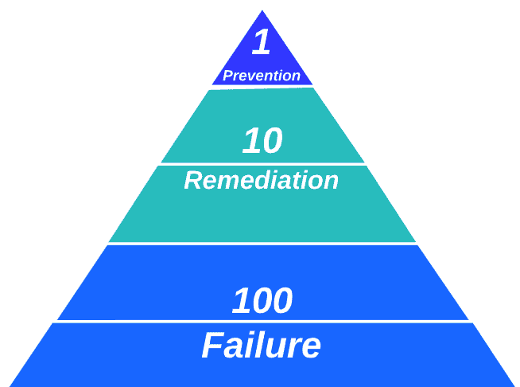

## 理解数据管理

在本章中，我们将探讨数据管理的重要性以及与数据管理相关的风险和挑战。我们还将讨论一些数据管理原则、不同类型的数据、数据生命周期，以及数据管理与数据治理之间的关系。这将让你了解管理数据为何至关重要，以及在管理数据时会遇到的一些挑战。我们将探讨一些策略，通过应用一些常用原则来克服这些挑战。

我们还将回顾与数据管理相关的最佳实践，其中将讨论与管理数据和元数据相关的策略。学习这些最佳实践将使你能够在组织中实施工具和流程，以实现最佳数据管理和高效利用资源。我们还将回顾备份和恢复策略、它们对业务为何至关重要，以及如何实施帮助你管理数据的工具。鉴于 Salesforce 于 2020 年停止提供数据恢复服务，本节旨在为你提供必要的知识，以便从一开始就能有效实施备份和恢复流程。最后，我们将讨论一些流行的 Salesforce 工具和第三方工具，这些工具可用于管理数据，包括备份和恢复数据。

本章涵盖的主题包括以下内容：

- 什么是数据？
- 什么是数据管理？
- 数据管理的各个方面
- 数据备份和恢复
- 行业工具

### 什么是数据？

我在许多项目中遇到过 *数据* 和 *信息* 这两个术语被混用的情况，大多数情况下这没问题，但就像我们对 *架构* 这一术语建立了共同理解一样，在此也应如此谨慎行事。

数据是以数字形式或其他媒体（如实体照片或纸张）存储的事实的表现形式。重要的是要认识到，并非所有呈现为数据的内容都是事实性的，这里 *事实性* 的含义是：当与其他数据元素结合来看时，它是真实的，并能传达真相的完整画面。在不考虑数据上下文的情况下不应审查数据，因为缺乏上下文的数据会引起混淆，并为误解敞开大门。请思考日期可以以多少种方式呈现。事实上，当你看到像 12-09-2020 这样的日期书写方式时，这是常见的混淆来源。前两个字符代表月份还是日期？当你有上下文时，例如你正在填写的纸质表格，或指示你以 MM-DD-YYYY 格式书写日期的 Web 表单，那时你就会知道前两个字符代表月份。因此，在上下文中呈现数据很重要，否则，它将失去其价值和有效性。

数据有时被称为信息的原材料，而信息则被视为有上下文的数据。关于此有很多正在进行的讨论，但这超出了本书的范围；就我们的目的而言，我们将坚持前面提到的数据定义。在下一节中，我们将探讨数据是否真的有价值，以及我们是否应该投入这么多精力来正确管理它。

### 数据有价值吗？

数据是，且应当被视为组织资产。考虑到社交媒体用户的数据过去曾被聚合并出售给营销人员，现在这很容易理解。无论是营利性还是非营利性组织，都意识到数据的重要性，并试图收集数据以获得能够推动决策的宝贵洞察。例如，直到十年前左右，很少有矿业公司具备了解其重型机械燃油消耗和使用情况的知识或专业知识，但今天，这些数据通过车载传感器发送到集中式数据库，在那里被聚合和分析以了解燃油消耗情况。这有助于公司了解哪些机器怠速过度，哪些机器可能燃油消耗过多，这可能是即将发生故障的迹象。主动对机器进行保养可以为公司节省数十万美元的停机和维护成本。

同样，对于非营利组织来说，了解其捐赠者群体、他们的兴趣和人口统计特征对组织的持续运营至关重要。利用其系统中的数据，它可以分析数据以确定如果针对特定人群，应将广告投放在哪些渠道上。同样，数据还可用于确定传统上哪些地区最需要帮助，以便组织可以将精力集中在这些地区。

随着 AI 科学的成熟和普及，数据将继续获得重要性，并成为许多新企业的支柱，而现有企业也将继续寻求采用数据的方式。AI 是基于数据训练系统以模拟任务的科学。随着新数据的可用性，这些系统将继续自我学习并完善其决策能力。例如，Tesla 在其汽车上使用内部和外部传感器，将数据发送回其数据中心，然后可用于显示特定路段平均速度的增加，确定导致驾驶员采取突发行动的危险地点。Tesla 对数据收集和分析高度重视，甚至会解析其在线论坛以获取洞察。

现在我们了解了数据的价值，在下一节中将探讨什么是数据管理以及它为何重要。


### 数据管理简介

数据管理是一门关于有效且以成本效益方式收集、存储和使用数据的学科。数据管理的关键目标是采取措施，确保数据始终可用且适合其预定用途，并在数据不再有用时适当地丢弃或归档。此前，我们已确立数据是一项宝贵资源，也是任何公司的资产，但现在让我们来看看数据管理的一些好处。

### 数据管理的好处

无论企业规模、营收或行业如何，数据都至关重要。从当地经营的小型家庭甜甜圈店，到每天为数百万客户提供服务的大型企业，合适的数据管理实践、流程和工具都是必不可少的。当然，小企业无需实施主数据管理（MDM）解决方案来管理其数据，但如果没有 MDM，大型组织将无法高效运营。

让我们全面审视数据管理的好处：

- **实现成本效率**：想想你在公司门户上查找差旅政策、寻找费用报销表格，或者仅仅是查找仅在公司内部使用的非标准缩写时花了多少时间。Gartner 2011 年的一项调查报告指出，由于数据质量问题，劳动生产率下降了 20%。然而，拥有有效数据管理的组织报告称，由于数据易于获取，因此支出更少。

- **避免代价高昂的错误**：错误会发生，并且是任何工作职能的一部分。无论你是医生、律师、建筑师还是收银员，每个人都会犯错，但有些错误代价高昂。例如，如果你对一家依赖足球和特定人群数据的初创公司感到兴奋，但这些数据不正确，那么该初创公司的生存可能岌岌可危。在更极端的场景中，考虑一位刚在急诊科结束 12 小时轮班的医生，他更新了一位患者的病历，填写了指示和药物。问题是，这位患者的姓氏与另一位本应收到这些指示的患者相同。尽管这是由人为错误引起的，但尽管如此，在这种情况下后果可能是致命的。

- 改善决策：有效的数据管理能够带来改进且高效的决策，准确且最新的数据可供决策者使用。例如，能够获取可靠的数据有助于组织更准确地预测销售，并在预测显示市场呈下降趋势时主动采取措施。

- 创造更多认同：当决策者和其他数据用户能够获取可靠的数据，并且这些数据能转化为更多收入、降低成本或两者兼得时，使用数据的人会对其更加自信，并愿意更有效地学习和使用系统，以及采纳新的系统增强功能。相反，当数据管理不当时，数据的消费者会对其失去信心，并开始采用其他方式来完成任务。例如，一家大型经销商实施了一个报价系统，该系统与**企业资源计划（ERP）**系统集成，为报价系统提供数据，并将产品价格添加到报价中。上线几周后，发现卡车部门的销售代表不像其他部门的同行那样使用该系统，因为拉取到报价中的价格不准确。召开了一次与 IT 支持团队的紧急会议，在确定根本原因后，引入了修复程序以纠正问题。

- 降低安全风险：有效的数据管理政策可确保您的数据安全。IBM 发布的 2020 年 *数据泄露成本报告*（https://www.ibm.com/security/data-breach）指出，数据泄露的平均成本为 386 万美元，识别和遏制大约需要 280 天。世界经济论坛发布的 2019 年 *全球风险报告*将网络安全评为面临社会的首要威胁。网络安全的一个关键方面是保护数据，以便业务运营能够持续顺利运行。

- **降低声誉风险**：信任和声誉是任何企业维持和扩大客户群的关键因素。客户会信任那些能够妥善管理其数据，并在数据被误处理时采取正确行动的组织。*剑桥分析丑闻*是许多 Facebook 用户在丑闻公开后退出该服务的压垮骆驼的最后一根稻草。拥有强大的数据管理计划不仅能增强组织内部的信心，还能增强利益相关者的信心，因为他们知道如果发生此类情况，组织已有应对措施。

- **保持竞争优势**：如果你是一家高科技行业公司，并在研发上投入数百万美元，那么你的知识产权落入不法分子之手可能会造成毁灭性后果，甚至导致公司倒闭。在某些情况下，这可能被视为国家安全风险。2017 年 Equifax 数据泄露事件就是如此，当时约 1.47 亿客户的数据被据称是外国行为体窃取。担忧在于，这些数据可能被挖掘，而身处财务困境的情报人员可能会被外国行为体操纵。

我们已经了解了数据管理的好处，现在让我们来看看与管理数据相关的挑战。

### 数据管理的挑战

大多数组织的数据量持续增长，不仅在规模上，而且在数据来源方面也是如此。让我们以物联网（IoT）或社交媒体的数据为例。在本世纪之前，这些都不是数据来源，但如今它们很可能已成为主要的数据来源。这些变化不仅为组织提供了大量机会，使其能够让数据产生意义并将其转化为收入，而且也带来了挑战。以下是当今组织面临的一些挑战：

- **充分利用数据**：许多组织在收集和存储数据，但仅仅这样做是不够的，因为数据本身不会提供任何价值，除非对其进行处理。弄清楚收集数据后该如何处理是一个耗时的过程，不会自动发生。它需要专门的资源和资金来使数据变得有用。随着 Salesforce 的 Einstein Analytics 等工具的出现，组织将能够减少努力，但尽管如此，关键是需要对数据进行处理，才能使其具有价值。

- **缺乏高管赞助**：数据管理应融入组织文化，让每个人都对数据负责，并在各自的领域承担所有权。这需要高管的认同，换句话说，需要可用的人力资源和资金资源。这还要求高管在自己的决策中支持和使用数据。然而，在那些长期成功运营且不认为有必要在数据管理活动上投入资源和时间的更传统类型的组织中，这可能是一个挑战。随着 Uber、Tesla 和 Airbnb 等新兴行业颠覆者的出现，新的数据驱动技术能够显著颠覆传统商业模式并威胁其生存，这并非不切实际。许多公司在高管层面意识到数据是持续成功和增长的关键组成部分，并已开始聘请首席数据官（CDO），但这仍是一个相对较新的现象。

- **法规合规**：与数据管理相关的法规复杂且因司法管辖区而异；此外，新法规不断出台，现有法规也在更新。这对组织来说是一个挑战，需要跟上步伐并持续关注任何不合规情况。不合规处罚不仅高昂，而且会给组织带来严重的声誉风险。

- **了解现有数据**：过去，组织从多个系统创建数据，分析并报告这些数据，将其归档，并在不再需要时最终将其删除。随着智能设备、传感器和社交媒体在我们社会中越来越普遍和被接受，数据仍在呈指数级增长，迅速填满数据库。据估计，每天产生 2.5 京字节（1 京 = 1,000,000,000,000,000,000,000）的数据。知名市场情报公司 IDC 报告称，仅智能设备的全球出货量预计到 2024 年将超过 14 亿台（https://www.idc.com/getdoc.jsp?containerId=prUS47567221）。跟踪所有这些数据并了解可用数据可能是一项艰巨的任务。这也导致对数据问题采取被动应对的方式，仅在问题出现时才加以解决。了解数据还涉及知道哪些流程是数据驱动的，以及数据对于这些流程继续运行有多么关键。


- **缺乏有效沟通**: 沟通非常重要，如果组织内需要发生任何有意义的变革，沟通就必须进行。战略努力，例如数据管理计划，如果没有有效的沟通策略来帮助利益相关者理解数据管理为何重要以及对他们有什么好处，是不可能成功的。沟通需要针对组织内不同职能进行定制，以确保信息能够传达且适合该职能。例如，财务部门在数据方面的需求和要求与人力资源部门不同。

- **数据互操作性**: 我们已经确认存在多个数据源，当数据最终进入组织存储时，它可能进入数据湖、数据仓库或其他数据库。由于这些数据存储有自己的命名法和格式，数据首先需要被转换，以便可以轻松用于分析和报告。

- **缺乏对数据的整体视角**: 数据所有权有时是分散的，这意味着数据管理可能是部门或公司中少数人才承担的责任。在分散式运营模式中尤其如此，我们将在数据管理运营模式部分讨论这一点。这可能导致数据孤岛，从而在部门或职能层面查看数据，而不是从公司角度进行整体审视。这种目光短浅的观点会导致内部办公室政治，并减缓旨在从数据中获益的措施。

- **流程和系统不足**: 一些组织理解数据的重要性，但缺乏从数据中获益的流程和系统。他们甚至可能有一些管理数据的流程，但这些流程可能数量不足或缺乏优化，导致对数据输出缺乏信心。这可能会触发下行螺旋效应，即用户对接收到的数据缺乏信心，从而导致下行趋势，这也可能导致与数据管理相关的关键职位在继续维护数据方面失去动力。

在本节中，我们回顾了什么是数据管理，并理解了其必要性以及制定有效数据管理策略及其实施所面临的挑战。既然我们已经了解了数据管理的好处和挑战，在下一节中，我们将回顾数据生命周期和数据管理的其他方面。

### 介绍数据生命周期

在本节中，我们将了解数据生命周期，然后在Salesforce的背景下查看一个示例。数据生命周期提供了从数据创建到数据清除的高级概览。了解数据如何创建并在整个生命周期中移动，有助于从运营角度理解我们每天执行的活动所处的位置以及它们的重要性。特定数据元素在其生命周期中会经历五个阶段：

1. 数据创建
2. 存储
3. 使用
4. 归档
5. 清除

我们将更详细地查看每个阶段。

### 数据创建

这是数据生命周期的第一阶段。在此阶段，数据会被创建或获取，这可以通过多种方式实现。以Dun & Bradstreet为例，它为Salesforce提供数据丰富功能。更常见的示例是使用IT应用程序创建数据；例如，在ERP中创建产品目录。在其他情况下，公司也可能使用设备来创建数据；例如，使用扫描仪扫描多张纸质发票，并直接在发票管理系统中创建数据。

### 存储

这是生命周期的第二阶段，涉及安全存储已创建的数据。在此阶段，数据库安全、网络安全和安全级别发挥作用，以确保数据得到充分保护。还会实施备份和恢复流程，以确保在出现问题时可以恢复数据。

### 使用

这是数据实际被使用的阶段。数据可以被查看、更新、移动到另一个数据存储、转换，并可在其上运行分析流程以从数据中生成洞察。数据也可以与外部组织共享；例如，组织向联邦税务机构提交季度纳税报告。

### 归档

就像你在搜索其他邮件时可能会发现三年前的求职邮件并决定将其归档一样，数据本身也有有用的生命周期，之后需要将其归档。当组织确定数据在特定时间段后可能不再非常有用，但出于监管或审计目的仍需要时，通常会进行归档。偶尔，组织可能需要引用归档的数据。例如，一个大型**客户关系管理（CRM）**实施项目决定不将旧系统中的所有数据导入Salesforce，但为了确保在需要时仍能访问数据，除了管理员外，它关闭了对旧系统的访问。这样，公司避免导入价值不高的数据，节省了时间和金钱，同时也确保其业务运营不受不利影响。

### 清除

在*数据管理的挑战*部分，我们探讨了数据增长的速度，永久保存每一位数据既不可行也没有用。取决于组织所在行业，监管法律可能会规定数据保留期，之后必须将其清除。清除涉及从系统中完全删除数据。这尤其重要，因为诸如**通用数据保护条例**（GDPR）之类的法律要求，当存储信息的主体请求*被遗忘权*时，其数据必须从组织的所有系统中完全且不可逆地删除。

既然我们已经了解了数据生命周期，让我们简要地将这些应用到Salesforce示例中。

### 数据生命周期 – Salesforce 示例

让我们在Salesforce的背景下逐步了解一个示例，以更好地理解如何应用数据生命周期以及以这种方式对数据分类的好处。一家名为Magnum Health Services的假设公司，总部位于美国，正在使用服务云来捕获客户的健康索赔。Magnum拥有6000万且不断增长的庞大客户群。它每年收到大约1000万个案例。该公司预计其客户群将以每年5%的速度增长，并预测案例量将增至每年1100万个。让我们回顾数据生命周期的每个阶段将如何应用于此场景。

### 数据创建

客户可以通过拨打热线或发送电子邮件来创建案例。Magnum的管理员还设置了系统，以便在Facebook和Twitter上提及公司的社交媒体帖子会自动在服务云中创建为案例。简而言之，Magnum拥有多个沟通渠道，这意味着数据被创建的来源有多个。

### 存储

创建的所有案例都存储在Salesforce平台中，并受到多层安全保护，包括IP限制、配置文件以及Salesforce为保护其基础设施（包括数据库、服务器和网络）所采取的其他措施。

### 使用

此数据对内部用户和外部用户（即客户）均可用。在内部，案例所有者可以查看、更新和删除案例；例如，自动创建为案例但无需公司响应的Facebook帖子。经理和高管可以运行报告和查看仪表板。在外部，客户可以通过提供更多详细信息、上传文件，或者通过客户社区简单地将案例标记为已解决，来与他们的案例进行交互。

### 归档

因为Magnum处理客户健康数据，它需要确保合规性。Salesforce符合**《健康保险可移植性与责任法案》（HIPAA）**合规性要求，并提供工具以确保其客户设置平台以符合医疗法规。Magnum已设置**字段审计跟踪**，它是Salesforce Shield的一部分，并按法律规定自动归档数据。

### 清除

Magnum已开发自定义流程，在规定的保留期过后运行以从归档对象中删除数据。这样一来，Magnum可以履行保护客户数据安全的义务，并释放Magnum资源，以便用于下一批可归档的记录。

既然我们已经了解了数据生命周期，让我们详细回顾数据管理的运营模式，并理解每种模式的优缺点。


### 数据管理操作模型

如果缺乏所有权、决策和监督，就无法有效实施数据管理策略。拥有有效的操作模型有助于从数据创建到组织中数据清除的整个过程中建立角色、职责和问责制。最常见的操作模型如下：

- 集中式
- 分散式
- 混合式

我们将在下面的子部分中审查这些模型。

> **定义**
> 
> **操作模型**是组织运作方式的表现形式。在数据管理的背景下，它使我们能够以可视化的方式表示组织如何管理其数据相关流程，并配备适当的制衡机制。

### 集中式操作模型

**集中式操作模型**是一种形式化的操作模型，由一名数据管理负责人负责决策并为组织提供愿景和方向。由于由一名个人负责领导变革，决策迅速，并且由于该角色与高管层近距离接触，因此具有重大影响力，可以在高管层争取资源和资金。

其弊端在于，这需要在角色分配和新员工招聘方面进行重大调整，以形成这种类型的数据组织，导致周期变长、成本增加。也可能导致官僚主义过度，因为各项举措必须寻求批准。这种操作模型还可能导致数据治理负责人受企业级目标的过度影响，而忽略了在决策过程中考虑各个业务单元及其相关业务流程的细微差别。

### 分散式操作模型

**分散式操作模型**是集中式模型的对立面，决策通过委员会达成共识。在此模型中，数据管理活动由各个业务单元或业务线负责。由于每个**业务线**（**LOB**）都非常了解自己的业务，因此该模型相对容易实施，因为一般来说数据问题都很清楚，而且由于有各个LOB的所有权，这些问题也可以快速解决。

然而，挑战在于在这个模型中很难达成共识；例如，一个LOB的数据管理优先级可能与另一个LOB不同。与集中式模型相比，由于缺乏明确的问责制和所有权，长期维持这种模型可能具有挑战性。应对这一问题的一种方法是让数据管理举措的所有权在LOB之间轮换，但要制定清晰的愿景和指导原则来指导决策过程。

### 混合式操作模型

**混合式操作模型**是集中式和分散式操作模型的结合。在此模型中，**卓越中心**（**COE**）在指导委员会的指导和监督下运作，该委员会由代表组织内关键业务单元的利益相关者组成。COE在工具和最佳实践方面提供指导，并推动组织的愿景。指导委员会拥有高管和高层管理人员，可以推动决策并确保COE理解该愿景。该模型的优点在于它赋予业务单元自主权，同时又拥有实现数据管理愿景所需的监督。业务单元还可以从作为COE一部分的专职资源的专业知识中受益。

虽然混合模式结合了集中式和分散式模式的优点，但它需要额外的**全职等效人员**（**FTEs**）来运营COE，这可能会增加设置此模式的初始成本。有时，指导委员会中过于有影响力或直言不讳的高管可能会推动经过不充分考虑的委员会决策，并且可能被视为自私自利。另一个因素是，进度和KPI的达成取决于业务单元的自行报告，这可能会使监督变得复杂。

现在我们已经了解了数据驱动型组织中一些常见的操作模型，接下来我们将回顾数据管理的最佳实践。

### 学习数据管理最佳实践

在本节中，我们将在Salesforce的背景下学习数据管理最佳实践。您可能已经意识到，Salesforce越来越多地不仅仅用于CRM，公司还在使用它来执行关键业务功能。即使仅将其用作CRM，数据也非常重要，并且需要持续的数据管理。

据我看来，那些可以因为用户请求而进入生产组织并添加或修改现有功能的日子已经一去不复返了。随着平台上构建的应用程序之间内部依赖性的增加，以及外部系统与Salesforce之间的外部依赖性的增加，特别是涉及数据和元数据的更改，必须经过深思熟虑。我不是建议花几个小时或几天时间来分析添加新列表视图会产生什么影响，而是根据更改的规模及其与其他应用程序或集成的关联程度，务实地对生产环境的更改进行处理。例如，向对象添加新字段所需的分析不会像将字段类型从多选下拉列表更改为单选下拉列表那样多。

我们必须明白，数据管理是一场马拉松，而不是短跑。它需要通过调整流程和工具以及在组织各个层面进行沟通来进行持续管理，以提醒用户数据管理对组织和用户自身决策的重要性。想象一下，一家B2C企业向50,000名顶级客户发送带有特别折扣的个性化感谢信，但其中5,000封没有送达预期的收件人，因为地址不正确，且公司未为客户在搬家时更新地址提供更便捷的方式。该公司不仅因将宣传册发送到错误地址而浪费了资金，还损失了潜在收入。此外，该公司还面临客户不满的风险，因为当这5,000名客户中的一些或全部发现他们没有收到包含折扣的感谢信时，这也会削弱客户对公司的信任。这可能会让他们认为公司不了解——或更糟的是——不关心自己的客户。

1-10-100数据质量规则是数据管理重要的另一个原因。该规则指出，由数据问题引起的问题，在预防阶段需要1美元，在问题出现后进行补救需要10美元，在发生故障后则需要100美元。必须记住，这些美元金额是相对数字，但原则仍然适用。以我们之前的例子为例，向错误地址发送5,000封信件属于故障阶段（参见下图），修复起来要花费更多。假设我们早已知道这个问题，并通过雇佣一些数据录入职员来清理和验证数据，那么成本将低得多。最佳情况是将工具和流程放在预防阶段，但公司要么缺乏意愿，要么认为资助这些工具和流程是一项开支而非投资。在下图中，随着我们沿着金字塔向下，修复问题的成本呈指数级增长：



图 3.1 – 预防与补救和故障的相对成本

该图表表明，花费在预防问题发生上的资源，远少于在发生重大故障时对其进行补救或修正所需的资源。在接下来的章节中，我们将探讨与数据和元数据相关的一些数据管理最佳实践。


### 了解数据和元数据

正如数据对企业很重要一样，元数据甚至更重要，因为它构成了您组织的基础。将元数据视为房屋的地基和框架，房屋建成后这两者都不可见，但它们构成了房屋的重要组成部分。实施数据管理最佳实践的另一好处是，它们有助于指标的开发，这些指标可用于根据客观标准评估您的组织。通常，当您询问某人数据管理实践有多好时，答案是*挺不错，但并不出色*，或者类似更多基于直觉而非可报告的坚实**关键绩效指标（KPIs）**的东西。如果您是为 Salesforce 客户工作的员工，可以使用这些内容持续监控组织的元数据和数据质量；或者，如果您是顾问，则可以将这些内容作为评估组织状态的基础，并推荐步骤，使其在数据和元数据方面达到最佳状态。了解并遵循这些最佳实践将帮助您维护组织，并让您轻松扩展，同时在用户在您的 Salesforce 组织中工作时为他们提供最佳体验。

### 元数据最佳实践

如前所述，元数据也必须持续管理。想想那些不再使用的字段和对象，因为 AppExchange 包现已替换了其功能。这只是一些示例。以下是指南和最佳实践，可确保您的组织保持可扩展性，因此，您的数据是有效且有用的。我想提到的是，其中一些单独来看可能似乎非常无害，但结合起来可能会严重阻碍速度并减缓开发。请记住，价值实现速度是当今全球经济中任何企业持续增长和成功的关键因素。您需要确保建立流程，以快速响应不断变化的市场条件，从而从可能的机会中获益或降低风险暴露，这些风险可能危及企业的生存。

### 必填字段

必填字段是减少数据质量问题的好方法，但应谨慎使用。必填字段过多会减慢用户的数据录入速度，并鼓励与数据驱动型组织不一致的行为。例如，用户会在自由文本字段中输入随机文本，只是为了快速填完表单。我的建议是页面布局上的必填字段不超过 5–7 个。

除非您绝对确定需要，否则尽量不要在对象级别设置必填字段。原因是您实施的任何集成现在都需要填充必填字段。对于用户进行数据录入时必须填充必填字段，但通过集成从其他系统导入数据时不需要填充的场景，这可能效果不佳。

### 公式和汇总字段

这是另一个你不希望过度使用，但如果这类字段太少也可能表明某些逻辑是在代码中实现的情况。在评估期间，我会查找关键对象，例如 `Account`、`Opportunity`、`Quote`，如果是自定义应用程序，还包括父子关系中处于父方的对象，以及汇总字段。

> **限制**
> 
> 对象上可拥有的父子关系或主详细关系字段数量有限制。这些字段会带来性能开销，因此需要谨慎使用，仅在绝对需要时才使用。汇总字段也有类似的限制，默认情况下仅适用于主详细关系字段。

同样，要关注对应用程序至关重要的对象上的公式，并检查代码，查看代码中是否存在更适合使用公式实现的逻辑。

### 记录类型

记录类型是平台提供的众多强大功能之一，但过多可能会适得其反。这是因为记录类型控制下拉列表值，具体取决于您拥有多少个下拉列表字段，为过多的记录类型维护这些值可能会变得非常繁琐。我的建议是每个对象不超过 5–7 个记录类型。组织中拥有过多记录类型通常意味着对象有相同数量的页面布局，这会增加维护的行政开销。

### 配置文件

从一开始，最佳实践就是通过权限集来控制访问。创建配置文件来控制访问可能非常诱人，但大量配置文件会成为管理员的噩梦。想象一个组织，有 15 个配置文件和 10 个对象上的 100 个字段。仅仅是只读访问权限的初始设置，就涉及审查 15,000 个复选框，以及另外 15,000 个用于编辑的复选框。

创建配置文件的一个好理由是页面布局分配，这只能通过配置文件而非权限集来控制。即使在这种情况下，我也建议仔细检查您的设计，看看是否有其他方式可以实现您的业务需求。

### 删除未使用的字段和对象

这是一件简单的事，但令人惊讶的是，我见过一些组织，管理员在生产环境中创建了带有少量字段的对象，用来*快速试用一下**概念验证**（POC）*，做完之后从未完全删除该对象。无论何种情况，都应养成在生产环境中不做这类 POC 或增强功能的习惯，但如果出于任何原因必须这样做，请维护一个正在创建的字段和对象列表，以便在不需要时将其删除。

同样的指南也适用于字段。未使用的字段令人不快，会导致最终用户在报告中感到困惑，尤其是如果它们位于页面布局上，还会导致集成问题，并通常导致组织混乱。如果未使用，请将其删除。目标是没有未使用的对象，且未使用的字段少于 15%，并将其放入待办列表中以便删除。

### 报告泛滥

尝试建立一个关于如何管理报告的稳健框架。在 Salesforce 中创建报告的便捷性是一把双刃剑。最终用户可以在几分钟内轻松创建自己的报告，但如果没有任何指南和治理，这可能导致报告重复、大量未使用的报告以及没有描述的报告，因此没人知道它们的用途。

运行以下查询来评估报告上次运行的时间。例如，制定一条规则：如果报告在过去 18 个月内未运行，在与报告所有者讨论后将其标记为删除。您可以使用任何想要的时间段，但我建议 18 个月，因为这既涵盖日历年度的开始和结束日期，也涵盖非日历会计年度日期。这可以确保在报告在一年中的特定时间运行的情况下，您的基础得到覆盖：

```
SELECT Id, Name, Description, LastRunDate, LastModifiedBy.Name
FROM Report
WHERE LastRunDate < 2019-06-01T00:00:00Z
ORDER BY LastRunDate DESC
LIMIT 50
```

同时质疑不再活跃的用户创建的报告的价值。检查该报告是否正在作为第一步被使用，如果是，请运行报告的人或职能部门创建其自己的副本，然后删除不活跃用户创建的报告。

在报告方面还要提到的另一件事是自定义报告类型。在创建新报告类型之前，请完全排除现有自定义报告类型无法满足报告需求这一事实。大量的报告类型会让最终用户在创建新报告时感到困惑，并造成维护噩梦，例如，当对象中添加新字段时，自定义报告类型不会自动更新，而需要您逐字段更新报告类型。

创建报告文件夹，并通过角色或共享报告的其他选项为用户授予访问权限。如果没有文件夹结构，用户将在公共文件夹中创建报告，这使得查找用户需要运行的报告变得困难。使用文件夹进行报告管理的一种方法是为每个职能创建文件夹，例如营销、销售、售前和财务。另一种方法可能是根据层级创建文件夹，例如，高管报告文件夹包含高管所需的所有文件，另外还有一个用于董事、高级经理、经理等的文件夹。

### 对象中使用多个业务逻辑工具

另一个需要牢记的元数据管理实践是避免在单个对象上混合使用大量工具。例如，自定义对象上的工作流，该对象已有两个流程构建器、一个流程和一个触发器（具有`before update`触发器，用于在数据保存到数据库之前验证数据）。所有这些都会使理解数据流变得真正具有挑战性，并导致意外错误。根据用例，将业务逻辑整合到单个触发器中，以优雅地处理您的业务需求。这是少数应使用代码而不是点击配置的场景之一。


### 应用泛滥

请注意避免创建过多的应用。尽可能寻找应用之间的协同效应，并使用权限集来控制访问。例如，如果有特殊价格请求，请考虑将其与销售应用合并。要求用户在应用之间切换会降低良好的用户体验并让他们感到困惑。在一个组织中，销售团队在销售流程的不同环节使用了超过 20 个应用，但这些应用需要为用户提供额外培训，更不用说维护它们所需的工作了。在罕见情况下，我发现一些应用功能也有重叠，因为它们是在一段时间内开发的，并且没有进行分析来确认类似功能是否已经存在。

### 单个对象上的多个触发器

这本不应是讨论开发最佳实践的内容，但我感到有必要提及这一点。不要在同一个对象上放置多个触发器。相反，应使用触发器处理程序或其他框架来处理逻辑。我在此提及这一点的原因是，这些触发器运行的顺序无法控制，可能导致许多数据问题。例如，如果有几名开发人员独立处理多项业务需求，并认为通过在 Opportunity 对象上使用触发器最能满足需求，当一名开发人员完成其部分后，会将触发器推送到生产环境；几周后，第二名开发人员也会将其触发器推送到生产环境。如果业务逻辑依赖于一个触发器在另一个之前触发，则无法控制这一点。有时，第一名开发人员编写的触发器可能会先触发，而其他时候，第二名开发人员编写的触发器可能会触发。另一个缺点是，两个触发器将共享 governor limits，从而增加代码因查询或超时限制而出错的可能性。

### 外部 ID

如果正确使用，外部 ID 是管理数据的非常强大的工具。在将 Salesforce 与外部系统集成时请使用它们。它们允许您在 Salesforce 和外部系统之间保持记录的单一版本。例如，在将 SAP 中的产品集成到 Salesforce 时，SAP 中的唯一产品 ID 可以存储在 Salesforce 的外部 ID 字段中。随后对 Salesforce 中产品的任何更新都可以轻松使用该外部 ID 来完成。这避免了在 Salesforce 中创建重复项，并使将更新推送到 Salesforce 变得容易。

### 元数据命名约定

命名约定适用于数据和元数据。如果可能，请在实现 Salesforce 组织之前先制定命名约定和标准。如果不可能，请尽量在今后的配置和开发中实施命名约定；对于现有元数据，则将此事项添加到您的待办列表中并逐步处理。在这一方面实现标准化可以带来许多好处并提高速度。例如，考虑一个没有描述且名称极其模糊的复杂流程，其名称毫无说明其用途的含义。仅仅了解其用途就可能需要花费大量时间。同样，如果类的命名未表明其用途，或者更糟的是，没有说明类用途的标题注释，您就需要查看代码才能大致了解类的内容。

如前所述，这可能非常耗时，请注意，任何修复 bug、增强流程或类的分析或设计工作都尚未开始。下面，我将提供关于如何最佳命名 Salesforce 组件的指导。我将提供一般准则，接着是不应命名这些组件的示例，然后是应命名它们的示例。这样做可以清楚地明确应做什么和不应做什么：

- **Lightning Flow (LF) and Process Builders (PB):** 闪电流和流程构建器应分别以 LF 和 PB 为前缀。然后，继续使用触发对象名称；对于自动运行的流程，使用 Auto，然后为流程赋予具体且能概括流程要点的描述性名称。作为经验法则，应使用动词来描述组件的用途，而非名词；例如，set field、create lead record 等等，而不是 lead record creation、acceptance email 等等。

  **Do:** PB – Opportunity Set Custom Forecast Field, LF – Lead Update Lead Owner, LF – Auto Send Survey – 清晰的名称，表明流程是流程构建器还是闪电流，并说明流程的功能。

  **Avoid:** Update fields, Set forecast__c, Create child record v3 – 不清楚的名称，未反映应用程序的意图。不明确流程的触发方式。

- **Public groups:** 确保组名称有意义、完整，并在适用时指定应用程序名称。使用应用程序名称，后跟组包含的特定用户组或角色。

  **Do:** Data Governance – Midwest Data Stewards, Data Governance – Director and Above Approvers – 表示应用程序，以及组中的用户或角色。

  **Avoid:** Public Group 1, Role Groups – 不明确用户是谁或该组用于哪个应用程序。

- **Email templates:** 电子邮件模板名称应完整、有意义，并在模板名称中引用其使用的应用程序名称。使用文件夹按应用程序分组模板，而不是将它们存储在公共文件夹中。先以应用程序名称开头，后跟模板用途和电子邮件模板的主题。如果电子邮件主题非常长，请使用缩写版本。

  **Do:** Data Governance – New Account Request – Inform Data Steward – 清晰地标识应用程序和电子邮件模板的用途，后跟其主题。

  **Avoid:** Template 1, Send email, Inform record owner – 这些都是电子邮件模板意图和用途不明确的示例。

- **Permission sets:** 尽可能使用权限集而非配置文件作为最佳实践。由于权限集用于打开对对象、系统权限或应用程序权限的访问，名称也应反映这一点。对于对象，可能无法在名称中列出所有对象，在这种情况下应使用权限集描述。尝试以动词开头，并说明权限集的实质。如果是特定于应用程序的权限集，请使用应用程序名称和将分配权限集的用户角色。

Salesforce 最近发布了一项名为权限集组的新功能，允许您对权限集进行分组以便于管理。在为权限集命名权限集组时，也应应用类似的考虑。

  **Do:** View Setup, Read Only Sales App, Create Leads, Data Governance Stewards, Invoicing Administrator – 说明权限集要点的不同权限集命名示例。

  **Avoid:** Permission Set Western Region, Quote Permission Set – 无需使用"权限集"一词，因为我们已经知道它是一个权限集。不明确用户是谁或该权限集适用于哪个应用程序。

- **Report and dashboard folders:** 确保您对报告和仪表板命名约定以及这些组件的一般管理有非常好的控制，因为事情可能会很快失控。培训您的用户，鼓励他们使用报告筛选器，而不是为每个季度、财年等创建多个报告副本。

除非存在机密数据，否则鼓励在业务职能之间共享报告。这样，用户无需在不需要时创建新报告，并增加业务职能之间的协作。可以使用文件夹来实现这一点。您可以按业务职能或用途命名文件夹。另一个提示是，将仪表板上使用的所有报告放在一个文件夹中，以便快速访问、故障排除和增强。以下是报告文件夹命名约定的一些准则：

  **Do:** Data Governance – Records Management, Corporate Marketing Reports – 这些是基于应用程序或文件夹中报告的一般用途的清晰名称。

  **Avoid:** All Reports, General Reports, Europe Reports – 文件夹中存储了哪些报告以及谁在使用它们并不十分清楚。

- **Profiles:** 通常，配置文件使用将分配给它的角色来命名。这样只需查看它就能大致了解配置文件的功能。如前所述，除非绝对必要，否则应尽可能使用权限集而非配置文件。

  **Do:** Sales Operations, Service Supervisor – 清晰且含糊的名称，指明配置文件的功能。

  **Avoid:** Custom Profile for Users, New Profile – 不传达配置文件任何信息的含糊名称。此外，无需提及"配置文件"一词，因为我们已经知道配置文件的功能。

- **Validation rules:** 验证规则名称的字符数有限制，因此您可能希望缩写一些术语，但要确保不以此牺牲名称的质量。验证规则的准则是：使用字段名称，后跟一个概括验证规则目的的短语，然后再后跟在括号中应触发验证规则的条件。

  **Do:** Loss Reason Required (Stage=Lost) – 清晰地表明，当阶段设置为 Lost 时，损失原因字段为必填项。

  **Avoid:** Validation Rule for Opportunity Record, VR for Account Object – 不明确、重复且含糊，无法传达有意义信息的名称。

- **Roles:** 关于角色需要牢记的关键是，它们不需要反映企业的 HR 层级；相反，角色层级控制数据可见性和报告的某些方面，例如 My Team 层级。角色绝不能以用户姓名命名。


### 推荐做法
- 经理，BDR – 清晰标识该角色属于 **业务开发代表 (BDR)** 团队的经理。
- 销售代表，西部大区 – 标识销售代表所分配的区域。这很有意义，并表明在此角色下可能存在其他汇报给它的角色，有助于排查数据可见性问题。

### 避免做法
- 销售代表 1 – 过于通用，未传达任何有意义的信息。
- 战略运营与研究副总裁或业务应用分析师 – 人力资源职位名称，应在角色中避免使用。

### 自定义对象
命名自定义对象时，应避免使用缩写和简称；对于特定于应用程序的对象，应在开头指定应用程序缩写或简称。

始终避免将自定义对象命名为与现有对象相同的名称，因为这在配置和最终用户后续使用过程中会造成大量混淆。

如果必须使用与现有标准对象或自定义对象相同的名称，请在名称后加上星号 (*) 后缀，以指示这是一个自定义对象。

如果 API 名称已存在，系统不会允许您保存自定义对象 API 名称，但对标签则不会这样做，因此请确保标签也具有区分度。

此外，每次都要填写描述，并提供有关对象用途的充足详细信息。

请记住，标签面向用户，API 名称由管理员和开发人员使用，因此二者都应措辞得当。

### 推荐做法
- 报价* – 指示这是另一个对象（标准或自定义）的副本版本。例如，您可能会发现标准报价对象无法满足业务需求，因此需要自定义报价对象。
- DG 会议请求 – 指示应用程序缩写，即数据治理以及对象名称。

### 避免做法
- 本地 – 含义模糊，未说明对象的用途。
- Svc Defs – 本意是表示该对象存储服务定义，但名称模糊不清。

### 自定义字段
这些遵循与自定义对象相同的一些规则。API 名称可以很长且具有描述性，优先于使用缩写和首字母缩写。始终使用清晰的描述，提供有关字段内容的充足详细信息。为向用户提供指导，请在字段的帮助文本属性中填写一个值。

### 推荐做法
- 外部 ID – 简称，但传达了该字段是外部 ID 字段的信息。
- 已使用平台 – 清楚地说明了该字段的用途。

### 避免做法
- 新字段 – 一个未提供任何有意义信息的标签。
- FTL – 含义模糊不清。如果必须使用缩写，请在帮助文本属性和描述属性中输入其完整形式。

### 工作流规则
工作流名称应定义为工作流所在的对象及其触发事件。应尽量避免使用缩写，而使用完整单词。使用描述字段详细阐述工作流规则的内容及其执行的操作。避免将工作流执行的操作放在工作流名称字段中，因为这些操作可能会更改，那样就需要更新名称，而不是使用描述字段。

### 推荐做法
- 机会 – 阶段已更改 – 请注意，名称包含工作流规则所在的对象及其触发事件。只需查看名称，您就能判断当 Stage 字段更改时会触发工作流。如果有多个字段触发工作流，可能无法写出所有字段名称，这种情况下请使用流程中最重要的字段。
- 当 Stage 字段值设置为“已赢”时，向客户发送入职电子邮件，并在账户记录上勾选“入职已完成”复选框 – 这是一个描述工作流实际执行内容的示例。

### 避免做法
- 发送电子邮件并更新记录 – 这是工作流名称的一个示例。它非常通用，未提供足够有意义的信息。此外，工作流操作在名称中进行了描述。
- 发送电子邮件并更新记录 – 此描述同样通用，除非进一步查看工作流，否则无法提供任何具体细节。甚至很难了解它的功能。

### 字段更新
由于这是将字段设置为新值，请使用 *设置字段名 – 字段的新值* 的约定。这使查看者能够一目了然地确定正在更新哪个字段。使用完整单词，如果空间有限且需要，可以使用公认的缩写。始终使用描述字段提供有关字段更新执行内容的详细信息。

### 推荐做法
- *入职已完成 – 真* – 描述该字段以及正在设置的新值。
- *将入职已完成复选框更新为真* – 此字段更新描述示例为查看者提供了一目了然的充足详细信息。

### 避免做法
- *阶段设置为已预订* – 在此示例中，这描述的是触发事件，而不是字段更新实际执行的操作。
- *阶段已设置为已预订* – 此描述未提供用户用来确定该字段更新执行的操作以及是否在其他地方使用的详细信息。

### 审批流程
与工作流规则类似，在名称中使用触发事件而非操作。这样，以后通过添加更多审批步骤来更新操作时，会更加灵活。对于审批流程名称，请使用 *对象 – 触发事件* 的约定。

### 推荐做法
- *报价 – 信用条款审批* – 审批流程名称的一个示例。请注意，它以审批所在的对象和审批功能开头。在此示例中，我们假设并非所有报价都需要审批，而是只有请求了信用条款的报价才需要审批。

### 避免做法
- *审批和拒绝电子邮件流程* – 与前面的示例相反，这显示了审批流程将执行的操作，而不是提供对审批流程意图的理解。

### 审批步骤
使用与前面描述的审批流程类似的约定，但请提供对审批步骤所执行操作的描述，而不是触发事件。

### 推荐做法
- 报价 – 信用条款 – 已发送至财务部 – 描述审批步骤所在的对象以及正在执行的操作和原因。在此示例中，因为报价中有销售代表请求的信用条款，所以将其发送到财务部。
- 机会 – 特许权交易 – 已发送至销售经理 – 这是另一个良好示例，因为它清楚地表明，当与潜在客户谈判的交易是特许权类型时，审批会发送到销售经理。

### 避免做法
- 审批步骤 1 – 过于通用，未提供任何有意义的信息。
- 美元阈值 – 仅表明已超过美元阈值，但细节不足。

### Apex
由于 Apex 在平台上以多种方式使用（触发器、类、控制器和 Web 服务），我将在此介绍一些更常见的组件。

- QuoteAttribute – 指示类名。
- QuoteAttributeSvc – 使用后缀 Svc 表示服务类。
- AttributeTrigger – 用于名为 Attribute 的对象的单个触发器的名称。对于触发器，请使用后缀 Trigger。
- AttributeTriggerHandler – 指示这是 Attribute 对象的触发器处理程序。在名称末尾使用后缀 TriggerHandler。
- QuoteUtil – 指示这是实用程序类。对于实用程序类，请使用后缀 Util。
- QuoteWS – 用于指示这是 Web 服务类。对于 SOAP Web 服务类，请使用后缀 WS。
- QuoteREST – 用于指示这是 REST 服务类。对于 REST 类，请使用后缀 REST。
- quoteAttributeCmp – 指示这是 **闪电 Web 组件** (LWC)。名称末尾的 Cmp 后缀用于显示这是一个 LWC 组件。

现在我们已经了解了有关常用元数据组件的元数据和命名准则，接下来让我们看看有关数据的一些实践。


### 数据最佳实践

如果说数据正越来越成为一个组织最重要的资产之一，这绝非夸张。我们之前看过一个示例，说明糟糕的数据如何导致时间损失，并使公司损失大量未实现的收入。你可以使用一些流程和工具，确保数据尽可能保持清洁，并在公司中持续使用。请记住，这些是最佳实践，应结合你的 Salesforce 组织、业务需求和驱动因素来考虑。在以下子章节中，我们将探讨可用于组织中数据的指导。

### 线索和联系人

确保线索和联系人中包含有效信息。可以通过运行报告来检查，至少是否存在电子邮件或电话号码。请记住，这仅是一个准则，对于你的公司来说，可能是一组标准而非单个字段。对联系人也做同样的处理，但对联系人应比对线索更严格。这是因为，在大多数 Salesforce 实现中，账户和联系人在 Salesforce 中是主数据，你需要确保数据可靠，尤其是当数据将被馈送到下游系统（如 BI 系统）时。

### 非活跃所有者

确保记录由活跃所有者拥有。记录由非活跃用户拥有可能会导致数据可见性、定时报告和仪表板出现问题。当当前所有者需要停用时，Salesforce 具有将记录批量转移到新记录所有者的工具。一个提示是：冻结用户帐户，执行转移，然后完全停用帐户。在进行记录转移时，还要确保更新任何默认所有者字段。这样可以确保在当前所有者下运行的流程不会报错，并且，通过冻结用户帐户，可以保护系统免受用户未经授权的访问。默认所有者字段是一种兜底机制，可防止记录被遗漏，并允许处理顺利进行；例如，Default Workflow User（当触发规则的用户未处于活动状态时显示）。或者，以案例为例，Default Case Owner，当案例不符合案例分配规则中定义的任何标准时，Salesforce 会自动将其指定为案例所有者。

### 孤立的联系人

除非你使用个人账户，否则没有理由拥有没有对应账户的联系人。发生这种情况时，Salesforce 会将该联系人视为私有联系人，并且仅允许联系人所有者和管理员访问。我建议创建一个虚拟账户，*未知联系人账户*，并将任何没有账户的联系人链接到这个虚拟账户。这样，用户将能够看到这些联系人，并可以将其链接到正确的账户，或者从系统中将其删除。

### 变更公司的联系人

确保你有一份详细记录的计划，说明如何处理变更公司的联系人。这可能会给营销带来真正的麻烦，对销售也同样成问题。确保建立良好的流程并严格执行。选项包括使用 **联系人关联多个账户** 功能，在联系人前加上 *公司已变更* 或 *无效*，或其他表明该联系人无效的标识。我不建议仅更新联系人的信息，包括客户账户信息，因为这可能导致各种问题。这样做后，所有联系人历史记录、笔记、事件和任务都会移动到新账户，这对后来引用该联系人的人来说可能非常令人困惑。

### 记录类型

当对象上已有现有记录，然后你创建一个新记录类型时，现有记录不会被分配该记录类型。相反，从今往后，新记录将根据记录类型的数量和默认记录类型来分配记录类型。确保你更新现有记录并分配相应的记录类型，因为否则，这可能会导致业务逻辑工具（如 Process Builder 和验证规则）出现一系列其他问题。

### 命名约定

为你组织中的关键数据元素制定命名标准。一个非常常见的示例是 *机会*，在同一个组织中有许多方式来命名机会，但应实施一致的流程，培训用户，并经常提醒他们。对于一家销售机器并根据采矿、建筑和政府等行业对客户进行分类的公司，良好的命名约定可以是 *MIN-ABC Inc-2020*，以指示客户处于采矿行业、客户名称，然后是机会创建的年份。

如果 Salesforce 是账户的主数据，请考虑制定用于名称的标准；例如，尽可能使用法定名称。在从线索转换创建账户的销售流程开始时可能无法做到这一点，但在报价阶段，你可以要求潜在客户提供其精确的法定实体名称，此时可以轻松执行这一点。但要小心，因为数据增强服务可能不使用精确的法定名称，因此请事先进行分析，了解它们拥有哪些数据以及这将如何影响你的现有数据。使用正确账户名称的另一个好处是有助于重复规则。例如，一名销售代表创建了一个名为 *Harley Davidson* 的账户，另一名创建了名为 *Harley* 或 *Harleys* 的账户。假设重复规则设置为精确匹配，它将不会运行，从而导致组织中出现重复项。

不要低估命名约定的重要性，因为它们有助于保持数据有序、提供一致性，并使管理员更容易管理数据。当销售代表离开公司时，这也可以帮助保持数据对其他人的可访问性。想象这样一家公司：销售代表不输入完整的联系人信息（包括姓名），而是在姓氏字段中输入一些随机字符串，以将联系人信息留给自己，因此没人确切知道他们在和谁交谈。现在，如果他们离开公司，可能会有与客户的未完成业务，或者更糟的是，他们可能会将该客户的联系人信息带到下一家公司，使他们离开的公司失去潜在的未来收入。

我们已经相当广泛地讨论了元数据和数据管理，但如果不谈论备份和恢复策略以及用于此目的的一些工具，这次讨论将不完整。

### 介绍数据备份和恢复

备份数据应该是业务连续性计划中至关重要的一部分。在 Salesforce 生态系统中，许多组织没有实施一致的备份流程和工具。通常的想法是，*Salesforce 在备份我的数据，所以我不必这样做。* 这是一种谬误，因为 Salesforce 不提供数据备份和恢复服务。我相信有些人将 Salesforce 的近实时数据复制与提供备份服务混淆了。实时复制是 Salesforce 确保客户高可用性的方式，并且是出于维护和合规目的（由于硬件故障或停电）所必需的。

当你登录 Salesforce 时，你的实例会从称为活动站点的位置主动提供服务。同时，任何正在发生的事务都会实时复制到另一个完全不同的物理位置的实例中。该实例称为 *准备站点*。如果活动站点出现故障，Salesforce 会无缝地将客户引导至准备站点。由于数据是近实时复制的，如果活动站点失败，客户丢失数据的可能性非常低。如果客户由于人为错误而丢失数据，或者某个流程删除了数据，Salesforce 也会将其复制到准备站点，因此数据复制不应被视为数据备份服务。

Salesforce 曾经有一个数据备份恢复服务，该服务已于 2020 年 7 月停止。这是一项昂贵的服务（每次事件 10,000 美元），并且需要很长的时间（大约 6–8 周）才能提供数据。即便如此，Salesforce 也不能保证 100% 的数据恢复，这突显了拥有自己完全实施并经过测试的数据备份策略的必要性。Salesforce 提供了可用于备份数据的工具，但由你来实施这些工具并定期测试你的备份。

虽然我们在这里将数据理解为 `Account` 和 `Contact` 对象中的记录，以及其他标准和自定义对象中的记录，但备份元数据同样重要。这是因为拥有适当权限的管理员和开发人员可能会无意中更新配置更改，例如字段、字段类型、页面布局、Apex 代码和其他开发人员的元数据。Salesforce 不会跟踪许多这些元数据类型的更改，如果你没有备份，你将无法恢复到先前的元数据。

在深入探讨数据备份之前，我们需要了解为什么它很重要以及备份数据的好处。

### 备份数据的原因

如前所述，一些 Salesforce 用户误解 Salesforce 完全保护他们的数据，因为数据在云端。毫无疑问，Salesforce 已实施强大的流程和工具，以在发生灾难性事件时备份和恢复数据，但它并不涵盖数据最初可能丢失的所有原因。最终，客户是其数据的监护人，而不是 Salesforce，这就像如果你将数据存储在数据中心，你也要对数据负责一样。

此处及以下的其他原因将阐述为什么备份数据很重要，而不应完全依赖 Salesforce。


### Human errors

大多数数据丢失错误都是由 **人为错误** 引起的。这可能导致数据被永久删除，而操作者甚至没有意识到自己做了什么。几年前，一篇 Reddit 帖子提到一位用户试图更新几千条记录，但忘记在这些记录上设置所需的记录类型。该平台会自动将所有上传的记录设置为默认记录类型。当该人意识到上传的记录具有不正确的记录类型时，他们便运行了默认记录类型的报告，随后删除了默认记录类型下的所有记录。

问题在于，有大量具有默认记录类型的记录也被删除了。然后用户再次使用正确的记录类型上传了初始数据。直到第二天发现大量记录丢失时，错误才被发现。这种情况及其他类似场景可能会发生，并且对企业来说代价可能非常高。

### Retired Salesforce data recovery service

如前一部分所述，如果你指望 Salesforce 来恢复你的数据，数据恢复服务自 2020 年 7 月起已不可用。在这种情况下，如果你没有数据备份且丢失了数据，你将不得不依赖旧备份（前提是你有旧备份），或从其他来源（例如，发票和订单）重新录入数据，但这对于线索或不在其他系统中的数据可能无法实现。即使数据恢复服务可用，它也不是最佳解决方案，因为 Salesforce 无法保证数据恢复；它仅限于事务记录，不包括元数据，并且恢复数据需要 6–8 周。数据也是 CSV 格式，更不用说每次事件会向您的组织收取 10,000 美元。

### The Recycle Bin

Salesforce 确实有回收站，你可以用它在遇到逆境时恢复记录，但回收站不应被视为备份解决方案，因为它可以恢复已删除的记录。如果你无意中更新了记录并想恢复这些记录，回收站将无法帮助你。

还值得指出的是，回收站保留记录 15 天，之后它们会被自动删除。随着 Salesforce 数据恢复服务的停用，一旦发生这种情况，实际上就无法恢复该数据了。

### Salesforce outages

Salesforce 中断可能导致数据丢失，过去也曾发生过。2019 年，一个失控的脚本将查看和修改所有数据的权限授予了与 Pardot 集成的实例。这一事件被称为 Permageddon，导致管理员失去了其组织中的权限。原因是 Salesforce 删除了受影响的所有权限以保护客户数据。对于没有建立元数据备份的公司来说，这是一个严峻的警示，管理员不得不为他们的组织手动重新创建配置文件和权限集。

在 2016 年的另一个实例中，NA14 实例崩溃导致几小时的客户数据丢失且无法恢复。Salesforce 在保护客户数据方面有着出色的记录，但尽管出于最好的意图，事情仍可能发生，客户应为各种场景做好准备。

### Salesforce recommends backing up

在这篇帮助文章（https://help.salesforce.com/articleView?id=000334121&type=1&mode=1）中，Salesforce 建议客户将制定备份策略作为数据管理的一部分，并定期备份数据，该平台具有可用于此目的的工具。这些工具旨在执行数据导入、更新、删除等操作，但有很多第三方工具专门从事数据备份和恢复，并使该过程变得简单且易于实施。

### Quick recovery from catastrophic events

当发生灾难性事件并导致潜在数据丢失时，你的首要任务是恢复业务运营，以便为客户提供持续服务。拥有经过深思熟虑和测试的数据备份策略，会让你安心，知道恢复会很快。

### Migrating data

在迁移数据时，拥有备份可以让你在迁移出错时恢复数据。在某些情况下，它还可以让你在在生产环境中执行数据迁移之前，在沙箱环境中重试加载。例如，如果你有大量针对新应用程序的数据希望在推广到生产环境之前进行负载测试，你将需要使用全沙箱，而全沙箱只能每 30 天刷新一次。如果你需要多次运行迁移，并在每次调整和优化后运行，你可以使用备份在全沙箱中恢复数据并进行测试。

### Compliance and regulatory policies

根据业务性质、管辖权及其法律，可能存在要求保留数据一定时间的规定。你可以备份数据并将其存储在异地或云端位置，并在需要时引用。一家公司在其系统中拥有超过十年的开票数据，并需要 7 年的数据用于合规目的。他们仍然希望保留其余数据，但不希望存储在平台上，并使用 CSV 格式的备份来备份超过 7 年的数据，并将其存储在云端位置。然后他们进行了几次测试迭代，以确保如果需要引用这些数据，他们的流程和使用的工具能够满足预期，然后继续将数据从平台中删除。

### Threats becoming more sophisticated and malicious

随着技术变得更加普及和 AI 变得更加普遍，与数据相关的攻击将继续演变并变得更加复杂和恶意。2019 年，全球风险报告将数据盗窃和欺诈列为前五项全球风险之一。拥有强大且经过充分测试的备份策略可以帮助应对这些威胁，并确保业务持续运营。2014 年，一家中小企业（SMB）遭遇了勒索软件攻击，过去大约 10 年的估算数据丢失，这些数据存储在一名高级估算师的计算机上。没有数据备份，因此无法恢复，除非支付赎金，但公司决定不支付。鉴于该公司在一个拥有少数几家非常大的数十亿美元客户的行业中运营，并且拥有先前完成的类似工作的估算数据至关重要，这对公司来说是一个沉重的打击。

### Reputational risk

声誉风险确实有实际成本，就像商誉与货币价值挂钩一样。要直接量化这种成本可能有些困难，但研究表明，客户会开始远离他们无法信任的公司。想象一下，在 Permageddon 期间，如果 Salesforce 决定不删除受影响的权限以保护客户数据，用户能够访问未经授权的数据，这会是更糟糕的结果，还是说管理员不得不为他们的组织重建权限更糟糕？

### Data loss via integration

考虑这样一个场景：一家公司准备了数月时间，准备在全球范围内推出带有多国广告活动的产品，然后在推出日期前几天，一个集成运行并损坏了原本用于该活动的一些数据。这不仅会导致从备份恢复该数据（假设备份存在）造成的生产力损失，还会推迟产品的推出日期，从而影响时间表并给公司带来金钱损失和收入损失。

### Natural disasters

虽然这种情况发生的可能性较小，也是 Salesforce 已经考虑并负责的事项，但自然灾害确实会发生，而且确实会发生。当自然灾害发生时，你希望自己安心，知道你的数据已备份并可用于恢复。

### Point-in-time recovery

进行备份的一个额外好处是，你可以进行数据比较以了解发生了哪些变化。例如，字段历史记录最多保留 24 个月的数据，但如果你需要比较更早的数据，除非你使用 Field Audit Trail（可保留最多 10 年的历史数据），否则这将不可用。

现在我们已经了解了为什么应该备份数据的原因，接下来将深入探讨如何执行备份。

### Devising a strategy for data backup

作为备份策略的一部分，需要确定的关键事项是，如果部分或全部数据无法访问，大约需要多少成本，以及如果数据永久丢失，重新替换该数据的成本。这时 **Recovery Point Objective**（RPO）和 **Recovery Time Objective**（RTO）就很重要了。RPO 定义了在成功恢复发生之前你可以丢失的数据量，而 RTO 定义了企业在没有数据访问权限的情况下可以容忍的时间。前者是确定备份运行频率的关键驱动因素，而 RTO 是在无法访问数据时你可以承受的停机时间的关键考量因素。需要注意的是，这里提到的 RTO 和 RPO 是指客户负责的部分数据和元数据。发生在 Salesforce 负责的基础设施中的灾难具有非常高效的 RPO 和 RTO，因为他们的基础设施采用冗余配置。


存在其他会影响您策略的因素，例如数据安全性、可扩展性（考虑大数据量）、合规性和监管政策。备份策略也由业务性质驱动。例如，与小型单分店洗衣店网站相比，全球电子商务网站的RTO和RPO将非常敏感。

在本节中，我们将回顾备份解决方案的一些关键考虑因素。这旨在作为指南使用，并且，根据您组织所在的行业，在选择备份解决方案时，您可能还有其他考虑因素。市场上有许多备份解决方案，除非您有这些解决方案无法满足的非常具体的要求，否则您很可能会实现现成的解决方案（购买与构建原则）。考虑到这一点，我在此列出了这些考虑因素。

### 成本

在寻找备份解决方案时，这通常是首先想到的方面。虽然它是一个重要因素，但您应从投资角度来看待成本，换句话说，为保护数据进行投资需要多少成本？某些备份解决方案只需简单设置，但其他解决方案可能需要您付费获取的专业知识，因此请将其纳入考虑。与成本相关的另一个因素是了解解决方案的技术和合同限制。例如，超过某个存储限制是否存在限制及相关成本？如果您使用的是Professional版本或达到API调用限制，是否需要从Salesforce购买API调用？还要确定是否需要进行任何基础架构类投资，例如购买额外的Amazon或Google存储来托管备份。

### 安全性

选择备份解决方案时，这应是首要关注点，因为您希望确保遵守所有联邦、地方以及监管机构定义的任何政策。其他需要考虑的事项包括备份是否在静止状态下加密，以及您是否使用自己的加密密钥。备份存储的位置是另一个重要考虑因素。通常，加拿大政府机构倾向于不将其数据存储在美国，因为某些美国法律允许访问这些数据。

另一个重要因素是数据是存储在本地还是云端。如果您使用的是Salesforce推荐的第三方，该第三方是维护自己的数据中心还是从其他供应商处采购服务。对数据的物理访问也是一个因素，因此您需要考虑谁可以访问您的数据，以及有哪些控制措施来保护这些数据免受未经授权的访问。

您是否可以轻松访问审计日志，不仅用于内部控制，也用于系统接受审计时？备份的保留期是多久，是否符合当地法律和您组织隐私官员定义的政策？访问备份有哪些身份验证机制，它们是否符合您企业的安全策略？

### 服务级别

您希望确保解决方案能够在合理时间内完成备份。在用户分布于不同时区的大型组织中，如果备份耗时过长且未经适当优化，性能可能会受到影响并拖慢业务用户的操作。该服务定义的RPO和RTO是什么，它们是否与您的灾难恢复计划相一致？

另一个考虑因素是支持，无论您是使用第三方备份解决方案还是在数据中心托管备份。围绕此的SLA是什么，它们是否符合您组织的期望？使用第三方解决方案时，有哪些监控机制来确保备份不会因（例如）基础架构问题而失败？

### 易用性

这些是与使用解决方案相关的考虑因素。您希望了解备份需要多少人工干预，因为理想情况下，您希望设置一次，然后每隔几个月审查一次配置并进行必要的调整。

另一个关键考虑因素是备份频率。您可以设置按需、每小时、每天、每周、每月或每年备份吗，这需要您投入多少精力？在将Salesforce版本应用到生产环境之前备份该环境时，这很有用。鉴于未来三个版本的日期已提前公布，您可以轻松设置计划，使其在版本应用于您的组织之前特定时间执行。

您还希望了解您计划实施的备份解决方案的运行架构，因为通常它们需要您要备份的对象上的外部字段。您需要创建这些字段吗，还是解决方案会为您创建这些字段？虽然Salesforce允许每个对象拥有大量外部字段（撰写时为25个），但您仍希望确认组织中没有任何对象已达到限制，或者如果实施所选解决方案是否会超过限制。

您的备份解决方案的关键用户是Salesforce管理员，您希望确保解决方案足够直观且不过于技术化，以便没有深厚技术知识的管理员仍能使用它。另一个考虑因素是培训新管理员所需材料的可用性，以及了解培训新用户所需的上手时间。

一个重要因素是，解决方案应能自动或以最小努力检测平台上的元数据更改。例如，如果向对象添加了新字段，解决方案应能够在无需大量干预的情况下将这些字段添加到备份中。这让我们想到了版本控制，它在恢复数据时是一个关键因素。例如，您将一个字段从文本更改为数字，然后更改为电话类型，并且在每次更改前都进行了备份。您现在需要将字段恢复为文本，以及原来的数据。此示例表明，您实施的解决方案需要具备强大的版本控制功能。请向解决方案供应商询问他们如何支持跨多个API版本（尤其是跨版本）的版本控制。

### 解决方案全面性

这与了解解决方案的产品是否完整有关。我们将在后续部分更详细地讨论备份和恢复的类型，但这里需要考虑的事项包括解决方案是否可以备份数据和元数据：

- **数据和元数据备份**：某些解决方案仅提供数据备份，这意味着您需要获取另一个解决方案或在内部开发一个用于元数据备份。同样，解决方案是否可以同时执行数据和元数据恢复，以及恢复的完整程度如何？备份是否支持大对象，等等？我过去审查过的一个解决方案提供有限的元数据恢复功能，这意味着我们不得不为未备份的元数据类型实施流程，以制定全面的恢复策略。

- **多组织和Salesforce版本**：如果这是您的要求，您还需要考虑解决方案如何与多组织配合工作，以及它如何与Salesforce版本配合工作。了解解决方案供应商为确保其产品与下一个版本兼容所采取的流程也至关重要。我曾遇到过一种情况：DevOps工具供应商在重大Salesforce版本发布后花费了超过4周时间，在此期间，**持续集成（CI）**的自动化流程停止工作。由于API向后兼容性，这种情况在备份解决方案中发生的概率较低，但您仍应与备份解决方案提供商彻底审查此事。


- **解决方案完整性**：另一个非常重要的考虑因素是备份记录和关系方面的解决方案完整性。例如，该解决方案能否备份账户及其关联对象，而这些对象又是其他子对象的父对象。备份和恢复可以支持多少层深度？如果您有复杂的自定义应用程序，或者正在使用 Salesforce CPQ（配置、定价、报价），这一点至关重要，因为它具有多层嵌套关系。

- **数据恢复**：了解解决方案可以备份和恢复的对象范围方面的任何限制。不要假设仅因为解决方案可以备份某个数据项或元数据，它就能恢复它。请记录并验证您与供应商做出的任何假设。与供应商讨论如何测试该解决方案，并执行不同的测试，例如在全沙箱组织中备份和恢复您的生产组织。尝试其他测试，例如恢复单个记录或特定应用程序的数据。再次强调，与解决方案供应商讨论您的需求将使他们能够建议您应执行哪些测试以及关注哪些领域。在评估解决方案时，确保将您的**灾难恢复 (DR) 计划**放在首位，因为您希望将解决方案与其保持一致。例如，解决方案的 RPO 或 RTO 是否在 DR 计划指定的数值范围内？

- **版本比较**：另一个有价值的方面是了解该工具是否提供组织比较，包括数据和元数据两方面。这在同步组织时非常有用，也可以在元数据存在重大差异导致备份失败时向您发出警告。选择备份工具时，另一个需要考虑的问题是检查该工具是否允许您填充沙箱，这可以消除为此目的而需要另一个工具的需求。恢复完成或沙箱填充后，您还希望了解该工具是否具有报告或日志，允许您将组织中的数据与备份中的数据进行比较。

### 性能

选择解决方案时，这是一个关键因素，而且，正如我们之前提到的，您希望在最终用户积极使用组织时尽量减少任何性能问题。在拥有不同时区用户的非常大的组织中，这可能是一个挑战，因为在组织未处于高峰使用且大多数用户离线时，并没有真正的*停机时间*。在这种情况下，您可能很容易忽略需要备份的数据，因为用户仍在系统中创建新记录。

例如，您在 09:00 GMT 开始了一个备份，另一地区的用户创建了一个账户和一个联系人。联系人记录将缺少账户 ID，因为在联系人备份开始时，它找不到该联系人关联的相关账户。您的解决方案必须能够支持对备份过程进行精细调整，以防止对组织产生不利的性能影响。这可能包括执行并行备份过程的能力、调整并行化程度、字段和记录数量等等。

如今大多数备份解决方案都使用 Bulk API，该 API 针对大数据量进行了优化，每小时可以处理数百万条记录，但存在限制，您需要确保该解决方案能充分支持您的备份和恢复要求。另一个因素是解决方案使用的是 Bulk API 1.0 还是 2.0。两个版本之间的限制存在差异，这对您的目的可能至关重要。

该解决方案还应让您了解将使用多少 API 调用，您希望确保其在您可用的调用范围内。仅仅因为解决方案使用 Bulk API 并不意味着其架构相同，因此您需要保证该解决方案能充分满足您的需求，不仅是今天，而且在未来数据量增长时也能满足。

在下一节中，我们将回顾不同类型的备份。

### 备份类型

在本节中，我们将了解不同类型的备份及其用例。可以执行三种类型的备份：

- **全备份**：范围包括所有数据，包括元数据。此备份提供了所有数据都已备份的安心感。缺点是，因为它是完整数据库，恢复数据子集可能需要花费大量时间。

- **增量备份**：此类备份的范围是，自上次全备份以来未备份的任何数据都将包含在增量备份中。在此类备份中，从某个时间点检索数据要快得多。如果恢复此备份，系统可能没有所有相关数据，为了重建这些数据，需要执行全备份恢复。然后，需要应用所有后续的增量备份才能回到数据丢失前的时间点。这也取决于数据备份的频率，因为备份作业并非 24/7 运行，而是计划作业。在执行生产环境的重大部署时，也会采用这种方法，通过备份数据和元数据来降低风险。

- **部分备份**：这是一种非常特定的备份类型，旨在备份数据子集，例如所有开放的商机。这非常适合存档目的，但缺点是它可能不包含所有相关数据；例如，对于商机，作为商机一部分的产品可能不包括在内。

组织通常会结合使用这些备份方法，例如，每周安排全备份，每天安排增量备份。为了归档数据并保持 Salesforce 运营部分的可管理性，他们可能会安排部分备份。

现在我们已经了解了不同类型的备份，让我们回顾数据恢复、相关注意事项以及恢复数据时的细微差别。

### 恢复数据

我们已经讨论了注意事项和备份类型，但如果没有有效的恢复策略，数据备份也没什么用。恢复数据时有不同的选项，您需要确定哪种恢复方法最适合您的用例。例如，如果 Contact 对象的数据在某个日期部分损坏，您无需为此执行全数据恢复。相反，您可以从该日期的备份中执行部分恢复。

### 数据丢失

这是数据恢复最明显的用例。当您的数据损坏并需要恢复时，数据恢复会很有帮助。某些工具将允许您回退到备份版本，选择备份日期，并简单地从该日期恢复数据。当数据被错误更新或删除时，这非常有用。

### 沙箱填充

在项目中，当您需要填充沙箱（尤其是开发者和开发者专业版类型沙箱）时，您可以简单地从备份中将数据恢复到沙箱。与使用 Data Loader 等工具并弄清楚关系和插入顺序相比，这可以节省大量时间和精力。

### 公民开发

如果您的公司有公民开发，大多数时候，公民开发人员需要一个带有一些初始数据的沙箱环境。能够从备份中有选择地恢复数据非常有效，可以使公民开发过程高效。某些工具可以备份和恢复具有非常复杂关系的数据。例如，**配置、定价、报价 (CPQ)** 应用程序具有复杂的数据模型，有时对某些对象具有循环引用和深层父子关系。在一个场景中，我曾与非常有能力的业务用户合作，他们以前使用过 Salesforce，甚至有一人获得了认证，但我们的公民开发过程变慢了，因为我们无法使用业务可操作的 CPQ 参考数据来填充沙箱。

我们将讨论不同类型的数据恢复，但首先让我们了解恢复过程中会发生什么。

### 恢复过程的细微差别

恢复过程的挑战之一是，您不会得到完全一致的数据恢复。这是因为 Salesforce 系统不是静态的时间点系统，而是动态系统，并且根据设计，备份中的数据与恢复的数据不会相同。例如，`CreatedDate` 和 `LastModifiedDate` 字段的值将不同，因为会发生数据转换（Salesforce 现在提供了一种方法，可将源系统中这两个字段的精确值迁移过来）。让我们看看可能出现的一些转换：

- **审计字段**：`CreatedBy` 和 `LastModifiedBy` 是可能更改的两个字段，但建议用于集成的 `SystemModStamp` 也会更改。

- **ID**：记录 ID 也会更改，连同用户 ID 类型字段一起更改。因此，`CreatedBy` 和 `LastModifiedBy`（假设恢复是在不同环境中执行的）也会更改。任何基于这些字段运行的自动化如果包含硬编码值，都需要更新。

- **自动编号字段**：如果对象上有 `Autonumber` 字段，执行恢复时，这些编号会更改，如果这些字段被引用，可能会对下游系统产生影响。

- **自动化**：组织中的任何自动化（例如触发器、验证规则和工作流规则）都可以对记录进行更改。其中一些可能导致恢复过程失败，因此采取措施确保恢复自动完成非常重要。


目标应是尽可能地将这些转换减少到最少，以便实现可靠的数据还原。整个恢复过程应被视为一个多步骤过程，在每个步骤中，都必须完成某些事情，以确保准确可靠的数据还原。接下来，我们将详细介绍每个步骤：

- 建立您的数据集：这是第一步，也是重要的一步。您需要确保非常清楚自己想要还原什么，以及最终结果应该是什么样子。数据还原的起始日期和结束日期是什么？在您选定的数据集中，是否有不应还原的记录例外情况？例如，在还原 Opportunity 记录时，您只想还原处于定价谈判阶段的记录。

- 预处理：此步骤涉及调整可能导致数据转换或导致还原过程失败的任何设置；例如，关闭触发器或停用验证规则。此步骤中可以执行的一些操作如下：

    - 关闭验证规则：关闭您要为其还原数据的对象上的验证规则。这有助于加快流程，并消除因验证规则触发时出现硬停止而导致还原过程失败的任何可能性。

    - 开启审计字段：这些字段指 CreatedDate、LastModifiedDate、CreatedBy 和 LastModifiedBy 字段，用于反映记录最初创建和更新的时间。最后两个字段反映了谁创建了初始记录以及谁最后更新了它。还原数据时，您需要确保已开启创建审计字段权限，以便数据使用正确的审计字段值进行还原。如果您有（例如）基于 CreatedDate 字段运行的工作流规则或流程构建器，这一点非常重要。使用当前 CreatedDate 字段（默认行为）加载数据可能会影响您的业务流程。请记住，审计字段一旦输入就无法更新，并且仅可通过 API 使用。

    - 同步元数据：通常，还原会因备份与正在执行还原的组织之间的数据和元数据不一致而失败。例如，环境中最近停用了某个机会阶段值，但在还原中，该阶段的数据仍然存在。在还原时，它会尝试还原该阶段，但在环境中找不到它时，会抛出错误。

    - 关闭自动化工具：请务必关闭工作流规则、流程构建器、流程和触发器等自动化工具，因为它们在还原数据时可能会导致重大转换。

    - 更改自动编号字段：这是另一个可能导致还原数据被转换的领域。请在开始还原前将 **自动编号** 字段更改为 **文本** 类型，以确保数据的写入方式与还原中相同。

- 数据还原：这是执行步骤，数据将被写回组织中。在此阶段拥有合适的工具可提供巨大帮助。假设您需要对 Accounts、Contacts 和 Opportunities 执行简单还原，且总共有五十万条记录。这可以通过 Data Loader 完成，但可能会变得非常繁琐且痛苦。

- 后处理：此步骤涉及恢复预处理步骤中所做的设置，具体而言，即激活验证规则、开启触发器、流程构建器和流程等设置。您还需要将 **自动编号** 字段切换回 **自动**，并确保为其提供正确的格式和起始值。您还需要确保从配置文件或权限集中删除 **创建审计字段** 权限。

- 验证：这是最后一步，涉及验证您的数据还原。除已知会发生变更的项目（例如公式字段）外，您需要关注备份和还原数据的总记录数是否匹配。然后，您可以对还原后的数据集进行筛选，并比较其他一些字段，例如（如果是机会）**阶段** 字段、病例的 **状态** 字段等。同样，拥有可辅助验证活动的工具可以大大节省时间，否则，您需要做好花费数小时验证还原的准备，然后才能宣布还原成功并使运营恢复正常。

下一节，让我们看看可用于协助进行数据备份和还原的一些工具。

### 备份与恢复 – 行业常用工具

在本节中，我们将讨论一些广泛用于备份和还原数据的工具。如您所见，其中一些是 Salesforce 的原生免费工具，而另一些是第三方 AppExchange 应用程序。这些只是少数几种工具，列表绝不详尽，也不对任何一种工具构成推荐。我们已经讨论了可能影响您决策的因素，包括成本，这些因素应作为指南，用于确定最适合您组织的工具。请注意，我没有说 _最佳_ 或 _最便宜_，而是说 _最优_，这意味着要在组织需求与实际约束（如成本、业务性质和规模以及数据量）之间取得平衡。

首先，让我们从 Salesforce 的原生工具开始。

### 数据导出服务

这是 **设置** 中的一个基于 UI 的工具，可让您计划或手动运行数据备份。它允许您选择要备份的对象，且仅限于数据；元数据不包含在内。按需导出每 7 天可运行一次。限制包括无法从沙箱环境运行导出，且没有还原机制，因此您需要另一个工具将生成的 .csv 文件还原到组织中。导出文件仅由 Salesforce 保留 48 小时（周末除外），随后将被删除。

### 数据加载器

这是 Salesforce 的另一个免费工具，可用于备份和还原。您可以按需运行它，或使用命令行界面对其进行计划。Data Loader 是一个功能强大的工具，支持 Bulk API，可用于导出多达 500 万条记录。超过该数量后，Salesforce 建议使用 AppExchange 合作伙伴进行备份和还原。它也仅限于数据，不涵盖元数据。其他限制包括无法导出附件，因此您需要使用数据导出服务或其他工具来处理附件，并且无法使用 Data Loader 导出复合字段。请记住，复合字段是由其他字段组合而成的字段，例如地址或位置字段。Data Loader 可以导出构成地址或位置字段的各个字段。

### Odasava

这是一个 AppExchange 合作伙伴工具，由一位 **Salesforce 认证技术架构师（CTA）** 设计，是一个可扩展的强大工具，可用于小型到超大型 Salesforce 组织。它提供数据和元数据备份及还原功能，并支持 Bulk API 以及其他 Salesforce API。

### OwnBackup

这是另一个广为人知的备份工具，支持数据和元数据备份及还原。它还支持 Bulk API 及其他 Salesforce API 来进行备份和还原。

这里仅提及了少数几家，但还有许多其他公司（包括 Skyvia 和 Spanning）提供这些服务。同样，在评估这些解决方案时，请考虑我们之前讨论的因素，以确保您的要求得到充分满足。

### 摘要

在本章中，我们首先定义了数据和信息，了解了数据为何有价值，接着是数据管理的好处。我们深入探讨了随着机器学习和 AI 的兴起，数据对组织变得越来越有价值的原因。我们探讨了与数据管理相关的一些挑战。这应能让您认识到数据为何至关重要，以及有效管理数据是组织持续成功的关键要素。

接下来，我们回顾了 Salesforce 环境中的数据生命周期及示例，以及当今用于便于数据管理的各种操作模式。我们还讨论了在 Salesforce 环境中管理数据和元数据的最佳实践，以及作为数据架构师我们可以采取哪些步骤来简化数据管理。掌握这些知识后，您可以开始逐步实施最佳实践，并避免数据未得到妥善维护时出现的陷阱。

在前几节中，我们回顾了 Salesforce 中的备份与恢复、实施流程的重要性，并解释了（与基础架构管理相关的某些场景除外）保护数据是客户的责任。我们讨论了为何应实施强大且经过充分测试的备份与恢复策略，然后回顾了选择备份解决方案时的关键考虑因素。关于 Salesforce 停止数据还原服务的讨论以及我们讨论的其他原因，希望已为您提供实施强大备份与恢复计划的充分理由。请确保这些计划也经历过多次演练，以消除流程中的任何问题。

在下一章中，我们将探讨 MDM，随着公司规模扩大及其数据量随之增长，MDM 正变得越来越关键，此外还有规模适中的公司系统环境中包含的众多不同系统。


### Questions

1. Precision Printing (PP) has been using Salesforce for 15 years and has a very mature DevOps process. They developed a custom quoting solution on the Salesforce Platform that has served them well over the years, but it’s showing signs of aging and requires significant maintenance efforts.

精准印刷公司（PP）已使用 Salesforce 长达 15 年，并拥有非常成熟的 DevOps 流程。他们在 Salesforce 平台上开发了一个自定义报价解决方案，多年来运作良好，但现在显示出老化迹象，需要投入大量精力进行维护。

PP’s management has decided to implement the Salesforce CPQ solution. What options should the architect propose for the legacy solution when Salesforce CPQ is live in production?

PP 的管理层已决定实施 Salesforce CPQ 解决方案。当 Salesforce CPQ 在生产环境中上线后，架构师应针对旧系统提出哪些选项？

- a) Remove all users’ access and keep the legacy solution running. Users will just forget about it.
- a) 移除所有用户的访问权限，并保持旧系统运行。用户最终会忘记它。
- b) When the Salesforce CPQ-managed package is installed, it will automatically remove the legacy application from the organization.
- b) 安装 Salesforce CPQ 托管包后，将自动从组织中移除旧应用程序。
- c) Migrate or archive any data from the legacy solution. Then, proceed to remove all legacy objects, Apex code, Visualforce pages, and other metadata associated with the legacy solution.
- c) 迁移或存档旧系统的任何数据。然后，移除与旧系统关联的所有旧对象、Apex 代码、Visualforce 页面和其他元数据。
- d) Run both solutions at the same time and give users the option to choose which one they want to use.
- d) 同时运行两个解决方案，并让用户选择他们想使用的一个。

2. NewTech Inc. promoted their sales operations manager to a Salesforce admin position and asked them to implement Salesforce. The new admin excitedly watched a few admin videos on YouTube and completed some trails to ramp up their knowledge of Salesforce. They proceeded to implement the organization and successfully rolled it out to the sales team.

NewTech Inc. 将其销售运营经理提升为 Salesforce 管理员职位，并要求其实施 Salesforce。这位新管理员兴致勃勃地在 YouTube 上观看了几段管理员视频，并完成了一些学习路径以提升 Salesforce 知识。随后，他们实施了该组织，并成功将其推广到销售团队。

A few months later, sales executives are complaining that reports do not show any meaningful data, except for long sentences entered by sales reps, while some critical decision-impacting fields are coming across as blank. What can the admin do to fix this problem (select two answers)?

几个月后，销售高管抱怨报告中没有显示任何有意义的数据，除了销售代表输入的长句子之外，而一些关键决策影响字段显示为空白。管理员可以采取什么措施来修复此问题（选择两个答案）？

- a) Do nothing as the complaints will just go away. As more data is entered into the system, the reports will start showing good data.
- a) 不采取任何措施，因为投诉会自行消失。随着系统中输入更多数据，报告将开始显示良好的数据。
- b) Convert Text Area (Long) fields to a simple Text type field.
- b) 将长文本区域（Text Area (Long)）字段转换为简单的文本类型字段。
- c) Review the Text Area (Long) fields with the sales managers and identify opportunities to convert these into restricted picklist-type fields or multi-select fields.
- c) 与销售经理一起审查长文本区域（Text Area (Long)）字段，并识别将这些字段转换为受限下拉列表类型字段或多选字段的机会。
- d) At the page layout level, mark the critical decision-impacting fields as required.
- d) 在页面布局级别，将关键决策影响字段标记为必填。

3. A new architect has joined XcelTek Solutions and has been tasked with improving adoption by the sales team at the company. XcelTek Solutions has most of its business running on Salesforce, including sales, sales operations, HR, recruitment, and legal.

一位新架构师加入了 XcelTek Solutions，并被委托提高该公司销售团队的采用率。XcelTek Solutions 的大部分业务都运行在 Salesforce 上，包括销售、销售运营、人力资源、招聘和法务。

A preliminary analysis by the architect reveals that there are seven Salesforce applications for overlapping functionality that the sales team uses to complete 90% of their sales. What can the architect suggest to improve adoption?

架构师的初步分析显示，存在七个功能重叠的 Salesforce 应用程序，销售团队使用它们来完成 90% 的销售工作。架构师可以提出什么建议来提高采用率？

- a) This is normal; you can have more than seven applications, too, if that’s what it takes to do business.
- a) 这很正常；如果为了开展业务需要，你也可以拥有超过七个应用程序。
- b) Complete an analysis of the functionality offered by each application and analyze whether the functionality can be merged between applications, thereby reducing the number of applications that the users have to be trained on and use.
- b) 完成对每个应用程序所提供功能的分析，并分析功能是否可以在应用程序之间合并，从而减少用户需要培训和使用的应用程序数量。
- c) Move the functionality of these seven applications to Heroku and have a custom UI in Salesforce that pulls/pushes data from and to Heroku.
- c) 将这七个应用程序的功能移至 Heroku，并在 Salesforce 中拥有一个自定义 UI，用于从 Heroku 向 Heroku 拉取/推送数据。
- d) Remove six applications and leave just one for users to use, thereby making it easier for them to learn and use the single application.
- d) 移除六个应用程序，只保留一个供用户使用，从而让他们更容易学习和使用单一应用程序。
