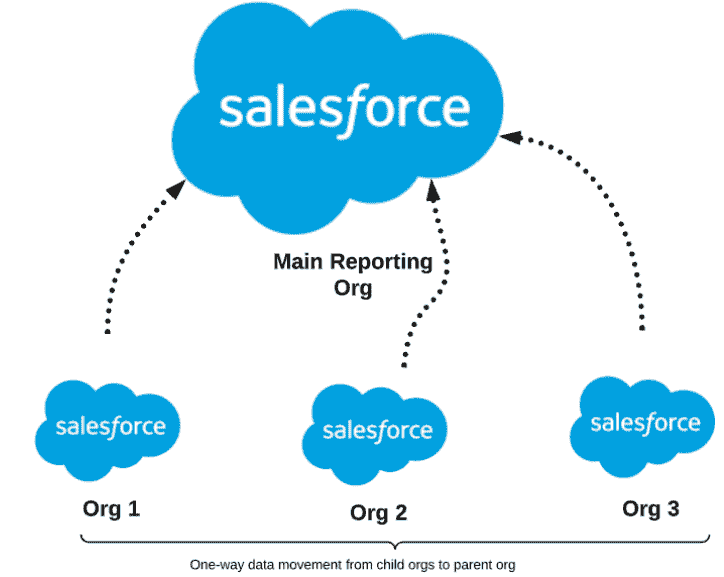
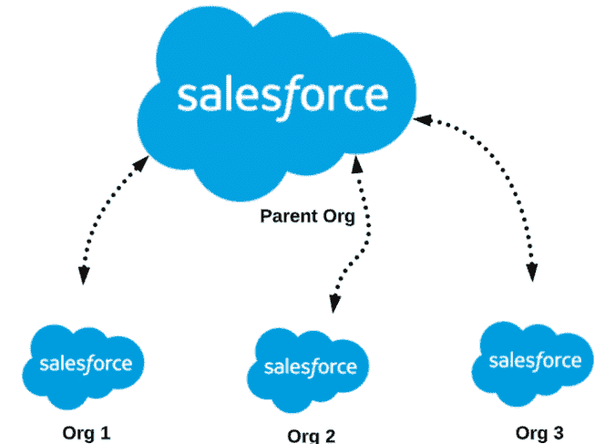
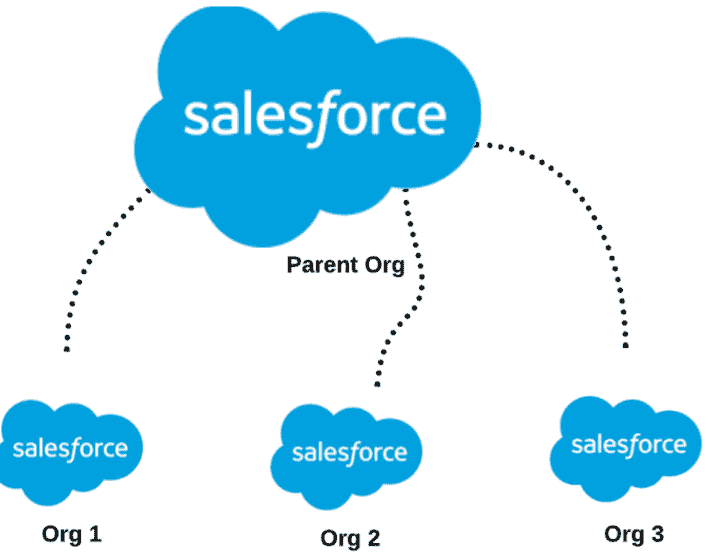
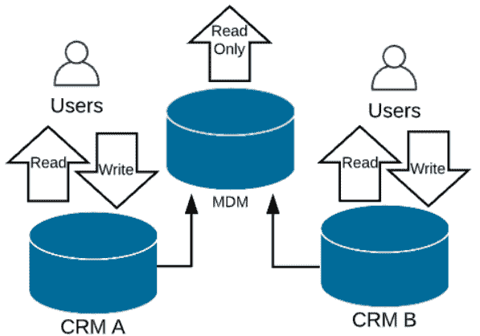
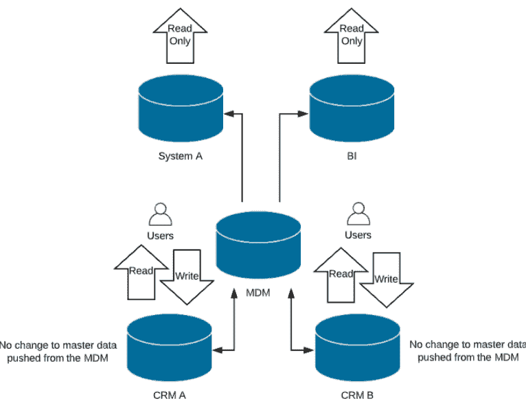
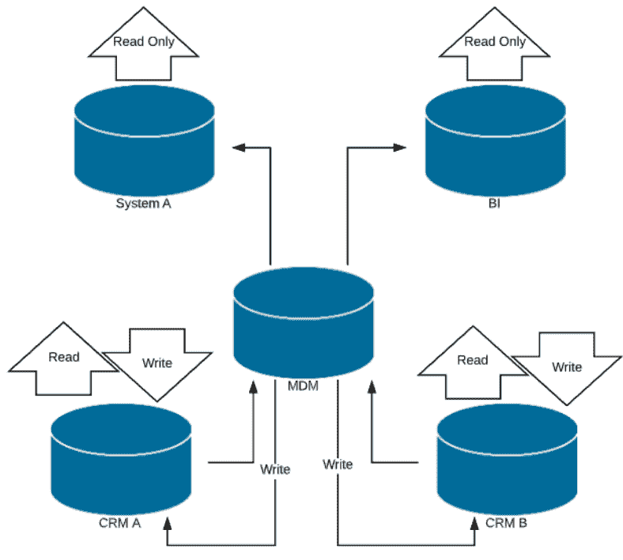
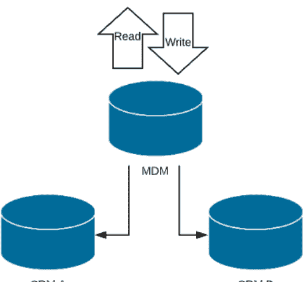
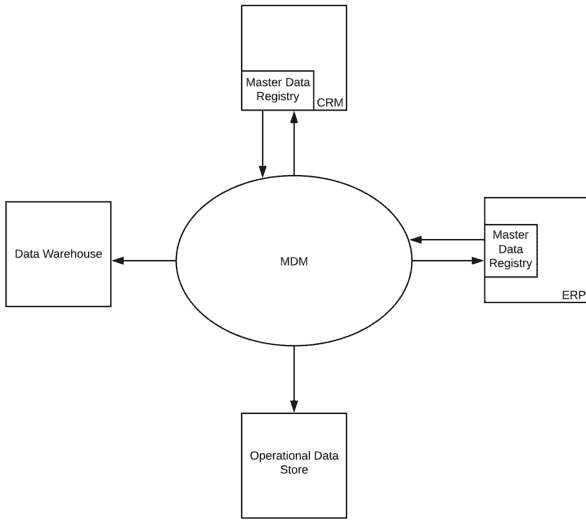

## 4 Making Sense of Master Data Management

## 4 梳理主数据管理

In the last chapter, we looked at data management, its importance, and the different aspects of data management. There are many types of data and not all of them are treated the same way. This is especially true now, given that sources of data have been increasing steadily over the last few years. Earlier data was mostly structured and easily manageable, but with social data, machine-generated **Internet of Things (IoT)** data, sound and video data, and much more, it is becoming increasingly important to ensure that the data that is core to your business is identified and managed properly. In this chapter, we will discuss **Master Data Management (MDM)**, different types of MDM data, its attributes, and why MDM is important.

在上一章中，我们探讨了数据管理、其重要性以及数据管理的不同方面。数据有多种类型，并非所有数据都以相同方式处理。这一点在当今尤其明显，因为过去几年数据来源稳步增加。早期的数据大多是结构化且易于管理的，但随着社交数据、机器生成的 **物联网 (IoT)** 数据、声音和视频数据等不断增加，确保对核心业务数据进行正确识别和管理变得越来越重要。在本章中，我们将讨论 **主数据管理 (MDM)**、不同类型的 MDM 数据、其属性以及 MDM 为何重要。

We will also be discussing the Golden Record – the much sought-after record that accurately and comprehensively provides a single customer view. Next up will be the MDM and CRM strategy and the different ways that you can ensure that your **System of Record** and MDM can interface with each other. We will close the chapter by discussing Customer 360, the suite of products from Salesforce that tries to solve the MDM problem, along with other tools to deliver a complete and accurate picture of the customer.

我们还将讨论“黄金记录”——一种备受追捧的记录，能够准确且全面地提供单一客户视图。接下来是 MDM 与 CRM 策略，以及如何确保您的 **系统记录源** 与 MDM 能够相互对接的不同方法。我们将通过讨论 Customer 360 来结束本章，这是 Salesforce 提供的一套产品，旨在解决 MDM 问题，并借助其他工具提供客户的完整准确图景。

The topics covered in this chapter include the following:

本章涵盖的主题包括：

- Understanding master data
- 了解主数据
- The Golden Record
- 黄金记录
- MDM and CRM strategy
- MDM 与 CRM 策略
- Customer 360
- Customer 360

By the end of this chapter, you will have a solid understanding of master data, its importance, and why the Golden Record is critical for data management and for organizations in understanding the customer's relationship with the organization. You will understand the correlation between the MDM and CRM strategy and the suite of tools that Salesforce provides to help achieve these business goals.

本章结束时，您将对主数据、其重要性以及“黄金记录”对数据管理和组织理解客户与组织关系的重要性有扎实的理解。您将理解 MDM 与 CRM 策略之间的关联，以及 Salesforce 提供的用于帮助实现这些业务目标的工具套件。

### Understanding master data

### 了解主数据

In this section, we will first start with the definition of master data, the need to identify and manage master data, and the different types of master data. This is going to help us in our later discussion of the Golden Record and in the MDM and CRM strategy sections.

在本节中，我们将首先从主数据的定义、识别和管理主数据的必要性，以及主数据的不同类型入手。这将有助于我们稍后讨论“黄金记录”以及 MDM 与 CRM 策略部分。

So, let's dive right in and define master data.

那么，让我们直接开始并定义主数据。

### What is master data?

### 什么是主数据？

Master data can be defined as the data that describes the core entities of the business. This can include customers, suppliers, locations, leads, and so on. A good indication of whether a data element is master data is to review its use across multiple business functions, processes, or systems in the organization. For example, leads that funnel into the marketing team, once qualified, will flow down to the sales team. Once a deal has been won, the same lead, which is now a customer, will flow down to sales operations and in this instance, eventually into the ERP's contracts module as a customer. Sharing master data eliminates the need for each function to maintain its own list and facilitates uniformity across business areas.

主数据可定义为描述业务核心实体的数据。这可以包括客户、供应商、地点、线索等。判断某个数据元素是否为主数据的一个良好指标是，检查其在组织内多个业务职能、流程或系统中的使用情况。例如，线索进入营销团队，一旦合格，就会流向销售团队。一旦交易成交，同一个线索（现在是客户）就会流向销售运营，并在此示例中，最终作为客户流入 ERP 的合同模块。共享主数据消除了每个职能维护自己的列表的需求，并促进了业务领域之间的统一性。

We should note that master data is owned by the organization and not by a particular business function or department. This is important because master data requires stewardship, and this sets the context to communicate the right mindset in the organization, implying that everybody is responsible for master data. Otherwise, specific area or data specialists are left to clean up the data and ensure its accuracy, while users creating the data don't feel the same level of ownership and accountability.

应当注意，主数据由组织拥有，而非由特定业务职能或部门拥有。这一点很重要，因为主数据需要数据管理，这为在组织中传达正确的心态设定了背景，意味着每个人都对主数据负责。否则，特定领域或数据专家将不得不清理数据并确保其准确性，而创建数据的用户则不会感受到同样的所有权和责任感。

### The need for master data management

### 主数据管理的必要性

We established in earlier chapters that the volume of data has been growing and organizations are finding it challenging to keep pace with the volume as well as the sources of data. A typical organization will have dozens of different systems spread out and with their own proprietary data formats and ways to allow access to data. This is especially true for large organizations that are siloed and don't have effective master data management tools and processes in place. This can lead to the following challenges:

我们在前面章节中已经确定，数据量一直在增长，组织发现很难跟上数据量及其来源的步伐。典型的组织会分布着数十个不同的系统，拥有自己的专有数据格式和数据访问方式。这对于数据孤岛严重且没有建立有效的主数据管理工具和流程的大型组织尤其如此。这可能导致以下挑战：

- **Data governance**: Master data management and data governance go hand in hand. You cannot implement an effective data governance strategy unless you have identified and fixed any issues with master data. For example, a company has five **Customer Relationship Management** (CRM) systems across three regions as a result of acquisitions over the years. Some of the customers exist in multiple CRMs, with slight differences in addresses, phone numbers, and so on. Unless you can identify which is the most accurate and comprehensive record, enforcing data governance rules will not make a difference.

- **数据治理**：主数据管理与数据治理密不可分。除非您已识别并修复主数据中的任何问题，否则无法实施有效的数据治理策略。例如，一家公司因多年来的收购，在三个地区拥有五个 **客户关系管理 (CRM)** 系统。某些客户在多个 CRM 中存在，地址、电话号码等略有不同。除非您能识别出哪个是最准确、最全面的记录，否则执行数据治理规则将不会产生任何影响。

- **Reporting**: In the example stated in the previous point, how do we know who our high-value customers are if they have the same names, but with slight variations. For example, is Precision Printers LLC the same as Precision Printers Inc or PP Inc? Another example is if we have, say, five subsidiaries of a company but they are not identified as related to each other via an account hierarchy, and that knowledge sits in someone's head. Unless that person is around, we may be duplicating our marketing efforts and wasting time and money sending the same marketing brochure five times.

- **报告**：如前一点所述的示例，如果高价值客户名称相同但略有变化，我们如何知道他们是谁？例如，Precision Printers LLC 是否与 Precision Printers Inc 或 PP Inc 相同？另一个示例是，如果一家公司有五家子公司，但它们未通过账户层级被识别为相互关联，且相关知识只存在于某个人的脑中。除非该人在场，否则我们可能会重复营销努力，浪费时间和金钱，五次发送相同的营销手册。

- **Integrations**: Integrations can become challenging when there is no consistent and accurately identified master data because, in a downstream system, which record are we going to send? For example, downstream call center software requires customer contact information. Based on the caller's phone number, the application matches it with the customer information sent by the upstream system and displays it to the call center agent, along with support levels and some other pertinent information. The customer contact information is held in CRM, but also manually entered in the ERP system. If we haven't defined which system is the source of truth and has the most accurate customer data, chances are we will be sending the incorrect customer contact to the call center system unless we incorporate additional logic in the interface that can send the correct information to the downstream system.

- **集成**：当没有一致且准确识别的主数据时，集成可能会变得具有挑战性，因为在下游系统中，我们将发送哪个记录？例如，下游呼叫中心软件需要客户联系信息。根据来电者的电话号码，应用程序将其与上游系统发送的客户信息进行匹配，并将其以及支持级别和其他相关信息显示给呼叫中心坐席。客户联系信息既保存在 CRM 中，也在 ERP 系统中手动输入。如果我们没有定义哪个系统是事实来源且拥有最准确的客户数据，那么除非我们在接口中加入额外逻辑以向下游系统发送正确信息，否则我们很可能会将不正确的客户联系信息发送到呼叫中心系统。

### 下游和上游系统

在集成语境中，下游和上游分别指目标系统和源系统。例如，如果某 ERP 将产品数据馈入 Salesforce CRM，而 Salesforce 与呼叫中心系统有集成，那么从 Salesforce 的角度来看，ERP 被视为上游系统，呼叫中心系统是下游系统。

- **客户服务**：如前文所述的呼叫中心示例中，客户服务差可能是缺乏有效主数据管理的直接后果。在此场景下，如果客户致电，而呼叫中心软件将其匹配到错误的客户名称或优先级，客户与呼叫中心的体验将不尽理想，如果软件显示的 SLA 不正确，可能会导致客户不满。

- **实现收入目标**：想象你去一家大型量贩店购买笔记本电脑，却发现店内的价格标签与你收到的传单价格不同。通常，商店会按照传单上的价格进行匹配，但你是否曾想过这最初为什么会发生？这很可能是印刷错误，但也可能是主数据问题。如果传单上的产品定价来源于与商店使用的不同系统，就可能出现定价不一致。现在想象一下，如果传单上的价格本不应低 20%，公司就损失了收入，对于大宗商品商店来说，这很容易转化为数十万美元甚至更多的损失。

- **维护和增强客户信任**：缺乏有效的主数据及其周围的控制会导致客户信任降低。例如，由于缺乏有效的主数据管理实践，各分支机构通过为相同的零部件和维修服务提供不同价格来达到销售目标，从而侵蚀了公司自身的业务。结果，客户信任度降低，当他们需要维修时，会致电三到五家不同的分支机构以获取最低报价。之所以会发生这种情况，是因为制造商一直在更新零部件定价并发送给经销商，而经销商则负责将其发送到各分支机构，分支机构再更新其费率表。有时，费率表几周都不会更新，导致定价不一致，从而给业务带来收入损失。

- **法规合规**：有效的主数据管理也可以防止监管报告和合规问题。例如，如果你没有建立有效的主数据管理流程来首先识别该人员的所有可能实例，那么在收到*被遗忘权*请求后，如何确保已有效删除该特定人员的所有数据？不遵守这些法规对组织来说可能代价高昂，不仅在底线收入方面，而且在声誉方面也是如此。

- **数据质量**：当数据存储在多个系统中并采用多种不同格式，且这些格式无法集成时，该数据的可用性会降低。建立有效的主数据管理实践可确保你的数据对用户来说始终可行且可信。数据质量的另一个方面是重复数据。建立主数据可确保你已处理重复项，并且正在访问唯一最准确的记录。例如，如果某业务职能在客户经过客户信贷团队审核后在 ERP 中录入客户，而销售团队也在 CRM 中录入同一客户，那么该数据必然会出现问题。通过主数据管理，你可以纠正这类问题并合并记录，从而实现良好的数据质量。

- **沟通**：当主数据识别缺乏一致性时，部门间的沟通可能变得困难。在产品型业务中这种情况很常见，一个业务部门称产品为某个名称，而另一个职能部门则倾向于用另一个名称来称呼它。

现在我们已经了解了主数据管理不当所带来的挑战，让我们来看看组织拥有的数据类型。

### 数据类别

关于主数据有多少种类型，一直有很多讨论。有人说是三种，有人说是五种，但无论如何，我们已经确定主数据对业务运营至关重要，并且通常分布在整个组织中，这意味着一个系统可能拥有所有客户联系人，而另一个系统可能拥有该组织销售的所有产品，而另一个系统可能拥有所有引用类型数据，包括货币等。典型公司将拥有以下五种数据类型：

- **事务数据**：这是由业务活动生成的数据，例如销售订单、报价单和发票。此数据对公司很重要，用于历史报告、分析、法律或法规合规目的。

- **元数据**：这是关于数据的数据。在 Salesforce 中，这包括标准字段和自定义字段、工作流规则、触发器、报表定义、单点登录设置等。

- **层次数据**：这是存储数据之间关系的数据；例如，科目表和组织层次结构。

- **引用数据**：这是定义一组有效值并被其他数据引用的数据，例如国家列表、货币、付款条件等。这也可能是由国际、地区或行业标准定义并在组织中使用的数据。

- **主数据**：这是企业内描述围绕其开展业务运营的业务实体的核心数据。此数据相对静态，不具有事务性质。通常，主数据涵盖的关键领域包括产品、客户、地点，以及由合同和权利组成的第四个领域。

### 了解引用数据和主数据

引用数据是用于为组织中其他数据设置上下文的数据。例如，机会对象上的 Stage 字段与事务数据（机会本身）或机会可能使用的不同货币一起使用。货币、阶段、状态和国家都是引用数据的示例。引用数据不仅为事务数据（机会对象上的阶段）提供上下文，也为主数据提供上下文；例如，在产品上，一个用于识别产品是否处于活动状态的选取列表值，或者联系人对象上的 Salutation 字段。

引用数据与主数据之间的一个关键区别在于，在理想情况下，前者不需要记录链接，这意味着相似记录的多个实例不需要被解决，而主数据则不然。在现实中，引用数据可能有多个来源；但是，应尽一切努力识别单一真实来源，以避免混淆和错误数据的泛滥。例如，客户名称（主数据）可能来自三个不同的系统，需要将其链接在一起以提供更清晰的数据图景。通常不需要为引用数据执行此操作，因为它更稳定且变化较少。这并不意味着引用数据没有相关挑战。引用数据可能来自组织外部，因此使用该数据的组织无法对其施加任何影响。例如，邓白街标（D&B）提供数据丰富服务。

它维护最新数据，集成后可以向 Salesforce 推送自动更新。例如，如果某组织将客户对象上的 **行业** 字段与 D&B 同步，而后者决定更改特定行业，这可能会对组织内部产生潜在的下游影响。

### 通过主数据管理解决问题

此前，我们回顾了组织在未妥善管理主数据时面临的挑战。在本节中，我们将回顾一些示例，以便更清楚地了解主数据管理在哪些方面能发挥巨大价值。请记住，拥有 50 个客户且以回头客为主的小型企业不需要广泛的主数据管理解决方案。这是因为，正如您将在下一节中看到的，它们不会面临相对较大组织或数据量不断增长的企业所面临的问题。然而，这不应被误解为小型组织不需要管理其主数据，而是说它们可能不需要大型组织所需的广泛工具和流程。在接下来的部分中出现的示例里，我们将重点关注客户数据，但其他主数据（例如产品）也存在类似问题。

### 重复数据

这是一个常见问题，通常出现在**并购**场景中。当一家公司收购另一家公司时，除非被收购公司位于另一个大洲或处于不同的业务领域，否则大多数情况下，两家公司之间的客户会有重叠。例如，一家汽车经销商收购了同一地区内另一家经销商的三家分店。两家经销商都使用相同的 CRM，但公司现在必须处理冗余数据并决定如何处理。实施强大的主数据实践和工具可以帮助缓解这类问题。

### 真实来源记录

在 Salesforce 中，如果共享模型没有经过深思熟虑，并且被锁定到销售代表在创建新客户之前无法搜索数据库中可能已存在的客户，这种情况很容易发生。结果，您可能会在 CRM 中看到创建的客户，例如 IBM、IBM Ltd.、IBM USA (Consulting)、IBM USA (Health) 和 IBM Healthcare Management Solutions。

### 数据标准化

当存在多个 CRM 且，比如说，行业字段在每个 CRM 中有不同值，或者账户对象上的客户优先级字段在一个 CRM 中有高、正常、低，而在另一个 CRM 中有铂金、金、银时，这种情况很常见。

### 层次结构

当数据已在 CRM 或多个 CRM 中录入，但对定义客户账户层次结构未给予足够重视时，就会出现此问题。例如，一家大型全球公司可能在不同业务线下拥有数百家子公司。作为该全球品牌（包括其子公司）的主要供应商，一个组织如何确定该账户产生的总收入是多少？来自某个区域、某条业务线或某个销售区域的收入是多少？除非定义了某种恰当链接子公司与母公司的层次结构，否则得出这些数字需要大量手动工作。除此之外，层次结构还提供一些进一步的好处，包括：

- 收入机会：在 Salesforce 中，我们了解账户层次结构，但我想深入探讨层次结构的概念及其重要性。此前，我们探讨了层次结构如何帮助我们回答谁是我们的顶级客户等问题。某个区域或销售区域的顶级客户是谁？不过，层次结构的好处不限于此。

在拥有全面视图时，我们可以寻找机会，以及客户及其子公司可能承担的任何信用风险。例如，Precision Printers 是一家在 150 多个国家提供打印机和复印机的全球供应商，拥有 47 家子公司。你正在与该公司谈判续签另一份 10 年合同，并注意到其中一家子公司在过去几年中一直持续订购大量复印机。你建议在合同中为该子公司包含一项特殊交易，即如果他们每年订购最低数量的复印机，则按折扣价提供。没有账户层次结构，这种洞察将无法实现。

- 产品洞察：鉴于可以存在多种不同类型的层次结构，包括产品、供应商和位置层次结构，为这些实体形成层次结构可以为业务带来益处。例如，产品层次结构可以帮助识别仅通过产品本身无法实现的洞察。例如，对于销售重型建筑机械并提供零件和维护服务的经销商来说，机器的斗式附件是一种产品，它汇总到轮式装载机（另一种产品），而轮式装载机又汇总到建筑机械类别。立即，您可以看到斗式附件与装载机及建筑机械类别的关系。

这些信息可以为我们提供关键问题，例如：我们是否应将斗式附件作为装载机的一部分销售，或者将其作为单独的附加组件销售是否有更多收入机会？我们的装载机与竞争对手的装载机相比如何？他们是否已将斗式附件计入机器的基础价格？

- 准确报告：另一项好处是，层次结构可以在系统之间提供比较基准。例如，在 ERP 中，您可能将斗式附件和装载机作为两种不同的产品，但在报价系统中，您将它们作为一种产品，价格相加得出列表价格。在您的商业智能（BI）工具中，您将两个销售区域中所有机器的价格相加，减去机器的平均全国成本，以得出每个区域的最终利润。您未考虑的是，制造商为将斗式附件运送到某个偏远区域而增加的附加费。这可能会导致数据偏差，从而影响您的销售和营销工作。

明确地说，创建和维护层次结构的工作也可以手动完成，一些公司确实如此，但这很乏味且容易出错。例如，您的数据团队从 ERP、CRM 和其他系统导入数据，然后转换数据以进行有效比较。使用 SDM，一旦设置完成，该过程即为自动化，MDM 工具承担原本由数据团队完成的繁重工作。但需要注意的是，拥有 MDM 并不能完全使组织免于人工干预，因为会出现数据管理员需要做出决定以确认记录匹配和合并的场景，但总体过程将更加高效。

在下一节中，我们将回顾有助于识别数据元素是否应被视为主数据的因素。

### 决定哪些数据是主数据

公司应非常关注识别什么才是真正的主数据，因为标准定义松散可能导致管理不那么有价值的数据，从而浪费精力和时间。某些类型的数据可以明确定义为主数据，例如账户和联系人，但其他类型的数据可能不那么明确。此处定义的标准在这些情况下将有所帮助，并应作为在您的组织中决定什么是主数据、什么不是主数据的指南：

- **行为数据**：当对数据子集进行分析以观察其与其他数据的交互方式时，即为行为数据。例如，在事务系统中，主数据与事务数据交互。例如，考虑客户购买产品（主数据），或合作伙伴请求添加新位置（主数据）。主数据与事务数据之间的关系可以视为动词/名词结构，其中事务数据构成动词，名词捕获主数据。在我们之前的示例中，购买产品的行为或跟踪合作伙伴添加新位置的请求将构成事务数据，相关记录也将是事务数据。主数据将是正在购买的产品或正在添加到系统中的位置。

- **生命周期**：主数据也可以通过对其执行的 **CRUD**（创建、读取、更新、删除）操作来描述。例如，出于确保主数据准确完整创建的需要，一些公司会制定严格的流程来创建客户账户。审查强调创建某些类型数据的业务流程有助于识别主数据。

- **基数**：基数是集合中元素的数量，如果集合中只有少数元素，则该元素为主数据的概率较低。例如，如果一个组织只有三个客户，那么在需要 MDM 解决方案的背景下，这将不被视为主数据。这并不降低客户的价值，因为它们对于任何企业生存都至关重要，但它有助于决定将哪些数据视为主数据。相比之下，拥有数千个客户和多个源系统的组织肯定可以使用 MDM 解决方案。

- **生命周期长度**：与事务数据相比，主数据更稳定、波动性更小；例如，合同通常被归类为事务数据。一家从事为期 2 周管道工作的 HVAC（供暖、通风、空调）公司可能只是将其合同视为事务数据，但在与大型商业客户合作时，他们可能决定将其视为主数据。公司也可能决定将为期 2 周的工作视为主数据，仅仅是因为在日常业务中处理起来更容易，而不是将其分离出来。同样，工单估算可能被视为主数据，因为在处理回头客时它们能提供有价值的历史情报。

- **复杂性**：这是另一个有助于确定元素是否应被视为主数据的因素。元素越不复杂，越不太可能被视为主数据；例如，一家只生产一种通用校包并向 Walmart 或 Target 等大型零售商供货的制造商，更关心现有包的数量而非类型及其他详细信息。由于只有一种类型和颜色，在主数据管理方面不需要管理太多内容。

- **价值**：这一类别略带主观性，将数据集是否应被承认为主数据的考量留给拥有它的实体。例如，如果公司认为无论持续时间和价值如何，所有合同都很重要，并对它们都高度重视，那么最有可能，合同将被视为主数据进行管理。

- **可重用性**：数据的可重用性通常是将一组元素作为主数据进行管理的驱动力。一个非常常见的例子是客户数据，因为公司致力于拥有客户数据的一致定义，并在组织内广泛使用。

现在我们已了解一些有助于识别数据元素是否为主数据的因素，在下一节中，我们将回顾 Salesforce 数据架构师面临的一个常见场景，即当组织中存在多个 Salesforce 组织时，设计管理解决方案来管理主数据和事务数据。

### 多组织场景

在使用 Salesforce 的组织中，常见的情况是使用多个 Salesforce 组织，这可能导致对客户和其他数据的视图不完整。多组织场景可能是合并和收购的结果，或者是拥有众多销售和营销团队的大型组织，在这种情况下拥有独立的 Salesforce 组织是合理的。这里不是讨论多组织策略何时合适的地方，但决定采用多组织不应轻率对待。请参考 Salesforce 的一篇博客文章，其中详细阐述了此主题：https://developer.salesforce.com/blogs/developer-relations/2014/10/enterprise-architecture-multi-org-strategy.html。

如前所述，客户数据可见性不佳会导致销售和服务方面的机会错失。在销售方面，可能是组织中不同的销售代表使用互不连通的组织联系客户；同样，在提供服务时，分散的组织无法提供客户的完整视图，往往导致客户从服务代理那里获得相互冲突的信息。

在 MDM 场景中，多个组织可以接入 MDM 系统，以便处理来自不同系统的记录、清理它们，如果是共存型 MDM 实现，还可以将它们推送回源系统（我们将在后面讨论）。不言而喻，在没有 MDM 的情况下，仍必须实施流程和工具，以确保数据不仅仅是从一个组织移动到另一个组织，而是确保数据是干净的。

但是，在系统架构中没有 MDM 的情况下，本节讨论的问题会显现出来，并且需要一个解决方案来确保业务顺利运行。在接下来的几个部分中，我们将回顾一些策略，以管理源于多组织场景的挑战，同时交付用于报告和分析所需的整合数据。然而，必须理解，虽然本讨论发生在主数据管理的背景下，但不应将其视为仅与主数据相关。在多组织场景中，您仍希望确保不仅主数据，而且事务数据都得到妥善管理。

### 主报告组织

此方法需要将一个 Salesforce 组织指定为主报告组织，其中源组织的数据将汇总以供分析用途。图 4.1 以图表形式描绘了此方法：

图 4.1 – 主报告组织

此主组织不会将数据发送回源组织和报告，而是用于获取单一客户记录视图。此方法的优点如下：

- 对源组织所需的更改很小，因为所有工作都在主组织中完成。
- 它会产生一个专用组织，其中拥有用于分析目的的干净和整合的数据。

此方法的一些缺点如下：

- 手动和自动化流程仍从源组织运行，无法受益于报告组织中存在的高质量数据。
- 购买和维护另一个 Salesforce 组织会带来额外成本。
- 集成组织所需的中间件会带来额外成本。

由此可见，由于需要维护额外的组织，这可能成本高昂，但它比其他模型具有优势。接下来，我们将查看父组织模型。

### 父组织

在这种安排中，将一个组织指定为主组织，用于业务流程和报告。子组织向主组织报告，数据在组织之间同步。前提是，在任何给定时间，所有组织中的数据都同步。此方法的一些优点包括以下内容：

- 所有业务处理的单一组织。
- 子组织中也存在清洗后的数据，从而导致 MDM 和源系统中的数据一致。

此方法的一些缺点如下：

- 这涉及简单的同步，可能导致低质量数据在系统中流传。
- 为保持组织同步而产生的集成流程和工具的额外成本。
- 可能需要为每个组织维护多个业务流程。

如图所示，父组织和子组织之间的数据是同步的：

图 4.2 – 父组织模型

此方法的最大好处是能够保持所有组织同步，但需要进行微调和分析，以确保自动化流程在组织之间运行。

### 整合组织

此方法要求除一个 Salesforce 组织外的所有组织被停用，数据整合到主组织中。此方法的一些优点包括以下内容：

- 提供客户的单一视图
- 易于维护
- 通过整合各个组织实现成本效率
- 对主组织进行有效的集中控制

此方法的一些缺点包括以下内容：

- 可能会更早达到组织限制。
- 当业务用户移动到整合组织时，可能会对业务用户造成中断，尤其是考虑到 Salesforce 用户名是唯一的。
- 它需要在整合组织中重新创建业务流程。
- 大量数据需要多轮测试，以确保数据可以验证准确性和完整性。
- 整合型项目在短期内风险高且成本高。

如图 4.3 所示，将一个组织指定为父组织，其他组织合并到其中：

数据从子组织迁移到父组织，随后将其停用

图 4.3 – 子组织迁移到父组织，然后停用

无论选择哪种方法，请确保在您的技术系统架构和业务优先事项的背景下考虑了每种方法的优缺点。如果报告和分析是关键，那么主报告组织模型可能更合适；而如果业务流程是优先事项，那么单一整合组织模型可能产生最大价值。

### 定义主数据管理 (MDM)

MDM 是确保主数据在整个企业中协调的技术、工具和流程。它提供了组织和业务合作伙伴可用的数据的一致、准确和完整的视图。

在下一节中，我们将回顾在进行 MDM 项目时对内外部沟通有帮助的基本概念。清晰地理解这些概念将使您能够更精确地定义业务需求，并为选择适合您组织的最佳解决方案提供基础。

### 回顾数据质量基础

在思考不良数据时，您脑海中会浮现什么？是 **电话** 字段中的值格式相同，还是下拉列表受到限制，无法输入其他值？您可能会对所有或大部分问题回答 *是*；确保数据一致且格式正确的这些做法通常被称为标准化和格式化。这些是现代 MDM 系统不可或缺的一部分。MDM 系统将允许您根据行业和业务实践为每个源系统定义标准。让我们更详细地回顾这些做法：

- **预防**：预防胜于治疗的格言同样适用于主数据，我们应该注意防止不良数据在最初被录入的机会。这些通常更容易实现，可以用于强制执行某些数据标准。例如，Salesforce 中的验证规则可用于强制执行良好的数据录入实践，例如确保如果机会设置为 **已关闭/丢失**，则必须填写自定义 **损失原因** 字段。在此示例中，如果未输入丢失原因，而销售代表在将机会设置为 **已关闭/丢失** 后尝试保存机会，他们会收到错误。同样，Salesforce Platform 上非常常见的预防方法是使用下拉列表。当您选中了 **将下拉列表限制为值集中定义的值** 复选框时，用户无法通过 **用户界面 (UI)** 或通过 API 添加新值。此的第三个示例是在字段中设置默认值，以便在用户未在字段中输入值的情况下，存在默认值。

- **审计**：管理数据的另一种方式是通过审计。审计通常用于频繁评估和改进数据质量，是管理主数据的一种有效形式。缺点是，审计是在数据已保存到数据库之后进行的，并且可能已被用于报告或集成等其他目的。但是，这不应阻止我们频繁审计数据，现有一些开箱即用的工具可用于此，或者 AppExchange 应用程序可帮助进行审计。例如，在 Salesforce 中设置重复规则后，您可以运行报告来检测数据中的任何重复项并采取适当措施。

**纠正**: 另一种在数据录入过程中常用的方法是纠正，但其使用频率低于预防，主要因为需要定义并一致应用规则。例如，线索对象上的自定义字段用于捕获正在处理线索的销售工程师，在转换时，它会被读取并输入到机会的**机会团队成员**相关列表中。一个简单的触发器，或更可取的是流程构建器流，可以用来完成此操作。另一个示例是，一旦机会设置为**已成交 - 已赢**，就将账户对象上的**类型**字段从**潜在客户**更新为**客户**。如您所注意到，需要为每种情况定义规则，并且至少在这些示例中，它们依赖于在其他地方存在某个值后才能输入正确值。

**去重**: 这是使用Salesforce的组织中常见的业务问题。这是因为CRM系统的性质决定了它必须拥有多个数据录入点进入系统。例如，考虑Web-to-Lead、营销工具以及销售代表将电子表格上传到系统，以及手动创建记录。所有这些都是进入系统的不同数据渠道。有时，即使是单一渠道也会导致重复；例如，当线索多次提交Web-to-Lead表单时，这可能会在Salesforce中创建重复记录。我们之前提到，如果Salesforce记录级访问安全性未正确设置且组织过度限制，且代表搜索账户并在系统中找不到它时，他们将创建一个新账户，从而建立重复记录。这假设系统中已经存在一条记录。

重复记录的一个关键挑战是重复记录可能具有众多变体，使得正确识别重复记录变得困难得多。例如，考虑地址为123 Main St, Detroit MI的**约翰·史密斯**联系人记录，第二条记录为地址Number 123 main street, Detroit Michigan的**J·史密斯**，第三条为地址123 Main st, unit 7, Michigan的**约翰·S**。这些是重复记录还是不同的记录？仔细审查记录后，我们可以安全地得出结论，这些是重复记录，但你将如何定义规则，以便计算机软件在审查这些记录时能正确识别重复记录？如本示例所示，正确识别重复记录可能相当具有挑战性，尤其是当记录量达到数十万条时。

MDM解决方案的关键功能之一是识别和解决重复数据，因为这是实现主数据清洁和可信状态的关键步骤。这一关键功能在不同来源的数据汇总到MDM后立即启动。

此过程的第一步是识别重复项，也称为匹配。通常，有两种方法——确定性方法和概率性方法：

- **确定性方法：** 在此方法中，寻找数据元素之间的精确匹配并分配一个分数。此方法通常会产生较少的匹配。如果捕获了唯一值，例如社会安全号码和社会保险号码，这是理想的选择，但考虑到这是机密数据，除非要求，否则客户不愿意共享它们。因此，最常用的字段包括电话号码、地址、电子邮件地址等等。此方法还引入了复杂性，因为要匹配的数据元素数量增加，这意味着需要更多的匹配规则。过多的匹配规则可能导致性能下降和昂贵的持续维护循环。

- **概率性方法：** 在此方法中，匹配基于多个标准，例如语音、出现的可能性和细微差别。此方法使用权重来计算匹配分数，并使用阈值来确定匹配。此方法在匹配记录方面更准确。它更适合可用于匹配的更广泛的数据元素集。

一旦记录被识别为重复项，下一步是合并重复项以创建黄金源，即单一事实来源。此阶段的关键挑战是哪些数据元素来自多条记录需要存续以形成黄金记录。这需要在MDM工具中构建一些*智能*，以确定哪些元素应该存续。

### MDM计划的关键要素

理解MDM不是解决业务问题的技术方案至关重要。虽然它会有所帮助，但它不会解决所有问题。如果不认识到这一点，这种心态可能导致MDM项目失败。一旦我们实施了MDM工具，所有数据问题都会自行解决的想法根本不现实。一个强大的MDM计划具有必须实施和遵守的关键要素，以便组织的MDM投资继续产生效益并提供高投资回报率。

MDM计划策略的关键要素应如下：

- **治理：** 这是一套指导组织机构、政策、原则和素质的指令，以促进对准确和一致主数据的访问。

- **衡量：** 这涉及设置**关键绩效指标**（KPI）来衡量和持续改进数据。

- **组织：** 这定义了将形成数据管家、数据所有者以及治理委员会成员的人员和团队。

- **政策：** MDM计划应遵循的要求、政策和程序。

- **技术：** MDM计划技术组件的选择、实施和管理。

一旦组织定义了什么被视为主数据，下一步是实施MDM计划。实施MDM计划的关键步骤包括以下内容：

- **识别主数据来源：** 此步骤涉及识别所有主数据来源。这是一个关键步骤，应该彻底进行，因为毫不奇怪，可能有多个主数据来源，包括私有存储的Excel电子表格、Word文档等等。

- **识别主数据生产者和消费者：** 此步骤涉及了解谁生产数据以及谁是其消费者。生产者和消费者可以是IT系统或人。

- **分析关于您数据的元数据：** 此步骤涉及确定与主数据关联的属性及其含义。这可能是一个广泛的步骤，特别是如果分散的地区或业务领域对数据有不同的定义；例如，什么定义了组织中的客户，或者新客户何时成为现有客户，因为可能存在与客户是新客户还是现有客户相关的流程。可分析的主数据属性示例可能包括以下内容：

  - 属性名称
  - 数据类型
  - 允许值
  - 约束
  - 默认值
  - 依赖项
  - 数据所有者

- **指定数据管家：** 这些人理想情况下应对数据有深刻理解，并可以协助未来维护主数据。

- **实施数据治理委员会：** 该组有权决定如何维护主数据、包含什么、保留多久以及如何授权更改。

- **开发主数据模型：** 这包括决定主数据的外观，包括其属性、大小和数据类型、允许哪些值等等；例如，在大型重型设备经销商中，零件部门偏好使用零件号来查找零件，而技术人员偏好使用旧零件号，因为他们记熟了，即使已经发布了取代旧零件的新零件号。

- **选择工具：** 这是您将选择用于数据清洗、转换和合并数据的工具的地方。这些工具将支持查找数据质量问题，例如重复项和缺失或不完整的数据。通常，这些工具还将具有版本控制机制，以跟踪主数据上的更改历史。

- **创建和测试主数据：** 一旦您选择了工具，下一步是创建主数据并对其进行测试。您希望从小数据子集开始，确保规则配置正确，并且生成的主数据集确实是所期望的。一旦您确认规则配置正确并生成所需数据，就可以开始加载其余数据。

### 创建主数据

创建主数据涉及两个基本步骤：

- **清洗和标准化数据：** 在开始清洗数据之前，您必须了解数据模型。您已将主数据的每个属性映射到源系统。一些数据清洗功能包括以下内容：

  - **规范化数据函数：** 确保字段具有相同的数据和一致的格式；例如，电话号码仅包含数字且不包含文本。
  - **替换缺失值：** 插入缺失值、默认值，并利用Dun & Bradstreet等服务来填补数据中的空白。
  - **标准化值：** 将测量值转换为商定的系统，将价格转换为共同的企业货币，等等。
  - **映射属性：** 将联系人姓名解析为名和姓，并将“零件号（part #）”和“零件编号（part no）”移动到**零件号**字段。

- 2. **匹配数据**：在此步骤中，您将匹配数据记录以消除重复项。此步骤需要大量的分析和考虑，因为您可能会不经意地丢失数据；例如，*John C King* 和 *John King*（在人员账户设置中是完全不同的联系人）被视为相同，导致重要历史数据丢失。

关键是对多个属性进行匹配，并建立一个算法来计算一条记录与另一条记录相同的可能性。当匹配分数较高并达到或超过阈值时，您可以肯定地说该记录确实是匹配的。

在下一部分中，我们将探讨不同类型的 MDM 实施模式，以及它们各自的优势和劣势。

### 实施 MDM

在本节中，我们将探讨如何实施 MDM 以及不同 MDM 样式的注意事项。MDM 中使用四种实施样式，主要取决于数据是由中央集线器控制，还是由数据源同步到集线器。之所以这一点很重要，是因为组织需要拥有单一真实版本。在 MDM 实施中，重点在于提高数据质量、建立数据治理规则，并确保数据易于管理且在各业务中可用。您选择的样式取决于您组织的性质、业务流程和公司目标：

- **登记簿样式**：此样式为多个系统中的记录分配全局唯一标识符，这些标识符随后可用于定义单一真实版本。该系统不会将数据发送回源系统，因此主数据继续通过源系统创建。它匹配并清理识别的交叉引用数据，并依赖源系统自行维护数据质量。当需要单一真实版本时，它使用引用系统来构建记录的完整图景。当您拥有大量源系统并希望尽量减少对源系统的干扰和重大变更时，此样式很有用。在需要记录的只读副本且不存在覆盖源系统中任何信息的风险，并且避免 MDM 集线器和源系统中数据重复的情况下，此样式也很有用。它提供了一种高效的方法来删除数据重复项并获得数据的一致视图。其低成本、相对快速的实施以及对源系统的最小更改，使其成为一个有吸引力的选项。下图展示了一种登记簿样式的 MDM：

### 图 4.4 – 登记簿样式 MDM 实施

图 4.4 显示用户正在向每个 CRM 读取和写入数据。从 MDM 指向 CRM 的细箭头描绘了 MDM 在接收到查询时必须执行的读取操作。

此样式的最大好处是源系统所需更改极少，因此可以在相对较短的时间内实施。

- **汇总样式**：在此样式中，数据从多个系统汇总到中央 MDM 集线器。然后对其进行转换、清洗和匹配，从而产生单一真实来源（黄金记录），并将其提供给下游系统供其他系统使用。此样式通常用于报告和分析。汇总样式实施的示例如下：

### 图 4.5 – 汇总样式模型

如图 4.5 所示，MDM 集线器成为下游系统的单一真实来源。对黄金记录的任何更新也会写回源系统。但是，源系统不得操纵该主数据。

顾名思义，这是一个非常复杂的过程，需要进行数据转换、清洗和匹配，并且需要大量测试。

- **共存样式**：此实施样式与汇总样式非常相似，但允许源系统对主数据进行更改。这意味着将黄金记录发回每个源系统，从而实现 MDM 与源系统之间的实时同步。共存样式在下图中描绘：

### 图 4.6 – 共存样式 MDM 实施

如图 4.6 所示，此样式与汇总样式实施非常相似，但此样式允许在源系统中直接进行更改的灵活性。

在此样式中，源系统也会与 MDM 集线器一起更新，从而使跨系统的数据保持一致。缺点是任何数据错误也会在整个系统中传播。

- **事务/集中式集线器实施样式**：在此样式中，主数据集线器成为单一真实来源和记录系统，任何需要访问数据的系统都必须订阅集线器以获取最新数据。除集线器以外的系统不得创建或修改数据。相反，它们从单一来源（即集线器）获取最新数据。实施此样式需要资源和时间，因为删除功能以防止在源系统中创建主数据可能代价高昂且需要大量测试：

### 图 4.7 – 集中式集线器样式 MDM 实施

这种样式提供了更多控制和更清洁的数据，因为只有一个数据输入点，但实施成本高昂，并且会减少其他系统可能实现的效益（如果数据直接输入到相应系统中的话）。

无论您选择哪种 MDM 实施，您能做的最重要的事情之一就是彻底理解并定义您希望通过 MDM 实施来解决的业务挑战。清楚了解您希望通过 MDM 达到的最终目标至关重要，因为实施错误的样式并撤回可能代价高昂且令人沮丧。

在回顾了不同的 MDM 实施样式及其各自的优势和劣势之后，接下来，我们将探讨选择 MDM 解决方案的注意事项。

### 选择 MDM 解决方案的注意事项

市场上有众多 MDM 工具，为您的组织选择最合适的工具似乎是一项艰巨的任务。我推荐的一个关键步骤是花时间，以相当详细的方式定义您希望通过实施 MDM 解决方案实现的目标。一个常见问题是，公司会立即开始选择 MDM 解决方案，而不真正了解他们正在尝试解决哪些业务问题，它如何与组织的短期和长期愿景相契合，以及路线图上的哪些其他项目可能会对 MDM 解决方案的实施产生重大影响。

确保您已定义并优先排序业务需求，这将帮助您稍后评估解决方案。这真的可以帮助您剔除供应商演示和销售话术中的花哨内容，并防止我所说的*花哨功能陷阱*，即解决方案选择委员会被那些锦上添花的功能所打动，而不是那些能为业务增加真正价值的核心功能。

通过制定解决方案选择计分卡，可以轻松避免这一陷阱，该计分卡根据优先排序的业务需求为每项所需的关键功能打分。例如，计分卡中一个重要的标准应该是易于维护，以及支持性。您不希望一个解决方案针对看似微小的问题就需要投入大量精力和专业技能，同时还要考虑供应商为该解决方案提供的支持类型。

在选择 MDM 解决方案时，我推荐以下一些关键功能和技术能力：

- **集成连接器**：解决方案支持开箱即用的连接器以与不同应用程序（包括 Salesforce）对接非常重要，否则您可能会发现自己花费时间构建 MDM 接口。例如，解决方案是否有用于与 SAP 对接的连接器（以 Salesforce 术语来说，即通过点击操作），或者是否需要从头开始编写？

- **部署选项**：有些 MDM 解决方案仅提供本地部署或基于云的解决方案。请寻找能够同时支持两者并已将其集成的供应商。原因是由于主数据的特性，公司仍不愿将其主数据完全迁移到云端，混合方法可能效果较好。

- **多领域**：解决方案应支持多个领域，而不仅仅是一个或几个领域；例如，请确保解决方案可以支持产品、客户、位置以及其他已被识别为主数据的领域。

- **可扩展解决方案**：了解该解决方案在水平（即所支持的主数据性质）和垂直（即解决方案可支持的数据量）方向上的扩展能力如何。

- **总体拥有成本（TCO）**：深入了解实施少量精选用例所需的投入，并随时间逐步构建解决方案。您的目标应是证明 MDM 的价值，这将有助于获得利益相关方的支持和意愿，以实施更多用例。增强 MDM 实施需要哪些技能？这些技能容易找到吗，还是高度专业化，因此成本高昂？

- **许可模式**：无论如何强调这一点都不为过，因为有些供应商会随数据增长而收取更多费用，因此在选择解决方案前，请务必进行容量规划练习，以了解您的存储需求类型。随着 MDM 规模的增长，您的许可将受到什么影响，是否存在需要了解的技术或合同限制？

- **技术路线图**：了解解决方案的路线图及其未来几年的发展方向。确保其与您的 MDM 策略以及现有和未来的系统环境保持一致。

- **架构模型**：如前所述，MDM 解决方案可实现的拓扑结构有多种（共存、整合、注册表等）。您希望确保所选解决方案支持不同的拓扑结构，而非将您锁定在特定拓扑中。这为您提供了更多操作空间，以便正确评估并选择最符合您业务需求的拓扑结构。它还使您能够在新收购中利用该工具，而该收购可能与您系统环境的复杂性相似。

- **支持性**：了解供应商如何支持其产品。鉴于 MDM 因其提供的关键服务而构成业务支柱，请询问服务级别协议（SLA）以及过去计划内和非计划停机（用于维护和修补）的详细信息。如果可能，查看现有客户的推荐，并询问对他们有效和无效的方面。

现在我们已经了解了选择 MDM 解决方案的一些标准，在下一节中，我们将介绍黄金记录、其重要性及其部分用例。

### 黄金记录

黄金记录，有时也称为单一客户视图，被定义为捕获有关数据元素所需所有必要信息的单个数据点。它是组织拥有的最准确的真实来源。例如，Acme Inc.（一家假设公司）的客户记录可能存在于多个数据库中，而拥有那个*最*准确和完整的记录正是 MDM 所追求和期望的。

基于业务规则的匹配方法论决定保留哪条记录和丢弃哪些记录。通常使用三种确定方法：

- **最近**：在此方法中，带有最新日期戳的记录被认为是最准确的，并被视为黄金记录。
- **最频繁**：此方法定义，如果相同的信息存在于多条记录中，则该记录可被视为合格的幸存记录。
- **最完整**：此方法将字段完整性作为最可行记录的标准。

使用这些幸存方法论的问题在于，它们更多依赖于数据的表面属性，而非对数据的深入理解。

例如，您可能有两条相似的客户联系记录，其中一条比另一条更新，但它有一个无效的电话号码。在这种情况下，选择最新的记录会导致黄金记录包含无效的数据元素。

另一个例子是，假设同一联系人存在三个客户联系记录，其中两条被认为是最频繁的，因为它们具有相同的数据元素。假设两者都有无效的电话号码，而第三条记录（被认为不常见但具有有效的电话号码）会导致黄金记录拥有无效的电话号码。这些例子说明，同时使用可信的第三方数据源来验证和丰富您的数据也很重要。

### 为什么黄金记录很重要？

虽然我们之前在主数据管理的背景下看过一些示例，但我还想在这里再看一个示例，以便我们了解黄金记录的重要性。假设一位名为 Tony Alex 的客户走进一家电子商店并购买了一台游戏机。支付设备费用时，他们提供的名字是 T Alex，以及他们的地址。回到家后，他们在商店网站上创建一个帐户，并使用全名注册以接收商店的更新和特别优惠。后来，商店决定给 Tony 邮寄一份特别节日优惠，但由于商店没有黄金记录，Tony 收到了两份特别节日优惠，一份寄给 T Alex，另一份寄给 Tony Alex。Tony 只能使用其中一份，因为商店政策要求出示身份证，并且只有名称与身份证匹配的优惠券才被接受。

这是一个只有两个输入点且导致此不一致的简单示例。如果 Tony 还访问了网站以访问受限内容并提供了 Tony A 作为他们的名字，会怎样呢？那么将会有分布在不同数据库中的三条记录，我们该用什么来获得唯一的真实版本呢？在这个简化的示例中，我们只有一个人的记录，但在现实场景中，我们可能面临数十万或数百万条记录。在这个示例中，企业浪费了时间和宝贵资源，这些资源本可以用在其他地方，只是因为主数据不可靠。

到目前为止，我们从收入角度讨论了黄金记录的价值，但实现并维持拥有单一真实记录的状态，从监管角度来看也同样重要。诸如《一般数据保护条例》（GDPR）和《加州消费者隐私法案》（CCPA）等政策涉及消费者访问请求——消费者有权请求并接收组织持有的其所有数据的完整披露。如果没有良好的主数据管理实践来实现黄金记录，这根本不可能做到。不遵守这些法规可能会导致高额罚款和处罚，从而影响公司的利润。

### 黄金记录的反对者

虽然黄金记录理念被广泛接受和实施，但如果不讨论一种反对观点，围绕它的讨论就不会完整，该观点认为追求黄金记录并非必要，且它是一个需要修订的有缺陷的概念。这是一个理论讨论，但尽管如此仍具有考虑价值。此论点的前提是基于存在封闭和开放**信息系统（ISes）**的基础。封闭 ISes 是组织自行开发或负责维护的系统，而开放 ISes 是由独立供应商开发和维护的系统。当今组织正从使用封闭系统转向开放系统，这意味着数据联合变得具有挑战性，因为数据的格式、结构和其他特征各不相同。除此之外，非结构化数据的额外来源也在出现，例如数字传感器、社交媒体和物联网设备。

在封闭 IS 中，组织精确了解数据，包括数据实体、属性及其在不同系统之间的依赖关系。集成相对容易构建，因为通过每个系统的数据模型已知很多信息。换句话说，数据可以通过利用集成系统的数据模型来轻松进行接口和联合。**数据联合**是指将来自多样化和分布式系统的数据带入单个数据存储，同时实施通用数据模型。

当今许多组织依赖本地和云系统的组合，并在各种系统中拥有各种类型的主数据，例如与客户、供应商和产品相关的数据，导致数据存储碎片化。当然，MDM 试图通过将所有这些数据集中在一个位置、去重并删除任何不一致来解决此问题，但系统数量不断增加（这些系统可能部分是**记录系统（SORs）**）的问题也使这些工作复杂化。此外，由于混合了同步和异步系统，或者在不同时间运行的自动化流程，数据联合也变得具有挑战性，并可能影响数据联合流程。

黄金记录方法指出的另一个缺陷是，它假设记录的单一真实版本，而忽略了记录的上下文信息或元数据。这是因为实现黄金记录涉及匹配和合并数据记录，这些记录对于保留该数据的上下文可能至关重要。

有人认为，上下文很重要，并适用于产生数据的业务领域，但在试图获得可供组织范围使用的“金色记录”时，我们正在牺牲该组织中那些业务孤岛曾经有用的重要上下文。金色记录的另一个假设是，尽管各个系统可能具有不同的数据模型，但有可能为数据共享开发单一数据模型。协调数据的这一想法构成了金色记录理念的支柱。

相反的观点认为，数据的含义是上下文相关的，并会随时间而变化。例如，MDM 系统中存在客户的金色记录，但客户是指进行购买的人、交付产品的用户，还是支付账单的人？因为这些可能是三个不同的人。这种上下文将存在于 CRM 和 **应收账款（AR）** 系统中。

如果进行购买并将商品送到其地址的人是同一个人，但产品用户不同，在 MDM 中您将看到两条记录——一条用于进行购买或将商品送到其地址的人（因为他们会被匹配和合并），另一条可能用于产品用户，但在 MDM 中没有任何上下文。

为了澄清这一点，另一个示例是将医疗数据用于患者诊断。假设患者数据（包括处方、住院记录、疫苗接种、过敏史以及其他自我报告数据，如体育锻炼和体温）存储在数据存储中。随后，它使用金色记录理念联合到下游诊断辅助系统，该系统由医疗提供者用于查看过去数据并协助诊断。

我们可以看出，这可能导致严重错误的诊断，因为医生可能会看到体温读数的平均值，却不知道读数是在什么时间采取的、读数采取时患者的状况，以及读数前进行的任何活动，而其他相关的上下文细节也可能缺失。

一个需要始终牢记的重要现实是，客户交互通常涉及多个领域。例如，当企业销售产品并签订合同时，客户主数据以及产品和合同（如果被视为主数据）都会受到影响。如果是基于佣金的销售，员工（也是主数据）也会受到影响，因为需要支付佣金。

根据金色记录的批评者的说法，组织一直在尝试实施 MDM 并达到金色记录，成功程度不一，结果参差不齐。这可能是因为人们渴望获得该记录的单一组织视图，而不是在保持上下文的同时利用数据。

### 修复缺陷

金色记录理念的批评者建议考虑流程或活动的所有主数据，而不仅仅是单一领域，如 *金色记录的批评者* 部分示例中的客户记录所示。该新框架的拥护者主张理解数据属性之间的各种含义和链接。因此，允许多种数据解释/上下文，并将其视为 *全局主数据* 的一部分。

在此模型中，每个系统都有自己的主数据注册表，用于保留应用程序中数据的上下文。中央 MDM 系统具有与其相应的元数据描述的可互操作属性，当检测到任何联邦系统的主数据发生变化时，MDM 将使用已知元数据和属性填充数据。

请记住，这种方法的基础仍然植根于 MDM，但改进了当前广泛使用的金色记录理念。其主张是，数据在任何给定时间可能有几种不同的上下文相关含义，而不是一个元数据描述（这就是金色记录所基于的），这一观点有分量，并可以为通过各种上下文查看和报告数据打开大门。以下是在实际环境中这种情况的示意图：

图 4.8 – 修复传统 MDM 架构中的缺陷

在下一节中，我们将探讨 MDM 与 CRM 之间的关联、CRM 的挑战，以及如何使用 MDM 缓解其中一些挑战。我们还将简要提及组织在云端实施 MDM 解决方案时面临的挑战。

### MDM 和 CRM 策略

MDM 和 CRM 策略应当并重，因为 CRM 通常是客户数据的入口。大型公司也有多个 CRM 系统，这些系统内通常存在客户数据重叠。此外，还需要管理客户层次结构，而典型的 CRM 系统并未针对管理层次结构进行优化。

具体挑战包括以下几点：

- 存在多个版本的事实真相，且没有匹配和合并规则。如前所述，CRM 系统未针对层次结构管理进行优化，且在没有标准化层次结构的 CRM 系统中存在多个客户记录，这使得报告变得具有挑战性。
- 在 **并购（M&A）** 过程中，许多 CRM 中可能存在多个客户记录副本，导致出现多个版本的事实真相，既没有匹配和合并规则，也没有明确识别特定数据元素的来源。
- 多个记录系统还会导致数据重复，而未识别正确版本，当这些数据流向下游系统时，可能会影响业务决策、客户参与度和保留率。
- 不正确的数据还会导致非标准化数据，客户在一个系统中可能被标识为制造业等行业，而在另一个系统中，因为其部分业务是零售业，所以被标识为零售业。

实施 MDM 可以通过提供整合且可信的客户数据（即备受追捧的金色记录）来解决 CRM 中的一些缺陷。它可以提高整体数据质量，并提供一种简单的机制来管理客户层次结构。

我们应该承认，由于主数据的性质及其构成业务支柱的方式，一些组织出于对数据隐私的担忧、对数据控制不足的感知以及对基于云的解决方案安全性的担忧，不愿实施基于云的 MDM 解决方案。Salesforce Customer 360 解决了一些这些问题，我们将在下一节中回顾。

### 客户 360

您可能已经注意到，企业的组织结构通常体现在数字化转型的讨论和实施方式中。每个人都意识到需要跟上不断变化的业务和监管环境，并转型业务以保持竞争力。然而，在实施时，例如，销售大型采矿卡车的部门会实施自己的报价解决方案，尽管施工部门已经有一个解决方案。理由可能是施工业务与采矿业务大不相同，需要自己的报价解决方案。随着越来越多的组织意识到业务和企业架构的重要性，我们可能会看到这种场景减少，但尽管如此，它们仍然是现实，并很好地展示了孤岛是如何形成的，并最终体现在公司创建的数字产品中。

IT 系统的这种孤岛化导致多个数据库和应用程序以及技术的分散使用，这使得很难获得单一且最准确的客户视图。您可能会问，这为什么重要，尤其是公司这样运营了数十年并一直在获利。答案是，随着市场竞争日益激烈，仅仅销售产品/服务并交付已经不够。客户要求更多，期望更多，而一流的公司正在满足这些期望。客户希望在即将获得的产品/服务之外，还能获得一种体验。除非公司了解客户旅程以及与其数字或实物资产的多个接触点，否则无法充分提供这种客户体验。总而言之，缺乏完整的客户视图将阻碍这一目标。

如何实现这一视图？这需要连接销售、服务、市场、供应链、商务及其他系统，但说起来容易做起来难，因为这些系统有时使用专有数据模型，这使得它们难以集成，或者使用旧技术，不便于轻松集成。构建单一客户视图的目标已经存在很长时间，但由于本节前面讨论的原因，实现起来并不容易。Salesforce 的 Customer 360 承诺通过实施云信息模型（CIM）来实现该目标，但有关该模型的更多内容将在后面介绍。首先，让我们了解 Customer 360 包含什么。它是一组工具和服务，可使客户提供智能且高度个性化的客户服务。

Customer 360 包含四个要素：

- **Customer 360 Data Manager**：这是关键组件，允许公司连接并提供 Salesforce 及其他企业系统中客户记录的单一真实数据源。它通过创建用于表示客户的单一通用 Salesforce ID 来实现这一点。这使公司能够为客户提供个性化体验，并在内部，使公司能够通过 Salesforce Einstein 获得关于客户行为的独特洞察。

- **Salesforce Identity for Customers**：此组件允许公司为客户提供统一、一致的登录体验。客户不再需要多个密码来登录并访问不同的公司资产（例如移动应用、网站和电子商务网站），客户可以使用启用了多因素身份验证的一个登录名安全地访问这些资源。

- **Customer 360 Audiences**：此功能可在网站访问、第一方 ID、电子邮件等方面创建多个客户档案，并允许公司创建客户旅程并获得 AI 驱动的洞察。**第一方 ID** 是与第一方 Cookie 关联的 ID。第一方 Cookie 是 Cookie（小型文本文件），当用户访问网站时会放置在用户的设备上。第一方 Cookie 与第三方 Cookie 不同，第一方 Cookie 只能由您正在访问的网站主机放置。例如，如果您访问 `google.com`，它可以在您的设备上放置 Cookie，但 `youtube.com` 不能。第一方 Cookie 通常被认为更注重隐私安全。

- **Salesforce Privacy and Data Governance**：这允许公司收集并强制执行其系统中的客户隐私偏好。其中还包括数据分类标签，该标签现可应用于 Salesforce 中的字段。这有助于公司确保其符合隐私法律。

### 常用信息模型（CIM）

CIM 是一种开源数据模型，用于标准化系统之间的数据互操作性。它是一种允许连接不同格式和结构的数据源的数据模型。它构成了 Customer 360 架构的基础。当数据源连接到 Customer 360 时，数据本质上是从这些源映射到规范数据模型。

规范数据模型（CDM）：这是一种可以包含源系统可能具有的不同数据模型中所有数据的数据模型；例如，假设我们的系统环境中有 MS Dynamics、SAP 和 Salesforce。这三者都会有自己的数据存储方式，而在 CDM 中，我们将能够获取这些数据、将其转换、存储，并轻松将其映射回源系统。因此，在上述示例中，我们将能够引入来自 MS Dynamics、SAP 和 Salesforce 的数据，使其他系统可以轻松使用这些数据，而无需自行进行转换或翻译。

### 数据湖

通常，当您在数据存储中存储数据时，需要将其结构化为特定格式。数据湖是不要求数据以任何严格格式存储的数据存储，并允许用户存储结构化数据和非结构化数据。

在 Salesforce 中，CIM 暴露到平台上，因此您可以针对它运行 SOQL 查询、构建触发器或创建 Lightning Web 组件（LWC）。Customer 360 的优势在于，无需将大量数据移动到数据湖中；相反，使用指向源的唯一引用允许数据保留在原位。这也意味着，无需更改源系统来适应集成。

### 摘要

我们从基础知识开始，回顾了主数据及其在任何组织（无论大小）中的重要性。我们回顾了不同类型的数据，特别是在 Salesforce 语境下比较了主数据和参考数据。当大多数人谈论主数据时，他们通常指的是主数据范畴下的这两个类别。我们详细讨论了什么是主数据以及它帮助我们解决哪些业务问题。这应该能让您认识到，为什么应该投入足够的资源和时间来识别主数据，并制定一个坚实的计划来妥善管理它，以确保业务运营的顺利和持续。

我们讨论了主数据管理（MDM），从其定义开始，以建立对该术语的基准理解，然后简要讨论了如何实施 MDM 计划。围绕实施 MDM 的不同风格的讨论，让您很好地了解哪种风格适合您的组织，随后讨论了选择 MDM 解决方案时的标准。我们还讨论了金色记录（Golden Record）、其重要性以及金色记录理念的反对者的观点。在讨论金色记录时，这应该能提供一种平衡的方法，牢记其优势以及在实施 MDM 解决方案时可以缓解的感知劣势。

最后，我们讨论了 Salesforce 的新产品 Customer 360 及其组件。Customer 360 是 Salesforce 为解决当今组织面临的主数据问题而做出的尝试，但它不止于此。它更进一步，通过 Salesforce Identity for Customers 为客户提供统一登录体验，将客户也带入讨论中，并通过 Customer 360 的 Salesforce Privacy and Data Governance 组件确保客户数据得到妥善治理，并能妥善处理客户关于组织持有的其数据的请求。

在下一章中，我们将讨论企业数据治理以及 GDPR 和 CCPA 等隐私法案，同时讨论如何从数据治理角度评估我们当前的状态。

### 问题

- 1. 精密打印机（PP）在每个地区都有多个 CRM，并决定实施 MDM 系统来整合记录并生成金色记录。项目团队决定使用幸存者规则来选择合并操作期间需要保留的记录。在这种情况下，数据架构师和项目团队需要考虑什么？

- a) 团队必须为每个系统定义多个幸存者规则，以生成金色记录。

- b) 幸存者规则不能用于此场景，因为它们不用于重复管理。

- c) 项目团队需要定义可用于生成金色记录的具体标准。

- d) 项目团队需要设置概率规则来确定金色记录。

- 2. 阿尔法大箱公司（Alpha Big Box Inc.）拥有多个系统，每个系统都被确定为记录系统（system of record），拥有与账户和联系人相关的部分主数据，也就是说，数据被输入或更新，对于这些特定的数据点，更新这些数据点的系统被视为记录系统。一个 CRM 正在迁移到 Salesforce，并被定义为未来账户和联系人的真实数据源（source of truth）。一个 MDM 也已近期实施，正在从 Salesforce 提取数据。

用户发现 MDM 中的一些记录存在空白或错误值，例如“Test Contact”。问题的根本原因可能是什么？（选择两个答案）：

- a) Salesforce 中用户验收测试（UAT）期间生成的测试数据仍然存在且未被删除。

- b) 项目团队应立即关闭 MDM 接口，删除 MDM 中的所有数据，然后重新启动所有集成。

- c) 所有数据尚未迁移到 Salesforce，但它已被过早定义为账户和联系人的记录系统，导致 MDM 为某些记录提取了这些特定字段。

- d) 始终只能有一个系统是记录系统；此配置无效，是问题的根源。

- 3. 酷乐箱公司（Koolio Box Inc.）是一家采用 B2C 模式的消费品零售商。它在 Salesforce 中拥有 2000 万条人员账户记录，且每年增长 5%。酷乐管理层担心这些记录并非唯一，并且由于存在多个数据输入渠道（例如 Web-to-Case、Web-to-Lead 和外部营销活动），如果不优先处理，情况会变得更糟。他们聘请了一名数据架构师来推荐解决方案。数据架构师应该推荐什么？

- a) 雇佣几名实习生，让他们在 Excel 中手动筛选记录并确定重复记录。从系统中删除这些记录。

- b) 开发一个使用 API 和 Lightning Web 组件（LWC）的自定义解决方案，以帮助基于有限数量的标准（例如电子邮件和电话号码）确定潜在重复项。

- c) 使用 AppExchange 包来清理现有数据，并利用它持续确保数据质量。

- d) 使用邓白白街（Dun & Bradstreet，D&B）服务来清理数据。

