## 6 管理性能

在前几章中，我们已经大量讨论了数据管理和治理。这一切都很合理，但是如果你在平台上构建的应用程序在负载很大时运行缓慢或崩溃，你就无法与用户建立信任关系，无论这些用户是通过 Salesforce 体验云访问应用程序的内部客户还是外部客户。

在本章中，我们将首先探讨 Salesforce 中的性能主题，并了解性能相关问题最初发生的原因。当然，我们需要工具来确定我们是否确实面临性能问题，以及是否需要进一步诊断。因此，我们将讨论一些可用于进一步调查和解决问题的工具。

一旦使用可用工具围绕原因建立了基础，我们将探讨可以采取哪些措施来改进平台上的性能。由于性能可能受到多种因素的影响，因此可以开展一系列活动来改进性能，我们将介绍一些可以用来改进性能的更常见的性能改进技术。性能管理的一个非常重要的方面是确保在应用程序进入生产环境之前对其进行测试。因此，我们将彻底讨论性能测试的重要性，以及如何在 Salesforce 平台上成功进行此类测试。

一旦你将应用程序的性能提升到可接受的水平，你就希望确保它继续以最佳方式运行，这需要了解性能监控，因此我们将以讨论平台监控来结束本章。

本章将介绍的关键主题如下：

- Salesforce 平台性能
- 性能工具
- 改进性能
- 在 Salesforce 中进行性能测试
- 监控性能

那么，让我们立即深入了解 Salesforce 平台上的性能。

### Salesforce 平台性能

随着时间的推移，组织中的数据将会增长。如果这些增长的数据没有得到妥善管理，可能会导致问题，包括性能问题、存储限制和系统采用率低。从长远来看，管理数据的最佳方法之一是将数据归档和数据管理实践作为每个新实施的一部分。如果不这样做，数据归档和管理活动将变成事后补救措施，并且实施起来需要更多工作。无论是否拥有未来几年足够的存储空间、性能良好、没有来自客户的性能相关投诉，或者认为永远不会达到限制，情况都是如此。

良好的架构意味着提前考虑性能，并在合理的情况下尽量减少可用资源的使用。在本节中，我们将回顾为什么性能很重要，以及导致性能问题的一些更常见的原因。我们还将回顾与性能相关的工具以及如何在 Salesforce 平台上执行性能测试。

让我们先来了解为什么关注组织的性能很重要。

### 性能监控的重要性

Salesforce 在销售和营销组织中广泛使用，并已成为关键业务平台。凭借其易用性和扩展平台的功能，各种团队都在使用它。从支持到销售运营，从财务到法律和 **人力资源 (HR)**，不同团队使用它在平台上开展业务。

Salesforce AppExchange 商店还提供了庞大的 3,000 多个业务应用程序组合，这也使得根据多种不同用例定制平台变得容易。广泛使用的另一个原因是可以与平台连接的众多集成工具。由于平台使用广泛，许多独立软件供应商 (ISVs) 已经构建了易于使用的连接器，可以快速轻松地将其产品与 Salesforce 集成。

所有这些都带来了巨大的机遇，但也带来了挑战，因为需要维护一个高性能的业务平台。这一点在新的 Lightning Experience (LEX) 用户界面 (UI) 中尤其明显，该界面高度依赖客户端处理，并且总体上更依赖网络质量来提供最佳用户体验。通常，软件即服务 (SaaS) 和平台即服务 (PaaS) 更难以监控，因为基础设施不由客户拥有。网络和应用程序监控工具（例如，捕获数据包进行分析）之类的工具在您自己的环境之外不起作用。幸运的是，有些工具可以帮助定位这类问题。我们稍后将回顾其中一些工具，但现在，让我们了解为什么监控 Salesforce 平台上的性能很重要：

- • 收入创造和生产力：销售团队需要持续销售，为了实现这一目标，组织通常会投入大量资金来实施和配置 Salesforce，以使其适合其业务。许多组织还投资于第三方工具，例如 AppExchange 应用程序，以使其销售团队尽可能高效。除了技术之外，组织还会花时间培训其销售代表，完善他们的推销词和幻灯片演示文稿，并提供通话脚本指导以及大量其他工具来帮助他们促成交易。技术和这些工具，加上优化的业务流程，构成了一台运转顺畅的销售机器。Salesforce 中的性能问题可能会严重影响销售团队的生产力，这可能导致收入损失。

- • 信任：如果系统经常运行缓慢，或者用户无法进行日常活动，很快就会出现不满的用户，他们会对系统失去信任。用户之间会互相交流并分享经验，一旦负面趋势开始形成，就很难扭转。制定流程和工具以确保系统以最佳水平运行，对于确保组织投资持续获得正回报至关重要。


- **系统运行状况**：与性能相关的问题通常指向应审查和纠正的底层问题。如果不纠正，这些问题可能会影响应用程序的其他区域或增加扩展应用程序所需的工作量。例如，报告运行缓慢，架构师在调查后发现该组织有许多复杂的共享规则。每次运行报告时，都必须评估共享规则，从而减慢原本运行良好的报告。另一个可能受影响的领域是，如果您的客户有每晚运行以从 ERP 等系统导入数据的集成。复杂的共享规则会减慢该过程，因为系统必须重新计算数据访问权限。在用户登录并处于多个时区使用系统的非常大的全球组织中，这可能会成为问题。在这些情况下，可以使用其他技术来确保数据导入顺利并最大限度地减少对用户的影响。

- **服务级别协议 (SLAs)**：系统性能不仅从内部用户的角度重要，从客户角度也同样重要。您与客户的 SLA 概述了响应时间和客户预期可获得的服务水平。如果您的组织性能不佳，客户 SLA 可能会受到不利影响。例如，在一家大型汽车经销商中，向客户承诺其车辆将在特定时间内得到维护，如果错过了该时间段，则整个账单会自动打 15% 折扣。Salesforce 用于管理工单并提交汽车零件订单。假设技术人员正在尝试查询特定品牌和型号的零件以便下单，但系统运行缓慢，导致技术人员下单相关零件所需的时间比预期长。结果，工作无法按时完成，并因公司现在必须给予客户 15% 折扣而损失收入。

- **持续改进**：组织努力竞争并保持其竞争优势，并使用不同的技术来实现这一目标。主动监控性能可让您确保过去犯下的错误不再重复，并将过去吸取的教训纳入未来的设计和构建中。净结果是整体改进客户服务，并向内部用户保证组织正在认真对待数据并对其投入重视。

现在我们已经了解了监控性能的原因，在下一节中，我们将回顾性能问题最初发生的原因，然后讨论可用于测量和改进性能的一些工具。

### 性能相关问题的原因

此前已确定，Salesforce 是关键业务应用程序，并且越来越多地用于 CRM 以外的更多业务功能。有许多因素可能会影响性能并影响业务运营，因此，我们必须了解这些因素。

当用户报告性能相关问题时，首先要做的是查看 Salesforce Trust 网站，确保问题不出在 Salesforce 侧。您也可以订阅该网站的警报。要检查实例状态，请访问 `status.salesforce.com` 并输入您的实例 ID，如下列步骤所示。首先，让我们回顾查找实例 ID 的步骤：

- 导航到 **SETUP**，然后进入 **COMPANY INFORMATION** 以查找您组织的实例 ID，如以下屏幕截图所示：

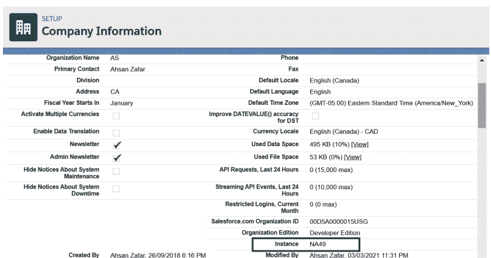

图 6.1 – 公司信息页面显示实例 ID，本示例中为 NA49

- 获取实例 ID 后，访问 status.salesforce.com 并输入您的实例 ID：

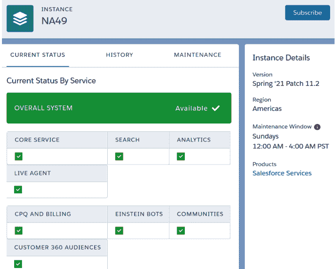

图 6.2 – 实例 NA49 的所有功能均正常运行，没有任何问题

您也可以点击 **HISTORY** 选项卡以查看该实例上出现的任何问题的历史记录，而 **MAINTENANCE** 选项卡显示应用于该实例的补丁和发行版，包括即将发布的版本。这在每个版本发布前的规划中，以及为正在进行或即将开始的项目规划时，都是非常有用的工具。

性能问题的一个挑战是，可能影响性能的因素范围很广，因此迅速将问题范围缩小到最可能的原因非常重要。一个很好的起点是广泛地询问以下类似问题：

是否影响所有使用 Salesforce 的人？

- 不同位置的用户是否遇到类似的性能问题？
- 他们使用什么浏览器？
- 在使用其他浏览器时是否遇到性能问题？

了解这些问题的答案可以帮助您将问题范围缩小到两三个最可能的可能性，然后可以进一步探讨。让我们来看看性能相关问题的原因：

- **休闲网络流量**：如今许多用户携带连接到办公室无线接入点的设备并流式传输高清视频和音频，这可能导致办公室网络带宽受限。缓解此问题的一种方法可以是为这些用户提供一个单独的接入点，使休闲网络流量通过该接入点，而包括 Salesforce 在内的关键应用程序可以在常规网络上运行，留出大量带宽。您需要确定一种方法防止用户设备接入网络；通常可以通过 **媒体访问控制 (MAC)** 过滤来完成，这样只有授权的 MAC 地址才能进入常规网络。

> **MAC 地址**
> 
> MAC 地址是网络上唯一标识硬件的唯一识别号。网络中的每个 MAC 地址都是唯一的，不会有两个相同的 MAC 地址。这是由 MAC 地址使用的命名法保证的，该主题超出了本书的范围。有关 MAC 地址的更多信息，请参阅 https://www.pcmag.com/encyclopedia/term/mac-address。

- **带宽质量**：带宽低可能是一个问题，用户会注意到您尝试解决它，但增加更多带宽来修复性能相关问题并不总能带来理想结果。这是因为带宽质量也很重要。丢包率增加几个百分点会以明显方式影响性能。

- **位置**：Salesforce 在全球拥有数百个实例，所有组织都运行在这些实例上。您距离托管您组织的实例的远近也可能是性能相关问题的一个因素。如果物理距离很大，并且到达该实例需要经过许多跳点，这可能导致性能缓慢。Salesforce 实例分布在世界各地的多个区域，组织由 Salesforce 根据用户所在位置分配。在注册之前，如果您希望组织位于大多数用户所在的区域，而不是执行合同的区域，则应咨询您的客户经理。

#### 跳点

跳点是一个网络术语，指数据包到达目的地必须经过的网络设备数量。这些网络设备可以是路由器、交换机、中继器等等。

每个设备接收数据包，处理其中的信息，然后将其转发到目的地。每当设备执行此操作时，都会花费时间，并且在传输数百万个数据包时可能会影响性能。在 Windows 中，您可以在 **命令提示符** 中使用 `tracert` 命令来查看跳点数量。例如，从我的笔记本电脑到 `salesforce.com` 是 9 个跳点。

请记住，跳点数较低不一定意味着连接更快，因为其他因素也会影响连接速度。

- **低效的配置或代码**：性能问题也可能由配置不当的应用程序或次优代码引起。这些可能会大量消耗系统资源，从而影响性能。如果某个特定的 Visualforce 页面或 Lightning 组件中问题不断出现，您会希望审查代码并确保其遵循最佳实践。另一种可能性是配置不当的应用程序。此前，我们讨论了共享规则的示例。如果共享规则过多，会减慢报告或数据查询的速度，因为每次执行查询时，系统都必须运行共享规则以确保数据安全性符合这些规则。

- **AppExchange 包**：许多 AppExchange 包为您的流程增加业务价值，但某些包也会与 ISV 服务器进行来回通信，可能会影响性能。例如，如果您正在使用数字签名解决方案并安装托管包，该包可能会占用带宽，导致性能不佳。管理员应经常审查和评估托管包，以确保它们仍然有用，并提供最初在组织中安装时的价值。

- **浏览器**：浏览器是云世界中默默无闻的英雄，在用户体验中起着关键作用。随着浏览器使用时间的增长，它会积累大量数据。这可能包括浏览器积累大量 Cookie 和缓存，从而影响性能。还建议将浏览器更新到最新版本，因为浏览器供应商不断发布新补丁，不仅修复安全漏洞，还改进性能。

使用 Salesforce 支持的浏览器是另一个重要因素。例如，一个组织一直在使用 Internet Explorer 11，并且不断遇到问题，因此用户开始使用 Google Chrome。问题是，每当用户遇到 Salesforce 方面或一般问题时，企业支持团队都不会提供支持，因为 Internet Explorer 11 是受支持的企业浏览器。


同时运行多个浏览器窗口或在同一窗口中打开多个标签页会严重降低性能。这是因为每个打开的窗口和标签页都会占用内存和中央处理器（Central Processing Unit，CPU）周期。

浏览器的另一个方面是可以添加插件和扩展。如果特定用户报告问题，我建议在诊断期间禁用所有插件和扩展。可以通过以无痕（Incognito）或隐私浏览（Private Browsing）模式打开浏览器来轻松完成此操作。

- 技术债务：如果不加以密切监控，这会在拖慢性能方面发挥重要作用。简单来说，技术债务是指为了快速交付解决方案而承担的债务。请注意“债务”一词，这意味着它需要及时偿还，否则将需要支付利息来偿还。只要有流程和工具来确保妥善处理技术债务，技术债务不一定是一件坏事。

在 Salesforce 世界中，技术债务包括从废弃的自定义字段、工作流流程、报告和触发器，到为满足业务要求而设置的权宜之计等任何内容。当 Salesforce 提供解决方案来弥补其解决方案中的差距时（通常作为每年三次发布的一部分），或者组织决定采用第三方解决方案或改进其自身解决方案时，在许多情况下，旧解决方案或权宜之计会保持原样留在组织中，从而导致技术债务。随着时间的推移和技术债务的累积，如果不采取行动，用户将开始出现性能问题。

- 硬件和软件要求：Salesforce 要正常运行需要满足某些硬件和软件要求。例如，运行 LEX 建议配置 8 GB 内存。最低要求是 5 GB 内存，但取决于您的应用程序对资源的需求，用户可能会因最低内存要求而遇到性能问题。如果未满足这些要求，可能会导致性能问题。Salesforce 不会阻止客户使用不受支持的软件和硬件，因此也应检查这一点，以便在诊断过程一开始就排除潜在的硬件和软件问题。

- 网络拓扑：由于业务性质，一些客户可能对其 Salesforce 组织可从中访问的 Internet Protocol（IP）地址有非常严格的要求。有时，他们会要求用户通过 VPN（虚拟专用网络）登录 Salesforce，这可能会导致网络流量延迟，因为所有通信都必须通过 VPN 隧道传输。

- **API 限制**：几乎每个 Salesforce 组织都安装了某种类型的 AppExchange 包或与其他系统集成。对于较大的组织，有时可能会安装几十个 AppExchange 包以及许多其他集成。所有集成和一些 AppExchange 包（取决于应用程序的内容）都会利用 API 调用。由于 Salesforce 施加限制以确保实例上其他客户的质量，因此对这些调用设置了限制。达到限制意味着您要么等待 24 小时（限制重置的周期）过去，要么从 Salesforce 购买额外的 API 调用。API 限制造成的中断是一个严重问题，因为它可能影响直接产生收入的活动或客户服务。例如，如果您的营销自动化工具无法与 Salesforce 通信，那么进入该工具的任何高价值潜在客户都无法推送到 Salesforce。

> **governor 限制**
> 已认证的托管包是通过 AppExchange 安全审查的托管包。除了客户组织限制之外，它们还拥有一组自己的 governor 限制。例如，客户组织中的每个事务 DML 限制为 150；已认证的托管包将获得每个事务 150 个自身的 DML 限制。有关详细信息，请参阅此链接中的 Per-Transaction Certified Managed Package Limits 部分：https://developer.salesforce.com/docs/atlas.en-us.apexcode.meta/apexcode/apex_gov_limits.htm.

既然我们已经讨论了性能问题的原因，在下一部分中，我们将讨论一些可用于解决性能问题的工具。

### 性能工具

有多种工具可用于监控和诊断性能问题。本节的讨论并非旨在详尽详述每个可用工具及其功能，而是提供指引，以便您在遇到性能问题时能够理解并使用它们。

必须指出，对于业务关键型应用程序，性能必须从一开始就放在首位。设计应用程序后将性能考虑留到最后，或者更糟的是，等到应用程序投入生产且用户开始报告问题时再考虑，这不是良好的做法。这就是为什么应该执行性能测试，以衡量应用程序扩展到预期用户数量范围较高阈值的能力。我们将在 *在 Salesforce 中进行性能测试* 部分更详细地讨论性能测试及其在 Salesforce 中的实施方法。

让我们讨论一下可用于在 Salesforce 中监控性能的一些工具。

### URL 后缀

这是一种查看 LEX 页面加载时间的技术。方法是在 URL 末尾添加 ?optVisible=1。例如，当我将其添加到特定记录的 **账户** 页面时，结果显示页面加载耗时 **4.49** 秒。我们将在 *LEX 中的性能* 部分讨论与 LEX 性能相关的详细信息。

可以在 **图 6.3** 的右上角看到，**账户** 页面加载耗时 **4.49** 秒：

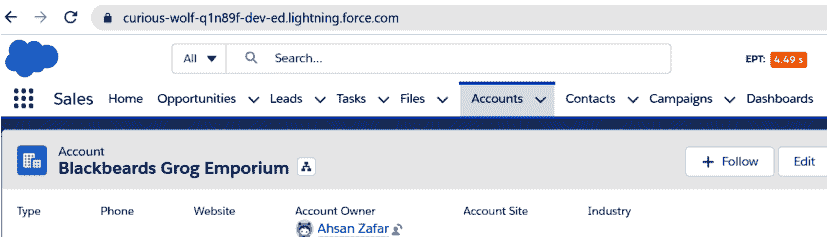

图 6.3 – 显示的 EPT（体验页面时间）值为 4.49 秒

这是一个方便的工具，可以在无需进行大量设置的情况下快速获取页面性能的初步数据。

### 速度测试

这是一项用于衡量性能的测试，提供不同指标来衡量 **JavaScript (JS)** 速度以及到 Salesforce 服务器的连接速度。要使用此工具，只需在登录组织时将 /speedtest.jsp 附加到 URL。例如，在我这边，我有 https://curious-wolf-q1n89f-dev-ed.my.salesforce.com/speedtest.jsp。

然后，在生成的页面上运行测试。如图 6.4 所示，这将生成 Octane 得分、下载和上传速度以及其他相关信息。在此示例中，Octane 得分远低于 Salesforce 要求的最低得分，因此用户应预期会遇到性能问题：

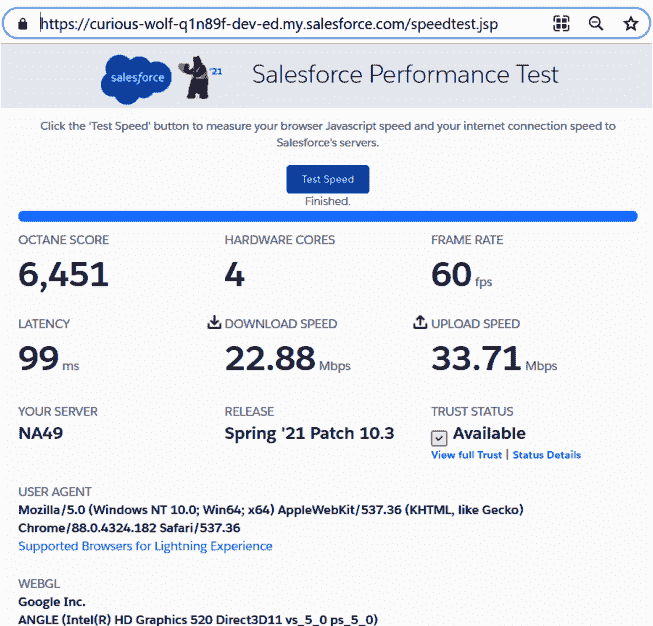

图 6.4 – Octane 得分

如图 6.4 所示，Speedtest 还有其他有用于故障排除的信息，例如上传/下载速度、实例 ID 以及与浏览器和操作系统相关的其他详细信息。

> **Octane 得分**
> 
> Octane 得分由 Google 开发，用于衡量浏览器中 JS 的性能。Octane 得分越高，对应的加载时间越快。需要注意的是，Octane 得分还会考虑硬件和浏览器类型。Salesforce 要求最低 Octane 得分为 20,000，并建议 Octane 得分超过 30,000 以获得最佳性能。

### Salesforce 优化器

这是 Salesforce 提供的一款免费工具，可以作为 PDF 报告或应用程序运行，并提供涵盖使用情况、未使用字段、自定义代码、报告和仪表板的多种指标的详细信息。该工具不仅可以扫描并突出显示组织中的问题区域，还会就如何解决这些问题提供建议。它还提供分析每个问题所需工作量的估计值，以及如果深入查看该项目，还可提供其他资源，如图 6.5 所示。该报告或应用程序可以通过在设置中搜索 Optimizer 来运行。

我更喜欢运行应用程序，因为它比报告涵盖更多功能，并提供排序功能，可用于对列表视图进行排序。Salesforce 建议定期运行此报告或应用程序。这样您可以在问题出现之前发现它们。图 6.5 显示了运行 Salesforce Optimizer 后的结果：

| 功能 | 类型 | 预计工作量 | 状态 |
|---|---|---|---|
| 用户登录 | 用户管理 | < 30 分钟 | 需要立即采取行动 |
| 不安全的默认外部访问级别 | 改进组织安全性 | > 2 小时 | 需要立即采取行动 |
| 挂起的版本更新 | 改进组织安全性 | > 2 小时 | 需要采取行动 |
| 未分配的角色 | 用户管理 | < 30 分钟 | 需要审查 |
| API 版本 | 自定义代码 | 1 - 2 小时 | 需要审查 |
| 配置文件分配 | 用户管理 | 1 - 2 小时 | 需要审查 |
| 不完整的 Chatter 配置文件 | 使用情况 | < 30 分钟 | 需要审查 |
| 不活跃的 Chatter 用户 | 使用情况 | 30 - 60 分钟 | 需要审查 |
| 每个对象的多个 Apex 触发器 | 自定义代码 | 1 - 2 小时 | 需要审查 |
| 字段使用情况 | 字段 | 30 - 60 分钟 | 需要审查 |
| 未分配的自定义配置文件 | 用户管理 | < 30 分钟 | 需要审查 |
| 未使用的报告 | 报表和仪表板 | < 30 分钟 | 需要审查 |

图 6.5 – 优化器应用的结果

您可以深入查看每个项目，并以更详细的方式查看结果，以及预计工作量和其他资源，以帮助您修复问题。

### Salesforce Shield 的事件监控

Salesforce Shield 是一组安全工具，可为 Salesforce 提供额外的安全性和治理层。其中一种工具称为实时事件监控，可提供平台上性能、安全性和使用情况数据等其他指标的实时数据。


事件监控（Event Monitoring）是一个仅通过 API 访问的工具，这意味着可以通过 API 访问它，该工具中的关键对象是 EventLogFile。这意味着数据可以轻松导入到 Analytics 或 Splunk 等应用监控工具中，以便更方便地使用。

你可以使用 Salesforce 事件日志文件（ELF）浏览器应用（https://salesforce-elf.herokuapp.com/?_ga=2.82989334.1271813283.1614356382-1891424622.1607399861）来访问和下载事件日志文件。然后可以使用你选择的数据可视化工具对数据进行可视化处理。下面的浏览器截图显示已过滤到单一事件类型 API 的结果：

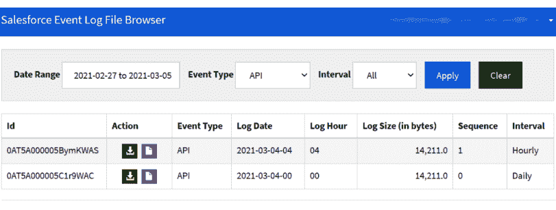

图 6.6 – Event Log File Browser 中一周内记录的所有 API 事件

以下是从 Event Log File Browser 下载的日志文件截图：

| 事件类型 | 时间戳 | 请求 ID | 组织 ID | 用户 ID | 运行时间 | CPU 时间 |
| :--- | :--- | :--- | :--- | :--- | :--- | :--- |
| API | 2.02103E+13 | TID:17799340000c627ff9 | 00D5A0000015USG | 0055A000006L6x5 | 24 | 7 |
| API | 2.02103E+13 | TID:17799340000c627ff9 | 00D5A0000015USG | 0055A000006L6x5 | 14 | 7 |
| API | 2.02103E+13 | TID:1824274000097a2802 | 00D5A0000015USG | 0055A000006L6x5 | 22 | 18 |
| API | 2.02103E+13 | TID:305955000070da4506 | 00D5A0000015USG | 0055A000006L6x5 | 8 | 4 |
| API | 2.02103E+13 | TID:3005950000706f4c06 | 00D5A0000015USG | 0055A000006L6x5 | 4 | 3 |
| API | 2.02103E+13 | TID:463390000083f97c2e | 00D5A0000015USG | 0055A000006L6x5 | 4 | 2 |
| API | 2.02103E+13 | TID:51712700005790e83e | 00D5A0000015USG | 0055A000006L6x5 | 68 | 52 |
| API | 2.02103E+13 | TID:570254000099a027ff | 00D5A0000015USG | 0055A000006L6x5 | 80 | 63 |
| API | 2.02103E+13 | TID:7450210000d1094500 | 00D5A0000015USG | 0055A000006L6x5 | 4 | 3 |
| API | 2.02103E+13 | TID:19956120000561e55b | 00D5A0000015USG | 0055A000006L6x5 | 69 | 32 |
| API | 2.02103E+13 | TID:19956120000561e55b | 00D5A0000015USG | 0055A000006L6x5 | 31 | 10 |
| API | 2.02103E+13 | TID:19956120000561e55b | 00D5A0000015USG | 0055A000006L6x5 | 12 | 6 |
| API | 2.02103E+13 | TID:2139330000aab16a8 | 00D5A0000015USG | 0055A000006L6x5 | 9 | 5 |
| API | 2.02103E+13 | TID:400400200003699ef9 | 00D5A0000015USG | 0055A000006L6x5 | 61 | 47 |
| API | 2.02103E+13 | TID:417069000008ab8461 | 00D5A0000015USG | 0055A000006L6x5 | 47 | 35 |
| API | 2.02103E+13 | TID:41970240000b670c95 | 00D5A0000015USG | 0055A000006L6x5 | 62 | 46 |
| API | 2.02103E+13 | TID:119769530000a57cc9 | 00D5A0000015USG | 0055A000006L6x5 | 4 | 3 |
| API | 2.02103E+13 | TID:12106225000ad691d9 | 00D5A0000015USG | 0055A000006L6x5 | 47 | 29 |

图 6.7 – 显示事件监控工具记录详细信息的示例日志文件

**注意**
为了简洁，前面截图中的一些空白列已被隐藏，并且截图已被裁剪以提高可读性。

你还可以通过结合事件日志文件的结果，并将其与 Salesforce 中调用应用的 IP 地址关联起来，来确定哪些应用程序正在使用 API 调用。以下是从 Salesforce 提取的示例登录历史记录：

### 登录历史记录

下载过去六个月的登录历史记录。或者，筛选并显示过去六个月最多 20,000 条登录历史记录。

位置显示用户登录所用 IP 地址的大致位置。要显示更多地理信息（例如大致城市和邮政编码），请创建包含这些字段的自定义视图。由于地理定位技术的特性，地理定位字段（例如国家、城市、邮政编码）的准确性可能会有所不同。

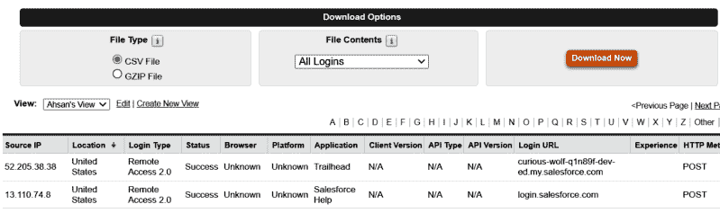

图 6.8 – 开发者工作台中的登录信息

源 IP 可以与事件日志文件中的 CLIENT_IP 结合，以获取详细信息——例如，关于正在使用最多 API 调用的应用程序、进行 API 调用的时间点以及其他可收集的有用信息。当给定的应用程序未在登录历史记录中指定，或事件日志文件中的 CLIENT_NAME 未知时，这尤其有用。图 6.9 显示日志文件中的一行，显示已查询 Account 对象（在 METHOD_NAME 列中）：

| API 类型 | API 版本 | 客户端名称 | 方法实体名称 | 每请求/响应/数据块/CPU 时间的行数 | 时间戳_用户 ID_派生 | 客户端 IP |
|---|---|---|---|---|---|---|
| P | 50 Workbench/51.0.0 query | Account | ... | 39 ... 751 ... 7052 ... 34 ... 10 2021-03 ... | ... | 35.173.67.53 |

图 6.9 – 事件日志中的示例记录

在图 6.9 中，处理的行总数显示为 39（在 ROWS_PROCESSED 列中，完整的列标题未显示），同时还向我们显示了源的 IP 地址。

让我们继续审查可用于监控 Salesforce 的其他工具。

### Salesforce 页面优化器

这是一款专门用于监控 Salesforce 社区性能的工具。它作为 Google Chrome 插件提供，并提供关于页面性能的可操作洞察。我们将在后文详细讨论此工具。

### Salesforce Lightning 检查器

这是另一个 Google Chrome 扩展程序，有助于诊断性能瓶颈。它可以用于检查应用程序的不同方面，例如已触发的事件和客户端存储详细信息。**性能**选项卡显示组件执行所需时间以及潜在瓶颈所在的位置的详细信息。

### Salesforce 报表

Salesforce 提供开箱即用的工具和报表，可用于监控 API 调用限制。此前我们已确定，API 限制可能会对依赖通过集成或 AppExchange 包使用外部系统的业务关键型应用程序造成严重问题。

开箱即用，你可以使用系统概览页面，该页面显示过去 24 小时的 API 调用，如下一张截图所示。你还应该考虑设置 API 使用通知，当 API 使用量达到一定阈值时，每隔 _x_ 小时发送一封电子邮件。系统会一直发送电子邮件，直到 API 使用量低于指定阈值：

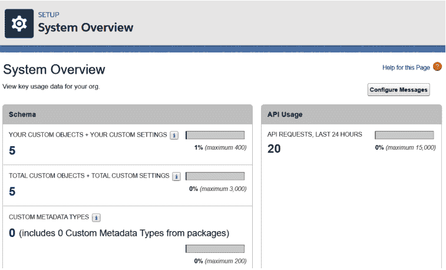

图 6.10 – 过去 24 小时内进行的 API 调用总数；在此示例中为 20

另一种查看使用情况的方法是运行名为“API Usage Last 7 Days”的报表，该报表显示过去 7 天的使用情况，如下一张截图所示。此报表仅在经典视图中可用：

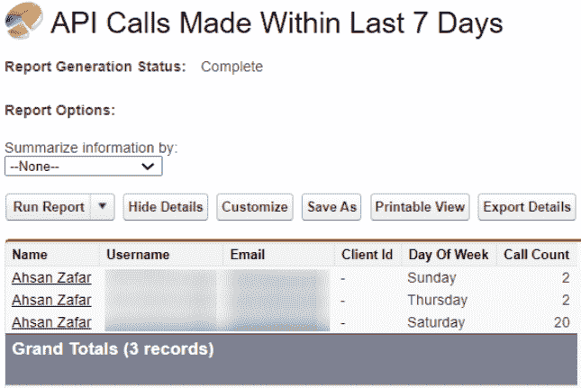

图 6.11 – 报表显示过去 7 天内进行的 API 调用数量

这些报表可以作为有用的工具，帮助了解你的组织中如何使用 API，以及是否需要采取主动干预措施以防止与 API 限制相关的错误。

### 查询计划工具

此工具用于访问结构化对象查询语言（SOQL）和 Salesforce 对象搜索语言（SOSL）查询、报表及列表视图的查询计划，以便针对性能进行优化。这是你可用的宝贵资源，可用于主动避免问题，或快速排除 SOQL 查询作为性能问题的原因。查询计划工具从开发者控制台访问，并有助于优化 SOQL 查询。你可以使用该工具了解不同的查询计划，以及你的索引查询过滤器是否会被查询优化器使用，或者是否会执行全表扫描。

> 查询计划
> 查询计划本质上是显示可用于从数据库访问数据的一系列步骤的地图。提交查询时，查询优化器会评估其可用于获取数据的不同方法，并返回成本最低的计划。这意味着返回的计划将以最少的时间获取数据。

由于大多数基于自定义代码的应用程序都使用 SOQL，因此这是一个非常实用的工具，可用于测试你的 SOQL 查询的性能。在深入探讨查询计划工具之前，我们先了解一下什么是全表扫描。

### 全表扫描

全表扫描是指按行扫描数据库表并检查每一行，以确定其是否匹配查询的 where 子句。从性能角度来看，这是一项开销较大的操作，并且在 SOQL 查询中鼓励使用过滤器：

```
SELECT name FROM Account WHERE name = "Star Wars Innovations";
```

过滤器是 SOQL 查询中 where 子句之后的部分。name = "Star Wars Innovations" 部分就是过滤器，由于 Account 对象中的 name 字段已编制索引，因此会使用索引。

Salesforce 使用一组特定的标准来确定是使用全表扫描还是索引，从而实现高性能查询。如图 6.12 所示，索引与查询结果中预期的行数共同发挥着关键作用：

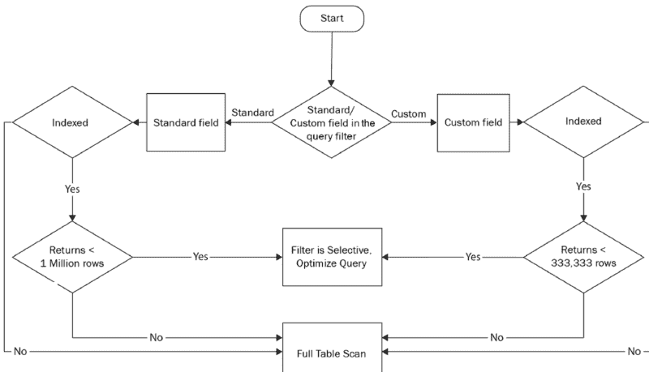

图 6.12 – 高级图表，显示 Salesforce 用于确定查询过滤器是否具有选择性，或是否会使用全表扫描的标准


查询优化器在查询包含选择性筛选条件时，会将其判定为选择性查询。选择性筛选条件有助于查询引擎确定如何获取结果，而非选择性筛选条件（因此也是非选择性查询）则需要执行全表扫描，这是一项代价高昂的操作。判定依据如下：

- 筛选条件包含标准字段或自定义字段。
- 某些标准字段会自动编制索引。这些字段如下：
  - 主键（Id、Name 和 OwnerId）
  - 关系字段（查找或主从关系字段 – CreatedById 和 LastModifiedById）
  - 审计字段（CreatedDate 和 SystemModStamp）
  - 标准对象和自定义对象的记录类型
- 如果自定义字段设置为唯一（Unique）或外部（External），则会自动对其编制索引。
- 一旦确定筛选条件已编制索引，就会确定返回的行数。对于标准索引字段，将确定前 100 万条记录的 30% 和剩余记录的 15%。如果总计少于 100 万行，则该筛选条件为选择性筛选条件，并由优化器使用。
- 对于自定义索引字段，将考虑前 100 万条记录的 10% 和剩余记录的 5%，如果总计少于 333,333 行，则该筛选条件被视为选择性筛选条件，并由优化器使用。
- 如果筛选条件中使用了 AND 运算符，则查询的目标是少于以下内容：
  - 每个筛选条件的索引选择性阈值的两倍
  - 字段交集的索引选择性阈值
- 如果使用了 OR 运算符，则查询的目标是少于以下内容：
  - 每个筛选条件的索引选择性阈值
  - 这些字段总和的索引选择性阈值
- 如果使用了 LIKE 运算符且没有前导通配符，例如 `LIKE `Star%，` 优化器会对前 100,000 行进行选择性采样。

Salesforce 对表中可编制索引的记录数量有上限，标准索引的 100 万条记录和自定义索引的 333,333 条记录反映了该上限。如果筛选条件中的所有索引都是标准索引，则使用标准选择性阈值；否则，将使用自定义选择性阈值。

让我们通过一些示例来确定以下 SOQL 查询是否会使用索引。

### 示例 1

此处在 **SystemModStamp** 字段上有一个筛选子句，该字段已编制索引：

```
SELECT name FROM Account WHERE SystemModStamp >
2019-01-01T00:00:00Z
```

有关该对象的详细信息如下表所示：

| 对象中的总记录数 | 4,000,000 |
| 筛选条件包含索引字段 | 是 |
| 返回的记录数 | 500,000 |
| 选择性阈值 | 750,000 |
| 返回的记录数是否低于阈值 | 是 |
| 查询是否为选择性查询 | 是 |

图 6.13 – Salesforce 用于确定查询是否为选择性查询的标准

在这种情况下，查询是选择性查询，因为运行查询时不会超过选择性阈值。

### 示例 2

在以下示例中，自定义字段用作索引。请注意，对于带有自定义索引字段的查询，选择性阈值要低得多：

```
SELECT name FROM Account WHERE LastEmailedDate__c >
2019-01-01T00:00:00Z
```

图 6.14 显示了对象的详细信息以及查询的行为：

| 对象中的总记录数 | 4,000,000 |
| 筛选条件包含索引字段 | 是 |
| 返回的记录数 | 200,000 |
| 选择性阈值 | 250,000 |
| 返回的记录数是否低于阈值 | 是 |
| 查询是否为选择性查询 | 是 |

图 6.14 – 满足选择性阈值的选择性查询

同样，查询被视为选择性查询，因为返回的记录数远低于选择性阈值中的记录数。

### 示例 3

在以下示例中，使用 AND 运算符的两个筛选条件会导致查询成为选择性查询：

```
SELECT name from Account where RecordTypeId = 'xxxxxxxxxxxxxxxx'
AND LastEmailedDate__c > 2019-01-01T00:00:00Z
```

图 6.15 显示了在查询中使用两个筛选条件时的行为，这使其成为选择性查询：

| 对象中的总记录数 | 4,000,000 |
| 筛选条件包含索引字段 | 是 |
| 第 1 个筛选条件返回 ('RecordTypeId = 'xxxxxxxxxxxxxxxx'') | 200,000 |
| 第 2 个筛选条件返回 (LastEmailedDate__c > 2019-01-01T00:00:00Z) | 300,000 |
| 返回的记录数 | 150,000 |
| 选择性阈值 | 800,000 |
| 单个筛选条件和筛选条件交集的返回记录数较低 | 是 |
| 查询是否为选择性查询 | 是 |

图 6.15 – 多个带有索引字段的筛选条件导致查询成为选择性查询

在此示例中，使用了多个查询筛选条件，两者都带有索引字段，导致返回的记录数低于选择性阈值，从而使查询成为选择性查询。

### 示例 4

在下一个示例中，使用 OR 运算符的两个筛选条件会导致查询成为选择性查询：

```
SELECT name from Account where RecordTypeId = 'xxxxxxxxxxxxxxxx'
OR LastEmailedDate__c > 2019-01-01T00:00:00Z
```

图 6.16 显示了使用与之前示例中相同数量的行但使用 OR 运算符的查询结果：

| 对象中的总记录数 | 4,000,000 |
|---|---|
| 筛选条件包含索引字段 | 是 |
| 第 1 个筛选条件返回 (RecordTypeId = 'xxxxxxxxxxxxxxx') | 200,000 |
| 第 2 个筛选条件返回 (LastEmailedDate__c > 2019-01-01T00:00:00Z) | 300,000 |
| 返回的记录数 | 200,000 |
| 选择性阈值 | 250,000 |
| 单个筛选条件和筛选条件交集的返回记录数较低 | 否 |
| 查询是否为选择性查询 | 否 |

图 6.16 – 在使用 OR 运算符时用于确定查询是否为选择性查询的标准

我们了解到，尽管单独来看，每个筛选条件返回的记录数较低（分别为 200,000 和 300,000），但合并后超过了选择性阈值限制，因此查询不被视为选择性查询。

在下一节中，我们将回顾如何理解查询计划（Query Plan）工具的结果，并使用这些结果调整查询以获得更好的性能。

### 解读查询计划工具的结果

既然我们在上一节中运行了一些查询，现在让我们运行一个查询并了解该工具的工作原理。图 6.17 显示了在 Account 对象上运行并返回单条记录的查询计划结果。让我们仔细分析各个数字的含义：

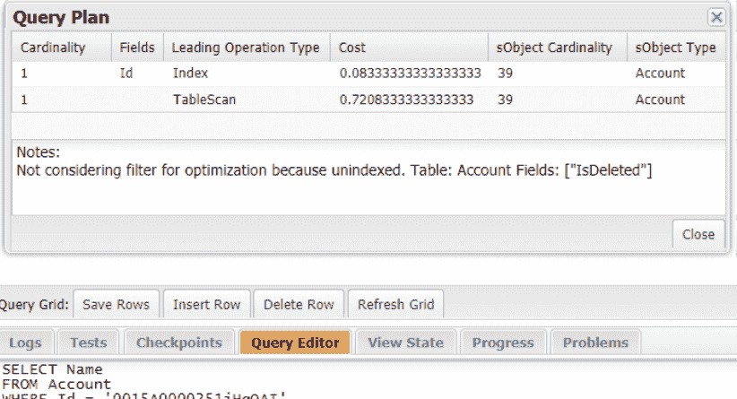

图 6.17 – 查询计划工具

从运行查询计划工具时的结果可以看出，此查询是选择性查询。如果 **Cost** 列中的值高于 1，则表示查询不是选择性查询。在此示例中，由于筛选条件被视为选择性筛选条件，因此将使用索引。

让我们逐一了解 _图 6.17_ 中查询计划工具结果所显示列的定义：

- **Cardinality**：主操作返回的预计记录数。
- **Fields**：优化器使用的索引字段。在本示例中，显示了 **Id** 字段，因为这是优化器使用的字段。
- **Leading operation type**：优化器用于优化查询的主要操作类型。一些值包括：
  - **Sharing**：Salesforce 将基于运行查询的用户关联的共享规则使用索引。
  - **Index**：查询将使用查询对象上的索引。
  - **TableScan**：将查询表中的所有行。
  - **Other**：查询将使用 Salesforce 内部的优化。
- **Cost**：与 Force.com 查询优化器的选择性阈值相比的查询成本。成本值源自表和值的数据库统计信息。将使用值最低的计划。
- **sObject cardinality**：查询对象的近似记录数。
- **sObject type**：查询对象的名称。

计划仅针对受支持的操作显示，包括诸如 `NOT EQUAL TO`、与 null 值（如 `Name = ' '`）的比较、前导通配符或对非确定性公式字段的引用等操作。

请牢记，由于 Salesforce 的多租户驱动架构，该平台拥有自己的 SOQL 查询优化器，该优化器会考虑多租户统计信息。统计信息每晚收集一次，但优化器还可以执行动态预查询，其结果会缓存一小时。Salesforce 的查询优化器还会在内部跟踪客户索引的候选项，并自动创建其确定可能有助于选择性的单列索引。

请注意，软删除记录可能会对查询性能产生重大影响，因此查询中可能会使用 `IsDeleted = false` 筛选条件。这将排除所有软删除记录。请牢记，删除的记录会计入统计信息，因此请确保您有硬删除记录的流程。

当在 Salesforce 中为字段编制索引时，这不一定意味着它立即可用，而是索引服务器可能需要长达 15 分钟来更新索引表，因为它是异步执行的。这一点很重要，因为假设您有一个大表，并通过与 Salesforce 支持合作确定自定义索引会有所帮助。索引已在该字段上创建，但性能仍然缓慢。可能是因为索引表尚未更新。

既然我们已回顾一些可用于监控的工具，现在让我们看看可以使用哪些技术来改进应用程序性能。

### 改进性能

我们已查看可用于诊断和监控性能相关问题的各种工具。下一步是根据问题所在的位置修复这些性能瓶颈。用于修复问题的技术或工具也会不同。例如，如果每个对象有多个触发器，页面性能可能会受到影响，要修复此问题，您需要重构代码以每个对象使用单个触发器。我们稍后还将回顾的另一个示例涉及在单个对象上使用多个流程构建器（Process Builder）流程——修复此问题需要确定将提供最佳性能的工具。


一旦发现问题，让我们来看看可以采取哪些措施来提升性能。这不应被视为详尽无遗的列表，而应作为可帮助您快速改善应用程序性能的指引。例如，可以采取多项措施来提升Visualforce页面性能，但我在以下各节中仅提及其中一部分。

### 浏览器缓存

这是一个来自UI的简单设置，可以通过在客户端（即浏览器）上安全地缓存最常用的数据，从而避免额外的服务器调用，显著提升页面性能。此设置默认处于开启状态，Salesforce不建议将其关闭。例外情况包括：公司安全策略不允许缓存安全数据的场景，以及在沙箱中希望无需清除缓存即可立即查看配置或代码更改效果的情况。

### 使用内容分发网络

**内容分发网络（CDN）**是一组基于服务器的基础设施，可加速网站性能。加载网站时，与网站一起托管的图片和其他内容也会被加载。如果您从与网站托管所在大洲不同的大洲访问网站，与位于与网络托管相同城市或地区的用户相比，您会看到延迟和响应延迟。

使用CDN时，内容会被复制到CDN中的服务器上，然后从访问网站的客户最近的位置进行服务。这有助于缩短客户的响应时间并提供出色的客户体验。在Salesforce中，Lightning Component框架和其他应用程序的静态内容由遍布全球的Akamai CDN服务器提供服务。这改善了应用程序加载时间，因为包括图片文件、**CSS（层叠样式表）**、JS和字体文件在内的静态资源以及其他库都被缓存，并从最合适的CDN位置提供给用户。使用CDN不会缓存您组织中的任何元数据或数据。

### 网络问题

运行`traceroute`或`ping`等基本命令后，如果发现需要进一步调查的情况，请立即联系您的网络团队进行更深入的调查。如果您已排查完所有与Salesforce相关的事项，并确定不是Salesforce相关问题导致性能问题，请不要拖延联系您的团队，因为这会延迟事件解决过程。网络团队需要时间，因为他们无法立即给出答案，需要在其端进行故障排除，只有在找到根本原因后才能开始修复过程。

然而，通过运行traceroute或ping命令，您可以为他们提供一个良好的开端。因此，让我们深入了解这些命令及其揭示的信息。

### Ping

这是一种广泛使用的命令，用于检查是否与主机（在本例中为Salesforce服务器）存在连接。该命令向服务器发送四个数据包，如果服务器响应四个数据包，则表示存在连接且没有数据包丢失。如果服务器不响应，则可能表示服务器存在问题。让我们通过一个示例来更好地理解这一点。如果我们ping login.salesforce.com，可以在图6.18中看到该位置的服务器已响应且没有数据包丢失：

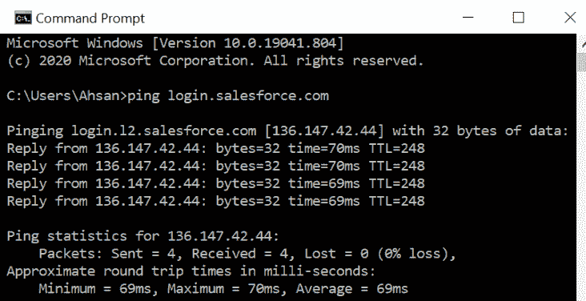

图6.18 – ping操作的服务器响应

如图6.18所示，login.salesforce.com上的服务器已响应，因此，我们的设备与服务器之间存在连接。

如果接收到的数据包数量与发送的数量不一致，或者数据包丢失量超过应接收的总数据包数的10%，则我们知道已发生数据包丢失且需要进一步调查。**往返时间（RTT）**是数据包传输到目的地再返回发送方所需的累计时间。

Salesforce的建议是使用多个数据包大小和持续时间捕获ping结果。建议运行以下命令：

```
ping -f -n 25 -l 1200 login.salesforce.com
ping -f -n 25 -l 1300 login.salesforce.com
ping -n 25 -l 1400 login.salesforce.com
```

运行同一组命令，但将您的实例作为目标。例如，如果您的组织位于NA111，则按以下方式运行命令：

```
ping -f -n 25 -l 1200 na111.salesforce.com
ping -f -n 25 -l 1300 na111.salesforce.com
ping -n 25 -l 1400 na111.salesforce.com
```

-n开关表示要发送的回显请求数量，默认值为4，-l开关表示缓冲区大小，因此当我们指定1200时，表示应发送1200字节的数据。请确保在运行下一命令之前让上一命令完成。请确保将结果保存给您的内部网络团队以及Salesforce支持团队。

如果我们ping一个不存在的位置，将得到如图6.19所示的输出。有时，防火墙出于安全原因会阻止ping请求，导致完全数据包丢失，在这种情况下无法确定服务器是否宕机：

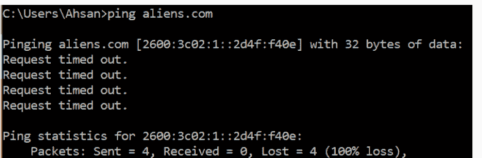

图6.19 – ping不存在的位置或设备会导致100%的数据包丢失

最小值、最大值和平均RTT数值彼此接近，表明测试期间方差不大，如图6.18所示，但最小RTT和最大RTT之间存在较大方差则会表明存在需要进一步调查的延迟问题。

### Traceroute

此命令用于跟踪数据包从源到目标的实时路径。它会记录到达目标所经过的所有网络设备的IP地址以及每跳之间的时间。您可以想象，数据包需要经过的路由器越多，所需时间就越长，因为每个设备都必须处理数据包并将其转发到下一路由器。

tracert命令默认向每跳发送三个数据包，因此您会在结果中看到每跳的RTT。例如，运行`tracert na111.salesforce.com`会给出以下结果：

```
C:\Users\Ahsan>tracert na111.salesforce.com

Tracing route to na111-ph2.r.salesforce.com [13.110.36.70]
over a maximum of 30 hops:

  1    17 ms    17 ms    16 ms  192.168.1.254
  2    18 ms    18 ms    24 ms  10.139.190.1
  3    42 ms    43 ms    42 ms  154.11.12.203
  4    73 ms    73 ms    75 ms  six.salesforce.net [206.81.80.33]
  5    74 ms    73 ms    73 ms  eth1-1--spn3-ncg0-phx3.net.sfdc.net [13.110.5.200]
  6    78 ms    70 ms    77 ms  dcl1-ncg0-phx3.na111-ph2.salesforce.com [13.110.36.70]

Trace complete.
```

图6.20 – 在NA111实例上运行tracert命令的结果

如前面的截图所示，目标及其IP地址会显示出来，并且我们可以看到测试最多会使用30跳。如前所述，每行中的三个数字表示到达每跳所需的时间。这些数字是累计的，不表示单个数据包到达目标所需的时间。很多人在运行traceroute到目标时感到困惑的一个原因是，后续跳的时间有时会早于前一跳。例如，在图6.20中，跳5耗时73 ms，而跳4耗时75 ms。这是因为命令为每跳发送单独的数据包，并非跟踪从跳1到跳6的同一数据包。网络条件在不断变化，因此发送跳4数据包时与发送跳5数据包时相比，完全可能存在网络拥塞。

有时，您可能会在traceroute结果中看到星号——这不一定表示存在问题，但如前所述，某些网络出于安全或网络流量原因不会响应这些数据包（称为ICMP数据包）。


### 精瘦表

数据库表连接是昂贵的操作。根据查询的复杂程度，返回结果可能需要花费大量时间和数据库资源。

如果您遇到这种情况，使用精瘦表可以帮助加快性能。

精瘦表是由 Salesforce 创建的特殊表，包含经常访问的字段。

请回顾第 3 章“了解数据管理”中讨论的 Salesforce 架构：所有标准字段都存储在一个表中，而所有自定义字段都存储在另一个表中。例如，如果您在账户对象上有自定义字段，这些字段存储在不同的表中，当您运行包含这些自定义字段的报表时，Salesforce 需要在后台执行连接操作并返回结果。

当使用精瘦表时，经常使用的标准字段和自定义字段会存储在该表中，以消除昂贵连接操作的需求，如图 6.21 所示。随着源表中数据的变化，精瘦表会自动保持最新，无需客户进行任何干预。使用精瘦表的另一个优势是，平台会在报表和列表视图等场景中自动使用精瘦表，从而提升用户的整体性能：

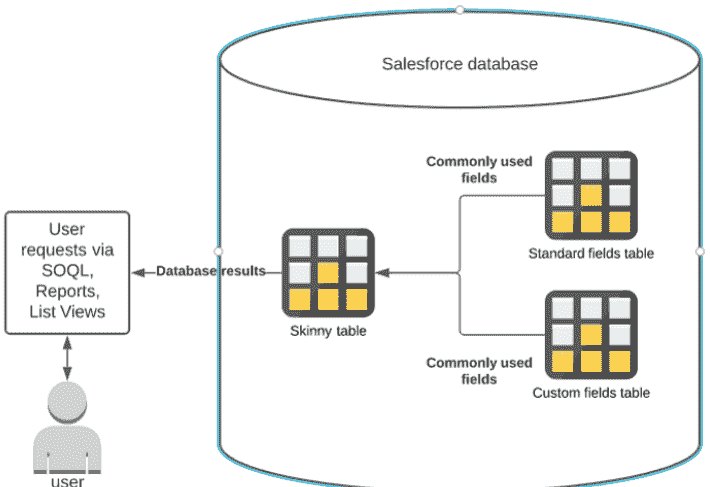

图 6.21 – 如图所示，用户的数据直接从精瘦表查询，而不是从标准字段和自定义字段查询，从而避免了昂贵的连接操作。

需要注意的是，精瘦表可用于只读操作，并可在标准对象和自定义对象上创建。可创建的字段类型有一定限制；例如，不支持**汇总汇总**字段或**公式**字段。客户无法自行创建精瘦表，而是需要与 Salesforce 客户支持开启案例来创建它们。

在将精瘦表作为解决方案时，必须牢记一些限制。主要限制之一是无法跨对象使用，也就是说，每个精瘦表只能包含来自单个对象的数据。例如，不能为 `Opportunity` 对象创建同时包含 `Opportunity Team Member` 对象数据的精瘦表。

精瘦表最多可包含 100 个字段，每当向对象添加新字段时，都需要联系 Salesforce 将其添加到精瘦表中。它们还支持加密字段和加密索引。精瘦表会在沙盒创建或刷新时复制到全副本沙盒中，但对于其他类型的沙盒，需要向 Salesforce 客户支持提交请求。

### 查询筛选器、索引和负运算符

请尽可能在 SOQL 查询中使用筛选器，因为这有助于优化器在满足特定条件时缩小记录范围。例如，此开发者组织有 39 条 `Account` 记录，因此让我们尝试查询所有记录并查看查询成本。如图 6.22 所示，未使用筛选器时的查询成本大于 1，我们知道这效率低下：

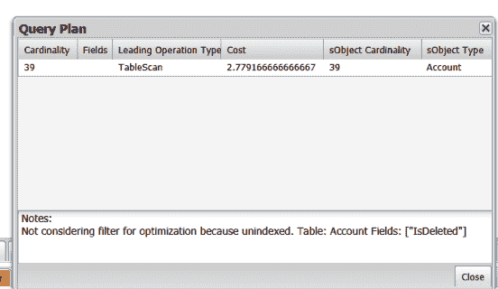

图 6.22 – 成本高达 2.78，对于查询来说效率非常低

如果我们在未编制索引的 **行业** 字段上使用筛选器，并再次运行查询计划，我们会看到即使仍然需要全表扫描，查询也非常高效：

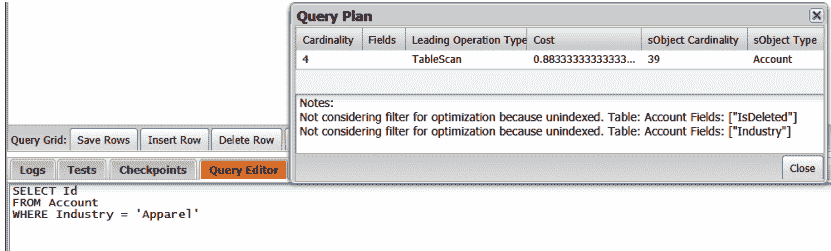

图 6.23 – 基数显示 4，表示将返回四条行业为服装的记录

请注意使用筛选器如何提升了性能。关于 IsDeleted 和 行业 的注释仅表示这些字段无法用于优化，因为它们未编制索引。

索引的行为类似，并会产生更高效的查询。在此示例中，我们使用 Id 字段作为索引：

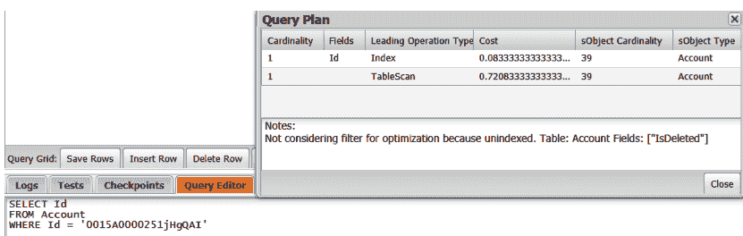

图 6.24 – 在查询中使用索引会产生非常高效的查询

在寻找改进性能的机会时，扫描您的查询以查看它们是否引用了负运算符，例如 NOT EQUAL TO（!=），因为这些可能导致非常低效的查询。以下示例查询所有账户站点不为 null 的账户记录：

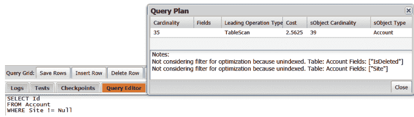

图 6.25 – 如图所示，仅使用单个负运算符就会导致查询性能不佳

在旨在提升性能时，请检查您的 SOQL 查询，因为编写不良的查询会对资源造成显著拖累并影响用户性能。

### 回收站中的已删除记录

这看起来非常无害，但已删除的记录可能会对性能产生显著影响。原因是，当您通过 UI 或 API 简单删除记录时，它们会被标记为软删除，这意味着它们会被移动到回收站并保留 15 天，直到达到大小限制为止。运行查询时，筛选掉软删除记录会带来相关开销，从而导致性能问题。

请确保没有大量软删除的记录，这可以通过频繁清空回收站来轻松实现，可以通过 UI 或使用具有硬删除选项的 Bulk API 来完成，该选项会从数据库中永久删除记录。请记住，此选项不会将记录移动到回收站，因此请谨慎使用。

### 归档

请确保数据归档是每个处理数据的项目的一个组成部分（有哪些项目不处理数据呢？），而不是在开始遇到问题后才临时考虑。数据库中拥有多年数据的组织可能会导致重大性能问题。想象一下查询一个拥有 500,000 条记录的对象，而数据库需要运行全表扫描来获取几千条记录。

有多种方法可以归档数据，范围从使用 Bulk API 构建自定义解决方案，到使用 Heroku 或部署现成的 AppExchange 解决方案。使用哪种工具将取决于您的业务和法规要求。重要的是要理解并非所有数据都一样，您需要仔细分析和分类数据，并实施解决方案以满足您的要求。例如，小型软件公司可能没有必要保留超过 3 年的报价记录，而受监管严格的健康保险提供商可能需要保留患者记录至少 7 年。

### 延迟加载

这是一种用于 Visualforce 页面以提升性能的功能，如果您仍在使用 Visualforce，可以考虑实现此功能。其理念是页面首先加载基本功能，以便用户可以开始与之交互，其余部分被延迟，直到用户执行某个操作（例如单击按钮）或经过一段短暂时间，然后页面的其余部分才会加载。

提升性能的另一个方面是启用页面上相关列表的单独加载。这是一个 UI 级别设置，允许用户在相关列表仍在加载时与页面交互。这使用户可以在所有组件（包括相关列表）加载完毕之前与页面交互，而相关列表有时数量很大，尤其是在 **账户** 页面上。这是因为 **账户** 对象是 Salesforce 中的关键对象，大量对象通常与它具有查找或父子关系。

### Visualforce 中的标准功能

请尽可能多地使用标准功能，除非您已仔细权衡每种方法的优缺点，并且自定义方法证明更好。例如，您可能希望在 Visualforce 页面中使用 jQuery 进行分页，但页面加载时，查询数据并在页面上呈现需要时间，而使用标准的服务器端分页选项可能更快，但处理是在服务器端完成的。

前者在数据集较小时可能更合适，但偶尔可能会有大数据集，用户也乐意偶尔等待页面加载。另一方面，服务器端选项更适合较大的数据集以及页面性能非常重要的情况。


### 将 Apex 类用于共享

Apex 代码默认在系统模式下运行，这意味着它可以访问 _一切_：它可以访问所有对象及其字段，字段级安全性和共享规则不适用。请检查确保您的类使用 `with sharing` 关键字，因为它会遵守字段级安全性和共享规则。这样做的净结果是返回的结果集更小，这有助于提高性能。

### 设备和浏览器

如本章前面所述，Octane 分数是衡量浏览器性能的良好指标。分数越高，预期的性能越好。由于 Octane 分数也会考虑用户的设备，因此确认设备支持流畅运行 Salesforce 所需的最低要求非常重要。如果用户的设备运行在最低推荐硬件规格上，请通过增加内存和处理能力来升级设备。

另一件事是确认设备已充电，或者没有以某种方式被限制性能。当设备电量即将耗尽时，设备通常会切换到低电量模式，或者用户可能无意中更改了设置，导致设备以低电量模式运行。

如果您在初步调查中确定问题仅特定于某个用户，请检查其浏览器。目前，Chrome 是运行 Salesforce Lightning 的最佳浏览器。我强烈建议不要将 Internet Explorer 与 Salesforce LEX 一起使用，因为您的用户会遇到许多问题。如果浏览器是 Chrome，请检查其版本以及该版本是否受 Salesforce 支持。

禁用浏览器中的任何扩展程序或插件也能显著提升性能，因为它们会主动消耗内存和处理资源。如果无效，重启浏览器也有助于解决与性能相关的问题，因为之前进程占用的资源会被释放。

### Visualforce 页面

您应制定标准，规定大部分开发将在哪里进行，无论是 Visualforce 还是 Lightning。但考虑到 Visualforce 是较旧的 UI，且大量自定义开发已在 Visualforce 中完成，我建议重新查看之前的发行说明，并确定 Visualforce 页面提供的自定义功能是否现在可以通过开箱即用的功能或使用声明式工具来实现。

当您需要立即解决 Visualforce 页面的性能相关问题时，我建议查看 **视图状态**。**视图状态**是一个加密字符串，用于存储包含字段值、控制器状态和组件状态的值集合，存储在隐藏表单元素中。非常大的视图状态需要大量处理时间，因为该字符串必须根据请求类型进行序列化/反序列化和加密/解密。

如果您发现问题在于 **视图状态** 的大小，可以通过将变量声明为 `transient` 来减少包含在 **视图状态** 中的变量数量。这样做不会将这些变量包含在 **视图状态** 中，但请确保这些变量不是维护页面状态所需的变量。如果 **视图状态** 之所以大是因为控制器和控制器扩展包含大量字段，请考虑过滤掉可能不需要的任何多余字段。

### 调试模式

Salesforce 默认使用生产模式，该模式会优化并缩小 JS 代码以减小其大小。这意味着浏览器中的 JS 代码被混淆，并且这仅适用于框架代码——自定义代码从未被缩小和混淆。此调试标志在生产环境中应始终关闭，否则，它会显著降低已开启该标志的用户的性能。

### 页面重新设计

页面上有许多字段也会影响性能，因此您要确保页面上仅提供实际使用的字段。例如，使用 **字段巡查** 等工具来识别不常使用的字段，并将其从页面中删除，最终从您的组织中删除。

在主页面上保留数量最少的最重要字段，将使用频率较低的字段放在另一个选项卡上。对组件也做同样的操作，如果它们不是最重要的，请将其放在第二个甚至第三个选项卡上。原因是主页面上的组件在初始页面加载时呈现，而其他组件则按需加载。

如果您发现主页面上有许多相关列表，请将其移至其他选项卡。Salesforce 建议一个选项卡上少于三个相关列表。对于主页面，将最重要的相关列表放在上面。

### 解决方案工具选择

并非每种工具都一样，这意味着您必须意识到用于交付解决方案的工具。工作流规则与 Lightning 流程的性能可能不同，并且可能是决定使用哪种工具的一个因素。这是一种设计时考虑因素，但随着数据量增加或更多自动化到位，它可能会在以后破坏您的业务流程。

我想深入解释这一点，因为通常，我们不太关注工具选择将如何影响性能，而且在大多数情况下，我们的决策仅限于解决方案选择是声明式的还是基于代码的。为了说明我的观点，让我们使用一个简单的自动化示例，该自动化用于在商机赢得时更新 **账户** 记录。我们将把 **类型** 字段从 **潜在客户** 更新为 **客户 – 直销**。作为本示例的工具选择，我们将定义 **工作流规则** 和 **Lightning 流程**，并使用 **开发者控制台** 来衡量性能。

在设置工作流规则之前，请先确保我们的调试日志级别设置得当。按照以下步骤打开调试日志：

- 1. 导航至 **设置 | 环境 | 日志 | 调试日志**。
- 2. 按照 **图 6.26** 所示设置调试级别详细信息。设置调试级别后，请务必通过更新开始和结束时间并确保为正确用户启用调试来打开调试：

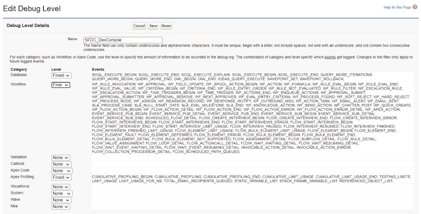

图 6.26 – 请注意每个调试元素的详细级别；默认情况下，其他类别也已启用，但我们希望专注于性能结果，因此我们启用了数据库、工作流和 Apex 性能分析

下面是工作流规则的设置方式。工作流规则关联一个操作，用于将关联的账户记录上的类型字段更新为客户 – 直销。图 6.27 显示工作流规则的设置：

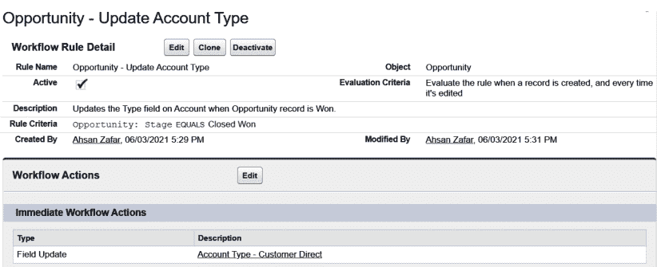

图 6.27 – 工作流规则设置

在以下屏幕截图中，我们展示了字段更新操作的设置方式：

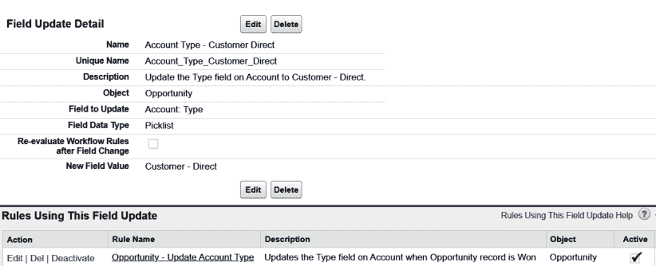

图 6.28 – 我们的字段更新操作的设置

调试日志已开启，工作流规则也已设置好，请继续将商机更新为已关闭已赢。检查账户记录以确认类型字段已正确更新。确认后，转到开发者控制台。在开发者控制台中，单击日志 选项卡，如下屏幕截图所示：

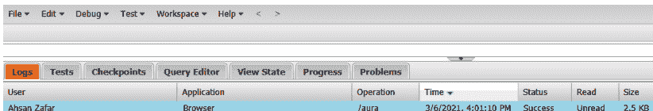

图 6.29 – 事务已被记录

双击日志记录，将打开执行日志页面（此处未显示）。日志打开后，转到调试 菜单，单击切换透视图，然后单击分析（预定义）选项，如下屏幕截图所示：

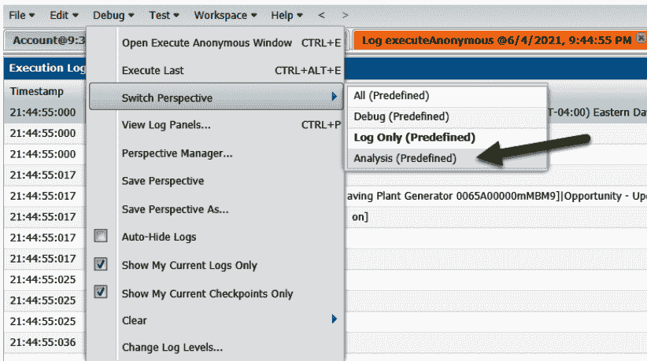

图 6.30 – 切换透视图和分析（预定义）菜单选项

在分析（预定义）透视图中，单击性能树 选项卡：

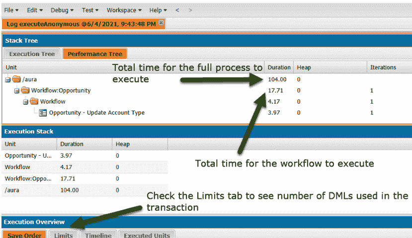

图 6.31 – 我们事务的结果

您可以看到，总处理时间为 104 毫秒 (ms)，而工作流规则 工具执行耗时 17.71 ms。该过程未执行任何 DML，因此页面后半部分的限制 选项卡没有任何信息。


让我们现在来处理 Lightning 流并设置相同的流程。以下是我们 Lightning 流定义的样子：

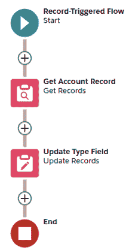

图 6.32 – Lightning Flow，在 Opportunity 记录设置为 Closed Won 时获取 Account 记录 ID 并更新 Type 字段

现在，让我们对一个 Opportunity 记录进行更新，但在此之前，请确保我们之前创建的工作流规则已被停用，并且调试日志已开启。遵循与处理工作流规则时相同的流程，我们看到以下结果：

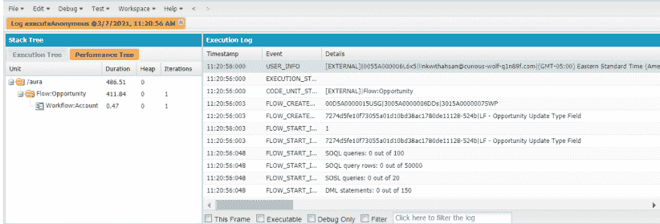

图 6.33 – 显示 Lightning Flow 更新关联 Account 记录上的 Type 字段所需时间的结果

结果令人惊叹：工作流规则完成耗时 17.71 ms，而 Lightning Flow 花费了 411.84 ms 才给出相同的结果。Lightning Flow 更新 Account 对象上的一个简单字段大约花了 23 倍的时间。

想象一下，如果你有一个涉及多个 DML 语句、SOQL 查询和其他操作的复杂业务流程，这个数字会如何变化。我的意思是，并非所有工具都具有同等性能。如果你的用户在抱怨性能问题，这是在排查问题时不可忽视且必须考虑的一个方面。

我们将工作流规则与 Lightning Flow 进行了比较，但同样的原则也适用于其他工具。你是应该使用触发器、Process Builder，还是也许使用异步 Queueable 进程来交付你的解决方案？在设计阶段，你都会问自己这样的问题；同样，在排查问题时，如果发现 Lightning Flow 耗时过长且让其继续运行已不再是选择，也需要自问这样的问题。你可能不得不立即采用其他选项，以确保业务运营以最小中断继续运行。

### LEX 中的性能

Salesforce 的第一个界面是 Salesforce Classic 界面，该界面更侧重于数据输入和检索。在过去几年中，随着 Web 技术的成熟，Salesforce 决定开发并发布一个基于 Web 标准的新界面，旨在为开发者提供一个构建响应式且高性能丰富应用程序的平台。

LEX 的一个显著特点是大部分工作在客户端完成，即你的浏览器中。页面按组件逐步加载，以减少加载时间。这与 Salesforce Classic 不同，后者中页面由服务器生成并在浏览器中呈现。由于 LEX 基于促进可重用性的基于组件的设计的现代 Web 标准，Salesforce 中的 Lightning 组件可以调用子组件。

由于 LEX 在客户端进行更多处理，它对用户环境敏感，应用程序性能可能受到几个因素的影响。用户使用的硬件和浏览器会影响用户体验。

另一个因素是用户所在的网络质量，因为数据需要在用户浏览器和 Salesforce 服务器之间传输。网络延迟增加会导致性能变慢。我们在前面的章节中讨论过其中的一些原因，但到现在应该意识到，与 Salesforce Classic 相比，LEX 中的性能相关问题更多依赖于用户的计算机。

### LEX 的技术要求

LEX 正在越来越多的组织中成为标准，而仍在使用 Salesforce Classic 界面的组织最终也需要从该界面迁移到 LEX。我简要地提一下 Salesforce 为获得可接受的用户体验所推荐的最低要求和建议要求。请记住，这些值仅应作为指导，你应该与不同地区的用户进行测试，以确保他们在使用 Salesforce 平台上的业务应用程序时能以可接受的性能水平履行职责。

对于最低要求，Salesforce 推荐以下基准：

- 网络延迟为 200 ms 或更低
- Octane 得分为 20,000 或更高
- 下载速度为 1 Mbps 或更高
- 5 GB RAM，其中 2 GB 可用于浏览器标签页

Salesforce 的推荐配置如下：

- 网络延迟为 150 ms 或更低
- Octane 得分为 30,000 或更高
- 下载速度为 3 Mbps 或更高
- 8 GB RAM，其中 3 GB 可用于浏览器标签页

这些基准适用于台式机和笔记本电脑。平板电脑和手机所需的最低基准数字不同，应参考 Salesforce 的文档。

在下一节中，我们将详细介绍体验页面时间 (EPT)。

### 了解 EPT

Lightning Experience 中的页面加载时间由 EPT 衡量。这是页面加载并处于用户可以与页面进行有意义交互的可用状态所需的时间。这听起来很简单，但 EPT 实际上包含一些细微差别。

我们之前讨论过，Salesforce Classic 和 LEX 的关键区别在于，前者的页面由服务器生成，而后者的页面由逐步呈现的组件组成。渐进式加载意味着组件可能会稍后加载其他子组件，因此确切知道页面何时对用户可用并不简单。

其他可能影响此指标的因素包括错误处理、缓存以及页面的实现细节，如果处理不当，可能会对 EPT 产生负面影响。

为了考虑这些因素，Salesforce 将 EPT 计算为从页面开始直到 2 个帧（大约 33 ms）内没有更多活动的时间。考虑这两个帧允许任何异步调用，例如 **XML HTTP Request (XHR)** 活动、存储活动或其他客户端工作完成。

在下一节中，我们将了解 Experience Cloud 以及可以采取哪些措施来确保托管在 Salesforce 上的面向外部的网站获得最佳性能。

### Salesforce Experience Cloud

Experience Cloud 是 Community Cloud 的新重新品牌名称，指的是你的客户或合作伙伴可能使用的面向外部的网站。确保其性能良好，从收入和声誉的角度来看都至关重要。据说，客户通常在离开网站页面前在上面花费的时间不超过 15 秒。这意味着你有 15 秒以上的时间来吸引他们的注意力，并让他们在你的网站上花费更多有意义的时间，最好是促成一次购买（假设是电子商务网站）。

想象一下，如果一个潜在客户访问了你的网站，而产品页面加载时间太长或崩溃了，该潜在客户很可能会离开而不是等待页面加载，并转而去你的竞争对手那里。在 *在 Salesforce 中进行性能测试* 部分，我们将了解 Costco 的例子，据估计，仅几小时的停机时间就给该公司造成了约 1100 万美元的收入损失。

Salesforce 提供了 **Page Optimizer 工具**，可以分析你的网站并识别可能影响性能的潜在问题。Page Optimizer 是一个可下载的 Google Chrome 浏览器扩展程序。该工具显示页面的网络性能，根据 Lightning 框架中使用的 Web 标准评估页面，并提出有助于改善页面性能的操作建议。

你的 Experience Cloud 网站上的自定义数量，以及每月页面浏览量、每月登录次数和流量模式，都是 Experience Cloud 网站上性能问题的一些常见原因。

建议是，在上线前确保你已对网站进行了规模和性能测试，因为网站上的非常大的负载可能会导致性能问题。大量使用 Apex、SOQL 和 SOSL 也会导致网站变慢，因此请尽可能坚持使用标准功能。


我们之前讨论过使用 CDN，可以通过将静态资源和其他频繁访问的内容卸载到这些网络上来提高站点的性能和可扩展性。Salesforce 提供的另一个功能是使用等候室，它允许用户排队进入等候区，然后以受控方式缓慢引入主网站。这使得经历流量激增的站点能够妥善管理负载，而不会因负载过大而面临卡顿或崩溃的风险。

在本节中，我们广泛介绍了性能问题产生的原因，并探讨了可用于监控 Salesforce 性能的众多工具。利用这些工具，我们可以有条不紊地排除这些问题可能发生的原因，并找到根本原因。

在下一节中，我们将讨论对 Salesforce 实现进行性能测试。

### 在 Salesforce 中进行性能测试

Salesforce 平台每天处理数十亿笔交易，并设计为高度可扩展。鉴于 Salesforce 以平台即服务的方式提供其平台，他们进行广泛的测试和监控，以确保其平台能够承受基础设施上可能施加的负载。

性能测试包含两个组件：

- 压力测试：压力测试用于在超出最大预期负载的负载下，在极端条件下测量系统性能。压力测试的目标是确定系统在不崩溃的情况下能够承受的最大限度。
- 负载测试：另一方面，负载测试是在预期负载下测量系统性能。这里的目标是确保能够提供可接受的服务水平，或者如果存在正式的 SLA，则能够满足它们。

在重负载下表现不佳的应用程序可能会导致系统崩溃，并可能使组织损失数百万美元的收入。2019 年，Costco Wholesale 网站在感恩节当天崩溃了不到一天。商业内幕报道称，此次崩溃使公司损失了约 1100 万美元的销售额。这只是一个例子，但在财务和声誉损失方面，成本可能都非常巨大。

与传统的本地部署系统不同，在传统系统中性能测试是软件工程过程的重要组成部分；由于 Salesforce 主动监控其云服务，我们不必担心系统是否会扩展。Salesforce 平台已经证明其可扩展性毋庸置疑；2013 年，平台每天执行惊人的 13 亿笔交易。如今，这个数字要高得多；公平地说，Salesforce 平台会运行良好，但您使用开发资源在内部构建的自定义解决方案会运行良好吗？（请注意，如果您使用的是开箱即用功能且仅对系统进行了轻微定制，那么投入时间和资源进行性能测试将不会带来巨大收益。）

性能测试重要的地方在于，当您拥有运行相对复杂业务逻辑的自定义应用程序，且用户数量庞大甚至有限时。在这些场景下，您可以决定进行性能测试，以确保应用程序不会崩溃，从而获得安心。您可以决定仅专注于对应用程序进行压力测试以了解其极限。

您可能还希望考虑对应用程序进行性能测试的另一个原因是测试集成。在许多情况下，Salesforce 与多个系统集成，尤其是 **企业资源计划 (ERP)** 系统，并且，具体取决于集成方式，大量数据可以推送到 Salesforce。例如，在快速销售类环境中，库存系统可能需要每小时将大量库存数据推送到 Salesforce。您会希望确保当该集成正在运行且数百名用户正在积极使用 Salesforce 时，Salesforce 仍能运行良好。大量数据导入或导出也可能给系统带来压力并影响性能。这是另一个您需要进行性能测试并确保系统能够处理大量数据负载的领域。

我们必须意识到，Salesforce 是一个多租户环境，包括软件和硬件在内的资源在数百个客户之间共享。一般来说，性能测试资源密集且涉及大量数据。因此，应采取适当措施，确保您的测试不会独占资源。Salesforce 拥有强大的监控机制，以确保公平使用资源，如果观察到异常活动，可以限制您的使用。

Salesforce 的站点可靠性 (SR) 团队可能会限制系统的原因有几个。通常，当超过某个阈值时，这些限制会自动应用。触发限制的最常见原因包括低效的 SOQL 查询、大量入站同步请求，甚至是异步作业。性能测试是组织可能会被限制的另一个原因。Salesforce 已建立协调性能测试的流程，其中包括事先获得 Salesforce 团队的批准。请参阅性能测试常见问题帮助文章，详细了解客户和 Salesforce 在性能测试中的角色和职责。您绝不应该在任何情况下在生产环境中进行性能测试，而应始终使用沙箱，最好是完全沙箱，进行性能测试。

在下一节中，我们将探讨如何对 Salesforce 应用程序进行性能测试。

#### 对 Salesforce 中性能测试的方法

### 规划

首先要做的是规划性能测试。要非常明确您想要测试和衡量的具体内容。是测试页面加载时间吗？是否还包括 API 测试？通过将测试范围缩小到业务应用程序最关键的部分，您将获得最大价值。这些可以是应用程序中运行复杂业务逻辑的页面，并且在单元测试或功能测试期间与其他页面相比运行速度相对较慢的页面。

### 测试模型

在规划步骤中确定需求后，下一步是定义测试模型。测试模型定义了需要定义和加载的众多变量，以模拟现实。让我们讨论其中一些，以便更加清晰。

某些事务比其他事务发生得更频繁；例如，创建订单的频率低于搜索联系人，因此您的测试分布需要包含大量搜索测试场景。思考时间是另一个因素，定义为用户收到最后一包数据到在网站上采取下一操作（例如，在页面上单击“下一步”）之间的时间。如果您的脚本一个接一个地运行测试步骤，那将不现实，因为人类用户通常会休息一下、处理信息，然后再进行下一步。因此，运行不考虑思考时间的自动化测试并不现实，因为您从性能测试中得出的结论将不准确。

使用模式是另一个必须考虑的因素，需要考虑系统预计使用最多的时间。例如，感恩节促销的访问者数量将远大于任何其他天的访问者数量。

您还应考虑这样一个事实，即 Salesforce 不是一个普通网站，内容被分发，用户以不同方式与之交互。相反，正如我们之前提到的，当 LEX 页面加载时，会发生多种情况，仅使用常规工具测量页面加载时间会导致不准确的结论。这就是为什么 Salesforce 建议使用 EPT 作为衡量 LEX 以及体验云 (Experience Cloud) 性能的指标。原因是 EPT 考虑了 LEX 独特的底层架构，其中单个组件可以与服务器通信。通过使用 EPT，我们可以确保获得准确的页面加载时间。

您也可以使用 Salesforce 衡量服务器端的情况，但正如在“在 Salesforce 中进行性能测试”一节中提到的，这不那么重要，因为平台在性能和可扩展性方面被主动管理。如果您仍需要测试性能，Shield 事件监控提供可用于评估性能的详细指标。如果您不使用它，也可以使用开发者控制台获取其中一些详细信息，但它们不如 Shield 事件监控提供的指标详细。

在 Salesforce 中，您将有兴趣衡量吞吐量和响应时间。吞吐量定义为系统在给定时间内可以处理的工作单元数量。吞吐量的示例包括每分钟创建的记录数量和每小时的搜索次数。响应时间定义为系统处理请求所需的时间。示例包括从文档生成工具生成文档所需的毫秒数，以及加载页面所需的毫秒数。


### 测试计划

定义测试策略和计划，并包含测试中将使用的测试用例和工具。测试计划还需要包含测试所需环境的相关详细信息以及记录所有测试缺陷的位置。你还需要确保拥有足够的资源来覆盖测试的所有方面，并且这应包含在测试计划中。

确保已考虑测试执行的时间表、将要测试的场景、成功标准以及将参与测试的资源的职责。我发现一个有用的技巧是包含一张单页系统级图表，显示将参与测试的不同系统。这些图表将展示不同的负载生成服务器、你的 Salesforce 组织以及测试中可能使用的其他系统，例如用于可视化测试结果的可视化系统。该图表有助于与内部利益相关者和 Salesforce 进行沟通。

不要对需要测试的内容过度追求，而应花时间思考在哪里能获得最大价值。如果你有 10,000 名用户，且即将上线的关键任务应用程序仅将由 500 名并发用户使用，并在 5 年内增长到最多 1,000 名并发用户，那么通过模拟 10,000 名并发用户对应用程序进行负载测试的价值很小。如果出于任何原因，你无法通过 500 个虚拟用户来模拟测试，可以请几名用户进行测试，然后推算结果。

Salesforce 建议在全沙箱中进行性能测试，该沙箱在数据方面与生产环境相同，但数据是时间点数据，意味着由于它在给定时间点克隆，因此该时间点后生产环境中的任何更改都不会反映在沙箱中。另一个需要记住的事是，尽管全复制沙箱与生产环境相似，但其托管基础设施并不完全相同。

一旦你最终确定了工具和测试范围内的测试用例，则需要开发在测试期间将运行的测试脚本。你的测试用例必须考虑到实际用户使用系统的现实情况，以便结果尽可能接近现实。之前的测试模型讨论将帮助你确定测试脚本需要考虑的因素。

### 测试执行

在此步骤中，你将执行测试脚本并记录结果。请确保与 Salesforce 协调你的测试。他们希望事先了解详细信息，包括 Salesforce 在出现问题时可以联系的关键联系人是谁、你预期的 **每秒交易数 (TPS)**、关于测试和将使用的工具的任何详细信息等等。Salesforce 团队无法验证你的测试策略，也无法为测试执行期间可能发生的任何问题提供调试服务。

### TPS

**TPS** 是每秒执行的交易数量。例如，如果 10,000 名用户在 1 小时内运行一个包含 2 个交易的单个 (1) 业务流程，那么 TPS 将如下：

10,000 x 1 x 2 = 20,000 每小时

TPS 是 20,000/(60*60) = ~ 5.5 个交易，向上取整为 6

Salesforce 建议将其设置为测试目的的两倍，即每秒 12 个交易。

### 分发结果和修复问题

一旦你运行完测试脚本，就该分发结果了。汇总结果以便于理解并防止对结果的任何误解。如果我不是向现场观众展示结果，我喜欢为每个表格和图表提供说明性注释，以便读者能更好地理解上下文来审查结果。

随着你将拥有的大量测试数据，将会存在需要改进的领域。我们在前一部分中回顾了改进性能的技术。这里，我建议使用帕累托原则，专注于解决那些能带来最大收益的性能瓶颈。例如，如果机会页面加载太慢且需要很长时间，那么应将其优先于一个速度极慢但仅由少数内部用户用于跟踪公司车队的 Visualforce 页面。由于前者由销售团队使用且直接关系到收入，解决该性能瓶颈应当优先。

在下一部分中，我们将讨论成功进行性能测试的一些关键属性。

### 成功进行性能测试

在本节中，我希望回顾一些你可以采取的措施，以确保性能测试成功。这些措施没有特定顺序，旨在作为指导原则，遵循这些原则，你将能够确保 Salesforce 实施的全面且成功的性能测试：

- **与 Salesforce 协调**：你的测试将产生大量数据，测试峰值将被 Salesforce 的监控团队注意到，因此尽早创建案例并开始与他们共享测试计划并不为时过早。这不仅会增加你获得理想测试日期的机会（是的，你向 Salesforce 提出时间表，但他们有权决定同意或不同意这些日期），而且你与 Salesforce 的通信还可以帮助你识别任何差距并在开始测试之前解决这些问题。

- **governor 限制**：我们知道 governor 限制的存在是为了确保没有单个客户会独占资源，从而剥夺同一实例中其他客户对 Salesforce 订阅的合理性能预期。性能测试可能会触发 governor 限制，在生产环境中发现这一点之前了解这一点是好事，但这也会使测试变得复杂。你需要做的是检查你的代码，并确保在进行性能测试之前，处理掉测试期间可能触发 governor 限制的任何潜在区域。

- **LEX**：如果你在测试 LEX，请确保你拥有适当的工具来测试 LEX 界面。这是因为与 Visualforce 界面不同，LEX 无法进行无头测试。它将需要一个能够测试 **GUI (图形用户界面)** 的工具。

> **无头测试**
>
> 这是一种在没有 *头* 的情况下进行浏览器 UI 测试的方法，意味着没有浏览器界面，测试在后台运行。这可以节省原本需要的资源；例如，在真实浏览器窗口中，运行操作需要内存，你打开的标签页或窗口越多，所需内存就越多。这会使性能测试结果向高端偏差。
>
> 在 LEX 中，使用传统负载测试工具进行无头测试是不可能的，因为大部分工作是由浏览器完成的，并且组件可能具有与服务器通信的子组件。像 Flood Element 这样的新工具，配合 Puppeteer，现在可以实现 LEX 的无头测试。

- **有经验的资源**：软件行业进行大量测试，一种测试类型的专业知识不一定能转化为其他测试类型的专业知识。例如，一名在大型现成 ERP (企业资源计划) 系统方面拥有丰富经验的测试负责人可能不一定知道如何设置和进行性能测试。确保你为工作拥有合适的专业知识，因为这对测试的成功起着重要作用。

- **负载生成**：如果你在测试 LEX 界面，那么如前所述，你需要一个能够执行此操作的工具。但对于性能测试，你还需要设置负载生成服务器，这些服务器将生成工具可以用于测试的数据。确保你的负载生成设置与工具兼容，并能产生足够的负载以充分进行性能测试。

- **使用不同的浏览器进行测试**：在测试 LEX 界面时，请确保已考虑用户在现实生活中可能使用的不同浏览器。在我之前提到的示例中，一个组织可能将 Internet Explorer 作为其企业支持的浏览器，但用户可能正在使用不同的浏览器，因此如果你仅使用 Internet Explorer 进行测试，你的测试可能会运行并返回结果，但不会具有现实性。

- **多租户挑战**：由于 Salesforce 运行的环境由许多客户共享，且 Salesforce 不提供环境基准数量的统计数据，因此你的性能测试结果可能会因测试时间、实例负载等因素而有很大差异。为了克服这一障碍，你可以在不同时间运行测试，最初使用单个用户。然后可以对该数据取平均值，作为全面性能测试的基准。这应该能让你很好地了解生产环境中的性能情况。

当环境中引入更改或错误修复时，请确保进行新的测量，以确保你正在将性能测试结果与新值进行比较。

我们已经了解了可以在 Salesforce 中对应用程序进行性能测试的方法，以及可以采取哪些步骤来确保我们进行的性能测试成功并符合业务目标。设置资源以进行性能测试可能是一项耗时且昂贵的工作，但通过遵循这些指南，你可以降低失败风险并提高成功的机会。

在下一部分中，我们将介绍监控、可用工具以及需要监控的内容，以确保你的组织平稳运行。


### 监控性能

本节将讨论可用于主动监控我们 Salesforce 组织的工具。请回顾我们在*第 3 章，了解数据管理*中的讨论：预防问题发生的成本为 1 美元，而问题发生后进行补救的成本为 10 美元。如果补救没有及时进行并发生故障，修复成本可能高达 100 美元。下一节将讨论监控什么内容，在随后的章节中，我们将介绍一些可用于监控 Salesforce 组织的工具。

### 监控什么内容？

有数十个可衡量的基准，但有没有几个可以衡量并为我们带来最大价值的指标呢？简短的回答是肯定的；您可以跟踪并监控以下指标的性能。对于其中一些指标，您需要咨询您的网络团队，以获取他们建议的最佳工具。请准备好解释 Salesforce 的工作原理、其多租户架构，以及组织无法直接访问底层数据库和应用服务器这一事实：

- **页面加载时间**：这是一个显而易见的指标，因为通常用户会在发现页面加载变慢时开始抱怨。LEX 页面由多个组件组成，在查看结果时，您希望看到组件加载顺序及其加载时间。这从诊断角度非常重要，因为这样您可以评估哪个组件导致了问题。问题可能由多种因素引起，例如网络延迟、第三方主机问题或 CDN 问题。

  您可以为 Salesforce 页面运行自动化测试来记录页面加载时间（LEX 中的 EPT）。现在有一些工具可以记录这些时间，在低于某个阈值时发送警报，并运行定时报表以进行趋势分析。这些测试可以提供每个组件的执行时间、组件加载顺序以及组件的其他详细信息。

- **网络**：这些测试提供关于网络层性能的详细信息。这些详细信息包括延迟、丢包率、跳数以及其他数据，例如数据包从源（客户端网页）到目的地（即 Salesforce 服务器）过程中网络设备之间的通信。

本测试的另一个方面是收集**超文本传输协议 (HTTP)** 性能数据，其中包括**域名系统 (DNS)** 解析时间、协商**安全套接字层 (SSL)** 连接的时间以及服务器响应代码。对于关键任务应用程序，监控这些指标并在问题开始出现时收到警报非常重要。例如，一家使用 Salesforce 作为船员排班系统的渡轮公司需要确保出于法律合规目的，船上配备了具备适当技能的船员。排班完成后，船只将从中出发的码头需要打印该排班表，并确保船员已登船并准备好出航。如果由于网络问题（例如延迟和丢包）导致与 Salesforce 连接出现问题，可能会导致严重后果，包括推迟出航时间，并在服务被视为必要服务的情况下可能面临处罚。

- **用户体验**：您还可以从用户角度主动收集性能数据，即收集诸如无线信号性能等统计信息。这也可以包括某个地理区域的用户，他们可能遇到了问题，或者是高速网络服务不足的偏远地区。然后可以针对需要关注的任何特定位置查看这些数据，或者将其与网络团队共享，以便他们在用户提交与性能问题相关的工单之前采取纠正措施。

关于性能方面可以监控的重要数据点，我们已经了解了。利用这些知识和本章讨论的工具，可以制定有效的策略来诊断和修复与性能相关的问题。

### 总结

本章开篇讨论了我们为什么应该关注性能的重要性。我希望这能让您思考，为什么在 Salesforce 中开发解决方案之前不经过深思熟虑的设计和架构考量是个坏主意。Salesforce 平台功能强大，允许客户构建缩短软件开发生命周期时间的应用程序，但当解决方案被草率地拼凑在一起时，这种优势就会变成弱点。

我们关于性能问题发生原因的讨论，希望能成为一份检查清单，供您使用，以确保您构建的应用程序或集成不会出现这些问题。性能问题的一个挑战在于它们会随着时间的推移而显现，但了解其原因将能让您从一开始就避免大多数问题。

我们广泛讨论了可用于提高性能的各种工具，以及可用于确保应用程序性能可接受的一些原则。了解这些工具，并在沙盒或开发者组织中尝试使用它们，以了解其优缺点，这样在需要时，您就知道为工作选择正确的工具了。

性能测试在 Salesforce 圈子中通常不被讨论，但它可以成为非常有价值的工具，用于衡量您是否会在生产环境中遇到性能问题。尽管其关注范围有限，但对于应用程序推广到成千上万用户或更多用户的大型组织，以及组织非常复杂且对其在负载下的表现存在疑问的情况，性能测试很有用。它们尤其应该用于面向外部客户的 Experience Cloud 站点，以确保站点在高负载下的性能在可接受范围内。

在下一章中，我们将讨论大数据量的话题，这正成为一个热门话题，因为组织的数据正在呈指数级增长，需要适当的管理方式。

### 问题

- 1. 精准打印 (PP) 在机会对象中有大量记录，用户一直抱怨报告运行时间非常长，列表视图加载时间更长。数据架构师可以提出哪些建议来改进这些报告和列表视图的性能？选择两个答案：

  - a) 要求用户检查其网络并升级到更高速的连接。

  - b) 减少列表视图中查询的字段数量。

  - c) 将报告设置为自动运行，这样用户无需等待其完成。

  - d) 分析报告，确定报告和列表视图中最常用的字段。联系 Salesforce 客户支持，在机会对象上创建一个精简表。

- 2. 精准打印 (PP) 正在为其 50,000 多名 Salesforce 用户部署一个应用程序。分配到该项目的架构师提出，在应用程序推广到生产环境之前应进行性能测试。与质量保证 (QA) 负责人和项目经理合作，团队在 Salesforce 中进行性能测试时需要考虑哪些事项？选择两个答案：

  - a) 性能测试必须在专为性能测试设计的 Salesforce 预配沙盒上进行。

  - b) Salesforce 必须批准测试方法，且测试用例必须在运行测试前提交。

  - c) 没有必要进行性能测试，因为应用程序会在生产环境中自动进行测试。团队可以待命以解决出现的任何问题。

  - d) 在平台上进行性能测试时，必须事先征得 Salesforce 的批准。

  - e) 全副本沙盒可用于性能测试，因为它在硬件方面接近生产环境，并且在创建沙盒时，它可以拥有与生产环境相同的数据。

- 3. 数据组合 (DC) 是一家数据分析公司，依赖 Salesforce 进行其销售和营销流程。DC 大量定制了其销售应用程序。该公司目前使用经典 UI，但计划很快迁移到 LEX。用户一直在报告账户记录页面加载非常缓慢。架构师可以提出哪些建议来改善这种情况？选择两个答案：

  - a) 告诉用户耐心等待，因为迁移到 LEX 将解决大多数这些性能问题。

  - b) 运行报告以分析页面布局中字段的使用频率。从页面布局中删除未使用的字段。

  - c) 通过在页面布局上实现一个按钮来启用延迟加载，该按钮配备一个组件，用于从外部源查询数据，而不是在页面加载时加载数据。

  - d) 联系 Salesforce，要求他们在页面布局上可见的字段上创建自定义索引。

### 延伸阅读

- 闪电体验技术要求: https://help.salesforce.com/articleView?id=sf.technical_requirements.htm&type=5

- 性能测试简介: https://developer.salesforce.com/blogs/2020/09/introduction-to-performance-testing.html

- 性能测试常见问题: https://help.salesforce.com/articleView?id=000335652&type=1&mode=1&language=en_US


- [Salesforce 平台每日处理 13 亿+ 笔交易的内部机制](https://developer.salesforce.com/blogs/engineering/2013/10/under-the-hood-how-the-salesforce-platform-handles-1-3-billion-transactions-per-day.html)

- [Experience Cloud 性能与扩展最佳实践](https://help.salesforce.com/articleView?id=sf.networks_perf_scale_best_practices.htm&type=5)
