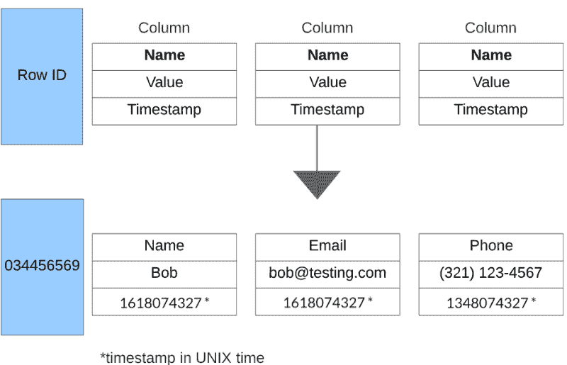
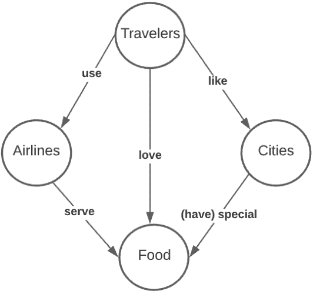

## 处理大数据量

在本章中，我们将讨论在 Salesforce 中处理大数据。Salesforce 已被组织使用很长时间，越来越多的组织已从实施和稳定阶段转入更成熟的增长阶段，其重点是利用实施阶段引入的功能来增加收入并降低成本。业务增长意味着数据也在增长，需要妥善管理，以防止对业务造成任何中断。

我们将简要了解不同类型的数据库，然后深入探讨**大数据量 (LDVs)**，这个话题因其独特的挑战而引起我的兴趣。我们将探讨什么是 LDV 场景，并讨论在可能的情况下如何避免这些场景。当我们确实需要处理 LDVs 时，我们将了解为取得成功所需考虑的因素，以及优化加载或集成 LDV 的技术。

无需始终使用涉及中间件的点对点集成与 Salesforce 进行集成：这就是 Salesforce Connect 和外部对象发挥作用的地方。我们将回顾外部对象、其限制以及使用外部对象的优势。当处理数以亿计甚至数十亿行的海量数据时，大对象可以提供帮助。我们将讨论大对象的优势及其注意事项，然后结束本章。

本章涵盖的主题包括：

- 再探数据库
- **大数据量 (LDVs)**
- Salesforce Connect 和外部对象
- 大对象简介

通过本次讨论，我们将了解在处理大数据时可用的选项，以及根据我们所处理的用例选择哪种选项。

### 再探数据库

在深入探讨 LDV 及相关主题之前，让我们简要回顾一下历史。了解关系型数据库和非关系型数据库将帮助我们理解 Salesforce 提供的不同类型的解决方案，并根据要求协助确定使用哪一种。在现代计算的早期，磁带被用于存储，第一个数字磁带存储系统 IBM Model 726 可以在单盘数据中存储 1.1 **MB**（兆字节）。为了进行比较，如今，一盒磁带可容纳高达 15 **TB**（太字节）。Model 726 是一种非关系型数据库，因为它是由相互链接的自由格式记录组成的。

随后出现了关系型数据库，它提供了一种更有条理的方法来存储、检索和搜索数据。数据按照规范化原则存储在多个表中，并使用称为**主键**和**外键**的唯一标识符在逻辑上链接在一起。有关规范化的更深入讨论（带有示例），请参阅 *第 2 章，理解 Salesforce 对象和数据建模*。

### 关系型数据库

**关系型数据库**为事务型和分析型应用程序提供了理想的媒介，当今广泛用作**企业资源计划 (ERP)** 系统、**客户关系管理 (CRM)** 系统和分析应用程序的存储骨干。关系型数据库的以下四大特性（简称 **ACID**）（**原子性**、**一致性**、**隔离性**、**持久性**）使其非常适合这些用途：

- **原子性**：关系型数据库内置了非常强大的事务控制机制。这意味着，如果事务在任何时候失败，它将被回滚，将值切换回较早的值，以确保数据保持准确。这防止数据库中的某些值因事务失败而被部分更新，而其他值保持不变。用于演示原子性的常见示例是银行账户之间的资金转账。原子性属性确保完整事务（即借记一个账户并贷记另一个账户）已完成，否则完整事务必须失败，以使数据库保持一致状态。

- **一致性**：这意味着数据库中定义的检查和约束必须在每个事务中得到满足。例如，如果表中的某列被定义为保存整数值，则数据库不应允许事务插入字符或 **二进制大对象**（或 **BLOBs**，通常用于 Oracle 数据库中存储图像和音频文件）。另一个示例是，在保存客户主数据的表中需要客户姓名。每当输入空值并尝试保存时，列上定义的约束将生效并阻止保存完成。

- **隔离性**：此属性与事务对系统其他用户和进程的可见性相关。它确保访问相同数据的事务不会与另一个事务并发运行。这一点很重要：假设一个银行账户余额为 1,000 美元，并发起两笔转账，每笔向不同账户转账 200 美元。这应该是两个独立的事务，但如果它们并发运行，两者都将读取余额为 1,000 美元，而第二个事务本应读取余额为 800 美元（在第一笔 200 美元转账到另一个账户后）。

- **持久性**：此属性与确保事务完成后，事务结果必须能够经受住任何系统故障相关。数据库管理员可以采取措施确保其数据库具有持久性，包括定期备份数据，而 Oracle 和 SQL Server 等现代数据库具有内置机制，可以应对灾难性故障并仍保持数据持久性。

回顾了关系型数据库后，让我们在下一节中了解非关系型数据库。

### 非关系型数据库

您可能已经从名称中猜到，非关系型数据库不使用关系（以关系型数据库中的主键、外键为例），因此不使用带有列和行的表。

非关系型数据库使用针对数据库中将存储的数据类型进行优化的存储。例如，如果将存储 JavaScript 对象表示法 (JSON) 数据，则针对 JSON 存储进行优化的文档数据存储可能合适。非关系型数据库通常称为 NoSQL 数据库。这是因为它们不使用 SQL 来查询数据，而是使用其他方法来查询数据。让我们简要讨论一些 NoSQL 数据库：

- **列式数据存储**：此类存储表面上与关系型数据库很相似，但它以非规范化格式存储数据。这些数据库具有列族（类似于关系型数据库中的表），列族中有行，行中有列。这些列中的值本质上是键值对的元组。列族包含在逻辑上相关的数据列，通常作为一个单元进行查询和操作。图 7.1 展示了一个列族示例：




图 7.1 – 列式数据库示例

在列式数据库中，并非所有列都需要填充，且每行的列数也可以不同。在前面的示例中，仅显示了一行：

- 键值数据存储：这些数据库将数据存储为键值对，键充当标识符，值是存储的数据。值使用适当的 **哈希函数** 进行存储。无需深入讨论哈希（超出本书范围），哈希函数只是使用数学函数将变长输入转换为压缩的数值固定长度输出。下面展示了一个键值存储示例：

| 键 | 值 |
|---|---|
| 123 | ('Hi', 'Bob', '544-3434', 10000) |
| 343 | ('Hello', 'John', '434-9241', 5751) |
| 569 | ('Howdy', 'Tim', '979-3111', 50311) |

图 7.2 – 键值数据库示例

键值存储针对使用键查询数据进行了优化，与关系型数据库不同，它们不适合使用非键值检索数据。

- 图数据存储：这种数据存储管理实体（即数据本身），也管理实体之间的关系。实体称为 **节点**，关系称为 **边**。与关系型数据库相比，这种数据库更强调实体之间的连接方式。这种数据库允许进行极快速查询，以理解复杂实体及其关系（节点）。图 7.3 展示了一个图数据存储示例：



图 7.3 – 显示旅行者节点和边的图数据库示例

在图数据存储中，访问节点及其边的操作非常高效，通常用于存在大量数据且需要探索复杂关系的场景。例如，用于欺诈检测的金融系统使用图数据存储来分析超出单个数据点的内容并形成合理结论。

- 文档数据存储：这些数据存储旨在将命名字符串字段和值存储在称为 **文档** 的实体中。这些文档使用 JSON 格式，并提供灵活性，使得每个存储记录可以彼此不同。图 7.4 展示了一个文档数据存储示例：

```
[
  {
    "year" : 2020,
    "make" : "Tesla",
    "model" : "Model S",
    "info" : {
      "Parts sourced from" : [ "Mexico", "China", "Brazil"],
      "First delivery date" : "2010-01-07T00:00:00Z",
      "Consumer product rating" : 7.2,
      "image_url" : "http://imageURL_Models"
    }
  },
  {
    "year" : 2021,
    "make" : "Lucid",
    "model" : "Air",
    "info" : {
      "Parts sourced from" : [ "Mexico", "China"],
      "First delivery date" : "2021-03-07T00:00:00Z",
      "Consumer product rating" : 8.1,
      "image_url" : "http://imageURL_LucidAir"
    }
  }
]
```

图 7.4 – 电动车辆示例文档存储

这种类型的数据存储适用于关系型数据库提供的严格结构不那么重要的场景。相反，更倾向于以文档形式存储和检索数据的灵活性，例如允许用户创建个人资料的高流量网站。

无论是关系型还是非关系型数据库，各有其优缺点，使其适用于特定场景。非关系型数据库适合存储结构较少的大量数据。由于只需最小结构，它们能更灵活地适应变化的业务条件。当需要更多结构、复杂业务逻辑以及 ACID 事务来确保准确性、完整性和数据完整性时，关系型数据库绝对是更好的架构选择。Salesforce 平台将关系型数据库用作其基础数据存储，但也存在其他使用非关系型数据库的服务。

您可能不需要参与决定使用关系型还是非关系型数据库，但了解其背后的理念能让我们以更有意义的方式与之交互，因为我们了解其优缺点。这一点尤其适用，因为我们中的大多数人，如果不是所有人，都以一种或另一种方式使用基于云的服务。既然我们更好地理解了不同类型的数据库，并了解它们在提供我们所使用的服务中所起的关键作用，让我们深入了解 LDV。

### 大数据量（LDV）

Salesforce 中的 LDV 没有严格的正式定义，如果您向经验丰富的架构师询问什么构成 LDV 场景，您很可能得到的答案是：这取决于具体情况。原因是，即使记录数量远低于 Salesforce 提供的一般指南，也可能存在 LDV 场景。一般指南是，一旦任何对象中的记录超过 100 万条，即构成 LDV 场景，您可能会开始看到 LDV 的影响。

虽然记录数量是判断是否存在 LDV 场景的一个考量因素，但并非唯一考量因素。即使记录数量低于通常推荐的阈值（即超过 100 万条记录），也可能有几个其他因素导致 LDV 场景。这些因素包括：

- **事务量和复杂性：** 这与组织中进出的数据量有关。如果您有与 ERP 等外部系统同步数据的集成，并且成百上千条记录正在传输到系统中，这可能不符合 LDV 场景的推荐指南。但是，假设您有三个此类集成同时运行——现在您将超出 LDV 的一般指南限制。

  另一个方面是事务的复杂性。从 ERP 导入并更新账户记录的集成将比从 ERP 导入产品数据并在 Salesforce CPQ 中动态形成捆绑包的集成运行得快得多。同样，当数据从 Salesforce 传出时，简单的机会数据导出将比使用 Salesforce 中的合同、订单或报价数据更新 ERP 的集成快得多。

- **数据偏斜：** 我们将在后续章节讨论不同类型的数据偏斜及其对性能的影响。

- **组织复杂性：** 组织在规模、共享规则复杂性和角色层次结构方面的复杂性可能会产生影响并创建 LDV 场景。考虑一种场景，当记录插入 Account 对象时没有共享规则，与集成运行且组织具有复杂 Apex 共享规则的情况相比。在第二种场景中，每次插入记录时都必须确定记录可见性，在处理大量记录时这可能会导致问题。

单靠记录数量显而易见，但我们在这里讨论的因素组合也会导致 LDV 场景。这应强调在最终确定集成或迁移方法之前正确分析组织的重要性。未能这样做可能会导致日后修复成本高昂且耗时的问题。让我们了解如果 LDV 在架构中未得到妥善考虑，其影响是什么。

### 了解 LDV 的影响

如果架构中未妥善考虑 LDV，您可能会看到 LDV 的影响。以下是当系统未针对 LDV 场景进行最优架构设计时的一些关键影响。这是在 Salesforce 中实施增强功能或新应用程序时，必须提出问题、理解答案并基于未来 3–5 年的预期数据增长进行设计的原因之一。

- 报表和列表视图：当遇到 LDV 场景时，这些最有可能是用户首先反映的内容。报表和列表视图会开始变慢，用户会抱怨说报表以前几秒钟就能运行，现在却需要很长时间。更糟糕的是，由于数据库需要筛选大量数据才能返回结果，这些操作可能会开始超时。

- 搜索：如果搜索引擎需要查询数百万条记录，搜索结果将花费更长时间。这是另一个用户会很快发现异常、结果返回速度比平时慢得多的领域。如果搜索使用自定义 UI，且搜索引擎需要查询多个对象并使用多个通配符，这一点尤其明显。

- SOQL：使用 SOQL 返回结果的 Lightning 组件或 Visualforce 页面在查询运行超过 120 秒时会开始变慢或出现查询超时问题。无论查询是否运行那么久，您都应该始终编写优化的 SOQL 查询，快速返回结果，而不必让用户等待很长时间。


- **共享计算**：每当记录所有权更新时，就会计算共享规则。在 LDV 场景下，这可能需要很长时间才能运行。这一点需要予以考虑，尤其是涉及数据迁移或集成的场景，因为当插入新记录或更新现有记录的所有者时，共享计算会自动运行，并且在 LDV 场景下会减慢系统速度。

- **相关列表**：用户会开始注意到某些记录的相关列表变慢。这与所有权偏斜有关，我们将在后面讨论，但当主从关系中从表一侧拥有大量记录时，也可能发生这种情况。例如，一家节奏快速的 **面向消费者（B2C）** 公司拥有数十万客户，一些忠诚客户的频繁订单导致 *Order* 对象中生成了大量记录。像 Amazon 这样拥有使用 Amazon Prime 并几乎从其在线商店订购每一件商品的客户的公司，最终可能在 *Order* 对象中拥有数十万条记录。人员账户记录上的相关列表可能需要很长时间才能加载。

我们已详细了解了 Salesforce 的多租户架构，但让我们从 LDV 的角度来回顾一下多租户架构和搜索架构。

### 多租户和搜索架构

在第 2 章“了解 Salesforce 对象和数据建模”中，我们详细了解了 Salesforce 的多租户架构。请参阅该章节以刷新你的记忆，但简而言之，多租户是一种使用相同硬件-软件栈为多个无关客户提供服务的方式。软件层或运行时引擎将每个客户的自定义内容和数据与其他客户隔离，防止其被查看或访问。在运行时，引擎会根据客户的元数据实例化虚拟表。

每当使用标准对象或自定义对象创建新的 Salesforce 应用程序，并为其添加标准字段或自定义字段时，Salesforce 都不会为（比如说）将字段作为列的自定义对象创建物理数据库表。这样做不可扩展，因为通常有数百个租户托管在一个实例上，管理租户所做的数据库更改需要大量资源。相反，平台使用一组元数据、数据和透视表（定义关系、唯一字段和索引的表）来管理虚拟数据库结构。

Salesforce 中有大量地方使用了 **搜索** 功能，最常见的或许是 **全局搜索**，但查找和重复记录处理时也会用到。Salesforce 的搜索架构基于其自身的数据存储，并针对搜索进行了优化。

了解底层架构的工作原理将有助于我们理解，为什么无法执行传统数据库中曾可用的某些操作。例如，你可以优化底层 **结构化查询语言 (SQL)**，随意运行数据库统计信息，或创建索引以优化数据库性能。如果在加载大量数据后认为有必要立即使用户可用，你也可以运行索引更新作业。

在 Salesforce 中，由于它是多租户共享环境，我们无法访问底层数据库，必须妥善规划集成和数据迁移。例如，平台上的搜索每 15 分钟运行一次，如果刚刚进行了大规模数据迁移，可能需要很长时间才能完成。如果组织的 24/7 呼叫中心依赖于此，我们需要恰当安排时间。同样，平台上的数据库统计信息每晚运行一次，这意味着在 LDV 迁移后尝试访问数据时，你的 SOQL 查询可能会很慢。

让我们回顾一下迁移或为 LDV 设计集成时需要考虑的一些关键事项。

### 集成或迁移 LDV 的注意事项

在设计 LDV 集成或迁移时，必须将多个注意事项放在首位。这是因为，尽管 LDV 的要求与典型集成或迁移并无太大不同，但关键在于了解 LDV 的影响，以便在设计中纳入缓解措施，避免出现问题。其中一些注意事项也适用于非 LDV 集成和迁移，但这里予以提及是因为它们对 LDV 有重大影响。

### 绿地组织与棕地组织

绿地组织是一个全新的组织，你需要从零开始进行设置。通常，当组织开始使用 Salesforce 时，他们会设置 CRM，组织会随着时间的推移慢慢发展，并在此基础上构建其他应用程序。另一方面，棕地组织是指已经上线并正在用于业务运营的组织。

在棕地组织中进行 LDV 迁移比在绿地组织中更复杂。原因是需要考虑的因素更多，首要因素是尽量减少对正在进行的业务运营的任何干扰。LDV 操作可能需要很长时间才能运行，并且可能会产生可见的性能影响，从而影响运营。例如，你最不希望看到的情况是，当加载 Case 记录的 LDV 进程正在运行时，你的客户支持用户正在与客户通话，却在等待 Case 记录打开。

对于绿地组织，你不会遇到这类问题，在运行 LDV 操作时拥有更多灵活性。务必始终站在用户的角度，确保并深入思考运行 LDV 操作的影响。许多企业在 Salesforce 平台上运行关键应用程序，而 Account 对象是 Salesforce 生态系统的中心。这是因为几乎所有在平台上构建的应用程序都使用它，任何影响 Account 记录的 LDV 操作都会减慢平台上所有人的系统速度。

在使用全球棕地组织时，另一个挑战是时区差异。LDV 所需时间取决于加载的数据量，但你可能会发现，需要停机来运行操作会很棘手。某个时区的用户可能离线，但这不一定意味着是加载数据的好时机，因为不同时区的用户可能正在充分使用系统。为防止这类问题，LDV 可以在周末运行，但如果平台上运行着 24/7 呼叫中心，这仍然可能具有挑战性。

### 数据建模

如上一节所述，Salesforce 数据模型将 Account 对象作为关键对象，其他对象通过主从关系或查找关系与其关联。从其他系统迁移时，请确保了解源系统的数据模型。这是因为，与你的假设相反，源系统的数据模型可能与你预期的不同。例如，在 Siebel 中，S_PARTY 表是包含联系人、用户、员工和账户（公司）的主表。其他记录和其他表是从它扩展而来，用于标识记录属于员工、联系人还是用户。如你所见，该数据模型与 Salesforce 中的不同，了解数据模型将有助于你确定为成功加载数据所需的转换。

请记住，Salesforce 平台针对读取操作进行了优化，而传统数据库则针对写入操作进行了优化。这意味着你应尽可能注意对数据进行反规范化。例如，一个账户可能有多个地址，如账单地址、送货地址和法律地址。在传统型数据库中，这些地址存储在主外键关系的单独表中，但在 Salesforce 中，Account 对象上直接包含送货地址和账单地址。你希望为要在对象上存储的其他地址创建新字段。


反规范化的一个被忽略的好处是，它减少了需要加载的记录数量，从而实现了更快、性能更好的加载，并且在需要验证的总行数方面需要较少的验证。从我们前面的示例来看，假设存在四种类型的地址——账单地址、送货地址、法律地址和售往地址。这些将在地址表中形成四条记录，但在 Salesforce 中，我们只需在 Account 对象上创建额外的两个地址，从而将需要加载的行数从四行减少到一行。下图展示了一个示例来演示这一点：

| ID | 名称 |
|---|---|
| 1 | Precision Printing |
| 2 | MPath Logistics |

### 账户表

| ID | 类型 | 地址 |
|---|---|---|
| 1 | 售往 | 123 Main St, Vancouver BC |
| 1 | 账单 | 1 Mission St, Vancouver BC |
| 1 | 运输 | 2411 Royals Road, Vancouver BC |
| 1 | 法律 | 541 Sheppard St, Toronto ON |
| 2 | 账单 | ... |

### 地址表

### 图 7.5 – 展示地址在规范化数据库中如何存储的示例

地址表中的“类型”列通常是另一个表，其中定义了所有地址类型，但此处为清晰起见将其合并。当数据反规范化并准备加载到 Salesforce 时，地址表不需要作为单独的对象创建，而是会在 Account 对象上创建不同的地址类型。

图 7.6 显示了与图 7.5 等效的内容。可以看到，不同类型的地址与账户名称及其他相关账户详细信息一起存储（此处为简洁起见未显示）：

| ID | 名称 | 账单地址 | 运输地址 | 售往地址 | 法律地址 |
|---|---|---|---|---|---|
| 1 | Precision Printing | 1 Mission St, Vancouver BC | 2411 Royals Road, Vancouver BC | 123 Main St, Vancouver BC | 541 Sheppard St, Toronto ON |
| 2 | MPath Logistics | 234 Quadra St, Chicago IL | 234 Quadra St, Chicago IL | 77 Jasper Ave, Calgary AB | 901 Bay Street, Toronto ON |

### 图 7.6 – 不同类型的地址将在 Salesforce 账户对象上如何存储的可视化表示

我们已了解数据建模的重要性，以及规范化与反规范化如何在设计数据迁移和集成时产生必须考虑的转换要求。

### 工具

**提取、转换、加载 (ETL)** 工具可以从源系统提取数据，进行转换，然后将数据加载到目标（即 Salesforce 对象）中。虽然这些工具对大多数迁移非常有用，但 LDV 可以利用 MuleSoft 等集成工具。原因是集成工具提供了一组更强大的功能，这使得迁移或集成 LDV 更加容易。例如，ETL 工具可以转换数据，但在你想要插入一个批次，然后根据某个标准对其进行更新的场景中，大多数 ETL 工具无法将两者链接起来。另一方面，集成工具可以轻松做到这一点，并在我们的示例中为你提供灵活性，即让插入操作完成，并在前一个操作成功后运行更新操作。以这种方式链接事件可以节省大量时间，因为它消除了手动干预的需求，并允许你以更多灵活性运行批次。

不要低估链接的重要性，因为它可以节省大量时间并让你免受许多麻烦。原因是 LDV 与常规加载不同，常规加载可能涉及几百、几千或几十万条记录。即使在 100,000 条记录的批次中有 0.5% 的记录失败，你也需要手动修复 500 条记录，如果不是巨大的话，这也是一个相当大的数字。对于 LDV，100 万条记录的批次中有 0.5% 的记录失败意味着 5,000 条，如果需要手动修复，这将是一个非常大的数据量。集成工具提供了重新运行失败记录的功能，你可以编排步骤的流程，以使需要任何类型手动干预的记录数量保持在最低限度。

在迁移到活跃的棕地组织时，你可能需要将现有数据从 Salesforce 导出，以某种方式对其进行转换，然后再将其加载回 Salesforce。集成工具在此处也很有用，因为一旦你熟悉为工具配置的设置，就可以对其进行自动化。例如，如果你要合并两个组织（org A 和 org B），其中 org B 将在合并后停用，那么你很可能在 CRM 数据之间有高度重叠，在这种情况下，你将希望从 org A 提取数据，转换数据（包括从 org B 添加新属性），然后将其加载回 Salesforce。

### 为操作定时

如果可能，在迁移数据时考虑采用分阶段方法，而不仅仅依赖一个周末来完成。尽管你已尽最大努力，将 1000 万个案例加载到 Salesforce，以及 100 万个账户记录和 300 万个联系人记录，也可能是大量工作。通过将大量数据拆分为可管理的块来分阶段进行迁移。这样，在数据迁移切换时，你将剩余较少的增量记录需要加载。

在全副本沙盒中运行批次时，对加载运行所需时间进行基准测试，将让你了解在生产环境中运行加载需要多长时间。这一点很重要，因为你希望确保与受影响用户的沟通无懈可击，并且他们知道平台日常使用受到影响的内容、方式和时间。

### 迭代，迭代，再迭代...

我再怎么强调这一点都不为过：多次迭代你的加载以消除任何问题。从 Developer Pro 沙盒和几千条记录开始，修复任何问题，然后重新运行批次。逐步增加记录数量并加载数据。一旦超过了 Developer Pro 沙盒中记录数量的限制，请转到 Partial Copy 沙盒，它提供 5 GB 的存储空间。最终，你希望在与生产环境完全相同的全副本沙盒中执行任何用户验收测试。

### 转换

如你众所周知，数据迁移和集成通常不是简单的提取和加载操作，而是在加载到目标之前涉及重大的转换。对于 LDV，由于数据量大，转换变得更加资源密集。如前所述，转换应在 Salesforce 之外完成，而不是依赖那里的自动化工具来加快加载速度并防止出现问题。

转换可以是各种事情，从使用公式来串联和创建新值到添加缺失值或根据某些标准在目标中替换值。你需要记住的另一种转换类型是转换为 Salesforce 中的字段类型。我所说的数据类型是，SQL Server、Oracle 等传统数据库在数据库中为每个表列定义了数据类型，因此一个列可以是小数、文本或类似的类型。在 Salesforce 中，由于我们无法直接访问数据库，我们拥有字段类型，因此要存储数字（无论是整数还是小数），你需要创建一个类型为 **数字** 的新字段。当你想要从 SQL Server 迁移数字值时，你需要将其类型转换为 Salesforce 中的相应类型。

你还需要将源中的选项列表值转换为 Salesforce，同样，还需要根据业务要求进行其他转换。重要的是，可能会发生重大转换，工具应能够处理加载而不会拖慢整个过程。

### 用户参与和验证

从项目一开始就让熟悉数据的用户参与进来。验证数据加载是否成功有多个方面，其中之一是让了解其数据的高级用户参与进来。设定期望、时间表，以及他们需要在多大程度上和何时验证加载。知道源中的记录总数与加载到 Salesforce 中的记录总数匹配是一回事，但这不一定意味着所有数据元素都传输正确，特别是在中间有转换步骤时。

你的用户将帮助发现字段看起来为空白或缺少战略账户等方面的缺口。这些有问题的记录不一定会出现在你的错误日志中，但从可用性角度来看，数据不准确。指导你的用户选择随机数据样本进行验证，但也要关注对业务最关键的数据。

根据对象，实现验证的另一种方法是验证字段的聚合计数或总和。例如，如果你的业务要求是加载当前财政年度的机会数据，那么将当前财政年度所有机会的 **金额** 字段总和与源系统中的值进行比较。如果机会无法一对一比较（例如，由于 **阶段** 字段值不同），这可能会变得棘手，并且可能需要一些额外工作。

在下一节中，我们将讨论，如果可能，应尽量避免 LDV 场景。

### 防止 LDV 场景

好了，本节的标题可能听起来有点极端，LDV 也并非一种疾病，但要点是，如果可能，你应该避免遇到 LDV 场景。我要强调的是，上一节讨论的标准并不意味着除非绝对必要，否则你就应该自动开始考虑 LDV 场景。


有防止 LDV 场景的方法，在合理的情况下应当采用。需要澄清的是，大型组织会出现 LDV 场景且无法避免，但我在这里再次强调，并非每个 LDV 场景都是自然形成的。相反，有些可以直接预防，例如，当组织没有归档策略，并且在 Salesforce 中存储了多年的数据，导致 LDV 情况时。在这种情况下，你应认真考虑将数据移出平台。让我们讨论一下可用于将数据移出平台以实现更好可扩展性和性能的选项。

### 数据归档

使用自动化工具定期归档数据，可以防止平台数据大规模增长，是一个不错的策略。请记住，核心 Salesforce 平台功能虽然强大，但并非用于存储海量数据，而是用于最佳事务负载。归档数据可以改进报表、列表视图和仪表板性能。它还能改进 SOQL，因为数据库需要查找的数据集更小。

数据归档可用于保留不再活跃但因审计或监管合规目的需要保留的旧数据。它可以帮助组织中仅保留运营所需的活跃数据。例如，不活跃的客户账户和联系人，如果已超过 5 年未订阅且未响应营销活动，可标记为归档。让我们简要看看可以用于归档 Salesforce 数据的一些方法：

- **面向中间件**：这利用中间件来编排归档过程并将数据存储在数据存储中。为检索目的，你可以使用 Lightning Connect，或使用中间件将数据检索到（例如）Salesforce 中的 Lightning 组件。

- **AppExchange 合作伙伴**：另一种方法是依赖第三方 AppExchange 应用来归档数据。AppExchange 上有许多此类应用，提供一系列功能可用于满足你的数据归档需求。

- **Heroku**：使用 Heroku 的组织也可以利用它来归档数据。这利用了 Postgres 数据库，以及 Lightning Connect、Heroku Connect 和自定义 Web 服务来启动归档过程。

- **大对象**：这是将数据从主 Salesforce 对象归档到专为存储大量数据而设计的特殊对象的另一种方式，但它们也有必须考虑的限制。我们将在本章后面更详细地讨论大对象。

简要回顾归档方法后，让我们继续讨论预防 LDV 场景的其他方式。

### 删除

删除已确认对组织无价值且因法规或合规原因不需要存储的数据，是永久删除的良好候选。这可以释放存储空间并减少潜在的 LDV 场景。

需要理解的是软删除和硬删除之间的区别。当记录被软删除时，不会实现性能改进，因为数据仍在平台上，并且会在回收站中保留 15 天。平台必须显式地将这些记录从查询和其他操作中排除。

如果知道不再需要已删除的数据，使用带有硬删除选项的 Bulk API 将允许你立即删除记录，而不将其存储在回收站中。建议对大量数据删除和即时性能改进使用此选项。

### 混搭

这是一种数据虚拟化，数据存储在外部系统中，应用在 Salesforce 用户界面 (UI) 中提供。这本质上创建了一种松耦合的集成，不依赖任何专有方法来集成两个应用程序。缺点是它最适合需要实时获取少量数据的场景。

### 外部对象

这是另一种数据虚拟化形式，数据存储在源系统中，但使用 OData 连接器，数据可以在 Salesforce 中按需提供。例如，假设你在 Microsoft Dynamics 中有订单数据。与其进行传统集成来集成 Salesforce 和 Microsoft Dynamics，不如使用 Salesforce Connect 将两个系统链接起来。当用户在 Account 记录上打开订单相关列表时，将通过连接器进行实时调用，结果返回并在相关列表中显示。

在下一节中，我们将探讨优化 LDV 操作性能的不同方式。

### 优化 LDV 操作

优化 LDV 操作性能有多种方式，我们将在即将到来的子章节中介绍这些方式。如果你遇到性能问题，不要一次性尝试所有这些方法，而是尝试实施这些技术并记录性能，同时继续根据需要监控和微调。这可以帮助你精确定位性能问题的原因，并可能有助于解决其他类似问题。

### 数据偏斜

当拥有超过 10,000 条全部关联到同一父记录的子记录时，就会出现数据偏斜情况。这是不希望看到的，防止数据偏斜的关键是将每个父记录的子记录数量保持在 10,000 阈值以下，并将这些新子记录分布到不同的账户中。偏斜有三种类型：

### 账户数据偏斜

账户数据偏斜发生在大量子记录关联到同一账户记录时。例如，超过 10,000 条机会记录具有相同的父账户。这通常发生在使用通用账户作为未分配联系人父记录时。账户数据偏斜可能导致以下问题：

- a) 记录锁定：在多线程下更新大量子记录（例如同一账户下的机会）时，为保持数据完整性，需要锁定同一账户。锁持有时间很短，但可能之前的更新仍持有锁，导致当前更新失败。请记住，在父子关系中，更新子记录时也会锁定父记录，以维护数据库中的数据完整性。

- b) 共享问题：根据共享配置，简单的更改（例如更改账户所有权）可能需要检查该账户的每条子记录并调整共享。在涉及大量记录的场景中，这会耗费大量时间并导致问题。

### 所有权偏斜

这是指单个用户拥有大量记录（通常超过 10,000 条）时发生的情况。例如，集成用户被分配了外部系统中的所有账户。当偏斜所有者存在于角色层次结构中时，删除或所有者更改等操作会导致系统从旧所有者、层次结构中的所有父用户，以及通过共享规则拥有访问权限的用户处移除共享。因此，所有权更改是系统中代价最高的事务性更改。

如果确实需要将大量子记录分配给父记录，请确定是否可以让子记录分布到多个父账户，从而避免所有权偏斜场景。请记住，Salesforce 中的每条记录都应有所有者，无论它是用户还是队列。

在无法避免所有权的情况下，可以让偏斜所有者在层次结构中没有角色。这样，系统就不需要对偏斜用户的记录进行任何共享计算。

### 查找偏斜

这是指大量记录关联到单个查找记录时发生的情况；例如，你有一个自定义报价对象，其中包含指向自定义设施对象的查找，用于指示组件维修地点。如果单个设施记录关联了过多报价，就会遇到查找偏斜问题。

从数据库术语来看，查找本质上是外键关系，在插入/更新记录时，关联的查找记录也必须被锁定以维护数据完整性。这就是查找偏斜不利于性能的原因。


即使多个对象都查找同一个对象，查找偏斜仍然可能发生；例如，对象 x、y 和 z 各自都有一个指向对象 a 的查找。如果对象 a 上的记录 ID ax1 是对象 x 上约 50,000 条记录、对象 y 上 10,000 条记录以及对象 z 上 20,000 条记录的父记录，则仍然会出现查找偏斜情况。可以采用以下一些方法来避免查找偏斜：

**改进记录保存性能** – 可通过以下方式实现：

- a) 提高同步 Apex 代码的性能 – 通过将代码合并到单个触发器对象中，优化触发器以达到最佳性能。

- b) 删除不必要的工作流、流程构建器或流程，或将其合并到现有触发器代码中。请记住，这些自动化会延长锁定持续时间，可能导致锁定失败增加。将工作流删除或合并到 Apex 中可以提高性能。

- c) 仅同步处理所需内容，并将其余代码移至异步处理，因为锁定会在自定义代码执行的整个期间保持。

**分散偏斜** – 考虑向查找添加更多值以避免偏斜，或尽可能将其留空。之所以会出现查找问题，是因为许多记录与单个记录具有查找关系。例如，一家企业为来访客户提供快速预算报价，而不会收集所有详细信息并在 Salesforce 中创建账户。为此目的已创建了一个通用账户记录。随着时间的推移，随着报价在该通用账户下创建，将出现查找偏斜情况，这可能会开始影响性能。

**使用选择列表字段** – 如果查找值较少，请考虑使用选择列表值。通过使用选择列表值，可以消除与查找相关的锁定，从而避免任何锁定问题。

由此可见，看似无害的查找也可能导致严重的性能问题。这提醒我们需要考虑设计的后果，并为可扩展性和性能而设计。

### 列表视图和报表

列表视图和报表通常是用户开始注意到性能问题的首要位置。这是因为平台上几乎每个用户都有报表、列表视图或两者兼有，以便专注于需要完成的工作：

- **限制字段数量：** 我首先建议教育用户在列表视图和报表中只使用他们真正需要的字段。在许多情况下，创建报表时，用户会添加字段来了解可用的数据，但在保存报表时从不删除它们。拥有用户不会使用的数据的报表价值较低，不仅如此，它还会影响性能。我认为最有效的策略不仅是在创建报表时告诉用户该做什么，还要解释这样做的重要性以及它可能对未来的影响。

此外，使用相对日期而不是精确日期值可以获得更好的性能。例如，在列表视图中使用 **上周** 来筛选上周的所有线索，在其他条件相同的情况下，比输入 **起始** 和 **结束** 日期性能更好。

不鼓励使用 **CONTAINS** 和 !=，因为这会阻止 Salesforce 平台使用索引，从而对性能产生负面影响。如果您不确定为用户创建的报表性能如何，有时编写报表或列表视图背后的查询并在查询计划中运行它会很有帮助。这可以让您了解查询在报表或列表中的性能。

- **未使用的报表：** Salesforce 提供了安排报表和仪表板的功能，以便用户可以自动通过电子邮件接收报表或仪表板。请确保经常清理已安排的报表和仪表板。在一个示例中，管理员使用的共享邮箱收到了多个报表的电子邮件，这些报表最初是高管的一次性请求，但从未从平台上删除。

- **治理：** 至少要对报表实施一定程度的治理。报表泛滥是真实存在的问题，如果不妥善处理，可能会迅速失控。我发现一种有用的方法是为每个业务部门创建报表文件夹，并授予该部门用户对文件夹的完全访问权限。或者，您可以指定 1-2 个高级用户并授予他们 **管理器** 访问权限，其余用户对文件夹拥有 **编辑器** 访问权限。

### SOQL 最佳实践

每当我们打开显示数据的 Visualforce 页面、运行报表或使用 Data Loader 运行更新数据的接口时，很可能正在从数据库查询数据并在后台运行查询，无论我们是否意识到。虽然承认有些数据出于性能原因被缓存，但假设我们第一次运行上述操作，后台将运行查询。

因为 Salesforce 平台是多租户的，客户无法直接访问数据库，所以当您运行报表、SOQL 和列表视图时，请求会发送到所谓的 **查询优化器**。这是数据库之上的一个层，它将 SOQL 转换为数据库可以理解的 SQL 查询。查询优化器理解 Apex 类中的 *共享规则*，包括 *with sharing*，因为这些直接影响 SOQL 语句的结果或报表运行时的结果。查询优化器旨在将 SOQL 优化为数据库运行的 SQL。*此处的优化是指是否会执行全表扫描或索引，以及连接的执行顺序。* 列表视图和报表部分中提到的一些做法也适用于 SOQL 查询，因此我此处不再赘述。

让我们回顾一下与运行 SOQL 查询相关的一些最佳实践：

- **使用索引：** 这对于确保查询高效运行非常有用。Salesforce 中有两种索引类型 – 标准索引和自定义索引：

标准索引包括 RecordId、标记为外部 ID 的字段、Name、LastModifiedDate、CreatedDate、RecordTypeId、Division、Email（仅适用于 Contact 和 Lead 对象）、查找和主从关系等字段。您可以要求 Salesforce 支持在公式字段和包含空值的字段上创建自定义索引。**公式**字段会实时计算值，默认情况下没有索引，这通常意味着需要进行表扫描。如果您决定在 **公式** 字段上创建自定义 **索引**，则定义 **公式** 字段的函数必须是确定性的。非确定性 **公式** 字段的示例包括：

- 它们包含对另一个字段的引用，例如，查找。
- 它们引用另一个 **公式** 字段。
- 它们使用动态日期和时间函数，例如 NOW、TODAY 等。
- 它们具有所有者、自动编号、区划和审计字段（排除 **CreatedDate** 和 **CreatedByID**）。
- 它们引用其他无法索引的字段，例如，多选选择列表、货币、长文本区域字段和二进制字段（包括加密字段）。

具有特殊函数的标准字段，例如 **Opportunity** 对象上的 **Amount** 和 **TotalOpportunityQuantity** 字段。

默认情况下不索引空字段，因此空字段需要全表扫描。可以应要求向 Salesforce 创建包含空字段的两列索引。在这种情况下，第二列可以是空值，但第一列不可以。

### 分区

此功能有助于分区数据，从而提高查询性能。您可以让 Salesforce 启用此功能并根据区域创建分区，但也允许其他值。每个记录随后都会为 **Division** 字段赋值。例如，*分区* 值可以基于北美、欧洲、澳大利亚等区域。

如果您拥有 **受分区影响** 权限，那么 Salesforce 中的搜索结果、列表视图和其他功能将提供选择要返回其结果的分区的选项。例如，您可以在创建或编辑列表视图时指定感兴趣的分区，从而仅显示特定分区的记录。同样，您可以在报表选项中指定分区以返回特定分区的结果，否则将显示所有分区的记录。


### 专用集成用户

我认为大多数，如果不是全部，集成密集型且数据量大的公司都会为这些操作使用专用集成用户，但我想重申在可能的情况下使用专用集成用户的必要性。这有助于识别是谁做出了更改以及这些更改是否与这些流程相关，但也有助于避免任何类型的冲突，当活跃平台用户正在组织中工作并且其用户名正在用于集成或数据迁移时。

### 设置适当的组织范围默认值

Salesforce 在共享表中存储对记录的访问权限。每当插入记录或所有权发生变化时，平台都必须插入/更新这些共享表。将组织范围默认值 (OWD) 设置为私有会增加维护这些共享表的额外负担。建议，如果可能并且是新建组织，在数据加载期间使用公共读/写设置，然后根据需要将 OWD 更新为其他设置。这样将允许平台插入数据，而无需同时在共享表中插入记录。

### 并行共享规则重新计算

随着组织自然增长或通过合并、收购或重组，预计会看到角色层次结构的变化。如果存在允许通过共享规则访问的共享规则，角色层次结构的更改意味着规则可能需要更新并重新运行。

在 LDV 场景中，这些规则可能需要花费大量时间才能完成，并导致诸如进程运行时间长和用户需要访问系统等问题。如果规则仍在运行且表格尚未更新，用户将无法访问数据或可能拥有超出应有权限的访问权限。

另一个问题是，由于这些共享规则的计算方式，关于进程需要多长时间才能完成没有太多信息，与此同时，如果 Salesforce 应用补丁或正在应用发布，这些进程会被中止并必须重新运行。

一旦 Salesforce 客户支持启用了并行共享计算功能，更新将通过后台处理队列异步发生。这允许创建多个执行线程并放入队列，从而快速完成进程，并且由于作业被放置在作业队列中，补丁或发布应用导致的中断不会影响这些作业。

### 禁用自动化和逻辑整合

一个良好的通用做法是禁用您在组织中可能设置的自动化和数据质量工具。这些包括触发器、流程、流程构建器、工作流规则和验证规则。原因在于它们旨在确保数据质量或转换。在加载大量数据时在 Salesforce 外部执行这些操作将有助于防止组织出现超时和其他性能问题。一个常用的良好做法是在触发器上设置某种管理员可通过 **自定义设置** 或 **自定义元数据** 类型访问的标志。只需将开关切换到 **关闭**，即可在 LDV 操作期间关闭所有触发器。这也应扩展到基于点击的工具，例如流程构建器、流程和验证规则，以便它们可以临时禁用。

需要考虑的另一个因素是组织的复杂性。它是否在同一对象上有多个工作流规则或流程构建器？Apex 代码是否已正确批量化？是否有高度依赖同步操作的自定义代码？如果对其中任何一个问题的回答是 _是_，您可能希望通过批量化 Apex 代码采取适当措施。在其他情况下，您希望将多个流程构建器上的业务逻辑整合到触发器中。在 LDV 场景中，一个更好的选择可能是将处理移至异步模型。其想法是避免同步操作，除非绝对必要。

整合也可以表现为减少您正在使用的自动化工具数量并将它们移至单一逻辑位置。例如，如果您在账户上有一个工作流规则、一个流程构建器、一个触发器和一个流程，从 LDV 角度来看，我建议将它们整合并移至触发器中，或者如果用户不需要立即看到结果，则采用异步技术。

### 推迟共享规则计算

当对共享规则的一部分角色、地区、公共组、用户和账户所有权进行大量更改时，它们可能会自动触发规则重新计算。这种重新计算可能需要很长时间才能运行，尤其是在 LDV 场景中，并影响性能，但也可能导致超时。

对于这些情况，建议进行所有更改并将规则重新计算推迟到稍后时间，也许是在用户离线或组织负载较低的相对时期。推迟共享规则计算只是推迟共享规则的自动计算，并在您完成工作并准备好让计算运行时需要手动干预。此功能默认不可用，您需要联系 Salesforce 客户支持才能在您的组织中使用它。

### 组成员资格和共享计算

共享计算通常有组来授予用户访问权限。Salesforce 中的组可以是单个用户，也可以是特定角色或层次结构中的另一组用户。Salesforce 中的组用于设置默认共享访问权限、与用户共享记录等等。请参阅此链接以了解有关 Salesforce 中组的更多信息：https://developer.salesforce.com/docs/atlas.en-us.securityImplGuide.meta/securityImplGuide/users_group_member_types.htm。

### 细粒度锁定

就像在主子关系中更新子记录时，系统会自动锁定父记录以防止数据完整性问题一样，在进行角色或组成员资格更新时，整个组成员资格表都会被锁定。无论更新是通过 API 还是使用前端进行的，都会发生这种情况。当正在进行大量更新（如 LDV 场景中）或其他正在更新角色或组成员资格的集成正在运行时，您可能会收到无法获取锁的错误。

细粒度锁定允许组维护操作继续进行，只要正在更新的角色和组之间没有层次结构或其他关系。这种并发性允许大量更新快速发生，同时防止任何锁定错误。

### 更新与 upsert 操作

在插入或更新操作中，一行会根据记录 ID 或外部 ID 简单地插入或更新。然而，对于 upsert，平台必须确定记录是否已存在，并基于该查询的结果，要么执行插入，要么执行更新。建议不要使用 upsert，尤其是在 LDV 场景中，因为这可能会导致相当显著的性能下降。

### 汇总字段 (RUP)

在进行 LDV 迁移时，您还可以推迟创建任何 RUP 字段，直到数据加载完成后。这是因为，在数据加载到系统时，如果您有多个 RUP 字段，平台会尝试在数据加载过程中计算它们，因为它们几乎是即时计算的。为了减少性能减速的可能性，建议在所有数据成功迁移后再推迟 RUP 字段。

我们可以采取多种措施，以确保 Salesforce 中的 LDV 可以在不必过度担心性能的情况下处理。关键是从一开始就为性能和可扩展性设计。性能问题不会一夜之间出现，而是糟糕的设计选择或架构疏忽的结果，这些问题随时间累积并影响组织中的性能。通过适当的规划和架构设计，可以避免这些问题，并向用户交付可扩展且高性能的解决方案。

并非所有数据都需要导入 Salesforce，有些用例中数据可以继续驻留在外部系统中，但按需提供给用户。这就是 Salesforce Connect 和外部对象发挥作用的地方。让我们更详细地讨论它们。

### Salesforce Connect 和外部对象

我们在 LDV 部分简要讨论了外部对象，但让我们在本部分深入探讨。Salesforce Connect 是一种点击式解决方案，可在不需要编写复杂代码或需要中间件来跨系统移动数据的情况下，将外部系统与 Salesforce 集成。数据从外部系统按需查询并提供给 Salesforce 中的用户。这样，您可以轻松集成 Oracle、SAP 或 Microsoft 等 ERP，以及支持 OData 协议的几个其他系统。

### OData 协议

**开放数据协议** 的缩写是 **OData**，它是一种用于集成不同系统或数据库的标准。OData 协议允许轻松使用互操作的 RESTful (REST) API。OData 的标准化是其优势，因为您不必担心不同系统的格式。由于源系统和目标系统都支持 OData 协议，这意味着它们可以使用事先商定的数据格式轻松通信。

通过使用利用外部对象的 Salesforce Connect，用户不仅可以从源系统读取数据，还可以写入、删除和更新数据。我曾见过它用于查询和显示存储在 Azure 数据库中的订单履行数据。外部对象就像自定义对象。


### 连接方式

使用 Salesforce Connect 有多种方式，其中之一是使用 OData 连接器。让我们简要回顾一下每种方式：

- **OData 适配器**：OData 2.0 或 4.0 适配器可用于与支持该协议的系统进行集成。常见的用例是同时使用 Microsoft SharePoint 和 Salesforce 的组织，并希望在 Salesforce 中显示 SharePoint 数据。由于 Microsoft 支持 OData，您可以在不编写任何代码或进行任何测试的情况下集成这两个系统。

- **自定义适配器**：可能存在 OData 适配器无法满足要求且需要自定义解决方案的情况。在这种情况下，Salesforce Connect 提供了使用 Apex Connector Framework 编写自定义适配器的灵活性。这不如 OData 适配器使用的点击式解决方案快速，但仍能提供更大的灵活性以满足业务需求。

了解了 Salesforce Connect 的一些使用方式后，让我们看看外部对象的优势。

### 外部对象的优势

外部对象是任何架构师工具箱中的强大工具，因为它们提供了许多优势，包括以下几点：

- **易于设置**：可以使用 Salesforce 中的 UI 设置外部对象，无需任何编码技能。这可以大大节省时间，也使得没有编码技能的 Salesforce 管理员可以轻松设置与外部系统的集成。

- **数据虚拟化**：外部对象提供了一种虚拟化数据的良好机制。这意味着您可以将数据存储在外部系统中，并在用户需要时随时为用户提供数据。Salesforce 中的存储成本高昂，外部对象可以用于为用户提供数据，而无需在 Salesforce 中存储数据。

- **读写操作**：外部对象不仅能从外部系统读取数据，还能将数据写回源系统。这是一项强大功能，使 Salesforce 用户可以在无需离开 Salesforce 的情况下更新另一个系统。

- **实时数据**：外部对象的另一个优势是数据可按需获取。每当您打开与外部对象关联的标签页时，就会向端点发出 REST 调用，并实时返回结果。对于用户需要立即获取但数据托管在外部系统中的用例，这是一项巨大的优势。这消除了对中间件工具的需求，用于跟踪已移动和/或等待移动到目标的记录；也就是说，它消除了系统间同步的需求，因为数据永远不会存储在 Salesforce 中，而是实时获取。

- **标准功能**：外部对象在自由文本搜索、记录视图和列表视图等功能方面存在一些限制，这些将在“外部对象注意事项”部分中讨论。由于用户习惯于 Salesforce 中熟悉的 UI，这使得用户更容易利用外部对象的数据。

- **移动数据**：外部对象的数据也可在移动设备上使用。因此，您的用户不仅限于在桌面前查看数据，而是可以在有内部连接的任何时间、任何地点访问外部对象。

让我们现在看看使用外部对象的一些注意事项。

### 外部对象的注意事项

由于外部对象提供了一种虚拟化数据的方式，在某些情况下类似于自定义对象，因此在使用外部对象之前需要考虑一些限制。这些限制包括以下几点：

- **标准功能有限**：大多数自定义对象提供的标准功能不适用于外部对象。例如，工作流规则、审批流程、记录类型、字段历史记录跟踪和注释不适用于外部对象。这就是为什么非常清楚您要实现的业务需求和业务目标至关重要，因为外部对象可能无法满足要求，其他选项可能更合适。

- **自定义字段有限**：自动编号、货币、公式和主从关系等自定义字段不适用于外部对象。同样，如果您计划使用 RUP 字段进行汇总摘要计算，它们也不适用于外部对象。

- **报告注意事项**：外部对象也有报告注意事项。由于数据从外部系统实时获取，报告运行可能需要一段时间。外部对象也不支持交叉筛选器。运行包含外部对象的报告时，会向外部系统发出回调，该回调计入允许的总回调限额。例如，对于 Enterprise、Performance 和 Unlimited 版本，一小时内可发出 20,000 个 OData 回调。

在决定为您的解决方案使用外部对象之前，请仔细考虑外部对象的限制。有关限制的完整列表，请参阅 Salesforce 的此链接：https://help.salesforce.com/articleView?id=sf.platform_connect_considerations_reports.htm&type=5。

我们已讨论过，外部对象是我们工具包中的有用工具，可在无需中间件或编写代码的情况下使数据在 Salesforce 中可用。虽然 Salesforce 是一项强大功能，但请仔细审查您的用例以及外部对象的限制，以确保您的业务需求能够通过外部对象得到充分满足。

现在，我们将回顾 big objects，这是 Salesforce 的另一项功能，可用于存储数亿条记录。

### big objects 简介

标准和自定义 Salesforce 对象旨在容纳数十万到数百万条记录，但组织生成新数据的速度呈指数级增长。Salesforce 客户也不例外，数据生成速度很快。最初并未针对大量数据设计，标准和自定义对象的限制正在达到，迫使客户寻找其他非 Salesforce 选项。管理大数据具有挑战性，因为它需要专门的技能和专用基础设施来有效管理。

认识到这些挑战及其客户的业务需求后，Salesforce 几年前推出了 big objects 功能。big objects 可以存储数百万条记录，可达到 10 亿条及以上。然后，这些数据可以在 Salesforce 平台上或通过任何外部应用程序访问。big object 架构与大多数人熟悉的主 Salesforce 平台不同。big objects 运行在非关系型数据库架构上，这允许更大的可扩展性和一致的性能。

正如我们在本章前面所见，非关系型数据库不用于事务性操作，而是针对大容量存储进行了优化。big object 架构也不例外，具有插入和检索数据的专门方式。常规 SOQL 查询与 big objects 配合使用效率不高，因为查询会超时，因此使用 Async（异步）SOQL 来查询 big object 数据。

简要介绍完毕后，让我们现在回顾 big objects 的优势。

### big objects 的优势

big objects 功能有助于解决客户在该功能出现前面临的特定问题。让我们尝试了解 big objects 的优势：

- **最终用户体验**：如果您的组织中对象中有数百万条记录，且用户开始抱怨报告、列表视图缓慢或 Apex 进程运行时间过长，big objects 可能是值得考虑的选项。您可以将旧数据从平台卸载到 big objects 中，从而提高 SOQL 性能，这转化为内部和外部用户的更高满意度。

- **学习曲线**：尽管 big objects 在创建和使用 Async SOQL 中的索引方面有其自身特点，但您可以使用 API 或 UI 创建 big objects 并使用 Async SOQL 查询数据。Async SOQL 与 SOQL 非常相似，如果您已经掌握 SOQL，过渡到 Async SOQL 并不太困难。

- **低成本存储选项**：与平台上的存储相比，big objects 是存储大量数据的更便宜的选择。一旦您建立了流程并配备了自动归档数据的工具，您就可以放手不管，无需担心性能或购买更多平台存储的审批问题。Salesforce 还使用 big objects 在 `FieldHistoryArchive` 对象中存储字段历史记录数据。该对象可以存储长达 10 年的字段历史记录数据。

- **分析**：报告大量数据可能具有挑战性，但使用 big objects，使用 Async SOQL 可以使工作更容易。将 big object 数据汇总到自定义对象中，可以使用户使用 Salesforce Report Builder 和仪表板等熟悉的工具进行分析。此外，**Einstein Analytics (EA)** 支持 big object 数据，因此您可以使用 EA 的功能快速可视化数据。


- **集成**: 大型对象与**平台事件 (PE)**协同工作，这是一个巨大的优势，因为您可以简单地发布事件并在大型对象中消费它。例如，每当报价获批并转换为订单时，您可以使用 PE 发布订单详情，并在大型对象中插入记录，供 EA 报表使用。

- **审计和合规数据**: 对于那些产生海量数据且需为审计或合规目的保留特定时间的行业，大型对象提供了很大的灵活性。数据保留在高度安全的 Salesforce 数据中心内，且解决方案可扩展，因此组织无需担心将数据从大型对象迁出。

现在，让我们来看看大型对象的一些注意事项。这些都很重要，因为在设计处理大数据的解决方案时，理解并考虑这些因素可能会影响您的解决方案选择。

### 大型对象的注意事项

与任何事物一样，在决定使用大型对象时，有几个架构方面的注意事项需要牢记。其中一些如下：

- **SOQL 和 Async SOQL**: 使用 Async SOQL 可以更有效地处理大型对象。这是因为这些对象是以特定方式创建的，常规 SOQL 查询未针对大型对象进行优化。

- **无 UI**: 与标准对象和自定义对象不同，一旦您为大型对象创建了元数据，就没有 UI 界面可供用户前往处理大型对象。您需要自行创建自定义 UI，可使用 Visualforce 或 Lightning 组件。

- **大型对象数量**: 您被限制创建 100 个对象，且每个对象中可创建的字段数量也有限制。您可创建的字段数量取决于您组织的许可证类型。例如，如果您拥有 Performance 版，可在大型对象上创建 800 个字段，而 Enterprise 版则允许 500 个字段。

- **Salesforce Connect**: 大型对象不支持使用 Salesforce Connect 和外部对象。这意味着您无法将数据存储在大型对象中并将其拉取到 Salesforce。

- **一致性优先于可用性**: 大型对象旨在存储数十亿条记录，其架构设计是优先保证一致性而非可用性。这里的一致性是指，在多节点系统中，每个节点都会提供完全相同的响应，而可用性则确保所有节点都会提供响应。

由于大型对象架构偏好一致性，在使用 API 处理大型对象时，请确保您有重试机制，以重写完整的批次，直到收到 API 的响应。从实际角度来看，这意味着，与其他数据库事务不同，平台或您的代码无法执行回滚，大型对象中没有回滚，因此必须为完整批次设置重试机制。

- **沙箱**: 创建沙箱时会复制大型对象。但是，数据不会复制，因此您需要自己填充沙箱。

- **字段**: 与您在标准对象或自定义对象上可以创建的各种字段不同，大型对象在可创建的字段类型方面存在限制。截至撰写本文时，支持以下字段：
  - 日期/时间
  - 查找关系
  - 电子邮件
  - 数字
  - 电话
  - 文本
  - 长文本区域
  - URL

这是一个重要的注意事项，因为如果您打算为（例如）数据归档目的部署大型对象并将数据从平台卸载，则需要考虑在数据存储到 Salesforce 之前可能需要进行的任何字段转换。另一个重要注意事项是，大型对象不支持 CreatedDate、LastModifiedBy 和 CreatedBy 等标准字段。

- **加密**: 如果您存储的是已加密的敏感数据，大型对象当前不支持该功能，标准对象或自定义对象中的任何加密数据在大型对象上都将以明文形式存储。

- **自动化工具**: 大型对象旨在支持海量数据，因此触发器、流程和流程构建器等功能不支持在大型对象上使用，因为这些功能用于促进事务系统的业务流程。而且，大型对象架构不打算用作事务系统。

- **安全性**: 取决于您的用例，在考虑使用大型对象时，这是另一个需要牢记的重要注意事项，因为其安全选项有限。您可以强制执行对象级和字段级权限，但不支持共享规则。这意味着您需要仔细分析如何将平台上的用户访问权限映射到大型对象。

- **报表**: 由于大型对象面向海量数据，目前不支持搜索、报表和仪表板。但是，您可以使用 Async SOQL 汇总大型对象中的数据，并将其移动到平台上的自定义对象。然后，您就可以像使用任何其他标准对象或自定义对象一样进行搜索、创建报表和构建仪表板。

在回顾了大型对象的注意事项之后，让我们来看看大型对象的一些用例。

### 大型对象的用例

一般而言，只要您拥有大量且无需用于事务或分析目的的活跃数据，大型对象都是一个不错的选择。关键在于了解业务的要求，包括数据所需的频率、分析、安全性以及数据的访问方式。让我们来看看大型对象的一些用例。

### 法规要求

法规要求通常要求建立健全的审计机制。审计哪怕少量字段也会产生大量数据。Salesforce 限制可启用审计历史记录的字段数量是有充分理由的。例如，仅凭单个机会记录就能产生海量数据，更不用说其他对象创建的记录了。

不同的监管机构对组织需要保留数据的时间有不同的要求，因此组织需要将其归档，并在审计发生时随时可用。银行和医疗行业受到严格监管，对数据保留和检索有严格要求。大型对象可以轻松满足这类组织的需求，因为它们可以水平扩展，而无需客户在其端执行任何额外操作，同时还能避免对最终用户造成任何性能影响。

### 归档

鉴于 Salesforce 是多租户环境，对可用存储量有限制。使用标准对象和自定义对象，您可以轻松存储数百万行数据，但平台上的额外存储空间很昂贵。大型对象是将数据从主平台卸载以释放空间的好选择，也是一种更经济的存储方式。

大型对象的优势在于无需任何昂贵的集成工作即可在 Salesforce 中直接使用。您无需担心身份验证或行级安全性，而且无需再担心集成问题，因为大型对象消除了这些对任何集成都至关重要的因素的需求。

您可以安排报表频繁运行（例如按季度），以确定是否存在未更新且适合归档的特定数据。将主平台存储视为活跃使用或引用的数据应驻留的主要区域，而大型对象则是不太频繁使用的数据或出于合规目的需要保留的数据应驻留的次要区域。Salesforce 中的任务就是一个这样的示例，任务使用频繁且记录创建速度快。与其删除旧任务，不如简单地将其归档，并用于趋势分析和报表。

### 360 度客户视图

组织需要尽可能全面地了解客户。客户与企业数字资产的所有接触点以及与企业的任何离线交互都是营销的重要信息来源。这可能会产生大量数据，尤其是在零售行业，而将所有这些数据存储在 Salesforce 平台上很快就会耗尽存储空间。

客户现在寻求个性化体验，这可以基于预测分析提供。通过将数据汇集到一个集中位置并利用 Salesforce Einstein Analytics，您可以根据客户偏好提供个性化优惠，或根据其购物历史在一年中的特定时间发送特别优惠。


随着使用 Salesforce 的客户产生前所未有的数据量，大数据正在成为现实。在阅读本节讨论后，您应该对处理这种超大数据量的可用策略和工具更有信心。

### 摘要

我们首先讨论了数据库的类型，以概述现有的数据库。我们都知道，Salesforce 平台在很大程度上建立在关系型数据库之上，更具体地说是 Oracle 数据库，但 Salesforce 生态系统中的并非所有内容都托管在关系型数据库上。

关于如何判断是否处于 LDV 场景的讨论，希望在您下次遇到类似情况时，能彻底评估可能导致 LDV 场景的各种因素，即使未达到百万记录的粗略阈值也是如此。此外，LDV 的注意事项不仅对 LDV 场景很重要，其中一些讨论也与常规数据迁移和集成相关。我知道防止 LDV 场景这一节标题颇具挑衅性，但其背后的想法是，存在防止 LDV 场景的方法，同时也承认当您拥有 500 万个账户记录和 700 万个联系人记录时，这可能并不总是可行。即使您处于 LDV 场景中，也并非一无所有，因为 Salesforce 提供了许多优化 LDV 操作的选项。

我们还研究了 Salesforce Connect 和外部对象。依我之见，这可能是使用率最低的集成选项之一。诚然，外部对象缺少我们习惯用于标准对象和自定义对象的功能，但它们是一项功能强大的特性，可以大幅缩短构建生产就绪集成所需的时间。大对象是另一项相对较新但拥有多个稳健用例的功能。下次您考虑归档或释放空间时，请考虑使用大对象，因为它们易于使用，并且可以与 Salesforce Einstein 配合使用，这使得数据对 Salesforce 用户来说更加易于访问。

总之，在深入探讨这些话题后，您应该对在 Salesforce 环境中处理大数据话题更有信心。您已了解 Salesforce 中各种可用选项的最佳用例，并结合您的业务需求，在仔细权衡每个可用选项的优缺点后，您将能够轻松做出良好选择，决定采用哪个选项。

在下一章中，我们将讨论常规数据迁移实践、一些可用的工具，以及 Salesforce 为集成和数据加载提供的 API。

### 问题

1. **精密打印（PP）** 正在实施 Salesforce 并使用 SAP 的订单管理模块进行订单履行。由于订单位于 SAP 中，销售团队无法访问订单状态数据。PP 的架构师可以推荐什么来满足此要求？（选择一个答案。）
- a) 实施一个中间件工具，当 SAP 端发生更改时，该工具可使用订单状态数据更新 Salesforce。
- b) 开发一个点对点集成，使用 Salesforce API，并在 SAP 中订单状态更改时更新数据。
- c) 配置 Salesforce Connect 并使用外部对象在 Salesforce 中更新数据。
- d) 雇佣一名数据录入员，在 SAP 中订单状态更改时在 Salesforce 中输入数据。

2. 几年前，PP 启动了一个新的 B2C 部门，拥有超过 1,000,000 个账户记录的全球客户群。PP 在此对象上运行着多种自动化工具，包括多个触发器、流程构建器和流程。过去几周来，用户一直在抱怨报告运行时间过长，以至于某些报告需要超过一分钟才能完成。数据架构师可以提出什么建议来纠正此问题？（选择两个答案。）
- a) 考虑在对象上使用自定义索引，并通过与 Salesforce 客户支持开立案例来探索使用瘦表。
- b) 将触发器合并为单个触发器以遵循最佳实践。
- c) 删除一些账户记录，以便数据库需要读取的记录更少。
- d) 分析并从报告中删除一些未使用的列。

3. **全球自行车和电动滑板车（GCS）** 是一家面向全球骑行爱好者销售自行车和电动滑板车的 B2C 企业。该公司有兴趣将 **机会** 字段历史记录保留在 Salesforce 提供的 18 个月（通过 API 可达 24 个月）以上，并通过 Einstein 报告使数据可用。该公司不感兴趣购买允许其保留字段历史记录长达 10 年的额外功能。架构师在这种情况下可以推荐什么？（选择一个答案。）
- a) 将数据导出为 **逗号分隔值（CSV）** 文件，并将 CSV 文件存储在外部存储设备上。提供 CSV 文件以便用户可以基于它们进行报告。
- b) 制作一个自动化流程，将 18 个月以上的数据归档到大对象，并使用 Einstein Analytics 进行报告。
- c) 创建一个 Microsoft SQL 数据库，并将数据归档到其中。使用 Microsoft 报告工具对数据进行报告。
- d) 将数据从 **机会历史记录** 表迁移到自定义 Salesforce 对象，并使用 Salesforce 报告对数据进行报告。

### 延伸阅读

- *数据存储的未来仍是（依然是）磁带*: https://spectrum.ieee.org/computing/hardware/why-the-future-of-data-storage-is-still-magnetic-tape
- *Salesforce 围绕数据构建*: https://engineering.salesforce.com/salesforce-is-all-about-data-d6fdf57cc8eb
- *在 Salesforce 中管理查找偏斜以避免记录锁定异常*: https://developer.salesforce.com/blogs/engineering/2013/04/managing-lookup-skew-to-avoid-record-lock-exceptions.html
- *适用于 Salesforce Connect 的 Salesforce 兼容性注意事项——所有适配器*: https://help.salesforce.com/articleView?id=sf.platform_connect_considerations_compatibility.htm&type=5
