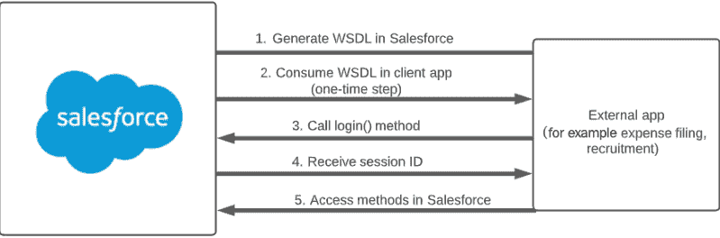
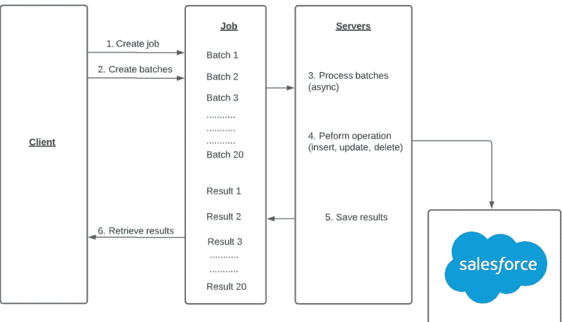
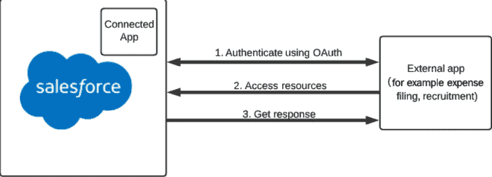
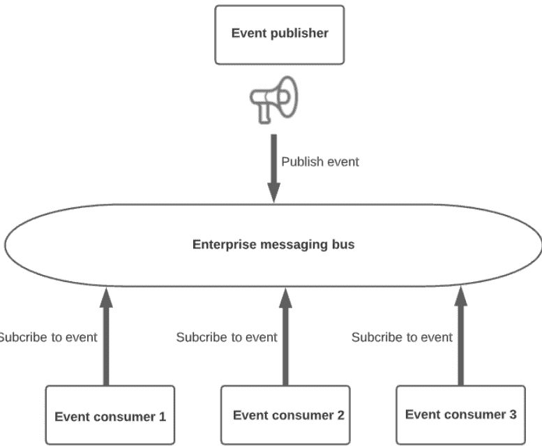
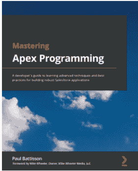
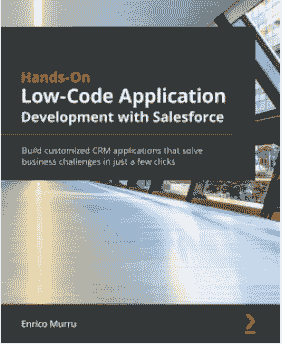

## 常规数据迁移的 8 个最佳实践

数据迁移是 Salesforce 管理员、开发人员和架构师常被要求完成的任务。了解如何最佳地处理数据迁移的最佳实践，可以确保避免代价高昂的错误，并使数据迁移完整且准确。

在本章中，我们将讨论可用于数据迁移的一些工具及其优缺点。大多数情况下，对于大型和复杂的数据迁移，会使用第三方工具，因为 Salesforce 提供的标准工具可能足够，但在精力方面并不十分高效。

在本章后半部分，我们将简要介绍 Salesforce 在数据迁移和集成环境中提供的不同 API。您将了解 API 的一般架构以及 API 的理想用例。由于本书关于数据，且大数据量用例变得越来越常见，我将比其他 API 更详细地讨论 Bulk API。

本章涵盖的主题包括：

- 评估数据
- 准备阶段
- 执行阶段
- 将数据加载到 Salesforce 的工具
- 了解 API

### 评估数据

在任何企业中，数据都是关键，并且增长迅速，导致使用各种数据库和数据存储来安全地存储这些数据。有时数据格式不同，需要进行处理以统一格式，避免混淆。但在深入讨论数据之前，让我们先了解数据迁移、转换和集成之间的区别：

- **数据迁移**：数据迁移是将数据从一个系统或应用程序移动到另一个系统或应用程序的过程。这通常是退役旧系统并升级到提供改进业务功能的新系统的结果。随着越来越多的企业从本地系统迁移到云基础架构，他们意识到数据必须随应用程序一起移动，以继续业务运营。

- **数据转换**：转换是将数据从一种格式转换为另一种格式的过程。每个应用程序都有自己遵循的一套标准，涉及数据格式、数据类型或字段长度。例如，在旧系统中，Opportunity 对象的 Stage 字段可能是数字字段。在转换过程中，我们需要将这些基于数字的 Stage 值映射到 Salesforce 中基于文本的 Stage 值。这通常需要在数据加载到目标之前，在暂存区域进行一些转换工作。为了避免混淆数据转换和迁移，重要的是要了解，前者涉及数据转换，而后者更多地侧重于用于将数据从一个系统移动到另一个系统的流程和工具。

- 数据集成：这涉及将来自不同来源的数据合并，为用户提供统一视图。例如，某企业使用 Salesforce 作为其客户关系管理（CRM）工具，但使用 Systems, Applications, and Products (SAP) 作为订单履行工具。在没有任何自助工具让客户自行查询状态的情况下，销售代表需要知道订单状态，以便及时向客户通报。在此场景中，随着订单在 SAP 中经历不同阶段且状态发生变化，状态可以反映在 Salesforce 中。

在厘清定义之后，让我们来看看评估数据迁移的必要性。

### 数据迁移评估的组成部分

数据迁移不应仅仅是项目计划中的单一条目，因为它很复杂且需要仔细规划和执行。将其作为项目计划中的次要条目，无疑会在将迁移运行到生产环境时引发问题。相反，它应被视为任何项目的主要组成部分，拥有自己的详细进度、任务和依赖关系。

通过适当的评估，您可以评估现状并提供现实的时间和预算估算，从而确保高质量的数据迁移。让我们讨论一下稳健的数据迁移评估的几个关键组成部分：

- 数据量：这通常是大多数项目团队在数据迁移讨论中首先考虑的问题。这是一个重要的考量因素，因为迁移 50,000 条记录与迁移 1 亿条记录需要不同的方法。例如，API 的选择，是使用 Bulk API 还是 REST API，对于后者用例（迁移 1 亿条记录）而言更合理，而不是前者。

- 数据类型：另一个需要考虑的是您计划迁移的数据的类型和格式。例如，从旧系统迁移线索的工作量远小于迁移账户、联系人、商机和产品。这是因为旧系统中这些对象之间可能存在潜在关系，且字段的数据类型和格式各不相同。例如，如果旧系统中的 Stage 值与 Salesforce 中的不同，则需要投入更多精力。

- **涉及的系统数量**：迁移涉及多少个系统——我们是将数据从一个源系统还是多个源系统迁移到 Salesforce？例如，在整合型数据迁移中，源系统可能是 Oracle NetSuite 和/或 Microsoft Dynamics，每个系统都有自己的数据类型和标准。将此类数据迁移到 Salesforce 会比简单地从 Oracle NetSuite 迁移数据复杂得多。这还可能需要在环境中引入一个暂存数据库，以便在将数据加载到 Salesforce 之前进行去重和转换。

- **隐私**：随着世界各地新隐私法规的出台和现有法规的修订，在准备阶段进行数据迁移时需要考虑哪些问题？离岸团队可以访问数据吗？数据迁移期间使用的基础设施应位于何处——可以位于隐私法律不够完善或未能有效执行的国家吗？所有这些考量都可能影响数据迁移项目的持续时间和成本。了解这些以及访问数据的任何限制（无论是基于客户要求还是出于合规原因），都将帮助您正确规划和应对这些要求。

- **数据保留**：旧系统中的并非所有数据都需要迁移到 Salesforce，但企业可能出于合规目的对数据保留有要求。项目团队需要与架构师和其他利益相关者合作，提供解决方案以确定保持合规的最佳方式，并为企业提供持续的数据访问。

- **资源可用性**：数据迁移绝非孤立的练习，即数据迁移团队离开、着手项目，然后带回一个成品，在生产环境中执行即可完美迁移数据。它必须涉及对数据了如指掌的业务资源，他们可以指导团队并验证数据迁移以及生产运行。提前了解业务资源限制有助于识别潜在风险，并提供采取有效缓解策略的机会。

- **当前环境**：这涉及评估所有待考虑的系统是位于云端还是本地。访问这些系统是否有任何特别注意事项，常规计划停机时间表在哪里？本地系统通常需要更多配置，因为需要访问内部网络。这还包括与迁移期间可能需要协助的任何第三方供应商资源进行协调。

- **沟通**：一个良好的迁移项目始终会有一个稳健的沟通计划，考虑不同利益相关者的需求以及他们喜欢的沟通方式。根据数据迁移项目的范围、复杂性和利益相关者的数量，沟通计划可能非常详尽。但这不应阻止您制定一个周密的沟通计划，因为它为其他利益相关者在项目期间如何保持最新状态以及对他们的期望提供了路线图。

- **文档化数据转换**：一旦您确定了源数据并将其字段映射到目标字段，请确保对此进行充分文档化。确保您已将源中的表映射到 Salesforce 中的对象，并将源表中的字段映射到 Salesforce 中的字段。此文档将成为日后可能因字段映射不正确而导致的任何问题的关键文档。它还构成所需转换的基础，并可供测试团队用来验证测试加载。

- **重复性练习**：应从一开始就明确，数据迁移是一项重复性练习。这意味着在执行阶段，需要进行多次迭代，以便团队对在生产环境中执行迁移感到放心。

- **数据质量**：数据质量问题是当今系统中的常见问题，几乎没有哪个系统能免疫。在将数据迁移到 Salesforce 时，需考虑源系统的数据质量问题。这将帮助您了解在将数据加载到 Salesforce 之前需要投入多少精力来清洗数据。由于数据用于决策制定以及（除其他外）自动化业务流程，因此源系统的数据质量在此评估阶段至关重要。

上述讨论并非旨在详尽无遗，而是列举了评估阶段的一些更关键方面。每个数据迁移项目都是独特的，正确评估需求并理解变量将提高成功数据迁移的可能性。

现在让我们来回顾数据迁移的准备阶段。

### 准备阶段

在此阶段，您将为下一阶段（即执行阶段）所需的一切做好准备。凭借上一阶段收集的大量信息，您已准备好采取行动，为成功的数据迁移做好准备。

让我们讨论适用于此阶段的最佳实践。

### 最佳实践

您已对当前环境、范围内的数据类型、源系统及其约束以及数据迁移的业务需求有了深入了解。现在是时候通过遵循以下描述的最佳实践来将所有这些付诸行动：

- **分析**：仔细分析评估阶段练习的结果。分析过程中跳过的看似微不足道的细节，日后可能会导致大量返工。例如，假设旧系统数据质量良好；如果没有与用户核实这一假设或对数据进行抽样验证，可能会导致数据清洗工作变得漫长且昂贵。

- **设置数据迁移环境和工具**：根据迄今收集的需求和已进行的分析，设置用于迁移数据的环境和工具。这将包括任何暂存数据库、数据清洗工具、去重工具、沙箱等。

- **测试计划**：这是准备阶段的一个关键方面，因为您需要清楚了解将测试什么（测试范围和要测试的用例）、如何测试以及在哪里测试（测试工具和适用的沙箱环境），由谁进行测试，以及测试的依赖项是什么。

- **外部 ID**：它们是您的得力助手，因此请利用它们来实现更轻松的数据迁移。外部 ID 不仅提供了一种跟踪源系统记录的方法，还提供了利用 Salesforce 中 Upsert 功能的能力。

- **尊重对象加载顺序**：这涉及确保在加载子对象之前先加载父对象。这意味着，如果您使用电子表格作为暂存区来转换数据，则需要先加载账户，然后才能加载联系人或商机记录。

- **硬编码 ID**：Salesforce 中的记录 ID 会随环境而变化，因此您应避免在加载中使用任何硬编码值。例如，沙箱中商机的记录类型 ID 与生产实例中的 ID 不同。如果必须存储 ID，请创建一个在运行期间引用的配置类型文件。这样，您可以在一个集中位置更新一次 ID，该 ID 可供所有运行引用。否则，在每个环境中移动时，您需要逐个更新行的记录 ID。

- **记录所有权**：Salesforce 中的每条记录都有所有者，准备数据加载时必须牢记这一点。如果记录所有者缺失或无效，系统不会迁移数据。您的旧系统中可能存在所有者为前员工且在源系统中已停用的记录。您需要确保，如果这些记录在迁移范围内，提供适当的记录所有者姓名，以避免记录报错。

- **Salesforce 设置**：由于下一阶段将涉及运行迁移，请确保在 Salesforce 中已完成适当的设置。这将包括角色层次结构、配置文件、权限集、页面布局和选项列表值定义等内容。这是一个重要步骤。否则，在运行测试加载时，您将因目标组织中设置不完整而导致的错误（而非数据迁移过程本身）而陷入困境。

- **沙盒更新**：在进行项目工作的同时，日常业务运营仍在继续，这意味着应持续进行以修复和增强为形式的更改，且其他项目也会不断应用到生产环境中。请务必考虑到这些，并与您的 Salesforce 团队协调，确保应用到生产环境的更改也同步应用到项目沙盒。这样可以防止在共享环境（例如 UAT 沙盒）中运行干运行时，因配置和代码库不同而出现意外情况。

- **禁用业务逻辑的能力**：您可以选择在数据加载到目标时让业务逻辑应用到数据上，但不建议这样做。最佳实践是在 Salesforce 外部转换数据并应用任何业务规则，然后将最终数据集加载到 Salesforce。这有助于提升性能并降低遇到数据相关问题的可能性。不过，采用此方法时，您需要确保声明式以及基于代码的自动化逻辑都内置了禁用标志，这些标志可在加载时轻松禁用。这些标志应在引入功能时作为设计的一部分构建，但如果不存在，则在运行生产迁移前应评估是否有必要加入它们。

- **直接从源头读取**：尽可能直接从源头读取数据。这是因为每个中间系统都有自己的格式化和存储数据的方式，数据在通过这个中间层时可能会导致数据丢失。例如，当数据从源系统导出到 Microsoft Excel 时，包含数字的文本字段可能会转换为带小数的数字字段，或者列中的前导零有时会被丢弃。这可能导致数据加载到 Salesforce 时出现错误。

- **错误处理**：当直接从源数据库拉取数据时，如果（例如）将 Salesforce 中新记录的 ID 写回到源表，将大大简化重新运行迁移流程。这样，在下一次运行时，您只需筛选出 Salesforce ID 列未填充的记录并重新运行即可。一般而言，无论数据源是什么，都要确保有处理错误的计划和重新运行的能力，因为重试是不可避免的。

- **备份数据**：在此阶段，您还需确保已建立数据备份，并且已测试相应的恢复流程，以便在需要恢复数据时使用。不要低估这一步骤，因为无论是否属于您的责任，丢失客户数据都是最糟糕的情况。请确保客户知晓并拥有适当的备份流程，并且已在恢复场景中测试过这些备份。

根据我的经验，这通常是最匆忙的阶段，因为我们都希望尽快进入执行阶段。请确保为该阶段分配足够的时间，因为仓促进行此阶段会导致问题并需要重新做工作。

在下一部分，我们将探讨任何数据迁移项目的核心——执行阶段。

### 执行阶段

这是“纸上谈兵”见真章的阶段，也是之前阶段所有工作接受检验的阶段。到本阶段时，您将对所处理的范围、数据类型、假设和约束有良好的了解。让我们讨论一下可以在本阶段应用的最佳实践。

### 最佳实践

您的映射文档已准备就绪，将要使用的工具以及任何暂存数据库也都已就绪，准备迎接那关键时刻。您迫不及待地想要点击 **运行** 按钮，看看使用一些初步数据的首次干运行效果如何。要说明的是，此处的执行阶段是指在沙盒环境中运行数据加载，而不仅限于生产运行。我们将在后续部分讨论特定的生产环境运行。以下是一些可以提高本阶段成功率的最佳实践：

- **从小批量开始**：先从小批量加载开始，在尝试大批量加载之前先解决任何问题。这样可以在逐步完善代码或调整迁移工具配置以修复任何问题时，将重新验证批次所需的工作量保持在合理范围内。

- 遵循步骤：到现在为止，您应该已经有一份部署文档，列出了运行干运行所需的步骤，并附有生产运行所需额外步骤的说明。在测试并进一步调整代码和迁移工具时，请确保文档保持最新。每次运行干运行时都要遵循本文档中的步骤。这将确保文档保持最新，并在您为 UAT 的最终全量加载做准备时不断完善文档。

- 重复规则：禁用在 Salesforce 中设置的所有重复管理规则。这些规则可能是您正在使用的 Salesforce 原生功能，或者如果您使用的是第三方解决方案，则是该工具设置的规则。您不希望加载因重复规则而报错，任何此类问题都应在数据加载到 Salesforce 之前在 Salesforce 外部处理。

- 禁用自动化：在运行加载之前，请确保已禁用任何相关的自动化，例如触发器、流程构建器和工作流。同样，任何类型的数据转换都应在加载到系统之前在 Salesforce 外部完成。

作为执行阶段的一部分，关于沙盒测试还有一些特定的最佳实践。让我们在下一部分回顾这些内容。

### 沙盒测试

无论加载看起来多么 _简单_，我都不建议直接在生产环境中运行。始终先在沙盒中运行，了解它在生产环境中可能的运行情况，并始终验证结果。以下是一些与沙盒测试相关的最佳实践：

- 可恢复的沙盒：数据迁移是一个重复性的过程，您会发现自己运行了多次测试加载，直到准备好进行 UAT 测试。设置沙盒需要时间，特别是考虑到 Salesforce 对某些类型沙盒刷新频率有限制。例如，如果您使用的是 Developer Pro 组织，可以隔天刷新一次。如果您需要在同一天修复并重新运行测试加载，您将会受到限制。

为避免遇到此类限制并节省重新设置环境的时间，请使用一个也能轻松恢复数据的数据备份工具。这还将消除对依赖拥有生产环境系统管理员权限的管理员进行沙盒刷新的需求。使用您的管理员凭据（假设已获授予），您可以轻松启动恢复，并在短时间内获得一个可用的工作环境。

- **全副本沙盒**：当您准备好进行UAT并让业务测试团队验证您的设置/代码时，请确保为此目的设置了全副本沙盒。在此类沙盒中运行完整迁移将提供一些非常有用的数据，例如，运行迁移在生产环境中需要多长时间。这是因为全副本沙盒具有相似（非相同）的硬件，且推断的结果通常对生产环境也有效。

另一个好处是，全副本沙盒与生产环境具有相同的数据，因此您正在使用一个与生产环境非常相似的环境。当然，如果这是绿地实施，则生产环境将没有任何数据，但在棕地实施的情况下，这可能是一个优势。

再次强调，无论数据迁移是简单还是复杂，沙盒测试都是必须的。对于较简单的迁移，这似乎是一个多余的步骤，但我认为花费时间和精力是值得的，而不是在棕地组织的情况下回头尝试在生产组织中恢复数据。

让我们现在回顾与生产运行相关的最佳实践。

### 生产运行

您已经进行了多次预演，并让业务测试在完整的UAT周期中验证了您的结果。是时候按下扳机并在生产环境中运行数据迁移了。此阶段的一些最佳实践包括以下内容：

- **生产冻结**：确保您已向其他利益相关者传达，生产环境的元数据应实行变更冻结。这是为了避免因未应用到沙盒环境的增强功能而出现任何问题。紧急修复无法避免，但如果存在任何非高优先级的紧急修复，建议将其推迟到您完全迁移数据之后。

变更冻结通常应在您迁移到全副本环境并在该处进行UAT测试时生效。为避免耽误其他项目或团队，请尽量缩短变更冻结与迁移生产运行之间的时间。我应该提到，对于较简单的迁移，可能不需要如此广泛的措施，但尽管如此，遵循这一做法以避免任何意外问题仍然是一个良好的实践。

- **备份数据**：在运行最终生产运行之前备份数据。理想情况下，您已经内置了回滚流程以应对生产运行失败的情况，但在因工具或其他原因无法做到这一点的情况下，在批量更改生产数据之前备份数据是明智的。明确地说，即使您的代码中内置了回滚机制，备份生产数据仍然是一个良好的实践。

- **运行时间**：需要考虑的另一个因素是运行的时间。当您在全副本沙盒中运行迁移时，您已经了解了迁移过程所需的总时间。考虑到这一点，您希望最大限度地减少对业务用户的干扰，并减少他们无法使用Salesforce的时间。在绿地组织中这不是问题，但对于拥有分布在多个时区用户的全球棕地组织来说，这是一个关键考量。在这些情况下，没有理想的停机时间。您希望选择一个对不同时区用户干扰最小的时间。

- **验证**：一旦迁移过程在生产环境中成功完成，请确保有业务用户可以验证加载的数据。这可以从对少量记录进行样本测试到预选更具战略意义的记录（即最新的账户）以及其他验证数据的方法，形式多种多样。请确保业务团队可用，并在被要求验证加载时清楚知道该做什么。

我们已了解数据迁移项目的不同阶段以及每个阶段应使用的最佳实践。现在让我们来看看一些可用于协助数据迁移过程本身的工具。

### 将数据加载到 Salesforce 的工具

工具就是工具，有许多工具可用于完成工作。使用合适的工具会让工作更顺畅、更容易完成，而使用不合适的工具会导致问题并延长工作时间。例如，使用标准数据导入向导（DIW，属于标准CRM的一部分）来处理需要进行大量转换和错误处理的复杂数据迁移工作将无法正常工作，并且您很快就会遇到DIW的限制。

如今，有许多第三方工具可用，具有重试机制、错误日志记录等高级功能。现代中间件产品通常具有提取、转换、加载（ETL）组件，可用于迁移数据。但是，在本节中，我们将讨论标准DIW和数据加载器。

### 数据导入向导（DIW）

Salesforce提供了一个名为数据导入向导的用户界面工具来导入数据。该工具可通过设置菜单访问。DIW的一些功能和限制包括以下内容：

- 可用于账户、联系人、线索和自定义对象。
- 每次最多可导入50,000条记录。
- 不能用于自动化导入过程。
- 支持的对象数量有限，例如，`Product2`对象记录无法使用`DIW`导入。
- 不能直接连接到源系统以查询数据。
- 使用Microsoft Excel **逗号分隔值（CSV）**文件作为导入作业的输入。

### CSV文件

当导入带有特殊字符的CSV文件时，您可能会看到数据被导入但出现乱码字符。这是由于将文件另存为CSV时的编码方式所致。使用Microsoft Excel保存文件时，编码设置为特定于机器的ANSI编码设置。您也可以在文本编辑器中打开文件，然后将编码设置为UTF-8并以CSV扩展名保存。

如所述，您需要将负载分割为每次50,000条记录，因为DIW有限制，更不用说它支持的对象数量有限。DIW适用于最终用户需要访问将数据加载到Salesforce且需要一种直观方法的场景。对于更复杂的用例，则不使用或不考虑DIW。

### Salesforce 数据加载器

这是一个客户端应用程序工具，可用于导入大量记录。它还支持来自文件或数据库连接的记录。数据加载器的一些功能和限制如下：

- 客户端应用程序需要下载并安装。
- 每次最多可导入500万条记录。
- 支持使用文件或数据库连接来导入数据。
- 可以通过用户界面或命令行访问。
- 支持自动化导入过程。
- 可用于将导入数据加载到DIW不支持的对象中。
- 它使用SOAP API处理记录。它还支持使用Bulk API以进行更快的处理。

Salesforce数据加载器可用于从其他来源查询数据，但仅限批处理模式，而此模式进一步受限于仅支持Windows。非Windows用户无法使用批处理模式，也无法使用数据加载器的一些高级功能。

> **Java软件开发工具包（SDK）**
> 
> 数据加载器要正常工作需要Java，以前Java会与数据加载器捆绑在一起。Salesforce已不再这样做，您现在需要安装开源Zulu OpenJDK以确保数据加载器正常工作。这里有一个链接可以帮助您安装JDK：https://help.salesforce.com/articleView?id=installing_the_data_loader.htm&type=5。

对于较简单的数据迁移，数据加载器可能是一个可行的选择，但涉及多个通过父子关系或查找关系相关联的对象时，可能会很麻烦，因为记录需要手动关联。出于此原因，并且随着更先进工具的可用性，数据加载器不用于复杂的数据迁移。

在下一节中，我们将回顾数据迁移的核心，即Salesforce提供的API。有多种可选方案，每种方案本身都比其他API更适合某些特定用例。

### 了解 API

Salesforce的一个显著特点是其采用API优先方法。这意味着Salesforce内部团队专注于在设计和开发用户界面之前，先将一套丰富的功能构建到API中。这样做之所以重要，是因为它赋予Salesforce客户灵活性，以便在需要时使用自定义开发的用户界面。这在Salesforce Experience Cloud中非常常见，一些客户倾向于使用Salesforce提供的标准模板，为其客户和合作伙伴提供自助服务体验，而另一些客户则构建完全由Salesforce用户界面驱动的完全自定义前端。

Salesforce 提供了多种用于不同目的的 API，例如操作页面布局、部署代码、查询 Einstein Analytics 数据，或用于操作数据的通用 API。在本节中，我们将讨论与数据操作相关的四种主要 API，这些 API 被视为核心数据 API。我将展示如何使用 SOAP 和 REST API 的详细步骤，因为它们比 Bulk 或 Streaming API 更常用。

### The SOAP API

The **Simple Object Access Protocol (SOAP)** 是一种行业范围内的标准协议，用于数据传输。它使用 **Web Services Description Language (WSDL)** 来定义访问数据的参数，并支持 XML 格式。WSDL 用作 API 和消费者之间的正式合同；此 API 非常适合用于服务器到服务器的集成。

Salesforce 提供两种可与 SOAP API 一起使用的 WSDL——Enterprise WSDL 和 Partner WSDL。前者与组织的配置紧密绑定，应仅用于单个 Salesforce 组织。后者更通用，可用于与多个 Salesforce 组织集成。*Figure 8.1* 展示了外部应用如何使用 SOAP 访问 Salesforce 资源：

Figure 8.1 – 在 Salesforce 中访问 SOAP 资源的关键步骤

如 *Figure 8.1* 所示，WSDL 在客户端被使用，随后使用 WSDL 中的方法登录并检索会话 ID。一旦会话建立，就可以调用其他方法来查询数据或在 Salesforce 中运行 DML 语句。

### The Bulk API

这是一个用于查询和加载大量数据的 RESTful API。Bulk API 是异步的，意味着只有在系统资源可用时才会进行数据处理。Bulk API 支持的数据格式包括 CSV、XML、JSON，以及用于摄取操作的二进制附件。要批量查询 Salesforce 中的数据，可以使用可检索多达 15 GB 数据的批量查询。

批量作业可以串行或并行模式处理。串行模式未经优化，因为一次只处理一个批次，但并行模式（并行度）的操作已针对优化进行了处理，意味着在任何给定时间可以处理多个批次。您可能认为并行度越高，吞吐量就越大，但事实未必如此。实际上，如果架构设计不当，更高的并行度可能会适得其反并减慢进程。所使用的工具或运行进程的代码调优程度等因素也会影响并行度。

### Designing a Bulk API solution

尽管 DIW 在幕后使用 Bulk API，但 Salesforce 没有提供用于处理该 API 的用户界面。您需要编写自己的客户端程序来使用它。此客户端可以是 C++ 或 Java 程序，或其他编程语言，然后调用 Salesforce 中的 Bulk API。

客户端创建 Salesforce Bulk API 作业，然后在该作业中创建批次，以便数据可以由 Salesforce 服务器以异步模式处理。客户端可以使用 API 提供的方法检查作业状态。客户端应用程序也可以在批次完成时检索结果，但也可以使用“监控批量数据加载作业”页面上的用户界面检查状态。Figure 8.2 展示了处理 Bulk API 操作的主要步骤：

Figure 8.2 – 典型的 Bulk API 操作

Figure 8.2 展示了使用 Bulk API 的主要步骤。创建一个作业，然后在其中创建批次。这些批次由 Salesforce 异步处理，并保存结果。客户端应用程序可以检索这些结果以检查批次状态。

使用 API 删除数据时，会发生软删除，这意味着数据保留在系统中，如有需要可以恢复。Bulk API 是唯一可以运行硬删除操作的 API，该操作会从系统中永久删除数据。另一个需要考虑的因素是，Bulk API 有其自身的 Governor 限制，这些限制与其他 API 不同。

### Lock contention

当操作正在进行且为保证数据完整性而锁定记录时，会发生记录锁定。与其他用于处理数据的 API 一样，Bulk API 作业容易出现锁定问题，并可能导致作业失败或吞吐量降低。

> **吞吐量**
> 这是衡量性能的指标，用于衡量每秒可以处理多少条记录。吞吐量越高，作业性能越好。

锁争用可能发生的原因有多种，将如下讨论：

- **主细关系**：当一个对象与另一个对象处于主细关系时，Salesforce 会锁定主对象以确保参照完整性。如果在不同批次的并行处理中插入了引用同一主记录的明细记录，则由于多个线程尝试锁定主记录，插入操作将失败。可以通过将属于同一主记录的明细记录放在单个批次中排序来防止这种类型关系上的锁定。这是因为，在并行处理期间，多个批次可能会尝试锁定同一主记录，从而导致锁争用。

### 参照完整性

参照完整性是指关系中数据的一致性，例如，发票明细行项目对象将与以发票对象为主的主子对象存在关系。发票明细行项目各自引用发票记录 12345。如果记录 12345 被删除，则五个发票明细行项目将成为孤儿记录。参照完整性可防止发生此类情况。

- 查找关系：这些与主细关系非常相似，即如果尝试锁定正在查找的记录（目标），可能会出现锁争用，导致插入/更新操作失败。请使用上述描述的用于主细关系的相同技术来避免锁争用。

- 定义查找字段时，可以选择以下选项之一：
  - i) 清除该字段的值。如果将此字段设为必填，则无法选择此选项

  - ii) 不允许删除查找关系中的查找记录

  这可能看起来微不足道，但在大批量数据加载期间，查找定义中选择的内容可能导致加载失败。这是因为 Salesforce 对两者的处理方式不同。当选择前者（即清除该字段的值。如果将此字段设为必填，则无法选择此选项）时，Salesforce 仅确保目标对象上的查找值存在。当选择后者时，它会锁定目标查找记录，可能导致锁争用情况。

- 触发器：加载会触发触发器的记录时，触发器逻辑可能导致系统尝试锁定除触发器源记录以外的记录，从而引起锁争用。为避免锁争用，请禁用触发器，或在触发器代码中添加逻辑以避免此类情况。

- 工作流规则：当工作流规则触发字段更新且多个线程尝试锁定同一记录时，Salesforce 会锁定记录，可能会发生锁定异常；例如，尝试在多个线程中更新同一父记录的工作流规则会导致锁争用。为避免这些锁，请在加载前禁用工作流。

- 组成员锁：有少数操作会导致组织范围锁定。这意味着在这种情况下你不能使用并行处理，因为一旦在组成员表上获取了锁，除非释放锁，否则无法进行其他更新。这些操作如下：
  - 添加分配给角色的用户
  - 更改用户角色
  - 将角色添加到角色层次结构或将地区添加到地区层次结构
  - 从公共或个人组、角色、地区和队列中添加/删除成员
  - 将账户所有者更改为新所有者，而此新所有者与原始账户记录所有者具有不同的角色。这适用于与之相关联的具有社区角色或门户角色的账户

确保你的代码以这种方式执行，即组成员对象上的锁最小化，且其他代码不会导致锁延长。当组成员类型操作正在执行时，由于这些操作运行时的组织范围记录锁定，运行必须处于串行模式。

- 重叠运行：多个重叠的运行作业可能会导致 Salesforce 作为作业一部分运行的对象、代码和工作流规则上出现意外的锁争用。确保作业之间有足够的时间，以便前一个作业完全运行完毕后再运行后续作业。

- 汇总字段：当详细信息一侧的记录正在被更新时，主记录也会被锁定以确保汇总字段被更新。这可能导致锁争用，如果可能，在加载数据之前应将这些字段删除。如果不可能，那么考虑在详细信息对象上使用汇总报告（如果它拥有所需的所有数据）或跨越主记录和详细信息对象的报告。如果那不是一个选项，那么按主对象记录排序并避免在多个批次中出现相同的主记录。

由此可见，与其他 API 相比，高效使用 Bulk API 有许多需要考虑的问题，而且，通常与 Bulk API 相关的复杂性由利用该 API 的第三方应用程序抽象化。尽管如此，当考虑大量数据时，Bulk API 仍然是数据迁移和集成的首选 API。

### REST API

REST API 是一个 Web 服务 API，可用于与 Salesforce 中的数据进行交互。它被认为是一个轻量级 API，使用请求和响应框架，并广泛用于 Web 和移动应用程序。

此 API 使用与 SOAP API 用于访问数据相同的底层 Salesforce 数据模型，并且与（也是基于 REST 的）具有其自身限制的 Bulk API 不同，REST API 的限制与 SOAP API 相同。

REST API 操作是通过与访问超文本传输协议（HTTP）方法（如 GET、HEAD 和 POST）的统一资源标识符（URI）进行交互来执行的。你可以使用这些 URL 执行查询、更新记录或在对象上运行描述操作。图 8.3 显示了基于 REST 的应用程序如何与 Salesforce 中的资源进行交互和访问资源的关键步骤：

图 8.3 – 使用外部应用程序访问 REST 资源的关键步骤

REST API 是一个广泛使用的 API，安全，并用于非数据密集型的轻量级应用程序。当与 OAuth 作为身份验证机制一起使用时，它比 SOAP 更安全，因为它消除了在客户端应用程序中存储任何凭据和令牌的需求。

### 流式 API

流式 API 用于自定义集成或近实时应用程序，不适用于数据迁移。此 API 基于事件驱动架构（EDA），意味着数据更新被发布到消息总线。这些更新的订阅者可以在其端消费该事件。这种方法与数据从系统中拉取的 SOAP 或 REST API 方法不同。

在 EDA 中，消息或事件被发布到中央位置；在此例中，它是**企业消息总线 (EMS)**，有兴趣的系统订阅它。每当发布事件时，它就会在总线上发布，所有订阅了它的消费者都可以使用它。这种架构将生成这些事件的系统与消费这些事件的系统解耦，从而形成可扩展的架构。图 8.4 显示了 EDA 的工作原理：

图 8.4 – 事件驱动架构

企业消息总线是流式 API 基于的技术的一部分。这称为 **CometD** 并使用消息总线来发布和订阅事件。流式 API 有多种变体；其中最常用的两种是 **平台事件** 和 **变更数据捕获 (CDC)**。流式 API 的早期变体是 **通用** 和 **PushTopic**，两者都需要代码来发布或订阅事件。使用平台事件和 CDC，有更多灵活性，因为它们既由代码也由 Salesforce 中的其他声明式功能支持，例如 Salesforce Flow 或 Process Builder。

### CometD

访问 CometD.org 网站了解 CometD 的功能和详细文档。

在本节中，我们从数据角度回顾了四种最常用的 API，了解了它们的最佳用例以及它们的工作原理。我们详细讨论了 Bulk API，因为在处理大量数据时，它是首选 API，这是一个我们在 *第 7 章，使用大量数据* 中广泛讨论过的主题。

### 摘要

数据迁移是一个令人兴奋的话题，因为无论你是迁移 1,000 条记录还是 1,000,000 条记录，都有某些你必须牢记的事项才能实现平稳的数据迁移。你所学到的与数据迁移不同阶段相关的最佳实践将帮助你在不遇到任何重大障碍的情况下进行成功的迁移。关键在于在跳入数据迁移的执行阶段之前花时间进行适当的分析。这将为你节省日后大量的麻烦和浪费的精力。

你还了解了适用于我们的数据迁移的标准 Salesforce 工具及其限制。如前所述，对于简单的迁移，这些可能就足够了，但对于复杂的迁移，有更复杂的第三方工具可用，能让工作变得更容易、更顺畅。

我们通过讨论 Salesforce 提供的 API 来结束本章。虽然 Salesforce 提供了许多其他 API，但我们涵盖了与数据迁移和集成相关的 API。你了解了每个 API 的一般架构以及如何使用它们，同时还详细讨论了 Bulk API。我们还在回顾流式 API 期间涵盖了 EDA，以及流式 API 如何支持可扩展性和近实时集成。

恭喜你读完最后一章！希望你在阅读时也学习了新概念和技术，可以用来为你的组织增加价值，并且玩得开心。

### 问题

1. **精密打印 (PP) 最近收购了另一家公司，并希望将 CRM 数据迁移到其主 Salesforce 实例并停用旧版 CRM 系统。旧版系统拥有 700 万条记录。应该使用哪个 API 将此数据加载到 Salesforce？(选择一个答案)**

   - a) REST
   - b) Streaming
   - c) SOAP
   - d) Bulk

2. **Centauri Logistics 的 Salesforce 团队希望将外部短信通知系统与 Salesforce 集成。当货物到达某个位置时，将向客户发送一条短信。司机到达位置时扫描位置特定的条形码。团队预计未来其他系统也可能对这些数据感兴趣。应该使用哪个 API 进行此集成？(选择一个答案)**

   - a) Streaming
   - b) Bulk
   - c) SOAP
   - d) Metadata

3. **PP 的团队一直努力工作，并设计了一个将 700 万条记录加载到 Salesforce 的解决方案。他们启动运行，但立即遇到带有锁定错误的失败记录。团队感到困惑，因为 API 正在并行模式下运行。数据架构师可以提出什么建议来修复这些错误？(选择一个答案)**

   - a) 他们应该以串行模式运行加载。
   - b) 他们应确保父记录和子记录在同一批次中。
   - c) 他们应该切换到使用 SOAP API。
   - d) 他们应该与 Salesforce 开立案例，请求支持向服务器分配更多 CPU 和内存资源。

### 进一步阅读

- Lightning Platform API 基础知识, https://trailhead.salesforce.com/en/content/learn/modules/api_basics/api_basics_overview
- Bulk API 2.0 和 Bulk API 开发指南, https://developer.salesforce.com/docs/atlas.en-us.api_asynch.meta/api_asynch/asynch_api_intro.htm

## 评估

本部分包含所有章节的问题答案。

## 第 1 章 – 数据架构师角色与职责

### 答案

- 1. 答案是 c。
- 2. 答案是 False。
- 3. 答案是 d。

## 第 2 章 – 理解 Salesforce 对象和数据建模

### 答案

- 1. 答案是 a。
- 2. 答案是 c。
- 3. 答案是 a 和 c。

## 第 3 章 – 理解数据管理

### 答案

- 1. 答案是 c。
- 2. 答案是 c 和 d。
- 3. 答案是 b。

## 第 4 章 – 理解主数据管理

### 答案

- 1. 答案是 a。
- 2. 答案是 a 和 c。
- 3. 答案是 c。

## 第 5 章 – 实施数据治理

### 答案

- 1. 答案是 b、c 和 d。
- 2. 答案是 b 和 c。
- 3. 答案是 b 和 c。

## 第 6 章 – 管理性能

### 答案

- 1. 答案是 c 和 d。
- 2. 答案是 d 和 e。
- 3. 答案是 b 和 c。

## 第 7 章 – 处理大数据量

### 答案

- 1. 答案是 c。
- 2. 答案是 a 和 d。
- 3. 答案是 b。

## 第 8 章 – 一般数据迁移的最佳实践

### 答案

- 1. 答案是 d。
- 2. 答案是 a。
- 3. 答案是 b。

## Packt

Packt.com

订阅我们的在线数字图书馆，即可完整访问超过 7,000 本书籍和视频，以及行业领先的工具，帮助您规划个人发展并促进职业发展。如需更多信息，请访问我们的网站。

## 为什么订阅？

- 使用来自超过 4,000 名行业专业人士的实用电子书和视频，花更少时间学习，花更多时间编码
- 使用专为您构建的技能计划改善学习
- 每月获赠一本免费电子书或视频
- 完全可搜索，轻松获取重要信息
- 复制和粘贴、打印和加书签内容

你知道吗？Packt 为每本出版的图书提供电子书版本，附有 PDF 和 ePub 文件？您可以在 packt.com 升级到电子书版本，作为印刷书籍客户，您有权获得电子书副本的折扣。如需更多详情，请通过 customercare@packtpub.com 联系我们。

在 www.packt.com 上，您还可以阅读一系列免费技术文章，订阅多种免费通讯，并获取 Packt 图书和电子书的独家折扣和优惠。

## 您可能还喜欢的其他图书

如果您喜欢这本书，可能会对 Packt 的这些其他图书感兴趣：

### 成为 Salesforce 认证技术架构师

Tameem Bahri

ISBN: 978-1-80056-875-4

- 探索数据生命周期管理并有效将其应用于 Salesforce 生态系统
- 设计适当的企业集成接口以构建您的连接解决方案
- 了解身份和访问管理的基本概念
- 开发可扩展的 Salesforce 数据和系统架构
- 为您的解决方案设计项目环境和发布策略
- 阐述与您的解决方案相关的优势、局限性和设计注意事项
- 发现准备 Salesforce CTA 评审委员会考试的技巧、窍门和策略

### 精通 Apex 编程

Paul Battisson

ISBN: 978-1-80020-092-0

- 了解 Apex 中的常见编码错误以及如何使用最佳实践避免它们
- 找出如何有效调试 Salesforce Apex 应用程序
- 探索不同的异步 Apex 选项及其常见用例
- 发现使用平台事件的有效技巧
- 开发自定义 Apex REST 服务以允许入站集成
- 在 Salesforce 平台上构建复杂的逻辑和流程

## 使用 Salesforce 进行低代码应用程序开发实战

Enrico Murru

ISBN: 978-1-80020-977-0

- 掌握数据建模基础知识以提高数据质量
- 使用自定义设置和元数据类型交付动态配置功能
- 通过实施 Salesforce 安全模型保护您的数据
- 使用 Lightning App Builder 自定义 Salesforce 应用程序
- 使用 Experience Builder 为您的社区创建引人注目的页面
- 使用 Data Loader 导入和导出数据，无需编写任何代码
- 拥抱 Salesforce Ohana 文化，分享知识并向全球 Salesforce 社区学习

## Packt 正在寻找像您这样的作者

如果您有兴趣成为 Packt 的作者，请访问 authors.packtpub.com 并立即申请。我们与成千上万的开发人员和技术专业人士（就像您一样）合作，帮助他们与全球技术社区分享见解。您可以提交一般申请，申请我们正在招募作者的特定热门主题，或提交自己的想法。

## 分享您的想法

现在您已完成《Salesforce 数据架构与管理》，我们很乐意听取您的想法！请访问 https://packt.link/r/1801073244 为此书评分并分享您的反馈。

您的评价对我们和技术社区很重要，将帮助我们确保提供优质内容。
