# Salesforce数据架构认证指南：全面覆盖Salesforce数据架构师考试内容，助你一次通过


## 贡献者

### 关于作者

**亚伦·奥尔波特**是一名 Salesforce 架构师，在其整个职业生涯中一直从事 CRM 系统和集成工作。亚伦专注于 Salesforce 技术架构与集成，帮助客户确保其技术投资获得最大收益。亚伦曾在 Dreamforce 上发表演讲，在线上撰写了从 DevOps 到数据架构等各类文章，并且经常出现在 Salesforce 伦敦开发者聚会上。

> *献给我的母亲黛博拉——你教会了我一切皆有可能。*

> *献给 Steph、Isla、Noah 和 Theo。你们是我的全部。没有你们的热爱、鼓励和支持，这本书就不可能完成。*

### 关于审校者

**拉杰瓦尔丹·奥克**是一名网络安全研究员，热衷于让互联网对每个人都更安全。他的研究兴趣包括网络安全、隐私及其与机器学习的交叉领域。他目前在 Microsoft 担任应用科学家。作为广告欺诈检测团队的一员，他的工作包括分析网络流量和构建模型以过滤点击欺诈。他还在加州大学戴维斯分校攻读博士学位，研究通过虚假评论操纵声誉的地下生态系统。此外，他在编程方面拥有丰富经验，并精通数据治理、隐私保护分析、威胁建模以及其他安全领域。


# 12

## Territory Management 157

Enterprise territory management overview 157

Implications of territory management on data model design and sharing records 160

Territory 158

Summary 163

Territory Type 158

Practice questions 163

Territory Type Priority 159

Answers 164

Territory Model 159

Further reading 164

Territory Model State 159

Territory Hierarchy 160

### Section 3: Applying What We've Learned – Practice Questions and Revision Aids

# 13

## Practice Exam Questions 167

Practice questions 1-20 167

Practice questions 61-80 182

Practice questions 21-40 172

Practice questions 81-100 186

Practice questions 41-60 177

Summary 191

# 14

## Cheat Sheets 193

Database modeling and database design 193

Data governance 198

Master data management 195

Large data volumes 199

Salesforce data management 197

Data migration 200

Accounts and contacts 201

Summary 202

### 15

## Further Resources 203

Data modeling and database design 203

Accounts and contacts 207

Master data management 204

Data APIs and Apex 207

Salesforce data management 204

Tuning performance 208

Data governance 205

Backup and restore 209

Large data volumes 205

Territory management 209

Data migration 206

Summary 210

### 16

## How to Take the Exam 211

Webassessor 211

Taking the exam virtually 216

Signing up for a Webassessor account 211

The result 216

Taking the exam in person 213

Summary 217

### 17

## Answers to Practice Questions 219

Answers for question set 1-20 219

Answers for question set 61-80 221

Answers for question set 21-40 220

Answers for question set 81-100 222

Answers for question set 41-60 220

## Index 223

## Other Books You May Enjoy 232

## Preface

Salesforce 技能，尤其是 Salesforce 架构师的技能，随着 Salesforce 生态系统在全球范围内的不断发展而持续增长。本书聚焦于 Salesforce 架构师课程的一个主题领域，即数据架构。Salesforce 认证数据架构师考试在初次阅读考试大纲时可能显得有些令人生畏，我自己当时也是如此。但不必如此。我很幸运第一次就通过了考试，这得益于我在数月时间内收集信息并研读 Salesforce 文档。本书是我在备考时希望拥有的书籍，因为它专门涵盖了考试理论部分所需的材料。

我们将依次逐一讲解考试大纲中涵盖的各个领域，从数据建模、主数据管理、Salesforce 数据管理、数据治理和大数据量到数据迁移。理解这些对于覆盖考试中测试的理论至关重要。而且，这些理论可以直接应用于你在担任 Salesforce 架构师角色时所构建和维护的解决方案中。

然后我们将把注意力转向通过额外的主题来应用概念，这些主题虽然不总是明确列在教学大纲中，但将完善你对应用 Salesforce 数据原则的了解。这些主题包括对账户和联系人、API 和 Apex、性能调优、备份和恢复以及区域管理的深入探讨。这些主题中的每一个都将解释数据模型、共享以及因此以这些主题为出发点构建的任何解决方案是如何受到影响的。

最后，我们将查看练习题（附答案）和一些复习辅助资料。读完本书后，你将掌握通过 Salesforce 认证数据架构师考试所需的主题，并能够在日常的 Salesforce 架构师工作中实施 Salesforce 数据设计最佳实践。

第 10 章《性能调优》探讨了在 Salesforce 平台上设计可扩展应用程序时可用的各种性能调优方法。

第 11 章《备份和恢复》概述了将数据从 Salesforce 平台导出和导入的可用方法，重点关注数据备份和恢复。

第 12 章《区域管理》介绍了 Salesforce 区域管理以及它与 Salesforce 平台上的数据模型和用法设计的关系。

第 13 章《模拟考试题》提供了类似考试的题目，以进一步实践你所学到的理论并加强你对考试课程主题领域的理解。

第 14 章《速查表》介绍了实用的参考速查表，为复习或日常工作提供快速参考指南。

第 15 章《更多资源》重点介绍了其他信息链接，可以增强你对本书所涵盖材料的理解。

第 16 章《如何参加考试》描述了你参加考试所需执行的操作。

第 17 章《练习题答案》提供了第 13 章《模拟考试题》中问题的答案。

## To get the most out of this book

你需要熟悉通用的 Salesforce 术语并具备 Salesforce 的实际操作知识，才能充分掌握本书所涵盖的概念。所有主题都假定对 Salesforce 多租户架构背后的理论有基本熟悉程度。

| Software/hardware covered in the book | Operating system requirements |
|---|---|
| Salesforce | Windows, macOS, or Linux with a web browser |

我们将介绍如何注册并获取 Salesforce Developer Edition 实例，可用于本书所涵盖的所有主题、示例和场景。

## Download the color images

我们还提供了一份 PDF 文件，其中包含本书中使用的屏幕截图和图表的彩色图像。你可以在此处下载：https://packt.link/YQqWX。

## Conventions used

本书中使用了多种文本约定。

Code in text: Indicates code words in text, database table names, folder names, filenames, file extensions, pathnames, dummy URLs, user input, and Twitter handles. Here is an example: "The start method is used to define the query."

A block of code is set as follows:

```
public class dmlStatementTest {
    public void testStatement() {
        List<Account> accounts;
        accounts.add(new Account(Name='Packt UK'));
        accounts.add(new Account(Name='Packt India'));

        insert accounts;
    }
}
```

Bold: Indicates a new term, an important word, or words that you see onscreen. For instance, words in menus or dialog boxes appear in bold. Here is an example: "Users will need the View Encrypted Data profile permission enabled within their profile or via an assigned permission set to read encrypted field values."

> Tips or Important notes
> Appear like this.

## Get in touch

我们欢迎读者的反馈。

General feedback: If you have questions about any aspect of this book, email us at customercare@packtpub.com and mention the book title in the subject of your message.

Errata: Although we have taken every care to ensure the accuracy of our content, mistakes do happen. If you have found a mistake in this book, we would be grateful if you would report this to us. Please visit www.packtpub.com/support/errata and fill in the form.

**Piracy:** If you come across any illegal copies of our works in any form on the internet, we would be grateful if you would provide us with the location address or website name. Please contact us at `copyright@packt.com` with a link to the material.

**If you are interested in becoming an author:** If there is a topic that you have expertise in and you are interested in either writing or contributing to a book, please visit `authors.packtpub.com`.

## Share your thoughts

Once you’ve read *Salesforce Data Architect Certification Guide*, we’d love to hear your thoughts! Please click here to go straight to the Amazon review page for this book and share your feedback.

Your review is important to us and the tech community and will help us make sure we’re delivering excellent quality content.


## 下载本书的免费 PDF 副本

感谢您购买本书！

您喜欢随时阅读，但又无法随身携带印刷书籍吗？

您购买的电子书与您选择的设备不兼容吗？

不用担心，现在每本 Packt 书籍都免费提供一本无 DRM 的 PDF 版本。

随时随地在任何设备上阅读。直接从您喜爱的技术书籍中搜索、复制和粘贴代码到您的应用程序中。

福利还不止于此，您还可以每天通过电子邮件获得独家折扣、新闻通讯和精彩免费内容的专属访问权限

按照以下简单步骤获取福利：

- 1. 扫描二维码或访问下面的链接：
- 2. 提交您的购买证明
- 3. 就这样！我们会直接将您的免费 PDF 和其他福利发送到您的电子邮件

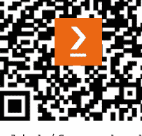

```
https://packt.link/free-ebook/9781801813556
```

### Section 1:
Salesforce Data
Architect Theory

在阅读完本书的这一部分后，您将掌握通过考试所需的所有理论。每个主题都已得到充分的讲解，以便您在尝试获得该认证时能够按要求回答问题。即使在通过考试后，您也可以一次又一次地回到本书的这一部分，因为所概述的主题将在您作为 Salesforce 数据架构师的日常工作中成为方便的参考。

本部分包含以下章节：

- *Chapter 1, Introducing the Salesforce Data Architect Journey*
- *Chapter 2, Data Modeling and Database Design*
- *Chapter 3, Master Data Management*
- *Chapter 4, Salesforce Data Management*
- *Chapter 5, Data Governance*
- *Chapter 6, Understanding Large Data Volumes*
- *Chapter 7, Data Migration*

#### Introducing the Salesforce Data Architect Journey

Salesforce Certified Data Architect 认证是每个 Salesforce 架构师认证之旅中的重要组成部分。它构成了 Certified Technical Architect 认证中 Application Architect 领域的组成部分，但鉴于通过考试所需的各种复杂性和知识，它也可以独立存在。作为架构师，我们受托构建可扩展的基础，供我们的用户有效执行，而数据是企业的生命线。了解数据与 Salesforce 平台的关系、怪癖和注意事项对于设计为用户提供价值的应用程序至关重要。通过该认证证明了对这些概念的先进知识。本书将为您提供通过考试所需的理论和技能。

在本章中，我们将通过介绍各个课程领域以及为什么了解它们不仅对通过考试很重要，而且对在 Salesforce 架构师日常角色的这一方面取得卓越也很重要，来了解 Salesforce Certified Data Architect 认证。

接下来，我们将概述本书中涵盖的学习之旅。

在本章结束时，您将能够了解构成该认证的主题领域，了解 Salesforce 数据架构师是什么，并了解本书中学习之旅的结构。

在本章中，我们将涵盖以下主题：

- What is the Data Architecture and Management credential?
- Introducing the exam
- Profile of a Salesforce Data Architect
- Introducing the learning journey

#### What is the Data Architecture and Management credential?

**Salesforce Certified Data Architect credential** 是 Salesforce 引入的多个认证之一，最初旨在解决三个主要挑战：

- 随着 Salesforce 实施规模和复杂性的增加，对良好的数据管理的需求日益增加，包括 Salesforce 中数据架构和管理方面的最佳实践。数据是许多企业的生命线，而 Salesforce 作为保存数据的平台的架构很重要。
- Certified Technical Architect 认证与其他可用认证之间所需的知识存在巨大差距。过去 CTA 的唯一先决条件是您必须持有 Salesforce Certified Administrator 认证并回答多项选择题 *pre-exam*！
- 并不是每个人都想成为一名全面的 Salesforce Certified Technical Architect。相反，他们可能希望专注于一个或多个特定的技术领域或 Salesforce 平台的方面。

简单来说，该认证将重点放在 Salesforce 平台的数据架构方面。通过该认证的候选人必须学习构成该认证教学大纲的广泛理论、技术和注意事项，这些内容基于 Salesforce Customer 360 平台上数据架构师所需的实际知识。通过学习通过 Salesforce Certified Data Architect 认证所需的一切，候选人将拥有知识和理解工具箱，可以从中汲取灵感，从而提高他们在考虑 Salesforce 平台数据方面的能力，提供解决方案的能力。

#### Introducing the exam

考试格式包括 60 道多项选择题，考生有 105 分钟完成考试。截至撰写本文时所需的通过分数为 58%，考试没有书面先决条件（尽管，正如您很快就会发现的那样，如果没有必要的学习和对 Salesforce 平台的基础知识，直接参加这项考试极具挑战性）。不熟悉 Salesforce 平台的人将难以理解本书中介绍的许多概念，因此更实际的做法是拥有足够的平台经验，以了解数据模型的工作方式、有哪些标准对象等等。这通常相当于使用该平台几年，但这取决于之前的经验。

分解题目数量、测试时间和所需通过分数，我们可以得出以下结论：

- 我们有 1 分钟 45 秒来回答每个问题。
- 我们需要 35 个正确答案才能通过考试。

考试在虚拟环境中进行，可以在测试中心或在线进行，均使用 Webassessor。相关流程将在本书末尾介绍。

**Preparing for Success**
正如您可能已经知道的那样，网上有资源，例如 Trailhead（`https://trailhead.salesforce.com`）——具体来说是 Data Architect and Management Trail mix（`https://trailhead.salesforce.com/en/users/strailhead/trail mixes/architect-data-architecture-and-management`）——以及涵盖特定主题理论的博客。为了增强您的学习之旅，我想介绍一些您可以采用的习惯，以提高成功的潜力。

#### Playground environments

Salesforce 提供免费的 **Developer Edition** 组织（有时称为 **DE** 组织），它们具有核心 Salesforce 平台的许多付费功能（因此不包括 Marketing Cloud 或 Tableau 等）。这些允许候选人在真实的 Salesforce 环境中尝试本书中解释的许多概念，以探索特定概念或功能的实际影响。例如，完全可以创建一个与外部数据源交互的外部对象，以便我们了解以这种方式与平台外数据交互时的可用性和其他限制。我强烈建议您在学习工具包中至少拥有一个 DE 组织。您可以在 `https://developer.salesforce.com/signup` 注册 DE 组织。

#### Documenting designs and design decisions

另一种有助于学习过程及以后的习惯是开始记录以下内容：

- Artifacts
- Design decisions

虽然这可能不是每个人的最终目标，但 **Certified Technical Architect (CTA)** 评审委员会考试要求候选人制作多个工件。这些包括数据模型、系统集成景观、参与者/许可证、角色层级等等。


每个需求的行项目，其中包含*功能考虑*和*技术考虑*列，用于记录此类项目。

#### Application Architect 领域中的其他 Salesforce 认证

如您所知，每个 CTA 领域都有多项 Salesforce 认证。具体到 Application Architect 领域，其包含以下认证：

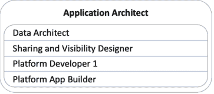

图 1.2 – Application Architect 领域

您可能已经拥有 Application Architect 领域中的部分或全部其他认证。对于那些可能还没有的人，我强烈建议您在成为 Salesforce Data Architect 的旅程中，获取 Platform App Builder 和 Platform Developer 1 认证。这两项考试都包含与平台数据相关的基础问题，可以成为获得 Salesforce Certified Data Architect 认证的另一个*推动因素*。

Sharing and Visibility Designer 认证与 Data Architect 认证会有一些重叠，因为 Salesforce 平台上的数据和共享相对紧密相连。完成此认证后，我建议您继续学习 Sharing and Visibility Designer 认证，因为本书中将介绍的一些概念与该认证相关。您可以看到 Application Architect 认证之间的关系，以及如果您尚未获得 Platform Developer 1 和 Platform App Builder 认证中介绍的基础知识，那么获得这些基础知识是有用的（尽管这些并非参加 Data Architect 考试的严格先决条件）。根据上图，完成相应考试后会自动获得 Application Architect 领域认证。

既然我们了解了认证和考试的形式（包括一些有助于加强学习的技巧和习惯），让我们来分析一下 Salesforce Data Architect 的工作职责。

#### Salesforce Data Architect 的简介

根据**Salesforce Certified Data Architect 考试指南**（位于 https://trailhead.salesforce.com/help?article=Salesforce-Certified-Data-Architecture-and-Management-Designer-Exam-Guide），Salesforce Data Architect 是指具备以下能力的人：

> ...评估架构环境和需求，并在 Customer 360 平台上设计健全、可扩展且高性能的解决方案，这些解决方案与企业数据管理相关。候选人熟悉信息架构框架，涵盖主要构建模块，如数据源、集成/移动、持久化、主数据管理、元数据管理和语义协调、数据治理、安全和交付。

> 候选人还拥有评估客户在数据质量方面的需求并创建解决方案以确保高质量数据（例如，无重复、数据正确）的经验，并且可以推荐组织变革以确保适当的数据管理。候选人拥有向业务利益相关者传达解决方案和设计权衡的经验。

让我们稍微分解一下这个定义。

该定义的第一段包含很多术语，但最终，它描述了一个能够理解需求并在制定解决方案或设计时应用数据架构原则和经验的人。对我来说，这是我们日常工作的一部分：理解需求和设计解决方案。其中还提到了性能、数据管理、安全性、可扩展性和治理。第二段侧重于数据质量和管理。所有这些方面都将在本书中涵盖。

当我们关注 Data Architect 的职责时，可以发现许多与谦逊的 Salesforce 管理员、顾问或架构师的相似之处——我们倾听利益相关者的需求，并设计满足这些要求的解决方案，同时始终注意在此过程中可能出现的考虑因素和权衡取舍。

Data Architect 运用其对 Salesforce Customer 360 平台数据架构的知识，包括其功能及其在设计或解决方案时对系统的影响，例如以下方面：

- 基于对象之间关系选择的共享和安全影响
- 大数据量的考虑和缓解措施
- 知道在何处使用哪种类型的对象（标准、自定义、大对象或外部对象）
- 索引
- 性能
- 数据管理和治理
- 从平台加载和提取数据，以及可用于影响这些操作性能的方法

在稍微分解了 Salesforce Data Architect 的职责定义之后，我们可以将注意力转向本书将要介绍的学习旅程。

#### 学习旅程简介

在本书中，认证学习旅程将分为考试的理论部分和设计者部分。理论部分将与考试指南中描述的课程紧密对应，而*设计者*部分则专门学习理论中引用的实际概念——例如，了解 Person Accounts 及其如何影响数据模型和共享。

学习旅程从考试背后的理论概念开始：

- 数据建模和数据库设计：
  - 理解 Salesforce 数据模型的架构方式、其背后的设计决策，以及该模型如何影响共享和安全性。
  - 理解不同类型的对象，以及它们如何融入数据模型设计策略。
  - 理解数据倾斜，这将帮助您理解 Salesforce 中的这一概念。
- 主数据管理：
  - 理解如何在 Salesforce 平台上有效设计和实施**主数据管理（MDM）**策略。
  - 能够阐述*黄金记录*的概念，跨多个数据源保持数据可追溯性，并理解这如何影响业务规则运行的上下文。
- Salesforce 数据管理：
  - Salesforce 许可证类型如何影响数据模型和可用的共享选项。理解这些以及如何治理平台上的数据，对于设计可扩展、高性能的解决方案（这些方案组合来自一个或多个 Salesforce 实例的数据）至关重要。
- **数据治理：**
  - 能够保护 Salesforce 平台上的数据是 Salesforce Data Architect 角色的关键部分。本章涵盖构建合规解决方案背后的概念，以及 Salesforce 平台如何支撑企业数据治理策略。
- **大数据量：**
  - 虽然 Salesforce 平台可以处理大量数据，但对于更大/海量的数据（称为*大数据量*）以及平台性能如何受到影响，需要考虑一些因素。
  - 本章涵盖 LDV 的考虑因素和缓解措施，以及可扩展的数据模型设计和数据归档策略。
- **数据迁移：**
  - 如何将高质量数据导入 Salesforce 平台？
  - 如何确保大量数据的加载顺畅、可靠、可重复且及时？
  - 如何有效地从 Salesforce 平台导出数据？

接下来，我们将了解设计者概念，这些概念应用实践知识和实践来完善理论：

- **账户和联系人：**
  - 我们将介绍 Account/Contact 模型，包括 Person Accounts、Contacts to Multiple Accounts、账户倾斜，以及这对查询和报告性能的影响。
- **数据 API 和 Apex：**
  - 我们将了解各种 Lightning Platform API 和 Apex 操作（包括数据库、批处理和异步操作），以及如何在 Salesforce Customer 360 平台上设计数据操作时有效部署它们。
- **性能调优：**
  - 我们将了解在 Salesforce Customer 360 平台上设计 Salesforce 应用时可用的各种性能调优方法。
- **备份和恢复：**
  - 我们将了解可用于从 Salesforce 平台导出数据和将数据导回的方法，重点在于数据备份和恢复。当您在设计作为整体 Salesforce IT 环境一部分的 ETL 和其他解决方案时，这非常有用。


+   - 区域管理：
+     - 我们将了解区域管理，以及它如何与 Salesforce Lightning 平台上的数据模型及其使用设计相关联。

最后，本书有一节专门讨论考试成功，重点关注以下内容：

+   - 练习题和答案
+   - 速查表
+   - 介绍本书中提到的某些概念和主题的进一步阅读资料
+   - Webassessor 概述，包括如何注册和参加考试

#### 总结

在本章中，我们了解了 Salesforce 认证数据架构师认证为何存在、考试形式以及 Salesforce 数据架构师的概况，从而真正理解该考试背后的概念为何对您的日常工作有用。最后，我们介绍了本书的学习路径，为本书其余部分定下基调。

在*第2章“数据建模与数据库设计”*中，我们将开始学习之旅，重新审视 Salesforce 数据模型、不同对象如何影响它，并涉及数据倾斜和所有权倾斜等概念。我们将介绍如何在适当考虑共享、记录数和性能的情况下有效描述 Salesforce 数据模型。

#### 练习题

回答以下问题以测试您对本章的掌握情况：

+   1. 什么是 Salesforce 认证数据架构师认证？
+   2. 为什么该认证存在？
+   3. Salesforce 数据架构师的典型概况是什么？

#### 进一步阅读

*阅读 Salesforce 官方考试指南：* https://trailhead.salesforce.com/help?article=Salesforce-Certified-Data-Architecture-and-Management-Designer-Exam-Guide.

#### 数据建模与数据库设计

在本章中，我们将开始探索认证大纲背后的理论，从数据建模和数据库设计开始。您将了解 Salesforce 数据模型是如何架构的、其背后的设计决策，以及您作为 Salesforce 数据架构师在工作中创建的数据模型如何影响共享和安全性。我们将介绍 Salesforce 共享模型，以便您在考虑数据访问选项时对可用内容有一个概览。

接下来，我们将研究不同类型的对象（例如标准对象、自定义对象、外部对象和大对象），以及它们如何融入数据模型设计策略。同时，我们还将介绍不同的关系类型，以便您了解何时应用它们。

转向性能方面，我们将介绍数据倾斜，让您理解 Salesforce 中的这一概念。然后，我们将介绍图表绘制技术，以便您能够开始有效地设计和表示 Salesforce 数据模型。

在本章中，我们将涵盖以下主题：

+   - Salesforce 数据模型
+   - 理解 Salesforce 共享与安全
+   - 探索标准对象、自定义对象、外部对象和大对象
+   - 克服数据倾斜
+   - 通过数据建模将所有内容整合在一起

#### Salesforce 数据模型

Salesforce 通过为其给定客户组织中的对象提供一种伪 RDBMS 视图，抽象化了其数据库中的底层数据结构。例如，查看 Sales Cloud ERM 时看到的图表，位于 https://architect.salesforce.com/diagrams/template-gallery/sales-cloud-overview-data-model：

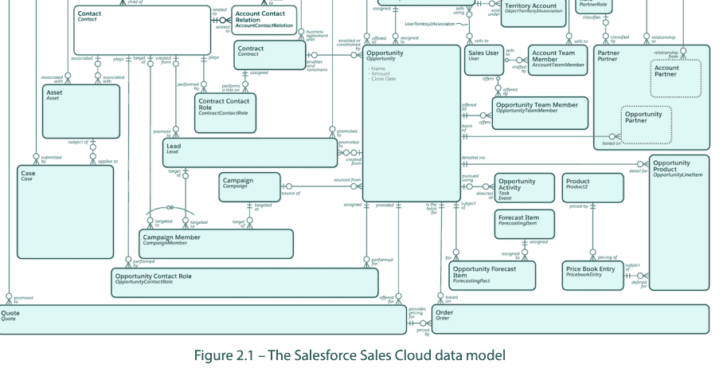

图 2.1 – Salesforce Sales Cloud 数据模型

正如我们所见，联系人记录将有一个 Account Id，以查找关系表示（在 RDBMS 术语中相当于外键）。以 Schema Builder 中一个新 Developer Edition 组织的 Account 和 Contact 为例：

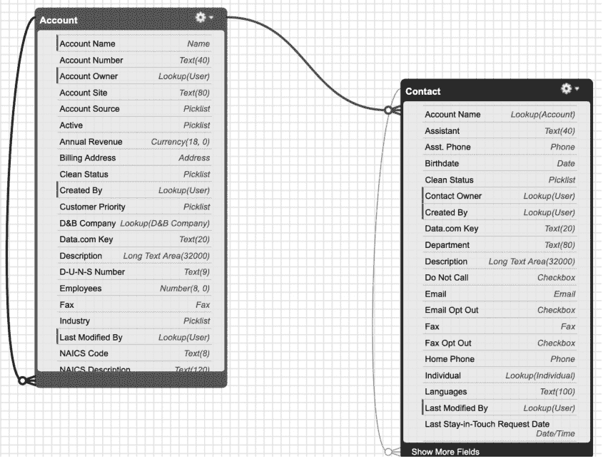

图 2.2 – 全新 Developer Edition 组织中 Schema Builder 中表示的 Account 和 Contact

##### 自己动手尝试

您可以随时在 https://developer.salesforce.com/signup 注册（完全免费的）Developer Edition Salesforce 组织，以便跟随本书中的示例进行操作，包括探索 Schema Builder。

Salesforce 会让您认为 Account 和 Contact 作为两个独立的数据库表存在（实际上，模式中的每个标准或自定义对象都有一个单独的表）。事实上，作为 Salesforce 数据架构师，在日常工作中以这种方式思考对象是完全正常的。

然而，事实是 Salesforce 有几个大型的底层数据库表（一个用于对象，一个用于字段，一个用于映射到这些对象和字段的数据，透视表等等），它们为每个组织提供了在运行时物化的虚拟数据结构。一个虚拟存储区域包含标准对象和标准字段，另一个包含标准对象和自定义字段，另一个包含自定义对象及其自定义字段。这在 https://developer.salesforce.com/wiki/multi_tenant_architecture 中有更详细的解释。本质上，标准对象/标准字段存储区域在创建新组织时填充，而自定义存储区域则在添加新自定义对象或自定义字段时添加（无论该自定义字段是添加到标准对象还是自定义对象）。因此，可以如下表示此结构，假设向标准 Account 和 Contact 对象各添加一个自定义字段：

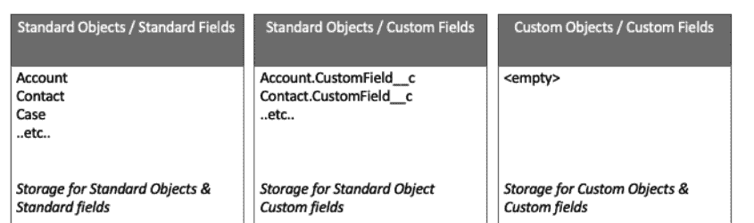

图 2.3 – Salesforce 数据库的表示（仅对象数据），其中向 Account 和 Contact 标准对象添加了自定义字段

现在让我们添加一个自定义对象，看看虚拟存储如何受影响，以及该更改在 Schema Builder 中如何显示：

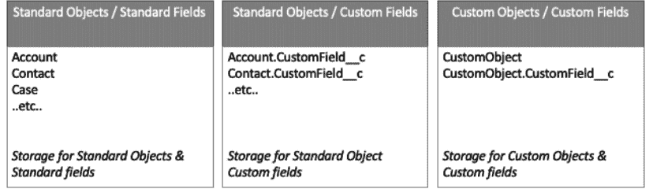

图 2.4 – Salesforce 数据库的表示（仅对象数据），其中向组织添加了一个自定义对象，并向该新自定义对象添加了自定义字段

*图 2.5* 在模式中包含了自定义对象和自定义字段：

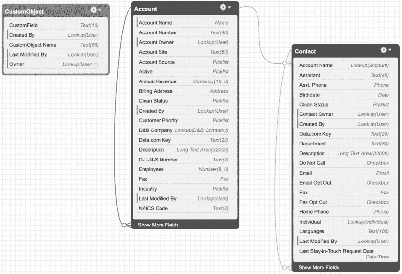

图 2.5 – Schema Builder，其中显示了新添加的自定义对象和自定义字段

了解了底层 Salesforce 数据模型的表示方式（这对性能调优等很重要，将在本书后面讨论）后，我们现在可以将注意力转向 Salesforce 中可用的标准对象。这些对象是为了解决常见用例而创建的（例如用 Account 表示公司，用 Contact 表示人），因此应尽可能使用。这不仅减少了重复造轮子，而且 Salesforce 还扩展了标准功能以应对特定用例，例如客户团队。客户团队扩展了 Account 的共享模型，允许在协作处理某个 Account 的团队之间进行定制共享。类似的功能也可用于 Case 和 Opportunity（分别称为**案例团队**和**机会团队**）。此团队功能是 Salesforce 数据模型支持的标准功能的一个示例，该功能并未扩展到自定义对象。

Salesforce 中可用对象及其字段的完整详尽列表由 API 文档提供（可在 https://developer.salesforce.com/docs/atlas.en-us.api.meta/api/sforce_api_objects_list.htm 获取），但一些最常用的对象如下：

+   - **Account** – 代表您可能与之开展业务的公司或机构。
+   - **Contact** – 代表一个人（通常与一个或有时多个 Account 关联）。
+   - **Lead** – 代表一个潜在客户或未合格销售线索。潜在客户通常用于售前场景，目标是将潜在客户转换为 Account、Contact，以及可选的 Opportunity。
+   - **Person Account** – 一个 *分组* 的 Account/Contact 对象（主要允许将 Opportunity 关联到个人买家而不是 Account/公司）。这本质上是将 Account/Contact 关系从查找关系改为 *由父级控制*。这对共享和数据可见性有影响。
+   - **Case** – 代表需要关注的跟踪问题或工作项。通常由支持人员使用。
+   - **Opportunity** – 代表一笔业务交易。
+   - **Opportunity Line Item** – 构成 Opportunity 的一部分并用于驱动其价值的项目。

> **标准对象数据模型图**
> Salesforce 标准数据模型可在 https://developer.salesforce.com/docs/atlas.en-us.api.meta/api/data_model.htm 获取（请记住，它们显示的是对象的逻辑表示及其关系，而不是物理数据库结构）。

现在我们已经了解了标准对象，以及支撑标准对象/标准字段、标准对象/自定义字段、自定义对象/自定义字段的三张表，我们可以开始关注数据查询如何工作，并关注这些表之间的性能。


当向 Salesforce 数据库发出数据查询（例如 Salesforce 对象查询语言（SOQL）或 REST API 调用）时，该请求会被转换为底层数据库的系统生成 SQL。虽然无法调整生成的 SQL，但留意我们的数据查询方式会如何影响 SQL 的生成，可以让我们在一定程度上施加影响。我们正是在这些参数范围内优化数据查询。

例如，考虑以下 SOQL 查询，它用于获取按字母顺序排序的列表中的前 10 个客户（Account）记录名称：

```
SELECT Name FROM Account ORDER BY Name ASC LIMIT 10
```

由于我们查询的是标准对象的标准字段，Salesforce 只需从 Account 的标准对象/标准字段表中检索数据。

当在查询中加入自定义字段（为便于说明，假设该字段名为 CustomField），我们实际上是在要求底层数据库查询执行 JOIN，以便能够从标准对象/自定义字段表中检索数据。因此，即使是这样简单的查询，也会导致从多个底层数据库表中检索数据：

```
SELECT Name, CustomField__c FROM Account ORDER BY Name ASC LIMIT 10;
```

现在考虑第三种场景。我们要查询一个自定义对象（名为 CustomObj__c），它有一个指向 Account（客户）的查找关系（名为 Account__c），并且还要将上一个例子中的客户名称和客户自定义字段放入结果中：

```
SELECT Name, Account__c.Name, Account__c.CustomField__c FROM CustomObj__c ORDER BY Name ASC LIMIT 10;
```

此时，我们查询了自定义对象/自定义字段表、标准对象/自定义字段表以及标准对象/标准字段表，而这一切只是为了从 3 个字段中检索 10 行数据！

因此，最佳实践是尽可能避免在数据访问查询中使用 JOIN，从而确保获得最佳性能。考虑到底层 Salesforce 数据的组织方式，拥有良好结构的数据模型（尽可能避免 JOIN）意味着报表、仪表板（dashboard）和列表视图都能获得良好的性能。

第 6 章“理解大数据量”（Understanding Large Data Volumes）描述了大数据量可能引发的问题（尤其是性能问题）以及如何缓解这些问题。

现在我们已经介绍了 Salesforce 数据模型，接下来将把注意力转向共享与安全，它们会影响数据的访问方式。

#### 理解 Salesforce 的共享与安全

Salesforce 中的任何数据访问都由一个分层安全模型决定。随着每一层的递进，数据访问权限会逐渐开放。因此，必须在最底层充分理解共享与安全需求，以便恰当地配置安全设置。Salesforce 安全模型的各层可如下图所示：

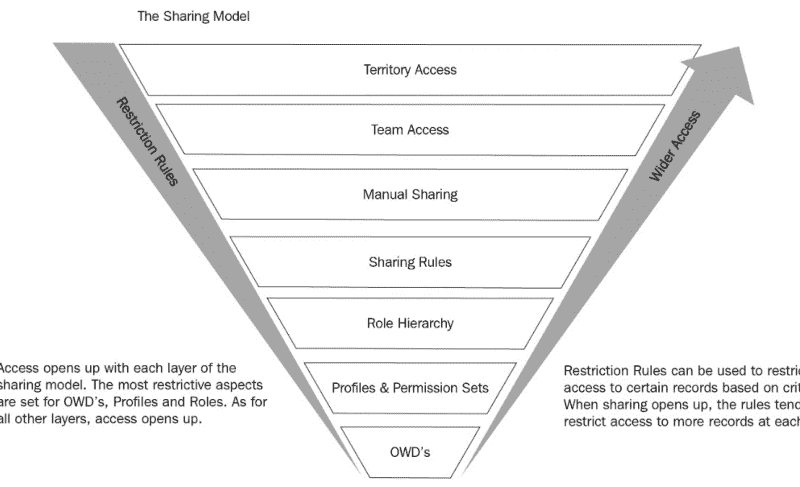

图 2.6 – Salesforce 安全模型各层的可视化表示

本节将解释构成安全模型的各层、它们的配置方式及其影响。

#### 组织范围默认值（Organization-Wide Defaults）

用户默认对彼此记录的访问权限是在 Salesforce 实例的组织范围默认值（OWD）中指定的。本质上，OWD 将数据访问锁定在最严格的级别，然后通过其他共享和数据访问工具（将在后续章节中说明）逐步向用户开放数据访问权限。例如，将 Account 的 OWD 设置为只读，意味着用户默认无法编辑客户记录。如果用户只需要编辑自己拥有的客户记录，则可以通过配置文件（Profile）或权限集授予对象级别的编辑和读取访问权限，同时将 Account 的 OWD 保持为只读。内部用户和外部用户（通过 Salesforce Community 或其他方式访问）分别有各自的 OWD。访问的前提相同，但外部 OWD 有助于默认锁定到更严格的数据访问模型。例如，

你可以选择让所有常规（有时称为内部）Salesforce 用户默认对所有客户记录拥有只读访问权限，而通过社区访问 Salesforce 的外部用户对客户记录则使用私有（Private）OWD，这样外部用户只能看到自己拥有的客户记录。可用的 OWD 设置值将在以下小节中说明。

##### OWD 值

在 Salesforce 实例中设置 OWD 时有多个选项可供选择，它们都会影响给定对象或关联记录/对象的数据访问方式。

###### 私有（Private）

只有记录所有者，或角色层级中高于记录所有者角色的用户，才能查看、编辑和报告此对象的记录。

###### 公开只读（Public Read-Only）

所有用户都可以查看此对象类型的记录，但只有记录所有者以及角色层级中高于记录所有者角色的用户才能查看、编辑和报告此对象的记录。

###### 公开读/写（Public Read/Write）

所有用户都可以查看、编辑和报告此对象记录中的数据。

###### 公开读/写/移交（Public Read/Write/Transfer）

仅适用于 Case（个案）和 Lead（潜在客户）对象。如果设置了此选项，所有用户都可以查看、编辑、移交和报告潜在客户或个案记录中的数据。

###### 公开完整访问（Public Full Access）

仅适用于 Campaign（营销活动）对象。如果设置了此选项，所有用户都可以查看、编辑、删除、移交和报告营销活动记录中的数据。

###### 由父项控制（Controlled by Parent）

用户基于对父记录的访问权限，对相关记录（例如编辑或删除）执行操作。例如，如果自定义对象 Invoice（发票）以 Account 作为父对象，且 Invoice 的 OWD 设置为“由父项控制”，那么用户对 Account 的访问权限会自动意味着他们可以访问与该客户记录关联的发票记录。如果用户对客户拥有编辑权限，则他们会自动拥有对关联发票记录的编辑访问权限。

#### OWD 的正确性至关重要

OWD 直到不久之前仍是限制用户访问记录的唯一方式。更改 OWD 会对整个 Salesforce 组织产生影响（尤其是执行共享重算所需的时间），并可能导致用户看到超出其应有权限的数据。因此，在实施 OWD 之前，必须充分了解用户的数据访问需求。自 Winter ’22 版本起，一项名为限制规则（restriction rules）的功能可帮助限制特定用户组对某些记录的访问。这将在“限制规则”一节中进一步说明。限制规则用于限制用户，但不能替代设计良好的 OWD 策略。

#### 配置文件（Profile）与权限集

指定对象级安全访问权限是配置文件的主要功能（尽管配置文件中还存在其他设置，例如登录时段、IP 地址范围等，但这些不在本考试范围内）。通过为特定对象指定创建（Create）、读取（Read）、编辑（Edit）和删除（Delete）权限，可以进一步开放用户对这些对象的访问权限，使其超出组织中已设置的 OWD。字段级安全性也是在配置文件和权限集中设置的，因此对特定字段的读取或编辑访问权限也是在此处配置的。

每个用户都必须被分配一个配置文件。权限集可用于通过权限集中可用的组织设置，进一步授予对对象和其他功能的选择性访问权限。托管包（Managed Package）通常使用权限集来让被分配的用户访问托管包所提供的功能。

#### 关于 View All 与 Modify All 的简要说明

View All（全部查看）和 Modify All（全部修改）本质上允许用户对组织内给定对象拥有全面的读取或编辑访问权限。它们会忽略特定对象的共享规则。因此，如果分配给用户的配置文件或权限集对 Account 设置了 View All，则他们将拥有对所有客户记录的读取访问权限。同理，对 Account 设置 Modify All 将授予用户对组织中任何客户记录的编辑访问权限。View All Data（查看所有数据）和 Modify All Data（修改所有数据）权限是在组织级别设置的，拥有这些权限的用户实际上会忽略共享规则，从而获得对组织中所有对象和记录的读取或编辑访问权限。

#### 角色层级（Role Hierarchy）

与组织结构类似，角色层级用于确定用户组的数据访问权限，并确保经理始终拥有与其下属员工相同级别的数据访问权限（无论该对象的 OWD 如何设置）。角色层级的每一级都应与特定用户组所需的数据访问级别相对应。因此，角色层级与组织结构图略有不同，因为系统管理员通常位于层级中较高的角色。根据 Salesforce 组织的许可配置，外部用户也可能被分配角色，因此他们可能是某个内部角色的下属。


#### 手动共享

在先前已介绍的机制未涵盖的定制共享场景中，手动共享提供了一种功能，可以手动共享记录，向无权访问该记录的用户授予读取和编辑权限。顾名思义，手动共享是一个用户驱动的过程，涉及在 Salesforce 用户界面中进行点击，以向其他用户授予记录访问权限。也可以通过编程方式创建手动共享（有关更多信息，请参阅专门介绍*编程式共享*的小节）。

与其他用户共享记录会在 Salesforce 数据库中创建一条共享记录。编程式解决方案需要管理除*手动共享*以外的共享原因对应的记录共享。使用记录上的**共享**按钮可以维护行原因为*手动共享*的编程式共享，这与开箱即用的共享按钮功能非常相似。

#### 手动共享何时失效

如果共享记录的所有者发生变更，则手动共享会被移除。如果共享未授予超出该对象 OWD 设置的访问权限，则一开始就不会创建共享。这两种情况同样适用于编程式共享场景。

#### 团队访问

客户、商机和个案都有*团队*记录共享概念，借助这一概念，用户组可以协作处理客户、商机或个案。记录所有者、角色层级中更高层的人员（因此继承了相同级别的记录访问权限）或管理员都可以向团队添加人员，以便协作处理记录，或修改访问级别（例如，从只读改为读取/写入）。

团队通常用于向 Salesforce 中的特定用户授予更高级别的记录访问权限，以便他们可以协作处理客户、商机或个案。例如，如果用户已经对某个特定客户记录拥有写入访问权限，那么在针对该记录的客户团队中将其添加为读取/写入成员不会产生任何影响。

针对客户、商机或个案记录创建团队，会在 Salesforce 数据库中创建一条团队记录和一条关联的共享记录。编程式解决方案必须同时维护这两类记录。有关编程式共享的更多信息，请参阅专门的小节。

#### 多个团队访问一条记录怎么办？

如果需要多个团队访问特定记录，那么区域管理或编程式共享可能更合适。每个客户、商机或个案只有一个团队，因此不支持针对单条记录设置多个团队的概念。

#### 区域层级访问

可以创建层级结构来表示组织的销售区域。这实质上有助于根据条件自动分配客户，以表明其属于区域模型的特定分支。第 12 章“区域管理”将更详细地介绍区域管理。

#### 编程式共享

当数据访问需求无法使用前述任何方式满足时，编程式共享（即以前所称的 Apex 托管共享）允许使用代码构建共享设置。基于代码的共享解决方案可以非常精巧和复杂，但也同样需要谨慎管理，因此在着手采用基于代码的共享解决方案之前，理解编程式共享的工作原理非常重要。

Salesforce 中的每个对象都有一个关联的共享对象。这有两种命名约定（一种用于标准对象，另一种用于自定义对象）。对于标准对象，关联的共享对象命名为 objectShare，例如 AccountShare、CaseShare 等。对于自定义对象，关联的共享对象使用类似于 object__Share 的格式命名。例如，对于名为 MyObject__c 的自定义对象，其关联的共享对象称为 MyObject__Share。

位于主从关系从属侧的对象没有关联的共享对象，因为对关系主控侧对象的访问会隐式授予对从属侧对象的访问。具有“公共读取/写入”OWD 的自定义对象也没有关联的共享对象。

使用代码以编程方式共享记录时，关联的共享对象需要一条带有行原因（row cause）的记录，用于存储共享发生的原因。通过 Salesforce UI 与用户共享记录，会在关联的共享对象中创建一条行原因为 manual share 的记录。编程式共享可以使用 manual share 行原因创建条目，也可以使用自定义行原因值。共享对象条目中的值如下：

- ParentID：被共享记录的 ID。该值在记录创建后无法更改。
- RowCause：如上一段所述，这是记录被共享的原因。它可以模拟在 Salesforce UI 中按下“共享”按钮的手动共享，也可以使用自定义原因。自定义共享原因需要先在 Salesforce UI 中创建，然后才能使用。在 Salesforce 设置中，对象在“管理设置”中具有 Apex 共享原因相关列表。
- UserOrGroupId：记录被共享给的用户或组的 Salesforce ID。
- `objectAccessLevel`：作为共享一部分授予的访问级别。该属性的名称是所共享记录对应的共享对象名称后跟 AccessLevel。例如，`CaseShareAccessLevel`。值可以分别是编辑、读取，或编辑/只读访问。

> **关于以手动共享行原因通过编程方式共享的记录的一点说明**
> 当以*手动共享*行原因共享的记录（无论通过编程方式还是 UI）更改所有者时，任何手动共享行原因记录都会从关联的共享对象中移除。自定义行共享在共享记录的所有者变更时会被保留。

#### 限制规则

限制规则自 Winter '22 版本起正式可用，可用于控制特定用户组允许查看的记录。根据创建限制规则的文档（https://help.salesforce.com/s/articleView?id=sf.security_restriction_rule_create.htm&type=5），*当限制规则应用于用户时，该用户通过组织级默认值、共享规则和其他共享机制可以访问的数据，会按您指定的记录条件进行过滤。*

在撰写本文时，限制规则适用于以下对象：

- 自定义对象
- 合同
- 事件
- 任务
- 工时表
- 工时表条目

在 Enterprise 版和 Developer 版中，每个受支持的对象最多可以创建两个限制规则；在 Performance 版和 Unlimited 版中，每个受支持的对象最多可以创建五个限制规则。

现在我们已经了解了 Salesforce 平台上的共享和安全机制，以及它们如何影响数据访问，接下来可以逐一了解每种 Salesforce 对象类型了。

#### 探索标准对象、自定义对象、外部对象和大对象

Salesforce 对象大致可以分为四种类型之一。尽管您肯定使用过平台上可用的标准对象和自定义对象功能，但有必要在更底层了解它们的工作原理，才能真正理解针对这些对象类型发出 SOQL 查询意味着什么，以及它如何影响性能。其次，您以前可能没有使用过外部对象和大对象。在数据存储和访问方面，这些对象有所不同（外部对象数据不存储在平台上，而是通过外部数据源按需访问。大对象数据可确保一致的性能，但数据位于 Salesforce 平台中与标准/自定义对象不同的位置）。

> **sObject**
> 
> **sObject** 是任何 Salesforce 对象的通用形式。标准 Salesforce 对象和您创建的自定义对象都是 sObject 的具体类型（它们都继承通用属性和行为）。另一种理解 sObject 的方式是，它抽象了任何 Salesforce 对象的实际表示，很像 **Java** 编程语言中的对象都继承自 *Object* 基类。

##### 标准对象

根据您的许可证类型，Salesforce 提供对许多标准对象的访问，这些对象旨在以极少的定制满足多种业务用例。

这些对象及其字段在开箱即用状态下都将存放在标准对象/标准字段的底层数据库表中。从对象访问的角度来看，额外的 Salesforce 许可证（如 *Service Cloud*）实质上会授予对底层 Service Cloud 标准对象（如 milestone 和 entitlement）及其开箱即用字段的访问权限。

标准对象和标准字段没有特殊后缀，因此在发出 SOQL 查询时，它们分别表示为 Account（标准对象名称示例）和 Name（标准字段名称示例）。下面是一个示例：

```
```sql
SELECT Name FROM Account
```
```

在没有任何定制的情况下，查询标准对象数据非常快。这是因为只查询一个数据库表。一旦向标准对象添加单个自定义字段，该字段就会在“自定义对象/自定义字段”表中创建，因此对该字段的任何查询实际上都会导致向底层 Salesforce 数据库发出 JOIN 查询，因为现在需要从两个表获取结果。

##### 自定义对象

自定义对象及其自定义字段全部在底层 Salesforce 数据库的“自定义对象/自定义字段”表中创建。自定义对象数据驻留在 Salesforce 数据库中，并且自定义对象和自定义字段都有 __c 后缀。例如，针对名为 MyObject 的对象中名为 MyField 的自定义字段中的数据进行 SOQL 查询时，语法如下：

```
```sql
SELECT MyField__c FROM MyObject__c
```
```


Queries on data held purely within these objects will be relatively quick, but any data on parent objects (especially where that object is a standard object) will incur a small performance penalty as the results will require the use of a JOIN in the underlying SQL query issued to the Salesforce database.

##### 外部对象

标准对象和自定义对象的数据都存储在 Salesforce 数据库的平台内，而外部对象的数据则存储在平台外的外部数据源中，通常位于另一个应用程序中。外部对象的理念是数据存储在平台外，但最终用户可以像在平台内一样与其交互。Salesforce 使用 Web 服务调用实时访问外部数据。外部数据可通过 Salesforce 实时供用户使用，并且外部对象始终会返回来自外部数据源的最新的数据。

外部对象需要在 Salesforce 实例中定义外部数据源，然后再用于确定如何访问外部系统。

在 Salesforce 中，外部对象以对象名称后加 __x 后缀表示。例如，来自 SAP 的订单在 Salesforce 中的发票数据将命名为 Invoice__x。外部对象支持间接和外部查找，以将数据与您的 Salesforce 记录关联起来。

外部对象在 Salesforce API 版本 32 及更高版本中受支持，并可与 Salesforce Connect 和 Files Connect 配合使用。

#### 大对象

大对象用于存储和管理海量数据（开箱即用可达 100 万条记录，但可通过额外付费扩展至数千万甚至数十亿条记录）。大对象提供一致的性能。根据我的经验，大对象通常适用于审计和归档用例，但任何需要在处理数亿或数十亿条记录时保持一致性能的场景都是大对象的设计目标。

大对象使用分布式数据库运行，并且本质上不是事务性的。因此，除了对象和字段权限外，大对象不支持共享。此外，这意味着工作流、流程、触发器等自动化在大对象上不受支持。

> **幂等性**
> 当完全相同的记录表示（即记录的完全相同的数据集）多次插入到大对象时，只会创建一条记录。这是为了使对大对象的写入保持幂等性。将相同的记录表示插入到 sObject（标准或自定义）将导致多个条目。

#### 对象关系类型

Salesforce 对象通过多种方式通过关系链接在一起。这些关系会影响共享和数据访问。各种关系类型在此进行说明。

##### 主从关系

主从关系紧密地将两个对象链接在一起，以至于子记录的某些行为会受到影响。这包括共享，其中对主记录（或父记录）的访问会授予对明细记录（或子记录）的访问权限。主从关系还支持汇总求和。

当主记录被删除时，所有子记录都会被删除。但是，取消删除主记录会恢复所有子记录。当明细记录被删除时，它会被移至回收站。如果明细记录被删除，随后主记录被删除，则明细记录无法恢复，因为它不再有主记录可关联。

##### 多对多

查找和主从关系类型都是“一对多”（其中多个记录可以链接到另一条记录，例如一个账户拥有多个联系人）。多对多关系（例如，将一个案例链接到多个自定义错误记录，以及多个自定义错误记录链接到同一个案例）是通过两个主从关系通过连接对象连接来表示的（一个具有两个主从关系的自定义对象）。因此，多对多关系只能用于将一个对象连接到另一个对象。在我们的案例和错误示例中，我们有标准案例对象与 BugCaseAssociation 连接对象之间的主从关系，以及自定义错误对象与 BugCaseAssociation 连接对象之间的主从关系。这可以图示表示：

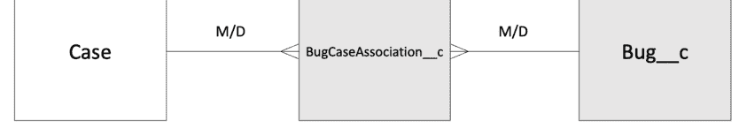

图 2.7 – 使用两个主从关系表示多对多关系

在介绍了主从和多对多关系之后，让我们来看其他关系类型。

##### 查找关系

查找关系将两个对象链接在一起，但共享不受影响（因此子对象可以具有单独的共享，与主从关系不同，主从关系会影响共享），并且不支持汇总求和。查找关系支持将两个对象链接在一起，但这可以包括查找同一对象类型的记录（想想账户层次结构，其中一个账户记录可以有一个父账户记录来表示公司集团结构的层次结构）。一个对象对自身具有查找关系称为自引用关系。当用户对象查找自身时，应改用层次关系（参见“层次”部分）。

##### 外部查找

当将外部对象记录链接到 Salesforce 标准或自定义对象，并且外部对象是父对象时，则使用外部查找关系。父外部对象上的标准外部 ID 字段与子对象外部查找关系字段的值进行匹配。

##### 间接查找

当将外部对象记录链接到其数据存在于 Salesforce 中的标准或自定义对象的父对象时，应使用间接查找关系将记录关联起来。创建间接查找时，您指定要在父对象中匹配的字段以及在外部对象上匹配的字段，从而关联记录。父对象上会选择一个自定义、唯一、外部 ID 字段，以匹配来自外部数据源的子外部对象的间接查找字段。

#### 层次

仅在用户对象上可用，层次关系是一种特殊的查找，用于将一个用户关联到另一个用户（其中记录不直接或间接引用自身）。将用户的经理存储为对另一个用户记录的查找是此功能的常见用例。

现在我们知道了将对象及其数据相互关联的不同方式，让我们来看一下当将过多记录关联到单个祖先记录或用户时性能会受到怎样的影响。

##### 自定义层次（父/子）关系

可以通过利用自定义子对象来实现自定义父/子层次，该对象对要创建父/子关系的对象执行双重查找（类型为查找关系）。一个查找的名称格式为 Parent，另一个为 Sub。例如，要创建父/子机会关系，请创建一个名为 SubOpportunity 的自定义对象，其中包含一个名为 ParentOpportunity 的查找和另一个 SubOpportunity，它们都查找机会对象。有关详细信息，请参阅 https://help.salesforce.com/s/articleView?id=000326493&type=1。

#### 克服数据倾斜

随着特定对象的记录数量增加，Salesforce 平台的自动扩展是预期功能。客户在系统中存在数万条相同类型的记录时，会要求保持一致的性能水平。在少数特定用例中会出现一些性能下降，具体如下：

- 一个用户拥有超过 10,000 条相同类型的记录（例如一个用户拥有超过 10,000 条账户记录）。这称为 **所有权倾斜**。
- 单个账户记录拥有大量子记录，例如 10,000 条或更多联系人记录，其 Account Id 查找为同一账户。这称为 **账户倾斜**。
- 类似于账户倾斜，当大量子记录（10,000+）与同一父记录关联时，可能会出现性能问题。这称为 **查找倾斜**。

我们将研究每种情况的原因以及如何缓解。

##### 所有权倾斜

当单个用户或队列拥有超过 10,000 条特定类型的记录（例如联系人）时，可能会出现由于所有权倾斜导致的性能问题。在 Salesforce 实例中，通常有一个默认用户或队列拥有所有未分配或未使用的记录。更改共享设置或其他与共享相关的操作会影响性能，因为基于拥有用户角色更改或其他与共享相关的计算重新计算共享会导致长时间运行的 Salesforce 操作，在此操作期间记录会被锁定。

###### 所有权倾斜缓解

为缓解所有权倾斜，请考虑以下措施：

- 根据会导致单个所有者的大量记录的数据预测（例如线索记录的默认所有者），请考虑为此类所有权场景设置多个所有者。分配规则可用于线索和案例（通常具有高数据量的标准对象），但也可以使用其他自动化技术根据记录的标准将记录分配给适当的所有者。
- 如果必须使用一个用户，则可以通过不将该用户分配到角色来减少性能影响。这消除了共享计算中的任何基于角色的影响。
- 如果拥有用户必须具有角色，则该角色应位于角色层次结构的顶部。因此用户无需在层次结构中移动，减少了共享计算成为长时间运行过程的影响。


- 确保任何拥有者用户都不是用于任何共享规则条件中的公共组的成员。如果是这种情况，更改记录拥有者将触发这些共享规则的重新计算，从而进一步减慢速度。

##### 账户倾斜

某些标准 Salesforce 对象维护一种特殊的数据关系，以促进在私有共享模型下的记录访问。这对于账户和商机尤其如此（事实上，这也是账户和商机团队在共享和访问特定记录方面得以实现的方式）。

账户倾斜是账户记录拥有大量子记录的结果。我曾在一些客户处见过这种情况表现为一个名为 Unassigned Accounts 的单个账户记录下有数万条子账户记录，这些记录可能很旧、未使用或未分配。此场景会导致性能和记录锁定问题。

当对子记录进行更新时，Salesforce 会锁定父账户记录（以在数据库中维护记录完整性）。因此，在同一账户记录下更新大量子记录可能会导致争用（多个进程或操作同时尝试访问同一事物），并尝试锁定父记录（这是使用单独的系统线程完成的）。

当对父账户记录进行更新时，例如更改拥有者，则必须对所有子记录重新计算所有共享。这可能会触发连锁反应，因为共享规则、角色层级计算以及与共享相关的许多其他操作都必须进行。这将导致长时间运行的进程以及潜在的记录锁定问题。

###### 账户倾斜缓解

为缓解账户倾斜，将子记录分布到多个父账户记录中。10,000 就是这里的 magic number。通过将记录分布到多个账户，我们可以避免账户倾斜及其与记录锁定和共享操作相关的性能影响。

##### 查找倾斜

查找倾斜与账户倾斜在原则上相似，当通过子记录上的查找字段与单个父记录关联的子记录数量很大时就会发生。虽然账户倾斜特定于账户对象，但查找倾斜会影响多个对象。

###### 查找倾斜缓解

尝试以下方法来缓解查找倾斜：

- 删除受影响对象中不必要的 workflow、process builder 或 flow，以减少创建或保存受影响对象的记录时的保存时间。
- 将倾斜分布到多个记录中。例如，为子记录上的查找提供单独的父对象记录，以减少甚至消除记录锁定和共享重新计算。
- 使用 picklist 值而不是查找。这意味着不会链接到实际的父记录，但可以通过对这些 picklist 值的报告来查询给定父记录的关联数据。此缓解技术不适用于大量查找值，因此仅应在 picklist 值数量较少时使用。

#### 数据倾斜总结

我们已探讨了 Salesforce 中的三种数据倾斜类型以及如何缓解它们。在 Salesforce 内部设计有效的数据管理策略时，请注意数据倾斜及其对性能的影响。通过在构建数据策略之初就为数据倾斜进行设计，即使是最大的 org 也能保持性能不下降。

现在我们了解了不同类型的数据倾斜及其影响，让我们结合本章所涵盖的内容。

#### 将其与数据建模结合起来

本章我们涵盖了很多内容，但现在是时候将理论付诸实践，并以数据模型的形式产出有形的东西。现在我们知道了可以设置的 OWD、可以影响的对象间关系以及记录的拥有者，我们可以将它们结合起来生成一个数据模型。

在本書中，任何数据模型图都将按照以下格式绘制（本质上是从第 1 章《Introducing the Salesforce Data Architect Journey》中的示例图中扩展的图例）：

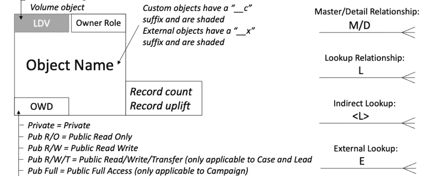

Figure 2.8 – The format for diagramming Salesforce objects used throughout this book

现在我们已经了解了数据建模格式，让我们来看一个数据建模示例。

#### 数据建模示例和说明

数据建模格式已介绍完毕，让我们来看一个示例数据模型，以展示我们能从单个工件中获得多少信息。以下是示例，与第 1 章《Introducing the Salesforce Data Architect Journey》中分享的示例类似：

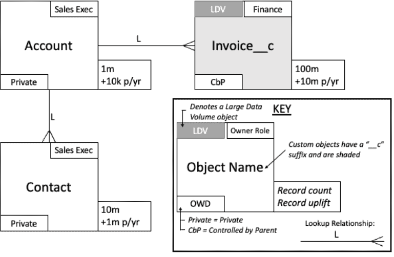

*Figure 2.9 – Example data model*

让我们查看数据模型并看看我们可以从中确定什么：

- 采用的是私有 OWD 模型，因此只有 Account 和 Contact 的记录拥有者以及角色层级中更高层级的角色才能查看和编辑记录（除非使用本章中解释的其他方法之一，例如手动共享来共享记录）。
- *Sales Exec* 角色被指定为账户和联系人的拥有者，而 *Finance* 是 *Invoice__c* 自定义对象的拥有者。然而，我们可以看到 *Invoice__c* 的 OWD 设置为 Controlled by Parent，因此拥有账户记录的 Sales Exec 人员也将能够查看和编辑 *Invoice__c* 记录。
- *Invoice__c* 对象已被指定为 *LDV*，鉴于数据量，我们需要确保考虑数据倾斜。在这种情况下，我们同时需要考虑账户倾斜和拥有者倾斜，因此应确保没有任何账户记录是超过 10,000 条 *Invoice__c* 记录的父级，并且财务部门的任何个人也不拥有超过 10,000 条 *Invoice__c* 记录，否则可能会出现性能问题（如 *Overcoming data skew* 部分所述）。

正如你所同意的，看似小的图中包含了很多信息，但可以快速确定默认数据访问情况以及关系的共享影响，我们也能及早了解 LDV 的影响。

在回答与数据访问及其对其他对象的影响相关的练习题时，尝试在有意义的情况下将问题可视化为图表，以便得出正确答案。

> **The Importance of the Data Model in the Certified Technical Architect (CTA) review board**
> 那些希望追求 **CTA** 评审委员会的人将被要求制作一个与本书中我们将制作的类似性质的数据模型。数据模型被视为评审委员会的核心工件，因此重要的是你知道如何快速制作清晰的数据模型图，以传达适当的信息量。

#### Summary

我们已开始学习之旅，并从数据建模和设计的概念开始。我们涵盖了共享和安全，深入探讨了 Salesforce 中用于控制数据访问的各种机制。我们特别关注了 OWD 和角色层级如何对用户可以访问的数据产生深远影响。我们看到了 OWD 如何影响 Salesforce 平台上解决方案的数据模型设计，以及为什么在构建满足客户需求的 Salesforce 解决方案时，基于对特定 OWD 设置影响的充分理解，正确设置这些设置很重要。

我们还涵盖了平台上可用的不同对象类型，强调了标准、自定义、外部和大对象之间的差异以及各自的各种用例。再次，某些对象类型的使用（特别是大对象和外部对象）会影响用户在数据访问方面的用户体验。

我们涵盖了关系及其对 Salesforce 功能和数据访问的影响，并看到了在 Salesforce 平台上将对象及其数据放在一起的不同方法，强调了我们如何将外部数据源中保存的数据与 Salesforce 内部保存的数据相关联。

我们还研究了与数据相关的性能问题，涉及数据倾斜以及可用于缓解用户拥有超过 10,000 条记录或账户作为超过 10,000 条子记录的父账户的影响的方法。

在掌握了本章重点介绍的概念后，你现在明白了为什么从 Salesforce 数据模型的初始设计开始就为未来进行规划很重要，以缓解与数据倾斜和其他影响性能的因素相关的风险。

最后，我们将建模数据解决方案的概念结合起来，并引入了数据模型图的标准。


在第3章“主数据管理”中，我们将深入探讨什么是主数据管理（MDM），并学习如何在Salesforce平台上有效设计和实施MDM策略。我们将了解黄金记录的概念，保持跨多个数据源的数据可追溯性，并学习这会如何影响业务规则运行的上下文。

#### 练习题

- 1. 公开读写/转移的组织级默认设置（OWD）适用于哪些对象？
- 2. 与拥有超过10,000条子记录的账户记录相关的性能问题被称为什么？
- 3. 对于营销活动（Campaign）对象，哪些OWD是其他对象所没有的？
- 4. 哪种Salesforce对象用于实时访问外部系统中保存的数据？
- 5. 判断对错：大数据对象会多次存储同一数据行的相同表示。
- 6. 哪种OWD会使对象继承与其关联对象相同的数据访问权限？
- 7. 多对多关系是如何创建的？
- 8. 哪种类型的关系仅适用于用户对象？
- 9. 在主从关系中，当主记录被删除时，子记录会发生什么情况？
- 10. 判断对错：使用查找关系时，子对象的共享会受到影响。

#### 答案

- 1. 潜在客户（Lead）和个案（Case）。
- 2. 账户倾斜。
- 3. 公开完全访问。
- 4. 外部对象。
- 5. 错误——对于同一数据表示的多次提交，大数据对象只存储一行数据。
- 6. 受父项控制。
- 7. 两个主从关系，每个对象上一个，使彼此相互关联。
- 8. 层级关系。
- 9. 子记录也会被删除。
- 10. 错误。

#### 延伸阅读

- *Salesforce 数据访问：* https://developer.salesforce.com/docs/atlas.en-us.dat.meta/dat/dat_components.htm
- *Salesforce 标准对象：* https://developer.salesforce.com/docs/atlas.en-us.api.meta/api/sforce_api_objects_list.htm
- *Salesforce 数据模型图：* https://architect.salesforce.com/diagrams#template-gallery
- *Salesforce 对象关系概览：* https://help.salesforce.com/articleView?id=overview_of_custom_object_relationships.htm&type=0
- *限制规则：* https://help.salesforce.com/s/articleView?id=release-notes.rn_forcecom_sharing_restriction_rules.htm&type=5&release=234

#### MDM简介

MDM是确定并维护企业内共享数据单一事实来源的学科。你大概可以想象，在企业IT系统中维护同一信息的多个副本效率低下，还可能导致数据不一致。除非人员与技术实现百分之百协同，否则维护同一数据的多个副本几乎是不可能的。孤岛式企业（各部门在人员和技术上有效分离）往往面临数据不一致的问题，其持有的数据质量和分类也常常存在缺陷。这些场景需要将不同系统持有的数据汇集成一个数据主库，即单一事实来源。

单一事实来源在概念上可以直观表示如下：

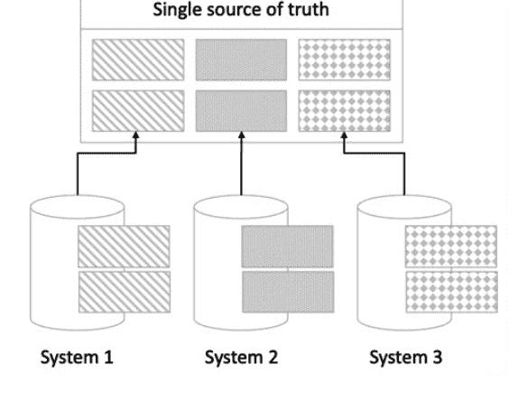

图3.1 – 将不同系统持有的数据汇集起来形成单一事实来源

我最近就亲身体验了一个MDM不当的例子，与我当地的一家汽车经销商有关。我曾向他们咨询并最终购买了一辆车，因此关于我和我所购车辆的数据便存入了销售团队的数据库。这对经销商来说很重要，因为他们可以在我的汽车需要保养等时候给我发送提醒。不幸的是，经销商的营销部门与销售部门之间没有集成，因此我仍会收到经销商发来的营销邮件，诱导我购买我已拥有的车。

这一场景之所以发生，是因为汽车经销商各部门之间的系统互不连通。在这家IT企业内，我被记录了两次：在一个系统中我是潜在客户，在另一个系统中我是合格（且已转化）的销售线索。如果汽车经销商各部门的数据被集中到一个单一事实来源中，他们就能看到我已经买了车，也许就能将营销重点转向追加销售和交叉销售活动，例如汽车配件优惠或保养套餐。

MDM应是一个持续的过程，是更广泛的组织数据战略的一部分。例如，当一个组织收购另一个组织时，后者的数据必须经过清理、去重、分类，并与收购方持有的数据进行核对。将数据整合到一个共享的单一事实来源中，能够确保组织中的人使用最新、已清理且分类正确的数据。这个单一事实来源通常被称为黄金记录。我们将在本章后面的“黄金记录”一节中介绍这一概念。

##### 关键术语

接下来，我们介绍MDM中使用的一些关键术语及其定义。

以下术语在MDM领域非常常用。作为Salesforce数据架构师，在处理MDM相关情况时，你可能会遇到它们。

###### 数据统一化

**数据统一化**是将来自多个来源的数据进行处理（通常通过机器学习和自动化），使其变成标准、准确且全面的格式的实践，这意味着任何与数据交互的人都可以以相同的方式（利用共同的数据语言）进行交互。例如，将产品称为**库存单位（SKU）**，而不是在内部称*产品代码*、在外部称*产品*。

###### 数据整合

顾名思义，**数据整合**是将来自多个数据源的数据汇集并整合到一个集中管理的*数据主库*或*数据中心*的实践。需要注意的是，这与黄金记录略有不同，因为黄金记录指的是信息的呈现，而数据整合指的是对整合后数据的实际管理（尽管从MDM数据中心呈现黄金记录也完全可以接受）。

###### 数据存留

数据存留关注的是，在企业IT系统中被识别为重复的数据会如何处理。通常，数据记录存留策略可分为以下几类：

- **适者生存式：** 采用被认为最合适的记录作为要使用的记录。
- **形成黄金记录：** 将适当识别的数据片段（由数据质量方面的业务规则决定）汇集在一起，形成单一事实来源。
- **上下文感知的数据存留：** 重复数据记录实际上不会被更改，也就是说，它们不会被合并到其他记录、归档或删除。这通常用于需要形成不同数据视图的企业（可以想象，根据数据被查看或交互的上下文不同，会产生不同的黄金记录）。正如你所预料的那样，这种方法涉及额外一层数据管理，因此可能带来性能方面的顾虑。

###### 阈值和权重

匹配数据时，权重是赋予数据记录的值，而阈值则决定对这些记录采取什么动作。例如，某个阈值可能会使两条记录自动关联，或者将两条记录标记为需要人工干预。权重用于计算匹配得分，而匹配得分会输入到阈值中。例如，匹配到相同的电子邮件地址、邮政编码和姓氏，会比仅根据名字匹配两条记录得分更高，因为名字在数据集中可能很常见。我们高权重的记录匹配结果可能会进入某个阈值，从而自动将记录关联起来。

###### 规范建模

规范数据模型是一种以最简单形式对数据进行建模的方式。通常，这用于中间件场景，即数据在源系统中以不同的方式进行建模。规范数据模型可以用作一种通用格式，既可以从中生成特定于系统的数据模型，也可以将数据输入其中。

规范数据建模的一个示例是：一个客户主记录（Salesforce）和一个需要通过中间件层在两个不同连接系统中创建的新联系人。由于两个源系统以不同格式表示联系人，中间件将获取Salesforce中的联系人，并将其转换为规范（或最简单）格式，从而可以针对每个需要交互以创建联系人的源系统，将其转换为特定于系统的格式。新的连接系统可以立即利用这种建模逻辑。


#### 层级管理

这是一个相对简单的概念，用来表示各种数据记录和元素的层级关系。例如，你可以将公司的地理区域或市场划分为 EMEA（欧洲、中东和非洲），然后按国家细分。你可能还有账户层级，表示为集团账户，然后是区域账户，最后是本地办公室账户。

现在我们从理论层面了解了 MDM 是什么，我们可以转向实施 MDM 时需要考虑的问题。

#### 实施 MDM

作为 MDM 策略的基础设计的一部分，应考虑组织在实施 MDM 时的系统环境、预算和技术能力。存在多种实施模型，可以大致归为以下几类：

- 源系统
- 中央注册表
- 整合的黄金记录
- 黄金记录的共存

这些不同的实施方法在此进行说明。

#### 源系统

可以确定一个系统作为源系统或信息权威来源。所有数据操作都在该单一系统或应用程序中执行。这种实施模型极其简单，因此不适用于部门孤立的组织或需要数据联合的场景。以我对汽车经销商的经历为例。我在 IT 企业中被代表了两次，在一个系统中作为潜在客户，在另一个系统中作为合格的（且已转化）销售线索。因此，这就是汽车经销商 IT 企业中存在两个源系统（即数据孤岛）的案例。这种场景仅适用于最简单的 IT 企业，即所有内容都由一个应用程序管理。也可能是 Salesforce 用于销售和服务，并与财务系统进行简单集成以开具和处理发票。Salesforce 是系统记录，因为财务系统本身不会直接执行任何操作；它实际上按 Salesforce 的指令行事。

#### 中央注册表

中央注册表通过使用 ID 和匹配记录（在识别时可以进行清洗和去重）将来自多个系统的数据链接在一起。主数据更改仍在各自的源系统中进行，通过在需要时实时从源系统汇总数据，按需创建一个单一事实来源。当组织中难以确定权威数据源时，此方法可能适用。存在成本考虑，因为在实施 MDM 策略之前可能没有可用的系统用作中央注册表，并且此外，注册表随时间的填充和维护还涉及相关流程。

#### 整合的黄金记录

从多个来源识别的主数据被合并以形成黄金记录，或单一事实来源。对黄金记录的任何更新都会应用到原始来源，通常使用中间件。采用此方法存在成本考虑，即实施中间件流程以促进向源系统的数据更新的成本。当实施 Salesforce 时，这可能是最常见的实施场景，因为它通常被引入 IT 企业成为事实上的单一真相来源。然而，要实现这一点，数据必须从源系统获取。简而言之，如果组织中有一个系统被确定为客户的单一视图，并且当客户信息在 Salesforce 中更新时，有多个下游系统需要更新，那么这种方法最适用。

#### 黄金记录的共存

与前面简要说明的整合黄金记录实施方法类似，MDM 更改可以在黄金记录系统和任何主数据源系统中发生。虽然这种方法实施时间可能更长，但数据可以在黄金记录系统或任何主数据源系统中进行主数据管理。随着数据的同步，任何给定系统中的质量保持一致。因此数据质量的访问得到改善，因为公司某个部门的用户可能只使用一个系统，而不一定是黄金记录系统。实施使用中间件工具的流程的相同成本考虑也适用于此。这种场景可能适用于组织可能拥有由某些职能使用的专业或遗留应用程序的情况。以拥有一个用于关键职能的专业系统且由特定用户群体作为其唯一系统积极使用的组织为例，鉴于其工作性质，他们需要查看客户的黄金记录。因此此场景适用，因为该系统可能应用的更新需要传回 Salesforce。黄金记录的这种并行或共存对于某些应用程序需要与 Salesforce 相同的质量黄金记录信息的情况可能是必要的。

#### 哪种实施方法最好？

每种实施方法都有其优点，可能取决于多种因素。作为架构师，我们的工作是根据组织的目标和战略举措提供建议，同时考虑可维护性。

#### 这与 Salesforce 有什么关系？

现在我们知道了 MDM 是什么，以及实施它的理论，让我们把注意力转向 MDM 和 Salesforce。通常，Salesforce 被实施以整合公司企业的数据，打破信息孤岛，并在各个业务单元或部门之间提供数据的一致视图。因此，Salesforce 成为事实上的事实来源，并在此类场景中实施时立即成为数据主系统。我们的单一事实来源因此存在于 Salesforce 中。

Salesforce 几乎总是需要与一个或多个系统通信数据更改。因此，通常使用中间件系统来促进构成 Salesforce 中黄金记录的连接系统之间通信和数据字段映射。作为 Salesforce 系统设计的一部分，为在 Salesforce 中创建的对象和字段生成的数据字典可以传递给中间件团队，以便促进数据映射，以便在 Salesforce 和连接系统之间中介数据更新。

向 Salesforce 的初始数据迁移练习应被用作从源系统构建给定记录的单一事实来源的时机，在加载到 Salesforce 并在上线日期后仅在连接的源系统中执行更改的集成开启之前，根据需要或适当进行清洗、去重和丰富。

现在我们知道了 MDM 是什么，让我们更详细地探讨单一事实来源的概念。

#### 黄金记录

正如我们现在所知，**黄金记录**，或**单一事实来源**，本质上是一个数据记录，其中存储了业务运营编排的权威信息来源。用户应能够查看黄金记录以查看信息 piece 的正确版本。虽然用户的信息权威来源可能是黄金记录，但相关系统的集成可能负责对该数据的更新，或将黄金记录数据更新推送到这些相关系统，如上一节所述。

黄金记录不一定包含企业中所有系统中保存的每条信息，而可能仅包含检索该信息所需的标识符。作为 Salesforce 架构师，我们的工作是确定在 Salesforce 是黄金记录所在的情况下，哪些信息应保存在 Salesforce 内部，哪些应保存在外部。某些信息应保存在 Salesforce 中，在那里进行主数据管理是有意义的；其他信息需要在 Salesforce 中呈现但不一定需要在 Salesforce 平台上驻留的信息，应在查看时按需提取。

#### 黄金记录中应包含哪些数据？

在设计黄金记录时，考虑用户、他们需要访问的数据以及何时需要。流程关键数据应引入 Salesforce 平台，但不会经常访问或报告的数据可以在需要时从外部系统按需显示。

例如，银行的客户记录可能在 Salesforce 中存在为 Person Account，并与之关联的是另一个系统中的实际银行账户记录。根据系统环境以及如何与这些其他系统交互，这些单独银行账户记录的标识符可能位于以下之一：

- Salesforce（在 Person Account 记录上，或与其关联的记录上）
- 中间件系统，例如 MuleSoft
- 一个单独的系统，由中间件或如果没有中间件则由 Salesforce 进行查询

在 MDM 策略的一部分中确定黄金记录将驻留的位置时，请考虑以下几点：

- 黄金记录上需要表示哪些信息？
- 哪些信息需要在黄金记录上物理定位，哪些信息可以引用以供按需检索？
- 所有黄金记录数据源位于何处？
- 是否需要新的集成？
- 现有集成是否需要更新或捕获额外属性？
- 黄金记录的每个字段的正确数据源是什么？
- 需要为对黄金记录的更新或来自黄金记录的更新制定哪些规则？

还记得《介绍 MDM》部分中的图 3.1 中的图表吗？我们将使用该黄金记录的概念概述作为我们使用以下实施技术进行探索的需求。在继续之前，请再次查看图 3.1 中的图表。


在我们的概念场景中，我们希望将来自这三个不同系统的数据汇聚起来，形成客户的黄金记录。基于本节开头介绍的黄金记录驻留示例，让我们来看看这些差异将如何表示。

#### Salesforce 持有黄金记录关联

在 Salesforce 被视为客户信息数据主体的场景中，连接系统的标识符可以表示为特定记录上的自定义字段，或与记录关联的自定义对象。

例如，Salesforce 中的联系人记录是企业内与个人相关数据的黄金记录。为了确保当 Salesforce 中的数据更新时（例如不应驻留在 Salesforce 中的人力资源系统数据），关联记录得到正确更新，中间件平台（例如 MuleSoft）需要查询 Salesforce，以确定在联系人记录更新时需要更新的关联系统及其记录标识符。这本质上在数据更新或检索操作中增加了往返，因为需要在 Salesforce 中查询 ID 才能知道应影响哪些关联系统记录。

下图显示了当 Salesforce 持有记录关联时，这可能如何排序：

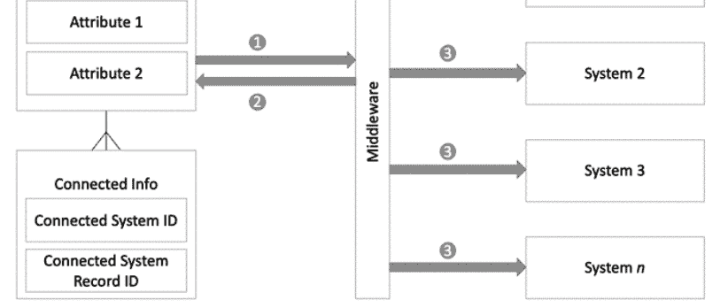

1 从 Salesforce 调用数据更新

2 中间件查询与 Salesforce 记录关联的系统标识符

3 对与 Salesforce 记录关联的系统进行数据更新

图 3.2 – Salesforce 持有黄金记录关联

在下一节中，我们将研究当中间件持有记录关联时黄金记录的表示方式。

#### 中间件持有黄金记录关联

以上一节的示例为例，如果中间件（例如 MuleSoft）持有黄金记录关联，我们基本上可以让 Salesforce 只关心自身在记录完整性方面的事，而将确保对关联系统的数据操作正确性的责任转移给中间件。这确实减少了最初查询 Salesforce 以确定这些关联系统 ID 的需求，但需要额外建立一个流程，以确保当关联系统被添加到 IT 企业或从中移除时，中间件能够得到适当更新。

下图显示了当中间件持有记录关联时，这可能如何排序：

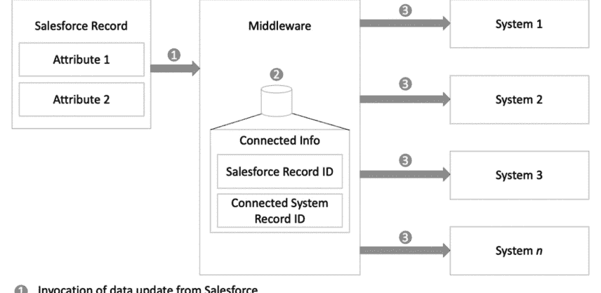

- 1. 从 Salesforce 调用数据更新
- 2. 中间件从内部数据库查询与 Salesforce 记录关联的系统标识符
- 3. 对与 Salesforce 记录关联的系统进行数据更新

图 3.3 – 中间件持有黄金记录关联

接下来，让我们看看当单独的系统或外部注册表持有记录关联时黄金记录的表示方式。

#### 单独的系统持有黄金记录关联

需要调用另一个单独的注册表系统或类似系统（通常通过中间件如 MuleSoft 协调），黄金记录不一定知道构成它的记录是什么，因此，使用标识符注册表来拼凑记录信息，然后协调对其他单独系统的调用。此操作可以由 Salesforce 调用中间件启动，使用 Salesforce 记录 ID 拼凑黄金记录，然后在注册表系统中引用以协调多个系统调用并将返回的数据处理回用户。或者，中间件或批处理系统可以按计划协调对黄金记录的数据更新。

下图显示了当单独的系统持有记录关联时数据更新可能如何排序：

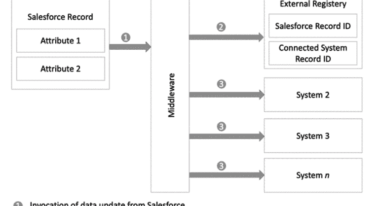

1 从 Salesforce 调用数据更新

2 中间件从外部注册表查询与 Salesforce 记录关联的系统标识符

3 对与 Salesforce 记录关联的系统进行数据更新

图 3.4 – 查询外部注册表以获取与 Salesforce 记录关联的系统标识符

当然，有时你可能希望使用保存在 Salesforce 之外的數據。

#### 使用 Salesforce Connect 实时拉取数据用于只读目的

在 Salesforce 记录上的数据不一定需要驻留在 Salesforce 内的场景中（按需从一个或多个系统或数据源拉取），Salesforce Connect 可用于有效地向用户呈现数据，就好像它驻留在 Salesforce 内一样（具有相同的用户界面和一定程度的交互性）。Salesforce Connect 使用适配器原则从外部源引入数据。例如，开箱即用提供 OData 2.0、OData 4.0 和跨组织（Salesforce 到 Salesforce）适配器，并且在 Apex 中提供编写自定义适配器的框架。

如果没有中间件解决方案（例如 MuleSoft）或确实不希望使用，则可能需要为数据访问目的建立到外部系统的点对点集成，而这正是 Salesforce Connect 的完美用例。

使用 Salesforce Connect 时，外部对象（正如你在第 2 章《数据建模和数据库设计》中回忆的那样）映射到外部系统中的数据表。此数据可以在 Salesforce 中执行操作时被用户查询和使用，例如搜索、在外部系统中的数据与 Salesforce 中保存的数据之间关联数据（使用外部或间接查找关系），或查看记录动态。

默认情况下，Salesforce 中的外部数据源是只读的，但可以使其可写。例如，想象一下从 SAP 查看订单数据，与 Salesforce 中保存的自定义账户关联。可以将外部数据源启用为可写的外部对象，以便可以从 Salesforce 创建新订单，将其写回 SAP，并在那里创建订单。

设置 Salesforce Connect 时，可能需要一种身份验证机制，以便 Salesforce 可以安全地与另一系统通信。这可能采用 Salesforce 将用于在外部系统执行查询的用户用户名/密码的形式，也可能采用更复杂的设置，例如使用外部身份验证服务（如 Microsoft Azure Active Directory）的开放式身份验证（OAuth）。

#### 使用 OData 2.0 或 OData 4.0 适配器进行外部数据检索

OData 是建立在表述性状态转移（REST）之上的协议。如 https://www.odata.org 所定义，OData 被描述为一个开放协议，允许以简单和标准的方式创建和消费可查询且互操作的 REST-ful API。

如果外部数据源可以作为 OData RESTful Web 服务公开，则可以使用 OData 2.0 或 OData 4.0 Salesforce Connect 适配器允许其在 Salesforce UI 中显示。

#### 使用跨组织适配器进行外部数据检索

可以使用 Salesforce Connect 的跨组织适配器从另一个 Salesforce 实例拉取数据。这使用 Lightning Platform REST API 来访问存储在另一个 Salesforce 实例（也称为组织或 org）中的数据，尽管实现对设置 Salesforce Connect 跨组织适配器的 Salesforce 管理员来说是隐藏的。因此，可以将一个 Salesforce 实例中的数据拉取到另一个实例中。

例如，如果你的公司收购了另一家也使用 Salesforce 的公司，但决定被收购的公司将继续保持一定程度的独立性并保留其单独的 Salesforce 系统，那么机会数据可以拉入你的 Salesforce 实例，以便可以对更完整的销售数据进行报告。

#### 使用自定义适配器进行外部数据检索

在现有适配器不合适的场景中，可以使用 Apex Connector Framework 在 Apex 中创建自定义适配器。编写此类适配器的编码知识不在考试或本书的范围内，但文档可以在此处找到：https://developer.salesforce.com/docs/atlas.en-us.234.0.apexcode.meta/apexcode/apex_connector_top.htm。

当外部数据源既不兼容 OData 2.0 或 OData 4.0，也不是另一个 Salesforce 实例时，通常需要自定义适配器。在这些场景中，需要自定义适配器与外部数据源通信，以便其数据可以在 Salesforce UI 中直接呈现、搜索和查询。

在了解了通过与保存在其他系统中的数据（系统标识符）的关系构建黄金记录数据的各种方法后，让我们探讨如何整合来自这些系统的数据属性。

#### 从多个来源整合数据属性

在设计 MDM 策略时，我们需要确定构成黄金记录的数据属性以及数据属性的来源。当多个来源可能包含相同属性时，可能需要实施清洗和去重流程，以确保企业范围内的数据属性值保持一致。根据使用的 MDM 实现方法，可能需要允许任何源系统促进对黄金记录的数据属性更新，然后触发流程将该更新推送到该数据属性的所有源系统。因此，在首次实施黄金记录时，数据质量和分类至关重要，因此应为初始黄金记录填充的一部分的数据清洗、匹配和去重策略留出时间。然后明智的做法是考虑锁定源系统以供用户创建新记录，以便在录入系统中捕获重复记录，并将创建新记录的权限几乎完全保留给集成或流程用户。这样，用户在单一位置输入数据，并在出现数据重复问题时立即被告知，源系统保持尽可能干净的状态。


不可避免地，随着时间的推移可能会出现数据问题，而报告和分析将有助于推断这些问题的原因。用户行为可以通过对数据录入系统进行培训和修改（通过使用验证和审批流程）来影响，并且可以通过对构建它们的规则库进行更改来调整自动化流程。

在了解了我们掌握的多个系统之间的数据属性整合后，让我们现在看看在处理来自黄金记录的数据时如何保留可追溯性和上下文。

#### 保留可追溯性和业务规则上下文

与我们建立黄金记录或单一事实来源一致，重要的是 MDM 策略能很好地与现有的业务规则协同工作，并且对数据的更改在整个组织中得到保留。例如，从 Salesforce Financial Services Cloud 实例中在连接的系统中创建银行账户的过程将由代表 Salesforce 行事的用户完成——这提供了一些关于该操作由何而起的可追溯性。记录在连接系统中创建或更新的规则在很大程度上仍然成立（尽管有些可能需要为 MDM 策略引入的流程进行调整）。

客户在银行的地址更新之前可能已在源系统中受到审批流程的约束。将此审批流程上移至记录系统（如我们银行示例中的 Salesforce Financial Services Cloud）可保留业务规则的上下文，以便审批仍然进行。将业务规则移至适当的系统仍可保留其上下文，便于数据管理的“谁、何时做了什么”性质。

Salesforce 提供了多种用于保留可追溯性和捕获元数据的功能。

#### 事件监控

用户事件可以在 Salesforce 事件监控中捕获，例如登录/注销事件、网页点击、API 调用、Apex 执行和报表导出。有关 Salesforce 事件监控的更多信息，请在此处查看：https://trailhead.salesforce.com/content/learn/modules/event_monitoring。

#### 设置审核跟踪

设置审核跟踪是 Salesforce 对在 Salesforce 设置区域中执行的操作所保留的日志，有助于确定系统管理员和具有某些设置权限的人员已采取了哪些操作。

#### 字段历史跟踪

字段历史跟踪允许记录和保存对 Salesforce 对象特定字段的更改（在 Salesforce 设置中配置）。这包括进行更改的用户、更改的日期/时间、旧值和新值。默认情况下，您可以跟踪每个对象的最多 20 个字段的历史记录。

#### 字段审核跟踪

字段审核跟踪是 Salesforce 的一项功能，用于定义归档字段历史数据的保留策略。这可以从数据被归档时起保留 10 年（与未启用字段审核跟踪时 Salesforce 允许的 18 个月相对）。字段历史跟踪是字段审核跟踪的先决条件（例如需要旧值和新值）。启用字段审核跟踪后，可跟踪的每个 Salesforce 对象的字段数量限制从 20 增加到 60。保留策略使用 Salesforce 元数据 API 定义。更多信息可在此处找到：https://help.salesforce.com/s/articleView?id=sf_field_audit_trail.htm&type=5。

#### 自定义元数据类型和自定义设置

自定义元数据和自定义设置便于创建和存储特定于组织 Salesforce 实施的元数据。这可能包括专有配置信息，以及例如业务逻辑的值存储。

让我们现在总结一下本章所涵盖的内容。

#### 摘要

在本章中，我们涵盖了 MDM 背后的大量理论、数据记录的单一事实来源，以及一些实施方法及其注意事项。虽然 Salesforce 通常被实施为事实上的事实来源，但了解为什么这通常推动这些决策以及它带来的好处很重要，因此花时间研究 MDM 理论是有意义的。在理解了该理论后，应能清楚 Salesforce 如何融入组织的 MDM 策略。

我们研究了数据质量在 MDM 背景下的重要性，以及为什么要保留构成单一事实来源或黄金记录的企业系统中数据属性的重要性。

我们将注意力转向 Salesforce 中的 MDM 实施，涉及中间件的使用，并强调 Salesforce 上线时必然伴随的数据迁移工作。

我们介绍了黄金记录是什么，并研究了在确定黄金记录的数据字段驻留位置以及源系统中的哪些数据字段构成黄金记录时需要考虑的各种因素。与 IT 企业中不同系统与黄金记录关联相关的架构会影响数据操作的工作方式和业务规则的运行，因此我们也涵盖了其背后的理论。我们还研究了如何保留数据质量并确保操作和流程的可追溯性和业务规则上下文，强调由于 IT 环境中引入新的数据主系统，流程运行的系统可能会发生变化。

在 *第 4 章，Salesforce 数据管理* 中，我们将深入探讨 Salesforce 许可类型如何影响数据模型和可用的共享选项。我们还将研究如何在平台上治理数据，因为这是设计可扩展、高性能的解决方案以组合来自一个或多个 Salesforce 实例的数据的关键。

#### 练习题

+ 1. *单一事实来源* 另称为什么？
+ 2. *源记录* MDM 实施方法是什么？
+ 3. 在实施 MDM 时，合并的黄金记录与黄金记录共存之间有什么区别？
+ 4. 在 Salesforce 与另一系统之间简单的点对点集成中，另一系统中记录的 ID（与 Salesforce 记录关联）应存储在哪里？
+ 5. 如果没有外部注册表且外部系统 ID 不存储在 Salesforce 中，但 Salesforce 通过中间件连接到其他系统，记录 ID 关联的理想存储位置在哪里？

#### 答案

+ 1. 黄金记录。
+ 2. 每个人都使用单一系统访问同一单一信息集。
+ 3. 合并的黄金记录是连接系统中更改的发起者。黄金记录共存意味着任何连接系统都可能发起数据更新（双向数据同步）。
+ 4. 在 Salesforce 中。
+ 5. 在中间件中。

#### 延伸阅读

- *MDM 初学者指南:* https://www.dataqualitypro.com/blog/beginners-guide-to-mdm-master-data-management
- *什么是主数据管理（MDM）？* https://www.mulesoft.com/resources/esb/what-is-master-data-management-mdm
- *Salesforce Connect:* https://developer.salesforce.com/docs/atlas.en-us.234.0.apexcode.meta/apexcode/platform_connect_about.htm

#### Salesforce 数据管理

在掌握了 **主数据管理（MDM）** 概念后，我们现在可以研究 Salesforce 数据管理。本章中，我们将研究 Salesforce 数据模型和 Salesforce 许可如何协同工作。所选择的许可类型会影响可用的对象。这可以扩展到 Experience Cloud 许可类型情况下可用的记录共享功能。

我们将研究 Salesforce 平台上的数据持久性是什么样的，以及在 Salesforce 平台上治理解决方案时如何运作。

接下来，我们将扩展来自 *第 3 章，主数据管理* 的 *黄金记录* 理论，以解释 Salesforce 平台上的 **单一客户视图（SCV）** 是什么样，以及来自多个 Salesforce 云和多个 Salesforce 实例的数据如何拼凑在一起。

因此，本章将涵盖以下主题：

- 分析 Salesforce 许可类型和对象访问
- 持久化数据
- 在 Salesforce 平台上表示客户的单一视图
- 整合来自多个 Salesforce 实例的数据

#### 分析 Salesforce 许可类型和对象访问

在本节中，我们将介绍不同的 Salesforce 许可选项如何影响用户可用的对象和标准功能。鉴于 Salesforce 产品中可用的庞大功能阵列，重要的是要确定所需的对象和功能（从内部和外部访问角度）是什么，以便购买正确的许可证。如预期，某些许可证比其他许可证更昂贵——例如，Service Cloud 许可证比 Sales Cloud 更昂贵。在 Experience Cloud 的情况下，此类许可证不仅会影响用户可用的对象，还会影响共享规则和角色层级。我们将在本节后面讨论这些影响。


由于正确获取许可的重要性至关重要，认证技术架构师（CTA）评审委员会产生的一个重要成果是《角色与许可》。这本质上是不同用户类型及其为与所提议的解决方案正确交互所需的许可的清单。作为 Salesforce 架构师，你应将此练习视为解决方案的支柱。如果出错，它会对用户的工作方式产生深远影响。

#### 重要说明

**Experience Cloud = Community Cloud：** Salesforce 已将 Community Cloud 重新品牌为 Experience Cloud。这是有意为之，代表着 Communities 从外部用户访问 Salesforce 数据的视角转变。驱动 Community Cloud/Experience Cloud 的技术已经发展到可以从中驱动整个数字体验和电子商务商店的前端，因此进行了重新品牌。为了避免疑问，Community Cloud、Communities 和 Experience Cloud 是同一事物。在撰写本文时，Salesforce 文档尚未完全更新，因此请注意你仍可能不时看到对 Community Cloud 和 Communities 的引用。

让我们现在深入探讨 Salesforce 平台上的不同许可类型。

#### 标准平台许可

核心 Salesforce 平台由以下几个产品组成：

- **Lightning Platform**
- **Sales Cloud**
- **Service Cloud**
- **Experience Cloud**

这些产品都围绕着支撑 Salesforce 平台的核心应用框架和关系数据库构建。事实上，Sales Cloud、Service Cloud 和 Experience Cloud 都可以被视为对核心 Lightning Platform 的增强。例如，Sales Cloud 拥有（其中包括）Account、Contact、Opportunity 和 Lead 对象。这些是预定义且相互关联的对象，可快速轻松地设置和促进销售流程。它们也可以被视为一组预定义的对象和相关功能，建立在 Lightning Platform 的基础之上——即关系数据库和应用层。

Service Cloud 在 Sales Cloud 可用的功能之上构建（尽管 Service Cloud 和 Sales Cloud 设计用于解决不同的用例）。由于向用户公开的功能不同，Service Cloud 采用与 Sales Cloud 不同的成本模型，因此被归类为不同的产品许可。

Experience Cloud 可以被视为进入 Salesforce 数据的透镜，并且有几种 Experience Cloud 许可类型可用。这些将在下一节中解释。Experience Cloud 仅公开对核心平台上对象的访问，因此包括 Sales Cloud 对象、Service Cloud 对象（如果已许可）和自定义对象。

在设计需要数据驻留在 Salesforce 平台上的解决方案时，请考虑你的内部用户所需的标准平台许可。一般来说，如果 Sales 或 Service Cloud 提供的标准对象旨在保存特定类型的数据或用于执行特定功能，则建议利用其周围构建的功能。

例如，当你需要潜在客户开发功能时，使用 Sales Cloud，因为这是开箱即用的 **Lead** 对象提供的功能。还有诸如 **Lead Assignment Rules** 和转换以创建 **Account**、**Contact** 和 **Opportunity** 记录等功能。自己重新创建这些对象是无效的。同样，当你对客户案例有 **服务等级协议（SLA）** 功能需求时，Service Cloud 为此目的提供了 **Entitlement** 和 **Milestone** 对象。如果你希望为客户提供访问权限，以便他们可以提出支持查询或对你出售给他们的产品提出问题，Experience Cloud 提供了实现这一目的的手段。

现在我们已经介绍了内部用户的标准平台许可，让我们来看一下外部用户访问的 Experience Cloud 许可。

#### Experience Cloud 许可

Experience Cloud 是外部用户（非公司内部人员）访问 Salesforce 的方式。在本节中，我们将查看为外部用户提供的许可类型。

Experience Cloud 许可与标准平台许可的工作方式不同，因为每种许可类型都会影响对对象和记录共享的访问。设计解决方案时有不同类型的 Experience Cloud 许可可供使用——具体如下：

- **External Apps.** 用于自定义数字体验，包括客户参与和品牌忠诚度。对 Salesforce 对象的访问有限。此许可类型可与 Person Accounts 配合使用。
- **Customer Community.** 用于 **面向消费者（B2C）** 体验，拥有大量需要访问 **Case** 对象或 Salesforce 知识库的用户。此许可类型可与 Person Accounts 配合使用。
- **Customer Community Plus.** 用于 B2C 体验，其中用户需要访问报表和仪表板并需要高级共享。此许可类型可与 Person Accounts 配合使用。
- **Partner Community.** **企业对企业（B2B）** 体验，其中用户需要访问 **合作伙伴关系管理（PRM）** 对象，例如 **Lead** 和 **Opportunity**。此许可类型不能与 Person Accounts 配合使用。

这在以下图表中进行了说明：

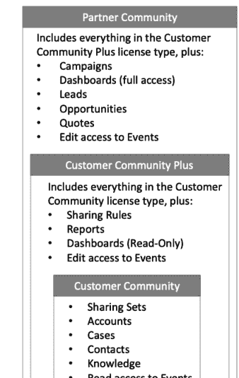

图 4.1 – Experience Cloud 许可类型差异

#### 重要说明

**何时使用不同的 Experience Cloud 许可类型：** 简而言之，有一种相对简单的方法来确定 Experience Cloud 站点应使用哪种许可类型。

一般来说，从 Customer Community 许可类型开始，然后根据你的需求进行调整，如下所示：

如果需要高级共享（超出共享集）对报表和仪表板的只读访问，请升级到 Customer Community Plus 许可。

如果需要 **Lead** 或 **Opportunity** 对象访问，或需要创建报表和仪表板的能力，请选择 Partner Community。

当然，还有额外的细微差别（在 https://help.salesforce.com/s/articleView?language=en_US&type=5&id=sf.users_license_types_communities.htm 中进行了解释），但这应该是学习考试时入门的好方法。

#### 非核心平台的 Salesforce 产品许可

Salesforce 套件中的 *非核心* 产品（如 Commerce Cloud 和 Marketing Cloud）许可方式不同。它们的许可不在考试范围内，因此本书中不会涵盖。

#### 完整产品与 Salesforce 管理包

核心平台上的 Salesforce 产品——如 Sales Cloud、Service Cloud 和 Experience Cloud——按每用户每月进行许可。每个许可都会打开更多功能并访问 Salesforce *核心* 平台上的不同实体。

Salesforce 套件中的某些产品是单独许可的，并通过连接器与核心平台交互，例如 Marketing Cloud、Pardot 或 Commerce Cloud。考试大纲涵盖核心平台使用，因此复习应集中在 *核心* 平台产品提供的数据实体和功能上。

为核心平台构建的 Salesforce 管理包，包括但不限于 Financial Services Cloud、Manufacturing Cloud 和 Health Cloud，本质上是许可的管理包，可在 *核心* 平台上安装额外的实体、应用和其他功能（如流程）。

让我们现在来看一下包许可，这也适用于托管和 AppExchange 包。

#### AppExchange 和包许可

根据 AppExchange、托管或非托管包的许可要求，权限集许可通常是许可付费包的典型方法。正如你所知，在从 AppExchange 安装包时（或直接从 Salesforce 安装，例如 Financial Services Cloud 等产品），用户需要获得正确的权限集许可，才能访问该包特有的任何对象或其他功能。在设计需要访问包公开的数据实体和其他功能的解决方案时，需要为需要访问该功能的用户授予一个或多个与该托管包关联的权限集许可。

正如你现在所知，作为 Salesforce 架构师，我们在平台上构建稳健、可扩展的解决方案以向合适的用户提供合适的功能时，有多种许可选项可供选择。这扩展到外部用户以受控方式与你的 Salesforce **组织（org）** 中保存的数据进行交互。我们现在可以转向以一致的方式在 Salesforce 平台上持久化数据。


#### 持久化数据

确保数据以一致的方式持久化对于 Salesforce 实施的长期成功至关重要。因此，了解数据质量问题的成因以及改善数据质量的可用技术非常重要，但理想情况下应尽可能在问题发生前就加以预防。

数据质量问题可能源于数据的年龄、数据的完整性和准确性、是否存在重复数据，以及数据使用方式的一致性。数据质量问题可能导致用户看到不完整或错误的信息，从而花费更多时间收集这些信息（这可能需要他们在多个系统或多个数据源中花费时间）。更糟糕的是，客户可能会因账户经理或服务代理掌握的信息不完整或不正确而受到糟糕的客户服务。最后，沮丧的用户可能会被阻止使用系统记录（SOR），转而采用离线流程，这意味着系统采用率降低或下降。幸运的是，Salesforce 提供了多种功能来解决这些潜在问题。

从数据重复开始，Salesforce 能够指定匹配和重复规则，以便识别并合并特定类型的记录，例如重复线索（如同一人多次通过 Web2Lead 捕获却存在多条线索记录的示例）。开箱即用的匹配和重复规则基于合理的默认值构建，例如共享电子邮件地址的线索或联系人可能是潜在重复项。用户会在 Salesforce 用户界面（UI）上收到通知，从中他们可以采取补救措施，例如丢弃当前记录（或潜在重复项）或合并记录信息。

在数据输入方面，可以利用验证规则来确保满足公式化条件，从而防止记录创建或更新，使用户在输入正确数据时遵守特定格式。例如，如果线索被推进到某个阶段之外，就可以使用验证规则来确保选择了某个行业字段或已输入有效的电话号码（精确到格式）。其次，可以使用选择列表（预定义的值列表）来限制用户可以对记录输入的值。当使用选择列表而不是自由文本值时，用户会被限制（以积极的方式）从受管理的列表中选择值。由此，报告和搜索变得更快、更轻松。还有依赖选择列表的概念，即一个选择列表中的值会根据另一个选择列表进行过滤或限制。这再次可用于引导用户从特定值集中选择，以推动数据质量。这些值集可以在多个选择列表之间共享，以确保所选值的<|message|>一致性（因为底层值是共享并集中管理的）。

Salesforce 具有以工作流规则和流程形式存在的声明式自动化。工作流规则可以被视为一组指令的容器，用于基于定义的标准（可以是时间限制）自动执行操作，例如发送电子邮件或更新字段。这些指令可以被视为采用“如果这样，就那样”的格式。

流程可用于执行某些记录操作，以推动数据的一致行为。例如，当创建账户时，可以运行一个流程，最终触发对信用机构的外部调用，以获取与账户记录相关的公司信用评级信息。

自动化类别中的下一个是**审批流程**。Salesforce 平台的此功能促进记录更改由用户的经理、指定用户或一组审批者提交审批。审批可以进行配置（以便一组中的一人或整组都需要批准请求），并提供变更发生的虚拟纸质 trail。例如，销售人员尝试对超过一定阈值的报价申请折扣时可能需要销售总监的批准。Salesforce 的审批流程机制非常适合这种行为。

最后，可能还需要数据清理。Salesforce 本身不包含原生数据清理功能，但 AppExchange 套件和外部工具存在，可促进数据的实时清理、丰富和去重，无论是在平台上原位进行（对于 AppExchange 套件而言），还是在平台外进行，其中需要数据的导出/导入（对于功能齐全的离线工具而言）。

虽然数据清理功能本身并非平台原生，但有一些字段类型和配置选项可以利用，使在分类、清理和去重数据时生活更轻松。这些通常是选择列表、复选框和查找过滤器。

简而言之，**选择列表**用于将输入限制为一组预定义值之一（可以是全局值集以实现组织范围内的选项统一）。**复选框**用于真/假值选择，而**查找过滤器**可以确保待选值的范围被缩小到根据过滤标准确定的适用值。

在制定数据管理策略时，考虑要灌输（并在可能的情况下应用报告和验证）何种约定可能是明智的。例如，对于**英国（UK）**公司，始终将后缀 *Limited* 缩写为 *Ltd*。虽然这是一个过于简化的示例，但其原则是数据创建、更新和查看的一致性可确保在处理数据时不会产生混淆，并且数据可以保持一致状态。

这就自然引出了数据质量如何被监控的问题。应从一开始就设计一个计划，以确定如何识别数据以及将如何处理它，直至此类活动的负责人和所有者。例如，销售团队需要在每个月末审查并更新所有不完整的线索记录，以符合业务的数据完整性或格式要求。这样一来，团队就知道每个月开始时的数据集比上个月结束时更好。

现在我们已经介绍了如何在 Salesforce 平台上以一致的方式持久化数据，我们现在可以看看 Salesforce 如何在其平台上解决*客户单一视图*的概念。

#### 在 Salesforce 平台上表示客户的单一视图

客户的单一视图（有时称为 SCV，但含义完全相同），代表每个客户统一的 360° 视图。如第 3 章《主数据管理》所述，可以使用集成层来生成黄金记录，其中它从多个来源整合数据（使用标识符（ID）注册表或 Salesforce 中的 ID 与记录相对应）。此外，数据清理、去重和丰富可以包含在整合客户数据的过程中。

你可能知道也可能不知道，并非所有 Salesforce 云都位于相同的底层基础设施上，因此 Salesforce 提供了各种连接器和加速器来克服这一点。示例包括以下内容：

- Marketing Cloud 连接器——连接 Marketing Cloud 和 Sales Cloud
- Pardot 连接器——连接 Pardot 和 Sales Cloud
- Commerce Cloud（B2B 和 B2C）的 MuleSoft 加速器和连接器

Salesforce 将各种技术和连接器整合形成一个名为 Customer 360 的产品。例如，可以使用连接器和 MuleSoft 作为集成平台，从多个 Salesforce 云中整合数据来构建全局配置文件。例如，客户的 B2C Commerce Cloud 配置文件、Service Cloud 配置文件、Experience Cloud 配置文件、Marketing Cloud 配置文件和外部系统数据都可以整合在单个全局配置文件 ID 下。其示例是零售的 Salesforce 架构，网址为 https://help.salesforce.com/s/articleView?id=sf.icx_b2c_solution_architecture_overview.htm&type=5。

让我们现在来看看 Customer 360 平台的不同元素。

#### Customer 360 平台的元素

Customer 360 平台有几个区域对数据架构考试有用。接下来将进行说明。

#### Salesforce Customer 360 Data Manager

Customer 360 Data Manager 是 Salesforce 的解决方案，用于连接 Salesforce 产品、Salesforce 实例、Commerce Cloud B2C 实例和其他数据源中的以客户为中心的数据。数据通过一个视图呈现，以提供客户的单一视图。

Salesforce 然后在其上叠加 Einstein 仪表板，提供数据验证功能。已匹配以形成全局配置文件的源记录数据可以从单个位置进行管理，包括编辑和删除源数据。


There is also the concept of a **Cloud Information Model (CIM)** that maps data to a common schema. This provides a single representation of that data in connected data sources.

Salesforce technologies such as Marketing Cloud, MuleSoft, and Commerce Cloud form part of a Data Manager solution, as data points exposed in these technologies form the data points of the customer representation.

These concepts should be familiar given the concepts and theory we covered in *Chapter 3, Master Data Management.*

Next up, let's look at Customer Identity.

#### *Salesforce Customer Identity*

Salesforce Customer Identity is a name given to a suite of technologies that allow (from an **Identity and Access Management**, or **IAM**, perspective) customers and partners to access your Salesforce instance and interact with your brand. Salesforce Identity concepts apply here, with the addition of Experience Cloud sites as the means upon which your brand is interacted with. As you may already know, Experience Cloud sites can be set up to use **Open Authentication (OAuth)**, **Single Sign-On (SSO)** (if not through an OAuth provider such as Facebook or Google), and passwordless login. It's also possible to use Customer Identity to embed a login experience into an existing website (such as an e-commerce site at the checkout stage). This provides a touchpoint to customers and allows for the collection of information such as an email address, currency preference, and so on.

This functionality requires External Identity or Community license types.

Lastly, let's investigate the **Customer Data Platform (CDP)**.

#### *Salesforce CDP*

In what can be thought of as an evolution of the traditional **Customer Relationship Management (CRM)** system, Salesforce CDP layers on engagement information (from Marketing Cloud) and buying information (from Commerce Cloud), along with integrated data sources using MuleSoft. In a nutshell, it is used to unify and segment data so that experiences for customers that are powered by the Salesforce Platform can be targeted and personalized to them. Customers can be engaged using their preferred channels and have a personalized experience that transcends sales, service, commerce, and marketing because these technologies are all connected, and the single view of the customer is exposed through the Salesforce Platform.

Now that we've explored how we can represent a single view of the customer on the Salesforce Platform, let's now look at how an important part of that process—data from multiple Salesforce instances—can be achieved.

#### Pulling together data from multiple Salesforce instances

Salesforce data architects must be able to design how to effectively consolidate, process, and leverage data from multiple Salesforce instances. While there are pros and cons of using multiple Salesforce instances within the boundaries of an **Information Technology (IT)** enterprise, there are instances where knowing how to best leverage the data from those multiple instances together across the IT enterprise can unlock value for your users. Salesforce offers several options or solutions in bringing data from several instances of Salesforce. These can include the following:

- Salesforce Connect
- Salesforce to Salesforce
- Bulk API
- Batch Apex

These are explained in the following sections.

#### Salesforce Connect

As explained in *Chapter 3, Master Data Management*, Salesforce Connect is a method for pulling in data from external data sources, using the OAuth 2.0 protocol, OAuth 4.0 protocol, or a custom Apex adapter for external data access.

Salesforce Connect is useful for surfacing data that isn't mastered in Salesforce yet can form part of the **Single Source Of Truth (SSOT)**. Consider a financial institution that has bank account information in Salesforce. Given the relative frequency in which transactions on a bank account may occur, it may make sense to surface that data on demand rather than store the transactions in Salesforce. This is a perfect use case for Salesforce Connect.

Read more about Salesforce Connect at https://help.salesforce.com/s/articleView?id=sf.platform_connect_about.htm&type=5.

#### Salesforce to Salesforce

Salesforce to Salesforce is a technology that's used to share data across Salesforce instances. Essentially, a connection is made between Salesforce instances, and then data sharing is set up so that users can see shared data and updated information from another Salesforce instance in their own Salesforce instance. Users only have access to shared records as they are mapped to records in their own org, and therefore the original data records in the external Salesforce org aren't directly accessible to users in your org. Custom reports can be created to report on external data. Field subscriptions can also be set up to map fields in an external Salesforce instance to fields in your Salesforce instance.

Salesforce to Salesforce is useful in scenarios such as a company that has different divisions that cannot or do not share business logic. This may be since the company has made a merger or acquisition or has a group structure, such as rolling up sales data from one **Business Unit (BU)** to a parent or group BU. Salesforce to Salesforce can be one-directional or bi-directional in terms of information transfer.

More information on Salesforce to Salesforce can be found at `https://help.salesforce.com/s/articleView?id=sf.business_network_intro.htm&type=5`.

#### Bulk API

Salesforce Bulk API (version 2.0 at the time of writing) is a **Representational State Transfer (REST)**-based Salesforce-specific **Application Programming Interface (API)** used to asynchronously read, upload, or delete large quantities of data on the Salesforce Platform. A good rule of thumb is that any datasets of 2,000 records or more are suitable candidates for Bulk API operations. As per Salesforce’s documentation at `https://developer.salesforce.com/docs/atlas.en-us.api_asynch.meta/api_asynch/asynch_api_intro.htm`, datasets of fewer than 2,000 records should be used with *bulkified* synchronous API calls (adhering to governor limits, using either REST or **Simple Object Access Protocol (SOAP)** protocols with the Salesforce Platform).

Addressing the question of using Bulk API for the bringing together of data from multiple instances, this API is a candidate for cases where large amounts of data are moved from one instance of Salesforce to another. Requests are processed asynchronously, with Salesforce returning a job ID upon accepting the request that can be queried for periodic updates of the status of the job.

Read more on getting started with Bulk API at `https://developer.salesforce.com/docs/atlas.en-us.api_asynch.meta/api_asynch/asynch_api_quickstart.htm`.

#### Batch Apex

Complex, long-running processes that run on the Salesforce Lightning Platform can utilize a technology called Batch Apex. Essentially, large datasets are queried, broken down into manageable chunks of data, and then processed. It is commonplace to perform whole data-type operations on a nightly basis as Batch Apex, such as processing and archiving all accounts that have had no activity past a certain date. Batch Apex utilizes the Database.Batchable interface and the Apex scheduler can be used to facilitate a Batch Apex class being run at certain times (such as hourly or nightly).

Batch Apex lends itself well to scenarios that call for business-logic operations that need to work with lots of data. In the UK, educational institutions and schools are regularly inspected by a regulatory body. Imagine that schools, inspectors, and information such as holidays booked by inspectors and term dates of schools are all held in Salesforce. A nightly Batch Apex job is the perfect candidate to initiate and process the data when scheduling inspections for schools, which could in theory require processing down to the area an inspector is responsible for.

Read about using Batch Apex at https://developer.salesforce.com/docs/atlas.en-us.apexcode.meta/apexcode/apex_batch_interface.htm.

> **Important note**
> 
> **Batch Apex is an interface:** Batch Apex is exposed as an interface that requires a developer to write an implementation for. Therefore, Apex coding skills are required for Batch Apex operations as they require running queries and processing using bespoke code.

As we delved into *Chapter 3, Master Data Management*, an SSOT approach can be defined and then used to consolidate data when presenting data to users. This may manifest itself in a *golden record*. One such example for data consolidation whereby data is brought together from multiple data sources and forms a single view of the customer is Salesforce Customer 360 Data Manager, as explained earlier in the *Representing a single view of the customer on the Salesforce Platform* section.

#### Summary

In this chapter, we covered a range of topics related to data on the Salesforce Platform. We started by looking at licensing and how different types of licenses affect the solutions we build as Salesforce architects. Different license types afford different object/entity access and functionality. For example, the Service Cloud license allows for entitlements and milestones, meaning it facilitates an SLA mechanism. Without this license, users don't have access to the entities for entitlements and milestones.

We also looked at external user access to the Salesforce Platform through the use of Experience Cloud license types. We covered the differences afforded in terms of object access and sharing functionality and looked at the different use cases for each license type for Experience Cloud.

You may have questioned why licensing was important to cover at the start of this chapter, but by now, you'll hopefully appreciate that licensing can have a profound impact on the data access of the solutions we architect.

Next, we looked at data persistence. We revisited the concept of an SCV on the Salesforce Platform, bringing in our knowledge from *Chapter 3, Master Data Management*, and understood how Salesforce addresses the notion of a single customer through its product suite.

We also built upon knowledge acquired in *Chapter 3, Master Data Management*, in bringing together data from multiple Salesforce instances, covering the options available to us to achieve this.

In *Chapter 5, Data Governance*, we'll look at how data on the Salesforce Platform can be safeguarded and governed, including visiting the concepts that underpin compliant solutions.


#### 练习题
- 1. 在B2C场景中，需要访问报表时，需要哪种Experience Cloud许可类型？
- 2. 哪种Experience Cloud许可类型会暴露**报价**对象？
- 3. 访问知识库需要哪种Experience Cloud许可类型？
- 4. 哪种Experience Cloud许可类型仅通过共享集促进记录共享？
- 5. 哪种Experience Cloud许可类型允许创建仪表板？
- 6. 哪些Experience Cloud许可类型允许使用共享规则？
- 7. 哪种Experience Cloud许可类型允许创建报表？
- 8. 哪种Experience Cloud许可类型会暴露**潜在客户**和**商机**对象？
- 9. 哪种技术用于以**开放数据协议（OData）** 2.0或OData 4.0格式展示外部数据？
- 10. 哪种技术用于在Salesforce平台上处理和执行跨整个数据集的长时运行Apex操作？
- 11. 哪种技术用于在Salesforce平台上读取、上传或删除大型数据集？
- 12. 哪种技术用于将一个Salesforce实例中的数据展示给另一个Salesforce实例？
- 13. Customer 360是Salesforce提供的一种解决方案，旨在提供什么？
- 14. Marketing Cloud和Salesforce使用什么连接？
- 15. 在Customer 360中，推荐使用哪种技术将外部数据源的数据整合到Salesforce平台上？

#### 答案
- 1. Customer Community Plus
- 2. Partner Community
- 3. Customer Community
- 4. Customer Community
- 5. Partner Community
- 6. Partner Community和Customer Community Plus
- 7. Customer Community Plus
- 8. Partner Community
- 9. Salesforce Connect
- 10. Batch Apex
- 11. Bulk API
- 12. Salesforce to Salesforce
- 13. 客户的360度视图
- 14. 适用于Salesforce平台的Marketing Cloud连接器
- 15. MuleSoft

#### 延伸阅读

Salesforce Experience Cloud许可：

```
https://help.salesforce.com/s/articleView?id=users_license_types_communities.htm&type=5&language=en_US
```

设置共享集：

```
https://help.salesforce.com/s/articleView?id=sf.networks_setting_light_users.htm&type=5
```

Salesforce数据存储分配：

```
https://help.salesforce.com/s/articleView?id=sf.overview_storage.htm&type=5
```

CDP：

```
https://www.salesforce.com/ap/solutions/customer-360/
```

Salesforce to Salesforce：

```
https://help.salesforce.com/s/articleView?id=sf.business_network_intro.htm&type=5
```

Bulk API 2.0简介：

```
https://developer.salesforce.com/docs/atlas.en-us.api_asynch.meta/api_asynch/asynch_api_intro.htm
```

#### 数据治理

保护**Salesforce**平台上的数据是Salesforce数据架构师角色的关键部分。本章涵盖*构建合规解决方案*背后的概念，以及Salesforce平台如何提供有助于企业**数据治理**战略技术基础的功能。

在本章中，我们将讨论以下主题：

- 实施合规数据模型的注意事项
- 企业数据治理

虽然有些人可能认为数据治理是一个有点*枯燥*或无聊的话题，但请继续阅读，你会发现为什么在设计*可扩展、安全*的Salesforce平台解决方案时它很重要。数据治理占认证大纲的10%，因此在参加考试时可以获得一些宝贵的分数。

本章是数据管理、安全性和治理方面相互交织的几个主题的集大成者。在本章结束时，你将理解合规数据模型背后的概念和法规，例如**通用数据保护条例（GDPR）**、**个人身份信息（PII）**等，并且能够阐明企业数据治理是什么以及它与Salesforce平台的关系。

让我们从理解实施合规数据模型的注意事项开始。

#### 实施合规数据模型的注意事项

Salesforce认证数据架构师认证大纲在数据治理的背景下讨论了实施**合规**数据模型。作为Salesforce数据架构师，我们有责任确保能够推荐一种设计数据模型的方法，使其符合以下等法规中规定的**合规标准**：

- **通用数据保护条例（GDPR）**，欧盟
- **加州消费者隐私法案（CCPA）**，美国
- **个人信息保护法（PIPA）**，日本
- **通用数据保护法（LGPD）**，巴西
- **个人信息保护和电子文件法案（PIPEDA）**，加拿大

这包括审查可用于识别、分类和保护敏感数据的各种选项。

我们现在来看这样一项法规，即GDPR。

##### 什么是GDPR？

GDPR是欧洲数据保护法，规定了如何处理欧盟个人的个人信息。

GDPR旨在控制组织或政府如何使用信息。个人有权知道他们的信息是如何被收集、处理和存储的。他们有权要求公司、政府或实体提供其持有的关于他们的信息，并有权被遗忘。如果提出这样的请求，持有数据的组织必须删除该数据，但须遵守公平数据处理原则（个人在自由选择加入收集此信息的公司或实体时必须已被告知该原则）。公司有法律义务公平地收集信息，仅将其用于所需的特定目的，安全地存储信息，并在不再需要时删除信息。如果公司违反GDPR，罚款可能高达2000万欧元或年度全球营业额的4%中的较高者（这是根据GDPR本身的规定）。

从软件应用程序的角度来看，遵守GDPR的影响包括确保应用程序数据模型能够记录同意和隐私偏好。正如我们已经知道的，Salesforce包含几个标准对象来帮助记录偏好和同意（例如Individual对象）。可以根据特定需求添加额外的自定义对象。

##### Individual对象

根据https://developer.salesforce.com/docs/atlas.en-us.api.meta/api/sforce_api_objects_individual.htm上的Salesforce文档，`Individual`对象代表客户的数据隐私和保护偏好。基于Individual对象的数据隐私记录存储客户的偏好。数据隐私记录与相关的潜在客户、联系人、个人账户和用户相关联。

当启用`Individual`对象时，可以通过将`Individual`字段添加到**潜在客户**、**联系人**和**个人账户**页面布局来向用户公开。

> **重要说明**
> 启用`Individual`对象：如果在Salesforce中启用了**数据保护和隐私**，则`Individual`对象可用。这可以通过在**Salesforce设置**中的**数据保护和隐私**下选择**在记录中提供数据保护详细信息**来完成。

##### *处理GDPR数据*

个人数据和敏感个人数据受GDPR保护，需要**识别**、**分类**和**保护**。Salesforce如何帮助解决数据保护问题？Salesforce包含多项功能来帮助保护数据免受未经授权的访问，包括以下内容：

- Classic和平台Shield加密
- 数据掩码
- 字段级安全
- 共享设置
- 事件监控
- 会话安全
- 字段历史跟踪

让我们详细讨论这些主题。

##### *Classic加密*

包含在基础许可证中的**classic加密**使用128位**高级加密标准（AES）**为自定义字段（一种独特的自定义字段类型）的静态数据提供加密。用户需要在其配置文件或通过分配的权限集启用**查看加密数据**配置文件权限才能读取加密字段值。Classic加密有助于对没有权限读取值的用户掩码加密字段。他们将看到一系列星号。使用classic加密的加密字段无法搜索，也不能用于Flow、审批流程、工作流更新等自动化操作。因此，在加密某些仅以掩码方式存储数据、供不应查看记录的人查看的字段时，请考虑使用classic加密。如果字段需要静态加密、需要用户可搜索或可在Flow等自动化场景中读取，请考虑改用Shield加密。


> **重要提示**
> 经典加密实际上是*免费*的：它随任何基础许可证提供，因此不会产生额外费用。

#### Shield 加密

**Shield 加密**（需额外付费）使用 256 位 **AES** 提供静态数据加密。虽然 Shield 加密不提供字段值的数据脱敏，但它允许对标准字段和自定义字段进行加密，且无需特殊字段类型。配置字段时，可以设置加密参数。使用 Shield 加密的字段可以被搜索，并可用于 **Flow** 等自动化工具中。此外，**Salesforce Shield** 允许你加密**文件和附件**。你可以在 https://developer.salesforce.com/docs/atlas.en-us.securityImplGuide.meta/securityImplGuide/security_pe_vs_classic_encryption.htm 了解更多关于经典加密和 Shield 加密之间的差异。

> **重要提示**
> Shield 加密适用于标准对象：经典加密不适用于标准对象。因此，如果需要加密标准对象上的数据，你就需要投入采用 Shield 加密。

#### 字段级安全性

正如*第 2 章“数据建模与数据库设计”*中所述，**字段级安全性**在配置文件和权限集级别设置，简单来说，它决定用户是否可以看到某个字段、读取其中的值，或编辑该字段中的值。字段级安全性是一种实际可行的方法，用于判断用户是否应有权访问某个字段，以及如果应该有，该访问权限是只读还是读/写。

#### 共享设置

同样在*第 2 章“数据建模与数据库设计”*中提到的，**共享设置**（如**组织级默认值（OWDs）**）可用于规定用户对 Salesforce 实例数据的默认访问级别。

#### 事件监控

作为 Salesforce Shield 套件的一部分，**事件监控**允许访问一个名为 **EventLogFile** 的仅限 API 的对象、**LoginEvent** 对象、**事务安全**，以及一个 **Event Monitoring Analytics** 应用程序。

启用事件监控后，可以通过 API 或使用 Tableau CRM 应用直观查看事件类型来理解事件并对其采取行动。当通过 API 对事件采取行动时，可以判断出诸如“不可能行程”之类的使用情况。不可能行程是指在时间上接近但地理位置相距遥远的登录或页面请求，使得在特定时间内从这些位置进行访问不可能实现，并可能具有恶意。

你可以访问 `https://help.salesforce.com/s/articleView?id=000339868&type=1.` 了解如何启用事件监控。

#### 会话安全设置

可以为用户在访问 Salesforce 时配置与会话安全相关的设置，以保护平台中组织数据的安全访问。

会话设置涵盖广泛的主题，包括**超时设置、缓存、多因素身份验证**，以及用于访问敏感数据的**高保障会话**。

你可以在 `https://help.salesforce.com/s/articleView?id=sf.admin_sessions.htm&type=5.` 了解更多关于会话安全的信息。

#### 字段历史跟踪

最后（但绝不是最不重要的），**字段历史跟踪**是一个强大的工具，可以了解谁对特定的一组对象字段做了何种更改。某些字段更改可能需要贵公司进行跟踪——例如，谁更改了 **Opportunities** 上的 **Stage** 选择列表，记录旧值和新值、更改者以及更改时间。字段级安全性允许通过 Salesforce *开箱即用*地跟踪每个对象的 20 个字段，不过 Shield（需要单独的订阅/付费）可以将每个对象的该限制提升至 60 个字段。此外，使用 Shield 时，字段历史数据会在 18 个月后归档，并保存 10 年。

你可以在 `https://help.salesforce.com/s/articleView?id=sf.tracking_field_history.htm&type=.` 了解更多关于字段历史跟踪的信息。

现在我们已经了解了如何实现合规的数据模型（包括 Salesforce 平台上可用的各种工具和技术），接下来让我们把注意力转向企业数据治理。

#### 企业数据治理

作为数据架构师，我们必须审视设计企业数据治理策略并将其在组织中实施时的各种方法和考虑因素。

为了更好地理解这一点，下图显示了企业数据治理策略的组成部分：

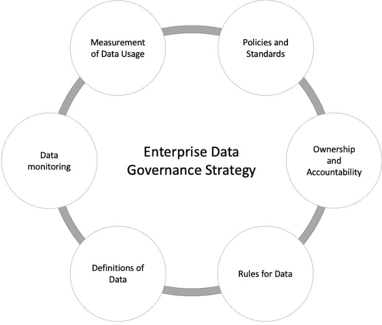

图 5.1 – 企业数据治理策略的组成部分

企业数据治理策略包含几个关键要素，包括以下几点：

- **数据政策和标准：**
  - 数据必须遵守哪些外部政策、规定或标准？例如，企业是否是金融服务机构，因而在数据治理方面需要考虑监管机构的要求？
  - 数据必须遵守哪些内部政策？例如，是否有与 PII（个人身份信息）相关的内部政策？
- **数据的所有权和问责制：**
  - 谁拥有数据？
  - 谁对数据负责？
- **数据规则：**
  - 围绕数据已经制定了哪些规则？
  - 需要制定哪些规则？
  - 谁来监督这些规则？
- **数据定义：**
  - 数据字典在哪里定义、存储和管理？
- **数据监控：**
  - 对数据进行了哪些监控？
  - 需要监控哪些系统？
  - 监控的目的是什么？
- **数据使用度量：**
  - 数据使用情况是根据哪些度量或**关键绩效指标（KPIs）**来衡量的？

在介绍了这些企业数据策略组成部分之后，应该明确的是，所提出的这些问题本身就凸显了制定健全的数据治理策略的重要性。鉴于数据对组织的价值（以及确保其受到如此对待的法律法规），从收集、定义、使用、监控到度量，对数据进行治理对于保护这一或许是组织最宝贵的资产至关重要。

现在，让我们来看看数据治理中涉及的一些角色和职责。

#### 角色与职责

企业数据治理框架可能包含不同的角色和职责，这就是为什么每个组织会有不同的需求。每家公司都需要根据其具体需求实施合适的数据治理模型。

让我们以可视化方式呈现数据治理框架中的角色：

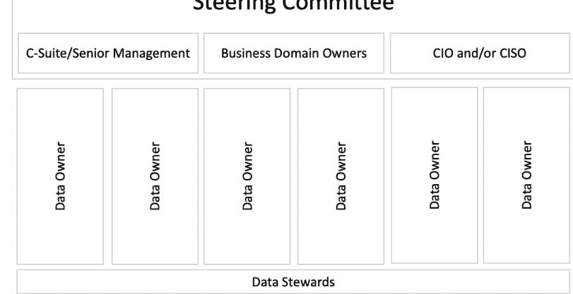

图 5.2 – 企业数据治理角色框架

在各种数据治理框架中，以下角色通常具有共性：

- 指导委员会
- 数据所有者
- 数据管家

让我们更详细地了解每个角色。

#### 指导委员会

**指导委员会**是由高级管理层、负责特定业务职能（如销售或服务）的人员以及 C 级高管（几乎肯定包括**首席信息官（CIO）**，有时还有**首席信息安全官（CISO）**）组成的一个议事机构。

该委员会承担多项职责，包括制定数据治理策略、与数据管家合作，以及确保数据治理职能能够被问责（其中可能包括各种具有特定交付物、成果和截止日期的工作计划或项目）。

#### 数据所有者

**数据所有者**是指负责确保某个数据域中的信息在组织 IT 企业系统和业务职能（如销售）中得到治理的个人或团队。数据所有者可能是指导委员会的成员（如果数据所有者同时也是 C 级高管或负责某个业务职能，如服务部门）。数据所有者通常负责以下事项：

- 批准数据定义（关于数据的描述或元数据）。
- 确保整个企业信息的准确性。
- 数据的质量。
- 参与、审查、完善并批准主数据管理的业务方法。这可能包括审查或定义影响主数据管理方法及其实施的计划及其他附加工作项或工件。
- 与其他数据所有者协作，处理整个企业范围内的数据问题并加以解决。
- 与指导委员会合作，特别是在解决方案上提供意见（数据所有者可提供 SME 知识）。此外，他们必须对软件的选择和使用提供意见，并定义和审查其数据域的政策或其他监管要求（例如，英国金融服务组织的一个例子是**金融行为监管局（FCA）**，该局对数据处理有严格要求）。

#### 数据管家

**数据管家**负责企业中数据的日常管理。他们是**主题专家（SME）**，能够理解并传达其业务领域中数据的含义、定义和用途（以及其业务线中的其他相关信息）。数据管家与整个业务范围内的其他数据管家合作，围绕业务数据的治理做出决策。

简而言之，数据管家负责以下事项：

- 成为其特定数据领域的 SME（主题专家）
- 识别、处理并解决其自身及其他数据管家数据中的问题
- 向特定数据域内的数据所有者和其他相关利益相关者汇报
- 在整个业务范围内开展工作，确保其数据得到其他数据管家和数据所有者的管理和理解


正如你现在所知，在企业数据治理框架下存在不同的角色，每个角色都有明确的职责。沟通是确保这些角色协同工作的关键驱动因素。这就是为什么指导委员会如此重要，它能够对数据所有者和数据管理员进行问责。

让我们总结一下本章我们所学的内容。

#### 摘要

数据治理占 Salesforce 认证数据架构师考试测试标准的 10%。

首先，我们研究了合规性，以及在 Salesforce 中实施数据模型时必须如何考虑合规性（以 GDPR 为例）。一些公司和行业需要在保护个人数据时根据特定法规或法律法案证明其合规性。例如，英国银行需要遵守 GDPR 以保护客户数据。如果其 Salesforce 解决方案未考虑 GDPR 而实施，他们可能会面临罚款并被迫采取补救措施。随后，我们介绍了如何遵守某些数据标准或法规的实用技巧，例如使用经典加密或 Shield Encryption。

之后，我们将注意力转向企业数据治理，深入探讨组织在保护、处理和管理数据时所涉及的各种角色和职责。

将本章内容与第 4 章《Salesforce 数据管理》中所涵盖的理论相结合，你现在可以理解，有效管理和治理数据对于在 Salesforce 平台上构建可扩展且合规的数据解决方案至关重要，以及 Salesforce 提供了大量功能来促进这一目标。

在第 6 章《理解大型数据量》中，我们将研究如何在 Salesforce 平台上保护和治理数据，包括探讨合规解决方案背后的概念。

#### 练习题

通过回答以下问题来测试你对本章所涵盖主题的掌握程度：

- 1. 负责制定整体数据治理策略的职能名称是什么？
- 2. 在企业数据治理模型中，哪种角色负责识别数据问题并与志同道合的人合作解决这些问题？
- 3. 哪种 Salesforce 加密技术允许对标准对象字段进行加密？
- 4. 哪种 Salesforce 加密技术允许对自定义对象字段使用星号进行掩码？
- 5. 默认情况下，对给定对象的多少个字段可以使用字段历史跟踪进行跟踪？
- 6. 使用 Salesforce Shield 字段历史跟踪时，对给定对象的多少个字段可以进行跟踪？
- 7. 哪种 Salesforce 对象旨在捕获联系人的数据隐私偏好？
- 8. 欧盟数据隐私法规的缩写是什么？
- 9. Individual 对象如何在 Salesforce 中启用？
- 10. 哪个企业数据治理角色负责批准数据定义？
- 11. Individual 对象如何向用户公开？
- 12. 哪种 Salesforce 安全措施控制用户对对象的默认访问权限？
- 13. 事件监控分析应用是什么？
- 14. 在极短的时间内从相距甚远的两个地点发生的两次登录事件被称为什么？
- 15. 哪个企业数据治理角色负责数据质量？

#### 答案

以下是前面问题的答案。你能正确回答其中多少个？在此核对你对前面问题的答案：

- 1. 指导委员会
- 2. 数据管理员
- 3. Shield Encryption
- 4. Classic encryption
- 5. 20
- 6. 60
- 7. Individual 对象
- 8. GDPR
- 9. 通过在 Salesforce 设置中启用数据保护和隐私
- 10. 数据所有者
- 11. 通过将其添加到线索、联系人和人员账户页面布局中
- 12. OWDs
- 13. 一个从 LoginEvent 和 EventLogFile 对象读取数据的 Tableau CRM 应用
- 14. 不可能的旅程
- 15. 数据所有者

#### 延伸阅读

请参阅以下资源以获取有关本章所涵盖内容的更多信息：

- *Individual Object:* https://developer.salesforce.com/docs/atlas.en-us.api.meta/api/sforce_api_objects_individual.htm
- *Salesforce Shield Encryption versus Salesforce Classic Encryption:* https://developer.salesforce.com/docs/atlas.en-us.securityImplGuide.meta/securityImplGuide/security_pe_vs_classic_encryption.htm
- *Enabling Salesforce Shield Event Monitoring:* https://help.salesforce.com/s/articleView?id=000339868&type=1
- *Session Security:* https://help.salesforce.com/s/articleView?id=sf.admin_sessions.htm&type=5
- *Field History Tracking:* https://help.salesforce.com/s/articleView?id=sf.tracking_field_history.htm&type=5

#### 理解大型数据量

虽然 Salesforce 平台可以处理大量数据，但对于较大/海量数据（称为 **大型数据量 (LDV)**）以及平台性能受影响的情况，需要考虑一些因素。本章涵盖 LDV 注意事项和缓解措施，以及可扩展数据模型设计和数据归档策略。

在本章中，我们将涵盖以下主题：

- 设计可扩展的数据模型
- LDV 性能缓解策略
- 数据归档策略

与使用数据库的传统应用程序不同，Salesforce 将所有数据存储在少数几个大型数据库表中。因此，与数据库相关的传统性能调优技术并不一定适用于 Salesforce 平台。相反，作为数据架构师，我们必须设计 Salesforce 实施方案以处理大量数据。这最好通过了解 LDV、它们对 Salesforce 性能的影响以及如何缓解 LDV 造成的影响来实现。本章中，我们将深入探讨可能影响性能的一些因素并讨论其缓解技术。

#### 设计可扩展的数据模型

随着 Salesforce 实施规模和复杂性的增长，数据的量也在增加。Salesforce 作为多租户架构，会自动处理扩展，但随着数据量的增长，某些操作的处理时间也会增加。

通常，不同的数据架构或配置会影响 Salesforce 平台上的两个方面：

- 加载或更新大量记录。这可以通过 UI（直接）或一个或多个集成来完成。
- 提取数据，无论是通过报表还是其他数据视图，或查询数据。

优化数据模型通常涉及以下操作：

- 仅托管基于业务目的和意图真正需要在 Salesforce 平台上驻留的数据
- 在执行某些数据操作时，推迟或临时禁用共享更改处理和其他业务规则逻辑
- 为与数据相关的给定任务或作业选择最佳（最有效）的操作

在我们深入探讨如何根据 LDV 进行识别和缓解之前，值得重新回顾一下 Salesforce 如何组织和查询数据背后的一些理论。

在第 2 章《数据建模和数据库设计》中，我们研究了 Salesforce 并非为我们 Salesforce 实例中的每个对象提供物理数据库表，而是基于少数几个（非常）大的物理数据库表对标准和自定义对象字段的存储进行虚拟化。

为了避免在多租户平台上为每个客户的 Salesforce 实例管理不断变化的数据结构，Salesforce 使用这种虚拟化技术。与数据库相关的传统性能调优技术并不一定适用于 Salesforce 平台，因为你 Salesforce 实例的底层数据结构与向用户和管理员展示的感知数据结构不同。Account 和 Contact 被视为两个不同的数据实体，在传统的 Relational Database Management System（RDBMS）中它们将是单独的表。然而，在 Salesforce 中，它们是从与同一节点上的其他 Salesforce 组织共享的大表虚拟化而来的，例如 EU6。如果你尝试基于 Salesforce 组织的虚拟化数据和架构应用 RDBMS 性能调优技术，你不会在实例的实际底层数据结构（或就此而言 Salesforce 节点）上看到预期的效果。完整的 Salesforce 节点列表可在 https://trust.salesforce.com 找到。

现在，让我们来看一下搜索数据、理解索引以及它们如何影响搜索性能。

#### 搜索 Salesforce 数据

简而言之，搜索是通过自由格式文本查询两条记录的行为（即向搜索引擎输入一个字符串并返回结果）。Salesforce 搜索架构与对象和记录数据的存储位置不同。它在 Salesforce 应用架构中使用自己的数据存储，专门为搜索自由格式文本而设计。这基本上就是 Salesforce 平台上如何实现自由格式文本搜索操作。


作为 Salesforce 数据架构师，您可能已经熟悉向实例用户展示搜索功能的各种方式。Salesforce 在应用程序的多个位置提供搜索功能，包括以下位置：

- 全局搜索
- 高级搜索
- 查找字段
- 重复处理（基于匹配规则）
- 知识库
- 建议解决方案
- Web2Lead
- Web2Case
- Salesforce 对象搜索语言 (SOSL)，与 Apex 一起使用，并通过应用程序编程接口 (API) 使用

让我们来看看索引数据，以及 Salesforce 在执行搜索时如何使用这些索引。

#### 索引数据

要在 Salesforce 中搜索数据，必须先对数据进行索引。Salesforce 有一组独立的搜索索引服务器用于**索引**操作，当发生新建或修改数据事件时，这些服务器会生成并处理索引操作的队列条目。因此，搜索索引是一个异步操作。Salesforce 建议（根据 https://developer.salesforce.com/docs/atlas.en-us.salesforce_large_data_volumes_bp.meta/salesforce_large_data_volumes_bp/ldv_deployments_concepts_search_architecture.htm）被索引的文本可能需要 15 分钟（甚至更长时间，具体取决于已创建或修改的数据量）才能变为可搜索。

#### Salesforce 如何执行索引搜索

当用户通过 UI、API 或需要通过 Apex 代码调用搜索的操作执行搜索时，Salesforce 将搜索为相应记录创建的索引。Salesforce 会利用这些结果，然后应用访问权限、搜索限制以及任何其他筛选条件或筛选逻辑，将结果缩小为*结果集*。结果集通常包含对调用搜索的用户或操作最相关的结果。当*结果集*达到预定义大小（由 Salesforce 查询优化器在内部指定）时，搜索结果中的其余记录将被丢弃。然后使用*结果集*来调用实际数据库查询，以返回用户将看到的记录，或者操作将返回到调用进程（如果是由 Salesforce API 或通过 Apex 代码调用的记录搜索）。

既然我们已经了解了 Salesforce 如何查询数据，接下来让我们看看与记录相关的操作如何受到单个父记录的过多子记录（也称为数据倾斜）的影响。

#### 数据倾斜及其对性能的影响

在考虑和设计 Salesforce 中的记录所有权策略时，请始终将 10,000 这个数字牢记在心。当 Salesforce 中同一父记录拥有超过 10,000 个子记录时，就会出现称为数据倾斜的问题。

数据倾斜有三种不那么令人愉快的类型：

- 账户数据倾斜
- 所有权倾斜
- 查找倾斜

我们稍后将更详细地探讨每种数据倾斜类型，但请记住，如果您设计的数据策略有助于分散记录所有权，使任何一条记录都不会成为超过 10,000 个子记录的父记录，那么您就不必担心数据倾斜会影响 Salesforce 实例的用户。

##### 账户数据倾斜

某些 Salesforce 标准对象（包括 Account 和 Opportunity 对象）具有特殊的数据关系，在私有共享模型下维护父记录和子记录的访问权限。账户数据倾斜是指一个账户拥有过多子记录。因此，在考虑账户记录所有权策略时，请考虑适当分散记录。不要创建一个通用的未分配或桶式父账户记录，并认为这样就足够了，因为当神奇的 10,000 个子记录数量达到时，您的用户会不高兴。账户数据倾斜出现时，会发生两个主要问题，即记录锁定问题和共享问题。

想象一下更新属于同一账户的大量子记录（例如联系人或机会）。由于 Salesforce 维护数据库的完整性，当对子记录进行更新时，它会同时锁定正在更新的记录和父账户。当更新大量属于同一账户的子记录时，这些锁可能导致错误，例如一条记录更新锁定了父账户。这意味着其他子记录的更新可能无法进行，您的用户将看到错误提示。这可不妙。

现在，让我们将注意力转向在更改父账户或子记录的共享时可能出现的共享问题。由于 Salesforce 会重新计算对父账户或子记录的访问权限，这种共享重新计算将花费时间。您猜怎么着？这些记录在共享重新计算期间也会被全部锁定。当我们考虑到涉及角色层次结构和共享规则的重新计算时，这些锁的持续时间可能会超过预期，并导致向用户返回错误。

##### 所有权倾斜

当同一对象类型（例如 Contact）的大量记录（想想我们的神奇数字 10,000）由单个用户拥有时，会导致称为所有权倾斜的性能问题。Salesforce 中的每条记录都必须有一个所有者（由于基于所有权的数据模型），因此在需要共享计算来管理由同一用户拥有的所有这些记录的可见性时，这可能会导致性能问题。同样，这也是尽可能避免使用通用的单一未分配或桶式父记录的另一个原因。

当导致所有权倾斜的用户存在于角色层次结构中时，记录删除或记录所有权更改等操作需要 Salesforce 平台从（导致倾斜的）所有者以及角色层次结构中指定的所有者的所有父用户，最后从通过共享规则获得访问权限的所有用户那里移除记录的共享。记录所有权更改本就被视为一项代价高昂的操作，因为它们会锁定记录并在重新计算共享时花费大量时间。所有权倾斜加剧了这一过程。

在无法避免所有权倾斜的情况下，Salesforce 建议不要为该用户分配角色。这样，角色层次结构实际上就会从任何共享或权限计算中移除，从而在执行这些操作时对性能的影响较小。

##### 查找倾斜

Salesforce 中的查找字段类型应被视为对象之间的外键关系。每次用户插入或更新记录时，Salesforce 平台都会锁定该记录上每个查找字段所引用的记录（例如，正在创建或更新的 Contact 记录的父账户）。通过锁定引用的记录，Salesforce 确保当记录的插入或更新数据提交到数据库时，这些记录之间的引用完整性得以保持。因此，10,000 条或更多记录查找同一条记录可能会因 Salesforce 为维护数据库完整性而锁定记录导致的争用而降低速度或引发错误。

由于查找倾斜更难发现，因此更容易从一开始就计划适当分散记录，避免超过 10,000 个子记录查找同一个父记录，从而避免查找倾斜。

既然已经讨论了数据倾斜及其对性能的影响，接下来让我们将注意力转向数据虚拟化。

#### 数据虚拟化

数据架构师应该问自己的一个关键问题是，我是否需要在 Salesforce 中存储这些数据？

虽然 Salesforce 提供了可扩展的架构，让用户能够访问执行其业务活动所需的数据，但对于不断变化或大量数据的访问，可以通过允许 Salesforce 在用户需要时向其展示外部系统保存的数据来满足。想想银行账户交易、ERP 中的行项目或客户购买交易。这种技术称为数据虚拟化。


#### 自定义索引

为了加快查询性能，Salesforce 支持创建 **自定义索引**。可以将索引理解为一种按构成索引的参数排序记录的方式。通过使用排序后的索引，可以提高记录检索速度。自定义索引的启用需要联系 **Salesforce Support**。在考虑这样做之前，值得先了解一下 Salesforce 平台对大多数对象自动索引的字段：

- `RecordTypeId`
- `Division`
- `CreatedDate`
- `SystemModstamp (LastModifiedDate)`
- `Name`
- `Email (for Contact and Lead records)`
- `Foreign key relationships (Lookup and Master-Detail)`
- `The (unique) Salesforce record ID, which is the primary key for each object`

> **重要说明**
> 自定义索引可以创建在几乎所有类型的字段上，除了多选列表、文本区域（长文本或富文本）、非确定性公式字段和加密文本字段。外部 ID 字段类型默认会在该字段上创建索引，但仅支持自动编号、电子邮件、数字和文本类型用于创建外部 ID 字段类型。

Salesforce 的底层数据库架构使得自定义字段的实际数据表不适合传统的数据库索引（因为我们本质上是在谈论一个包含 Salesforce 实例中对象所有字段的大型单一物理表）。为克服此索引限制，Salesforce 会为每个运行 Salesforce 应用的基础设施节点创建一个单独的索引表，该表本质上包含该节点中的对象字段数据的副本，以及有关对象字段数据类型的信息。然后 Salesforce 可以（通过其应用层）在此单独的索引表上构建和维护传统的数据库索引。索引表对索引搜索能够有效返回的记录数设置了上限，因为只有在将查询结果返回给发出查询的进程或用户之前被视为返回的那些索引记录，才会被考虑，然后才默认为更宽泛（因此性能更差）的非索引搜索。

默认情况下，索引表不包含空记录（有时称为 null 记录，尽管 Salesforce 支持可以根据需要启用包含 null 记录的自定义索引）。如果在自定义字段上创建了自定义索引，则必须显式启用并重建索引，才能将空值行包含在索引中。

还值得知道的是，Salesforce 查询优化器（Salesforce 应用层的一项功能）维护着一个单独的数据库表，其中包含每个索引中对象和字段数据分布的统计信息。Salesforce 的查询优化器使用此表在自动化进程、用户或报表发出查询时执行预查询，以确定使用索引是否可以加快查询速度（从而提高性能）。

#### 标准索引字段

当 SOQL 查询过滤器匹配数据库中返回的第一百万条记录中少于 30% 且数据库中额外记录中少于 15%，总计不超过 100 万条记录时，Salesforce 的标准索引字段会被使用。

例如，标准索引在以下情况下使用：

- 当针对包含 200 万条记录的对象表发出 SOQL 查询时，且过滤器匹配大约 450,000 条或更少的记录（因为 100 万的 30% 大约为 300,000，而剩余 100 万的 15% 大约为 150,000）
- 当针对包含 500 万条记录的对象表发出 SOQL 查询时，且过滤器匹配大约 900,000 条或更少的记录（因为 100 万的 30% 大约为 300,000，而剩余 400 万的 15% 大约为 600,000）

在了解了标准索引字段后，让我们来看一下自定义索引字段及其使用时机。

#### 自定义索引字段

与标准索引不同，自定义索引在 SOQL 查询过滤器匹配总记录数中少于 10%，最高不超过 333,333 条记录时使用。

例如，自定义索引在以下情况下使用：

- 当针对包含 500,000 条记录的对象表执行 SOQL 查询时，且过滤器匹配 50,000 条或更少的记录（因为 500,000 的 10% 为 50,000）
- 当针对包含 500 万条记录的对象表执行 SOQL 查询时，且过滤器匹配 333,333 条或更少的记录（因为 500 万的 10% 为 500,000，但上限为 333,333 条记录，因此使用 333,333 的值）

有关索引的一些复杂细节的更多信息，请参阅 https://developer.salesforce.com/docs/atlas.en-us.salesforce_large_data_volumes_bp.meta/salesforce_large_data_volumes_bp/ldv_deployments_infrastructure_indexes.htm。

现在你已经了解了索引，让我们关注一个有助于我们避免表连接以优化基于读取的操作的解决方案。

#### 精简表

为了加快对单个对象的某些只读操作的性能，可以创建 **精简表** 以避免跨标准字段和自定义字段的连接。当精简表启用时，它们会在适当时自动使用。你不能直接创建、访问或修改精简表，因为这是由 Salesforce Support 完成的。从本质上讲，你可以与它们协作来定义精简表应包含的内容，以优化对特定字段的只读查询，例如针对账户。如果你优化的报表、列表视图或查询（因此为其创建了精简表）发生变化（例如添加新字段以响应业务用户在报表中需要额外值），你将需要联系 Salesforce 来更新你的精简表定义。

还值得注意的是，精简表不包含软删除的记录，因此当查询使用精简表覆盖标准底层表中的更广泛对象数据时，它们将不可用。

仅引用精简表中定义的字段的只读操作不需要跨标准和自定义对象字段表进行额外连接，因此可以获得更好的性能。根据 Salesforce 的说法（在 https://developer.salesforce.com/docs/atlas.en-us.salesforce_large_data_volumes_bp.meta/salesforce_large_data_volumes_bp/ldv_deployments_infrastructure_skinny_tables.htm），精简表的使用最适合包含数百万条数据记录的 Salesforce 对象，以提高对这些记录的只读操作的性能，例如执行报表和仪表板或列表视图。

精简表可以创建在所有自定义对象以及以下标准对象上：

- Account
- Contact
- Opportunity
- Lead
- Case

精简表还有一些其他注意事项。例如，精简表最多可包含 100 列，并且不能包含来自其他对象的字段。可以将它们视为针对单个对象的只读操作的优化表。

让我们看一个精简表的视觉示例：

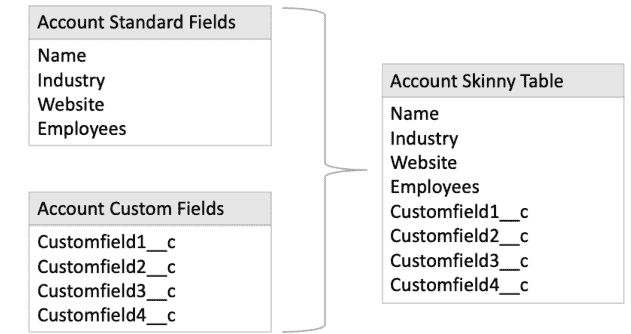

图 6.1 – 精简表示例

它们是为了在向单个对象发出只读查询以读取数据时消除跨标准字段和自定义字段的连接而创建的。

##### 选择性过滤条件

**选择性过滤条件** 可用于你的 **Salesforce 对象查询语言 (SOQL)** 查询中以提高性能。在 Salesforce 应用逻辑内部，Salesforce 平台的查询优化器功能会做出此决定，并在查询运行时确定已发出 SOQL 查询（包括报表和列表视图所需的查询）的过滤条件选择性。

在处理相对简单的 SOQL 查询时，你可以通过使用多种工具收集其统计信息来轻松确定特定过滤条件是否具有选择性，但谦逊的 **Developer Console Query Editor** 就足够了。在对选择性字段应用索引后，相关过滤条件的查询将更高效地执行。

通过确认报表、SOQL 和列表视图中的过滤条件具有选择性，然后对这些字段应用索引，Lightning Platform 查询优化器在查找目标数据时就不必执行全数据集扫描。这意味着在这种使用场景中性能将达到最佳。

#### 分区

**分区** 可用于划分数据并减少 SOQL 查询返回的记录数，从而提高调用查询的用户或进程的性能。Salesforce 为按分区划分数据提供了特殊支持（可以将其视为数据的逻辑部分），但这需要通过联系 Salesforce 客户支持专门启用。


现在我们已经了解了 LDV 缓解方法，让我们来看一下归档数据的各种方法。正如本章前面所介绍的，最理想的情况是平台上只有正确且相关的用户数据。话虽如此，让我们来探索数据归档的策略。

#### 数据归档策略

正如我们在 Salesforce 上为用户存储数据一样，也存在需要将数据归档到平台之外的情况。这可能是由于各种原因，例如监管合规性（某些数据需要保留），或保持平台上的最优数据量（例如仅保留正在使用的数据，并自动归档超过特定年龄的数据）。幸运的是，归档 Salesforce 数据有各种选项，例如使用平台内解决方案如大对象，或将数据存储在外部系统或数据仓库中。我们将在以下小节中查看这些选项。

#### 大对象

正如第 2 章《数据建模和数据库设计》中所述，**大对象**用于存储和管理海量数据（默认最多 100 万条记录，尽管这可以通过额外费用扩展到数千万甚至数十亿条记录）。

大对象无论加载多少记录都能提供一致的性能，这对于审计和归档用例非常有用，而大对象正是为此而设计的。任何需要在处理数亿或数十亿条记录时保持一致性能的需求，都是大对象所设计的使用场景。

大对象使用与主 Salesforce 平台不同的分布式数据库，并且是非事务性的。需要提醒的是，除了对象和字段权限外，大对象不支持共享。此外，这意味着自动化（例如工作流、流程和触发器）在大对象上不受支持。

#### 数据加载器

谦逊的 Salesforce 数据加载器可用于导入和导出数据。这将在下一章第 7 章《数据迁移》中详细介绍，但现在我们知道 Salesforce 数据加载器支持使用两种不同模式将数据导入和导出 Salesforce，**串行**和**批量**，它们支持不同的批处理大小和并发选项。虽然数据加载器通常是手动调用的工具，但它可以用作归档数据的简单解决方案，通过将 Salesforce 数据导出为一个或多个 CSV 文件，然后可以存储或在平台外摄取，例如在本地服务器、共享驱动器或数据仓库工具上。

#### ETL

**提取、转换、加载（ETL）**工具可用于通过 Salesforce REST、Partner 和/或 Bulk API 自动归档数据。作为定期夜间作业的一部分，可以运行来自 **MuleSoft** 等中间件解决方案的自动化流程或计划作业，其中会发出查询以检索自上次作业成功运行以来符合归档条件的数据。然后可以将此数据保存到离线数据存储中或插入到**企业数据仓库（EDW）**中。

#### 总结

在本章中，我们深入探讨了数据架构及其潜在陷阱和缓解策略。了解数据倾斜发生的原因有助于我们设计更好的父/子记录所有权策略。此外，了解 Salesforce 如何使用索引可确保我们能够创建报告、列表视图并构建查询，这些查询与多租户架构平台的约束一起工作，而不是与其对抗。因此，我们研究了 LDV 问题和缓解策略，了解诸如选择性过滤条件和精简表等概念如何用于确保我们能够有效地处理大量数据。

接下来，我们将注意力转向数据归档策略以及我们可用的各种选项，确保我们遵守数据保留和归档的监管要求（如果适用），并确保我们仅使用与用户相关的数据。

在 *第 7 章，数据迁移* 中，我们将基于对 Salesforce 平台上数据如何被索引和组织的知识进行构建，以便我们开始构建将数据导入和导出平台的有效策略。

#### 练习题

通过回答以下问题来测试您对本章所涵盖主题的了解：

- 1. LDV 代表什么？
- 2. 用于存储 100 万条或更多记录的 Salesforce 对象类型是什么？
- 3. 包含超过 10,000 条子记录的一个账户被称为什么？
- 4. 超过 10,000 条记录查找单个父记录被称为什么？
- 5. 利用托管在外部系统上的数据是一种被称为什么的技术？
- 6. 可以用来分区数据并减少 SOQL 查询和报告返回的记录数的是什么？
- 7. 可以用来避免查询中对单个对象内数据的连接并加快只读操作的是什么？
- 8. 属于同一父记录的超过 10,000 条子记录被称为什么？
- 9. 指定以下场景中使用的索引类型：
  - 当对包含 400,000 条记录的对象数据执行 SOQL 查询时，且过滤器匹配 40,000 条或更少的记录
  - 当对包含 1500 万条记录的对象数据执行 SOQL 查询时，且过滤器匹配 333,333 条或更少的记录
- 10. 是否可以在多选列表上创建自定义索引？

#### 答案

以下是前面问题的答案。您能正确回答多少个？在此检查您对前面问题的答案：

- 1. Large Data Volume
- 2. Big object
- 3. Account skew
- 4. Lookup skew
- 5. Data virtualization
- 6. Divisions
- 7. Skinny tables
- 8. Ownership skew
- 9. Custom index
- 10. False

#### 进一步阅读

有关本章所涵盖内容的更多信息，请参阅以下资源：

- *Salesforce Trust:* https://trust.salesforce.com
- *Search Architecture:* https://developer.salesforce.com/docs/atlas.en-us.salesforce_large_data_volumes_bp.meta/salesforce_large_data_volumes_bp/ldv_deployments_concepts_search_architecture.htm
- *Indexes:* https://developer.salesforce.com/docs/atlas.en-us.salesforce_large_data_volumes_bp.meta/salesforce_large_data_volumes_bp/ldv_deployments_infrastructure_indexes.htm
- *Skinny tables*: https://developer.salesforce.com/docs/atlas.en-us.salesforce_large_data_volumes_bp.meta/salesforce_large_data_volumes_bp/ldv_deployments_infrastructure_skinny_tables.htm

#### 数据迁移

数据迁移本质上是从一个或多个系统获取数据，对其执行操作（例如清洗、转换和丰富），然后随后将该数据加载到一个或多个系统中。

通常，在实施 Salesforce 时，数据迁移被视为一个独立的工作流，需要回答的问题。如何将高质量数据导入 Salesforce 平台？如何确保加载大量数据是顺畅、可靠、可重复且及时的？如何有效地从 Salesforce 平台导出数据？导入或导出数据到或从 Salesforce 平台时应遵循的正确步骤是什么？从哪里开始？

在本章中，我们将学习可用于将数据导入 Salesforce 平台的方法，包括调优和优化技术。然后，我们将探讨在进行任何大规模数据在 Salesforce 平台内外的移动时需要考虑和理解的概念和流程。我们还将学习如何有效地从 Salesforce 平台导出数据。

数据迁移由于多种原因而需要，例如当实施了新系统（例如 Salesforce）作为单一客户视图，或公司收购了另一家公司并将数据合并到另一个系统中时。另一个例子是当数据定期购买或获取时，并且该数据需要迁移到公司 CRM。因此，数据迁移是一个重要且持续进行的流程。

一些人认为数据迁移是庞大、令人恐惧的，最好交给别人，但一旦理解了概念，将数据迁移到或从 Salesforce 平台就不必畏惧。数据迁移占考试大纲的 15%。通过理解本章的材料，您将能够理解围绕数据移动和 Salesforce 平台的流程、概念和复杂性。


在本章中，我们将涵盖以下主题：

- 理解数据迁移及其注意事项
- 加载高质量数据
- 将大量数据迁移到 Salesforce
- 从 Salesforce 导出数据

#### 理解数据迁移及其注意事项

在本节中，我们将介绍数据迁移涉及的各个阶段，以及为什么在数据迁移的定义阶段投入时间很重要。当考虑将数据从一个系统移动到另一个系统时，重要的是要问自己以下问题：

- 迁移这些数据是否合适？
- 迁移数据能带来什么好处？
- 数据的质量是否足够高？
- 长期来看，这些数据将如何维护？
- 应该制定哪些治理或其他流程？

通过解决这些问题，我们实际上已经开始了数据迁移过程。虽然 IT 企业中的某个系统可能存储了部分数据，但如果仅仅因为目标系统是 IT 企业中的亮眼新组件而将数据迁移过去，这并不一定是合理的。例如，我曾与一位客户合作，他们投资了 Salesforce 以提供更好的营销和客户服务，并且在实施过程中，他们立刻认为维修管理系统中的所有数据都需要迁移到 Salesforce。这家客户生产用于测量水果和蔬菜等新鲜农产品重量的物理设备。当这些设备出现问题时，他们的检查和维修流程会使用一个仅支持人员和维修工程师才能访问的基于云的系统。当 Salesforce 被引入作为 IT 企业中客户数据的新记录系统时，他们花时间评估了 Salesforce 需要与之交互的系统，以确定哪些数据需要呈现给营销、销售和支持代理，以便与所谓的“互联客户”互动。本质上，我们谈论的是 Salesforce 将从多个数据源整合数据（听起来熟悉吗？我们在第 4 章“Salesforce 数据管理”中涵盖了这一场景背后的概念。）

在与客户交流时，他们希望重新定义服务流程，因此我们决定，将 Salesforce 作为新的客户主数据管理系统，实施基于案例的工作流。对于现有的维修数据，我们决定不从一个最终将在几年内退役并进入只读状态的系统中导入数据。为满足这一需求，我们决定使用外部对象来呈现维修数据，但将其保留在现有系统中。然而，我们实际决定做的是引入与服务权利和支持合同相关的信息，这些信息将来由 Salesforce 驱动。本质上，客户希望通过仅迁移必要数据来通过 Salesforce 提供更好的服务。通过允许现有记录在 Salesforce 中呈现，只有所需的数据被迁移过来。

在数据迁移过程开始时进行的提问环节引导我们得出了我在此解释的关于即将迁移哪些数据的设计。

质疑数据迁移过程的下一步是了解数据质量是否足够高。在与客户交谈时，有些客户相当坦率地承认他们的主要系统中有大量重复或不完整的字段。其他客户可能无法如实回答其数据质量到底如何。幸运的是，我们可以与客户合作定义指标，这些指标将明确数据质量对他们的意义。例如，哪些字段被认为是必要的？在分析数据时，我们可以快速确定哪些字段，在总记录数中所占百分比，完全没有值，或者只有非常低的填充率。我们应该质疑这些字段是否是构建质量数据集图景所必需的。我们还应该查看数据的完整性、重复计数等。我们将在下一节中更详细地讨论这一点。对于我的客户来说，数据在迁移前并不算太差。字段完整性不错，但大约 5% 的迁移记录是重复的。因此，客户需要做出决定——在迁移数据之前还是之后修复重复项。他们决定在迁移完成后修复它们。

在我们完成迁移数据的考虑之前，我们需要考虑长期的数据维护。在迁移期间或之后是否需要制定任何控制措施或程序？在访问和修改数据权限方面，源系统会发生什么？是否需要定期处理或丰富数据的流程？这是手动还是自动化的操作？哪些指标使该过程成功？这略微涉及数据迁移的治理方面，因为通常围绕数据维护的流程将构成更广泛的治理结构的一部分。对于我的客户，他们决定将 Salesforce 的匹配和去重功能作为避免重复的账户和联系人记录被录入系统的主要方式。他们将使用 Salesforce 的报告功能监控该过程，并决定如果未来出现数据质量问题，将采购合适的工具。

现在，让我们学习如何定义数据迁移流程。在下一节中，我们将介绍在其余数据迁移过程中将采取的步骤。

#### 定义数据迁移流程

在完成了关于数据迁移*是什么*和*为什么*的追问之后，就可以考虑采用更正式的流程。以下步骤序列是从一个或多个系统迁移到另一个系统的典型过程，某些步骤可以根据特定要求省略或调整位置——例如，在迁移之前或之后进行数据去重。

在多个 Salesforce 实施项目中，我在数据迁移工作流中使用了以下步骤序列：

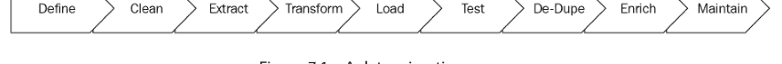

图 7.1 – 数据迁移流程

接下来，让我们探讨每个阶段以了解通常涉及的内容。

##### 定义

我们首先定义目标数据模型和客户关系管理（CRM）数据层级。这很可能是通过捕获和验证关于如何最好地支持目标业务流程的需求来完成的。定义了目标数据模型后，我们可以将注意力转向确定 IT 企业中主数据所在的位置。正如本章前面提到的，分析数据对于确定从中迁移数据的源系统中数据的质量和完整性非常有用。

接下来，有必要了解源系统的现状数据模型，以便在处理过程的提取阶段能够理解数据结构。想象一下从另一个 CRM 系统（如 Dynamics 365）迁移。虽然 Dynamics 365 具有账户、联系人和商机的概念，但它构建在 SQL Server 之上，因此使用更传统的 SQL 数据库来存储数据。在检查现状数据模型时，需要理解该实例的 SQL Server 数据库架构。我们的数据字典应该从“定义”阶段开始建立。随着我们对数据源和目标数据结构的了解加深，可以生成定义字段类型和格式（包括需要应用的任何规则）的数据字典。

确定了源系统、数据结构、选定实体和字段后，我们可以开始映射数据。我们通过定义源实体和字段将如何映射到目标数据模型（包括可能需要应用的任何转换）来实现这一点。接下来，可以定义清理、去重和丰富数据（如果需要）的策略，包括这些步骤应在流程中的哪个位置进行（例如，提取前或提取后）。

##### 清理

数据清理可以简单地定义为执行数据清洗操作的行为，无论是手动过程还是使用自动化和软件工具。对每个 IT 企业而言，清洗在数据方面的定义会有所不同；例如，确保任何联系人姓名不包含无效字符。所有清洗活动通常包括定义要用于协助该过程的任何工具，以及任何匹配规则和评分阈值。


#### 提取

提取数据涉及从源系统中获取已定义的源数据。因此，要有效地提取数据，必须对源系统、现状数据模型以及任何其他相关信息进行明确定义和充分理解。如果在所有数据提取完成后需要执行任何清洗、去重或扩充活动，则可以将所有提取的数据合并到一个暂存区中。

#### 转换

在数据被提取之后，或者在全自动**提取、转换、加载（ETL）**流程的提取阶段之后，通常需要在数据加载到目标系统之前对其进行转换。为了成功完成此操作，有必要了解在转换时要应用的任何实体映射、字段映射以及其他规则、条件或逻辑。

#### 加载

现在，我们处于流程中可以将数据加载到目标系统的阶段。在完成所有这些定义并仔细准备要加载的数据之后，我们可以选择用于加载活动的工具，例如不起眼的 Salesforce Data Loader。你可能会惊讶地发现，通过脚本让 Data Loader 在命令行上运行，或将其作为更广泛的自动化流程的一部分时，可以实现如此多的自动化。我们还需要考虑可接受的加载性能。我们可能需要加载数百万条记录，因此在可接受的时间范围内完成加载可能会有所不同，具体取决于数据迁移项目的参数、客户行业等。例如，我曾监督一家银行的数据迁移流程，该流程自然只能在银行不营业时进行（并且需要完成）。幸运的是，我们多次测试了该流程，因此在周五晚上及时完成数据加载是相对简单直接的。

#### 测试

通常有两种适用于数据迁移的测试类型：

- 按规格测试
- 按意图测试

简而言之，按规格测试涉及确保加载了正确数量的数据。例如，提取为我们提供了 1,000 条公司记录，因此我们向 Salesforce 加载了 1,000 条 Account 记录。如果加载计数为 990，则说明 1% 的数据未加载成功，我们需要调查原因。理想情况下，这应该在测试过程中被发现并纠正，但我理解在生产数据迁移当天，情况可能并不总是如此。

按意图测试可以被视为针对数据的**用户验收测试（UAT）**。加载的数据能否经受住真实环境的使用？我们的用户能否借助加载的数据按预期履行职责？数据关系是否正确关联？

在流程的测试环节中，还需要考虑的另一件事是数据的对账策略。考虑到我们已经应用的转换，我们如何确保来自各个源系统和目标系统的数据集保持一致？在覆盖了规格、意图和对账之后，我们应该能够说：我们加载了正确数量的记录，这些记录按用户的预期正常工作，并且根据转换逻辑的规定，其最终的期望状态是正确的。

#### 去重

如前所述，数据迁移流程中的去重步骤可能在流程早期进行，但如果认为更合适，也可以在迁移后进行。在对数据进行去重时，可以使用合适的工具来辅助该流程。通常会给该工具一组规则，以确定使用什么条件来匹配数据。这反过来又用于生成数据重复可能性的评分，因此应考虑将其删除。例如，构建一条匹配具有相同电子邮件地址和邮政编码的 Contact 记录的规则并非完全不合理。这些记录很可能是同一个人，因此可以将其标记为需要干预（在这种情况下，标记为删除）。如果你要将数据迁移到新的数据主库，则可能值得考虑关于传播数据更改以及将重复记录发送到下游系统的预期行为。

#### 扩充

一旦数据被加载并处于干净状态，可能希望通过纳入一次性或持续性的流程来扩充数据。例如，Salesforce 拥有大量可用的 AppExchange 软件包，可以提供扩充的公司地址和员工信息、信用评分信息等。如果有扩充数据的需求，通常对已清洗、去重的数据集进行扩充是有意义的。

#### 维护

到目前为止，我们已经定义了一个流程，仔细地映射了我们的数据，并通过提取、转换和加载数据来构建和执行该流程。在此过程中，我们对数据进行了清洗、去重和扩充。但在这个流程完成之前，我们需要覆盖最后一步（有些人可能会认为这是最难的一步）：我们需要考虑如何维护我们已经花费了如此长时间和如此多精力以正确方式送入目标系统的数据。维护自然会根据拥有目标系统的业务特征的不同而采取不同的形式。Salesforce 提供了各种工具（甚至包括基本报告），可以帮助确保数据尽可能保持良好的状态。这包括随着用户采用和使用系统，数据如何随着时间的推移而不断添加。

现在我们已经了解了数据迁移流程和步骤，让我们更深入地探讨如何加载高质量数据。

#### 加载高质量数据

当用户与数据交互时，数据必须具备良好的质量才能发挥其作用。例如，销售人员可能会查看 Salesforce 中的 Contact 记录，以拨打电话尝试向该客户进行追加销售或交叉销售。如果用户看到同一个人的多条 Contact 记录（重复记录），并且这些记录的完整程度各不相同，他们最终可能会非常恼火。因此，这些用户可能无法获得某个 Contact 的全部信息，或者更糟糕的是，他们仍然需要在记录之间来回跳转，以推断出应拨打的正确电话号码或应使用的电子邮件地址。

如前所述，在数据迁移流程中可以采取实际步骤。在加载前准备数据时，或者在数据加载到目标系统后，必须进行清洗、去重和（可选）扩充。在考虑数据的数量和质量时，对于一些企业来说，在加载之前执行清洗、去重和扩充活动可能更有意义。这样，将加载最小、最完整且无重复的数据集。

让我们将注意力转向在 Salesforce 中可以采取哪些措施来促进加载高质量数据，我们有几个工具可供使用。验证规则可用于强制字段值采用正确的格式。这可以确保记录达到基线级别的完整性。这包括确保某些字段被填写（例如，除非与销售相关的某些字段已完成，否则无法将 Opportunity 设置为特定阶段）。我们还有匹配和重复规则，用于标记重复记录并帮助用户防止创建重复记录。可以利用系统中的匹配规则来生成 Salesforce 报告，以突出显示那些需要注意的记录。最后，Flow 可用于在创建和更新数据记录时以自动化方式执行操作。在批量处理记录时，通常应关闭自动化。在日常逐条处理记录时，可以使用 Flow 等自动化来提高记录或相关记录上数据的完整性。

现在我们已经介绍了与数据质量相关的各个方面，接下来让我们看看如何将大量数据（LDVs）迁移到 Salesforce。

#### 将大量数据迁移到 Salesforce

在向 Salesforce 加载大量数据（数十万或数百万条记录）时，有多种工具和注意事项需要牢记。首先，用于将数据加载到 Salesforce 的应用程序编程接口（API）会产生巨大的影响。Bulk API 可用于并行加载大量数据（通过将其设置为并行模式）。这可能会导致记录锁定问题，即由于父记录被锁定而无法加载记录。然而，与一次一批地加载数据（称为串行模式）相比，这通常会产生更快的加载时间。减少记录锁定问题可能性的一种方法是按父记录对待加载的记录进行排序


IDs。纯粹从性能角度考虑，Bulk API 的并行模式是在最短时间内将数百万条记录加载到 Salesforce 中的最快方式。外部 ID 字段可用于在导入记录时避免重复，因为外部系统 ID 用于标识记录。这在执行例如脚本化数据加载任务时尤其有用，因为外部 ID 可用作关联父记录和子记录的键。

接下来，考虑将用于创建和更新数据的操作。Salesforce 提供了 **insert**、**update** 和 **upsert** 操作。Insert 用于数据创建，update 用于更新现有记录，而 upsert 用于更新现有记录，或在找不到要更新的记录时创建新记录。可以想象，upsert 操作在 Salesforce 资源方面的成本更高，因为在确定要执行的操作时，会对每条记录进行实时计算。因此，最佳实践是在将 LDV 迁移到 Salesforce 平台时使用 insert 和 update 操作，因为它们比 upsert 更快。

最后，重要的是要记住，Salesforce 上的数据存储是有限的，通常与购买的用户许可证数量相关联。如果你不断地将数百万条记录加载到 Salesforce 中，最终你的数据存储会用完。然而，当 Salesforce 环境被配置时，限制相当宽松。通常，数据存储设置为 10 GB（对于 2019 年 3 月下旬起配置的 Salesforce 组织）加上每个许可用户 20 MB 或 120 MB，具体取决于购买的 Salesforce 版本（因此，Salesforce Professional Edition 的 20 用户组织将拥有 10.4 GB 的数据存储）。

**重要说明**
有关数据分配和存储限制的更多详细信息，请访问 https://help.salesforce.com/s/articleView?id=sf.overview_storage.htm&type=5。

这很好地引出了下一节，我们将在其中查看从 Salesforce 导出数据。

#### 从 Salesforce 导出数据

尽管我们可能希望通过将数据移入 Salesforce 来最大化客户在 Salesforce 上的投资，但我们应考虑围绕从 Salesforce 导出数据的要求。这可能涉及导出某些数据（例如，到数据仓库平台），这通常涉及在计划的间隔（例如每晚）执行自动化流程。预期有几种技术可用于完成此任务。

##### 数据导出

Salesforce 提供两种开箱即用的导出数据方法。第一种是数据导出服务，可从 Salesforce 设置中访问。数据导出可用于手动每周或每月导出数据（取决于你拥有的 Salesforce 版本），以及安排每周（每 7 天）或每月（每 29 天）定期数据导出。

导出数据的第二种方法是来自 Salesforce 的简朴数据加载器应用程序。这可用于提取对象数据，并且如果需要，可以使用查询来过滤数据，例如按当天的最后修改日期过滤所有账户。数据加载器也可用于导出操作进行脚本编写，因为它支持仅在 Windows 操作系统上可用的命令行界面。

#### Bulk API

Salesforce 的 Bulk API 在处理数百万条记录时，用于导出数据与导入数据一样有效。例如，可以使用 Bulk API 查询高效查询大量数据（最多 15 GB），拆分为（最多 15 个）1 GB 批次。查询必须在 2 分钟内返回（否则会返回 QUERY_TIMEOUT 错误）。如果结果在 1 GB 批次大小限制内，并且批次在 10 分钟时限内处理，则会处理批次并返回结果。Salesforce 将尝试 15 次批次尝试（因此为 15 GB 限制），因此如果超出此限制，批次将被视为不成功并返回 Retried more than 15 times 错误。

##### PK 分块

Primary Key（PK）分块于 2015 年添加到 Bulk API 中，用于提高从 Salesforce 平台下载大量数据的性能。所有自定义对象和大多数标准对象都支持 PK 分块（完整列表可在 https://developer.salesforce.com/docs/atlas.en-us.234.0.api_asynch.meta/api_asynch/async_api_headers_enable_pk_chunking.htm 获取）。

PK 分块的工作方式是，当在 Bulk API 请求中启用它时，连同分块大小（例如 250,000），Salesforce 会获取要返回的数据集的最小和最大 ID，然后创建一组 SOQL 语句，每个语句都包含一个 WHERE 子句以检索给定分块大小的记录。Salesforce 合并所有结果并返回完整数据集。如果我们举例说明我们选择 Salesforce 中每个联系人的所有电子邮件地址，我们将编写一个 SELECT SOQL 语句，如下所示：

```
SELECT Email FROM Contact
```

现在，假设我们在 Salesforce 中有 100 万个联系人，并且我们设置分块大小为 100,000。这里，Salesforce 将生成 10 个 SOQL 语句，类似于以下代码块中所示的内容（其中 <ID of record x> 占位符将被实际记录 ID 替换）：

```
SELECT Email FROM Contact WHERE Id >= <ID of record 1> AND Id < <ID of record 100,000>
SELECT Email FROM Contact WHERE Id >= <ID of record 100,000> AND Id < <ID of record 200,000>
SELECT Email FROM Contact WHERE Id >= <ID of record 200,000> AND Id < <ID of record 300,000>
```

- 4. 当从 Salesforce 导出大量数据时，用于加快大型 SELECT SOQL 查询性能的方法是什么？
- 5. 哪个数据 API 促进数据以并行批次进行异步处理？
- 6. 按其父记录 ID 对要导入的记录进行排序会降低发生什么的可能性？
- 7. 真或假：upsert 在加载大量数据时被认为对性能有好处。
- 8. PK 分块是哪个 Salesforce API 的功能？
- 9. 任何数据迁移过程中的第一步是什么？
- 10. 为什么 PK 分块被认为比直接的 *Export All* 操作更快？

#### 答案

以下是前面问题的答案。你能正确回答多少个？在此检查你对前面问题的答案：

- 1. Large Data Volume
- 2. Primary key
- 3. Data Export
- 4. PK Chunking
- 5. Bulk API
- 6. Parent record locking
- 7. False. Use insert and then update as separate operations.
- 8. The Bulk API
- 9. Define
- 10. Because by breaking the query down into sub-queries, the Salesforce Query Optimizer threshold isn’t reached and therefore the performance of each query is optimal.

#### 延伸阅读

请参阅以下资源。有关本章所涵盖内容的更多信息：

- 从 Salesforce 导出数据选项：https://trailhead.salesforce.com/content/learn/modules/lex_implementation_data_management/lex_implementation_data_export
- Salesforce 中的 PK 分块：https://developer.salesforce.com/docs/atlas.en-us.234.0.api_asynch.meta/api_asynch/async_api_headers_enable_pk_chunking.htm
- 数据分配和存储限制：https://help.salesforce.com/s/articleView?id=sf.overview_storage.htm&type=5
- Bulk API 查询：https://developer.salesforce.com/docs/atlas.en-us.api_asynch.meta/api_asynch/asynch_api_bulk_query_intro.htm

### 第 2 部分：
Salesforce 数据
架构设计

将注意力转向专注于数据的 Salesforce 平台上解决方案的有效设计，本书的这一部分涵盖了有关核心数据模型、Apex 的有效使用、获取数据的选项、性能调优以及领地管理的主题。就像本书的第一部分一样，所概述的主题将在你作为 Salesforce 数据架构师的日常工作中成为一个方便的参考。

本节包含以下章节：

- 第 8 章，Accounts and Contacts
- 第 9 章，Data APIs and Apex
- 第 10 章，Tuning Performance
- 第 11 章，Backup and Restore
- 第 12 章，Territory Management


#### 账户与联系人

在核心平台云（如 Sales Cloud 和 Service Cloud）中，两个核心对象是 Account（账户）和 Contact（联系人）。这两个对象值得单独一章来描述 Salesforce 平台赋予它们的特殊行为。

在本章中，我们将介绍 Account 和 Contact 模型，包括 Person Accounts（个人账户）以及联系人关联多个账户启用带来的影响、Account Skew（账户倾斜），以及这对查询和报表性能的影响。我们还将查看与账户和联系人相关联的标准 Salesforce 数据模型中的对象。

阅读完本章后，你将理解 Account 和 Contact 数据模型，包括启用个人账户时会发生什么。你还将理解启用联系人关联多个账户功能的影响和注意事项。此外，你将了解与 Account 和 Contact 相关联的对象。最后，你将理解 Account Skew 是什么以及它如何影响你的用户。

在本章中，我们将介绍以下主题：

- 理解 Account 和 Contact 模型
- 介绍个人账户
- 探索联系人关联多个账户功能
- 探索与账户和联系人相关联的对象
- 综合应用
- 重新审视 Account Skew

##### 理解 Account 和 Contact 模型

**Account** 对象是许多 Salesforce 核心平台云产品（如 Sales Cloud、Service Cloud、Financial Services Cloud 和 Experience Cloud）的核心。**Contact** 对象代表与 Account 记录相关联的人员。

在最基本的解释中，**Account 记录**代表一家公司或类似实体，可以与一个或多个 Contact 记录相关联，例如员工。因此，Account 记录可以被视为一家公司或企业。一个 Account 记录可以拥有多个 Contact 记录，代表该公司或企业的员工。

让我们看看这种简单结构是如何在图表中表示的：

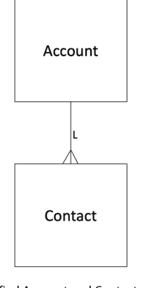

图 8.1 – 简化的 Account 和 Contact 对象关系

正如你所预期的那样，由于 Salesforce 最初专注于销售团队/销售（因此得名），Account 对象包含许多有用的标准字段，可以在最小化自定义的情况下使用。

这些标准字段包括以下内容：

- **Industry**：账户可能所属的行业选择列表，例如农业或运输
- **Shipping address**：邮寄地址
- **Billing address**：发票和文件发送的位置
- **Number of employees**
- **Ownership**：表示公司所有权结构是私有、公开、有限等
- **Standard Industry Classification (SIC)** 代码
- **Ticker symbol**：公开股票交易代码 - 例如，Salesforce 交易代码为 **Customer Relationship Management (CRM)**，其交易代码为 CRM
- **Website**：网站地址

还有其他标准字段可供使用，你可以在 https://developer.salesforce.com/docs/atlas.en-us.object_reference.meta/object_reference/sforce_api_objects_account.htm 提供的 Account 对象文档中了解更多信息。

现在我们了解了 Account 对象，让我们探索 Account 层级结构。

##### Account 层级结构

Account 记录也可以拥有父级 Account，代表公司层级。例如，你可能有一家名为 *MadeUp* 的公司，其 Account 记录包括 MadeUp Incorporated（全球集团实体）、MadeUp North America、MadeUp **Europe, Middle East, and Africa**（EMEA），以及该公司在各国的国家特定 Account 记录。

让我们用以下图表可视化我们的 Account 层级结构：

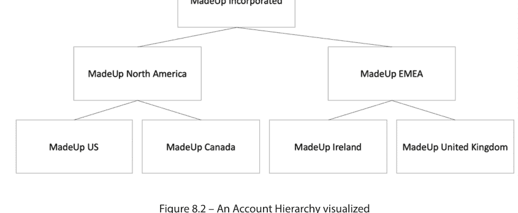

图 8.2 – 可视化的 Account 层级结构

Account 层级结构可以通过 Account 记录的 ParentId 字段填充父级 Account 记录的 Salesforce ID 来实现。这是一个标准字段，无需功能启用或自定义。

在了解了账户和联系人的业务视角后，让我们来看一下个人账户。

##### 介绍个人账户

在账户和联系人的业务视角中，账户是一家公司，联系人是该公司的员工，业务交易（Opportunities）与 Account 记录相关。在向个人销售时，例如 Financial Services Cloud 实施中的银行客户，我们需要将 Opportunities 与这些人相关联，就像它们是 Account 记录一样。这就是 Person Account 概念的用武之地。

**Person Account** 是一种特殊的 Account 记录类型，它将单个相关联 Contact 记录的部分但非全部信息提取到 Account 上。这允许将有关该人员的信息（来自相关联的 Contact 信息）在将业务交易（Opportunity）与该人员相关联时得到体现。Opportunity 仍与 Account 记录相关联以形成 Person Account。

启用 Person Account 时，Account 和 Contact 的 **Organization-Wide Defaults (OWDs)** 需要设置为 Private，或者 Contact 需要设置为 Controlled by Parent。启用后，可使用 Person Account 记录类型。之后可以根据需要创建其他 Person Account 记录类型，用于页面布局/配置文件分配以及为用户提供正确体验所需的其他功能。

要启用 Person Account，需要向 Salesforce 支持部门提交案例。启用后，Person Account 无法被禁用。此外，这对共享模型有永久性影响。鉴于启用 Person Account 的先决条件是将 Contact 的 OWD 设置为 Controlled By Parent 或 Private，请考虑启用这种广泛共享设置的永久影响。不构成 Person Account 的联系人将需要通过 Salesforce 的其他共享功能（如角色层级和共享规则）显式与用户共享。

> **重要说明**
> 
> 可以启用 Person Account 并继续像以前一样使用 Account 和 Contact 记录。以需要启用 Person Account 的 Financial Services Cloud 银行为例，银行可以针对公司和个人创建 Opportunities，分别由其 Account 和 Person Account 记录表示。

使用 Person Account 时请注意，Leads（代表人员）不会转换为单独的 Account、Contact 或 Opportunity。相反，你必须将 Lead 转换为 Person Account 和 Opportunity。

此外，Parent Account 字段不会出现在 Person Account 上，因为你无法使用 Person Account 表示 Account 层级。在绘制和可视化 Person Account 时，我更喜欢在合并的 Account 和 Contact 周围画一个虚线框，如下图所示：

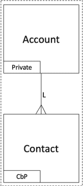

图 8.3 – Person Account 的图表表示

现在我们已经介绍了 Person Account，让我们学习如何在 Salesforce 中将一个 Contact 记录与多个 Account 记录相关联。

##### 探索联系人关联多个账户功能

如你所料，联系人关联多个账户功能允许一个 Contact 记录与多个 Account 记录相关联。启用联系人关联多个账户后，Contact 记录本质上具有一个主要 Account 记录关系和零个或多个间接 Account 关系。

> **重要说明**
> 
> 禁用联系人关联多个账户功能将有效地删除你 Contact 记录的所有间接 Account 关系。

启用后，Account 对象的标准 Contacts 相关列表可以在页面布局上替换为 **Related Contacts** 列表。Contact 页面布局可以添加 **Related Accounts** 列表。Person Account 的页面布局可以同时添加这两个相关列表。

> **重要说明**
> 
> 默认情况下，与 Contact 记录相关联的任何活动都会汇总到该联系人的主要 Account 记录。可以取消选择 **Salesforce Setup** 中 **Activities Settings** 中的 **Roll up activities to a contact’s primary account** 选项来禁用此默认行为。


现在，让我们探索围绕 Account 和 Contact 对象的更广泛对象模型。

#### 探索与账户和联系人关联的对象

尽管两者之间存在明确的关系，其中多个 Contact 记录可以属于同一个 Account，但还有几个额外的对象可以为这两个对象的记录之间的关系提供上下文。

现在，让我们从 AccountContactRelation 开始，探索各种 Account 和 Contact 对象的关联。

##### AccountContactRelation

我们在本章前面描述了联系人关联多个账户的功能，因此涵盖了单个 Contact 记录如何与多个账户关联。嗯，AccountContactRelation 对象就是实现这一 Salesforce 功能的底层数据模型实体。

AccountContactRelation 对象本质上充当 Account 和 Contact 之间的连接对象。一些标准字段用于提供 Contact 与 Account 之间关系的上下文。这些可能包括关系开始和结束的开始/结束日期等内容。它们还可能包括他们在账户中可能扮演的角色，其中可以多选。其他字段可能包括表示关系是否活跃以及关系是否指向联系人的主要账户等信息（使用 IsDirect 字段）。

该实体的底层数据模型可以可视化如下：

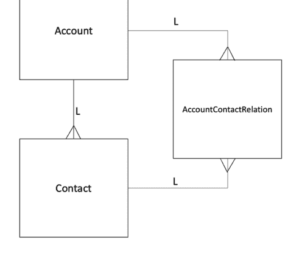

图 8.4 – AccountContactRelation 在标准 Salesforce 数据模型中的位置（OWDs 已有意省略）

现在，让我们学习如何为相关账户和联系人之间的关系提供上下文。

##### AccountContactRole

为了表示特定 Contact 记录相对于 Account 记录所扮演的实际角色，例如决策者、买方等，AccountContactRole 对象是一种轻量级的方式来关联联系人，从而提供上下文。

想象一下，你是一名使用 Salesforce 的销售人员，正在向某家公司（Account）销售。知道是谁（Contact 记录）在做什么（AccountContactRole 记录）可以使销售更有针对性，并有助于确保你能与合适的人进行正确的对话。

AccountContactRole 对象是一个连接对象，因为它包含对 Account 和 Contact 对象的查找——即 AccountId 和 ContactID 字段。顾名思义，它也是用于捕获联系人所执行角色的对象。这由 Role 字段表示。

该连接对象可以在数据模型中与 Account 和 Contact 一起表示如下：

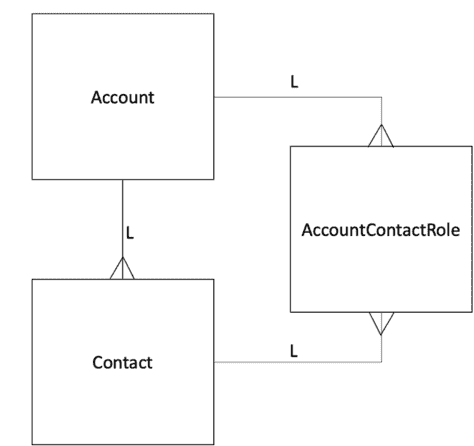

图 8.5 – AccountContactRole 在标准 Salesforce 数据模型中的位置（OWDs 已有意省略）

在介绍了 AccountContactRole 对象之后，让我们来看一下账户团队。

##### 账户团队

**账户团队**代表在账户中扮演角色的 Salesforce 用户。例如，在向账户销售或服务时，你的组织中可能有 Salesforce 用户负责管理关系、作为升级联系点等。

账户团队提供了一种将你的 Salesforce 用户与账户关联起来的方式，除了 Salesforce 中已为你的组织配置的共享模型之外。例如，你可能有一个私有账户、联系人和机会共享模型，以及一个已设置的角色层级，其中销售团队成员位于该角色层级的同一位置。默认情况下，这些用户不会自动访问所有账户记录。他们需要通过共享规则或手动共享等方式显式共享。账户团队提供了一种打开对账户和其他对象（包括联系人、机会和案例）的访问权限的方式。此访问权限可以按每个账户团队成员进行指定。

负责此功能的 Salesforce 实体称为 AccountTeamMember。除了对 User 和 Account 的查找之外，该对象还提供 AccountAccessLevel、CaseAccessLevel、ContactAccessLevel 和 OpportunityAccessLevel 选项列表字段。这些字段可以具有 None、Read 和 Edit 值，可用于设置各自的访问级别。

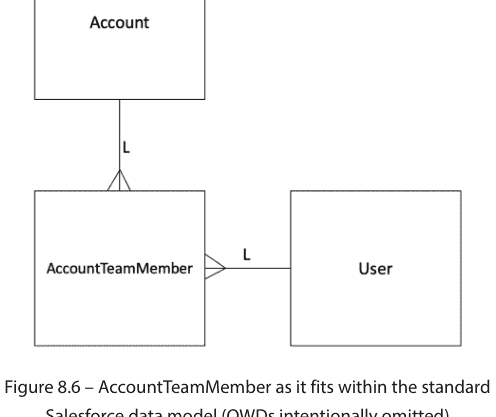

现在我们已经介绍了围绕核心账户和联系人数据模型的关联对象，让我们来看一个示例，将本章中的所有内容结合起来。

#### 综合应用

让我们使用本章中涵盖的账户和联系人概念中的实际示例，将本章中学到的内容结合起来。

让我们想象一家虚构的银行，它既与个人打交道，也与企业打交道（以及为该企业工作的员工）。该虚构银行拥有处理企业客户的销售团队、处理非企业银行客户的个人银行家，以及可以参与多个公司业务的某些客户个人，例如法律专业人士。让我们想象一下账户和联系人部分的数据模型如何可视化：

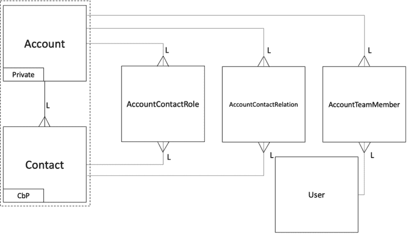

在这里，我们可以看到如何使用 Person Accounts 功能和三个连接对象实现账户和联系人之间几种不同类型的关系。我们的虚构银行可以使用单独的账户和联系人记录来处理企业（类似于开箱即用的 Salesforce 功能），或使用个人账户来处理个人。

联系人在账户中扮演的角色由 AccountContactRole 对象表示，因此多个人员可以由同一个企业客户处理。

对于与多个公司打交道的法律专业人士的需求，可以使用 `AccountContactRelation` 对象。

最后，使用 `AccountTeamMember` 对象可以满足处理企业客户的用户团队的需求。

虽然对象模型纯粹关注账户和联系人（因为未包含 OWD），但可以看到如何以简单的方式使用标准 Salesforce 对象实现多个业务需求。

现在我们已经介绍了一个将所有内容结合起来的示例，让我们重新审视一个影响账户和联系人的性能问题：账户倾斜。

#### 重新审视账户倾斜

如 *第 2 章、数据建模和数据库设计* 中所述，**账户倾斜**是账户记录包含 10,000 个或更多子记录的结果。这会导致性能和记录锁定问题。

当对账户的子记录进行更新时，Salesforce 会锁定父账户记录以在数据库中维护记录完整性。在同一账户记录下更新大量子记录可能会导致问题，因为这些子记录操作都将尝试锁定父账户记录。

此外，当对账户记录进行影响共享的更新时，例如更改记录所有者这样看似无害的操作，那么该账户的所有共享都必须重新计算。这适用于账户的所有子记录。这可能导致许多相互关联的流程失败，因为共享规则、角色层级计算和其他共享操作必须进行。如果任何操作锁定记录或花费时间过长，可能会发生争用。

#### 缓解账户倾斜

缓解账户倾斜的简单规则是将子记录分布到多个父账户记录中。记住，10,000 是特定账户记录在出现账户倾斜之前建议的最大子记录数。

在重新审视了账户倾斜之后，让我们总结一下本章中我们所涵盖的内容。

#### 总结

在本章中，我们深入研究了账户和联系人模型，了解其在许多核心 Salesforce 云产品更广泛数据模型中心的位置。首先，我们研究了启用个人账户所涉及的细微差别，并研究了联系人关联多个账户的功能。还探索了围绕账户和联系人对象的更广泛数据模型。最后，我们重新审视了账户倾斜，以了解其在性能方面的意义。


在 *第 9 章，数据 API 和 Apex* 中，我们将介绍考试的实际方面。

#### 练习题

通过尝试回答以下练习题来测试你对本章所学内容的掌握：

1. 哪个对象负责管理联系人与账户的关系，其中该联系人可能与多个账户关联？
2. 当未启用“联系人与多个账户”功能时，哪个对象负责管理联系人与账户的关系？
3. 什么术语描述了一个行为类似于联系人，但可以与商机关联的账户记录？
4. 哪个对象将用户记录与账户关联，而不通过所有权和配置的组织范围共享模型？
5. 在账户记录上，`ParentId` 字段用于什么？
6. 真或假？可以并行使用个人账户和企业账户。
7. 真或假？一旦启用个人账户，就无法禁用它们。
8. 真或假？在启用“联系人与多个账户”功能后，联系人的活动历史将汇总到联系人的指定主账户记录。
9. 使用账户团队时，**AccessLevel** 列表值的设置必须是什么？
10. 什么是账户倾斜？

#### 答案

你在回答练习题时表现如何？在此核对你的答案：

1. `AccountContactRelation`
2. `AccountContactRole`
3. 个人账户
4. `AccountTeamMember`
5. 账户层次结构
6. 真
7. 真
8. 真
9. 高于相应对象的组织范围默认值的数值
10. 记录锁定、共享或其他长时间运行的进程，这些进程可能因账户记录拥有过多子记录而失败

#### 进一步阅读

以下资源将有助于巩固你在本章中学到的内容：

- 账户对象 API 文档：<https://developer.salesforce.com/docs/atlas.en-us.object_reference.meta/object_reference/sforce_api_objects_account.htm>
- 联系人对象 API 文档：<https://developer.salesforce.com/docs/atlas.en-us.object_reference.meta/object_reference/sforce_api_objects_contact.htm>
- *启用个人账户*：<https://help.salesforce.com/s/articleView?id=sf.account_person_enable.htm&type=5>
- *设置联系人与多个账户*：<https://help.salesforce.com/s/articleView?id=sf.shared_contacts_set_up.htm&type=5>
- *比较联系人与多个账户与其他选项*：<https://help.salesforce.com/s/articleView?id=sf.shared_contacts_comparison.htm&type=5>
- AccountContactRelation API 文档：<https://developer.salesforce.com/docs/atlas.en-us.object_reference.meta/object_reference/sforce_api_objects_accountcontactrelation.htm>
- AccountContactRole API 文档：<https://developer.salesforce.com/docs/atlas.en-us.object_reference.meta/object_reference/sforce_api_objects_accountcontactrole.htm>
- AccountTeamMember API 文档：<https://developer.salesforce.com/docs/atlas.en-us.object_reference.meta/object_reference/sforce_api_objects_accountteammember.htm>

#### 数据 API 和 Apex

在本章中，我们将探讨与数据操作相关的各种 Salesforce 应用程序编程接口（API）。了解各种 API 和 Apex 操作对于完善你对 Salesforce 平台在数据操作方面的编程能力知识至关重要。在参加考试时，你可能会遇到涉及根据 Salesforce API 的使用或使用 Apex 代码来实现特定数据操作来回答的假设场景问题。因此，这对于完善你作为 Salesforce 数据架构师的知识至关重要。本章中，我们还将介绍与数据相关的 Apex 功能，包括数据库操作、使用批量数据方法以及异步 Apex。

在本章中，我们将介绍以下主题：

- 如何调用 API
- Lightning Platform 数据 API
- Apex 数据库操作
- 批量 Apex
- 异步 Apex

在本章结束时，你将能够很好地理解在设计涉及 Salesforce Lightning Platform 上数据操作的解决方案时，如何适当部署所涵盖的每个主题。让我们从了解如何调用 API 开始。

##### 如何调用 API

虽然 API 的设计和实现超出了本书的范围，但我们将简要介绍如何调用 API，即 Salesforce REST API。从高层次来看，API 本质上是对端点（URL）的请求，附带 XML 或 JSON 正文（称为请求负载）。端点将返回响应负载，其格式可能为 XML 或 JSON，具体取决于其配置方式。

恭喜！你已通过发出查询（请求）调用了 Salesforce API，并返回了一份账户记录列表，其中包含每个记录的 Name 字段（响应）。

让我们开始探索 Lightning Platform 数据 API。

##### Lightning Platform 数据 API

Salesforce Lightning Platform 上有 11 个 API 可用，涵盖各种操作，包括处理元数据（Metadata API）、构建允许用户与 Salesforce 记录交互的用户界面（User Interface API），以及在构建自定义开发模块或应用程序时使用（Tooling API）。

我理解并非阅读本书的每个人都是软件工程师，因此了解 API 的复杂工作原理。 然而，了解 Salesforce 如何以编程方式公开与数据相关的操作是必要的。这将让你更全面地了解数据如何通过 Salesforce 平台上的操作而受到影响，而不仅仅是通过通用用户界面交互。

简而言之，API 提供了两种软件应用程序之间相互通信的手段。通常，一个应用程序公开一组可供其他应用程序调用的操作。API 还支持身份验证，Salesforce 也不例外。在使用 Salesforce API 调用操作之前，必须以编程方式对 Salesforce 进行身份验证。正如用户使用用户界面与 Salesforce 交互一样，所有 API 操作都是作为用户执行的，因此它受与其他用户相同的权限模型约束。我见过为此目的专门设置 *集成用户* 账户。相同权限模型适用于其他软件工具使用的用户账户的优点是，可以使用相同的权限设施（组织范围默认设置、角色层次结构、配置文件、权限集、共享规则、手动共享等）来确保只有适当的数据可访问。

在以下小节中，我们将重点关注以下 API，因为它们允许我们在 Salesforce 平台上处理数据：

- REST API
- SOAP API
- Bulk API

让我们依次介绍这些 Salesforce API，首先从 REST API 开始。

##### REST API

与 **简单对象访问协议（SOAP）** API 类似，Salesforce **表述性状态转移（REST）** API 提供了与 Salesforce 交互的编程接口。由于 REST 在数据包大小方面是一个更轻量级的框架，因此它更受移动应用程序的青睐。

**重要说明**

REST 涉及利用标准的一组 HTTP 方法来获取数据或将数据推送到和从端点。REST API 调用是无状态的，即每次调用都被视为一个独立的操作。REST 支持 JSON 或 XML 作为负载格式。

SOAP 比 REST 更重量级，但允许在调用特定端点上的操作时确定要调用的方法方面具有更大的灵活性。SOAP API 调用是有状态的，即操作或数据的状态在每次传递时都会在前后传递。SOAP 使用 XML 作为负载格式。

Salesforce 提供了相同的底层数据模型，并且无论使用 REST 还是 SOAP API 调用操作，相同的 governor 限制都适用。

使用 REST API，可以在对查询端点的请求中调用 Salesforce 数据查询，其中 SOQL 查询可以作为请求的一部分传递。例如，调用以下端点的 GET 操作将返回所有账户记录 Name 值，符合 REST API 规范：<https://login.salesforce.com/services/data/v54.0/query?q=SELECT+Name+FROM+Account>。

要创建记录，请在创建记录的对象的端点上调用 POST 操作（例如 `/services/data/v20.0/sobjects/Account/`，负载为字段名称和值映射）。这可能如下所示：

```
{
  "Name": "Packt",
  "Industry": "Publishing"
}
```

值得注意的是，Salesforce REST API 是无状态的，即调用应用程序需要在请求中包含所有必要的信息，以便 Salesforce 理解如何处理该请求。如果你使用 Salesforce REST API 开发，你会很快注意到它使用通用的 HTTP 方法（GET、POST 等），因此所有资源和操作都是通过通用接口访问的。

REST API 支持使用 OAuth 2.0 协议对 Salesforce 进行身份验证，这是一种用于对 RESTful 应用程序进行 Salesforce 身份验证的完善记录的方法。

现在我们已经介绍了 REST API，让我们探索相对相似的 SOAP API。


#### SOAP API

SOAP API 与 REST API 的工作方式类似，你可以通过 Web 服务调用来处理对象数据。SOAP API 在使用上不如 REST API 轻量，因为状态会随着每个请求和响应来回传输。SOAP Web 服务调用必须使用 XML 作为负载数据格式，并且可以被任何支持 Web 服务的编程语言使用。

SOAP Web 服务通过使用 Web 服务描述语言（WSDL）文件来定义，该文件描述了可执行的方法、任何参数以及对这些操作的调用的示例请求和响应。你的 Salesforce 实例的 WSDL 可以从 Setup 下载，方法是在搜索框中输入 API，然后选择返回的 API 菜单项。然后，你可以下载两个 WSDL 文件之一：

- 1. Enterprise WSDL：这特定于你的 Salesforce 实例，并考虑了你所做的自定义（例如自定义对象的创建）。
- 2. Partner WSDL：这是一个使用通用类型工作的 WSDL 文件（所有对象都通过 Object 操作进行交互，而不是直接操作 Account 实体、Contact 实体等）。

在使用 SOAP API 时，你首先会调用一个操作，以你想要执行操作的用户身份登录 Salesforce，这会生成一个会话标识符。该会话标识符随后用于所有后续请求。

以我们在本章 REST API 部分创建 Account 记录的示例为例，SOAP 表示如下（假设登录操作已完成）：

```xml
<soapenv:Envelope xmlns:soapenv="http://schemas.xmlsoap.org/soap/envelope/" xmlns:urn="urn:enterprise.soap.sforce.com" xmlns:urn1="urn:sobject.enterprise.soap.sforce.com" xmlns:xsi="http://www.w3.org/2001/XMLSchema-instance">
    <soapenv:Header>
        <urn:SessionHeader>
            <urn:sessionId>[sessionId retrieved from a login() call]</urn:sessionId>
        </urn:SessionHeader>
    </soapenv:Header>
    <soapenv:Body>
        <urn:create>
            <urn:sObjects xsi:type="urn1:Account">
                <Name>Packt</Name>
<Industry>Publishing</Industry>
            </urn:sObjects>
</urn:create>
</soapenv:Body>
</soapenv:Envelope>
```

如你所见，与 REST 示例相比，SOAP API 调用更具描述性。<urn:create> 标签指定这是一个 SOAP 插入操作，<urn:sObjects xsi:type="urn1:Account"> 标签指定这是一个 Account 对象，然后子标签指定字段。REST API 通过向 Account 端点发送 POST 请求，也假定相同的事情。

虽然本节偏技术性，但 SOAP 和 REST API 在数据库操作方面具有同等能力。区别在于它们的交互方式。可以说，数据库操作可以通过编程方式执行。鉴于所有操作都在用户上下文中运行，Salesforce 权限模型适用。

现在我们已经介绍了 SOAP API，接下来让我们看看 Bulk API。

#### Bulk API

Salesforce Bulk API 主要用于两个目的：数据导入和查询。简化这些术语来说，你可以使用 Bulk API 执行插入、更新、upsert 或删除操作（导入），或者检索数据（查询）。使用 Bulk API 的关键原因在于要导入或查询的数据量。任何涉及超过 2,000 条记录的操作都适合使用 Bulk API。

在执行导入操作时，Bulk API 会将操作分成一组较小的批处理以提高性能。启动导入批处理作业时，首先必须创建一个 CSV 文件，表示要处理的记录（就像使用 Salesforce Data Loader 一样）。作业指定操作是什么（插入、更新、upsert 或删除），以及要操作的对象，例如 Account 或 Contact。当你启动作业时，Salesforce 将负责优化作业，以减少性能问题、超时和批处理失败的可能性。

在执行查询操作时，Bulk API 将根据指定的查询返回记录。同样，Salesforce 会优化作业以提高性能，并尽可能减少超时或失败的可能性。

在执行导入作业时，Salesforce 会将数据按每 10,000 条记录分成批次（每日限制为 1.5 亿条记录）。Salesforce 会尝试处理批次中的每条记录，但如果批次未在 10 分钟内完成，则该批次失败。Salesforce 会重试任何失败的批次，最多重试 10 次。如果批次在重试 10 次后仍然失败，则整个批处理作业被标记为失败。在这种情况下，你可以使用调用 Bulk API 的 Failed Record Results 或 Unprocessed Record Results 端点返回的结果来检索未处理的记录，并在纠正任何错误或问题后使用这些记录启动新作业。

查询作业自然更容易管理，因为数据在作业完成后返回。但是，如果查询作业重试超过 15 次，它将失败。在这种情况下，最简单的解决方法是向查询应用过滤条件，以提高性能并减少返回的记录数。

现在我们已经了解了 Bulk API，接下来让我们看看 Apex 数据库操作。

#### Apex 数据库操作

在 Apex 代码中，可以通过两种方式之一与 Salesforce 数据库交互：使用数据库操作语言（DML）语句或使用 Apex Database 类方法。DML 语句采用插入、更新、upsert 或删除操作的形式。以下是一个 DML 插入语句的示例：

```apex
public class dmlStatementTest {
    public void testStatement() {
        List<Account> accounts;
        accounts.add(new Account(Name='Packt UK'));
        accounts.add(new Account(Name='Packt India'));

        insert accounts;
    }
}
```

Apex 数据库方法的工作方式略有不同，因为不是使用 insert 或 update 等关键字，而是调用 Database 类的方法。我认为，这提供了更大的灵活性，但代价是等效 DML 操作的代码更冗长。这是因为 Database 类方法允许通过参数指定在遇到错误时是否尝试部分记录处理。我们之前使用的相同示例，但使用 Apex Database 类，可以表示如下：

```apex
public class apexDatabaseClassTest {
    public void testStatement() {
        List<Account> accounts;
        accounts.add(new Account(Name='Packt UK'));
        accounts.add(new Account(Name='Packt India'));

        Database.SaveResult[] accountSaveResult = Database.insert(accounts, false);
        // You would iterate through the
        // Database.SaveResult list here
    }
}
```

`Database.insert` 操作的第二个参数是一个布尔值，指定是否尝试部分记录处理。如果传入 true 值，则一旦一条记录无法处理，所有剩余记录都不会被尝试，并且会抛出异常。如果传入 false 值，则所有记录都会被尝试，每条记录的状态将返回到 `Database.SaveResult` 数组。可以对此进行迭代，并采取适当的操作。

要确定最合适的 Apex 方法，请考虑是否需要抛出异常并立即中断代码的执行。如果需要，则使用 DML 语句是合适的。如果你希望允许处理某些记录，并根据所有记录的状态采取操作而不中断代码流程，则考虑改用 Apex Database 类方法调用。

> **重要说明**
> 
> 数据库事务控制以及回滚数据库操作的能力仅在 Apex Database 类中可用。此外，Apex Database 类允许你清空回收站并使用 `convertLead` 方法转换潜在客户。

现在我们已经介绍了使用 Apex 的数据库操作，让我们转向另一个 Apex 数据处理工具，称为批量 Apex。

#### 批量 Apex

顾名思义，批量 Apex 用于批量调用和处理可能大量的记录，其中记录数由向 Salesforce 发出查询确定。这种执行方式非常适合可能需要处理大量记录，但确切记录数未知的情况，例如在夜间批处理过程中更新记录。

批量 Apex 类必须实现 `Database.Batchable` 接口，因此必须实现 `start`、`execute` 和 `finish` 方法。一个用于实现 `Database.Batchable` 接口的极简 Apex 类类似于以下内容：

```apex
public class myBatchClass implements Database.Batchable {
    public Database.QueryLocator start(Database.BatchableContext info){}
    public void execute(Database.BatchableContext info, List<SObject> scope){}
}
```


```apex
public void finish(Database.BatchableContext info){}
}
```

`start` 方法用于定义查询。返回的 `Database.QueryLocator` 用于在指定的批大小中有效地检索查询结果（如果未指定，则为 200）。

`execute` 方法用于定义 Apex 类逻辑的大部分内容，并处理在该记录批次中返回的记录。

`finish` 方法用于任何后处理逻辑。我在夜间批处理作业类定义中使用它来调用一封电子邮件，汇总作业的统计信息（处理的总记录数、成功和失败）。

要调用批处理 Apex 类，必须对其进行调度。这可以在 Developer Console 中作为匿名 Apex 执行来完成：

```apex
Id batchJobId = Database.executeBatch(new BatchClass(), 150);
```

在此示例中，我们的批处理 Apex 类名为 `BatchClass`，我们以每次 150 条记录的批大小执行它（因此每次批处理都会由批处理类的 `execute` 方法处理 150 条记录）。

作为示例，让我们编写一个批处理类，返回我们 Salesforce 实例中今天创建的所有 Account 记录，并为每个记录附加短语“processed”。然后，我们将使用默认批大小 200 进行调用：

```apex
public class appendAccountNameBatch implements Database.Batchable {
    public Database.QueryLocator start(Database.BatchableContext info) {
        return Database.getQueryLocator('SELECT Id, Name FROM Account WHERE CreatedDate = TODAY');
    }

    public void execute(Database.BatchableContext info, List<sObject> scope) {
        List<Account> accounts = new List<Account>();
        for (sObject s : scope) {
            Account act = (Account)s;
            act.Name = act.Name + ' processed';
            accounts.add(act);
        }
        update accounts;
    }

    public void finish(Database.BatchableContext info) {
        // Do nothing
    }
}
```

该类将按如下方式调用：

```apex
Id batchJobId = Database.executeBatch(new appendAccountNameBatch());
```

Batch Apex 作业可以在 Salesforce Setup 中通过在快速查找框中输入 Apex Jobs 来查看（并停止）。如果作业为 **Completed**，则表示它已无错误运行。状态为 **Aborted** 或 **Failed** 的作业需要调查，因为它们未成功执行。

完全可以按计划安排 Batch Apex 作业运行，例如每晚运行一次。为此，您需要为批处理 Apex 类创建一个包装类，该类实现 Schedulable 接口，然后根据使用类似 Unix 的 cron 格式定义的计划安排该类执行。

> **重要说明**
>
> **Unix** cron 格式用于指定可调度作业的运行频率。它源自 Unix 操作系统上的 cron 实用程序。它遵循六个值的日/时间格式（年份可选为第七个）。它表示为字符串，例如 `0 0 17 * * ?`，表示每天下午 5 点执行。有关 cron 字符串格式的更多信息，请参阅 `https://developer.salesforce.com/docs/atlas.en-us.apexcode.meta/apexcode/apex_scheduler.htm`。

例如，让我们将 appendAccountNameBatch 类包装起来以允许其被调度：

```apex
public class scheduledAppendAccountNameBatch implements Schedulable {
    public void execute(SchedulableContext sc) {
        appendAccountNameBatch b = new appendAccountNameBatch();
        // your batch class
        Database.executeBatch(b);
    }
}
```

然后，我们可以使用匿名 Apex 调用此可调度类：

```apex
System.schedule('Nightly scheduledAppendAccountNameBatch Job', '0 0 1 * * ?', new scheduledAppendAccountNameBatch());
```

这将导致我们的批处理类每晚凌晨 1 点运行。通过了解 Apex 代码如何被调用以及记录批处理如何帮助我们在 governor limits 内工作，我们可以有效地使用 Apex 代码处理大量记录。

现在我们掌握了 Batch Apex，让我们探索使用 Lightning Platform 上的 Apex 进行异步操作。

#### Asynchronous Apex

Apex 代码可以使用批处理类以异步方式运行，并随后排队或调度。Apex 代码也可以通过在方法上使用 `@future` 注解来编写以在后台运行。所有 Apex Web 服务调用都是 `@future` 方法，具有 `callout=true` 参数，即它们被强制异步运行，在后台运行，用户界面操作不会因其调用而被阻塞。

另一种思考异步 Apex 的方式是它本质上在自己的时间执行。使用 `@future` 方法的好处是 governor limits 更高，这意味着 SOQL 查询大小和堆大小限制更宽松，因为执行是在自己的时间、在自己的系统线程上进行。

编写使用 `@future` 注解的 Apex 方法时，它们必须是静态的，并且只能返回 void 返回类型——即不返回任何内容。

下面是一个最基本的异步 Apex 类示例：

```apex
public class asyncClass {
    @future
    public static void anAsyncMethod() { }
}
```

现在我们了解了异步 Apex，让我们总结一下本章所涵盖的内容。

#### Summary

在本章中，我们探讨了 Salesforce 平台在数据操作方面的更具编程性的元素。我们在查看 Bulk API 之前先查看了 REST 和 SOAP API。然后，我们将注意力转向 Apex Database 类操作、Batch Apex，以及使用 `@future` 注解的异步 Apex。理解了这些概念后，您作为 Salesforce 数据架构师，现在已熟练掌握可对解决方案状态产生影响的编程行为的决策。

在下一章中，我们将通过实际示例探索更多关于如何缓解 **Large Data Volume (LDV)** 问题的概念，以及如何加载大量数据。

#### Practice questions

通过回答以下问题来测试您对本章所涵盖主题的了解：

1. 适合 SOAP API 请求的唯一数据格式是什么？
2. Bulk API 用于哪两种作业类型？
3. 用于描述可由调用应用程序导入的 SOAP API 提供的操作的资源类型是什么？
4. Bulk API Query 操作尝试多少次重试？
5. 运行 Bulk API Ingest 操作时记录被分成什么批大小？
6. Bulk API Ingest 作业支持哪些操作？
7. 编写 Apex 批处理类时扩展了什么接口？
8. 异步 Apex 方法使用什么注解？
9. Apex `insert` 语句，后跟特定对象类型的记录列表，是在处理 Salesforce 数据库时哪种类型方法的示例？
10. Apex `Database` 类的 insert/update/upsert/delete 方法有一个布尔参数，它的作用是什么？

#### Answers

以下是前面问题的答案。您能正确回答多少个？在此检查您对前面问题的答案：

1. XML
2. Ingest and Query
3. WSDL
4. 15
5. 10,000
6. Insert, update, upsert, delete
7. Database.Batchable
8. @future
9. A DML statement
10. Determine whether to allow partial processing of records

#### Further reading

有关本章所涵盖内容的更多信息，请参阅以下资源：

- *OAuth 2.0 with Salesforce*: https://developer.salesforce.com/docs/atlas.en-us.api_rest.meta/api_rest/intro_oauth_and_connected_apps.htm
- *Batch API*: https://developer.salesforce.com/docs/atlas.en-us.api_asynch.meta/api_asynch/asynch_api_intro.htm
- *Bulk API 2.0 – How requests are processed*: https://developer.salesforce.com/docs/atlas.en-us.api_asynch.meta/api_asynch/how_requests_are_processed.htm
- *Batch Apex*: https://developer.salesforce.com/docs/atlas.en-us.222.0.apexcode.meta/apexcode/apex_batch_interface.htm
- *Executing Batch Apex*: https://help.salesforce.com/s/articleView?id=000328480&type=1
- *The Apex Batchable Interface*: https://developer.salesforce.com/docs/atlas.en-us.apexref.meta/apexref/apex_interface_database_batchable.htm#apex_Database_Batchable_execute
- *The Apex Schedulable class*: https://developer.salesforce.com/docs/atlas.en-us.222.0.apexcode.meta/apexcode/apex_scheduler.htm
- *Future methods in Apex*: https://developer.salesforce.com/docs/atlas.en-us.222.0.apexcode.meta/apexcode/apex_invoking_future_methods.htm
- *The Apex Database Class*: https://developer.salesforce.com/docs/atlas.en-us.apexref.meta/apexref/apex_methods_system_database.htm


#### 10 调优性能

在本章中，我们将介绍在 Lightning Platform 上设计 Salesforce 应用程序时可用于调优性能的各种方法。我们将重新审视已经讨论过的几个概念，深入探讨一些场景，以展示所强调技术的实际应用。在本章结束时，你将了解在 Salesforce Platform 上设计可扩展解决方案时可用的各种性能调优技术，特别是关于数据性能方面。

在本章中，我们将介绍以下主题：

- 瘦表和其他**大数据量（LDV）**缓解技术
- 查询和搜索优化
- 任务锁
- **主键（PK）**分块以提高性能
- 加载海量数据

我们将首先了解 LDV 缓解技术，以及在使用海量数据时如何调优我们的 Salesforce 实现。

##### 瘦表和其他 LDV 缓解技术

**瘦表**是一种 LDV 缓解技术，当用户对 Salesforce 数据库执行查询时遇到缓慢的读取操作时非常有用。这是因为标准对象的基础（虚拟）数据库架构实际上是跨两个表的连接。标准对象有标准字段和自定义字段。例如，当性能受到影响时，对于从 Account 等标准对象查询数据（同时包含 Account 对象的标准字段和自定义字段）的查询，使用瘦表可能会带来好处。

##### 选择性过滤条件

为了提升 SOQL 查询性能，可以使用选择性过滤条件。你可以通过在 Developer Console 中运行查询并查看查询统计信息来确定某个过滤条件是否具有选择性。你可以与 Salesforce 支持合作，为选择性字段应用索引，以加快查询和报告性能。简而言之，当索引应用于选择性过滤条件字段时，查询将更高效地运行。在 Salesforce 应用程序逻辑中，当发出查询时，Lightning Platform 查询优化器会确定 SOQL 查询、报告或列表视图的过滤条件选择性。

通过确认报告、SOQL 和列表视图中的过滤条件具有选择性，然后对这些字段应用索引，Lightning Platform 查询优化器在查找目标数据时就不必执行完整数据集扫描。这意味着在这种情况下性能将是最优的。

##### 分区（Divisions）

分区（Divisions）是 Salesforce 的一项特殊数据性能功能，可用于对数据进行分区，并减少 SOQL 查询返回的记录数。这能有效提升用户运行数据查询和报告时的性能。要启用分区（Divisions），你需要向 Salesforce 支持提交一个案例。

既然已经重新审视了瘦表和其他 LDV 缓解技术，下面我们来看一下搜索和查询的优化。

##### 查询和搜索优化

正如我们在*第 6 章“理解大数据量”*中所探讨的，Salesforce 执行搜索分为两个部分。第一部分是创建结果集，然后用于执行实际搜索。让我们快速回顾一下结果集是如何生成的。当发起搜索时（无论是通过 Salesforce 用户界面、Salesforce API 还是 Apex 代码），Salesforce 首先会搜索已为相应记录创建的索引。取得这些结果后，Salesforce 会应用访问权限、搜索限制以及任何其他过滤器或过滤逻辑，将结果缩小为结果集。然后，该结果集用于在底层数据库中执行实际记录搜索。

加速搜索的方法是在搜索时仔细考虑所用字段的索引，以提升这些搜索的性能。如*第 6 章“理解大数据量”*所述，开箱即用地会自动应用多个索引。当与自定义索引（在 Salesforce 支持的协助下启用）结合使用时，可以提高搜索性能。

提醒一下，当 Salesforce 执行索引搜索时，如果查询的过滤条件匹配不到前一百万条记录的 30%（以及不到额外记录的 15%），则会使用标准索引，最多达一百万条记录。

自定义索引（你需要与 Salesforce 支持合作来启用这些索引）用于查询过滤器匹配不到总记录数的 10% 的情况，最多达 333,333 条记录。

现在我们已经介绍了可以对查询和搜索进行的优化，接下来让我们看看任务锁。

##### 任务锁

在加载数据时，由于多种问题可能会发生记录锁定。在处理任务时，需要注意一些与任务记录关联的记录被锁定的情况。具体如下：

- 当插入任务时，Account 记录以及 WhoId 和 WhatId 字段引用的记录会被锁定，但仅当任务记录的状态不是“已完成”且活动日期已设置（不等于 null）时。
- 当更新任务时，Account 记录以及 WhoId 和 WhatId 字段引用的记录会被锁定，无论任务记录的值如何。
- 当删除任务时，Account 记录以及 WhoId 和 WhatId 字段引用的记录会被锁定，无论任务记录的值如何。

当我们分析任务记录可用的记录关联时，主要涉及两个字段——即 WhoId 和 WhatId 字段。WhoId 是 Contact 或 Lead 记录，而 WhatId 是任何其他类型的记录，例如 Account 或 Opportunity。

当 WhoId 引用 Contact 记录时，会通过 Contact 和 Account 记录之间的关系引用父 Account 记录。WhatId 如果不是直接引用 Account 记录，则会是另一个最终解析为 Account 记录的对象记录。理解了这些信息后，任务记录可以按最终引用的账户进行组织，并使用 Bulk API 以并行方式分批次加载。

另一种加载任务的方式是使用串行作业（按顺序处理的作业），如果最终的父 Account 记录相同，这种方法可能很适用。当单个 Account 记录关联的任务记录超过 10,000 条，或者由于引用对象之间的关系可能导致锁竞争时，这种方法是必要的。

如果作业是作为夜间批处理或类似流程的一部分进行调度的，Salesforce 最佳实践是确保批处理作业执行中内置时间缓冲。这是为了确保记录不会因计划作业运行时间过于接近而重叠，从而导致记录被锁定并引发竞争。

现在我们已经了解了任务锁，接下来让我们转向查询大量数据，以及如何使用 PK 分块来提高性能。

##### PK 分块以提高性能

PK 分块是一种机制，旨在允许提取整个 Salesforce 表数据——例如，作为备份例程的一部分。PK 分块有效地将记录 ID 添加为 WHERE 子句参数，以批量查询来自 Salesforce 实体的数据。

通常，如果 Salesforce 中的对象超过 1000 万行，则在导出其数据时应使用 PK 分块。如果你发现数据查询经常超时，请使用 PK 分块。

鉴于 PK 分块通过添加 WHERE 子句并使用有序 ID 范围，将一个大的查询有效地拆分为多个独立的查询，因此可以设置批处理大小。默认值为 100,000（即每个批次默认返回 100,000 条记录），但最高可达 250,000。因此，对于 1000 万行的实体，批处理大小为 250,000 时将返回 40 个数据批次。

在*第 7 章“数据迁移”*中，我们通过一个实际示例了解了 PK 分块的工作原理。需要注意的是，可以将过滤查询与 PK 分块一起使用（即它们已经带有 WHERE 子句）。在这种情况下，每个子查询返回的记录数可能少于指定的批处理（或分块）大小。另外值得注意的是，由于查询针对整个表，它会返回（但会省略）软删除的记录。由于这些记录在给定查询的结果中被省略，因此返回的批处理大小可能小于该特定子查询指定的分块大小。

在 Salesforce 中查看 PK 分块作业时，其初始状态为 NOT_PROCESSED。任何失败的批次将具有 FAILED 状态，但后续批次仍将作为整个作业的一部分进行处理。

> **重要说明**
>
> 在启用 PK 分块的作业中进行过滤时，使用 ORDER BY 子句或任何形式的 ID 字段都会有效禁用 PK 分块，并且不会带来任何性能提升。

要启动 PK 分块批处理作业，请随编程请求发送 `Sforce-Enable-PKChunking` 头。以下是一个示例：

```
Sforce-Enable-PKChunking: chunkSize=250000;
startRow=001A0000000abcdef
```

在此示例中，分块大小已设置为 250000，查询的起始 ID 为 001A0000000abcdef。

现在我们已经了解了查询大量数据以及如何使用 PK 分块来提高此类操作的性能，接下来让我们看看如何将海量数据反方向导入 Salesforce。


### 加载海量数据

在向 Salesforce 平台加载大量数据时，我们主要关心的是如何在尽可能短的时间内，可靠地将尽可能多的数据导入 Salesforce 实例。假设我们要加载 2000 万条记录。从串行与并行处理的角度思考，我们可以从两个角度来看待加载场景：

- 顺序（串行）加载 2000 万条记录
- 将 2000 万条记录拆分成较小的批次，并行插入，从而以更短的时间并行加载 2000 万条记录

为了快速加载海量数据，我们需要优化并行数据加载。在加载任何数据之前，我们可以采取几个步骤来加速加载操作。将共享计算推迟到加载操作完成之后，意味着共享重计算只会运行一次，而不是在处理的每个记录批次上都运行。禁用数据加载时可能运行的任何逻辑（例如工作流规则、流和触发器），将确保加载数据时不会浪费宝贵的处理时间来运行这些自动化操作。当然，这依赖于数据以预处理状态插入，因为自动化操作不运行意味着某些字段值更新等操作不会被调用，因此需要离线手动处理。

接下来，让我们考虑可能出现的各种偏斜类型。例如，是否会有单个客户记录包含超过 10,000 个子记录？是否会有某个记录所有者拥有超过 10,000 条记录？是否会有超过 10,000 个查找指向同一条记录？

通过考虑各种类型的偏斜，我们可以在加载数据时规划并缓解这些潜在偏斜。我们可以设置多个客户记录来缓解客户偏斜，设置多个记录所有者来缓解所有权偏斜，并移除这些所有者的角色（但如果没有进行适当的影响分析，不要这样做），等等。针对预期的最终数据状态所带来的已知影响进行规划，对于加载大量数据大有裨益。

接下来应考虑记录锁。了解根据所加载记录的类型，记录将如何被锁定，意味着可以将源数据划分、排序，并以离散的并行批次加载。请注意任务锁定行为以及主从关系中明细记录的行为。

最后，可以根据数据量调整批次大小。例如，以顺序操作方式加载 2000 万条记录，与以 200 个批次、每批 100,000 条记录的方式加载，会产生不同程度的性能、记录锁定行为和數據偏斜。通过正确的规划，并考虑禁用自动化、延迟共享计算等因素，可以使用 Bulk API 高效加载数百万条记录。

现在我们已经探讨了在向 Salesforce 加载海量数据时可以使用的技术，接下来总结一下本章涵盖的内容。

#### 总结

在本章中，我们涉及了许多不同的概念，所有这些概念都与在 Salesforce 中处理数据时提高性能相关。我们首先回顾了 LDV 并介绍了瘦表。然后我们继续讨论了搜索和查询的优化，接着研究了任务锁及其对性能的影响。

本章接下来的议程是考虑将大量数据移出和移入 Salesforce。为此，我们介绍了 PK 分块，然后研究了在加载数百万条记录的情况下，以高性能方式将数据移入 Salesforce。

在下一章中，我们将了解如何将数据移入和移出 Salesforce 用于数据备份和恢复场景。

#### 练习题

通过尝试回答以下问题来测试你对本章主题和概念的理解：

- 1. 哪种数据 API 支持以并行批次方式异步处理数据？
- 2. 哪种 LDV 缓解技术可用于分区数据并减少 SOQL 查询返回的记录数？
- 3. 启用 PK 分块需要哪个标头？
- 4. 使用 Bulk API 加载数据时，哪种模式被认为是最高效的——串行还是并行？
- 5. 当 Salesforce 执行索引搜索时，如果查询的过滤条件匹配什么，将使用标准索引？
- 6. 当查询过滤条件匹配什么时，会使用自定义索引？
- 7. 在缓解必须拥有角色的用户的所有权偏斜时，该角色应位于角色层次结构中的什么位置？
- 8. 对还是错？启用瘦表需要 Salesforce 支持。
- 9. 对还是错？在缓解所有权偏斜时，应考虑移除与拥有 10,000 条或更多记录的用户相关联的角色。
- 10. 对还是错？加载大量数据时，禁用工作流规则和触发器之类的自动化操作并不是最佳实践。

#### 答案

练习题做得怎么样？在这里查看你的答案：

- 1. Bulk API
- 2. 分区（Divisions）
- 3. Sforce-Enable-PKChunking
- 4. 并行
- 5. 前 100 万条记录中少于 30%（以及后续记录中少于 15%），最多 100 万条记录
- 6. 总记录数中少于 10%，最多 333,333 条记录
- 7. 位于顶层
- 8. 对
- 9. 对
- 10. 错

#### 延伸阅读

要了解有关本章所涵盖概念的更多信息，请查看以下资源：

- PK 分块：https://developer.salesforce.com/docs/atlas.en-us.api_asynch.meta/api_asynch/async_api_headers_enable_pk_chunking.htm
- 瘦表：https://developer.salesforce.com/docs/atlas.en-us.salesforce_large_data_volumes_bp.meta/salesforce_large_data_volumes_bp/ldv_deployments_infrastructure_skinny_tables.htm
