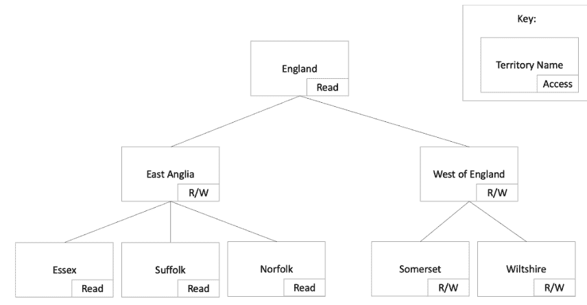
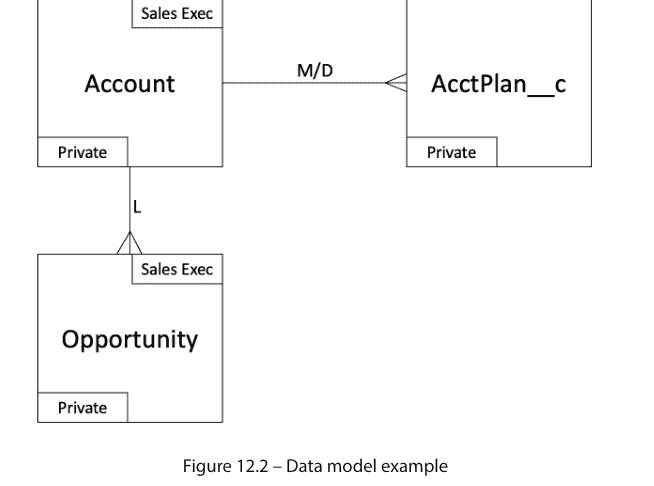

# 11

## 备份与恢复

虽然 Salesforce 在提供平台和底层数据设施以处理客户数据和自定义数据方面表现出色，但我们也应考虑如何将数据从 Salesforce 平台备份出来以及恢复到 Salesforce 平台。我们将研究可用于执行数据备份和数据恢复操作的各种方法。

在本章中，我们将涵盖以下主题：

- 在 Salesforce Lightning 平台上备份和恢复数据的方法
- 促进数据备份和恢复的 AppExchange 和外部软件

在进入本章内容之前，让我们明确一点：我们将研究数据和元数据的备份与恢复。元数据是描述数据的数据，也是你对 Salesforce 平台进行自定义的格式。数据是存储在 Salesforce 组织中的实际数据，例如客户和商机数据。

让我们开始探索备份和恢复，首先研究在 Salesforce 平台上进行数据备份和恢复时可用的方法。

### 在 Salesforce Lightning 平台上备份和恢复数据的方法

在我们深入探讨备份和恢复数据的方法之前，让我们详细说明本章涉及的两个数据定义，即数据和元数据，因为在备份和恢复方面，两者交互方式不同。让我们从元数据开始。

### 元数据简介

元数据是描述数据的数据。当我们想到可扩展标记语言（XML）文件时，本质上它是一个包含数据（值）和元数据（标签）的文件。例如，请参见以下内容：

```
<?xml version="1.0" encoding="UTF-8" standalone="yes"?>
<person>
    <firstname>Aaron</firstname>
    <lastname>Allport</lastname>
</person>
```

代码示例展示了一个简单的人物 XML 结构，包含名字和姓氏。在这里，我们可以使用元数据（person、firstname 和 lastname 标签）来推断我们表示的是一个名叫 Aaron Allport 的人。

Salesforce 将对实例进行的一组自定义表示为一组元数据文件。例如，一个公用组 XML 表示如下：

```
<?xml version="1.0" encoding="UTF-8"?>
<Group xmlns="http://soap.sforce.com/2006/04/metadata">
    <doesIncludeBosses>true</doesIncludeBosses>
    <fullName>Packt</fullName>
    <name>Packt</name>
</Group>
```

在这里，我们可以从 XML 中推断出，有一个名为 Packt 的公用组，允许与该组共享的记录同时共享给组成员的经理。

Salesforce 将绝大多数自定义表示为 XML，因此它们可以轻松地被提取和存储。

现在我们已经介绍了元数据如何用于描述数据，以及它在 Salesforce 平台上对你的自定义的作用，接下来让我们看看什么是数据。

### 什么是数据？

在 Salesforce 领域中，数据被定义为已自定义的标准对象和已创建的自定义对象中存储在实例中的记录数据。虽然联系记录元数据可能定义了 FirstName 字段，但该字段中为每条记录存储的值就是该记录的数据。当数据从 Salesforce 平台导入或导出时，通常以逗号分隔值（CSV）格式表示，其中文件的第一行提供字段，后续行是每条记录的数据（每条记录在文件中表示为一行）。


其他格式也是可能的，使用中间件等进行一些转换逻辑。例如，一个 CSV 文件在导出几条 *联系人记录* 时看起来如下：

```
Id,FirstName,LastName,Email
003abcdefghi123456,Aaron,Allport,aaron@aaronallport.com
003jklmnopqr789012,John,Smith,j.smith@example.com
```

在理解了数据与元数据之间的区别之后，让我们质疑为什么我们首先应该备份数据和元数据。

### 为什么备份数据和元数据？

让我们快速了解一下备份数据和元数据的重要性。首先，Salesforce 不会自动为你备份数据。因此，如果出现用户或自动化流程意外导致从你的 Salesforce 实例中无意丢失数据的情况，那么拥有可用于恢复操作的数据副本是有意义的。定期备份数据以防意外数据丢失或因业务运营需要进行数据导出，是被认为良好的做法。

正如备份数据被认为是良好的做法一样，Salesforce 提供了备份元数据的能力，有效地允许你保存组织的大部分（但不是全部）配置。这在从 Salesforce 沙盒环境开发元数据更改时尤其有用，同时确保你保留 Salesforce 环境配置的备份。

现在我们已经介绍了备份数据的一些场景，让我们探索导出和导入数据及元数据的各种方法。我们将从备份数据开始。

### 备份数据

Salesforce 提供了三种平台原生方式来导出你的数据。虽然中间件可以促进更高级的数据检索和转换，但备份数据的相对直接的需求可以使用以下方式实现：

- 数据导出服务
- 数据加载器
- 报表导出

让我们依次探索其中的每一个，从数据导出服务开始。

- 一个 **仅明细** 报表，它导出所有报表行而不带任何格式。此格式支持选择导出文件类型，例如 Excel（.xls 和 .xlsx 均可）和 CSV。

报表导出在调用导出时立即下载。

数据导出的方法现在已介绍完毕，让我们探索如何将数据导入平台作为恢复数据的一种方式。

### 导入数据

要原生地将数据导入 Salesforce 平台，当然有我们在其他章节中介绍过的 API，例如 Bulk API。然而，值得简要提及数据加载器应用程序和 Salesforce 用户界面中的数据加载器功能。

#### 使用数据加载器应用程序导入数据

正如数据加载器应用程序可用于从你的 Salesforce 实例导出数据，它也可以用于导入数据。为此，必须提前准备用于对象数据的 CSV 文件，作为要导入的数据。在调用数据加载器应用程序导入数据时，要导入的 CSV 的列可以映射到正在导入的对象的字段。

#### 使用 Salesforce 用户界面中的数据加载器功能导入数据

Salesforce 设置支持使用 CSV 文件将数据导入对象，与数据加载器独立应用程序的方式大致相同，包括为目标对象映射列。

现在我们已经介绍了导入数据，让我们继续导出元数据。

### 备份元数据

当谈到备份 Salesforce 实例的元数据时，有几种方法可以利用来做到这一点。这些包括以下内容：

- 沙盒刷新
- 变更集
- SFDX
- Ant 迁移工具

让我们依次探索其中的每一个。

### 沙盒刷新

可能最简单地从生产 Salesforce 实例备份元数据的方式是启动沙盒刷新。此功能使用生产元数据的副本创建或刷新指定的沙盒环境（但根据沙盒环境类型，数据可能存在也可能不存在）。

沙盒刷新已介绍完毕，让我们研究变更集。

#### 变更集

变更集通常是许多 Salesforce 管理员和开发人员学习的第一种方式，用于将选定的元数据更改从沙盒环境移动到生产环境。变更集对开发人员不友好，本质上充当非开发人员在 Salesforce 环境之间移动一组元数据的默认方式。虽然大多数变更集的使用是为了将更改移入生产环境，但变更集也可以用于将更改从生产环境移动到特定的沙盒环境。

在了解了变更集如何用于在环境之间选择性地移动元数据之后，让我们了解一下 Salesforce Developer Experience（SFDX）。

##### SFDX

作为一套面向开发者的命令行实用工具，SFDX 允许将元数据更改从生产环境或用户具有登录访问权限的从生产环境创建的任何沙盒导出和导入。了解 SFDX 使用的具体细节对于考试并不重要，但知道开发者可以使用它从 Salesforce 导出元数据是有用的。

##### Ant 迁移工具

与 SFDX 类似，Ant 迁移工具是另一个用于在本地目录和 Salesforce 实例之间移动 Salesforce 元数据的命令行实用工具。同样，与 SFDX 一样，Ant 迁移工具可用于将 Salesforce 元数据从生产环境移动到本地目录。

现在我们已经探索了备份元数据，让我们继续导入元数据。

### 导入元数据

正如你现在可以想象的那样，除了沙盒刷新流程之外，所有方法都可用于导入元数据，作为将元数据恢复到 Salesforce 实例的一种方式。让我们从变更集开始。

#### 变更集

通过捕获选定的元数据工件集并将其从一个 Salesforce 环境移动到另一个环境，变更集可用于将一组更改从一个环境恢复到另一个环境。想象一下 Salesforce 环境意外地从生产环境刷新——如果有另一个包含更新的元数据工件集的 Salesforce 环境，那么变更集就可以作为执行元数据恢复的一种手段。

让我们现在探索 SFDX 作为恢复元数据的手段。

##### SFDX

使用 SFDX，可以使用本地文件系统或源代码存储库来存储元数据文件。因此，这是一个合适的手段，可以从本地文件存储或存储库对特定环境执行选择性元数据恢复活动。

SFDX 重新介绍完毕后，让我们简要了解一下 Ant 迁移工具。

##### Ant 迁移工具

同样，与 SFDX 类似，Ant 迁移工具可用于从本地文件目录对特定 Salesforce 环境执行元数据恢复，尤其是在恢复场景中为生产环境。

现在我们已经探索了导入元数据，让我们现在研究 AppExchange 和促进数据和元数据备份与恢复的外部软件。

### AppExchange 和促进数据备份与恢复的外部软件

在 Salesforce 平台上处理数据备份和恢复时，自然会有开发人员和软件供应商探索数据备份和恢复如何超越 Salesforce 提供的原生平台功能。正如平台上许多用例的常态，例如为特定行业垂直领域提供的业务逻辑行业特定扩展，也存在 AppExchange 套件和完整的外部软件来支持数据备份和恢复操作。

例如，Salesforce Backup and Restore 是你 Salesforce 订阅的付费附加组件，可促进对 Salesforce 实例中保存的数据和元数据的定期自动备份。然后可以使用这些备份根据需要将数据和元数据恢复到你的 Salesforce 实例，而不论最初需要该操作的原因是什么，例如人为错误。

有一些 AppExchange 套件可促进 Salesforce 数据和元数据的自动备份和恢复，通常备份到平台外设施。这些会产生与 Salesforce 订阅分开的费用，因为它们涉及与不同的软件供应商签约。这随后允许使用 AppExchange 套件作为到该外部平台的各种操作的中介，例如数据备份和恢复。要了解更多关于促进数据和元数据在 Salesforce 平台内外备份和恢复的 AppExchange 套件的信息，请阅读更多内容 https://appexchange.salesforce.com/appxSearchKeywordResults?keywords=backup%20and%20recovery。


接下来，还有一些功能完善的外部软件包支持数据和元数据的备份与恢复，通常与 SFDX 集成以进行元数据操作。对这些软件包的复杂理解超出了考试范围（因此也超出了本书范围），但它们都自动化并促进了自动化的沙盒配置以及数据和元数据的备份与恢复，并且通常作为 **持续集成/持续部署 (CI/CD)** 管道的一部分与自动化工作流集成。

让我们现在总结一下本章所涵盖的内容。

#### Summary

在本章中，我们研究了在 Salesforce 平台上工作时备份和恢复数据和元数据的各种方法。我们首先分解了数据和元数据之间的区别，然后再进入从原生或平台角度来看备份和恢复元数据和数据时可用的工具。

接下来，我们研究了 AppExchange 和外部软件，这些软件促进备份和恢复，涵盖了它们为促进甚至加快此任务所做的工作。最后，我们研究了导出和导入数据时的一些最佳实践。

在下一章中，我们将探讨 Territory Management 以完成我们的学习材料。

#### Practice questions

通过尝试以下练习题来测试你对本章所涵盖概念的理解：

- 1. Which Salesforce feature allows for selected metadata changes to be migrated from one environment to another?
- 2. What is the name of the standalone application that facilitates data imports and exports to and from the Salesforce platform?
- 3. Which report export format supports CSV, XLS, and XLSX?
- 4. Which facility allows for monthly backups?
- 5. What format is the file from a monthly backup?
- 6. What is metadata?
- 7. What metadata backup facility is used to create a production-like instance of Salesforce?
- 8. Which two metadata backup and restore technologies work with local or source-controlled copies of metadata?
- 9. What does CSV stand for?
- 10. In a CSV file, the first row of data is the what?

#### Answers

你在回答练习题时表现如何？在此查看你的答案：

- 1. Change sets
- 2. Data Loader
- 3. Details Only
- 4. The Data Export service
- 5. A zip file containing several CSVs
- 6. Data that describes data
- 7. Sandbox refreshes
- 8. SFDX and the Ant Migration Tool
- 9. Comma-Separated Value
- 10. The field names to which the values in the following rows pertain

#### Further reading

有关本章所涵盖的概念和主题的更多信息，请参阅以下资源：

- *Best practices to backup Salesforce data:* https://help.salesforce.com/s/articleView?id=000334121&type=1
- *Export data using Data Loader:* https://help.salesforce.com/s/articleView?id=sf.exporting_data.htm&type=5
- *Export data using report exports:* https://help.salesforce.com/s/articleView?id=sf.reports_export.htm&type=5
- *Export data using weekly backups:* https://help.salesforce.com/s/articleView?id=sf.admin_exportdata.htm&type=5
- *Create a Sandbox:* https://help.salesforce.com/s/articleView?id=sf.data_sandbox_create.htm&type=5
- *Ant Migration Tool Guide:* https://developer.salesforce.com/docs/atlas.en-us.daas.meta/daas/meta_development.htm
- *SFDX:* https://developer.salesforce.com/tools/sfdxcli

在内部，Enterprise Territory Management 是一种共享方式。出于这个本质，Salesforce 利用规则引擎，根据你如何设置 Enterprise Territory Management 来执行共享和相关实时重新计算。

在我们深入了解 Enterprise Territory Management 的具体设置方式之前，让我们先介绍一些特定于 Enterprise Territory Management 的术语，如下所示：

- **Territory**
- **Territory Type**
- **Territory Type Priority**
- **Territory Model**
- **Territory Model State**
- **Territory Hierarchy**

我们将逐一介绍这些术语，从 territory 的定义开始。

### Territory

**territory** 可以被视为对 Salesforce 实例中账户记录的分组以及处理这些账户记录的用户。Territories 是从 territory types 创建的。Territories 可以是分层的。例如，完全可以有一个名为美国的 territory，其子 territory 为西北、东北、西南、东南和中部。Territory 记录包含以下几个关键信息：

- 分配给 territory 的用户
- 任何分配的账户
- Territory/Account Assignment Rules（账户的特征意味着它将被分配到此 territory）

接下来，让我们查看 territory type 的定义。

#### Territory Type

**Territory Types** 用于根据账户规模、账户账单州或指定账户等标准组织和创建 Territories。创建 Territories 时，它们是从 territory type 创建的。Territory Types 不会出现在 Territory Management 设置过程中创建的 territory model 层级中。

例如，可以创建一个名为 *UK County-Based Accounts* 的 territory，其中 territories 可以根据 Account 记录中 **state** 列表中的 **UK County** 值创建。

在了解了 territory type 之后，让我们转向 territory type Priority。

#### Territory Type Priority

**Territory Type Priority** 是一个自定义方案，你可以定义它，用于在从你定义的 territory types 创建 territory 记录时提供帮助。例如，你可能有 1 到 5 的 territory type Priority 值，以表示在创建 territory 记录时与企业销售策略保持一致的优先级。这可能意味着西南 Territory 被赋予 1 的优先级，因为企业预计在下一个财政年度在此地看到最多的增长。本质上，Territory Type Priority 用于确保在创建新的 territory 记录时，正确的 territory types 具有优先权。

现在我们已经介绍了 Territory Type Priority 的定义，让我们来探索 territory model。

#### Territory Model

territory model 是你为 Salesforce 实例定义的完整 territory management 系统的表示。你可以有多个 territory models，但同一时间只能有一个处于活动状态。Salesforce 提供了一个漂亮的 territory models 图形层级结构，有助于我们可视化 Territories 的组织方式，包括层级结构。territory models 允许你测试账户和用户记录分配的工作方式，因此允许你在激活它之前尝试查看实现特定 territory model 会产生什么影响。

> **Important note**
> 
> Salesforce Enterprise Edition 仅允许同时存在两个 territory models。Performance 和 Unlimited 版本可以有四个 territory models。相同的限制适用于从使用这些 Salesforce 版本的生产实例创建的 Salesforce 沙盒环境。记住同一时间只能有一个 territory model 处于活动状态。

在介绍了 territory model 之后，让我们现在查看 territory model state 的定义。

#### Territory Model State

Territory Models 被分配一个 **state** 值，以便快速允许给定 territory model 的状态。有三个可用值，如下所示：

- **Planning:** 所有 territory models 默认此值。可以认为它表示 territory model 正在开发中/处于草稿状态。
- **Active:** territory model 处于活动状态。记住，同一时间只能有一个 territory model 处于活动状态。
- **Archived:** 之前处于活动的 territory model 已归档，因为另一个 territory model 已被激活。一旦 territory model 被归档，就无法重新激活。

> **Important note**
> 
> 当 territory model 被归档（或你决定删除活动 territory model 上的一个 territory）时，Opportunity 记录上的 **Territory** 字段将被设置为空白值，适用于之前分配了活动 territory 的 Opportunity 记录。

在激活或归档 territory model 时，可能会发生错误。如果发生这种情况，territory model 的状态将被设置为 **Activation Failed** 或 **Archiving Failed**。Salesforce 将向你发送一封电子邮件，其中包含失败原因的详细信息。

接下来，让我们查看 Territory Hierarchy。

#### Territory Hierarchy

**Territory Hierarchy** 显示 territory model 的结构化视图。Territory Hierarchy 是与 territory model 的主要交互点，也是可以创建、编辑和删除 Territories 的地方。它也是可以执行分配规则并将 Opportunities 分配到 Territories 的地方。

在介绍了 Territory Hierarchy 的定义之后，让我们深入了解 Enterprise Territory Management 的设置方式。

#### Implications of territory management on data model design and sharing records

**Territory management** 本质上促进了基于规则集的记录自动共享，该规则集由在你的 Salesforce 实例中激活的 territory model 定义。**Organization-Wide Defaults (OWDs)** 的设置方式将影响 territory management 实现在你的组织中的工作方式。这是因为 territory management 提供的共享以及账户和机会的分配可能不会在已有的共享之外提供任何进一步的记录访问。在这种记录共享没有差异的情况下，territory management 本质上成为组织记录的工具。可以利用 Territory management 报表类型，根据活动 territory model 将账户和机会分配给用户提供报告。

在默认账户和机会模型设置为 **Private** 的情况下，territory management 可用于设置与用户共享的账户和机会记录的访问级别。例如，账户和机会可能根据你 Salesforce 实例的 OWD 配置为 **Private**。Territory Management 可用于将与用户共享的 Opportunity 记录的记录访问配置为只读或读写。


如果一个区域属于区域层级结构，那么区域层级结构中位于已分配区域之上的区域记录会继承该已分配区域的共享设置。让我们通过一个示例来更详细地解释这一点。

让我们假设以下图表中显示的区域层级结构已被配置。假设组织范围默认共享设置已设置为“私有”，针对账户和商机记录，并且在未使用区域管理的情况下，被分配到区域的用户否则无法访问这些记录。以下图表中表示的共享将是为区域层级结构中每个区域设置的共享：



图 12.1 – 一个区域模型示例

在我们的示例中，被分配到东盎格利亚区域记录的用户将对埃塞克斯、萨福克和诺福克区域记录具有读取访问权限。尽管东盎格利亚区域上的访问权限为 R/W（读取/写入），但区域访问权限不会被继承。因此，对子埃塞克斯/萨福克/诺福克记录的访问仍保持为只读。

#### 重要说明

对商机记录的自动区域分配需要编辑生成的 Apex 类，这需要 Apex 编程技能。Apex 编程超出了考试范围，因此本书中不会涵盖。

账户记录的区域分配可以配置为在从区域模型层级屏幕创建账户分配规则时作为声明式功能的一部分自动运行。

现在我们了解了区域管理是如何在 Salesforce 共享模型中为账户和商机记录共享提供另一层，接下来让我们思考一下区域管理如何将共享扩展到与账户或商机关联的其他子记录。

例如，一个具有到账户的 **主从** 查找的自定义对象意味着该自定义对象的记录如果通过区域管理共享给用户的账户，则用户将可以看到这些记录。这可能会无意中打开超出在实施区域管理前设想的记录访问权限，因此应考虑区域模型。分层应用适用于已共享账户或商机记录的基于标准的共享规则可能会导致其他非预期副作用。因此，彻底测试你的模型对于成功在组织中推广至关重要。

作为提醒，主从关系意味着用户在处理子记录时继承他们对父记录的访问权限。这对数据模型的设计可能产生深远影响，因为区域管理可能会给其他对象数据带来非预期的更高访问权限（例如根据区域设置可能获得编辑权限）。因此，数据模型设计、对象之间的关系以及与数据模型设置相关的其他因素都将受到区域管理实施的影响。

让我们快速看一个示例来解释实施区域管理可能产生的一些非预期副作用，这意味着数据模型可能需要修订：



图 12.2 – 数据模型示例

以此数据模型示例作为指导，我们可以看到私有 OWD 正在生效。请注意从 **账户** 到自定义账户计划对象（表示为 **AcctPlan__c**）的主从关系。

现在，假设我们启用了一个区域模型，该模型以读取和编辑访问权限将账户记录共享给某些用户。这些用户现在可以访问账户计划，甚至可以编辑账户计划记录。假设只有账户所有者才应能够创建或编辑账户记录的账户计划。因此，从一开始将关系类型设置为从账户计划到账户的查找类型可能更明智（因为查找允许根据 OWD 设置指定的共享默认值）。当然，事后诸葛亮总是好事，但仔细规划也会带来回报，尤其是在处理共享的副作用时。Salesforce 提供了其他记录共享方法，这意味着在区域管理下账户计划记录可以实现私有、只读访问。

回顾 OWD 和 Salesforce 实例设置的基础知识，对于账户记录的内部 OWD 为“公开只读”或“公开读写”的组织而言，用户不会看到记录可见性的增加。具有公开只读权限的组织可以使用区域管理为某些账户记录向用户授予更高级别的访问权限，如果共享用例适合区域管理。

现在我们已经介绍了区域管理如何影响共享，以及实施区域管理可能如何影响数据模型的设计，让我们总结一下本章所涵盖的内容。

#### 总结

在本章中，我们研究了企业区域管理，并探讨了它如何影响 Salesforce 平台上的解决方案设计和共享。我们现在了解了区域管理如何影响数据模型设计以及记录共享如何受到影响。我们通过几个示例来阐述这些要点，并强调在实施区域管理之前，彻底评估数据模型设计、共享以及与 Salesforce 实例设置相关的其他因素至关重要。

在掌握了企业区域管理之后，我们可以在第 13 章《练习考试题目》中检验我们对本书所涵盖内容的知识。

#### 练习题

通过尝试以下练习题来测试你对本章所学材料的掌握：

- 1. Salesforce 曾经有两种区域管理类型，但现在只支持一种。它被称为什么？
- 2. 什么功能允许你配置父/子区域关联？
- 3. 区域管理的哪个特性允许在从区域类型创建区域时对某些区域类型进行优先级排序？
- 4. 假设有一个活跃的区域模型，授予选定用户对属于某个区域的账户记录的读写访问权限。账户记录与一个包含与账户记录关联的子记录的自定义对象具有主从关系。用户对这些自定义对象记录有什么访问权限？
- 5. 真或假？区域管理模型可以在激活前进行测试。
- 6. 真或假？开箱即用，只有账户记录可以通过声明式方式使用区域管理进行分配。
- 7. 如何使用区域管理配置选定（即使用筛选器）的商机记录分配？
- 8. 用最简单的定义，区域管理做什么？
- 9. 使用区域管理，如果用户被分配到属于某个特定区域的账户，且访问级别为只读，他们对父区域有什么访问权限？
- 10. 区域模型有哪三种状态？

#### 答案

你在回答练习题时表现如何？在这里查看你的答案：

- 1. 企业区域管理。
- 2. 区域层级结构。
- 3. 区域类型优先级。
- 4. 读写。
- 5. 真。
- 6. 真
- 7. 它们不会以这种方式配置。区域管理商机分配是通过编辑 Apex 类来工作的。
- 8. 它根据与记录关联的标准共享账户和商机记录，以选择一组用户。
- 9. 只读，因为区域管理会向上传播共享访问权限。
- 10. 规划、活跃和已归档。

#### 延伸阅读

要了解更多关于区域管理的信息，请查阅 *Territory Management Implementation Guide*，网址为 https://resources.docs.salesforce.com/latest/latest/en-us/sfdc/pdf/salesforce_implementing_territory_mgmt2_guide.pdf。
