### 第 3 部分：
应用我们所学 –
练习题和复习辅助

在学习了理论之后，你现在可以借助练习题、复习辅助、延伸阅读以及如何参加考试的方法来为考试做准备。

本部分包含以下章节：

- 第 13 章，练习考试题目
- 第 14 章，速查表
- 第 15 章，进一步资源
- 第 16 章，如何参加考试
- 第 17 章，练习题答案


7. 哪个数据 API 能够促进数据的异步并行批处理？请选择一个答案：
A. Bulk API
B. Serial API
C. Streaming API
D. REST API

8. Universal Containers 发现，通过向一组选定用户授予对 Account 对象的访问权限，其 Brand 自定义对象（Account 的子对象）会自动对他们可见。用户对该对象的访问权限与对 Account 对象的访问权限相同。Account 与 Brand 之间存在什么类型的关系？请选择一个答案：
A. Lookup relationship
B. Many-to-many relationship
C. Master/Detail relationship
D. One-to-many relationship

9. 层级关系类型仅适用于哪个标准对象？请选择一个答案：
A. Account
B. Opportunity
C. Contract
D. User

10. Universal Containers 有一个 Account 对象，其中 Brand 作为自定义子对象，通过 Master/Detail 关系关联。如果其父 Account 记录被删除，会发生什么？请选择一个答案：
A. 子 Brand 记录将被删除
B. 什么也不会发生——Brand 记录仍然保留
C. 在删除所有 Brand 记录之前，Account 记录无法被删除
D. Brand 记录会自动重新指向下一个可用的 Account 记录

11. *Universal Containers* 的用户在对 `Contact` 对象运行报表时抱怨查询性能缓慢。有 1500 万条联系人记录，报表包含标准和自定义字段共 80 列数据。哪种 Salesforce 功能可用于提高报表的性能？请选择一个答案：
A. Skinny tables
B. Custom report types
C. Scheduling the report and using the export instead
D. List views

12. Skinny tables 的哪两个特性是正确的？请选择两个答案：
A. 它们适用于只有几千行的对象数据
B. 它们最多可包含 100 列
C. 它们适用于所有标准对象
D. 它们仅用于读取操作

13. 以下哪个标准对象可与 skinny tables 一起使用？请选择三个答案：
A. Account
B. Contract
C. Opportunity
D. Contact
E. Task

14. 以下哪项不是 **Large Data Volume (LDV)** 缓解技术？请选择一个答案：
A. Divisions
B. Selective filter conditions
C. Skinny tables
D. Custom report types

15. 哪种 LDV 缓解技术可用于划分数据并减少 **Salesforce Object Query Language (SOQL)** 查询返回的记录数？请选择一个答案：
A. Selective filter conditions
B. Divisions
C. Skinny tables
D. Data virtualization

16. Universal Containers 在查询其 Account 记录时查询性能不佳，尽管行数在数十万左右。应采取什么措施来提高查询性能？请选择两个答案：
A. 在开发者控制台中运行查询，以确定是否存在任何选择性筛选条件字段
B. 对选择性筛选条件字段应用索引
C. 在查询的 WHERE 子句中应用更多字段
D. 对尽可能多的 Account 字段应用索引

17. 需要哪个标头才能启用 PK chunking？请选择一个答案：
A. -Enable-PKChunking
B. Enable-PKChunking
C. Sforce-PKChunking-true
D. PKChunking=true Sforce

18. 以下哪种 LDV 缓解技术只能通过联系 Salesforce 支持启用？请选择两个答案：
A. PK chunking
B. Skinny tables
C. Selective filter conditions
D. Divisions

19. 在 Salesforce 平台上，共享最基础的方面被认为是什么？请选择一个答案：
A. Role Hierarchy
B. Organization-Wide Defaults (OWD)
C. Sharing rules
D. Manual sharing

20. 哪个 OWD 仅适用于 Campaign 对象？请选择一个答案：
A. Private Read-Only
B. Public Read-Only
C. Public Read/Write/Transfer
D. Public Full Access

#### Practice questions 21-40

1. 哪个 OWD 值与以下陈述相关？*只有记录所有者或在角色层级中高于记录所有者角色的那些用户才能查看、编辑和报告该对象的记录。* 请选择一个答案：
A. Private
B. Public Read-Only
C. Public Full Access
D. Public Read/Write/Transfer

2. Salesforce 中哪种共享机制为案例、联系人和商机在 OWD 设置之外的访问提供了特殊规定？请选择一个答案：
A. Role Hierarchy
B. Manual sharing
C. Sharing rules
D. Profiles and permission sets

3. 共享规则有哪两种类型？请选择两个答案：
A. Criteria-based sharing rules
B. Ownership-based sharing rules
C. Value-based sharing rules
D. Profile-based sharing rules

4. Salesforce 平台的哪种共享功能用于为 Salesforce 中的特定用户提供对记录的更高级别访问，以便他们能够协作处理 Account、Opportunity 或 Case 记录？请选择一个答案：
A. Team access
B. Programmatic sharing
C. Permission sets
D. Profiles

5. 哪种 Salesforce 共享功能允许使用代码构建共享设置，当数据访问需求无法通过任何声明式方式满足时？请选择一个答案：
A. Programmatic sharing
B. Managed packages
C. Apex modules
D. Programmable permissions

6. *Universal Containers* 的订单信息保存在外部系统中，需要在 Account 记录中显示。每个 Account 记录都有一个外部 ID 字段，该字段是外部系统中 Account 记录的 ID。应使用哪种方法来显示信息？请选择一个答案：
A. External object, using the ID field on the Account field as a lookup for the external system
B. Big object, storing a copy of the order information, with data synchronized nightly
C. Custom object, storing a copy of the order information, with data synchronized nightly
D. Use the standard Order object, copying in the data in real time

7. *Universal Containers* 的用户抱怨账户性能不佳。账户层级设置为系统中所有账户都只有一个全局主账户。有 30,000 条 Account 记录是全局 Account 记录的子记录。这种性能不佳的症状是什么？请选择一个答案：
A. Account skew
B. Incorrect OWD setup
C. Poor data archiving strategy
D. Not enough sharing rules

8. *Universal Containers* 希望将其用户的经理与员工的用户记录进行建模。哪个内置的 Salesforce 功能允许这样做？请选择一个答案：
A. Custom field lookup to the User object
B. Text field containing the ID of the users manager
C. Hierarchical relationships
D. Programmatic sharing

9. *Universal Containers* 的用户抱怨账户记录存在性能问题。账户层级设置为没有任何一个 Account 记录拥有超过 10,000 条子记录；然而，用户通常各自拥有超过 10,000 条 Account 记录。这种性能不佳的症状是什么？请选择一个答案：
A. Lookup skew
B. Ownership skew
C. Account skew
D. Relationship skew

10. *Universal Containers* 正在将数据迁移到 Salesforce，以表示过去 15 年其集装箱租赁的历史。这大约有 400 万条记录的数据。哪个 Salesforce 功能可用于以确保查询数据时性能良好的方式存储此数据，但以仅保存每个记录的一个实例的方式，从而避免任何重复？请选择一个答案：
A. Custom object
B. External object
C. Reuse a standard object
D. Big object

11. *Universal Containers* 希望通过 Experience Cloud 站点为外部客户用户提供访问权限。客户需要能够运行报表和仪表板，并且 *Universal Containers* 希望其用户能够访问与其 Account 记录相关的 Order 记录。哪种许可类型最适合 Experience Cloud 站点？请选择一个答案：
A. Customer Community
B. Customer Community Plus
C. Partner Community

12. *Universal Containers* 希望通过 Experience Cloud 站点为外部客户用户提供访问权限。客户不需要能够运行报表和仪表板，并且 *Universal Containers* 希望其用户仅能够访问与其 Account 记录相关的 Order 记录。哪种许可类型最适合 Experience Cloud 站点？请选择一个答案：
A. Customer Community
B. Customer Community Plus
C. Partner Community


13. 对于 Experience Cloud 站点，哪种共享功能仅适用于 Customer Community 许可类型？请选择一个答案。

+   A. 共享规则
+   B. 共享集
+   C. 手动共享
+   D. 程序化共享

14. 哪种技术用于以 OData 2.0 或 OData 4.0 格式呈现外部数据？请选择一个答案：

+   A. Salesforce Connect
+   B. Batch Apex
+   C. Bulk API
+   D. Salesforce to Salesforce

15. Universal Containers 希望通过 Experience Cloud 站点向客户展示报价（Quote）。站点用户需要哪种许可类型才能查看标准的 Quote 对象记录？请选择一个答案：

+   A. Customer Community
+   B. Customer Community Plus
+   C. Partner Community

16. Universal Containers 有大量 Container Location 记录需要根据与每个客户最后一条 Order 记录关联的值，在 Salesforce 中每夜进行更新。鉴于该操作需要查询数量不确定的记录，应使用什么来实现这一要求？请选择一个答案：

+   A. Batch Apex
+   B. Bulk API
+   C. 平台外 ETL 作业
+   D. 串行模式的 Bulk API

17. Universal Containers 希望公开 Individual 对象，用于记录客户的数据隐私和保护偏好。要实现此目的，应将 Individual 字段添加到哪些对象的页面布局中？请选择三个答案：

+   A. Lead
+   B. Contact
+   C. Account
+   D. Person Account
+   E. Opportunity

18. Universal Containers 希望检测异常的登录活动，例如不可能行程（impossible journeys，即用户似乎在很短的时间内从相距甚远的多个位置登录 Salesforce）。他们还希望跟踪某些对象上超过 20 个字段的更改。可以使用哪些 Salesforce 技术来满足这些要求？请选择两个答案：

+   A. Salesforce Classic 加密
+   B. Salesforce Shield 事件监控
+   C. Salesforce Shield 加密
+   D. Salesforce Shield 字段历史跟踪

19. Universal Containers 正在实施 Salesforce 作为其新的主数据系统。基于跨多个后端系统的单一事实来源（SSOT），用户将看到的客户数据视图被称为什么？请选择一个答案：

+   A. 黄金记录
+   B. 主记录
+   C. SCV 记录
+   D. 客户主数据

20. Universal Containers 的用户在尝试对自己拥有的 Account 记录执行操作时抱怨性能不佳。Universal Containers 的每个用户通常拥有超过 10,000 条 Account 记录，但他们无法重新分配记录以解决所有权倾斜（ownership skew）问题。改善性能的推荐下一步最佳做法是什么？请选择一个答案：

+   A. 删除用户的角色，或将他们放在角色层次结构顶部的各自角色中
+   B. 使用快速操作调用 Batch Apex 作业来执行这些操作
+   C. 让系统管理员代表用户执行这些操作

#### 基于视觉大模型的智能图文转换

输入一张图片，自动提取图片中的文字信息，识别文档结构和排版布局，以 Markdown 格式输出。

支持丰富的文档元素：

+   - 段落（paragraph）
+   - 标题（title）
+   - 列表（list）
+   - 表格（table）
+   - 引用（quote）
+   - 插图（image）
+   - 代码块（code）

输出 JSON 格式，包含元素类型、Markdown 内容和相对坐标（bbox）。

> > 注意：bbox 使用相对坐标，即图片宽度和高度的比例值。

```
{
  "direction": "horizontal|vertical",
  "contents": [
    {
      "type": "paragraph|title|list|...",
      "markdown": "in markdown format",
      "bbox": [0.xmin, 0.ymin, 0.xmax, 0.ymax]
    }
  ]
}
```

适用于扫描件、截图、照片等多种图像场景，可广泛用于文档电子化、信息提取与知识管理。

4. *Universal Containers* 正在向他们的 Salesforce 实现中加载大量数据。对于他们将加载的、跨多种对象类型的数百万条记录，什么被认为是最佳实践？请选择两个答案：

+   A. 尽可能对数据进行预处理，以避免不必要的计算并最大限度地减少加载后的处理时间
+   B. 不要事先对数据进行预处理，以避免不必要的计算并最大限度地减少加载后的处理时间
+   C. 延迟共享计算，以避免每条记录提交到 Salesforce 数据库时进行不必要的共享重算
+   D. 不要延迟共享计算，以避免每条记录提交到 Salesforce 数据库时进行不必要的共享重算

5. *Universal Containers* 正在使用 Bulk API 将数据加载到他们的 Salesforce 实例中。对于使用 Bulk API 加载数据，哪种模式被认为是最快的？请选择一个答案：

+   A. 串行模式
+   B. 并行模式

6. *Universal Containers* 希望能够同时向个人和企业销售。Salesforce 的哪项功能最适合利用开箱即用的对象模型，同时提供针对个人记录商机（Opportunity）的功能？请选择一个答案：

+   A. 自定义 `Individual_People__c` 对象，向 `Opportunity` 记录添加查找（lookup）字段，以将其关联到 `Individual People` 对象记录
+   B. 为所有个人设置一个总括账户（bucket account）记录，并将个人表示为该总括 `Account` 记录的联系人
+   C. 标准 Account/Contact 模型已经提供了此功能
+   D. `Person accounts`

7. 在启用 `Person` 账户之前，`Contact` 对象允许哪些 OWD（组织级默认值）值？请选择两个答案：

+   A. 由父项控制
+   B. 私有
+   C. 公开只读
+   D. 公开读写

8. *Universal Containers* 会处理一些与多个账户有关联的个人，因此他们正在考虑为此启用 **Contacts to Multiple Accounts（联系人关联多个账户）** 功能。启用 **Contacts to Multiple Accounts（联系人关联多个账户）** 功能后，联系人的活动记录的默认行为是什么？请选择一个答案：

+   A. 它们仅与创建活动记录时所查看的 Account 记录相关
+   B. 它们会被处理为与该联系人的所有 Account 记录相关
+   C. 它们汇总到该联系人的主 Account 记录
+   D. 它们都是孤立的——没有父账户

9. *Universal Containers* 希望转向基于团队的销售模式。Salesforce 的哪项功能应考虑用于允许其他用户有选择地访问 Account、Contact 和 Opportunity 记录，或作为默认销售团队的一部分访问这些记录？请选择一个答案：

+   A. 客户团队
+   B. 用户层级
+   C. AccountContactRelation 条目
+   D. AccountContactRole 条目

10. 使用客户团队授予用户访问 Account、Contact 或 Opportunity 记录的权限时，Access Levels 必须设置为何值？请选择一个答案：

+   A. AccessLevel 选项列表值必须设置为高于相应对象 OWD 的值
+   B. AccessLevel 选项列表值可以设置为相应对象 OWD 以外的任何值
+   C. AccessLevel 选项列表值必须设置为低于相应对象 OWD 的值

11. *Universal Containers* 正在将数百万条 Task 记录加载到他们新的 Salesforce 实例中。所有相关对象都已加载，因此所有相关 ID 都能够与这些 Task 关联。在加载 Task 时，出现了记录锁定问题。缓解此问题的最佳实践是什么？请选择两个答案：

+   A. 按关联/最终父级 Account ID 记录对所有 Task 记录进行排序
+   B. 按关联/最终父级 Account ID 记录对 Task 记录进行分批，并并行运行多个批次
+   C. 加载 Task 记录时无需考虑关联/最终父级 Account ID 记录，并顺序运行多个批次
+   D. 按关联的 WhatId 记录对所有 Task 记录进行排序

12. 当 Salesforce 执行索引搜索时，如果查询的筛选条件符合以下哪种情况，会使用标准索引？请选择一个答案：
A. 少于前 100 万条记录的 30%（且少于其余记录的 15%），最多 100 万条记录
B. 少于前 100 万条记录的 30%（且少于其余记录的 25%），最多 100 万条记录
C. 少于前 100 万条记录的 25%（且少于其余记录的 20%），最多 100 万条记录
D. 少于前 100 万条记录的 25%（且少于其余记录的 25%），最多 100 万条记录

13. 您已为 Account 对象上的多个字段启用了自定义索引。自定义索引在查询筛选条件符合以下哪种情况时使用？请选择一个答案：
A. 少于总记录数的 10%，最多 500,000 条记录
B. 少于总记录数的 30%，最多 333,333 条记录
C. 少于总记录数的 10%，最多 333,333 条记录
D. 少于总记录数的 10%，最多 500,000 条记录

14. 关于任务锁定行为，以下哪项陈述是正确的？请选择一个答案：
A. 当插入一条 Task 记录时，Account 记录以及 WhoId（而非 WhatId）字段引用的记录会被锁定，但仅当 Task 记录的状态不是“已完成”，并且活动日期已设置（不等于 null）时
B. 当插入一条 Task 记录时，Account 记录会被锁定，但 WhoId 和 WhatId 字段引用的记录不会被锁定，但仅当 Task 记录的状态不是“已完成”，并且活动日期已设置（不等于 null）时
C. 当插入一条 Task 记录时，Account 记录以及 WhoId 和 WhatId 字段引用的记录会被锁定，但仅当 Task 记录的状态是“已完成”，并且活动日期已设置（不等于 null）时
D. 当插入一条 Task 记录时，Account 记录以及 WhoId 和 WhatId 字段引用的记录会被锁定，但仅当 Task 记录的状态不是“已完成”，并且活动日期已设置（不等于 null）时

15. 什么是外部查找？请选择一个答案：
A. 外部查找适用于外部对象数据是您在 Salesforce 中持有的子记录的父记录的情况
B. 外部查找适用于外部对象数据是您在 Salesforce 中持有的父记录的子记录的情况


#### 16. 以下哪些标准字段默认不被索引？请选择两个答案：
- A. RecordTypeId
- B. Division
- C. Email
- D. CreatedDate
- E. ShippingAddress

#### 17. 关于精简表 skinny tables，以下哪些说法是正确的？请选择两个答案：
- A. 它们是只读的
- B. 它们包含软删除的记录
- C. 它们是读写
- D. 它们不包含软删除的记录

#### 18. 分区 Division 如何提高性能？请选择两个答案：
- A. 它们用于增加 SOQL 查询返回的记录数
- B. 它们用于对数据进行分区
- C. 它们用于减少 SOQL 查询返回的记录数
- D. 它们会自动为查询添加过滤条件

#### 19. 何时最适合使用精简表？请选择两个答案：
- A. 精简表在包含数百万条记录的表上最有用，可提高只读操作的性能，例如报表
- B. 精简表在包含数千条记录的表上最有用，可提高读写操作的性能
- C. 精简表对标准对象最有用，例如 Order 和 Contract，因为这些对象默认需要复杂的查询
- D. 精简表仅对自定义对象最有用，可提高只读操作的性能，例如报表

#### 20. 什么是间接查找？请选择一个答案：
- A. 间接查找适用于你的 Salesforce 数据是外部对象数据的子对象的情况
- B. 间接查找适用于你的 Salesforce 数据是外部对象数据的父对象的情况

#### 练习题 61-80

1. *Universal Containers* 要求其运营团队的成员能够看到相同的数据，但由于角色层级设置的缘故，这些团队成员都在同一分支下。如何将 Case 记录与每个团队成员共享，以便一个成员拥有的所有 Case 记录对其他成员可见？请选择一个答案：
- A. 基于所有权的共享规则
- B. 基于条件的共享规则

2. *Universal Containers* 要求其 L3 客户支持团队的成员能够查看 Team__c  picklist 的值为 L3 的所有 Case 记录。如何实现？请选择一个答案：
- A. 基于所有权的共享规则
- B. 基于条件的共享规则
- C. 手动共享 Case 记录

3. *Universal Containers* 要求案例团队成员能够按需将记录与其它部门的用户共享，以便在处理案例时使用。标准无法提前明确定义，因此无法围绕共享要求构建基于规则的方案。如何实现此要求？请选择一个答案：
- A. 基于所有权的共享规则
- B. 基于条件的共享规则
- C. 手动共享 Case 记录

4. *Universal Containers* 有一个 Experience Cloud 站点，允许用户为其账户创建并查看 Case 记录的更新。Experience Cloud 站点用户抱怨他们无法看到自己创建的 Case 记录。他们使用的是 Customer Community 许可证。可以使用什么来解决此问题？请选择一个答案：
- A. 基于所有权的共享规则
- B. 共享集
- C. 基于条件的共享规则
- D. 手动共享 Case 记录

5. *Universal Containers* 有一个 Experience Cloud 站点，允许用户为其账户创建并查看 Case 记录的更新。Experience Cloud 站点用户抱怨他们无法看到自己创建的 Case 记录。他们使用的是 Customer Community Plus 许可证。可以使用什么来解决此问题？请选择两个答案：
- A. 基于所有权的共享规则
- B. 共享集
- C. 基于条件的共享规则
- D. 手动共享 Case 记录

6. 角色层级包含对哪些对象的特殊访问权限？请选择三个答案：
- A. Contact
- B. Opportunity
- C. Contract
- D. Case
- E. User

7. 当用户被分配到为给定对象勾选了此选项的配置文件或权限集时，对象的 **View All** 权限会授予用户什么权限？请选择一个答案：
- A. 他们可以读取该对象的任何记录
- B. 他们可以编辑该对象的任何记录
- C. 他们可以创建该对象的任何记录
- D. 他们可以删除该对象的任何记录

8. 当用户被分配到为给定对象勾选了此选项的配置文件或权限集时，对象的 **Modify All** 权限会授予用户什么权限？请选择三个答案：
- A. 他们可以读取该对象的任何记录
- B. 他们可以编辑该对象的任何记录
- C. 他们可以创建该对象的任何记录
- D. 他们可以删除该对象的任何记录

9. 当用户被分配到勾选了此选项的配置文件或权限集时，**View All Data** 权限会授予用户什么权限？请选择一个答案：
- A. 他们可以读取任何记录
- B. 他们可以编辑任何记录
- C. 他们可以创建任何记录
- D. 他们可以删除任何记录

10. 当用户被分配到勾选了此选项的配置文件或权限集时，**Modify All Data** 权限会授予用户什么权限？请选择三个答案：
- A. 他们可以读取任何记录
- B. 他们可以编辑任何记录
- C. 他们可以创建任何记录
- D. 他们可以删除任何记录

11. 用户记录访问可以通过哪些方式进行限制？请选择两个答案：
- A. 限制规则
- B. OWDs
- C. 角色层级
- D. 权限集

12. *Universal Containers* 要求多个团队能够访问同一记录。哪种 Salesforce 共享功能最适合此需求？请选择两个答案：
- A. 手动共享
- B. 编程共享
- C. 角色层级
- D. 区域管理

13. 关于任务锁定行为，以下哪个说法是正确的？请选择一个答案：
- A. 当任务被更新时，Account 记录以及由 WhoId 和 WhatId 字段引用的记录会被锁定，无论任务记录的值如何。
- B. 当任务被更新时，Account 记录以及由 WhoId 和 WhatId 字段引用的记录不会被锁定。
- C. 当任务被更新时，Account 记录以及由 WhoId 字段（但不是 WhatId）引用的记录会被锁定，无论任务记录的值如何

18. *Universal Containers* 希望实施解决方案来备份其 Salesforce 实例中的数据，但没有数据仓库，也没有启动备份操作所需的中间件。应首先考虑哪些选项？请选择两个答案：
- A. 每周安排的报表作为每个对象的数据导出
- B. 使用 AppExchange 套件
- C. 在开发者控制台运行自定义 SOQL 查询
- D. 使用现有的基于云的 Salesforce 备份解决方案

19. *Universal Containers* 正在导出所有现有的 Account 记录以进行离线分析和去重活动。Account 记录超过 500 万条。使用现有的 Salesforce 数据导出功能，哪种导出设置最合适？请选择一个答案：
- A. PK 分块，批大小 250,000
- B. Salesforce 报表，另存为 CSV
- C. PK 分块，批大小 100,000
- D. Bulk API 读取作业，无 PK 分块

20. *Universal Containers* 发现其 Salesforce 实例中存在所有权倾斜。为什么在这种情况下移除与拥有违规记录的用户关联的角色对性能有益？请选择一个答案：
- A. 涉及角色层级的共享重新计算被移除，因此速度更快
- B. 没有角色的用户不受共享重新计算的影响

#### 练习题 81-100

1. 默认情况下，你最多可以跟踪多少个字段的字段历史跟踪？请选择一个答案：
- A. 10
- B. 20
- C. 30
- D. 40

2. *Universal Containers* 的用户抱怨 Salesforce 配置更改太多。有多个管理员同时进行更改。用户发现有时更改会在数小时后被撤销。哪个 Salesforce 功能允许查看系统管理员的审计日志？请选择一个答案：
- A. Setup Log
- B. Setup Admin History
- C. Setup Audit Trail
- D. Setup Config Trail

3. 当启用 Salesforce Shield 时，默认情况下你最多可以跟踪多少个字段的字段历史跟踪？请选择一个答案：
- A. 20
- B. 40
- C. 60
- D. 80

4. 默认情况下，字段审计跟踪数据可用多长时间？请选择一个答案：
- A. 18 个月
- B. 2 年
- C. 3 年
- D. 5 年

5. *Universal Containers* 有一个 Experience Cloud 站点，允许用户为其账户创建并查看 Case 记录的更新。Experience Cloud 站点用户抱怨他们无法看到自己创建的 Case 记录。他们使用的是 Partner Community 许可证。可以使用什么来解决此问题？请选择两个答案：
- A. 基于所有权的共享规则
- B. 共享集
- C. 基于条件的共享规则
- D. 手动共享 Case 记录


6. 在某个 Salesforce 实例中启用 Salesforce Shield 后，Field Audit Trail 数据可保留多长时间？选择一项答案：

+   A. 5 年
+   B. 7.5 年
+   C. 10 年
+   D. 12.5 年

7. 在不额外订阅产品的情况下，Salesforce 提供哪三项功能来保留对 Salesforce 实例所做更改的可追溯性？选择三项答案：

+   A. Setup Audit Trail（设置审计跟踪）
+   B. Weekly Report Exports（每周报告导出）
+   C. Field History Tracking（字段历史记录跟踪）
+   D. Event Monitoring（事件监控）
+   E. Field Audit Trail（字段审计跟踪）

8. 默认情况下，Salesforce Connect 支持哪些协议？选择两项答案：

+   A. OData 2.0
+   B. SOAP
+   C. OData 4.0
+   D. OAuth

9. *Universal Containers* 拥有两个独立的 Salesforce 实例，他们希望连接这两个实例，以便在一个实例中显示另一个实例的数据。哪种技术可以快速实现这一需求？选择一项答案：

+   A. 中间件，如 MuleSoft
+   B. Salesforce 到 Salesforce 连接器
+   C. Salesforce REST API
+   D. 自定义 Apex 逻辑

10. 以下哪些 Salesforce 产品需要连接器才能与核心 Salesforce 平台进行数据读写？选择三项答案：
A. Marketing Cloud
B. Pardot
C. B2B Commerce
D. Service Cloud
E. Experience Cloud

11. 关于任务（Task）记录锁定行为，以下哪项陈述是正确的？选择一项答案：
A. 删除任务时，Account 记录以及 WhoId 和 WhatId 字段引用的记录不会被锁定
B. 删除任务时，Account 记录以及 WhoId 和 WhatId 字段引用的记录会被锁定，无论任务记录值如何
C. 删除任务时，仅 WhoId 和 WhatId 字段引用的记录会被锁定，无论任务记录值如何
D. 删除任务时，Account 记录以及 WhoId（但不包括 WhatId）字段引用的记录会被锁定，无论任务记录值如何

12. Universal Containers 有一个面向外部用户的 Experience Cloud 站点。他们希望所有用户都能访问 Events，并让一部分用户拥有 Events 的编辑权限。要实现这一需求，需要哪些许可证类型？选择两项答案：
A. Customer Community
B. Partner Community
C. Customer Community Plus

13. Universal Containers 已实施 Enterprise Territory Management。由于区域结构的变化，部分区域需要重新分配。要将重新计算及其性能影响降至最低，应遵循的最佳实践流程是什么？选择一项答案：
A. 先从单个分支中最底层的区域开始，然后逐级向上处理层次结构
B. 先从分支中最顶层的区域开始，然后逐级向下处理层次结构
C. 先从层次结构中最底层的区域开始，然后逐级向上处理层次结构
D. 先从层次结构中最顶层的区域开始，然后逐级向下处理层次结构

14. 判断正误：在 Enterprise Territory Management 中，对子区域应用继承规则可以提高性能。选择一项答案：

+   A. 正确
+   B. 错误

15. Universal Containers 在其部分 Enterprise Territory Management 规则中设置了筛选条件。哪些是规则条件获得最佳性能的注意事项？选择两项答案：

+   A. 仅对数值字段定义条件
+   B. 不要将数值字段的条件定义为文本字符串
+   C. 仅对字符串字段定义条件
+   D. 仅将数值字段的条件定义为文本字符串

16. Universal Containers 希望将 Salesforce 实例中的数据备份到本地。哪些选项可以立即使用（无需支付额外费用）来实现这一需求？选择三项答案：

+   A. Data Export Service（数据导出服务）
+   B. Salesforce Backup and Restore（Salesforce 备份与恢复）
+   C. Report Export（报表导出）
+   D. Data Loader
+   E. List Views（列表视图）

17. Universal Containers 希望从生产 Salesforce 实例备份元数据。哪些选项可以立即使用（无需支付额外费用）来实现这一需求？选择三项答案：

+   A. Change Sets（更改集）
+   B. Sandbox Refresh（沙箱刷新），用于从生产环境创建沙箱
+   C. Force.com Migration Tool
+   D. Salesforce Metadata Export（Salesforce 元数据导出）
+   E. Salesforce Org Backup（Salesforce 组织备份）

18. Universal Containers 正在向他们的 Salesforce 实例批量加载并更新数百万条记录。在减轻此活动期间任何性能影响方面，哪些被视为最佳实践？选择两项答案：

+   A. 延迟共享计算
+   B. 禁用任何自动化，例如触发器和工作流规则
+   C. 启用自动化，例如触发器和工作流规则
+   D. 启用共享计算

19. 哪些功能需要 Salesforce 支持人员才能启用？选择三项答案：

+   A. Big Objects
+   B. Skinny Tables
+   C. Divisions
+   D. Custom Indexes
+   E. Selective Filter Conditions

20. 为什么 Skinny Tables 可以加快包含数百万行数据的对象的查询性能？选择三项答案：

+   A. 它们避免了 Salesforce 数据库中标准字段和自定义字段之间的连接
+   B. 它们不包含软删除的记录
+   C. 它们不包含对象的所有字段
+   D. 它们仅包含已索引的字段
+   E. 运行查询时，对象的其他字段会被丢弃

#### 小结

在本章中，我们涵盖了大量不同的、类似考试的题目，以测试您对考试所涵盖内容的掌握程度。请在第 17 章“实践题答案”中核对您的答案。

在第 14 章“速查表”中，我们将介绍一些复习辅助工具。

接下来，让我们看看多对多关系：

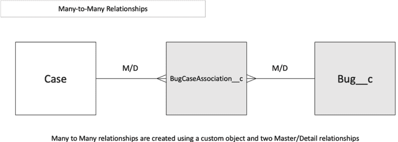

图 14.2 – 多对多关系建模

接下来是共享模型：

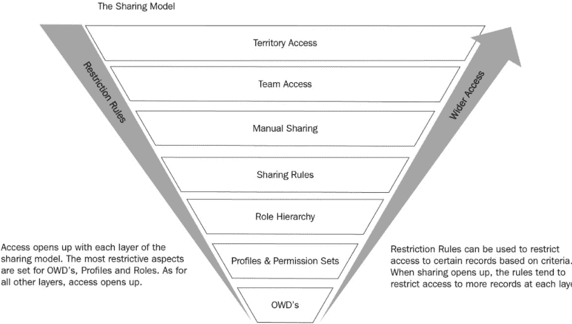

图 14.3 – 共享模型

最后，我们再来回顾一下对象和字段存储：

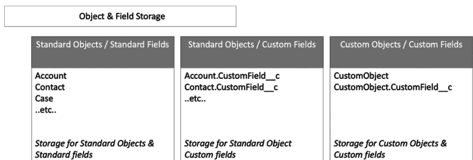

图 14.4 – 对象和字段存储

现在让我们继续学习主数据管理。

#### 主数据管理

现在让我们看看在“主数据管理（MDM）”主题中引入的图表。

以下内容可用作主数据管理主题的辅助工具，其中我们探讨了以 Salesforce 作为黄金记录关联持有者的 MDM 场景：

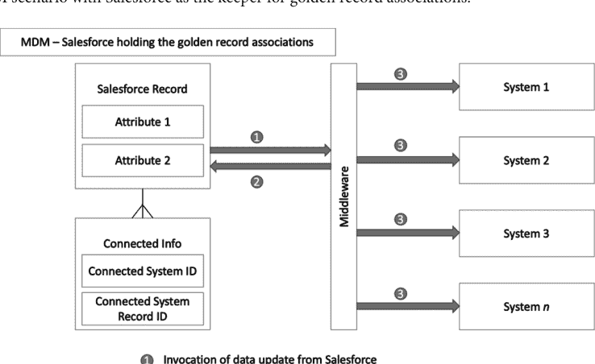

图 14.5 – Salesforce 持有黄金记录关联


图 14.7 – 外部注册表持有黄金记录关联

1 从 Salesforce 发起数据更新调用
2 中间件从外部注册表查询与 Salesforce 记录关联的系统标识符
3 对与 Salesforce 记录关联的系统执行数据更新

让我们继续学习 Salesforce 数据管理。

#### Salesforce 数据管理

现在让我们看看 Salesforce 数据管理复习辅助工具。

本书前面在第 4 章“Salesforce 数据管理”中已介绍过，现在让我们回顾 Experience Cloud 的许可，以便您在回答有关 Experience Cloud 和许可选项的问题时能够做好充分准备：

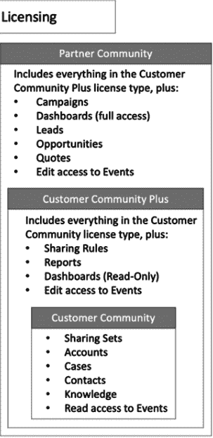

图 14.8 – Salesforce Experience Cloud 许可

现在让我们继续学习数据治理。

#### 数据治理

在第 5 章“数据治理”中，我们介绍了企业数据治理策略的概念。

让我们回顾企业数据治理策略：

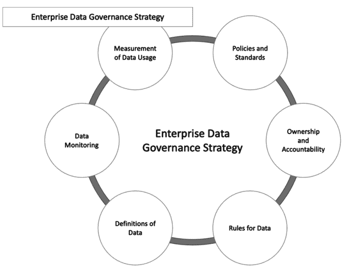

图 14.9 – 企业数据治理策略

接下来，让我们继续学习大数据量。

#### 大数据量

第 6 章“理解大数据量”深入探讨了 Salesforce 中的大数据量（LDV），包括缓解技术。


我们之前在探讨 LDV 时已经涉及过索引，这里让我们回顾一下：

#### Salesforce 查询优化器 – 标准索引

30% 的最多 100 万条记录 + 超过 100 万条记录的额外记录的 15%，总计最多 100 万条记录

示例：
2 百万条记录 – 300,000 + 150,000 = 450,000 条记录
6 百万条记录 – 300,000 + 700,000 = 100 万条记录

#### Salesforce 查询优化器 – 自定义索引

10% 的最多 100 万条记录 + 超过 100 万条记录的额外记录的 5%，总计最多 333,333 条记录

示例：
2 百万条记录 – 100,000 + 50,000 = 150,000 条记录
6 百万条记录 – 100,000 + 233,333 = 333,333 条记录

图 14.10 – Salesforce 查询优化器索引阈值

接下来是数据迁移，让我们进一步研究一下。

#### 数据迁移

在我们通过复习辅助资料的旅程中，接下来是数据迁移。

我们已经介绍了典型的 数据迁移 所涉及的阶段，所以让我们在这里刷新一下我们的知识：

#### 数据迁移流程

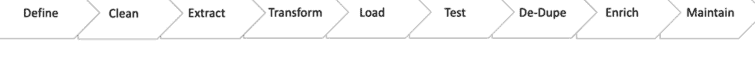

图 14.11 – 数据迁移流程

现在，让我们继续讨论账户和联系人。

#### 账户和联系人

在第 8 章《账户和联系人》中，我们探讨了这两个 Salesforce 平台核心对象的关系以及各种连接对象。

让我们回顾一下账户和联系人图表，以刷新我们对该主题的记忆，首先从 Person Account 和 Contact Role 数据模型开始：

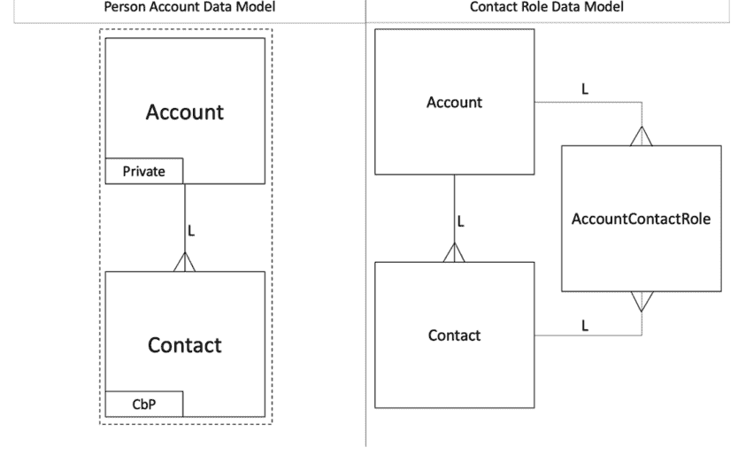

图 14.12 – Person Account 和 Contact Role 数据模型

接下来，让我们重新审视 Account Team 和 Account/Contact Relation 数据模型：

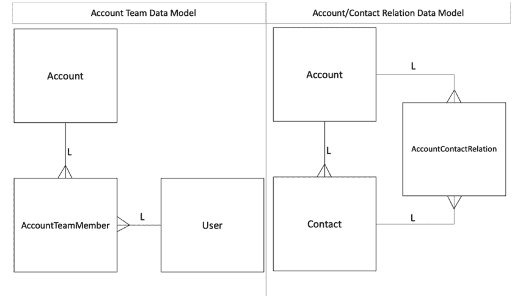

图 14.13 – Account Team 和 Account/Contact Relation 数据模型

账户和联系人部分已介绍完毕，让我们总结一下本章所涵盖的内容。

#### 摘要

在本章中，我们介绍了几个备忘单或复习辅助资料，您可以使用它们来唤起您对多个主题领域的记忆和理解。

在第 15 章《进一步资源》中，我们将重点介绍进一步资源链接，您可以探索这些链接以加强您对本书中涵盖的特定主题领域的理解。

### 15

#### 进一步资源

在我们的学习旅程中，我们已经涵盖了许多不同的主题。然而，您仍然可以学习更多内容来增强您对特定主题的理解。在本章中，将重点介绍额外的资源和 Salesforce 官方文档（如果有）。

让我们从 *数据建模和数据库设计* 开始。

#### 数据建模和数据库设计

以下资源可用于进一步探索我们在介绍数据建模和数据库设计时重点介绍的主题：

- *Salesforce 中的数据访问:* https://developer.salesforce.com/docs/atlas.en-us.dat.meta/dat/dat_components.htm
- *Salesforce 标准对象:* https://developer.salesforce.com/docs/atlas.en-us.api.meta/api/sforce_api_objects_list.htm
- *Salesforce 数据模型图:* https://developer.salesforce.com/docs/atlas.en-us.api.meta/api/data_model.htm
- *Salesforce 对象关系概述:* https://help.salesforce.com/articleView?id=overview_of_custom_object_relationships.htm&type=0
- *限制规则:* https://help.salesforce.com/s/articleView?id=release-notes.rn_forcecom_sharing_restriction_rules.htm&type=5&release=234
- *数据建模 (Trailhead):* https://trailhead.salesforce.com/content/learn/modules/data_modeling
- *Salesforce 数据建模 101:* https://www.youtube.com/watch?v=2VGWIM4yMAs

现在，让我们继续讨论主数据管理。

#### 主数据管理

有关主数据管理的更多信息，请参阅以下资源：

- *MDM 初学者指南*: https://www.dataqualitypro.com/blog/beginners-guide-to-mdm-master-data-management
- *什么是主数据管理 (MDM)？*: https://www.mulesoft.com/resources/esb/what-is-master-data-management-mdm
- *Salesforce Connect*: https://developer.salesforce.com/docs/atlas.en-us.234.0.apexcode.meta/apexcode/platform_connect_about.htm
- *请教架构师：有效 Salesforce 数据管理策略的 5 个步骤（第 1 部分）*: https://www.salesforce.org/blog/ask-architect-5-steps-effective-salesforce-data-management-strategy/
- *什么是主数据管理*: https://www.youtube.com/watch?v=2vhArFG_eCo
- *企业产品管理背景下的主数据管理 (MDM) 与 PLM*: https://www.slideshare.net/tataconsultancyservices/master-data-management-mdm-plm-in-context-of-enterprise-product-management

接下来，让我们转向 Salesforce 数据管理。

#### Salesforce 数据管理

有关 Salesforce 数据管理的更多见解，请参阅以下资源：

- *Salesforce Experience Cloud 许可*: https://help.salesforce.com/s/articleView?id=users_license_types_communities.htm&type=5&language=en_US
- *设置共享集*: https://help.salesforce.com/s/articleView?id=sf.networks_setting_light_users.htm&type=5
- *Salesforce 数据存储分配*: https://help.salesforce.com/s/articleView?id=sf.overview_storage.htm&type=5
- *客户数据平台*: https://www.salesforce.com/ap/solutions/customer-360/
- *Salesforce to Salesforce*: https://help.salesforce.com/s/articleView?id=sf.business_network_intro.htm&type=5
- *Bulk API 2.0 简介*: https://developer.salesforce.com/docs/atlas.en-us.api_asynch.meta/api_asynch/asynch_api_intro.htm
- *Apex Governor 限制:* https://developer.salesforce.com/docs/atlas.en-us.236.0.salesforce_app_limits_cheatsheet.meta/salesforce_app_limits_cheatsheet/salesforce_app_limits_platform_apexgov.htm
- *数据管理 (Trailhead):* https://trailhead.salesforce.com/content/learn/modules/lex_implementation_data_management?trailmix_creator_id=strailhead&trailmix_slug=architect-data-architecture-and-management

接下来是数据治理。

#### 数据治理

有关数据治理的更多信息，请参阅以下资源：

- *Individual 对象:* https://developer.salesforce.com/docs/atlas.en-us.api.meta/api/sforce_api_objects_individual.htm
- *Salesforce Shield 加密与 Salesforce Classic 加密:* https://developer.salesforce.com/docs/atlas.en-us.securityImplGuide.meta/securityImplGuide/security_pe_vs_classic_encryption.htm
- *启用 Salesforce Shield 事件监控:* https://help.salesforce.com/s/articleView?id=000339868&type=1
- *会话安全:* https://help.salesforce.com/s/articleView?id=sf.admin_sessions.htm&type=5
- *字段历史跟踪:* https://help.salesforce.com/s/articleView?id=sf.tracking_field_history.htm&type=5
- *数据治理、数据管治、规划与数据质量:* https://www.youtube.com/watch?v=lA9i190y_OI

接下来，让我们探索一些适用于大数据量的资源。

#### 大数据量

有关大数据量的更多信息，可以通过查看以下资源找到：

- *Salesforce Trust:* https://trust.salesforce.com
- *搜索架构:* https://developer.salesforce.com/docs/atlas.en-us.salesforce_large_data_volumes_bp.meta/salesforce_large_data_volumes_bp/ldv_deployments_concepts_search_architecture.htm
- *索引*: https://developer.salesforce.com/docs/atlas.en-us.salesforce_large_data_volumes_bp.meta/salesforce_large_data_volumes_bp/ldv_deployments_infrastructure_indexes.htm
- *瘦表*: https://developer.salesforce.com/docs/atlas.en-us.salesforce_large_data_volumes_bp.meta/salesforce_large_data_volumes_bp/ldv_deployments_infrastructure_skinny_tables.htm
- *Salesforce 架构师 – 大数据量*: https://medium.com/salesforce-architects/tagged/large-data-volumes
- *大对象*: https://developer.salesforce.com/docs/atlas.en-us.236.0.bigobjects.meta/bigobjects/big_object.htm
- *大数据量部署的最佳实践*: https://developer.salesforce.com/docs/atlas.en-us.salesforce_large_data_volumes_bp.meta/salesforce_large_data_volumes_bp/ldv_deployments_introduction.htm
- *Salesforce 中的大数据量 (LDV) 管理*: https://www.youtube.com/watch?v=TzrRZs2VQEU

让我们现在转向数据迁移资源。

#### 数据迁移

有关数据迁移的额外资源如下所列：

- *从 Salesforce 导出数据的选项*: https://trailhead.salesforce.com/content/learn/modules/lex_implementation_data_management/lex_implementation_data_export
- *Salesforce 中的 PK 分块*: https://developer.salesforce.com/docs/atlas.en-us.234.0.api_asynch.meta/api_asynch/asynch_api_headers_enable_pk_chunking.htm
- *数据分配和存储限制*: https://help.salesforce.com/s/articleView?id=sf.overview_storage.htm&type=5
- *Bulk API 查询*: https://developer.salesforce.com/docs/atlas.en-us.api_asynch.meta/api_asynch/asynch_api_bulk_query_intro.htm
- *迁移数据的最佳实践*: https://help.salesforce.com/s/articleView?id=000326326&type=1
- *数据导入：导入数据的最佳实践 | Salesforce*: https://www.youtube.com/watch?v=GgBtfffWqw0

接下来是账户和联系人资源。


#### 账户和联系人

有关账户和联系人的更多信息，请参阅以下附加资源：

- *Account 对象 API 文档：* https://developer.salesforce.com/docs/atlas.en-us.object_reference.meta/object_reference/sforce_api_objects_account.htm
- *Contact 对象 API 文档：* https://developer.salesforce.com/docs/atlas.en-us.object_reference.meta/object_reference/sforce_api_objects_contact.htm
- *启用人员账户：* https://help.salesforce.com/s/articleView?id=sf.account_person_enable.htm&type=5
- *启用联系人关联多个账户：* https://help.salesforce.com/s/articleView?id=sf.shared_contacts_set_up.htm&type=5
- *将联系人关联到多个账户与其他选项的比较：* https://help.salesforce.com/s/articleView?id=sf.shared_contacts_comparison.htm&type=5
- *AccountContactRelation API 文档：* https://developer.salesforce.com/docs/atlas.en-us.object_reference.meta/object_reference/sforce_api_objects_accountcontactrelation.htm
- *AccountContactRole API 文档：* https://developer.salesforce.com/docs/atlas.en-us.object_reference.meta/object_reference/sforce_api_objects_accountcontactrole.htm
- *AccountTeamMember API 文档：* https://developer.salesforce.com/docs/atlas.en-us.object_reference.meta/object_reference/sforce_api_objects_accountteammember.htm
- *Sales Cloud 中账户和联系人的注意事项：* https://www.youtube.com/watch?v=ZXceWxOTNmQ

现在让我们转向数据 API 和 Apex 的资源。

#### 数据 API 和 Apex

有关数据 API 和 Apex 的进一步信息可在以下位置找到：

- *使用 Salesforce 的 OAuth 2.0：* https://developer.salesforce.com/docs/atlas.en-us.api_rest.meta/api_rest/intro_oauth_and_connected_apps.htm
- *Batch API：* https://developer.salesforce.com/docs/atlas.en-us.api_asynch.meta/api_asynch/asynch_api_intro.htm
- *Bulk API 2.0 – 请求如何处理：* https://developer.salesforce.com/docs/atlas.en-us.api_asynch.meta/api_asynch/how_requests_are_processed.htm
- *Batch Apex：* https://developer.salesforce.com/docs/atlas.en-us.222.0.apexcode.meta/apexcode/apex_batch_interface.htm
- *执行 Batch Apex：* https://help.salesforce.com/s/articleView?id=000328480&type=1
- *Apex Batchable 接口：* https://developer.salesforce.com/docs/atlas.en-us.apexref.meta/apexref/apex_interface_database_batchable.htm#apex_Database_Batchable_execute
- *Apex Schedulable 类：* https://developer.salesforce.com/docs/atlas.en-us.222.0.apexcode.meta/apexcode/apex_scheduler.htm
- *Apex 中的 Future 方法：* https://developer.salesforce.com/docs/atlas.en-us.222.0.apexcode.meta/apexcode/apex_invoking_future_methods.htm
- *Apex Database 类：* https://developer.salesforce.com/docs/atlas.en-us.apexref.meta/apexref/apex_methods_system_database.htm
- *使用 Bulk API 进行快速并行数据加载：* https://www.youtube.com/watch?v=OioHST8SZ7A&t=1962s

在重点介绍了数据 API 和 Apex 资源之后，让我们现在继续进行性能调优。

#### 性能调优

有关性能调优的更多资源，请参阅以下链接：

- *PK 分块：* https://developer.salesforce.com/docs/atlas.en-us.api_asynch.meta/api_asynch/async_api_headers_enable_pk_chunking.htm
- *精简表：* https://developer.salesforce.com/docs/atlas.en-us.salesforce_large_data_volumes_bp.meta/salesforce_large_data_volumes_bp/ldv_deployments_infrastructure_skinny_tables.htm
- *性能优化技术：* https://developer.salesforce.com/docs/atlas.en-us.salesforce_large_data_volumes_bp.meta/salesforce_large_data_volumes_bp/ldv_deployments_techniques_for_performance.htm
- *Salesforce 数据架构设计师系列 – 第 6 节 性能调优：* https://www.youtube.com/watch?v=-QTDZObPOac

现在让我们继续了解备份和恢复资源。

#### 备份和恢复

请查看以下内容以获取有关备份和恢复的更多信息：

- *备份 Salesforce 数据的最佳实践：* https://help.salesforce.com/s/articleView?id=000334121&type=1
- *使用数据加载器导出数据：* https://help.salesforce.com/s/articleView?id=sf.exporting_data.htm&type=5
- *使用报表导出导出数据：* https://help.salesforce.com/s/articleView?id=sf.reports_export.htm&type=5
- *使用每周备份导出数据：* https://help.salesforce.com/s/articleView?id=sf.admin_exportdata.htm&type=5
- *创建沙盒环境：* https://help.salesforce.com/s/articleView?id=sf.data_sandbox_create.htm&type=5
- *Ant 迁移工具：* https://developer.salesforce.com/docs/atlas.en-us.daas.meta/daas/meta_development.htm
- *SFDX：* https://developer.salesforce.com/tools/sfdxcli
- *Salesforce 备份和恢复：* https://www.youtube.com/watch?v=znfkpQDopyw

接下来是区域管理。

#### 区域管理

区域管理的参考资料以供进一步学习可在以下位置找到：

- *区域管理实施指南：* https://resources.docs.salesforce.com/latest/latest/en-us/sfdc/pdf/salesforce_implementing_territory_mgmt2_guide.pdf
- *开始使用企业区域管理：* https://trailhead.salesforce.com/content/learn/modules/territory-management-basics/get-started-with-enterprise-territory-management
- *使用区域管理实现自动化：* https://www.youtube.com/watch?v=upFY2uMvCIY

### 16

#### 如何参加考试

当你准备好参加考试时，你需要通过注册流程，然后在虚拟或现场参加考试。继续阅读以了解此流程的工作方式。在本章结束时，你将确切知道需要做什么才能参加考试。如果你已经使用 Webassessor 参加过 Salesforce 考试，可以选择跳过本章。

本章将涵盖以下主题：

- Webassessor
- 现场参加考试
- 远程参加考试
- 成绩

现在，让我们深入了解如何参加考试，首先介绍 Webassessor 平台。

#### Webassessor

**Kryterion Webassessor** 是一个用于安排、支付和参加考试的平台。由 Salesforce、**Amazon Web Services (AWS)** 和其他组织用于管理资格认证考试，它提供了一个安全的机制来预订和支付你的考试，然后启动考试本身。成绩永久保存，这意味着你针对特定产品套件（如 Salesforce）的所有考试历史都保存在一个地方。

让我们现在看看如何注册 Webassessor 账户。

#### 注册 Webassessor 账户

为了安排考试，如果你还没有为 Salesforce 考试注册 Webassessor 账户，则必须先注册。

为此，首先，导航到 https://www.webassessor.com/salesforce 并点击 Create a new Webassessor login now 链接：

Schedule your Salesforce Certification Exam

由于冠状病毒（COVID-19）爆发，许多考试测试中心已关闭。在此处查看开放测试中心列表：https://www.kryteriononline.com/locate-test-center。有关 COVID-19 情况的更多信息，请查看此常见问题解答：https://sfdc.co/CertCovid-19。

Connect with the Trailblazer Community
Ask Salesforce-related questions and connect with Trailblazers from around the world by joining the Trailblazer Community.

Information about Salesforce Exams
Learn about each credential, prerequisites, and check out the exam guides.

Prepare for your exam
Continue learning and improving your Salesforce knowledge by visiting Trailhead or schedule a Trailhead Academy class to learn more from certified instructors.

Additional questions
Visit Trailhead Help to view relevant articles or to contact us.

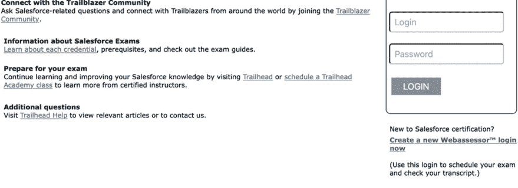

图 16.1 – Webassessor 登录屏幕

填写表单详细信息时，请确保使用与你的 Trailhead 账户相同的电子邮件账户。填写所有字段后，点击 Save 按钮：


Webassessor™ 登录：

必须是电子邮件地址或字母数字字符。

密码：

密码长度至少为 8 个字符，并且至少包含一个大写字母、一个小写字母、一个数字和一个特殊字符：!@#$%&^*()[]{}（例如，"johnSmith6$"）

重新输入密码

法定名字：

在考试中心参加考试时，您在两种身份证明上使用的姓名必须与下面指定的姓名完全一致。此外，所有身份证明必须是最新的。过期的身份证明将不被接受。

法定姓氏：

电子邮件地址：

主要电话：

地址行 1：

地址行 2：

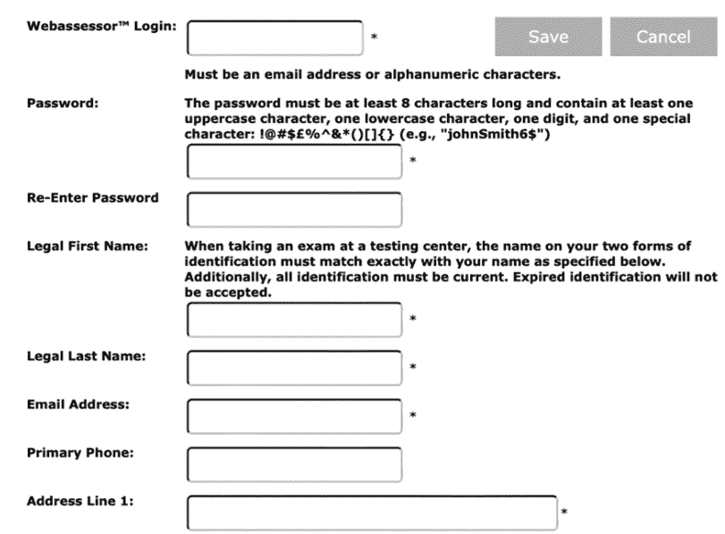

图 16.2 – Webassessor 新账户注册界面

完成可能需要的任何电子邮件验证后，您的账户即可使用。

现在让我们看看参加现场考试需要什么条件。

#### 现场参加考试

为了参加考试，我们必须先注册：

- 1. 为此，请使用您的凭据登录 Webassessor（如果您尚未登录），然后点击“Register For An Exam”选项卡：


图 16.3 – Webassessor 选项卡

- 2. 接下来，展开“Architect Exams”部分，以访问 Salesforce 架构师考试课程中的考试：


图 16.4 – 考试部分

- 3. 展开“Salesforce Certified Data Architect”部分，然后点击“Onsite Proctored”旁边的“Register”。接着，您将看到考试中心列表和筛选选项。勾选合适的考试中心旁边的复选框，然后点击“Select”：

选择下面的选项以缩小显示的考试中心列表。


选择您希望参加考试的考试中心。

##### 可用考试中心

|  | 考试地点名称 | 地址 | 城市 | 省/州 | 国家 | 地图 | 重要地点信息 |
|---|---|---|---|---|---|---|---|
|  | Spark Exam Centre | 30-31 Friars Street, Nando's Building, OFF MERCHANTS PLACE | Reading | Berkshire | 英国 | 地图 |  |
|  | Pitman Training Centre\_Cambridge | 2nd Floor, St Andrews House, 59 St Andrews Street | Cambridge | Cambridgeshire | 英国 | 地图 |  |
|  | Exams Ltd | Sefton House, Adam Court, Newark Road | Peterborough | Cambridgeshire | 英国 | 地图 |  |
|  | Pitman Training\_Enfield | 2nd Floor Nicon House, 45 Silver Street | Enfield | Enfield | 英国 | 地图 |  |
|  | Oriac Information Systems | Oriac House, 10 The Glenmore Centre, Pent Road | Folkestone | Kent | 英国 | 地图 |  |
|  | SMARTTHINK LIMITED\_Maidstone-Kent | F10 & F14 First Floor Kestrel House, Knightrider Street | Maidstone | Kent | 英国 | 地图 |  |

图 16.5 – 选择考试中心

- 4. 接下来，选择日期和时间。勾选复选框以确认您已阅读文本框中的文本，然后点击“Select”：

Rewards Training 4th Floor, The Pinnacle Building, Station Way, Crawley, West Sussex RH10 1JH

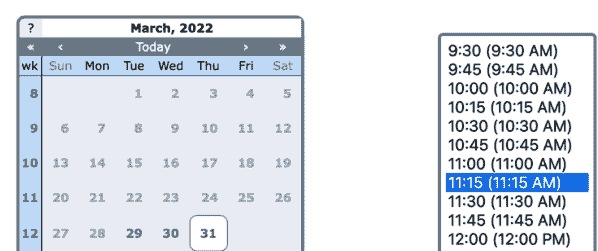

> 考试政策：完成 Salesforce.com 认证考试时，您必须遵守 Salesforce.com 认证计划协议。有关更多信息，请访问：https://trailhead.salesforce.com/help?article=User-Agreement。此外，您必须遵守注册确认邮件和考试监考人员向您提供的所有指示和要求。未能遵守计划协议、监考人员指示或考试政策将导致纪律处分。取消和改期政策：如果您的考试安排在考试中心，您可以在预定开始时间前 72 小时免费改期或取消考试。如果您的考试安排为在线监考，您可以在预定开始时间前 24 小时免费改期或取消考试。在考试中心考试前 72 小时内或在线监考考试前 24 小时内改期或取消，将收取 75 美元的费用，并且您必须向 Salesforce 认证团队提交工单以处理更改。上述政策不包括 Certified Technical Architect 评审委员会考试，该考试要求至少在预定考试开始日期和时间前 10 个工作日提出取消和改期请求。如果您未在预定时间完成考试，并且未提前联系 Salesforce 认证团队，您将被视为未出席，并需支付全额考试费用。如需改期或取消考试的帮助，请向 Salesforce 认证团队提交工单：https://trailhead.salesforce.com/help?support=home

我确认我已阅读并理解上述文本框中的所有信息，并同意遵守这些条款和规则。

图 16.6 – 选择参加考试的日期和时间

- 5. 如果您有优惠券代码，请在付款界面中输入；否则，请前往“Check Out”并使用接受的付款方式支付。您的考试现已预订完成。

下一步是在预定时间亲自前往考试中心参加考试。您需要出示身份证明以确认您的身份。每个考试中心的环境可能有所不同，您可能独自或与其他考生共用房间，但可以肯定的是，考试将是您坐在电脑前，使用电脑鼠标完成。

现在我们了解了现场考试的方式，让我们探讨一下虚拟考试的含义。

#### 虚拟参加考试

与现场参加考试一样，我们必须先注册：

- 1. 为此，请使用您的凭据登录 Webassessor（如果您尚未登录），然后点击 **Register for an exam** 选项卡。
- 2. 接下来，展开 **Architect Exams** 部分，以访问构成 Salesforce 架构师考试课程的考试。
- 3. 展开 **Salesforce Certified Data Architect** 部分，然后点击 **Online Proctored** 旁边的 **Register**。
- 4. 接着，您将看到可用的虚拟监考日期和时间列表。勾选合适的考试中心旁边的复选框，然后点击 **Select**。
- 5. 接下来，选择日期和时间。勾选复选框以确认您已阅读文本框中的文本，然后点击 **Select**。
- 6. 如果您有优惠券代码，请在付款界面中输入；否则，请前往 **Check Out** 并使用接受的付款方式支付。您的考试现已预订完成。

为了准备考试，您需要在笔记本电脑上创建生物识别身份信息，并下载一个名为 **Sentinel** 的软件。具体操作说明将在考试预订后收到的确认邮件中提供。

考试时间临近时，请务必找到一个不会被打扰、没有噪音、且没有任何笔记或类似可能暗示作弊物品的房间。考试为闭卷形式，意味着不得参考任何笔记或材料。

参加考试时，您将被要求暂时摘下眼镜并向监考人员展示（当然，如果您戴眼镜的话），并且您可能会被要求不时向监考人员展示您的考试区域。

现在我们已经介绍了虚拟考试，接下来让我们关注考试结果。

#### 结果

无论考试形式如何（现场或虚拟），当您完成考试后，您会立即看到结果以及您在考试各个领域的得分明细（以百分比表示）。如果您通过了，恭喜！如果您没有通过，请使用得分明细来确定需要重新学习和复习的地方。使用与预订考试相同的流程进行重考预约。重考将产生费用，但比首次考试费用便宜。不要把未通过视为坏事。您会收到反馈，以便下次取得更好的成绩并通过，因为第二次复习可以更有针对性。

现在我们已经了解了结果的格式，让我们总结一下所涵盖的内容。


#### Summary

在本章中，我们介绍了如何在现场和虚拟格式下参加 Salesforce 认证数据架构师考试。我们介绍了 Webassessor 并学习了如何注册考试。

如果你尝试了 *第 13 章、练习考试问题* 中的练习题，那么你可以在 *第 17 章、练习题答案* 中核对你的答案。

### 17

#### Answers to Practice Questions

本书本部分介绍的练习题集，候选人可在本章中获得答案。

##### Answers for question set 1-20

- 1. b
- 2. b
- 3. c
- 4. d
- 5. a
- 6. d
- 7. a
- 8. c
- 9. d
- 10. a
- 11. a
- 12. b and d
- 13. a, c, and d
- 14. d
- 15. b
- 16. a and b
- 17. a
- 18. b and d

##### Answers for question set 21-40

- 1. a
- 2. a
- 3. a and b
- 4. a
- 5. a
- 6. a
- 7. a
- 8. c
- 9. b
- 10. d
- 11. b
- 12. a
- 13. b
- 14. a
- 15. c
- 16. a
- 17. a, b, and d
- 18. b and d
- 19. a
- 20. a

##### Answers for question set 41-60

- 1. a and b
- 2. c
- 3. a and d
- 4. a and c
- 5. b
- 6. d
- 7. a and b
- 8. c
- 9. a
- 10. a
- 11. b and d
- 12. a
- 13. c
- 14. d
- 15. a
- 16. c and e
- 17. a and d
- 18. b and c
- 19. a and c
- 20. b

##### Answers for question set 61-80

- 1. a
- 2. b
- 3. c
- 4. b
- 5. b and c
- 6. a, b, and d
- 7. a
- 8. b, c, and d
- 9. a
- 10. b, c, and d
- 11. a and b
- 12. b
- 13. a
- 14. d
- 15. a
- 16. d
- 17. a
- 18. a and d
- 19. a
- 20. a

##### Answers for question set 81-100

- 1. b
- 2. c
- 3. c
- 4. a
- 5. b and c
- 6. c
- 7. a, c, and e
- 8. a and c
- 9. b
- 10. a, b, and c
- 11. b
- 12. a and c
- 13. a
- 14. b
- 15. a and b
- 16. a, c, and d
- 17. a, b, and c
- 18. a and b
- 19. b, c, and d
- 20. a, b, and c
