# Salesforce 端到端实施手册：设置项目和计划以实现卓越业务成果的实践者指南

 Salesforce 端到端实施手册

面向实践者的指南，用于设置项目和计划以实现卓越的业务成果

KRISTIAN MARGARYAN JØRGENSEN

前言由 Tameem Bahri 撰写 - A.P. Moller - Maersk 的 CRM 全球工程总监，Salesforce CTA，以及《Becoming a Salesforce Certified Technical Architect》的作者

第一版

<packt>

第一版

 Salesforce 端到端实施
手册

面向实践者的指南，用于设置项目和计划以实现卓越的业务成果

 KRISTIAN MARGARYAN JØRGENSEN

前言由 Tameem Bahri 撰写 - A.P. Moller - Maersk 的 CRM 全球工程总监，Salesforce CTA，以及《Becoming a Salesforce Certified Technical Architect》的作者

 目录

前言

第 1 部分：开发前阶段

第 1 章：为您的 Salesforce 项目创建愿景

第 2 章：定义您的 Salesforce 项目的性质

第 3 章：确定如何交付您的 Salesforce 项目

第 4 章：获得资金并与 Salesforce 和实施合作伙伴[content]

 Salesforce 端到端实施手册

面向实践者的指南，用于设置项目和计划以实现卓越的业务成果

KRISTIAN MARGARYAN JØRGENSEN

前言由 Tameem Bahri 撰写 - A.P. Moller - Maersk 的 CRM 全球工程总监，Salesforce CTA，以及《Becoming a Salesforce Certified Technical Architect》的作者

第一版

<packt>

第一版

 Salesforce 端到端实施
手册

面向实践者的指南，用于设置项目和计划以实现卓越的业务成果

 KRISTIAN MARGARYAN JØRGENSEN

前言由 Tameem Bahri 撰写 - A.P. Moller - Maersk 的 CRM 全球工程总监，Salesforce CTA，以及《Becoming a Salesforce Certified Technical Architect》的作者

 目录

前言

第 1 部分：开发前阶段

第 1 章：为您的 Salesforce 项目创建愿景

第 2 章：定义您的 Salesforce 项目的性质

第 3 章：确定如何交付您的 Salesforce 项目

第 4 章：获得资金并与 Salesforce 和实施合作伙伴[content]

 Salesforce 端到端实施手册

面向实践者的指南，用于设置项目和计划以实现卓越的业务成果

KRISTIAN MARGARYAN JØRGENSEN

前言由 Tameem Bahri 撰写 - A.P. Moller - Maersk 的 CRM 全球工程总监，Salesforce CTA，以及《Becoming a Salesforce Certified Technical Architect》的作者

第一版

<packt>

第一版

 Salesforce 端到端实施
手册

面向实践者的指南，用于设置项目和计划以实现卓越的业务成果

 KRISTIAN MARGARYAN JØRGENSEN

前言由 Tameem Bahri 撰写 - A.P. Moller - Maersk 的 CRM 全球工程总监，Salesforce CTA，以及《Becoming a Salesforce Certified Technical Architect》的作者

 目录

前言

第 1 部分：开发前阶段

第 1 章：为您的 Salesforce 项目创建愿景

第 2 章：定义您的 Salesforce 项目的性质

第 3 章：确定如何交付您的 Salesforce 项目

第 4 章：获得资金并与 Salesforce 和实施合作伙伴[content]

 Salesforce 端到端实施手册

面向实践者的指南，用于设置项目和计划以实现卓越的业务成果

KRISTIAN MARGARYAN JØRGENSEN

前言由 Tameem Bahri 撰写 - A.P. Moller - Maersk 的 CRM 全球工程总监，Salesforce CTA，以及《Becoming a Salesforce Certified Technical Architect》的作者

第一版

<packt>

第一版

 Salesforce 端到端实施
手册

面向实践者的指南，用于设置项目和计划以实现卓越的业务成果

 KRISTIAN MARGARYAN JØRGENSEN

前言由 Tameem Bahri 撰写 - A.P. Moller - Maersk 的 CRM 全球工程总监，Salesforce CTA，以及《Becoming a Salesforce Certified Technical Architect》的作者

 目录

前言

第 1 部分：开发前阶段

第 1 章：为您的 Salesforce 项目创建愿景

第 2 章：定义您的 Salesforce 项目的性质

第 3 章：确定如何交付您的 Salesforce 项目

第 4 章：获得资金并与 Salesforce 和实施合作伙伴[content]

 Salesforce 端到端实施手册

面向实践者的指南，用于设置项目和计划以实现卓越的业务成果

KRISTIAN MARGARYAN JØRGENSEN

前言由 Tameem Bahri 撰写 - A.P. Moller - Maersk 的 CRM 全球工程总监，Salesforce CTA，以及《Becoming a Salesforce Certified Technical Architect》的作者

第一版

<packt>

第一版

 Salesforce 端到端实施
手册

面向实践者的指南，用于设置项目和计划以实现卓越的业务成果

 KRISTIAN MARGARYAN JØRGENSEN

前言由 Tameem Bahri 撰写 - A.P. Moller - Maersk 的 CRM 全球工程总监，Salesforce CTA，以及《Becoming a Salesforce Certified Technical Architect》的作者

 目录

前言

第 1 部分：开发前阶段

第 1 章：为您的 Salesforce 项目创建愿景

第 2 章：定义您的 Salesforce 项目的性质

第 3 章：确定如何交付您的 Salesforce 项目

第 4 章：获得资金并与 Salesforce 和实施合作伙伴[content]

 Salesforce 端到端实施手册

面向实践者的指南，用于设置项目和计划以实现卓越的业务成果

KRISTIAN MARGARYAN JØRGENSEN

前言由 Tameem Bahri 撰写 - A.P. Moller - Maersk 的 CRM 全球工程总监，Salesforce CTA，以及《Becoming a Salesforce Certified Technical Architect》的作者

第一版

<packt>

第一版

 Salesforce 端到端实施
手册

面向实践者的指南，用于设置项目和计划以实现卓越的业务成果

 KRISTIAN MARGARYAN JØRGENSEN

前言由 Tameem Bahri 撰写 - A.P. Moller - Maersk 的 CRM 全球工程总监，Salesforce CTA，以及《Becoming a Salesforce Certified Technical Architect》的作者

 目录

前言

第 1 部分：开发前阶段

第 1 章：为您的 Salesforce 项目创建愿景

第 2 章：定义您的 Salesforce 项目的性质

第 3 章：确定如何交付您的 Salesforce 项目

第 4 章：获得资金并与 Salesforce 和实施合作伙伴[content]

 Salesforce 端到端实施手册

面向实践者的指南，用于设置项目和计划以实现卓越的业务成果

KRISTIAN MARGARYAN JØRGENSEN

前言由 Tameem Bahri 撰写 - A.P. Moller - Maersk 的 CRM 全球工程总监，Salesforce CTA，以及《Becoming a Salesforce Certified Technical Architect》的作者

第一版

<packt>

第一版

 Salesforce 端到端实施
手册

面向实践者的指南，用于设置项目和计划以实现卓越的业务成果

 KRISTIAN MARGARYAN JØRGENSEN

前言由 Tameem Bahri 撰写 - A.P. Moller - Maersk 的 CRM 全球工程总监，Salesforce CTA，以及《Becoming a Salesforce Certified Technical Architect》的作者

 目录

前言

第 1 部分：开发前阶段

第 1 章：为您的 Salesforce 项目创建愿景

第 2 章：定义您的 Salesforce 项目的性质

第 3 章：确定如何交付您的 Salesforce 项目

第 4 章：获得资金并与 Salesforce 和实施合作伙伴[content]
## 前言

Salesforce 已连续 9 年被评为 #1 CRM 提供商。在截至 2022 年 7 月的财季中，Salesforce 超越 SAP 成为全球最大的企业应用提供商。自成立以来，Salesforce 通过构建和收购额外的互补产品，扩展了最初以销售领域为重点的 CRM 方案——现已涵盖销售、电子商务、服务、现场服务、营销自动化、集成、RPA、分析、AI 等诸多领域。

随着这巨大的增长和扩张，Salesforce 的实施也出现了业务和技术复杂性以及组织互联性和依赖性的激增，所有这些都影响了 Salesforce 项目和计划的交付方式。

关于 Salesforce 架构以及开发 Salesforce 解决方案的技术方面（无论是有代码还是无代码）的文献非常丰富，并且没有缺乏涵盖特定 Salesforce 云的优秀实施手册。令人惊讶的是，没有一本书涵盖 Salesforce 项目或计划的实施生命周期。

如果您的组织打算投资——或已经投资——Salesforce，您希望确保从该投资中获得最大价值。当 Salesforce 被您的组织精细调整并采用，并且持续为您的用户和组织提供增量价值时，价值就会得到释放。

本书提出了一个框架，说明如何处理 Salesforce 实施项目以及如何让您的组织成功管理 Salesforce 计划。在此过程中，本书将为您提供有关常见问题以及减轻或完全防止这些问题的策略的见解。

为了能够涵盖一个范围广泛的主题，本书是跨职能和多维的。这意味着它涵盖了许多学科和领域，而不会成为专门针对某一特定主题的纯粹书籍。

涵盖的主题——全部在 Salesforce 背景下——包括以下内容：

- 业务架构和战略
- 企业架构
- Salesforce 架构
- 项目管理
- 敏捷
- DevOps
- 治理
- 变更管理
- 计划管理
- 数据管理与分析
- 产品管理

我希望这种方法能让您全面了解 Salesforce 项目和计划的性质——而不至于迷失在细节中。

到本书结束时，您将获得知识，能够为 Salesforce 项目和计划的成功奠定基础，并从投资中获得最大价值。

### 本书适合谁

本书面向计划为其组织实施 Salesforce 或已在实施 Salesforce 的 Salesforce 顾问、架构师、项目和计划经理以及产品负责人。Salesforce 实施合作伙伴的 Salesforce 顾问和交付负责人阅读本书也会受益。

如果您正在将职业生涯转向 Salesforce 生态系统——一个充满活力、包容性强、回报极高且不断发展的社区——本书将让您很好地了解在 Salesforce 项目和计划中工作时应期待什么。

### 本书涵盖内容

第 1 章，*为您的 Salesforce 项目创建愿景*，首先介绍了 Salesforce 实施的生命周期，并为您概述了 Salesforce 项目的开发前阶段。然后深入探讨战略分析和方法，帮助您了解公司变革的必要性。这将使您能够定义 Salesforce 项目的愿景——您的 *why*。

第 2 章，*定义您的 Salesforce 项目的性质*，将带您了解在定义 Salesforce 项目范围时将开展的活动。我们还将探讨您如何——在此早期阶段——开始考虑如何将其转化为 Salesforce 解决方案的高级技术范围，以及至关重要的是，通常应考虑哪些技术使能因素。这将使您能够定义 *what*。

第 3 章，*确定如何交付您的 Salesforce 项目*，探讨交付方法、变更管理和治理等主题。您将了解在决定项目合适的交付方法时应考虑哪些方面，以及如何区分项目和计划。我们还将讨论项目分阶段的各种方法的优缺点。我们将介绍 Salesforce 项目通常会带来哪些变化，以及您应如何管理它。最后，我们将指导您为整体 Salesforce 治理奠定基础——您的 Salesforce 卓越中心。本章使您能够回答 Salesforce 项目的 *how*。

第 4 章，*获得资金并与 Salesforce 和实施合作伙伴[content]

 Salesforce 端到端实施手册

面向实践者的指南，用于设置项目和计划以实现卓越的业务成果

KRISTIAN MARGARYAN JØRGENSEN

前言由 Tameem Bahri 撰写 - A.P. Moller - Maersk 的 CRM 全球工程总监，Salesforce CTA，以及《Becoming a Salesforce Certified Technical Architect》的作者

第一版

<packt>

第一版

 Salesforce 端到端实施
手册

面向实践者的指南，用于设置项目和计划以实现卓越的业务成果

 KRISTIAN MARGARYAN JØRGENSEN

前言由 Tameem Bahri 撰写 - A.P. Moller - Maersk 的 CRM 全球工程总监，Salesforce CTA，以及《Becoming a Salesforce Certified Technical Architect》的作者

 目录

前言

第 1 部分：开发前阶段

第 1 章：为您的 Salesforce 项目创建愿景

第 2 章：定义您的 Salesforce 项目的性质

第 3 章：确定如何交付您的 Salesforce 项目

第 4 章：获得资金并与 Salesforce 和实施伙伴[content]
测试翻译

通过在环境中部署 Salesforce 解决方案的实际操作以及如何推动用户验收测试。最后，我们将介绍如何在数据迁移和上线签核前确定您的准备情况。

第 10 章《沟通、培训与支持以推动采用》涵盖了规划、沟通和变革管理的关键活动。我们将讨论并提供分阶段推出计划的模板，以及不同的培训交付方式。我们将探讨您应如何提供超配支持以及何时可以安全地过渡到持续的生产支持。我们将探讨您应如何监控和推动 Salesforce 解决方案的采用，以最大化投资回报。

第 11 章《上线阶段应避免的常见问题》介绍了 Salesforce 项目上线阶段的常见问题，并提供了缓解和预防策略。我们还将介绍上线阶段的汇总清单，帮助您评估 Salesforce 项目的状态。

第 12 章《发展您的 Salesforce 组织和 DevOps 能力》首先概述了 Salesforce 计划的持续改进阶段。我们将探讨产品型组织的概念以及您为何应努力将组织转型为此类组织。我们将描述您如何通过更新的 Salesforce CoE 及其核心角色为 Salesforce 计划和平台实施合适的治理。最后，我们将深入探讨 Salesforce DevOps，并探索您如何发展 Salesforce DevOps 能力，以为用户和组织提供更大价值。

第 13 章《管理您的 Salesforce 数据以收获 Customer 360 的成果》涵盖了数据管理和治理这一重要领域。我们将介绍数据分类、数据生命周期和数据质量维度等基本概念。我们将向您展示如何治理、监控和改进 Salesforce 数据的质量。然后我们将引导您评估自己的分析计划，并描述您如何考虑利用 Customer 360 数据以最大化 Salesforce 投资回报。

*第 14 章《持续改进阶段应避免的常见问题》*介绍了 Salesforce 计划持续改进阶段通常面临的常见问题，并提供了缓解和预防策略。我们还将介绍进入持续改进阶段时应做什么的清单，以及为了进一步为用户和组织释放价值而应持续做的事情。

## 如何充分利用本书

如果您对基本业务、CRM 和项目管理概念有所了解，将有助于您充分利用本书。具备 Salesforce 的专业工作经验是有利的，但并非阅读本书的先决条件。

虽然 Salesforce 开发和技术架构是更明确的领域，但 Salesforce 交付则较少如此。这正是本书的目标——提供一个框架和一种视角。

我主要参与为在本地和全球运营的欧洲公司推动 Salesforce 实施。您的观点和经验可能与我不同。我希望开启一次对话，并邀请您积极参与并分享您对 #BetterSalesforceDelivery 的看法。

让我们开始吧！

## 下载彩色图片

我们还提供了一份 PDF 文件，其中包含本书中使用的屏幕截图和图表的彩色图像。您可以在此处下载：https://packt.link/CIbLQ。

## 使用的约定

本书中使用了多种文本约定。

**粗体**：表示新术语或重要词语。示例如下：
"您能够将您的 **Salesforce 组织** 演进以适应不断变化的业务需求，以及管理和利用您的数据，是本阶段的核心活动。"

提示或重要说明

如下所示。

## 联系我们

我们始终欢迎读者的反馈。

**总体反馈**：如果您对本书的任何方面有疑问，请发送电子邮件至 customercare@packtpub.com，并在邮件主题中提及书名。

**勘误**：尽管我们已尽一切努力确保内容的准确性，但错误仍可能发生。如果您在本書中发现错误，我们将不胜感激您向我们报告。请访问 www.packtpub.com/support/errata 并填写表格。

**盗版**：如果您在互联网上发现我们作品的任何形式的非法复制，我们将不胜感激您提供位置地址或网站名称。请联系 copyright@packt.com 并附上材料链接。

**如果您有兴趣成为作者**：如果您在某个领域具有专业知识，并且有兴趣撰写或为书籍做出贡献，请访问 authors.packtpub.com。

## 分享您的想法

阅读完《*Salesforce 端到端实施手册*》后，我们很想听听您的想法！请点击此处直接前往本书在亚马逊的评论页面并分享您的反馈。

您的评论对我们和技术社区非常重要，将帮助我们确保提供优质内容。

## 下载本书的免费 PDF 副本

感谢您购买本书！

您喜欢随时阅读但无法随身携带印刷书籍吗？

您的电子书购买与您选择的设备不兼容吗？

不用担心，现在每本 Packt 书籍都免费提供无 DRM 的 PDF 版本。

随时随地在任何设备上阅读。直接从您喜爱的专业技术书籍中搜索、复制和粘贴代码到您的应用程序中。

福利还不止于此，您还可以每天通过电子邮件获得独家折扣、新闻通讯和优质免费内容。

按照以下简单步骤获取福利：

- 1. 扫描二维码或访问以下链接

https://packt.link/free-ebook/9781804613221

- 2. 提交您的购买证明
- 3. 就这样！我们会直接将您的免费 PDF 和其他福利发送到您的电子邮件

## 第 1 部分：开发前阶段

本部分将指导您在开始开发前的活动。我们还将介绍 **Packt 制造设备**（**PME**），即本书中将贯穿始终的案例公司。

本部分包含以下章节：

- *第 1 章*，为您的 Salesforce 项目创建愿景
- *第 2 章*，定义您的 Salesforce 项目的性质
- *第 3 章*，确定如何交付您的 Salesforce 项目
- *第 4 章*，获得资金并与 Salesforce 和实施合作伙伴接洽
- *第 5 章*，开发前阶段应避免的常见问题

## 为您的 Salesforce 项目创建愿景

要开始一段旅程，您需要确定想要去哪里。本章将指导您通过分析方法来了解贵公司变革的迫切需求，这将成为您创建 **Salesforce 项目**愿景的基础。

在为您的 Salesforce 项目创建愿景后，您就可以继续进行 Salesforce 实施开发前阶段的下一步活动。

在本章中，我们将涵盖以下主要主题：

- 介绍 Salesforce 实施的生命周期
- 您 Salesforce 项目开发前阶段的概述
- 了解贵公司变革的迫切需求
- 定义您 Salesforce 项目的愿景
- 在开发前阶段进行迭代

让我们开始吧！

## 介绍 Salesforce 实施的生命周期

本书将为特定于 Salesforce 项目的整个实施生命周期提供一个框架——从开发前阶段的 **项目启动**到持续改进阶段。以下是所涉及阶段的简要概述：

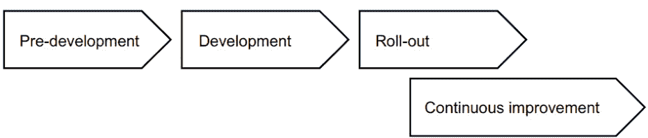

Figure 1.1 – Salesforce实施的项目阶段

在图1.1中，您可以看到Salesforce项目的每个阶段。让我们简要定义每个阶段：

- **预开发阶段**：在此阶段，您正在为Salesforce项目创建愿景，定义其性质，确定交付方式，为其争取预算，并与Salesforce和实施合作伙伴进行接触。在此阶段，您还将设立治理机构，该机构将拥有并监督Salesforce项目的交付。
- **开发阶段**：该阶段始于项目启动活动，之后项目团队将开始交付项目。交付Salesforce项目有不同的方法论，我们将在*第3章，如何交付您的Salesforce项目*中介绍。无论您选择哪种方法论，开发阶段都是详细设计、构建并测试您的Salesforce解决方案范围以确保质量的阶段。
- **推广阶段**：在此阶段，您正在部署发布、迁移数据、培训用户、提供支持，并密切监控用户对解决方案的采用情况并相应做出响应。
- **持续改进阶段**：最后，您将进入持续改进状态。您将Salesforce组织**Salesforce组织**演进以适应不断变化的业务需求，以及管理和利用您的数据的能力，是此阶段的核心活动。

Salesforce项目——尤其是**绿地实施**，组织首次为**Salesforce组织**设置使用——并不始于项目启动活动。Salesforce项目也不应在推广阶段的用户培训结束后直接结束。

现在我们已经了解了Salesforce项目的整体阶段。让我们深入了解您Salesforce项目的预开发阶段。

## 您 Salesforce 项目的预开发阶段概述

Salesforce项目的每个阶段都有其自己的**关键里程碑**，以及实现里程碑所需的活动。

让我们开始了解您Salesforce项目第一阶段的关键里程碑。

## 预开发阶段的关键里程碑

您Salesforce项目的预开发阶段始于构思。构思被定义为贵公司从一系列CRM提供商中做出技术选择，并且Salesforce被选为未来**CRM平台**的时点。决定CRM提供商超出了本书的范围。

预开发阶段的关键里程碑是为Salesforce实施争取初始预算，并与**Salesforce公司**签订合同，并且最常与**实施合作伙伴**签订合同，以协助您开发和推广解决方案。

要实现这些里程碑，需要进行多项活动。我们将在下一节介绍这些活动。

## 预开发阶段的活动

您Salesforce项目预开发阶段的活动如以下图所示：

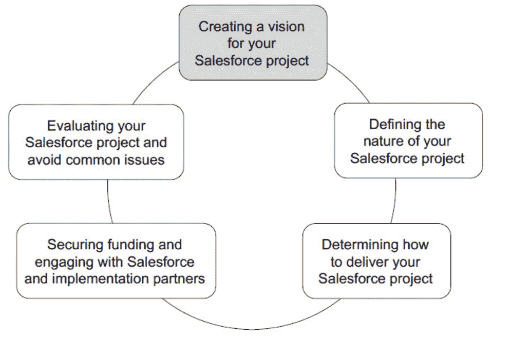

Figure 1.2 – 预开发阶段的活动

从图1.2可以注意到的两个关键点如下：

- 预开发阶段的每个活动都由本书中的一章覆盖，因此您可以轻松导航到想要深入了解的部分。
- 图中没有箭头。虽然活动的顺序通常意味着您应按顺时针顺序进行流程，但并非总是如此。我们将在本章的*预开发阶段的迭代*部分重新讨论这一点。

现在我们已经确定了预开发阶段整体活动包括*什么*，让我们来看一下*谁*将执行这些活动。

## 介绍 Salesforce 任务小组

为了开展预开发阶段的活动，Salesforce实施的执行赞助人应创建一个**Salesforce任务小组**。

Salesforce任务小组应由三个关键角色组成，分别来自业务组织、IT组织以及您的**项目管理办公室（PMO）**。最后，Salesforce任务小组*必须*有一名执行赞助人。

每个成员的角色和职责在*表1.1*中描述：

| 任务小组成员角色 | 任务小组成员职责 |
|---|---|
| 业务负责人 | - 主导对公司战略状况的分析 - 确定所需业务能力 - 确定用于衡量项目成功的业务KPI |
| 技术负责人 | - 基于所需业务能力，确定高层级目标技术范围 - 确保目标技术范围与企业架构原则和计划保持一致 |
| PMO代表 | - 任务小组项目管理 - 利益相关者管理 - 安排与内部和外部利益相关者的会议，记录会议纪要和行动项 - 设定并安排任务小组会议节奏，并向执行赞助人汇报 - 升级任务小组无法处理的议题和决策 |
| 执行赞助人 | - 支持并指导任务小组 - 担任升级联系点 |

Table 1.1 – 任务小组成员角色的职责

## 预开发阶段的持续时间

在新冠疫情初期，一些公司意识到变革的迫切性，并在一个月内完成了预开发阶段的所有活动。虽然这可能挽救了受影响行业的中小型企业，但您不应仓促通过此阶段。

在预开发阶段所做的扎实准备和组织对齐工作，将使您的Salesforce项目更加稳健，并相比仓促的预开发阶段具有更大的成功机会。

让我们继续到下一节，在那里我们将揭示贵公司对变革的需求。

## 理解贵公司变革的迫切需求

在本节中，我们将通过各种方法分析贵公司的状况，以便确定Salesforce项目的愿景。

为了帮助举例说明所使用的方法，让我们首先介绍本书中将贯穿始终的示例公司。

## 介绍我们的示例公司 – Packt Manufacturing Equipment（PME）

让我们看一下示例公司的一些初始事实：

- 公司名称：Packt Manufacturing Equipment（PME）
- 行业：制造业
- 年收入：3亿美元
- 员工人数：2,000名全职员工
- 地理范围：在全球运营和销售；在成熟的PME市场直接销售，在新兴PME市场通过分销商销售

介绍负责在预开发阶段塑造项目的PME Salesforce任务小组：

- **业务负责人：** Kalinda Keen。Kalinda是制造业的老兵。她在PME担任过多个职能的多个职位。目前，她在全球商业卓越部门工作，负责为当地营销、销售和客户服务组织建设能力。Kalinda密切关注影响PME的市场趋势和力量。
- **技术负责人：** Cary Sharp。Cary是全球IT部门冉冉升起的新星。Cary是一名正在向企业架构师职位过渡的解决方案架构师，对云计算极感兴趣。他在PME工作了4年，对PME系统格局非常了解。
- **PMO代表：** Alicia Fast。Alicia是PME的新人，近期从另一个行业加入。她拥有丰富的项目管理经验，她最近的工作涉及管理Salesforce实施。
- **执行赞助人：** Diane General。Diane是全球商业卓越的**高级副总裁（SVP）**，向PME首席执行官汇报。Kalinda向Diane汇报。Diane在PME工作超过10年，曾担任从国家领导到职能管理等多个管理职位。她在组织内备受喜爱和信任，并参与了PME数字转型战略的董事会委员会。

在了解了示例公司PME之后，让我们回到贵公司。

## 贵公司的环境、状况和挑战

要制定路径，除了知道您想去哪里之外，您还需要了解您来自哪里，以及至关重要的是，为什么需要移动。因此，您在预开发阶段的第一个活动就是分析和确定您的**公司状况**。

在以下章节中，我们将介绍了解贵公司组织架构、客户以及所销售的产品和服务的基本方法。

## 重要说明

作为 Salesforce 工作组的成员，您的职责不应是产出分析结果，而是 *整合并理解推动贵公司变革迫切性的宏观力量*。

## 了解贵公司的组织架构

在进行任何战略分析之前，您应首先明确贵公司的组织架构。实现这一目标最简单的方法是查看贵公司的组织架构图。*图表*一词使用复数是有意为之，因为将存在多个层级。

您需要了解贵公司结构方面的以下内容：

- 贵公司本地组织的架构：
  - 贵公司直接在多少个国家运营？
  - 国家或本地组织通常是如何组织的？
  - 每个国家是否有自己的领导团队，还是各国销售、客户服务和市场营销团队分别直接向集团销售、客户服务和市场营销管理汇报？
  - 贵公司本地组织的架构之间存在多大差异？
- 每个国家或销售组织雇用了多少人？
  - 每个国家或销售组织雇用了多少人？
  - 分别有多少人从事市场营销、销售和客户服务职能？
  - 除销售、市场营销和客户服务之外，本地国家或销售组织还管理哪些其他职能，管理程度如何？这可能包括后台销售支持职能、本地物流和本地 IT 支持。
- 集团层级组织：
  - 这通常是贵公司集团管理的组织架构图
  - 特别注意 IT 治理：
    - 集团 IT 负责制定指导方针并提供临时建议，还是牢牢掌控企业 IT 架构并致力于确保合规？可能介于两者之间，但务必充分了解。
- 合作伙伴、分销商或经销商网络：
  - 如果贵公司通过合作伙伴销售产品或服务，这些合作伙伴关系是如何管理的？
  - 合作伙伴关系是在集团层面管理，还是由本地销售组织管理？或在某个中间层级管理？
  - 贵公司与多少家合作伙伴签订了协议？
  - 贵公司的合作伙伴覆盖哪些国家？
  - 贵公司的合作伙伴销售 *全部* 产品和/或服务，还是仅销售其中一部分？

## 小贴士

与人力资源部门沟通，了解贵公司内部的组织架构。关于合作伙伴网络，您可能需要内部调查以确定谁在管理这些关系。

请注意，组织是动态的，小规模的组织变动经常发生，大规模的变动也时有发生。

*要了解组织架构图可能是什么样子，让我们来看一下以下图表中 PME 的公司结构：*

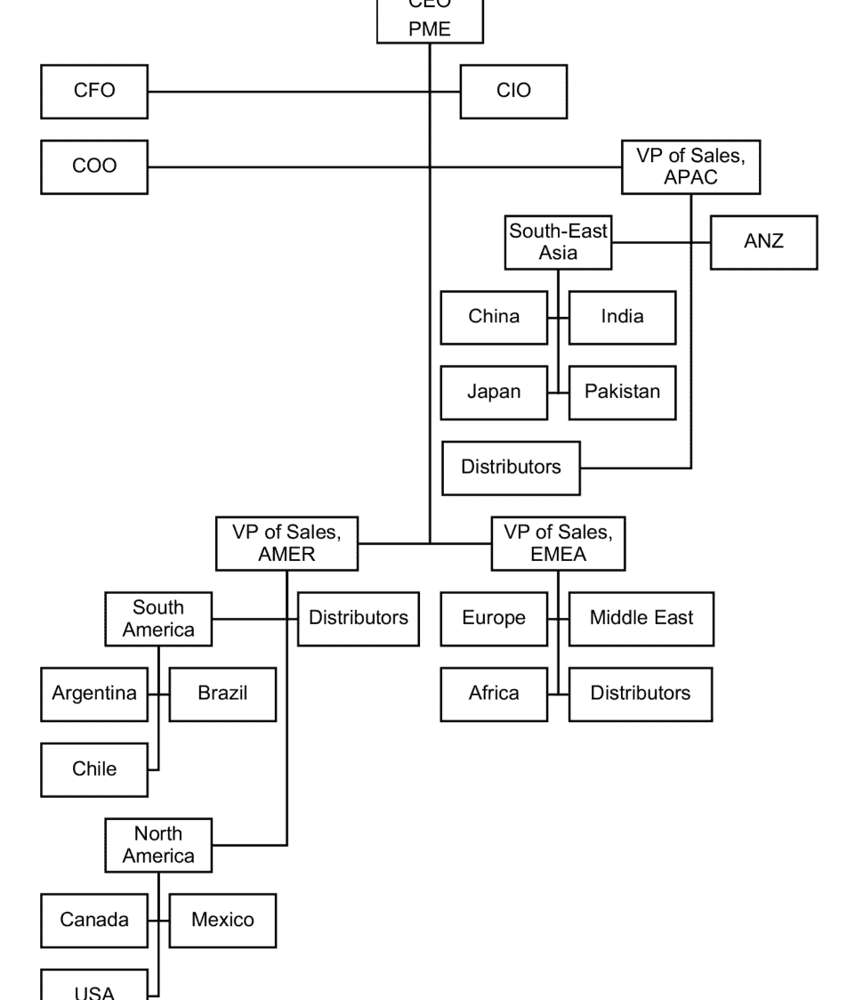

图 1.3 – PME 组织结构图

在图 1.3 中，您可以看到 PME 的 CEO 位于顶部。直接向 CEO 汇报的有 CFO、COO 和 CIO。在 PME，直接向 CEO 汇报的还有三个 PME 区域的 SVP：AMER、APAC 和 EMEA。每个区域 SVP 下辖 PME 的本地国家组织；其中一些设有负责多个较小国家的国家负责人。PME 的区域 SVP 还负责管理在其区域内运营的分销商关系。

您现在已经明确了贵公司及其合作伙伴的组织架构。让我们继续了解贵组织的销售对象以及销售内容。

## 了解客户是谁

您应寻求了解客户的以下关键方面：

- 您有多少客户？
- 您是否拥有少数大型客户占据了大部分收入，还是收入分散在众多客户中？这一比例是否发生变化？
- 从收入和员工人数来看，您的客户通常有多大？请了解客户收入的中位数。
- 您的客户属于哪些行业？
- 贵客户的终端客户或消费者是谁？

## 了解您销售的产品和服务

您应寻求了解产品和服务的以下关键方面：

- 您的产品如何帮助客户克服挑战？
  - 如果您拥有多个产品类别和/或客户细分，您应尝试将答案整合为三到四个关键分组，以便清晰易懂
- 您有多少种产品？
  - 您是否拥有少数产品占据了大部分收入，还是收入分散在众多产品中？
- 您的产品和服务是成品、预包装产品和/或服务，还是高度可配置的？
  - 同时确保您还确定贵公司是否有计划在未来使产品和服务可配置

## 小贴士

与贵公司本地和集团层面的销售和市场营销领导者沟通，了解您的客户以及您的产品和服务如何为他们创造价值。您还可以请求财务或 BI 部门提供有关客户的数据和见解方面的帮助。

## 介绍战略分析基础

虽然商业战略的文献浩繁且不断增长，但仍需要对贵公司进行一些基础分析，以了解其现状和变革的迫切性。在本节中，我们将介绍最常用的分析方法。

## 小贴士

如果贵公司拥有自己的战略分析框架，您应利用该战略分析的见解来了解贵公司的现状。

## PESTLE 分析

2020 年代开始于 Covid-19 大流行后的经济动荡、供应链压力、欧洲的新战争、世界其他地区的持续战争以及通货膨胀。这些都是宏观层面的现象——根据行业和地理位置的不同，以不同方式影响贵公司的状况。

使用 **PESTLE 分析**，您可以将这些影响归类为六个因素：

- **政治：** 政治因素包括任何可能影响或正在影响贵公司的潜在或已实现的政治决策，例如税收、补贴和改革。*您的执行赞助人和高级管理层可以迅速列出他们密切关注的关键当前政治趋势。*
- **经济：** 这些因素众多；一些关键示例包括通货膨胀、利率、消费者信心、企业信心以及贵公司所服务的市场的 GDP 增长。*您的 CFO 或财务业务合作伙伴是了解影响贵公司的经济因素的首要信息来源。*
- **社会：** 社会因素涵盖贵公司市场人口的构成和趋势，以及他们的文化偏好。*您的市场营销部门应能很好地洞察目标人群——无论是消费者还是企业——的转变趋势。*
- **技术：** 这些因素包括可能使您（以及竞争对手）能够以更低的生产成本更高效地生产和交付产品和服务的技术进步，以及更有效地营销和销售产品和服务。常见示例包括制造业自动化，以及更高效的卡车发动机或电动汽车。利用客户洞察进行更好的细分和市场定位以更有效地销售也是技术因素的其它示例。*与贵公司的 CTO 或创新负责人交谈以收集这些见解。*
- **法律：** 法律因素包括与贵公司所在行业和运营地区相关的法律先例，以及贵公司可能面临的任何特定法律问题和风险。*贵公司的总法律顾问、您的 CFO 或风险管理负责人能够与您讨论法律因素，尽管您无法获得所有领域的见解，因为其中一些可能属于保密范围。*
- **环境：** 这些环境因素包括贵公司运营地区物理环境的关键趋势。明显的例子是气候变化及其直接和间接影响。虽然气候变化的直接影响可能对贵公司影响较小，但间接影响，如政治不稳定、消费者和企业偏好的变化以及产品和服务需求的转变，可能对贵公司的状况产生更大影响。*您的执行赞助人和高级管理层可以告诉您是否有任何环境因素对贵公司特别有影响。*

在明确了影响贵公司的宏观因素后，让我们继续了解贵公司的竞争对手状况。

## 波特五力模型

这是由著名哈佛商学院战略与竞争教授迈克尔·E·波特创建的标准方法，用于分析影响企业竞争状况的各种力量。

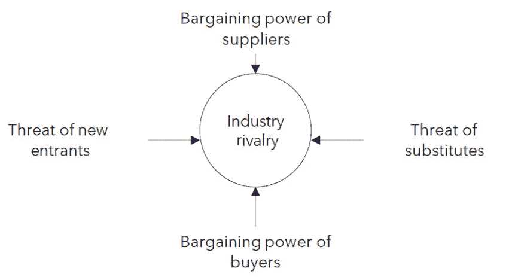

图 1.4 – 波特五力模型

让我们逐一分析五种力量：

- **行业竞争**：在描述贵公司行业竞争时，您应寻求回答以下关键问题：
- **行业竞争的性质**：贵公司及其竞争对手是如何竞争的？示例包括降价、游击式营销方法以及通过独家合同锁定客户。
- **竞争态势**：贵公司在运营市场中是主导者还是众多竞争者之一？最大的竞争对手是谁？谁在获得市场份额，谁在失去市场份额？使用最近一个报告年度与前一个报告年度进行对比以观察这一趋势。
- **新进入者的威胁**：是否有迹象或实际的新进入者进入贵行业？他们的运营模式和差异化手段是什么？
- **替代品的威胁**：客户是否以新的方式使用替代产品或替代品来满足其需求？
- **供应商的议价能力**：如果贵公司（以及整个行业）越来越依赖数量更少的供应商，那么他们将拥有更大的议价能力，从而导致价格上涨。
- **买方的议价能力**：与供应商的议价能力类似，如果您向高度集中的客户群体销售，贵公司将拥有更少的议价能力。

## 市场发展

确定贵公司运营的市场是增长、停滞还是衰退。比较贵司关键市场的 **市场发展状况**。此外，请注意贵市场是否存在任何周期性模式和季节性。*您的首席财务官或财务业务伙伴是此处的资讯来源。*

## 公司财务表现

您可能可以轻松从贵公司最新的 **年度报告**（例如，如果贵公司是上市公司）获取这些关键数据。如果不能，请与您的执行赞助人和其财务业务伙伴合作，以了解贵公司财务状况的概况。

- **顶线收入增长**：这告诉您贵公司是否在增长。如果在增长，很好！但请在整体市场增长的背景下理解这一点。如果贵公司增长速度慢于市场，则意味着贵公司正在向竞争对手流失市场份额。您应随后寻求了解其原因。*您的销售和营销组织的负责人应该能够帮助您确定这一点。*
- *您的财务业务伙伴将能够帮助您了解收入增长的驱动因素。* 请索取 **价格-销量-组合（PVM）分析**，以了解去年与前一年的收入增长是否主要由于销售的产品或服务数量增加、价格提高，或产品和服务组合的变化。
- **毛利率 %**：确定贵公司的毛利率百分比是增加还是减少。这是贵公司 *生存能力* 的标志。将贵公司的毛利率 % 与主要竞争对手进行比较。如果低于竞争对手，则竞争对手要么能够为其产品和服务获得更高的价格，要么在以更低成本生产产品方面更有效率，或两者兼有。
  - 您的财务业务伙伴将能够使用相同的 PVM 分析方法帮助您了解毛利率 % 变化的驱动因素
- **营业利润 %**：确定贵公司的营业利润 % 是增加还是减少。该数据是贵公司损益表中多个因素的结果。它是贵公司 *财务可持续性* 的标志。
  - 请您的财务业务伙伴协助解读并将贵公司的营业利润 % 置于适当背景中

对贵公司财务表现的分析是战略分析的最后一个组成部分。接下来，我们将把所有分析整合在一起。

## 总结贵公司的战略状况

战略分析的最后一步是将关键、最重要且最具影响力的事实、因素和趋势整合和结构化，形成易于理解的概览。让我们探讨经典的 **优势、劣势、机会和威胁（SWOT）** 分析模型：

- **优势**：贵公司有哪些关键优势使其在竞争中脱颖而出？
  - *在 Porter 五力分析以及贵公司财务表现分析中的发现可为此提供参考*
- **劣势**：贵公司有哪些关键劣势使其容易受到竞争对手的攻击？
  - *在 Porter 五力分析以及贵公司财务表现分析中的发现可为此提供参考*
- **机会**：贵公司可以追求的关键机会有哪些？
  - *在 PESTLE 分析以及市场发展分析中的发现可为此提供参考*
- **威胁**：针对贵公司的关键威胁有哪些，贵公司应积极缓解？
  - *在 PESTLE 分析以及市场发展分析中的发现可为此提供参考*

为了了解 SWOT 可能包含的内容，让我们来看一下我们案例公司 PME 的 SWOT 分析：

- **优势**：
- *现有客户信赖的品牌*
- *庞大且经验丰富的制造能力，能够生产出优于竞争对手的产品*
- **劣势：**
  - *公司财务表现。顶线收入增长慢于竞争对手——正在流失市场份额。PVM 的驱动因素仅是销量*
  - *缺乏现代商业组织所需的现代系统支持*
  - *客户体验下降以及与竞争对手相比下降的 **客户满意度（CSAT）***
- **机会：**
  - *通过商业化服务产品，将服务部门转变为利润中心*
  - *多个目前未被服务的细分市场，分布在各个地理区域*
- **威胁：**
  - *现有和新的竞争对手正在迅速开发新的方式来现代化其公司的进入市场策略，从而获得更多市场份额。竞争对手为客户提供自动化和个性化的营销沟通、无缝全渠道购买体验、数字自助服务和预测性维护解决方案。*
  - *一些竞争对手还利用 **物联网（IoT）** 和 **人工智能（AI）** 技术提供先进的预测和指导性洞察，以提升其客户体验。*

在收集了有关贵公司战略地位的见解后，现在是时候将这些见解用于创建 Salesforce 项目愿景了。

## 定义 Salesforce 项目的愿景

通过整合您的战略分析，您应该对 Salesforce 项目的潜在目的有良好的了解。

为了让您自己、Salesforce 工作组以及最终更广泛的组织都一目了然，请确保您能够解释为什么现在是开展 Salesforce 项目的正确时机。

### 为什么是现在？

Salesforce 项目现在被考虑的主要原因是什么？

实施 Salesforce CRM 的常见原因包括以下内容：

- 丧失竞争优势：
  - 竞争对手通过提供卓越的购买过程客户体验而获得市场份额，而您当前的客户要求得到更好的服务
  - 您的市场分析、竞争对手分析和 SWOT 应该表明这是否是主要原因

### 旧版 CRM 系统原因：

- 自建 CRM 系统无法维护/升级以支持贵公司数字化转型的雄心
- 您的分析（或企业架构师的分析）应该已经发现这一点
- 旧版 CRM 系统许可证和支持即将到期：这可能是由于贵公司决定不再继续使用现有 CRM 系统，或可能是由于您当前的供应商决定您的（本地部署）CRM 系统已达到生命周期末期
- 无系统支持：
  - 贵公司没有 CRM 系统来支持业务流程：您的业务用户使用电子邮件和电子表格来管理其营销、销售和客户服务运营

*对于我们的案例公司 PME 而言，现在是 Salesforce 项目正确时机的最主要原因是，当前的 CRM 系统不足以满足 PME 领导层的数字化转型雄心。此外，几个较小的国家并未使用 PME 提供的 CRM 系统，因为他们认为它笨重且不令人满意。总的来说，他们转而使用电子邮件和电子表格，有些甚至为其他小型 CRM 供应商和电子邮件营销供应商购买了许可证（这让 IT 团队非常沮丧）。最后，客户流失率正在增加，CSAT 评分正在下降，客户服务部门被客户电话和电子邮件淹没。*

贵公司可能还有其他正当理由说明为什么 *现在* 是开启新 CRM 之旅的正确时机。不管原因是什么，请确保

你完全理解它，并且你的更广泛的利益相关者群体与之保持一致。

在确定了 *现在* 是 Salesforce 项目的正确时机之后，让我们继续为你的 Salesforce 项目制定愿景。

## 为您的 Salesforce 项目创建愿景

为了确保你的 **愿景声明** 能达到其目的，让我们先了解一下 Salesforce 项目愿景声明的特征。

A vision statement should fit the following criteria:

愿景声明应符合以下标准：

- 是一个简短的单句段落
- 描述你 Salesforce 项目的本质和目标
- 不应是技术性的
- 你的利益相关者应易于理解
- 面向员工作为受众
- 应激发对未来和 Salesforce 项目的兴奋感

你和你的 Salesforce 工作组在确定合适的愿景声明之前可能会制作多个草案。

## 提示

与你的执行赞助人进行会议，以确保做对。

PME 的 Salesforce 工作组已进行多轮信息收集，以形成对 PME 情况、挑战以及为何现在是其 Salesforce 项目正确时机的综合看法。他们也完成了预开发阶段的第一个主要活动：他们已创建了与其利益相关者一致的 Salesforce 项目愿景：

PME 的 **Salesforce CRM** 项目将 **使我们能够专注于** 跨 **营销、销售和客户服务** 的增值、面向客户的活动，这些活动 **对我们来说具有刺激性**，同时 **为我们的客户提供愉悦的体验**。

让我们分解 PME 愿景声明的结构。首先，它明确了项目 *面向谁*，即营销、销售和客户服务部门的员工。它还明确说明了项目将 *使* PME 能够做什么，即专注于增值、面向客户的活动，而非当前笨重、手动的 CRM 系统状态。最后，PME 的愿景声明说明了项目发生的 *原因*：激发 PME 员工并取悦客户。

在为你的 Salesforce 项目制定了清晰的愿景后，你已准备好进入 Salesforce 之旅的下一章。

## 在预开发阶段进行迭代

到目前为止，你一直与公司的内部利益相关者互动，以了解公司并为你的 Salesforce 项目创建愿景。内部利益相关者在定义 Salesforce 项目时至关重要。如前所述，随着你在预开发阶段活动的推进，随着你获得更多知识并发现有关公司及其环境的新的见解，你可能会回过头来修改你的组织概述和战略分析。你也可能会对 Salesforce 项目的愿景声明进行微调，只要不是 180 度的转变，这都是可以的。

因此，请注意不要将事情视为不可更改的终极真理和神圣决定。在预开发阶段的第一次迭代中保持开放的心态。

## 摘要

自本章开始以来，你已经走了很远。首先，你了解了 Salesforce 项目实施生命周期的各个阶段。接下来，你了解了 Salesforce 项目预开发阶段的关键里程碑、成果和活动。然后，你努力理解并描述了公司的情况和变革的必要性，从而能够为你的 Salesforce 项目创建愿景。

在为你的 Salesforce 项目确立了愿景——the *why*——之后，你已准备好进入 Salesforce 实施的下一章，第 2 章，*Defining the Nature of Your Salesforce Project.*

## 定义您的 Salesforce 项目的性质

在本章中，你将学习如何界定 Salesforce 项目所需的业务能力范围，并确定支持这些能力所需的高层次假设技术范围。这两个要素 together 将被称为你的 Salesforce 项目的性质。

你将了解业务流程映射和设计研讨会，以便了解当前业务流程并定义 Salesforce 解决方案的业务能力。然后，你将了解 Salesforce 许可类型，并学习如何确定 Salesforce 解决方案的高层次假设技术范围。

我们将继续关注我们的案例公司 **Packt Manufacturing Equipment (PME)**，并逐步开展活动以定义其 Salesforce 项目的性质。

在定义了项目的性质后，你将准备好进入 Salesforce 实施预开发阶段的下一个活动。

本章将涵盖以下主要主题：

- 定义 Salesforce 解决方案应支持的能力
- 确定 Salesforce 解决方案的高层次技术范围
- 在预开发阶段进行迭代

开始吧！

## 定义 Salesforce 解决方案应支持的能力

在上一章中，你确定了公司的情况以及 Salesforce 项目的整体目的和愿景。如以下图表所示，现在是时候更具体地定义你的 Salesforce 项目的性质了：

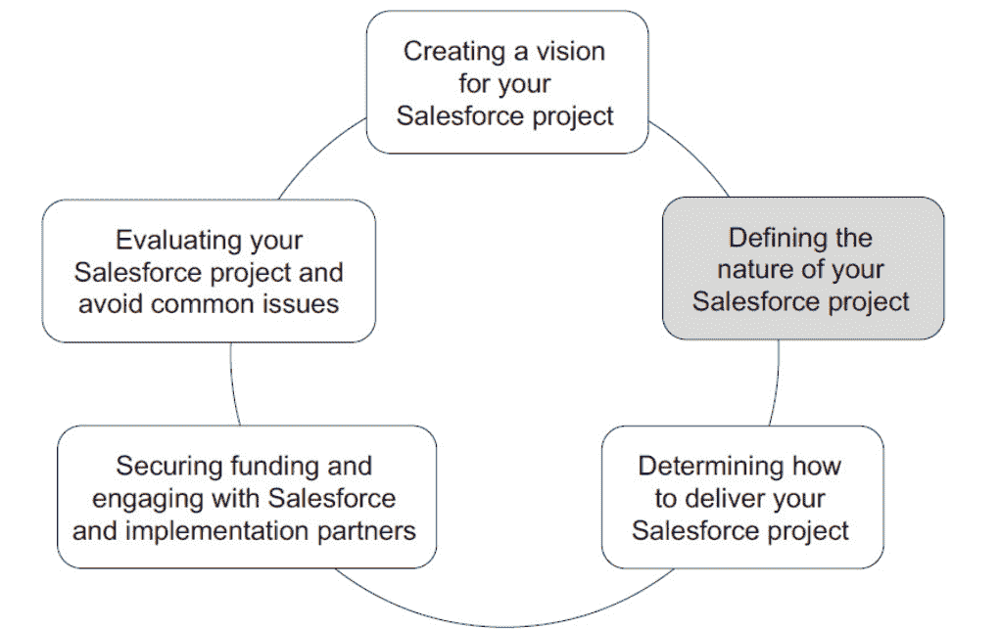

图 2.1 – 预开发阶段的活动

在开始定义 Salesforce 项目的业务能力之前，让我们先了解业务能力是什么以及为什么要定义它们。

## 了解业务能力

所有公司和组织都有若干 **业务能力**。但它们到底是什么？业务能力由具备技能或专业领域的 **人员** 组成，他们根据 **业务流程** 执行工作，由一个或多个 **系统** 支持，同时能够访问相关 **数据** 并创建和更新数据以实现期望的 **业务成果**。

一个常见的业务能力的例子是 **账户和联系人管理**。账户和联系人管理涵盖公司管理客户及其联系人数据的能力和流程。

如你所想，在确定技术范围应是什么之前，了解和绘制公司的业务能力非常重要。原因在于系统是业务能力的一个组成部分。在深入技术架构和设计之前，了解 Salesforce 解决方案应支持哪些业务能力和业务成果是 *至关重要* 的。

业务能力可能在较小或较大程度上实现期望的成果。我们说业务能力 *成熟度各不相同*，因此让我们来探讨业务能力成熟度。

## 了解业务能力成熟度

为了理解业务能力成熟度的概念，让我们看一个简单的例子。

如果你的公司为客户提供任何形式的支持，你就隐含地拥有一个 *客户服务* 领域的业务能力。具体业务能力可能是客户服务工单管理或在 Salesforce 解决方案中常被称为的 **案例管理**。你目前可能除了客户服务电话号码和有人接听电话回答客户咨询外，几乎没有系统支持。客户服务人员可能几乎没有接受过预定义流程的结构化培训，也无法访问任何有助于他们提供客户服务的数据。在这种情况下，你当前的案例管理业务能力可被归类为具有 *低成熟度*。

另一方面，你的客户服务能力可能由受过良好培训且熟练的人员组成，他们按照预定义流程工作。他们还可能得到一个对齐且适合目的的系统支持，该系统提供足够的数据洞察，帮助客户服务人员提供一流的客户服务。如果这些描述成立，你的案例管理业务能力将被认为具有 *更高的成熟度*。

接下来，让我们看看如何对业务能力进行分类。

## 对业务能力进行分类

业务能力按 **领域** 分组，其中领域代表公司的整体职能，例如营销、销售、客户服务、运营、财务、IT 和人力资源。

在深入业务能力的具体细节之前，提前确定 Salesforce 项目范围内的整体业务领域至关重要。

除了按领域对公司的业务能力进行分组并评估每个能力的成熟度外，你还应意识到每个公司都不同。不同的领域和业务能力在不同行业以及公司不同的业务线和地区之间存在差异，因此需要逐案识别。了解哪些业务能力被认为

strategic within your company and therefore given focus and resources to expand and mature – in order to achieve target business outcomes.

在您进行确定当前业务能力活动的过程中，请记住您所了解的业务能力成熟度，并寻求识别哪些能力在贵公司成功中发挥战略作用。

现在让我们来看看 Salesforce 工作组在为您的 Salesforce 项目定义业务能力方面的作用。

## Salesforce 工作组在为您的 Salesforce 项目定义业务能力方面的作用

作为 Salesforce 工作组成员，您将深度参与确定 Salesforce 项目范围内的业务能力的活动。

业务负责人和技术负责人将忙于创建和整合在这些活动中产生的输出和成果物。

## 确定您的高层业务流程

第一步是创建贵公司整体业务流程的高层概述。合适的说明方法是营销活动到开票和售后客户服务的端到端流程的简单流程图。在图 2.2 中，您可以找到 PME 高层业务流程的简单流程图示例：

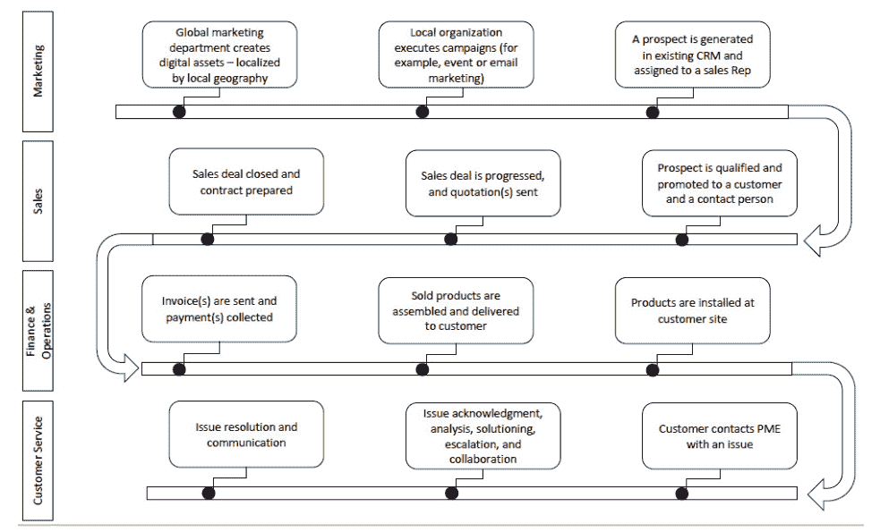

### 图 2.2 – PME 当前的高层业务流程

此简单流程图在此阶段是合适的，因为它不允许分支或决策，迫使您保持在高抽象层级。高抽象层级也意味着您向其展示的大多数，如果不是全部，利益相关者都能够理解并产生共鸣。

接下来，我们将研究将高层业务流程分解为业务能力。

## 创建您当前业务能力的概述

要确定当前业务能力，首先确定整体业务职能，即领域。接下来，遍历您创建的高层业务流程图表中的每个步骤，并将每个步骤分解为单独的业务能力。在命名业务能力时，请牢记业务能力的定义——区分引入新人员、系统和数据的业务流程。

Tip!

提示！

与贵公司的企业架构师合作，以验证您对业务能力的概述。根据需要进行更新。

一旦确定了贵公司所有的能力，请创建业务能力地图以进行简单说明。

Tip!

提示！

Salesforce *从根本上和主要* ——在众多其他功能中——是一个 CRM 系统。因此，您应将业务的营销、销售和客户服务领域能力作为 Salesforce 项目的起点。

在下面的图表中，您可以看到 PME 的业务能力地图——专注于客户关系管理业务能力：

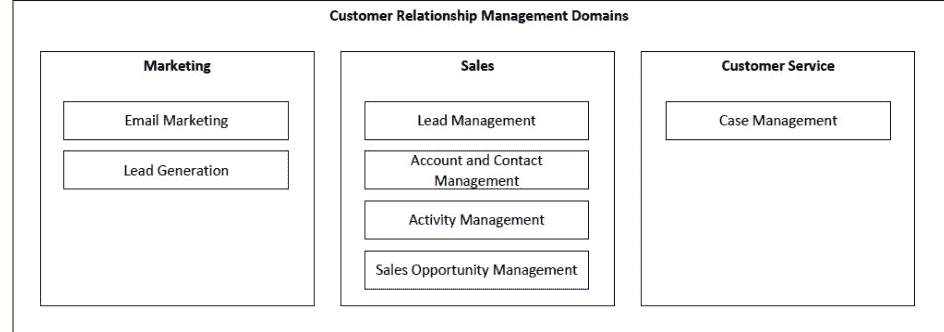

### 图 2.3 – PME 当前的业务能力地图

在 *图 2.3* 中，PME 的业务能力地图显示了目前由 PME 当前 CRM **技术栈** 支持的业务能力。技术栈 指的是一个或多个营销、销售或客户服务人员为执行其工作而使用的系统。

在确定了贵公司的高层业务流程后，让我们继续更好地理解已识别的能力并获取终端用户的观点。

## 促进研讨会以了解当前关键业务流程

到目前为止，您，Salesforce 工作组，将已对贵公司整体业务流程进行桌面研究，并与企业架构师和您的执行赞助人进行了接触。为了验证您对公司 CRM 业务能力的理解，获取终端用户的观点至关重要。

Tip!

提示！

从变革管理角度[content]
strategic within your company and therefore given focus and resources to expand and mature – in order to achieve target business outcomes.

在您进行确定当前业务能力活动的过程中，请记住您所了解的业务能力成熟度，并寻求识别哪些能力在贵公司成功中发挥战略作用。

现在让我们来看看 Salesforce 工作组在为您的 Salesforce 项目定义业务能力方面的作用。

## Salesforce 工作组在为您的 Salesforce 项目定义业务能力方面的作用

作为 Salesforce 工作组成员，您将深度参与确定 Salesforce 项目范围内的业务能力的活动。

业务负责人和技术负责人将忙于创建和整合在这些活动中产生的输出和成果物。

## 确定您的高层业务流程

第一步是创建贵公司整体业务流程的高层概述。合适的说明方法是营销活动到开票和售后客户服务的端到端流程的简单流程图。在图 2.2 中，您可以找到 PME 高层业务流程的简单流程图示例：

### 图 2.2 – PME 当前的高层业务流程

此简单流程图在此阶段是合适的，因为它不允许分支或决策，迫使您保持在高抽象层级。高抽象层级也意味着您向其展示的大多数，如果不是全部，利益相关者都能够理解并产生共鸣。

接下来，我们将研究将高层业务流程分解为业务能力。

## 创建您当前业务能力的概述

要确定当前业务能力，首先确定整体业务职能，即领域。接下来，遍历您创建的高层业务流程图表中的每个步骤，并将每个步骤分解为单独的业务能力。在命名业务能力时，请牢记业务能力的定义——区分引入新人员、系统和数据的业务流程。

Tip!

提示！

与贵公司的企业架构师合作，以验证您对业务能力的概述。根据需要进行更新。

一旦确定了贵公司所有的能力，请创建业务能力地图以进行简单说明。

Tip!

提示！

Salesforce *从根本上和主要* ——在众多其他功能中——是一个 CRM 系统。因此，您应将业务的营销、销售和客户服务领域能力作为 Salesforce 项目的起点。

在下面的图表中，您可以看到 PME 的业务能力地图——专注于客户关系管理业务能力：

### 图 2.3 – PME 当前的业务能力地图

在 *图 2.3* 中，PME 的业务能力地图显示了目前由 PME 当前 CRM **技术栈** 支持的业务能力。技术栈 指的是一个或多个营销、销售或客户服务人员为执行其工作而使用的系统。

在确定了贵公司的高层业务流程后，让我们继续更好地理解已识别的能力并获取终端用户的观点。

## 促进研讨会以了解当前关键业务流程

到目前为止，您，Salesforce 工作组，将已对贵公司整体业务流程进行桌面研究，并与企业架构师和您的执行赞助人进行了接触。为了验证您对公司 CRM 业务能力的理解，获取终端用户的观点至关重要。

Tip!

提示！

从变革管理角度

练习。

- **记录员**：应在整个工作坊期间有人做笔记——至少在小组会议中。如果有两个人主持，如果无法安排专职的记录员和计时员资源，其中一人可以担任记录员。
- **计时员**：通过指定计时员在每个练习剩余 15、10 和 2 分钟时进行提醒，确保你能按计划进行并完成议程。
- **工作坊成果**：工作坊的产出即为工作坊成果。这些是你通过举办工作坊希望挖掘的知识精华。以下是你应努力产出的关键工作坊成果的简要说明：
  - **参与者**：参与当前业务流程的已识别参与者（终端用户群体）。
  - **流程**：这些是在工作坊中创建的流程图以及各种叠加层——请参阅以下要点：
    - **差异**：*在整个工作坊中*对识别出的任何流程差异*给予极度密切的关注*。对于每个差异，确定以下哪一项适用：
      - 差异在所有业务线或地区中*保持一致*。将这些差异记为**类型-1 差异**。
      - 差异在业务线和地区之间*不一致*。将这些差异记为**类型-2 差异**。
  - **系统**：参与者在整个流程中使用的系统列表。
  - **差异**：对识别出的任何*系统*差异给予与流程差异相同的关注。遵循相同的记号记录已识别的差异。
- **数据：** 流程中参与者使用的关键信息/属性。此时请保持在业务层面的描述，而不是实际的 API 名称。至关重要的是，了解数据量。这只需达到*数量级*（10、100、1,000），而非具体数值。
- **问题和建议：** 改进流程以更好地服务客户的痛点和新想法的清单。

## 重要提示！

创建并维护一份关于*流程问题*和改进*建议*的文档。在整个 Salesforce 项目过程中你将多次需要这份文档。

让我们看看**PME 的 Salesforce 工作组**与工作坊参与者一起制作了什么流程图，以及发现了关于流程的哪些见解：

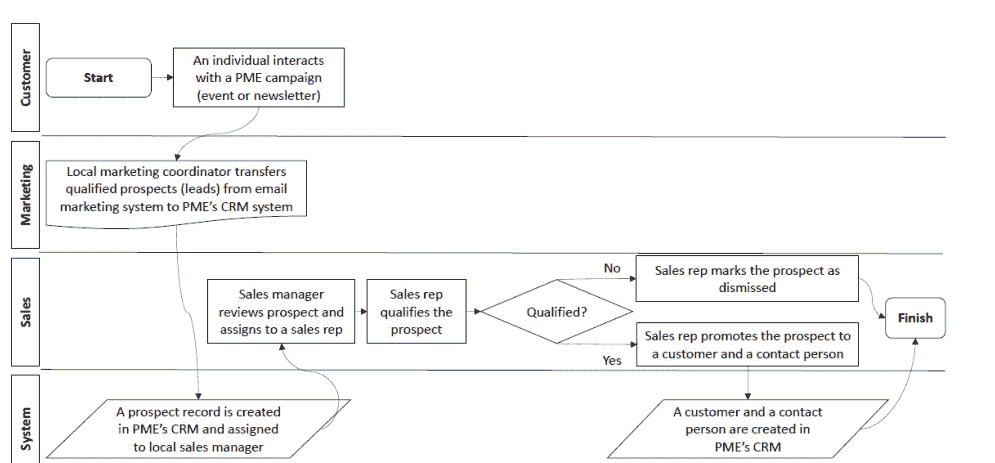

图 2.4 – PME 当前线索管理流程的泳道示例

线索管理工作坊取得了显著成功。SME 们互动良好，并热切分享了他们的工作方式（其流程）、执行工作的系统，以及他们依赖和创建的信息（数据）。

Kalinda，PME Salesforce 工作组中的业务负责人，记录了工作坊中提到的差异。她记录的内容如下：

- *流程差异：*
  - 有些国家有一项业务规则，要求营销部门在将信息输入 PME 的 CRM 系统并将潜在客户分配给销售之前必须捕获特定信息。然而，CRM 系统并不支持这一点，但如果信息缺失，销售会抱怨。其他国家对潜在客户应具备哪些信息没有任何业务规则。
  - 在某些国家，联系和[content]
练习。

- **记录员**：应在整个工作坊期间有人做笔记——至少在小组会议中。如果有两个人主持，如果无法安排专职的记录员和计时员资源，其中一人可以担任记录员。
- **计时员**：通过指定计时员在每个练习剩余 15、10 和 2 分钟时进行提醒，确保你能按计划进行并完成议程。
- **工作坊成果**：工作坊的产出即为工作坊成果。这些是你通过举办工作坊希望挖掘的知识精华。以下是你应努力产出的关键工作坊成果的简要说明：
  - **参与者**：参与当前业务流程的已识别参与者（终端用户群体）。
  - **流程**：这些是在工作坊中创建的流程图以及各种叠加层——请参阅以下要点：
    - **差异**：*在整个工作坊中*对识别出的任何流程差异*给予极度密切的关注*。对于每个差异，确定以下哪一项适用：
      - 差异在所有业务线或地区中*保持一致*。将这些差异记为**类型-1 差异**。
      - 差异在业务线和地区之间*不一致*。将这些差异记为**类型-2 差异**。
  - **系统**：参与者在整个流程中使用的系统列表。
  - **差异**：对识别出的任何*系统*差异给予与流程差异相同的关注。遵循相同的记号记录已识别的差异。
- **数据：** 流程中参与者使用的关键信息/属性。此时请保持在业务层面的描述，而不是实际的 API 名称。至关重要的是，了解数据量。这只需达到*数量级*（10、100、1,000），而非具体数值。
- **问题和建议：** 改进流程以更好地服务客户的痛点和新想法的清单。

## 重要提示！

创建并维护一份关于*流程问题*和改进*建议*的文档。在整个 Salesforce 项目过程中你将多次需要这份文档。

让我们看看**PME 的 Salesforce 工作组**与工作坊参与者一起制作了什么流程图，以及发现了关于流程的哪些见解：

图 2.4 – PME 当前线索管理流程的泳道示例

线索管理工作坊取得了显著成功。SME 们互动良好，并热切分享了他们的工作方式（其流程）、执行工作的系统，以及他们依赖和创建的信息（数据）。

Kalinda，PME Salesforce 工作组中的业务负责人，记录了工作坊中提到的差异。她记录的内容如下：

- *流程差异：*
  - 有些国家有一项业务规则，要求营销部门在将信息输入 PME 的 CRM 系统并将潜在客户分配给销售之前必须捕获特定信息。然而，CRM 系统并不支持这一点，但如果信息缺失，销售会抱怨。其他国家对潜在客户应具备哪些信息没有任何业务规则。
  - 在某些国家，联系和资格认定潜在客户并在 PME 的 CRM 系统中更新信息的责任属于营销部门。在大多数国家，这是销售团队的责任。
- *系统差异：*
  - PME 各地国家组织使用多种不同的电子邮件营销系统——甚至包括 PME IT 团队未批准的系统。
  - 有些国家使用 PME 提供的 CRM 系统；其他国家使用程度较少，同时在 CRM 外的电子表格中维护其他数据。

工作坊参与者很乐意分享改进和创新想法的相关问题和建议。Kalinda 仔细记录了所有这些要点：

- 工作坊参与者提出的问题：
  - 营销协调员将线索转移到系统是一个繁琐的手工流程——错误会发生，这意味着加载了错误客户信息，更糟糕的是，潜在客户根本未被加载到 CRM 系统中，从而导致潜在销售丢失。
  - PME 当前的 CRM 系统没有任何重复检查，因此当前系统中存在许多重复的潜在客户记录，使得难以获得概览，销售团队对系统的信任度总体较低。
  - 许多潜在客户记录非常陈旧且未被销售资格认定。在工作坊中，销售解释说他们并非全部了解（未受培训）如何将潜在客户转换为客户和联系人；相反——一旦获得资格——销售代表会直接创建客户和联系人，而不转换潜在客户。
  - 销售提出了一个问题，即经常会出现潜在客户被销售经理分配给错误的销售代表——该代表缺乏特定产品见解或在错误的地理区域。他们随后必须将其重新分配回销售经理，销售经理再将其重新分配给另一位销售代表。
  - 销售抱怨分配给他们的潜在客户质量。
- 工作坊参与者的建议：
  - 营销希望当前电子邮件营销系统能够自动将营销合格潜在客户转移到 PME 的 CRM 系统
  - 销售希望在潜在客户分配给他们之前具备一些关键信息，以便有效地对潜在客户进行资格认定
  - 销售希望系统规则为所有潜在客户在分配给他们之前必须至少填写公司名称、姓名、电子邮件地址或电话号码以及产品兴趣
  - *销售希望删除所有旧潜在客户*
  - *销售建议对营销进行培训，了解销售的组织架构，以便他们能够正确地将潜在客户分配给他们*
  - *销售希望获得更好的培训，了解如何转换潜在客户*

## 提示！

定期与你的执行赞助人举行会议，汇报工作坊的进展和初步发现。分享已识别的流程和系统差异，并询问执行赞助人 Salesforce 项目是否也有意愿和意图在公司业务线和地方组织之间开展**流程协调**。

在分析和更好地了解公司当前业务能力之后，现在是确定 Salesforce 解决方案能力的下一步。

## 设想由你的 Salesforce 解决方案支持的新业务能力

在 Salesforce 工作组迄今为止开展的活动中，你已从 SME 终端用户那里收集到大量改进建议，以提高效率、更好地服务客户并简化客户的购买体验。

请记住，虽然终端用户是关于改进建议的最有价值的信息来源之一，但终端用户的**可能性视野**可能仅限于现有系统和流程的边缘。

作为 Salesforce 工作组的成员，*你的责任和特权*是超越微小的渐进式流程改进，重新构想公司未来 Salesforce 解决方案应支持的能力，以便创新公司提升竞争优势的方式。

与*关键*利益相关者——包括公司的高级领导——召开工作坊，以了解他们希望未来解决方案包含的能力。

在工作坊之前，准备以下两项关键内容并与工作坊参与者分享：

- 创建已开展工作坊的**执行摘要**——突出 SME 在工作坊中分享的问题和建议
- 研究**趋势**在你的行业内外的发生情况，并尝试了解竞争对手如何创新地营销和服务客户

工作坊的目标应是为你提供 Salesforce 解决方案所需的新能力清单。

*PME 的 Salesforce 工作组已确定了许多新的期望能力和现有业务能力的增强，这些内容显示在以下表格中：*

| 领域 | 新业务能力 | 描述 |
|---|---|---|
| 营销 | 基于账户的营销 | 销售和营销希望能够针对特定账户使用账户特定内容，无论是在潜在客户生成活动期间还是在销售机会进行期间。 |
|  | 客户 | 营销希望创建不同的 |

| 类别 | 主题 | 描述 |
|---|---|---|
|  | 旅程个性化 | 针对不同客户细分、角色和地区的潜在客户和入职旅程。 |
|  | 同意和偏好管理 | 所有利益相关者都同意 PME 需要一个坚实、透明、全面且灵活的解决方案来管理和记录同意和偏好数据。 |
| 销售 | 销售预测管理 | 销售希望未来的 Salesforce 解决方案提供预测能力。 |
| 销售 | 报价管理 | 销售希望有一个解决方案，可以在系统中创建报价（PDF），而无需使用 Excel 和 Word。 |
| 销售 | 合同管理 | 销售希望对整个合同生命周期管理获得更好的系统支持。 |
| 销售 | 电子商务商店 | 销售管理希望为客户提供通过电子商务商店购物的选项，除电话和电子邮件下单之外。 |
| 销售 | 分销合作伙伴管理 | 销售希望更好地了解其分销合作伙伴的销售机会管道，并提供一个统一客户问题解决的平台。 |
| 客户服务 | 服务等级协议（SLA）管理 | 客户服务希望未来的 Salesforce 解决方案能更好地跟踪和管理 PME 相对于自身 SLA 目标以及与客户合同约定的 SLA 的执行情况。 |
| 客户服务 | 知识管理 | 客户服务——以及更广泛的 PME 组织——拥有大量关于其产品如何工作以及如何排查和修复各种问题的知识和资产。他们希望在客户服务代理处理客户问题时，以结构化的方式使用这些信息。 |
|  | 自助客户管理 | 客户服务希望为客户提供通过在线门户提交案例和寻求帮助的选项——除电话和电子邮件求助之外。他们设想之前知识管理能力中描述的资产可以在门户中展示。 |
|  | 现场服务管理 | 客户服务有一个现场服务技术员的子部门，其工作是确保 PME 的产品在客户现场得到专业安装。PME 希望有一个系统来管理整个现场服务流程。 |
| 全部 | 报告和分析 | 所有利益相关者都同意 PME 需要全面、可使用且灵活的报告和分析解决方案——以实现客户互动的 360 度视图，并利用客户数据的整合进行 AI 和 ML 预测和处方，以预测和响应客户需求。 |

表 2.1 – PME Salesforce 解决方案所需的全新能力

PME Salesforce 工作组的某些关键发现是电子商务商店作为 PME 销售领域的全新业务能力，以及现场服务管理作为由新的 Salesforce 解决方案提供系统支持的全新能力。

在此阶段，您正忙于收集信息、创建流程图、了解公司当前的业务能力，并设想由未来的 Salesforce 解决方案支持的新能力。随着您在这个阶段的进展，让我们看看 RAID 日志如何帮助您的流程。

## 开始构建您的 RAID 日志

在此阶段，您已经遇到了许多不同的利益相关者，他们对项目有各种输入、建议和期望。

确保在 Salesforce 工作组团队和关键利益相关者可用的存储库中捕获与项目相关的 RAID 项目。RAID 代表以下内容：

- **风险**：在 Salesforce 实施各阶段进展过程中记录您可能发现的任何风险。记录您为防止或减轻风险而采取的任何行动。
- **概率-影响矩阵**：除了风险标题和描述之外，请务必记录如果风险 materialize 会产生什么影响，以及风险发生的概率。这种分类有助于您优先考虑风险，并专注于高影响和高概率风险的预防或缓解。
- **假设**：在整个 Salesforce 项目中，您所做的任何假设都必须记录下来。添加类别以便轻松排序。
- **问题**：如果已发生的风险正在产生影响，这现在就是需要处理的问题。保留正在进行的问题日志，包括您为修复或减轻问题而采取的行动。
- **决策**：记录 Salesforce 工作组做出的任何决策，无论是独立做出还是与您的执行赞助商和更广泛的领导团队达成一致。请注意事情尚未定案。因此，在预开发阶段的第一次迭代中做出的决策可能会随着您获取更多见解和知识而修改。在此阶段保持开放接受变化——您的 Salesforce 项目的性质正在塑造以更好地适应您组织的业务需求。这确保您 Salesforce 项目成功的关键因素！

现在您已经收集了 Salesforce 解决方案的所有业务能力，是时候查看解决方案能够正常运行所需的重要技术使能因素了。

## 确定支持已识别业务能力所需的技术使能因素

您在理解业务流程和期望的新能力上花费了大量精力。您可能没有过多关注的是理解和描述 Salesforce 解决方案的技术使能因素和非功能性需求的努力。

让我们先从了解技术使能因素开始。

## 技术使能因素和非功能性需求

这些需求是关键能力，以确保 Salesforce 解决方案具有性能和可扩展性，提供无缝的用户体验，并最大化采用率。

让我们看看 Salesforce 解决方案最常见的一些技术使能因素和非功能性需求：

- 本地化：
- **多语言支持**：对于在多个国家运营的任何公司，或在某个国家使用或标准做法是为系统用户提供一种以上语言的公司，多语言通常是一个需求。
- **多货币支持**：与多语言支持需求类似，对于在多个国家运营且使用多种货币的任何公司，拥有多货币支持的解决方案通常是一个需求。
- **身份和访问管理（IAM）**：作为一家公司，您需要确保合适的人（和系统）可以访问系统中的正确功能，并且您希望确保只有获得授权访问的用户才能实际访问您的系统和功能。这就是 IAM 的作用所在。前面列表中显示了两个最知名的用例。您希望确保授权人员的安全性和访问便利性：
  - **单点登录（SSO）**：SSO 允许一个人只需记住一套凭据（用户名和密码）即可登录多个系统。它通常用于企业系统，其中内部用户使用 SSO 登录内部应用程序，以便授权用户无缝访问。**配置**和用户访问管理是 IAM 的重要组成部分。
  - 另一个 SSO 的实施用例称为 **社交登录**，外部用户使用其社交媒体账户（例如 Facebook、Twitter 和 LinkedIn）或其他常用服务（例如 Gmail 和 Amazon）来访问数字服务。
- **数据安全**：当您的系统识别（*身份验证*）用户时，您的系统应仅向该用户提供其执行工作所需的数据访问权限。数据安全关注的是确保在正确的时间向正确用户提供正确级别的数据访问。
- **数据和文件归档**：当您从旧系统迁移数据，并且公司用户开始在您的 Salesforce org 中工作时，数据将

创建了，而且很多。你将需要并且希望具备归档数据的能力，原因如下：

- **合规要求**：许多地区、国家和州仅允许在一定期限内保留**个人身份信息（PII）**数据，且只有在有正当保留理由的情况下才允许。
- **可用性**：如果不定期归档旧数据或无关数据，用户将不必要地在所有数据杂乱中筛选，降低用户体验和生产力，并增加错误风险和糟糕的客户体验。
- **性能**：如果不归档旧数据或无关数据，当用户搜索信息、加载记录页面或运行报表时，加载时间会随时间增加，从而降低用户体验和生产力。
- **成本**：存储是云解决方案的重要成本驱动因素。虽然可以购买额外存储，但拥有*高效且自动*的归档解决方案，其节省的存储空间成本很快就会超过其投入。
- **备份和恢复**：而数据和文件归档主要与旧数据或无关数据相关，备份和恢复则关注通过确保关键运营 Salesforce 数据定期备份并且在数据因任何原因被意外删除、修改或损坏时能够轻松恢复，从而确保业务连续性。提供这些服务的成熟的 Salesforce 专属**现成商业解决方案（COTS）**可用 – **OwnBackup** 和 **Odaseva** 是 Salesforce 生态系统中的市场领先提供商。
- **可访问性管理**：提供对某种残疾人士可访问的 Salesforce 解决方案不仅在道德上是正确的，对业务来说也是明智的。在许多国家，要求向客户提供的商品和服务也必须对残疾人士可访问是法律要求。此外，能够为残疾人士提供就业机会将扩大你的人才库 – 这对残疾人士和你的公司都有益。

- **速度/性能：** 每个人都希望解决方案快速易用且无需等待。在某些用例中 – 例如，客户服务电话 – 如果客户联系页面加载时间超过一定秒数，可能对业务不可接受，因为这会导致糟糕的客户体验。其他关键性能方面包括运行报表和仪表板以及搜索记录。这些是非功能性需求的示例。
- **可靠性：** 用户能够登录并执行工作的系统正常运行时间百分比是可靠性的特征。虽然你的公司很大程度上依赖 Salesforce 来确保正常运行时间，但你可以做一些事情来最大限度地减少停机时间。这些包括在部署新功能时最大限度地减少运营中断，并在集成中构建异常处理以优雅地处理连接问题。

许多非功能性需求实际上由 Salesforce 提供并在一定程度上受其控制，因为 – 除了作为 SaaS 解决方案外 – 它还为其客户提供基础设施和平台。然而，你如何设计、配置和开发你的 Salesforce 组织对其安全性和性能水平有重大影响。

提示！

聘请技术架构师来支持你定义 Salesforce 项目的技术使能因素。

在涵盖了一些 Salesforce 解决方案的常见技术使能因素和非功能性需求后，让我们来看看经常与 Salesforce 集成的 数据源。

## 数据源

虽然你的公司雄心和意图可能是让 Salesforce 成为营销、销售和客户服务团队的主要系统，但你的公司**系统环境**中不可避免地还会有其他系统和应用程序。这些其他系统和应用程序各有其独特目的，并持有有时对 Salesforce 中的用户相关的数据，而有时可能是 Salesforce 需要向应用程序发送信息以完成流程。

让我们看看经常与 Salesforce 集成的一些系统：

- **企业资源规划（ERP）系统**：这些系统用于运营目的，涵盖生产计划、库存管理、物流计划、订单处理和开票。
- **数据仓库（DWH）**：这是一个包含企业各处数据的数据库。它可能具有各种分布和结构级别。例如，数据湖包含数据科学家用于建模和利用的非结构化数据，而高度结构化和管理的数据库可以为 BI 系统提供基础，为用户提供报表层。
- **Active Directory（AD）**：AD 通常充当与 *IAM* 相关的**身份提供者**或**身份存储**，用于集中管理配置和**取消配置**以及访问级别更改。
- **网站**：你的公司很可能至少有一个描述公司及其产品和服务的网站。网站可能有一个**联系表单**供人们填写问题或请求信息，然后发送给你的销售或客户服务团队。
- **内容管理系统（CMS）和数字资产管理系统（DAM）系统**：这些系统存储在多个应用程序中使用的资产，包括你的网站和电子邮件营销解决方案。
- **产品信息管理系统（PIM）系统**：存储在多个应用程序中使用的有关你的产品（和服务）的信息，包括 ERP、电子商务商店、CRM 和产品**配置、定价和报价（CPQ）**解决方案。

提示！

将你的研讨会中关于*系统*和*数据*的成果作为与 Salesforce 解决方案集成的基线。聘请架构师来支持你确定哪些系统和数据（Salesforce 外部）需要与你的 Salesforce 解决方案集成。

接下来，我们将看看如何总结你的 Salesforce 解决方案的所有功能。

## 总结你的 Salesforce 解决方案所需支持的功能

在添加了技术使能因素后，你现在拥有了 Salesforce 项目范围内的完整功能集。让我们看看以下图中 PME 的业务能力图是什么样的：

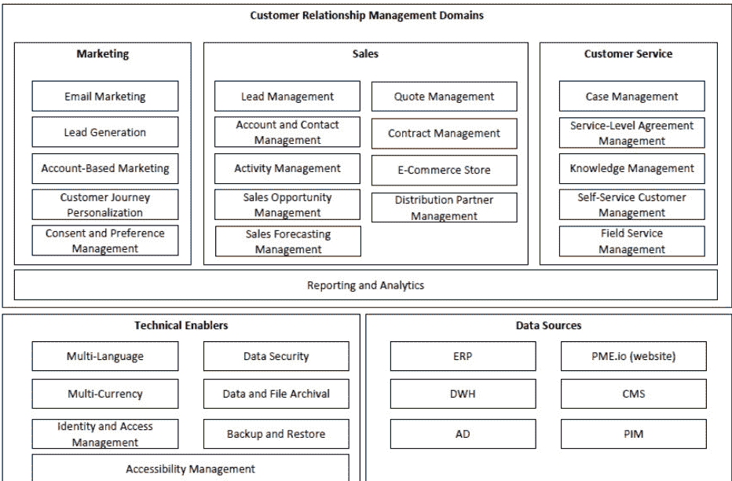

图 2.5 – PME 的 Salesforce 解决方案业务能力图

*除了设想的新业务功能外，PME——作为一家全球公司——确定了需要提供本地化解决方案的需求，该解决方案提供多种语言并支持多种货币。PME 也非常重视确保坚实的安全性，既包括对 Salesforce 的用户访问，也包括他们可以访问的数据。PME 还认识到定期归档和备份数据和文件以遵守法规、确保解决方案可扩展且性能良好并确保业务连续性的价值。最后，PME 希望确保其解决方案可供其残疾员工使用——以及为其客户工作的残疾人士使用。*

*PME 通过与终端用户的研讨会以及与技术架构师的合作，确定了需要与未来 Salesforce 解决方案协同工作的关键系统和数据源。*

在总结了你的 Salesforce 解决方案所需支持的功能后，你就可以继续确定你的 Salesforce 解决方案所需的高级技术范围。

## 确定你的 Salesforce 解决方案的高级技术范围

到目前为止，我们还没有在 Salesforce 功能上花费太多精力。随着我们继续定义你的 Salesforce 解决方案的高级技术范围，这将发生变化。

你已经定义了 Salesforce 解决方案所需支持的业务功能。现在是时候了解支持这些业务功能需要什么**假设性技术范围**。在此时它是*假设性*的，因为你无疑会有许多假设和不确定性。随着你在章节中的进展

在预开发阶段，技术范围将变得更加明确，直到你最终与 Salesforce 签约。

## 高层技术范围

在此阶段，确定高层假设技术范围的目的是：

- 能够估算该解决方案的 **许可成本**
- 能够要求一个或多个潜在的实施合作伙伴提供该解决方案的 **实施成本** 估算
- 能够估算维护和运行你的 Salesforce 组织的 *成本* **目标运营模式**
- 能够了解对公司整体系统格局的技术影响和范围

所有这些目的对于预开发阶段的后续活动、商业案例建模都是关键，也是你在选择与实施合作伙伴合作参与项目交付时 RFP 文件的关键组成部分。更多内容请参见 *第 4 章，获取资金并与 Salesforce 和实施合作伙伴接洽*。

让我们开始了解不同的 Salesforce 许可类型。

## Salesforce 许可类型

首先要掌握的概念是最广泛、最基础的概念——让我们来看看 Salesforce 组织版本。

### 组织版本

Salesforce *核心* 提供四种不同的 **版本** 用于商业用途，还有第五个版本 **开发者** 用于非商业用途。为简单起见，让我们专注于以下链接中描述的四种商业用途版本：
https://help.salesforce.com/s/articleView?id=sf.overview_edition.htm&type=5.

你的 Salesforce 组织的版本决定了你可访问的功能和服务，也是你 **用户许可** 成本的基础。

你需要详细研究版本之间的差异并将其与公司需求进行权衡。如果你计划使用 Salesforce 同时支持销售和客户服务，请在以下页面研究 *比较版本和主要功能* 部分：
https://www.salesforce.com/editions-pricing/sales-and-service-cloud.

在决定选择哪个版本时，需要考虑以下几点：

- 你可以升级版本，但 *无法降级*。因此，如果你对选择哪个版本犹豫不决——因为你可能尚未完全理解不同功能意味着什么——请选择较低版本。
- 如果你是一家中型或大型公司，计划拥有多个 **参与者**，在多个业务领域使用 Salesforce，自动化业务流程并与其他系统集成，你应考虑选择 *企业版* 或 *无限版*。

Tip!

如果你不确定选择哪个版本，并且在此阶段决定假设较低版本就足够了，请将其添加到你的 RAID 日志的假设部分以及风险部分，并以 *高影响* 分类，因为升级成本将产生巨大的财务影响。

让我们继续探索 Salesforce 云。

## Salesforce 云和附加组件

Salesforce（公司）提供大量按领域捆绑的产品和功能，称为 **云**。在 *图 2.6* 中，你可以看到 Salesforce 如何展示其产品，共同构成品牌名称 **Salesforce Customer 360.**

Salesforce 产品范围从 *核心 CRM* 产品，如 **Sales Cloud**、**Service Cloud** 和 **Experience Cloud**，到 **营销**、**商务**、**集成** 和 **分析**。

Sales Cloud 和 Service Cloud 按每用户计价，而其他云的成本模型各不相同。例如，对于 Marketing Cloud，成本模型按每联系人计价，而对于 Commerce Cloud，则按每订单计价。

为了扩展核心 Salesforce，有大量 **附加组件** 可用于几乎所有可想象的用例——并且每年都在增长。你可以在以下链接显示的文档中查看所有可用的附加组件： https://www.salesforce.com/content/dam/web/en_us/www/documents/pricing/all-add-ons.pdf.

关于附加组件的一个关键点是它们并非在所有版本中都可用，这意味着 *某些附加组件需要更高版本* 才能购买。例如，为了购买和使用 **Sales Cloud Einstein** 进行 AI 驱动的销售情报、**Partner Relationship Management (PRM)** 用于构建与合作伙伴协作的社区网站，或 **Field Service** 用于通过现场技术人员管理和支持你的客户，你需要在 **企业版** 或 **无限版** 组织版本上。

接下来，我们将探讨 AppExchange 如何进一步支持你的 Salesforce 解决方案。

## AppExchange

为了扩展 Salesforce 云的常见用例，**独立软件供应商 (ISVs)** 开发并提供 Salesforce **应用**、预建解决方案和模板化 Salesforce **Flow**——以加速你的 Salesforce 项目的价值交付。

AppExchange 应用还包括最流行和广泛使用的企业应用的连接器，例如 **LinkedIn**、**SurveyMonkey**、**Slack** 和 **CTI** 解决方案，仅举 *少数* 例子。Salesforce 还有一个名为 **Salesforce Labs** 的部门，提供免费的 AppExchange 应用和解决方案，其中选择显示在以下链接，你将在其中看到特定于 Salesforce 云的 AppExchange 解决方案概览 https://appexchange.salesforce.com.

虽然一些 AppExchange 产品需要付费，其他则是免费的，但你应该意识到它们在法律上或技术上都不是由 Salesforce Ltd 提供的。因此，在将任何 AppExchange 产品纳入你的（Salesforce）系统格局之前，请务必进行与任何其他 SaaS 产品采购相同的 **尽职调查**。

此外，AppExchange 上还列出了一个专门针对官方 Salesforce *顾问* 的菜单，也称为 **系统集成商 (SIs)** 或 **实施合作伙伴**，这是我们在本书中使用的术语。我们将在 *第 4 章*、*获取资金并与 Salesforce 和实施合作伙伴接洽* 中进一步探讨这一部分。

## 构建你的假设高层系统格局

在确定了 Salesforce 解决方案需要支持的功能，并介绍了 Salesforce 产品之后，现在是时候构建你的假设高层系统格局了。但从哪里开始？

首先确定哪些系统和应用程序将成为 Salesforce 领域的一部分——组织内的产品、附加组件以及你可能包含的任何 AppExchange 应用——以及哪些 *外部* 于 Salesforce。

如果你计划用 Salesforce 替换任何遗留 CRM 系统，那些系统之前支持的功能将来将由 Salesforce 解决方案支持。确定哪个 Salesforce 产品涵盖你的所需业务能力。

对于所有其他系统和应用程序，请参考你的工作坊产品的执行摘要——当前使用的系统和数据的列表。这通常包括你的 ERP、DWH，以及如果你不考虑在 Salesforce 实施中替换它，可能的 **中间件** 解决方案。

让我们看看 PME Salesforce 工作组在以下图表中构建的假设高层系统格局：

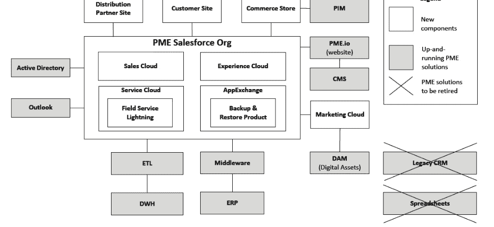

图 2.6 – PME Salesforce 解决方案的高层技术范围

*Cary Sharp，PME Salesforce 工作组的 **技术负责人**，负责研究并领导确定 PME Salesforce 解决方案的假设技术范围，以支持所需的业务能力。*

*首先，Cary 审查了可用的 Salesforce 组织版本，目前不确定是选择企业版还是无限版。他假设企业版至少在首次发布之前就足够了。*

*让我们回顾一下 Cary 为 PME 系统格局确定的 **新组件**：*

- *Salesforce 组件:*
  - **Sales Cloud**: 为了支持 PME 在销售领域的业务能力，Sales Cloud 是基础的 Salesforce 产品。
  - **Service Cloud**: 为了支持 PME 在服务领域的业务能力，Service Cloud 是基础的 Salesforce 产品。
  - **Field Service cloud add-on**: 为了支持特定的现场服务管理能力，Cary Sharp 发现 Salesforce 有一款专门针对现场服务用例的专业产品，并将其加入系统架构。
  - **Experience Cloud**: Cary 很高兴得知 Salesforce 有用于创建面向客户解决方案的解决方案，因此 Experience Cloud 被加入以支持两个独立的能力。
  - **Distribution partner site**: 一个 PME 的分销合作伙伴可以与 PME 协作销售机会并解决客户案例的站点。PME 将因此获得额外的好处，即对其分销合作伙伴绩效的可见性提升，从而进一步支持和培养关系。
  - **Customer site**: 一个客户可以访问 PME 知识资源并通过创建案例请求帮助的站点。
  - **Commerce Cloud**: Cary 很惊讶地看到 Salesforce 产品组合中提供了一款商务产品。商务站点将支持 PME 让客户自行在线下单的愿景，而无需致电或发邮件给 PME 繁忙的销售和客户服务部门。Commerce Cloud 还将连接到 PME 现有的 PIM 系统作为产品数据的来源。
  - **Marketing Cloud**: 为了支持 PME 的营销目标，Marketing Cloud 被加入目标系统架构。Cary 注意到有两种不同的 Marketing Cloud 解决方案可供选择，但不确定该选择哪一个。目前，他将 Marketing Cloud Account Engagement 记录为假设，因为据称它非常适合 B2B 公司。Marketing Cloud 还将连接到 PME 现有的 **DAM** 解决方案，用于数字营销活动的数字资产管理。
  - **AppExchange**: 为了支持 **备份和恢复** 能力，Cary 注意到这些产品将通过 AppExchange 应用连接到 PME 的 Salesforce org。

接下来，让我们回顾将在 PME 系统架构中复用的 **现有组件**：

- **AD**: 为了管理 PME Salesforce org 中 Salesforce 用户的配置、去配置和访问控制，Cary 建议复用 PME 现有的 AD。
- **Outlook**: 虽然 PME 的总体愿景是减少邮件使用，但 PME 认识到邮件仍然是关键的沟通工具——尤其是销售代表与客户互动时。Cary 希望让销售代表同步其 Outlook 联系人和日历，以支持活动管理能力。
- **ETL**: PME 拥有现有的 ETL，目前将其现有的本地 CRM 系统连接到其 **DWH**，用于数据归档和汇总 BI 报告。因此，Cary 希望复用该 ETL 并将其连接到其 Salesforce org。Cary 不确定 PME 旧的 ETL 解决方案是否适合连接到基于云的 CRM，因此他将此项加入 RAID 日志的假设部分。
- **Middleware**: PME 拥有现有的中间件解决方案，连接其后端 **ERP** 系统和当前 CRM 系统。Cary 的假设是当前中间件适合现代企业架构。他将此项加入 RAID 日志的假设部分。
- **Website**: PME 希望继续通过其当前网站 `www.PME.io` 收集线索，并将线索发送到其 Salesforce org 由销售处理。其网站依赖 CMS 进行内容和本地化管理。

最后，不会成为 PME 未来系统架构一部分的系统如下：

- **Legacy CRM**: 目前为 PME 各地提供支持其当前 CRM 流程和数据的系统。
- **Spreadsheets**: Cary 清楚地记得工作坊中的发现，许多终端用户提到由于当前 CRM 系统无法满足其需求，因此离线在电子表格中处理和维护客户和活动数据。PME 的 Salesforce 工作组一致认为，消除使用电子表格维护客户数据的行为应成为其 Salesforce 项目的关键目标。

在 PME 的案例中，回想他们识别出一些流程差异，但由于这些差异在所有当地国家/地区都是一致的，Cary 假设整个 PME 都可以在一个 Salesforce org 中工作。他将此项加入 RAID 日志的假设部分。

## 重要提示！

如果您在此阶段的工作坊和分析揭示了业务流程、报告要求或数据隔离要求方面的 *显著* 差异，您需要进行重要分析以确定您的 **org 策略**。Org 策略涉及确定贵公司是否需要一个或多个 Salesforce org 来支持公司需求。确定 org 策略超出了本书的范围。您需要聘请经验丰富的 Salesforce 技术架构师协助进行此分析。

以下是关于您 Salesforce 解决方案假设技术范围当前状态的一些关键要点：

- 它将在预开发阶段及以后进一步修改、细化和详细丰富。

> 它是为 Salesforce *简化的*，意味着贵公司可能存在众多其他系统 **系统架构**。因此，贵公司的完整系统架构将包含比 PME 简单示例中所示更多的组件。

顺着这个思路，让我们看看您可以如何迭代定义 Salesforce 项目的性质。

## 预开发阶段的迭代

对 Salesforce 项目进行范围界定是一项庞大而有趣的练习——它总是需要不止一次迭代。随着您推进预开发阶段的以下活动，您将返回审查 Salesforce 解决方案所需支持的能力和高层技术范围。在此过程中，请确保更新您的 RAID 日志以记录决策和假设。您正朝着让 Salesforce 项目成形迈进。

## 摘要

您现在已经建立了 Salesforce 项目的业务和技术范围应为的假设——即您 Salesforce 项目的性质。您首先学习了如何收集输入并确定期望的业务能力。然后，您了解了 Salesforce 产品组合。最后，您首次尝试定义 Salesforce 解决方案的高层技术范围。

到目前为止，您已经为 Salesforce 项目创建了愿景——*为什么*——以及其性质——*是什么*——并且您已准备好进入 Salesforce 实施的下一章：*第 3 章，如何交付您的 Salesforce 项目*。是时候看看交付 Salesforce 项目的最佳方式——*如何*。

## 如何交付您的 Salesforce 项目

在本章中，您将了解不同的 **交付方法**，以及如何根据项目的性质以及贵公司的环境和优先事项选择最适合您 Salesforce 项目的交付方法。接下来，您将了解深思熟虑的 **变更管理** 策略对 Salesforce 项目成功至关重要的原因。最后，您将学习构想您的 **Salesforce 卓越中心 (CoE)** 的结构——用于监督 Salesforce 计划的管理和治理框架。

您将了解 **瀑布**、**敏捷** 和 **混合敏捷** 交付方法，以及不同项目分阶段方法的概念。您将了解如何制定沟通和变更管理策略，以及项目不同阶段所需的相关活动。最后，您将了解 Salesforce CoE 中的角色和职责、起草其 CoE **章程**，以及如何为 Salesforce 计划创建 **路线图**。

我们将继续关注我们的案例公司 Packt Manufacturing Equipment (PME)，以及他们在确定如何交付 Salesforce 项目的活动中的进展。

在确定如何交付项目后，您将准备好进入 Salesforce 实施预开发阶段的下一个活动。

本章将涵盖以下主要主题：

- 选择您的交付方法
- 确定您的变更管理策略
- 构想您的 Salesforce 卓越中心

预开发阶段的迭代

开始吧！

## 选择交付方法

在上一章中，您定义了 Salesforce 项目的性质——期望的业务能力以及高层次的假设技术范围。如以下图所示，现在是确定如何交付您的 Salesforce 项目的时候了。

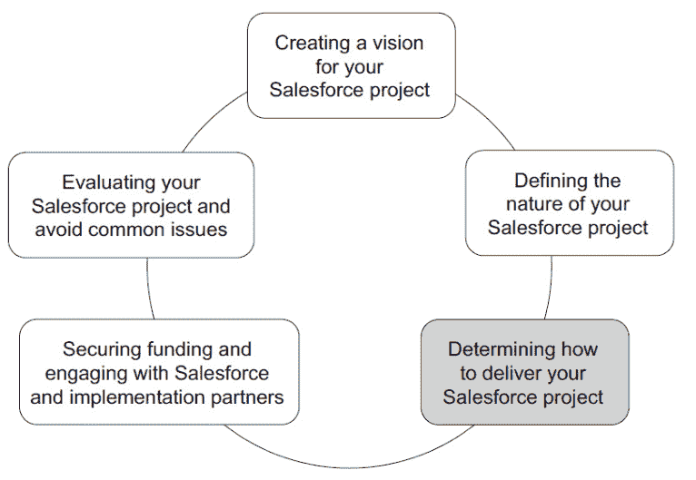

图 3.1 – 预开发阶段的活动

在深入交付方法之前，让我们先简要了解一下企业项目，特别是 Salesforce 项目的特殊之处。

## 企业项目

考虑到组织可能正在规划或当前交付的各种项目类型，重要的是要注意它们之间的差异。

下表提供了一些最常见的企业项目类型之间细微差别的简单概述：

| 项目类型 | 示例 | 在生产环境中开发 | 涉及后端系统 | 面向客户 | 对业务连续性至关重要 |
|---|---|---|---|---|---|
| 业务项目 | 战略项目、人力资源和重组项目。 | 不适用 | 否 | 或许 | 否 |
| 营销微网站 | 用于新产品发布潜在客户生成的网站。 | 有时 | 否 | 是 | 否 |
| ERP 项目 | SAP 或其他 ERP 实施，用于支持后台业务运营。 | 从不 | 是 | 否 | 是 |
| CRM 项目 | 从用于基本账户和联系人管理的简单应用程序到企业级 CRM 实施。 | 有时 | 有时 | 有时 | 有时 |
| Salesforce 实施项目 | 从核心功能的基本使用到全功能实施。 | 绝不应该发生 | 大多数情况下 | 有时 | 大多数且日益常见 |

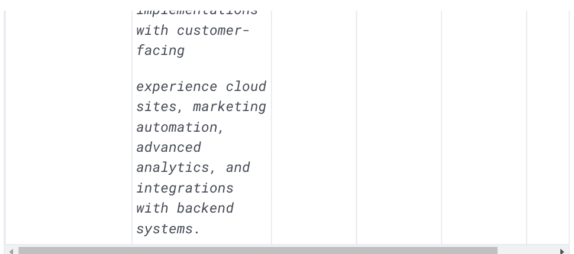

表 3.1 – 企业项目类型

将 *表 3.1* 中的企业项目类型进行比较后得出的一个关键结论是关于 **在生产环境中开发**。对于业务项目而言，这完全不相关，因为它们不是 IT 项目。对于其余项目类型，可能存在项目和解决方案直接在生产环境中开发的情况，仅仅因为系统没有支持的开发环境，或者因为风险或风险的影响被认为较低，因为该应用程序对公司而言并非业务关键。

重要提示！

对于 **企业级** Salesforce 项目，其解决方案集成到多个系统并且由 Salesforce 支持的业务关键流程，*开发绝不应直接在生产环境中进行。*

让我们继续讨论 Salesforce 项目和项目组合。

## 区分 Salesforce 项目和 Salesforce 项目组合

确定您正在处理的是 Salesforce 项目组合还是 Salesforce 项目非常重要。为了帮助理解这种区别，让我们探讨以下几点：

## Salesforce 项目：
- 要交付一项或多项能力
- 有目标截止日期

## Salesforce 项目组合：
- 包含处于不同阶段的 **项目组合** Salesforce 项目和/或若干敏捷产品开发团队——这一概念我们将在 *第 12 章，发展您的 Salesforce Org 和 DevOps 能力* 中进一步探讨
- 没有设定的结束日期：项目的目标应该是持续改进组织的业务领域能力
- 对于 *一家* 组织，只应有 *一个* Salesforce 项目组合

项目概念与某些类型的 **交付方法** 更相关，我们将在本章后面再讨论。但首先，让我们通过介绍常用的 **术语** 来达成共识。

## Salesforce 项目中常用的术语

误解和错误使用的概念在整个生态系统中广泛存在。它是业务和技术利益相关者共同的主要混淆来源。

让我们看看 Salesforce 项目中最常用的一些术语：

- **最小可行产品 (MVP)**：用于产品开发的术语，其中产品可能是有形的或非有形的（数字）。无论如何，MVP 是目标 *产品*（解决方案）的一个版本，具有 *最小* 的 **必备** 功能集，同时仍是用户在 *生产环境* 中完成工作所需的 *可行* 解决方案。MVP 本质上缺少许多它 **应该具备** 的功能或 **希望具备** 的功能。对许多组织而言，Salesforce 项目是创新项目。此时未来设想流程的许多方面仍是假设。认为组织能够提前准确知道哪些功能最重要并带来最大价值——更不用说这些功能的详细需求——对于大多数 Salesforce 项目来说是一种有风险且次优的方法。相反，定义 MVP 并获得快速、有价值的 *改进反馈*，通常是最快且最好的方法。
- MVP 的概念可以在多个层面上应用：
  - 在 *项目层面*，在确定哪些业务能力集合是使最终用户获得可行解决方案的最低限度时。
  - 在 *能力层面*，MVP 涉及确定哪些功能是关键的，哪些不是。
- **试点**：一种 **推广** 方法，用于从解决方案的全部预期用户中的有限群体获取反馈——通常针对解决方案的 MVP 版本。然后可以将这些宝贵的反馈用于在向更多用户推广之前改进解决方案。
- **最小可销售产品 (MMP)**：在 MVP 概念的基础上，MMP 是被认为比早期 MVP 版本更有可能被市场（Salesforce 用户）接受或购买（采用）的产品（Salesforce 解决方案）版本。
- **概念验证 (PoC)**、**原型** 和 **预原型**：这些术语描述了尝试创建版本以查看其在概念上和技术上是否可行的活动。这些术语（解决方案版本）被归为一类，因为它们具有一个关键特征：它们永远不打算投入生产。PoC——即使它证明了一个概念（解决方案）在开发环境中可行——在准备投入生产之前始终需要进一步的完善、重新工程、设计优化、重建和测试 *before*。
- 不幸的是，经验丰富和经验不足的专业人士经常不准确地使用这些术语。有些人使用这些术语来解释或请求快速交付并在生产中使用功能或项目的精简版本，而不提前明确或阐述目的，也不考虑对其他功能、系统或项目的必要技术使能因素或依赖关系。
- **解决方案**：指项目的技术交付成果，包括标准的 Salesforce 开箱即用组件，以及项目中构建的任何配置、定制和集成。
- **实施**：常与项目和解决方案等术语同义使用。
- **发布**：这个词有两种含义，细微差别。一种含义是解决方案部署到生产环境时。另一种含义是——如果与功能一起实现了某种功能标志——当功能被 *打开* 并准备好使用时。我们将在 _第 7 章_、_构建和测试您的初始发布_ 中进一步介绍这一概念。
- **Salesforce** 或 **Salesforce, Inc**：这可能指用户实际工作的系统，也可能指公司 _Salesforce, Inc_。

前一节中描述的许多术语都与某种形式的敏捷开发方法相关，如果您选择使用实施合作伙伴进行交付，则应在合同中明确说明。我们将在 _第 4 章_、_获取资金并与 Salesforce 和实施合作伙伴合作_ 中再次讨论合同问题。

提示！

一个经验法则是——如果可能——您应优先考虑更紧凑的 MVP 范围以实现更快交付和更快反馈，而不是交付更慢、投入使用后过时风险更大的全面解决方案。

一旦您的 MVP 在选定的用户组中进行试点，您就可以迭代改进 MVP，使其成为 MMP 以便进一步推广。

敏捷是否是您 Salesforce 项目的正确交付方法将在下一节中介绍。

## 理解交付方法

让我们直接开始，了解交付方法的两个极端，以及第三种更难定义但经常使用的方法。

## 纯瀑布

在纯瀑布 Salesforce 项目中，需求由业务利益相关者在业务分析师的帮助下提前以完整细节定义。所有需求都整齐地组织在庞大的业务需求文档（BRD）中。

接下来，架构师有时还有高级开发人员通过创建详细的低级解决方案设计开始工作。然后解决方案设计移交给开发团队以开发整个解决方案。如果解决方案是对现有实时系统的增强或扩展，则在用户验收测试（UAT）之前进行系统集成测试（SIT）。

然后，UAT 严格按照 BRD 中规定的验收标准进行，并且技术、性能和非功能需求也会被测试。如果一个或多个特定验收标准失败，项目领导需要迅速评估这些失败是否关键，必须在部署前修复，还是部署后再修复

在后续版本中。如果解决方案通过 UAT，则解决方案将被部署并推广给用户。

如果您与实施合作伙伴签约交付项目，从根据 BRD 进行架构设计和开发解决方案到 UAT 开始并看到已开发的解决方案，*可能需要数月*的时间。

### 提示

了解更多关于瀑布交付方法的信息，可在以下链接中查阅 *Prince2* (https://www.prince2.com/eur/what-is-prince2) 和 *PMP (Project Management Professional)* (https://www.pmi.org/certifications/project-management-pmp)。

## 纯敏捷

在 **纯敏捷** Salesforce 交付中，敏捷团队仅以简要的 **产品愿景** 作为指导。它由敏捷团队自行决定——由产品负责人领导——创建其产品待办列表，其中包含最重要的、最紧急的待交付功能。团队共同协作细化产品待办列表，并在 **冲刺计划** 时，团队使用 **故事点扑克** 来估算 **产品待办项 (PBIs)**（即 **用户故事**）的大小。一旦团队的冲刺容量（*用户故事点数*）被填满，团队便开始为 PBIs 创建解决方案设计、开发并测试它们，然后向利益相关者 **演示** 已开发的功能（一种形式的 UAT），最后发布已开发并被接受的 PBIs。**冲刺**（也称为 **迭代**，具体取决于团队选择的敏捷方法）通常持续一到四周，其中两周是最常见的。

敏捷团队在 **自组织** 意义上是自组织的，即它将为作为 PBIs 优先排序并创建的需求开发解决方案。PBIs 可以在各个层级组织，例如 **主题、史诗、功能、用户故事** 和 **任务**。PBIs 的组织方式并不是区分敏捷与瀑布交付的重要部分。理解纯敏捷的关键在于，团队在前期没有定义明确的范围——最多由资助方阐述一个产品愿景，PO 必须将其转化为一组 PBIs，这些 PBIs *共同* 构成 **冲刺目标**。

我们将在 *第 7 章*、*构建和测试您的初始版本* 中更详细地介绍这些主题和术语。

敏捷团队 *可能* 包含以下角色，具体形式化程度取决于敏捷方法的类型：

- **产品负责人 (PO)**: 代表业务和解决方案的预期用户。
- **Scrum 主管**: 促进敏捷仪式，移除阻碍，指导团队使用敏捷方法，并确保为持续改进团队协作而商定的行动得到执行。Scrum 主管的关键职责是保护开发人员、功能顾问和 QA 专家免受干扰，例如会议和报告。
- **开发人员 (编码员)**: 使用 **Apex** 和 **JavaScript** 等技术开发复杂逻辑、定制的 **用户界面 (UIs)** 和自定义集成。
- **功能顾问 (配置员)**: 以 **声明式** 的方式配置功能——使用点击而非代码。在 Salesforce 上下文中，**低代码/无代码** 是一个区别性特征，功能顾问在敏捷团队中通常比开发人员更多。
- **业务分析师**: 一些敏捷团队设有专职业务分析师以支持 PO 进行 **待办事项细化**；在其他团队中，功能顾问或开发人员承担该角色。
- **QA 专家 (测试员)**: 一些敏捷团队设有专职 QA 专家执行用户故事测试和回归测试；在其他团队中，功能顾问和开发人员共同承担用户故事测试责任，而 PO 负责回归测试——如果它是手动流程。我们将在 *第 7 章*、*构建和测试您的初始版本* 中介绍各种测试形式。毋庸置疑，对于组织通常认为的任务关键型系统——Salesforce——投资质量保证至关重要。

在下图中，您可以看到两种方法在视觉上的比较：

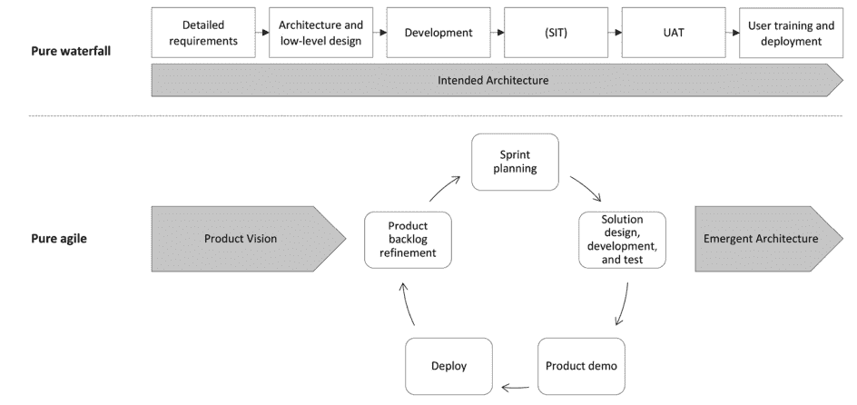

图 3.2 – 纯瀑布与纯敏捷交付

图 3.2 中需要注意的两个关键点如下：

- 在纯瀑布交付方法中，需求在前期详细定义，然后架构也详细设计。开发团队随后严格遵循设计的架构，并交付最初的 **预期架构**。是否 **预期架构** 是最佳且最 **适合用途的架构** 的架构，直到解决方案部署并收到终端用户反馈后才能得出结论。在这些 **易变、不确定、复杂、模糊 (VUCA)** 时代，对于大型或复杂项目，认为自己能够理解详细需求并 *主计划* 详细解决方案设计是冒险的做法。
- 在纯敏捷交付方法中，架构随时间演进，被称为 **涌现式架构**。如果没有向敏捷团队提供零 **防护栏** 或 **开发指南**，纯涌现式 Salesforce 架构很少是最优架构。

### 提示

了解更多关于敏捷交付方法的信息，可在以下链接中查阅：

- **看板:** https://www.atlassian.com/agile/kanban
- **Scrum:** https://www.scrum.org/resources/what-is-scrum
- **SAFe (规模化敏捷框架):** https://scaledagile.com/what-is-safe

正如本节开头所承诺的，有第三种交付方法更难定义但常用于 Salesforce 项目。

## 混合敏捷

**混合敏捷** 有多种形式，因为它不是像传统敏捷和瀑布交付方法那样在框架中定义的模型。核心敏捷主义者可能会将 SAFe 归类为混合敏捷框架，但解决这一争论超出了本书范围。

在混合敏捷交付方法中，您将 *挑选元素* 两种极端的方法，以达到中间立场，该立场 *对您的组织更好* 于任一极端的纯形式。

混合敏捷交付的目的是对成本和解决方案架构有所 *指示*，但不会花费太多时间在前期确定所有最低级别的细节——以免需求在项目开发阶段开始前变得陈旧。

## 选择您的 Salesforce 交付方法

如果以下情况适用，您应考虑选择 *纯瀑布* 交付方法：

- 您可以在 BRD 中前期准确阐述组织和业务用户的详细需求——在 *Salesforce 上下文* 中。
- 您认为提供需求后，在开发期间（数周、数月甚至数个季度）处于黑暗中等待不会导致初始需求在解决方案交付前过时。
- 您更看重在开发过程中知道最终成本和时间表，而不是持续检查解决方案并能够适应不断变化的需求、新知识或新发现的关键需求。
- 您希望确保避免 **范围蔓延**。
- 您的项目范围有限，需求不复杂，且提供需求的业务利益相关者无法在较长时间内提供支持。
- 您的项目 *仅* 涉及以下 *两者之一*：
  - 不可协商的法律或合规功能
  - 复杂集成，其中独立团队或人员依赖彼此在特定时间可用
- 您已准备好为在 **固定预算固定范围** 模式与 **按时按材** 模式相比的交付 *可能* 支付更高的价格。

另一方面，如果以下所有条件都为真，您应考虑选择 *纯敏捷* 交付方法：

- 您已在生产环境中拥有一个 Salesforce org 运行，并且只是希望向 *现有 Salesforce 云* 添加新功能。
- 您不需要对交付范围的总成本进行任何估算。

- 你接受与 *纯粹涌现式架构* 相关的 *风险*（除非同时建立合适的治理机制）。
- 你更看重持续检查解决方案并能够适应变化的需求、新知识或新发现的关键需求 *优先于* 知道最终成本和时间线。
- 你相信你会想要并且需要做大量的原型 PoC 以了解解决方案将涉及的内容 – *并且接受这种方法需要时间和金钱*。
- 如果你与实施合作伙伴合作，采用纯敏捷交付方法，你意识到并接受与按时按材合同模式相关的风险。

你应考虑选择一种 *混合敏捷* 交付方法——而非纯敏捷——如果以下情况适用：

- 你的组织需要项目成本的 *至少一些指示*。
- 你看到了在前期确定 *一定程度的架构* 的价值。
- 你需要在瀑布方式下处理项目范围中的 *某些* 元素，例如法律要求、合规要求和集成，同时需要以敏捷方式处理 *其他* 元素。

*在我们与 PME 的场景中，Salesforce 任务组的项目被赋予开发包含营销、销售和服务能力的 MVP 解决方案并在全球推广的目标。该解决方案必须具有足够的[content]
- 你接受与 *纯粹涌现式架构* 相关的 *风险*（除非同时建立合适的治理机制）。
- 你更看重持续检查解决方案并能够适应变化的需求、新知识或新发现的关键需求 *优先于* 知道最终成本和时间线。
- 你相信你会想要并且需要做大量的原型 PoC 以了解解决方案将涉及的内容 – *并且接受这种方法需要时间和金钱*。
- 如果你与实施合作伙伴合作，采用纯敏捷交付方法，你意识到并接受与按时按材合同模式相关的风险。

你应考虑选择一种 *混合敏捷* 交付方法——而非纯敏捷——如果以下情况适用：

- 你的组织需要项目成本的 *至少一些指示*。
- 你看到了在前期确定 *一定程度的架构* 的价值。
- 你需要在瀑布方式下处理项目范围中的 *某些* 元素，例如法律要求、合规要求和集成，同时需要以敏捷方式处理 *其他* 元素。

*在我们与 PME 的场景中，Salesforce 任务组的项目被赋予开发包含营销、销售和服务能力的 MVP 解决方案并在全球推广的目标。该解决方案必须具有足够的[content]
- 你接受与 *纯粹涌现式架构* 相关的 *风险*（除非同时建立合适的治理机制）。
- 你更看重持续检查解决方案并能够适应变化的需求、新知识或新发现的关键需求 *优先于* 知道最终成本和时间线。
- 你相信你会想要并且需要做大量的原型 PoC 以了解解决方案将涉及的内容 – *并且接受这种方法需要时间和金钱*。
- 如果你与实施合作伙伴合作，采用纯敏捷交付方法，你意识到并接受与按时按材合同模式相关的风险。

你应考虑选择一种 *混合敏捷* 交付方法——而非纯敏捷——如果以下情况适用：

- 你的组织需要项目成本的 *至少一些指示*。
- 你看到了在前期确定 *一定程度的架构* 的价值。
- 你需要在瀑布方式下处理项目范围中的 *某些* 元素，例如法律要求、合规要求和集成，同时需要以敏捷方式处理 *其他* 元素。

*在我们与 PME 的场景中，Salesforce 任务组的项目被赋予开发包含营销、销售和服务能力的 MVP 解决方案并在全球推广的目标。该解决方案必须具有足够的[content]
- 你接受与 *纯粹涌现式架构* 相关的 *风险*（除非同时建立合适的治理机制）。
- 你更看重持续检查解决方案并能够适应变化的需求、新知识或新发现的关键需求 *优先于* 知道最终成本和时间线。
- 你相信你会想要并且需要做大量的原型 PoC 以了解解决方案将涉及的内容 – *并且接受这种方法需要时间和金钱*。
- 如果你与实施合作伙伴合作，采用纯敏捷交付方法，你意识到并接受与按时按材合同模式相关的风险。

你应考虑选择一种 *混合敏捷* 交付方法——而非纯敏捷——如果以下情况适用：

- 你的组织需要项目成本的 *至少一些指示*。
- 你看到了在前期确定 *一定程度的架构* 的价值。
- 你需要在瀑布方式下处理项目范围中的 *某些* 元素，例如法律要求、合规要求和集成，同时需要以敏捷方式处理 *其他* 元素。

*在我们与 PME 的场景中，Salesforce 任务组的项目被赋予开发包含营销、销售和服务能力的 MVP 解决方案并在全球推广的目标。该解决方案必须具有足够的[content]
- 你接受与 *纯粹涌现式架构* 相关的 *风险*（除非同时建立合适的治理机制）。
- 你更看重持续检查解决方案并能够适应变化的需求、新知识或新发现的关键需求 *优先于* 知道最终成本和时间线。
- 你相信你会想要并且需要做大量的原型 PoC 以了解解决方案将涉及的内容 – *并且接受这种方法需要时间和金钱*。
- 如果你与实施合作伙伴合作，采用纯敏捷交付方法，你意识到并接受与按时按材合同模式相关的风险。

你应考虑选择一种 *混合敏捷* 交付方法——而非纯敏捷——如果以下情况适用：

- 你的组织需要项目成本的 *至少一些指示*。
- 你看到了在前期确定 *一定程度的架构* 的价值。
- 你需要在瀑布方式下处理项目范围中的 *某些* 元素，例如法律要求、合规要求和集成，同时需要以敏捷方式处理 *其他* 元素。

*在我们与 PME 的场景中，Salesforce 任务组的项目被赋予开发包含营销、销售和服务能力的 MVP 解决方案并在全球推广的目标。该解决方案必须具有足够的[content]
## 项目分阶段方法

在旧时代，部署 IT 解决方案是以大爆炸的方式进行的，部署所有功能并让所有用户同时上线，盛大庆祝，香槟和蛋糕齐飞——据我所知。过去至少十年里，构建 MVP 以尽快发布可用的解决方案已成为常态和口号。

对于许多类型的 IT 项目来说，构建 MVP 并在开发的产品能够通过更好的功能集、体验、业务成果和/或相比被取代的现有系统更低的成本来提供价值时就发布它是有意义的。然而，对于企业 IT 项目——Salesforce 实施项目就属于此类——存在充分的理由来抵制过早投入生产环境（首次上线）的冲动。

不急于进行初始推广的最强论据是，一旦用户在生产环境中上线，你的 Salesforce 设置和复杂性相比开发阶段至少会翻倍。

以下是一些你在上线后将拥有的关键驱动因素和责任，而在开发阶段至少不会以同等程度存在：

- 用户的配置和去配置：
  - 员工更换角色，需要新的角色、权限集、组和队列成员资格
- 新用户的培训
- 管理生产环境
- 可能管理生产支持环境
- 每次 Salesforce 发布时每年三次对关键流程进行回归测试
- 处理来自用户的新的功能请求

### 用户 bug 报告的处理

这看起来工作量很大，如果在流程和架构上没有以最精简的方式管理，确实如此。我们将在 *第 12 章，演进你的 Salesforce Org 和 DevOps 能力* 中进一步介绍这一点。

我绝不是建议你尽可能推迟初始发布。我只是指出 *需要考虑合适的时机*——考虑到建立这些流程所需的时间，其中一些需要在前期进行技术设置。

可以通过分阶段实施来避免大爆炸，从而不会因前面提到的生产责任而不堪重负。

存在两种项目分阶段类型，乍一看可能似乎相同，但存在明显差异。

### 按范围分阶段

不同的业务领域能力会开发并发布给相关的 **功能用户组**。例如，你可以选择为你的 *销售* 组织开发并发布业务能力，然后再为你的 *营销* 和 *客户服务* 组织开发并发布。采用这种方法有优缺点，如下所述。

这些是优点：

- 范围更小意味着增值、可用的解决方案的开发和推广更快
- 已获取的 Salesforce 许可证比如果解决方案必须包含完整范围并等待所有能力开发完成后再让任何单个功能用户组开始使用 Salesforce 的情况更早得到利用
- 培训和变革管理的并发工作更少
- 任何一个业务能力无法正常工作并延迟整个解决方案部署的复合风险更低

这些是缺点：

- 风险是陷入对少数能力的过度优化，超出投资回报，而牺牲了为其他用户组开发新能力。
- 可能需要开发临时集成到遗留系统以获得完整的客户概览。例如，如果 Salesforce 解决方案最初是为销售用户构建且不包括客户服务，销售用户将无法在 Salesforce 中访问其客户的服务历史记录，他们要么必须使用两个 CRM 系统（用户体验不佳），要么需要开发临时集成以在 Salesforce 中显示来自遗留 CRM 的服务历史记录。

### 提示！

随着我们在本章活动中逐步推进，请牢记你不同业务能力成熟度和战略重要性，因为它们将指导你为初始 Salesforce 发布确定范围的优先级。

让我们看看分阶段实施 Salesforce 项目的另一种策略。

### 按地理分阶段

在这种项目分阶段类型中，一个地理区域的用户将使用项目中开发的所有能力——但推广（和迁移）是分阶段进行的。

例如，你可能决定开发一个初始 MVP 解决方案，推广到澳大利亚和新西兰组织，然后进一步推广到其他地区或国家——批量或国家组。

按地理分阶段的优点如下：

- 培训和变革管理的并发工作更少
- 开发的解决方案不太可能与任何特定国家或地区不匹配的风险更低——阻碍采用

按地理分阶段的缺点如下：

- 风险是为一个国家或地区优化解决方案，而未进行预期的流程协调

### 提示！

作为一般经验法则，当能力开发、测试并准备好使用时，优先尽快推广以获取反馈。根据收到的反馈改进解决方案，然后尽可能推广到尽可能多的地理区域，以确保构建的解决方案被整个组织采用——这样你就不会冒不同地理区域同时使用不同系统的风险。

在介绍完 Salesforce 项目交付方法论后，是时候谈谈变革了。

## 确定你的变革管理策略

在你的 Salesforce 项目过程中，你的组织会有许多变化。最重要的是，你的员工的工作方式会发生变化。你作为组织管理这些变化的能力对 Salesforce 项目的成功有直接且巨大的影响。你可以设计和交付最技术上复杂的解决方案，但如果你的用户不愿意、不需要或不知道如何使用你的解决方案，那么你的努力和投资将不会结出果实。

### 介绍变革管理

**变革管理** 涵盖你为最大化组织所经历变化的积极成果而使用的所有努力、举措、活动和工具。

你需要在 Salesforce 项目中管理变革，以确保你的 Salesforce 解决方案的预期用户采用并使用你的 Salesforce 解决方案。**采用** 的水平是衡量 Salesforce 项目成功与否的关键指标，我们将在 *第 4 章，获得资金并与 Salesforce 和实施合作伙伴互动* 中进一步介绍。

采用率，然而，是你为管理变革所投入的集体努力的 *综合结果*。让我们看看你的 Salesforce 项目可能带来的变化范围。

### Salesforce 项目中的变革程度

通过实施 Salesforce 增强业务能力——*超出了改变业务能力的系统组件*。

实施 Salesforce 可能会以以下方式改变你的业务能力组件：

- **系统**：可能用 Salesforce 取代遗留系统将影响你的整体系统格局，并可能影响 *你的企业系统如何集成*。
- **数据**：数据作为 Salesforce 项目的一部分，其管理、存储、分配、消费和利用方式会受到影响。在当今的 **数据驱动型企业** 中，数据被认为是最重要的资产之一。你需要考虑并绘制因用 Salesforce 取代旧的工作方式（遗留系统）而受影响的利益相关者，设计你的未来数据管理和治理，并了解

建立新的报告和分析能力与资产所需的工作。聘请 **企业架构师** 和 **数据架构师** 在此练习中支持您。

- **流程**：您面向客户并与客户互动的员工的业务流程将会发生变化。在整个 Salesforce 项目期间，您将把大部分变更管理工作集中在该变化如何影响您的员工上。
- **人员**：随着系统和流程的变化和优化，之前从事基础数据录入和手动重复性任务的人员将腾出时间，专注于创造更多价值的活动，以实现更好的业务成果——所有这些都与您 Salesforce 项目的整体愿景保持一致。
- 员工当前的能力和技能与从事增值活动所需的技能之间可能存在差距。这需要提升技能和培训——超出学习使用您的 Salesforce 解决方案的范围。当然，提升技能和培训的性质取决于您识别出的能力差距。如果您作为 Salesforce 项目的一部分正在改变公司的整体销售方法——例如，从传统的交易型销售转变为解决方案销售——您可能需要开展一系列销售培训课程。
- 在某些项目中，您可能会发现一些需要学习新技能以适应新工作方式的员工对变革不感兴趣和/或不具备变革能力。在这种情况下，您需要考虑他们在组织内可能适合的岗位，以便仍然保留这些员工所拥有的组织知识。最后的办法是，如果他们对您提供的机会不感兴趣，或者您无法在组织内为他们找到机会，您可能需要考虑让部分员工离职。
- 在开展识别不同员工群体变化的练习时，与您的人力资源业务合作伙伴密切合作，以捕捉职位描述和所需技能的变化。

虽然这些要素目前可能由组织内不同部门负责，但确保所有要素都得到解决，是设计和交付用户将采用的解决方案的关键前提。稍后在本章中，我们将探讨如何锚定改变组织能力的集体责任。

## 识别受变革影响的利益相关者

实施 Salesforce 时，变革将在组织的多個层面发生，而管理这些变革需要不同类型的活动。

在上一节中，您已确定实施 Salesforce 带来的变革范围。现在让我们具体看看谁会受到变革的影响，以便您据此规划沟通和变更管理活动：

- **终端用户**：他们的工作方式将会改变，因为他们将在 Salesforce 中工作。
- **您的终端用户的经理**：Salesforce 将为他们提供有关员工工作的新的洞察。管理者的支持对于维持变革和采用您的 Salesforce 解决方案至关重要。很可能经理们需要提升技能和辅导，以便他们能够支持和鼓励员工采用您的 Salesforce 解决方案。
- **本地销售组织的领导层**：本地领导层将有效地充当您 Salesforce 项目的本地执行赞助人。他们的支持和沟通对于采用至关重要。
- **全球领导层**：假设您将拥有一个在整个公司使用的 **Salesforce 组织**，您的全球领导层将能够以全新的方式深入了解营销、销售和客户服务绩效。这需要培训以及可能的能力提升，以充分发挥这一新层次洞察的最大价值。
- **应用管理员工：** 可能管理过您旧版 CRM 系统的员工将经历重大变革，因为他们必须学习管理您的 Salesforce 解决方案及其用户。
- **数据、BI、报告和分析员工：** 这些职能可能属于您的 IT 组织，也可能不属于。无论组织位置如何，他们的基础数据架构都将发生变化，因为他们——借助 Salesforce——将拥有新的数据源，以及为报告利益相关者创建和展示报告和仪表板的新的场所。

## 按 Salesforce 项目阶段安排变更管理活动的时间

管理变革的方法和活动——您的工具箱——无论您为 Salesforce 项目选择哪种交付方法都是相同的。然而，变更管理举措的时机和力度则取决于您选择的交付方法。

让我们探讨一下举措的时机如何通常因交付方法而异：

| 关键变更管理举措 | 瀑布式 | 混合敏捷 | 纯敏捷 |
|---|---|---|---|
| 识别受变革影响的利益相关者 | 开发开始前 | 开发开始前 | 在产品待办事项列表细化或冲刺计划时 |
| 使用愿景确定信息并制定沟通计划 | 开发开始前 | 开发开始前起草，持续调整 | 在产品待办事项列表细化时 |
| 招募变革推动者 | UAT 之前 | 开发开始前 | 在冲刺计划中 |
| 终端用户参与 | 直到 UAT 和培训阶段 | 在开发前阶段的工作坊中，在开发阶段的展示活动中 | 持续在展示活动和用户反馈论坛中 |
| 用户培训 | 在推广阶段 | 在推广阶段 | 在产品演示中以及在应用中使用 |
| 监控并确保采用 | 在推广阶段 | 在推广阶段 | 持续进行 |

表 3.2 – 按交付方法划分的关键变更管理举措的时机

接下来，让我们看看有哪些框架可供您使用。

## 使用变更管理框架

有很多变更管理框架可供您选择。一些最常用的框架包括 Prosci ADKAR® 模型、Drucker 组织变革领导力学院，以及经典的 John Kotter 的《领导变革的 8 步流程》。

Tip!

虽然详细说明每个变更管理框架的内容超出了本书的范围，但我鼓励您阅读它们并从中获得灵感。遵循一个整体经过验证的框架是有益的，但要注意不要让自己陷入过于僵化的结构——根据您公司的文化，将您认为对自己的变更管理策略有价值的元素纳入其中。

我们知道您的组织将经历变革，因为这是您 Salesforce 项目的目标，所以我们可以预测它。我们无法预料的是组织——受变革影响的人们——将如何反应和回应。

在整个 Salesforce 项目中，您将花费大量精力来了解员工当前的流程，并确定未来的、改进的或新的流程以了解变革的内容。我们无法确定这些关于改进和变革的假设是否成立——即使它们成立，也无法确定受影响的人是否会将其 *视为* 积极的变革。

Tip!

随着您推进 Salesforce 项目，调整和完善您的变更管理策略。

接下来，我们将转向了解如何治理和管理您的 Salesforce 项目和计划。

## 设想您的 Salesforce 卓越中心

截至目前，您的项目工作组由三个关键角色组成（参见第 1 章《为您的 Salesforce 项目创建愿景》），他们已出色地完成了工作到目前为止。现在是设想如何管理您的 Salesforce 项目并设想您的 **Salesforce 卓越中心 (CoE)** 结构的时候了。您的 Salesforce 工作组成员将在新的 Salesforce 卓越中心中继续发挥关键作用。

## 了解 Salesforce 卓越中心的用途

您的 Salesforce CoE 将是您管理 Salesforce 项目的管理和治理框架。

建立您的 Salesforce CoE 的好处是多方面的：

- 确保 *及时交付* Salesforce 项目或功能，具体取决于您选择的交付方法
- 确保您的整体 *Salesforce 解决方案符合* 公司所受的法规要求
- 实现创新的 *更快交付* 并降低风险

执行得当，这些收益的总和将在财务上产生重大影响，与没有设立 Salesforce CoE 相比可节省大量成本。

## 为您的 Salesforce CoE 起草章程

为您的 Salesforce CoE 创建一份 **章程**，以使项目利益相关者和 Salesforce CoE 成员保持一致。

您的 Salesforce CoE 章程应包含以下内容：

- 您 Salesforce 项目的愿景
- 您 Salesforce CoE 的目标和职责
- 衡量您 Salesforce 项目成功与否的指标

让我们来看看您 Salesforce CoE 的职责。

## 确定 Salesforce CoE 的结构和职责

您的 Salesforce CoE 包含以下元素和团队——各自承担不同的职责——共同朝着同一目标努力。

让我们来看看 CoE 职责背后的任务：

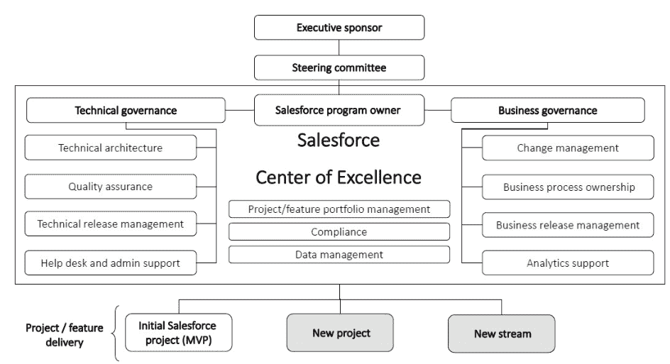

图 3.3 – Salesforce 卓越中心

执行赞助人：贵公司高级领导层的代表，对 Salesforce 项目的成功有切身利益。可能是直接向公司 CEO 汇报的 SVP，具体取决于组织的规模和结构，有时甚至是 CEO 本人。

- **指导委员会**：负责您 Salesforce 项目战术支持的团队。应由您的执行赞助人、CFO、CIO 以及高级商业领导代表组成。您有时可能希望邀请 Salesforce 或实施合作伙伴等外部人员在指导委员会会议上进行演示。
- **Salesforce 项目负责人：** 负责监督和协调 Salesforce CoE 的职责。项目经理推动 Salesforce 项目组合管理，并根据业务和技术组织的意见制定项目路线图。项目负责人还负责监督 Salesforce 项目的交付，不过每个项目或交付流都应配备专职的 Salesforce 项目经理——或 Scrum Master。
- **业务治理：** 该团队负责收集和整合需求、业务流程定义、变更管理、报告支持以及发布管理的业务方面。
- **技术治理：** 该团队负责确保您的 Salesforce org 安全，其应用程序具有可扩展性和高性能。此外，该团队还监督质量保证、技术发布管理以及帮助台和管理员支持等领域，其中包括用户管理。

您 Salesforce CoE 中的团队和职责可能会根据 Salesforce 项目的特定性质、行业和组织而有所不同。

在预开发阶段，一旦您为初始 Salesforce 项目获得资金，您的 Salesforce CoE 就会启动并开始运作。

起草您的 Salesforce CoE 章程和结构是创建商业论证以获得 Salesforce 项目和项目资金的重要前提。一旦获得资金，您将希望开始为您的 Salesforce CoE 配备人员。

接下来，让我们看看如何创建您的 **Salesforce 路线图**。

## 为您的 Salesforce 项目创建路线图

这里有意使用 *program* 一词，因为该项目可能包含许多与 Salesforce 相关的项目和流——但不一定包含在初始 Salesforce 项目的范围之内，或至少不包含在 Salesforce 解决方案的初始发布中。

让我们看看我们的案例公司 PME 制定的 **Salesforce 项目路线图**，它以经典的 **转型图 (T-Map)** 形式呈现。

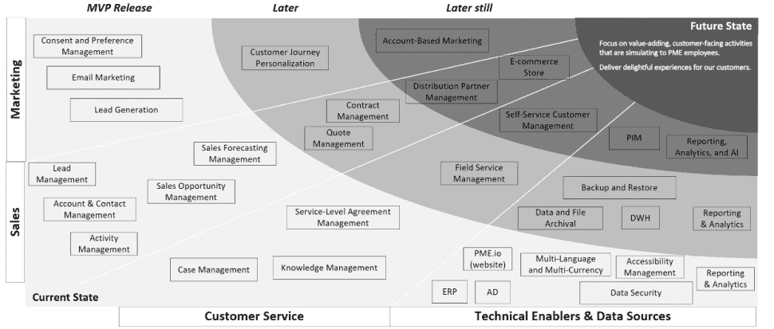

图 3.4 – PME 的 Salesforce 项目路线图

*PME 的 Salesforce 任务组制定了其路线图。他们考虑了初始发布的项目分阶段和交付方法。他们决定通过创造性地为所需功能定义三个类别来保持简单：*

- **MVP Release**：MVP 发布包含 PME 现有电子邮件营销和 CRM 系统当前支持的功能，以及 PME 认为将为业务带来巨大价值的少数精选功能。
- **Later**：*这些功能非常受期待，但需要在开始构建之前具备若干基础功能。PME 不打算将 Later 类别的功能打包成一个项目，而是打算区分 MVP 发布和 Later still 类别功能之间的交付时间。*
- **Later still**：*这些功能也受期待，但仍依赖于在 MVP 发布和 Later 类别中交付的功能。*

*PME 已通过范围对 Salesforce 实施进行了有效分阶段，显著降低了实施风险。它也希望按地理区域对项目进行分阶段。*

## 在预开发阶段进行迭代

确定如何交付您的 Salesforce 项目是一项重要工作。确定您的 Salesforce 项目路线图和初始 Salesforce 项目的范围是一个迭代过程。随着您意识到依赖关系并更熟悉获取许可证和实施功能的成本，您将返回路线图并进行修改。迭代和修改非常好——您正在进一步塑造 Salesforce 以适应您的组织。将任何更改和决策记录在您的 RAID 日志中。

## 摘要

在本章中，您已对如何最好地交付 Salesforce 项目进行了许多考虑。您考虑了哪种交付方法最适合您的特定项目和组织，并考虑了如何按范围和地理区域分阶段实施以降低风险并提高交付速度。然后，您了解了变更管理以及变更管理的程度。您还学习了如何识别因 Salesforce 项目而受到影响的众多利益相关者，以及应如何根据您选择的交付方法 *安排* 变更管理活动的时间。最后，您设想了您的 Salesforce CoE，即监督 Salesforce 项目的管理和治理机构，并学习了如何创建 Salesforce 项目路线图。

到目前为止，您已为 Salesforce 项目创建了愿景——*为什么*——以及其本质——*是什么*——并且您刚刚确定了 *如何* 交付它。

您现在准备进入 Salesforce 实施预开发阶段的最后一章：*第 4 章，获得资金并与 Salesforce 和实施合作伙伴接洽*。是时候确定 *多少* 了。

## 获得资金并与 Salesforce 和实施合作伙伴接洽

在本章中，我们进入 Salesforce 项目的财务和法律层面。首先，我们将介绍如何创建和呈现商业论证以获得项目的资金。接下来，我们将探讨如何与 Salesforce 接洽以获取许可证成本报价，并介绍与实施合作伙伴沟通的复杂性，以及在选择合作伙伴时应注意什么。

您将了解财务预测方法，包括您的 Salesforce 项目如何增加公司收入，以及在 Salesforce 实施过程中需要考虑——并预测——哪些成本。您将了解在与 Salesforce 接洽时可能遇到的角色以及如何最好地向 Salesforce 请求报价。最后，您将了解与实施合作伙伴合作的价值，可用的类型、选择流程以及如何与其签订合同。

在为 Salesforce 项目获得资金、从 Salesforce 获取 Salesforce 许可证并与实施合作伙伴签订合同后，您终于可以开始 Salesforce 实施的开发阶段。

本章将涵盖以下主要主题：

- 创建商业论证以获得资金
- 与 Salesforce 和实施合作伙伴接洽
- 在预开发阶段进行迭代

开始吧！

## 创建商业案例以确保资金

在上一章中，您确定了将如何交付您的 Salesforce 项目——交付方法、沟通以及变革管理策略——并设想了 Salesforce CoE 来管理您的 Salesforce 实施。现在是时候为您的项目争取资金并开始与 Salesforce 和实施合作伙伴接洽，如下图所示：

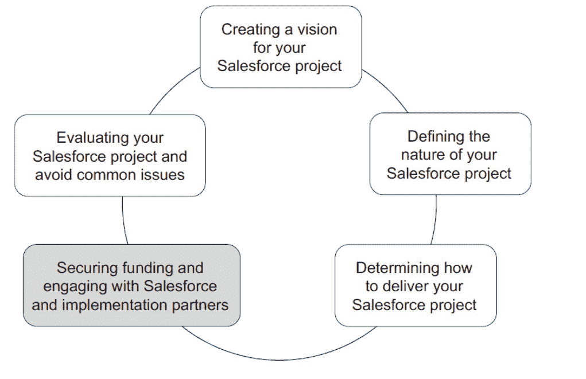

图 4.1 – 前期开发阶段的活动

在能够创建财务预测之前，让我们具体说明您对 Salesforce 项目期望的业务成果。

## 确定所需业务能力的 KPI 和目标

如果您希望在推出时能够衡量 Salesforce 项目是否成功，您需要确定如何衡量绩效以及什么目标定义成功。您的 Salesforce 任务组不应设定业务目标；您应与业务利益相关者沟通，以确定跟踪哪些 **关键绩效指标 (KPIs)** 是合理的以及应追求哪些 **KPI 目标**。

这在前期可能看起来是一项很大的工作，但请考虑相反的情况：如果没有设定 KPI 或目标，项目成功衡量将依赖于来自各个用户组的、主观的定性输入，而非预先确定的、充分论证的考虑。此外，当您[content]
## 创建商业案例以确保资金

在上一章中，您确定了将如何交付您的 Salesforce 项目——交付方法、沟通以及变革管理策略——并设想了 Salesforce CoE 来管理您的 Salesforce 实施。现在是时候为您的项目争取资金并开始与 Salesforce 和实施合作伙伴接洽，如下图所示：

图 4.1 – 前期开发阶段的活动

在能够创建财务预测之前，让我们具体说明您对 Salesforce 项目期望的业务成果。

## 确定所需业务能力的 KPI 和目标

如果您希望在推出时能够衡量 Salesforce 项目是否成功，您需要确定如何衡量绩效以及什么目标定义成功。您的 Salesforce 任务组不应设定业务目标；您应与业务利益相关者沟通，以确定跟踪哪些 **关键绩效指标 (KPIs)** 是合理的以及应追求哪些 **KPI 目标**。

这在前期可能看起来是一项很大的工作，但请考虑相反的情况：如果没有设定 KPI 或目标，项目成功衡量将依赖于来自各个用户组的、主观的定性输入，而非预先确定的、充分论证的考虑。此外，当您[content]
## 创建商业案例以确保资金

在上一章中，您确定了将如何交付您的 Salesforce 项目——交付方法、沟通以及变革管理策略——并设想了 Salesforce CoE 来管理您的 Salesforce 实施。现在是时候为您的项目争取资金并开始与 Salesforce 和实施合作伙伴接洽，如下图所示：

图 4.1 – 前期开发阶段的活动

在能够创建财务预测之前，让我们具体说明您对 Salesforce 项目期望的业务成果。

## 确定所需业务能力的 KPI 和目标

如果您希望在推出时能够衡量 Salesforce 项目是否成功，您需要确定如何衡量绩效以及什么目标定义成功。您的 Salesforce 任务组不应设定业务目标；您应与业务利益相关者沟通，以确定跟踪哪些 **关键绩效指标 (KPIs)** 是合理的以及应追求哪些 **KPI 目标**。

这在前期可能看起来是一项很大的工作，但请考虑相反的情况：如果没有设定 KPI 或目标，项目成功衡量将依赖于来自各个用户组的、主观的定性输入，而非预先确定的、充分论证的考虑。此外，当您

可以转化为成本节约或投入到更有价值的活动中。

-   **Salesforce CoE 成本：** 用于治理、维护和运行您的 Salesforce 解决方案的新员工（非项目成本）。这些包括内部管理员和业务分析师，他们负责进行小规模的错误修复、实施小型功能请求以及用户管理 – *维持运转*。我们将在下一节中更详细地介绍这一点。
-   **遗留系统运营成本：** 不再维护即将退役的遗留系统的员工。如果可能，您应该对这些人员进行再培训和提升技能，使其成为 Salesforce CoE 的一部分，因为他们对贵组织非常熟悉并拥有许多可转移技能，这些技能 – 结合 Salesforce 知识 – 将成为您新的 Salesforce CoE 的宝贵资源。由于 Salesforce 对这些人来说可能是一个全新的平台，云计算也可能对他们来说是新的，因此在培训方面要谨慎细致 – 我们将在 *第12章*、*发展您的 Salesforce Org 和 DevOps 能力* 中再次讨论此主题。

让我们看看您在实施合作伙伴模式方面的选择。

## 选择您的实施合作伙伴模式

**康威定律** 指出，如果组织未获得外部输入，就会或多或少地将现有流程（和数据）原封不动地迁移到新系统中。如果您的公司投资于 Salesforce 这样闪亮的、尖端的技术、市场领先的 CRM 平台，却不改进其流程，那将是完美机会的巨大浪费。

这正是 Salesforce 实施合作伙伴发挥作用的地方。

让我们看看不同的合作伙伴模式：

-   **100% 内部实施：** 您的公司完全不与实施合作伙伴合作。对于 Salesforce 项目而言，对于初始的绿地实施来说，这不是推荐的做法。初始实施部署后，对现有云的错误修复和功能增强可以由内部团队执行，并得到明确定义的开发指南和治理的支持。
-   **100% 外包：** 您的公司除了一些高层治理和提供需求外，将所有工作外包。实施合作伙伴负责开发、部署、培训、用户管理和帮助台。选择 100% 外包是有正当理由的 – 例如，如果贵公司的 IT 资源有限，但您希望开发出优秀的解决方案并为用户提供及时支持。
-   **折中方案：** 在此模式下，您自行处理 Salesforce 的部分工作 – 最常见的是用户管理、报告支持、错误请求管理、新功能请求管理、培训和帮助台等元素。此模式有无穷无尽的变化，也是最普遍的。您需要明确的是，贵公司在哪些元素上比实施合作伙伴做得更好，以及原因。通常，这取决于涉及与终端用户沟通的元素。

您选择的合作伙伴模式并非一成不变。随着您在 Salesforce 实施各阶段的推进，了解什么有效、什么无效，并据此优化您的设置。

## 重要说明

实施合作伙伴的成本属于您公司的 **资本支出（CAPEX）**，而您日常的内部运营费用则属于 **运营支出（OPEX）**。请与您的 CFO 或其他财务业务合作伙伴讨论，贵公司在选择 Salesforce 实施的合作伙伴模式时是否有偏好或考虑因素。

让我们继续讨论您 Salesforce CoE 所需的资源。

## 确定您的 Salesforce CoE 目标运营模式

您需要将 Salesforce CoE 成员在交付 Salesforce 项目上花费的时间成本纳入其中。要确定这一点，我们首先需要了解需要成为 Salesforce CoE 的一部分的角色。

为了帮助您确定在初始实施和推广后 *纯粹维护* 实施所需的角色，请查阅 Salesforce 帮助文章 *最佳实践：实现卓越的 CRM 管理*，网址为 https://help.salesforce.com/s/articleView?id=000327119&type=1。

文章中的模型基于最多 750 名用户。对于计划投资并实施 Salesforce 的企业组织而言，了解运行其 Salesforce 平台所需的关键资源因素至关重要，以便估算维护其解决方案的运营成本。

那么，让我们深入探讨这些考虑因素和因素。

在所有 Salesforce org 中，您至少会有一名内部用户拥有配置 Salesforce org 的管理员权限。人数和时间取决于多个因素以及围绕运营模式的决策 – 以及您选择的合作伙伴模式。

以下列表包括其中一些因素：

-   您的 Salesforce org 是否已上线生产
-   使用的 Salesforce 云和附加产品的广度
-   您的 Salesforce org 定制的程度
-   您 Salesforce org 中解决方案的可维护性*

*提示
可维护性是一个因素，您可以通过为 Salesforce 项目和计划制定正确的治理机制来 *可以影响*。我们将在 *第7章，构建和测试您的初始发布* 中更详细地介绍这一点。

-   内部 Salesforce 用户的数量
-   您 Salesforce org 中业务线的数量
-   销售区域或国家/地区的数量
-   面向客户的应用程序的数量，例如 Experience Cloud 网站或商务商店

其中一些因素纯粹基于事实，例如用户数量。

您的 Salesforce CoE 成员负责的领域不仅仅是用户管理 – 回顾上一章中的 Salesforce CoE 结构图。并非所有成员都会 100% 分配给 Salesforce CoE。因此，您应使用 **基于活动的成本核算模型** 来计算纳入 Salesforce 计划商业案例的成本。

*让我们看看 PME 的 Salesforce CoE 成员角色和时间分配情况：*

| CoE 角色 | 人数 | 分配给 Salesforce CoE 的时间 | 年薪 | CoE ABC 成本 |
|---|---|---|---|---|
| 执行赞助人 | 1 | 20% | $ 300,000 | $ 60,000 |
| 项目负责人和 MVP 项目经理 | 1 | 100% | $ 200,000 | $ 200,000 |
| 产品负责人 | 1 | 100% | $ 150,000 | $ 150,000 |
| 管理员 | 3 | 100% | $ 100,000 | $ 300,000 |
| 企业架构师 | 1 | 10% | $ 200,000 | $ 20,000 |
| 数据架构师 | 1 | 20% | $ 150,000 | $ 30,000 |
| 领域主题专家 (SMEs) | 3 | 25% | $ 150,000 | $ 112,500 |
| 变革推动者（来自本地销售组织） | 8 | 20% | $ 150,000 | $ 240,000 |

**年度 Salesforce CoE 成本** $ 1,112,500

图 4.2 – PME Salesforce CoE 角色、时间分配和成本

*PME 有 2,000 名全职员工，其中一半将在 Salesforce 中工作并需要许可证和用户管理。PME 的企业架构师将建议 Salesforce 如何融入 PME 的业务战略，数据架构师将就 Salesforce 如何支持 PME 的数据战略及其执行提供专业意见。领域主题专家和变革推动者将在整个项目中参与，以帮助提高解决方案满足业务需求的机会，并使其得到 PME 业务用户的认可。*

乍一看似乎是很多人和成本，然而，一个强大且协调一致的 Salesforce CoE 将在未来带来回报。

在完成确定 KPI 及其目标以及 Salesforce CoE 估计成本的初步练习后，是时候拿出计算器（或电子表格）来算一算数字了。

## 预测您的 Salesforce 项目的财务影响

要预测您的 Salesforce 项目将如何从财务上影响您的公司，您需要首先汇总您的 KPI、其目标以及您的假设和前提。

让我们看看 PME 对其 Salesforce 项目的假设和前提：

| 项目 | 假设与前提 |
|---|---|
| 年度收入 | 营销影响与销售影响的乘积——在最后一次推广后 18 个月内完全分阶段实现。 |
| 销售对收入的影响 |  |
| 年度新商机数量 | 源自 PME 公司信息以及 KPI 和 KPI 目标定义练习的结果。由于洞察力更强、客户 360 度全景视图以及更高效的商机管理，新商机数量增加。 |
| 平均成交商机比率 |  |
| 成交商机数量 |  |
| 平均成交商机金额 |  |
| 成交商机价值 = 销售带来的收入影响 |  |
| 营销对收入的影响 |  |
| 年度产生的营销合格线索数量 | 源自 PME 公司信息以及 KPI 和 KPI 目标定义练习的结果。由于营销自动化改善而产生的营销合格线索（MQL）增多，新商机数量增加。为了衡量营销自动化改善的独立影响，我们不包括上述销售对收入影响的驱动因素。 |
| 线索转化率 |  |
| 转化线索数量 = 新商机数量 |  |
| 平均成交商机比率 |  |
| 成交商机数量 |  |
| 平均成交商机金额 |  |
| 成交商机价值 = 营销带来的收入影响 |  |
| 毛利率 % | 对毛利率 % 无影响。 |
| 新许可成本 - Salesforce | 为每个 PME 地方销售组织在上线时及时获取许可而产生的成本。 |
| Salesforce 企业版许可成本 | 1,000 名 PME 销售和服务人员，拥有企业版的完整 CRM 许可，按标价计。 https://www.salesforce.com/editions-pricing/sales-and-service-cloud/ |
| Salesforce Marketing Cloud 账户参与（MCAE）许可成本 | MCAE Plus 版本许可成本 – 标价。5 个额外的联系人区块以容纳 120,000 个联系人。 https://www.salesforce.com/editions-pricing/marketing-cloud/account-engagement/ |
| 旧系统许可成本 | 从 Salesforce 上线起再加 3 个月。假设：旧系统的成本模型按用户计。 |
| 运营成本 | 以下影响的乘积。 |
| 业务运营成本：销售与客户服务 | 源自 PME 公司信息以及 KPI 和 KPI 目标定义练习的结果。 |
| Salesforce CoE 成本 | 根据 PME Salesforce CoE 角色及各项目阶段的时间分配产生的成本。 |
| 旧系统运营成本 | 与节省的“旧系统许可成本”同时产生的成本。 |
| 投资（CAPEX）：实施成本 | 一次性成本，基于 PME 企业架构师对实施和本地部署推广的估算。 |
| 经营利润：毛利率减去 OPEX 和 CAPEX | 收入和成本影响的净影响。 |

图 4.3 – PME Salesforce 项目的假设与前提

接下来，你需要将所有假设和前提转化为财务模型，以比较你的 Salesforce 项目对公司基线绩效的影响。

## 重要提示

虽然你的 Salesforce 项目路线图包含随着时间推移要添加到 Salesforce 解决方案中的更多功能，但你应仅包括为准备此商业案例而包含范围内的项目的财务影响。

在下图中，你可以看到 PME 的 Salesforce 项目影响的财务模型：

## PME 的 Salesforce 项目影响 vs. 基线

|  | 基线 | 较基线变化 % | 未来 | 较基线绝对变化 |
|---|---|---|---|---|
| 年度收入 | $ 300,398,180 | 12.7% | $ 338,688,553 | $ 38,290,373 |
| 销售对收入的影响 |  |  |  |  |
| 年度新商机数量 | 20,000 | 3.0% | 20,600 | 600 |
| 平均成交商机比率 | 23% | 2 个百分点 | 25% | 不适用，百分比 |
| 成交商机数量 | 4,600 | 12.0% | 5,150 | 550 |
| 平均成交商机金额 | $ 63,500 | 无 | $ 63,500 | $ - |
| 成交商机价值 = 销售带来的收入影响 | $ 292,100,000 | 12.0% | $ 327,025,000 | $ 34,925,000 |
| 营销对收入的影响 |  |  |  |  |
| 年度产生的营销合格线索数量 | 2,200 | 10.0% | 2,420 | 220 |
| 线索转化率 | 18% | 5 个百分点 | 23% | 不适用，百分比 |
| 转化线索数量 = 新商机数量 | 396 |  | 557 | 161 |
| 平均成交商机比率 | 33% | 无 | 33% | 不适用。 |
| 成交商机数量 | 131 |  | 184 | 53 |
| 平均成交商机金额 | $ 63,500 | 无 | $ 63,500 | $ - |
| 成交商机价值 = 营销带来的收入影响 | $ 8,298,180 | 40.6% | $ 11,663,553 | $ 3,365,373 |
| 毛利率 % | 45.0% | 无 | 45% | 不适用。 |
| 毛利率影响 | $ 135,179,181 | 12.7% | $ 152,409,849 | $ 17,230,668 |
| 运营成本（OPEX） | $ 100,500,000 | -0.6% | $ 99,871,500 | $ (628,500) |
| 新许可成本 - Salesforce | $ - | 不适用 新 | $ 1,719,000 | $ 1,719,000 |
| Salesforce 企业版许可成本 |  |  | $ 1,680,000 | $ 1,680,000 |
| Salesforce Marketing Cloud 账户参与（MCAE）许可成本 |  |  | $ 39,000 | $ 39,000 |
| 旧系统许可成本 | $ 1,500,000 |  | $ - | $ (1,500,000) |
| 运营成本 | $ 99,000,000 |  | $ 98,152,500 | $ (847,500) |
| 业务运营成本：销售与客户服务 | $ 48,000,000 | -2.0% | $ 47,040,000 | $ (960,000) |
| Salesforce CoE 成本 | $ - | 不适用 新 | $ 1,112,500 | $ 1,112,500 |
| 旧系统运营成本 | $ 1,000,000 | -100% | $ - | $ (1,000,000) |
| 其他运营成本 | $ 50,000,000 |  | $ 50,000,000 | $ - |
| 投资（CAPEX）：实施成本 | $ - |  | $ 7,440,000 | 不适用 一次性 |
| 经营利润：毛利率减去 OPEX 和 CAPEX | $ 34,679,181 | 30.0% | $ 45,098,349 | $ 10,419,168 |
| 经营利润率 % | 11.5% | 15.3% | 13.3% | 不适用。 |

## 图 4.4 – PME 的 Salesforce 项目影响与基线对比

现在，如图 4.3 所述，其中一些影响会在数月内分阶段进行——例如，生产率提升不会一夜之间发生，而且旧系统许可成本的节省也不会在你至少能够在用户开始使用新的 Salesforce 解决方案时停用用户之前实现。

## 提示

为了最好地管理你的执行赞助商和指导委员会成员的期望，要保持现实和保守：随着时间的推移分阶段进行收入影响和生产率提升。提前产生成本。

让我们看一个来自 PME Salesforce 工作组的损益（P&L）影响预测示例——考虑影响分阶段的情况：

|  | 第 1 年 | 第 2 年 | 第 3 年 | 第 4 年 | 第 5 年 | 3 年合计 | 5 年合计 |
|---|---|---|---|---|---|---|---|
| 损益影响 '000 |  |  |  |  |  |  |  |
| 年度收入影响 | $ - | $ 4,964 | $ 28,541 | $ 38,290 | $ 38,290 | $ 33,504 | $ 110,085 |
| 毛利率 % | 45% | 45% | 45% | 45% | 45% | 45% | 45% |
| 毛利率影响 | $ - | $ 2,234 | $ 12,843 | $ 17,231 | $ 17,231 | $ 15,077 | $ 49,538 |
| 运营成本（OPEX）影响 | $ 1,171 | $ 407 | $ (205) | $ (389) | $ (389) | $ 1,373 | $ 596 |
| 新许可成本 - Salesforce | $ 69 | $ 1,367 | $ 1,719 | $ 1,719 | $ 1,719 | $ 3,155 | $ 6,593 |
| Salesforce 企业版许可成本 | $ 39 | $ 1,330 | $ 1,680 | $ 1,680 | $ 1,680 | $ 3,049 | $ 6,409 |
| Salesforce MCAE* 许可成本 | $ 30 | $ 37 | $ 39 | $ 39 | $ 39 | $ 106 | $ 184 |
| 旧系统许可成本影响 | $ (6) | $ (1,188) | $ (1,500) | $ (1,500) | $ (1,500) | $ (2,694) | $ (5,694) |
| 运营成本影响 | $ 1,108 | $ 228 | $ (424) | $ (608) | $ (608) | $ 912 | $ (303) |
| 业务运营成本：销售与客户服务影响 | $ - | $ (93) | $ (537) | $ (720) | $ (720) | $ (630) | $ (2,070) |
| Salesforce CoE 成本 | $ 1,113 | $ 1,113 | $ 1,113 | $ 1,113 | $ 1,113 | $ 3,338 | $ 5,563 |
| 旧系统运营成本影响 | $ (4) | $ (792) | $ (1,000) | $ (1,000) | $ (1,000) | $ (1,796) | $ (3,796) |
| 其他运营成本影响 | $ - | $ - | $ - | $ - | $ - | $ - | $ - |
| 投资（CAPEX）：实施成本 | $ 5,252 | $ 2,188 | $ - | $ - | $ - | $ 7,440 | $ 7,440 |
| 对经营利润的影响：毛利率减去 OPEX 和 CAPEX | $ (6,423) | $ (362) | $ 13,048 | $ 17,619 | $ 17,619 | $ 6,264 | $ 41,502 |
| 累计对经营利润的影响 | $ (6,423) | $ (6,785) | $ 6,264 | $ 23,883 | $ 41,502 | $ 6,264 | $ 41,502 |
| 回收期 | 32 个月 |  |  |  |  |  |  |
| 投资回报率（ROI） |  |  |  |  |  | 84% | 558% |

*营销云账户参与

## 图 4.5 – PME 的 Salesforce 项目损益影响

除了计算你的 Salesforce 项目的损益影响外，你还需要确定两个关键的财务投资指标：

- **回收期**：在你的投资的负面财务影响——Salesforce 许可、实施和推广成本，以及你的新 Salesforce CoE——被你的经营利润的正面财务影响所抵消（收回）之前的 *持续时间*：来自预期更优业务成果的增加收入和降低运营成本。
- **投资回报率（ROI）**：你的一次性投资与你的经营利润影响之间的简单 *比率*。在 PME 的情况下，一次性投资是实施和推广成本。

由于组织在风险偏好方面的差异，可接受的回收期是多久，以及它愿意等待多久才能获得对 Salesforce 投资的财务回报，建议同时包含 3 年和 5 年的财务预测。

你已经完成了所有基础工作并创建了一个很好的初步商业案例。现在是时候向公司的领导层展示它以获得资金支持了

针对您的 Salesforce 项目。

## 展示您的 Salesforce 项目商业案例

如果您一直遵循本书预开发阶段部分中的每一章，创建您的 **商业案例演示** 将会轻而易举。

邀请以下关键利益相关者参加会议：执行赞助人、**首席执行官 (CEO)**、**首席信息官 (CIO)**、**首席财务官 (CFO)**、来自商业领导层的代表、企业架构师，以及所有 Salesforce 任务组成员。

在您的 Salesforce 项目商业案例演示中包含以下部分：

- **执行摘要**：包含项目的关键财务指标以及提升公司创新能力的好处。
- **愿景**：包含您在 *第 1 章* 中创建的愿景，*为您的 Salesforce 项目创建愿景*。
- **项目性质**：包含您在 *第 2 章* 中定义的业务领域能力和假设技术范围，*定义您的 Salesforce 项目的性质*。突出显示 **业务用户** 将如何从项目中受益以及它将如何改善 **客户体验**。
- **项目治理**：展示您设想的 Salesforce CoE 将提供的治理和管理框架，参考您在 *第 3 章* 中对此所做的工作，*确定如何交付您的 Salesforce 项目*。
- **交付方法与分阶段方法**：解释您计划如何交付 Salesforce 项目，如 *第 3 章* 中所定义，*确定如何交付您的 Salesforce 项目*。
- **指示性项目时间表**：根据您选择的交付方法与分阶段方法——结合您对实施成本的估算——突出显示您 Salesforce 项目的以下里程碑：项目启动、开发启动、UAT、首次上线，以及所有预期用户在解决方案上运行的目标月份或季度。
- **变更管理策略**：如您在 *第 3 章，确定如何交付您的 Salesforce 项目* 中所确定的。
- **间接收益**：突出显示能够创新、适应变化并降低业务连续性风险的好处。
- **实施成本**：参考本章前面关于财务预测的工作。
- **项目投资**：
  - 3 年和 5 年财务影响
  - 项目投资回收期（月）
  - 项目投资回报率
- **项目路线图**：在您的 Salesforce MVP 解决方案之外，包含您在 *第 3 章，确定如何交付您的 Salesforce 项目* 中创建的路线图。

您现在已向管理层展示了商业案例——做得好！

如果这是第一次会议，并且您尚未与 Salesforce 和实施合作伙伴展开合作，您将基于假设和过往经验来确定许可成本和实施成本。

如果您在第一次会议中未获得资金，请询问并记录关键的反对意见和反馈。这将让您知道需要改进商业案例的哪些方面——您需要考虑要更改什么以及它如何改变其他组件和成本。可能需要修改范围、交付方法、分阶段、KPI 和目标，从而改变财务预测。

您可能会发现，您的 Salesforce 项目资金未获批准，因为高级管理层认为您的商业案例依赖于成本假设，但您已获批准开始与 Salesforce 和实施合作伙伴接触以巩固您的假设。您将在下一节中获得对此的见解和帮助，在该节中我们将探讨如何有效地与 Salesforce 和实施合作伙伴合作。

现在，是时候与 Salesforce 和实施合作伙伴交谈了。

## 与 Salesforce 和实施合作伙伴的合作

一旦您的 Salesforce 项目预算获得预先批准，您就可以同时开始与 Salesforce 和实施合作伙伴展开合作。在本节中，我们将介绍如何有效地做到这一点的基础知识。

### 与 Salesforce 合作

为了验证您关于 Salesforce 许可成本的商业案例假设，您需要从 Salesforce 获取报价。

让我们看看您将与谁合作获取报价。

### 来自 Salesforce 的参与方

当您访问 www.salesforce.com 并请求观看产品演示或下载白皮书并填写您的信息时，您将在 24 小时内——或在大多数情况下在同一工作日内——收到联系。**业务发展代表** 将致电您以了解您是否希望与客户执行官交谈。

随着您与 Salesforce 的对话进展，您将被介绍到多个不同的角色：

- **客户执行官 (AE)**：根据您公司的规模以及您希望请求报价的云/产品，您将被分配一名 **核心 AE** 和一个或多个云/产品特定 AE，例如 **Marketing Cloud AE**
- **解决方案工程师 (SE)**：与您合作了解您的业务需求并将其转化为可能满足需求的 Salesforce 产品

接下来，让我们看看您如何从 Salesforce 获取报价。

### 向 Salesforce 请求报价

请求 Salesforce 报价的最佳方式是回顾您的用户是谁以及他们将在 Salesforce 中做什么。标准方法是创建 **参与者图** 或表格。

以下是 PME Salesforce 项目第一阶段的参与者图示例：

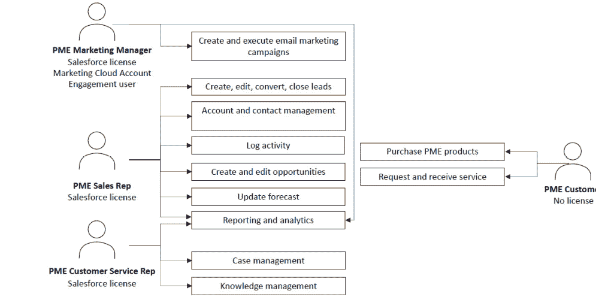

图 4.6 – PME 参与者图

请求中应包含的几个关键附加要素如下：

- 包含您在第 1 章《为您的 Salesforce 项目创建愿景》中创建的愿景。
- 包含您在第 2 章《定义您的 Salesforce 项目的性质》中定义的业务领域能力和假设技术范围。
- 如果您已完成第 2 章《定义您的 Salesforce 项目的性质》中 Org 版本部分中的练习，请包含您认为需要的版本。如果没有，我建议您回去阅读该部分。
- 考虑您可能实际开始功能开发/配置的时间。说明您何时需要多少个许可证——包含您在第 3 章《确定如何交付您的 Salesforce 项目》中创建的路线图。

太好了，您已准备好报价请求并发送给 Salesforce。让我们看看 Salesforce 将如何回应。

### 评估来自 Salesforce 的报价

当您与 Salesforce 的客户执行官和解决方案工程师交谈时，他们会就您甚至尚未考虑的话题提出几个问题。他们使用这些探询性问题来了解哪些产品可能与您的公司相关。

请做好被惊讶和启发的准备。您可能会因所有选项和可能性而感到有点不知所措。在交付方法、项目分阶段和路线图创建方面，保持对迄今为止所做工作的灵感和信任之间的健康平衡。

您可能会发现自己需要更新各种文档以包含一些新功能和新的 Salesforce 产品。

**提示**

当您与实施合作伙伴合作并获得其提出的解决方案和所需许可证时，您可能会发现需要修改所需的许可证。为了确定所需的许可证，请与 Salesforce 和您选择的实施合作伙伴进行对齐通话。

接下来，让我们与实施合作伙伴交谈。

### 与实施合作伙伴合作

在本节中，我们将介绍实施合作伙伴的类型、选择一个合作伙伴的过程、如何与他们沟通、选择时应注意什么以及签约时应注意什么。

### 实施合作伙伴的类型

截至 2022 年 8 月 22 日，Salesforce AppExchange 上有 2,141 家注册咨询公司（https://appexchange.salesforce.com/consulting）提供实施服务。它们从个人经营到全球咨询公司不等。

让我们了解实施合作伙伴类型的差异：

- **全球咨询公司**：这些是主要的咨询、IT 策略和实施公司。按定义，它们涵盖所有类型的 IT 服务和领域。它们是所有最大企业软件公司（Salesforce、Microsoft、SAP、Google 和 AWS）的合作伙伴。它们还提供所有编程语言的定制软件开发服务，并拥有用于应用和系统开发以及托管服务的主要 **离岸** 中心。它们通常利用其规模和离岸中心作为竞争优势。
- **专业公司**：这类实施合作伙伴专注于 Salesforce 实施。它们从小型精品公司到提供战略和变革管理咨询服务以及 Salesforce 项目交付的全功能咨询公司不等。大多数专业公司专注于特定的云和/或行业细分。专业公司作为利基云和/或行业专家脱颖而出。
- **承包商**：这些是更喜欢不签订永久合同的个人。他们通常全职、独家地为一家公司签约 3-6 个月，合同期结束时可能续约。
- **自由职业者**：他们与承包商类似，但与为一家公司独家签约不同，他们可能同时为多个客户工作。
- **Salesforce 专业服务**：Salesforce 的服务部门。与专业公司类似，因为它们仅专注于 Salesforce 实施服务。

让我们看看您如何寻找 Salesforce 项目的实施合作伙伴。

## 选择实施合作伙伴的过程

选择实施合作伙伴的过程涉及一系列步骤——每个步骤都有其自身目的——如以下图表所示，本章后面将对每个步骤进行详细说明：

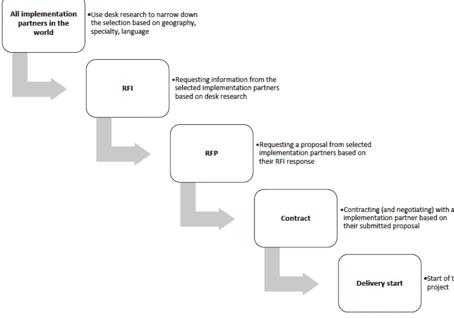

图 4.7 – Salesforce 实施合作伙伴选择过程的高层示例

图 4.7 描述了为您的 Salesforce 项目寻找合适的 Salesforce 实施合作伙伴的漏斗。漏斗最初包含超过 2,000 家潜在实施合作伙伴，然后在每个步骤中逐步减少，直到您与选定的合作伙伴签订合同，交付项目方可开始。

## 重要说明

与采购部门联系以确保选择流程一致。采购流程各不相同，详细的采购流程不在本书的范围内。建议您与采购团队沟通，了解公司的指导方针，并由品类经理/采购经理与您合作，共同完成选择和与所选实施合作伙伴签约的过程。

接下来，让我们探讨与潜在实施合作伙伴接洽的常见做法。

## 向实施合作伙伴请求信息

当您发送 **请求信息（RFI）** 时，您只是请求有关潜在实施合作伙伴的信息。利用 RFI 在不向请求中提供公司全面且敏感信息的情况下对潜在实施合作伙伴进行 *预先资格审查*。然而，为了让实施合作伙伴理解您请求的严肃性和合法性——从而提高获得适当回复的可能性——您应在 RFI 中至少包含以下要素：

- 公司基本信息
- 请求原因
- 所要求的回复截止日期
- 您请求的信息——请尽量简短

为什么在此阶段分享这些信息？这是为了让实施合作伙伴能够内部审核并将请求分配给合适的团队或人员以作出回应。

在收到并比较回复后，就该邀请其中一些参与流程的下一步。

## 向实施合作伙伴请求提案

在对回复您 RFI 的部分实施合作伙伴进行预先资格审查后，让我们继续流程。接下来是发送您的 **请求提案（RFP）**。

### 提示

鉴于许多 RFP 回复包含 50-100 页或幻灯片，建议邀请 *约* 4-7 家潜在实施合作伙伴，具体取决于您对其参与 RFP 的信心。对于大型实施项目，请同时纳入专业和全球咨询公司。

与其空谈，让我们看看 RFP 至少应包含哪些内容，以便实施合作伙伴能够为您提供贵公司可以有效评估的提案：

- **贵公司背景、背景和挑战**：分享您在 *第 1 章，创建您的 Salesforce 项目愿景* 中进行的分析的精简版本。
- **项目性质**：包含您在 *第 2 章，定义您的 Salesforce 项目的性质* 中定义业务领域能力和假设技术范围。突出 **业务用户** 需要从项目中受益的内容，以及最终如何改善 **客户体验**。
- **企业架构指南**：*请咨询贵公司的企业架构师提供此项。*
- **并发项目/计划**：*请咨询贵公司的企业架构师提供此项。*
- **假设交付方法**：包含您计划使用的交付方法的信息、您对其的理解以及选择它的原因。对实施合作伙伴的建议和论点保持开放——许多实施合作伙伴都有交付项目的既定模式。参考 *第 3 章，确定如何交付您的 Salesforce 项目*。
  - 请确保将变更管理和沟通服务纳入提案回复的一部分。
- **关键假设**：您迄今为止所做的关键假设——*参考您的 RAID 日志*。
- **实施合作伙伴背景**：您应请求有关实施合作伙伴在您所在行业以及 Salesforce 项目技术范围内交付的以往项目的信息。
- **提案回复格式**：如果您没有偏好，请说明。采用此方法有利有弊。如果您不指定格式，您可能会被内容淹没；另一方面，您可以感受到参与的实施合作伙伴的工作方式和信息呈现方式。
  - 至少，添加一份说明您要求受邀合作伙伴的提案在其回复中包含的内容的描述，可能包括以下内容：
    - 建议的解决方案架构
    - 所需许可证
    - 实施估算
    - 相关客户参考案例——行业或技术范围
    - 团队结构
    - 项目治理
- 项目价格或拟议角色的费率
- **健康、安全和环境（HSE）信息**：如果您和贵公司认同在至少具备基本 HSE 措施的情况下，人们和团队才能发挥最佳工作水平，您应要求提供支持该主张的信息。请求可能有多种形式，具体取决于您的行业，从对实施合作伙伴如何运营并为员工提供适当工作条件的简单描述，到客观且外部认可的认证，例如来自 **国际标准化组织（ISO）**。
- **法律**：咨询贵公司的法律顾问，以确定您是否可能要求实施合作伙伴在收到您的 RFP 文件前签署 **保密协议（NDA）**。
- **RFP 流程和时间表**：分享以下信息：
  - 提交回复的截止日期
  - 关于 RFP 文件和项目的提问流程
  - 回复提交后的流程
  - 目标签约日期
  - 项目开始的目标日期

## 提示

尽可能坦诚地说明贵公司希望在 Salesforce 项目中解决的业务挑战。您越准确、简洁，RFP 回复的质量就越好。

太好了，您已编制好 RFP 文件并发送给预先资格审查的实施合作伙伴。接下来，让我们看看在评估收到的提案时应强调什么。

## 在合作伙伴中应寻找什么

为您的 Salesforce 项目选择实施合作伙伴可能令人不知所措，不仅仅是因为您需要消化和理解的信息量巨大。常见的采购做法指出，您需要为 RFP 回复定义若干评估标准。这些标准通常包括价格、相关技术专长和公司风险。

除了通常的因素外，我建议您关注以下受邀参与 RFP 流程的实施合作伙伴的特征：

- 哪些实施合作伙伴 *挑战您*，对您的业务挑战提供不同或新的视角，并建议替代技术解决方案或不同的项目分阶段方法？
- *端到端思考*，即使您没有明确要求。例如，如果实施合作伙伴就报告策略或计费、开票和付款流程提出多个问题——只是为了理解最终目标——这是一个很好的迹象，表明他们考虑了您的端到端业务流程。
- *大胆突出风险*并提出缓解措施。有经验的专业人士知道您此类项目常见的风险，并会知道如何建议您继续进行。

让我们看看 PME 从其 RFP 回复中获得了哪些见解。

*PME 选择了四家实施合作伙伴对其 RFP 作出回应。其中一家实施合作伙伴脱颖而出，因为他们解决了 PME 在 RFP 中包含的一些关键假设：*

- *PME 将 Marketing Cloud Account Engagement（Pardot）作为其营销自动化的假设纳入其中，因为据称它是理想的选择*

针对 B2B 公司。然而，一家实施合作伙伴在其回复中提到——由于 PME 的路线图包含电子商务商店——PME 应考虑 Marketing Cloud，因为它可能更适合 Commerce Cloud。

- 中间件：PME 已有现有的中间件解决方案，连接其后端 ERP 系统和当前 CRM 系统。Cary——PME 的技术负责人——假设当前中间件适合现代企业架构。一家实施合作伙伴指出使用旧版中间件存在若干风险——其中之一是它不支持 **事件驱动架构**。

除了解决关键假设外，一家实施合作伙伴还强调了处理客户数据的策略需求。由于 Salesforce 除了核心产品（Sales Cloud 和 Service Cloud）外还提供多个云，多个 Salesforce 云将持有客户信息。管理系统之间客户数据流需要投入精力进行设置——要么利用提供的连接器，要么通过定制集成开发。PME 还可以考虑实施 **客户数据平台 (CDP)**，作为客户主数据管理解决方案。实施合作伙伴建议 PME 与其企业和数据架构师讨论此事。

收到并评估了您 RFP 的回复后，是时候进入签约阶段了。

## 与实施合作伙伴签约

在您付出努力遵循选型流程的步骤后，您希望确保项目在推进过程中不会因任何法律纠纷而受阻。经过仔细思考，您和实施合作伙伴可以使合同成为项目的指路明灯，而非行政负担。

让我们探索一下在此签约阶段您可能会遇到的一些文件：

- **工作说明书 (SoW)**：该合同文件描述了项目或合作中的范围、定价、发票时间表、协作方式以及交付成果的验收方式。
- **采购订单 (PO)**：在签署 SoW 后，您的公司可能会签发一份 PO 并发送给您选择的实施合作伙伴。它用于会计目的，因为实施合作伙伴可以在其根据合同交付工作时开具的发票上列明 PO 号码作为参考。
- **主服务协议 (MSA)**：补充并取代其他合同文件（SoW 和 PO）。
- **条款和条件 (T&Cs)**：您的公司可能有一般性的 T&C，在每次合作基础上很少可协商。您的法律顾问会了解并指导您。

## 重要说明

请与您的采购合作伙伴以及法律顾问联系，以了解贵公司使用的结构。如果贵公司没有内部法律资源，强烈建议您聘请外部律师协助起草 Salesforce 项目的合同并谈判条款。

无论您最终使用哪份法律文件，您 *需要描述*——除了其他法律和商业条款外——下表中所述的元素：

**各合同/合作类型下的典型合同条款描述：**

| 合同/合作类型 | 固定价格项目 | 按时计费 (T&M) 合作 |
|---|---|---|
| 交付方法 | 纯瀑布式。 | 纯敏捷。 |
| 范围（实施合作伙伴有义务交付的内容） | 在业务需求文档 (BRD) 中定义。 | 高层产品愿景。确保分配给商定时间的资源具备适当能力。这可能更详细或更不详细。可以按角色（技术架构师、开发人员、业务分析师）、资历/经验水平划分，或按资源是否在岸或离岸可用划分。 |
| 价格 | 按项目里程碑计价。 | 按资源角色的费率表。 |
| 发票时间表 | 在项目里程碑完成后。 | 按报告的可计费工时每月开具。 |
| 项目管理负责人 | 供应商（实施合作伙伴）。 | 客户。 |
| 协作方式和所需客户资源 | 客户方资源在项目里程碑时可用，以评估、接受或拒绝交付。 | 客户方资源在整个合作期间可用，以提供需求并接受工作交付。 |
| 范围交付的验收标准 | 在 UAT 和上线时：不同严重程度级别下发现的缺陷数量，以及解决时间。 | 工作在冲刺/迭代中持续验收。 |
| 常见附录 | BRD。UAT 和超护理期间缺陷修复的 SLA。 | 不适用。 |

表 4.2 – 各合同类型下的典型合同要素描述

如表 4.2 所强调的那样，必须注意元素描述通常如何根据您选择的交付方法而变化。

## 重要说明

表 4.2 描述了两种纯交付方法。在第 3 章《确定如何交付您的 Salesforce 项目》中，我们深入探讨了这些方法，同时也强调了常见的混合敏捷交付方法。您可能已为 Salesforce 项目选择了某种形式的混合敏捷作为交付方法。如果是这样，请务必相应地考虑并调整合同要素——并确保它们之间不会冲突。

无论您的合同或项目的标题是敏捷、瀑布还是其他名称，请务必与实施合作伙伴保持一致，并请律师了解各方的期望，并对每个要素/条款进行明确描述：固定价格或 T&M、交付、验收、时间线、范围等等。

## 在预开发阶段迭代

如前所述，虽然本书的章节按线性方式排列，但在您准备好与 Salesforce 和您选择的
实施合作伙伴签约之前，您将对这些章节中的活动和决策进行迭代。也许在向高级领导层展示 Salesforce 项目的商业案例时，您没有获得所请求的预算批准，或者商业案例未达到贵公司投资委员会的标准。如果是这种情况，请务必记录原因，以便您知道需要改进或修改的内容。然后，返回第 2 章《定义您的 Salesforce 项目的性质》，重新定义范围，考虑能力之间的依赖关系。

一旦您完成该迭代，请继续进行循环——预开发阶段的章节——更新您的 RAID 日志和商业案例，并再次提交。

## 摘要

在本章中，您已在商业案例中总结了您的 Salesforce 项目，其中包含基于 Salesforce 项目预计收入和成本影响的财务预测。您已确定合作伙伴模式和目标 Salesforce CoE 运营模式，并向高级领导层提交商业案例以确保 Salesforce 项目的资金，并已与 Salesforce 接洽以获取所需许可证的报价，最后，您与实施合作伙伴接洽，经历了选择一个合作伙伴的过程，并与您选择的实施合作伙伴签约。与此同时，在选择实施合作伙伴的同时，您开始通过分配内部和外部资源来建立 Salesforce CoE。

到目前为止，您已为 Salesforce 项目创建了愿景——为什么——以及其性质——是什么。您已确定如何交付 Salesforce 项目——如何——现在您已预测 Salesforce 项目将花费多少以及它将通过增加收入和降低运营成本对贵公司产生的财务影响。

您现在已完成 Salesforce 实施预开发阶段的所有活动。请继续阅读下一章，其中涵盖了预开发阶段应避免的常见问题，并提供检查清单以评估 Salesforce 项目的状态。

## 预开发阶段应避免的常见问题

前几章涵盖了预开发阶段的大量活动：为您的 Salesforce 项目创建愿景、定义业务和技术范围、确定交付方式、构建并展示商业案例以获取资金，以及与 Salesforce 和实施合作伙伴进行互动。

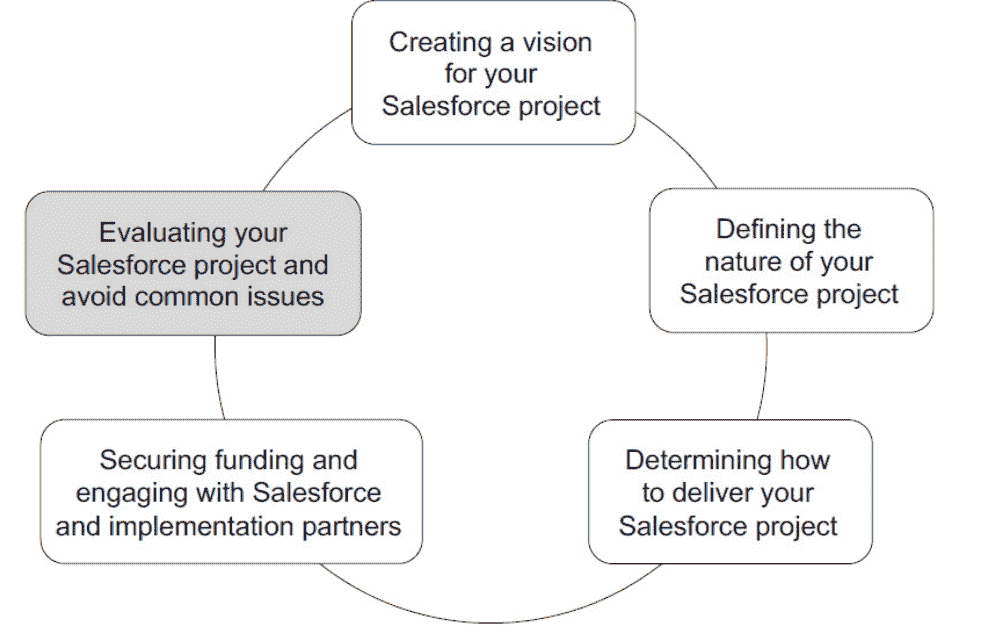

图 5.1 – 预开发阶段的活动

本章将讨论 Salesforce 项目预开发阶段经常遇到的常见问题。我们还将介绍防止或缓解这些问题产生的策略。

您将学习 **根因分析** 来剖析常见问题并能够有效解决它们。章节末尾有一套 **检查清单**，可在您完成预开发阶段时评估您的 Salesforce 项目状态。

本章将涵盖以下主要主题：

- 介绍问题和根因分析
- 预开发阶段的常见问题
- 评估您的 Salesforce 项目状态

让我们开始吧！

### 介绍问题和根因分析

在深入探讨 Salesforce 项目预开发阶段的常见问题之前，让我们先明确一些定义。

在项目管理术语中，**问题** 是未解决风险的体现。此外，未解决的问题会阻止项目最大化其成功潜力。

问题存在潜在原因。**根因分析** 是一种简单有效的方法，用于提出问题可能潜在原因的假设。问题可能是需要解决的更大问题的症状，而不仅仅是缓解症状。

在下一节中，我们将探讨一些最常见的阻碍 Salesforce 项目在预开发阶段推进的问题。对于每个问题，我们将介绍其可能的根因并提供缓解和预防策略。

### 预开发阶段的常见问题及其根因

让我们开始吧。定义明确后，我们现在将查看预开发阶段面临的一些最常见问题，并用 **鱼骨图** 进行了说明：

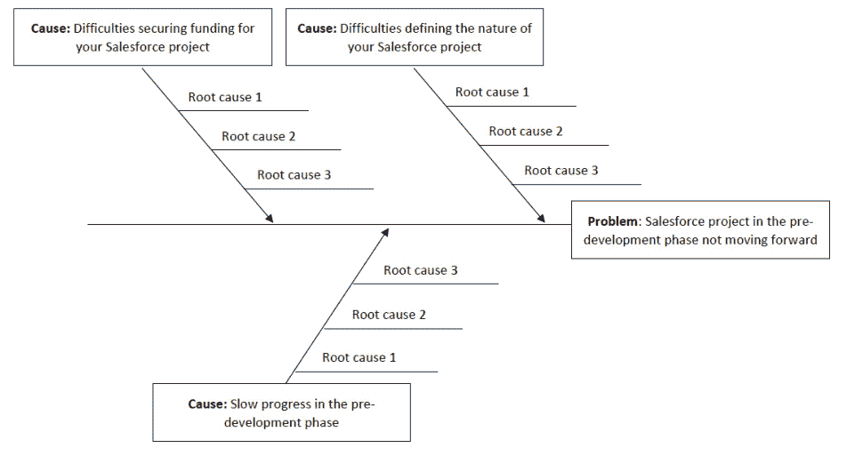

图 5.2 – 预开发阶段常见问题的鱼骨图

接下来，我们将讨论鱼骨图中每个常见问题的可能根因以及缓解和预防策略。

### 为您的 Salesforce 项目获取资金的困难

在下表中，您可以找到导致您在获取资金方面遇到困难的可能根因——以及如果您已面临该问题时的缓解策略。如果您尚未尝试为您的 Salesforce 项目获取资金，您可以阅读以下内容了解需要注意的事项——然后回顾第 4 章，获取资金并与 Salesforce 和实施合作伙伴合作。

| 可能根因 | 缓解和预防策略 |
|---|---|
| 财务影响——投资回报率和回收期——未达到贵公司投资委员会设定的标准 | 考虑更改项目的分阶段。创建范围-地理区域推广矩阵，以可视化 Salesforce 将覆盖哪些地理区域和范围。据此更新您的商业案例——更小、更快的初始实施和推广投资将加快价值实现时间。 |
| 您的商业案例对利益相关者而言不连贯 | 与您的财务业务合作伙伴合作，了解所需格式。 |
| 范围内的业务能力未与战略业务优先事项挂钩 | 您需要与您的执行赞助人合作，了解组织的整体战略。重新审视第 1 章，为您的 Salesforce 项目创建愿景，并推进预开发阶段的活动。 |
| 缺乏执行赞助人的参与 | 认识到拥有积极参与的执行赞助人是 Salesforce 项目成功的先决条件。与您的执行赞助人安排一次会议，并在以下方面重新对齐： - 对 Salesforce 项目愿景的对齐 - 您对执行赞助人在项目中的预期参与 - 讨论您在为 Salesforce 项目获取资金方面面临的挑战——请教如何推进的指导 - 执行提供的指导 |
| 不确定为 KPI 设置什么目标 | 一个经验法则是，如果您是一家中型或大型公司，并且贵公司目前依赖电子表格和电子邮件来管理销售和客户服务职能，那么投资 CRM——在充分考虑和变更管理的前提下——将是一项有益的投资。如果您的项目范围是对现有组织的扩展——例如 Field Service、Commerce、Marketing Cloud 或 CPQ（配置、价格、报价）——您应聘请领域专家或架构师，了解实施此类解决方案时的行业基准改进。 |

表 5.1 – 为您的 Salesforce 项目获取资金困难的可能根因

让我们进入预开发阶段的下一个常见问题。

### 定义您的 Salesforce 项目性质的困难

在表 5.2 中，您可以找到导致您难以定义 Salesforce 项目性质的可能根因——以及如果您已面临该问题时的缓解策略。如果您尚未定义 Salesforce 项目的性质，您可以查看表格了解需要注意的事项——然后回顾第 1 章，为您的 Salesforce 项目创建愿景，以及第 2 章，定义您的 Salesforce 项目的性质。

| 可能根因 | 缓解和预防策略 |
|---|---|
| 项目愿景不明确且内部未对齐 | 重新审视第 1 章，为您的 Salesforce 项目创建愿景，并与您的执行赞助人以及更广泛的业务利益相关者互动，共同创建一致的项目愿景。 |
| 未涉及终端用户 | 重新开始并重置。在 Salesforce 项目的预开发阶段不涉及终端用户是灾难的配方。务必至少听取他们对当前流程的担忧和痛点。将这些纳入项目的范围，并考虑对技术范围和整体商业案例的任何更改。 |
| Salesforce 任务组中技术资源不足以确定假设的技术范围 | 如果贵公司没有内部技术资源，请聘请外部 Salesforce 架构师根据拟纳入范围的业务能力起草假设的技术范围。然后据此更新您的商业案例。 |

表 5.2 – 确定 Salesforce 项目性质困难的可能根因

### 提示！

请咨询您 Salesforce 项目的执行赞助人，了解贵公司内哪些能力被视为战略性能力——并基于您与终端用户研讨会的结果提供您自己的见解。

让我们进入预开发阶段的下一个常见问题。

### 预开发阶段进展缓慢

在表 5.3 中，您可以找到导致您在预开发阶段 Salesforce 项目进展缓慢的可能根因——以及如果您已面临该问题时的缓解策略：

| 可能根因 | 缓解和预防策略 |
|---|---|
| 您在分析第 1 章，为您的 Salesforce 项目创建愿景，以及第 2 章，定义您的 Salesforce 项目的性质时陷入停滞 | 认识到到目前为止所做的分析和决策——虽然重要——但并非最终。保持开放的心态，并在推进过程中更新您的假设。 |
| 您面临基于新信息需要多次迭代的挑战 | 虽然您应根据新的发现和反馈迭代并更新商业案例，但不要让完美阻碍了良好和完成。 |
| 您的项目不是全新实施，而是仅通过另一个云或功能进行扩展 | 在这种情况下，您将更快地迭代预开发阶段的步骤。考虑聘请实施合作伙伴与您一起进行“发现”，以塑造项目愿景、目标、范围和商业案例。虽然这当然是一个选项，但这种方法在内部组织对齐和明确的项目组合管理框架建立后效果最佳。 |

> 我们将在第12章《演进您的Salesforce组织和DevOps能力》中讨论项目管理与持续改进。

表5.3 – 预开发阶段进展缓慢的可能根本原因

接下来，让我们评估您的Salesforce项目。

## 评估您的Salesforce项目的状态

我们已在本Salesforce项目预开发阶段涵盖了许多主题、领域和活动。其目的是使您能够交付成功的Salesforce项目。

如果您的项目似乎陷入停滞，或您对进展不满意，以下部分将帮助您评估Salesforce项目的状态。对于您无法勾选的每项，请返回相应的章节并完成活动以继续推进您的Salesforce项目。

## 预开发阶段Salesforce项目的检查清单

在预开发阶段开始时，您已完成以下基础步骤：

- 为您的Salesforce项目聘请了一位高层赞助人
- 创建了一个Salesforce工作组来推动预开发阶段的活动

接下来，您已完成以下活动以了解公司战略状况：

- 了解公司组织结构
- 了解您的客户是谁
- 了解公司销售的产品和服务
- 了解公司的竞争状况
- 了解*为何现在*是开展Salesforce项目的正确时机
- 为您的Salesforce项目创建了*愿景*——与高层赞助人和关键利益相关者保持一致

接下来，您已完成以下活动以定义Salesforce项目的性质：

- 了解范围内的业务能力
  - 人、流程、系统和数据
- 涉及终端用户
- 设想未来能力
- 确定高层技术范围
  - 已包含技术使能和非功能性需求
- 开始构建您的**风险、假设、问题和决策** (**RAID**) 日志

接下来，您已完成以下活动以决定如何交付您的Salesforce项目：

- 了解您是在准备Salesforce项目还是项目群
- 选择了Salesforce项目的交付方法
  - 如果是混合方法，您已阐述并描述了如何定义您的方法
- 考虑了项目分阶段方法（地理和范围）
- 确定了变更管理和沟通策略
  - 考虑了变更影响程度
  - 考虑了变更管理活动的时机
- 设想了您的Salesforce **卓越中心 (CoE)**
  - 创建了章程
  - 确定了CoE的结构和职责
  - 为您的Salesforce项目群创建了路线图

接下来，您已完成以下步骤以确保Salesforce项目的资金：

- 定义了KPI及其目标
- 创建了财务预测
  - 估算了收入影响
  - 估算了成本影响
    - 运营成本
    - 许可成本
    - 实施和推广
- 确定了Salesforce CoE运营模式
- 计算了Salesforce项目的**损益 (P&L)** 预测、ROI和投资回收期
- 向高级管理层提交了Salesforce项目商业案例

在为项目获得资金后，您已执行以下操作：

- 向Salesforce请求报价
- 定义了选择实施合作伙伴的流程
- 评估并选择了实施合作伙伴
- 与实施合作伙伴签订合同
- 在合同中明确各方职责时保持谨慎
- 建立了Salesforce CoE

在预开发阶段之旅的每个章节中，您可能发现自己需要进行迭代。退一步，改变一些要素，然后继续前进。

## 总结

在本章中，您已通过清单评估了Salesforce项目在预开发阶段的状态。您还熟悉了预开发阶段常见的常见问题，并学习了如何减轻或防止其出现。

在您的Salesforce项目状况良好后，您已准备好进入旅程的下一步，即开发阶段，从*第6章*、*详细说明初始版本的范围和设计*开始，在那里我们将共同创建您的业务流程、编写用户故事，并为您的初始Salesforce版本创建解决方案设计。

## 第2部分：开发阶段

本部分将教您如何进一步定义Salesforce项目的范围并了解其解决方案设计。我们还将带您了解开发流程和测试活动，并讨论常见问题，以便您可以避免或减轻它们。

本部分包含以下章节：

- *第6章*，详细说明初始版本的范围和设计
- *第7章*，构建和测试初始版本
- *第8章*，开发阶段应避免的常见问题

## 详细说明初始版本的范围和设计

在*第1部分，预开发阶段*中您所做的艰苦工作之后，本Salesforce项目**开发阶段**的第一章将指导您完成关键活动和里程碑。接下来，我们将介绍如何将您在预开发阶段定义的高层范围分解为**用户故事**。然后，我们将介绍如何确定适当的前期架构水平，以及应创建哪些**Salesforce架构制品**。最后，我们将讨论如何理解用户故事解决方案设计并说明您的**目标解决方案架构**。

本章提供了创建用户故事的最佳实践，以最大化开发适合您业务的*正确*解决方案的机会。我们描述了您应在Salesforce项目开发阶段及以后创建和维护的解决方案设计制品！

在本章中，我们将涵盖以下主要主题：

- Salesforce项目开发阶段概述
- 详细说明初始版本的范围
- 为初始版本创建解决方案设计

让我们开始吧！

## Salesforce项目开发阶段概述

本阶段是架构师、业务分析师、项目经理、Scrum Master和开发人员最熟悉的Salesforce项目阶段。重点在于详细说明需求、设计解决方案并构建和测试它们。

让我们来看看该阶段的里程碑。

## 开发阶段的关键活动和里程碑

该阶段始于**项目启动会**，项目经理、业务领导、架构师和项目赞助人向此时入职的项目团队成员介绍项目愿景和性质。

在项目启动会后，开发阶段的下一个关键里程碑如下：

- 详细说明您的版本范围
- 完成您版本的解决方案设计

注意

达到前两个里程碑的活动有时被称为**准备阶段**，因为项目正在准备开始构建解决方案。

- 建立团队的开发流程
- 完成您版本的构建和测试
- 创建您的数据迁移计划
- 详细说明初始推广、培训和变更管理计划

提示

如果您为项目选择了纯敏捷交付方法，您将在*第12章*、*演进您的Salesforce组织和DevOps能力*中找到设置灵感。

在确定了开发阶段整体里程碑和活动*是什么*之后，让我们看看您的开发阶段可能需要*多长时间*。

## 开发阶段的持续时间

根据以下主要因素，Salesforce项目的开发阶段可能需要*从几周到数月*不等的时间来完成：

- 您的Salesforce项目的范围
- 您选择的交付方法：
  - **纯敏捷**：您将在功能开发完成后按需将工作软件发布到生产环境
  - **纯瀑布**：您在项目结束时部署版本，当版本通过用户验收测试后
  - **混合**：您可能会按照纯敏捷或纯瀑布交付方法进行发布
- 分配和可用的资源：
  - **业务资源**：这包括一位专职的**产品负责人 (PO)** 来负责和收集需求，并验证功能交付。PO的可用性、投入度、经验和能力对项目都有重大影响。
  - **技术资源**：这些是架构师、功能Salesforce顾问、Salesforce开发人员和QA专家（测试人员），以及可能需要对与Salesforce集成的系统进行更改的其他技术资源。所需资源可用性的协调和时机是优化项目交付的关键任务。

### 提示

除非你的项目是绿地实施——意味着这是贵公司首次使用 Salesforce——对于大型项目（例如新的云产品如 Field Service 或主要产品如 CPQ），你应将*限制准备阶段*最多控制在几个月内，以确保需求输入和目标流程仍然相关。

为了简洁起见，本书本节将聚焦于*混合敏捷交付方法*，其中在开始构建阶段之前会进行一些活动来详细说明 Salesforce 项目的范围并创建前期架构。

### 重要说明

项目启动后的里程碑和活动将以冲刺（纯敏捷）、阶段（瀑布）或混合（混合敏捷）的形式进行。

为重温差异，请参阅*第 3.2 图*，位于*第 3 章*，*确定如何交付您的 Salesforce 项目*。

让我们看看谁将监督你的 Salesforce 项目。

## 在开发阶段中你的 Salesforce CoE 的角色

回顾你在预开发阶段被鼓励建立的*Salesforce 任务组*，它推动相关活动。它包括贵公司三个关键领域的资源：业务、技术和项目管理办公室。*你*很可能隶属于其中一个职能部门。

你的 Salesforce 任务组已确定项目范围内的能力和 Salesforce 云产品——并为至少初始版本 secured 预算。你的 Salesforce 任务组还与实施合作伙伴签约，以支持交付初始版本。

在预开发阶段之后，你的 Salesforce 任务组不应被解散，而应演变为你的 Salesforce **卓越中心 (CoE)**。你的 Salesforce CoE 成员非常适合*管理初始版本的交付*。

在*第 3 章*，*确定如何交付您的 Salesforce 项目*中，你设想了 Salesforce CoE 的结构和职责。现在是执行并建立它的时机。

在混合交付方法中，下一步活动是将业务能力分解为更小的待办事项，以便你的实施合作伙伴的开发人员和功能顾问可以消费并交付可工作的解决方案。

## 详细说明初始版本的范围

你项目的下一步工作是将愿景和能力——业务流程——转化为产品待办事项。将业务能力分解为更小的待办事项需要你通过一系列研讨会让 Salesforce 解决方案的终端用户参与其中。

在*第 3 章*，*确定如何交付您的 Salesforce 项目*中，我们讨论了三种可选择的整体交付方法——*纯瀑布*、*混合敏捷*和*纯敏捷*。

由于本节涵盖混合敏捷交付方法，让我们考虑为开发做准备的活动：

- 做出努力建立基础架构，包括但不限于确定 Salesforce 组织策略、集成、数据迁移、数据备份和归档以及报告策略，以及开发和环境策略
- 详细说明项目范围内的业务流程（客户和用户旅程），并为其创建解决方案设计

### 提示

在混合敏捷中——在建立基础架构之后——你可以选择详细说明项目范围内的所有流程——以及解决方案和估算。或者，你可以决定详细说明足够数量的待办事项以填满最初几个冲刺，并与冲刺开发团队同时，投入资源在并行的设计流中进行持续的待办事项细化。

让我们开始详细说明贵公司未来的业务流程。

## 共同创建未来的业务流程

你可能还记得第 2 章《定义你的 Salesforce 项目的性质》中的活动，在那里你主持了研讨会以确定当前能力、其流程以及利益相关者的当前痛点和建议。

而那些研讨会的目的是确定和理解当前流程，开发阶段研讨会的目的是创建由 Salesforce 支持的未来流程。

为初始版本范围内的每项能力——流程——计划并主持研讨会。回顾第 2 章《定义你的 Salesforce 项目的性质》中提出的研讨会结构，但请遵循以下建议议程：

- **欢迎和介绍：** 主持人欢迎参与者并介绍议程和目标，参与者进行自我介绍：
- **研讨会目标**：分享你在*第 1 章，创建你的 Salesforce 项目愿景*中制定的愿景声明
  - 你正在寻求参与者宝贵的意见来塑造贵公司未来的 CRM 系统
- **练习**：将整体研讨会目标分解为较小的练习，并在适当休息之间进行：
  - **第一个练习**：回顾你在*第 2 章，定义你的 Salesforce 项目的性质*中定义的当前流程，并回顾痛点和改进建议：
    - 这种方法本身就很有价值——此外还有助于创造紧迫感并激发变革欲望
  - **第二个练习**：是时候从零开始并开始共同创建未来流程了。这可能会令人望而生畏——作为一个团队盯着空白画布。以下是一些帮助你入门的方法：
    - 通过简要讨论流程起点之前发生了什么以及终点之后会发生什么，来确定整体业务流程的开始和结束。
    - 说明流程中的总体阶段：例如，创建、分配、执行和执行后。
    - 通过确定哪些**角色**参与业务流程来创建**泳道**——你可以使用为当前流程确定的角色。

### 提示

牢记研讨会的目标和重点，并引导参与者避免陷入对每个流程步骤细节的过度分析。

- 如前所述，请对*变化*给予*极大关注*。如果你的解决方案将被多个区域和/或业务线使用，请务必在实际可行的情况下纳入每个区域的利益相关者——如果 Salesforce 项目的目标是统一业务流程。

### 提示

在设计研讨会之前，确保与你的实施合作伙伴保持一致，以确定各方的角色和职责，从而最大化研讨会的产出。如果你正在与实施合作伙伴合作，他们应该能够提供经验丰富的业务分析师和/或架构师来主持和推动研讨会。

根据 Salesforce 项目范围内的业务能力的范围和性质，经验丰富的**Salesforce 业务分析师**可能足以支持你的业务利益相关者共同创建由 Salesforce 支持的未来业务流程。对于绿地实施以及更复杂的实施，请务必在研讨会中纳入**Salesforce 解决方案架构师**。他们的意见和经验将确保所提出的流程从 Salesforce 角度来看是合理的。

让我们看看每次研讨会后的下一步。

## 撰写用户故事

在每次研讨会后，你的产品负责人或实施合作伙伴将使用共同创建的未来业务流程为每个史诗或业务流程创建待办事项，也称为**用户故事**。

用户故事应是一句易于理解的句子，描述——从*用户*的角度——他们*想要*能够做什么以及*为什么*。让我们分解一下：

- **角色**：他们可能是业务流程的一部分的内部或外部人员：
  - 内部角色示例：特定职能的员工
  - 外部角色示例：客户、合作伙伴或供应商
- **需求**：角色在流程步骤中想要能够做什么？
- **目的**：这实现了什么业务成果？
- 请注意，目的应与项目的整体业务目标相联系。用户故事的*目的*不仅仅是为了能够进入业务流程的下一步。

应为业务流程中的每个步骤编写用户故事。

撰写用户故事时应注意以下几点：

- 它们不应使用 Salesforce 特定的语言编写，而应与技术和系统无关
- 它们应关注业务需求、问题和期望的业务成果，而不应描述期望的解决方案

遵循上述建议将确保实施合作伙伴的专家顾问为你的业务寻找最佳解决方案。

### 重要说明

确保为您的 Salesforce 解决方案的每个领域分配一名 PO 负责。如果单个业务利益相关者不能代表解决方案范围内的所有业务领域，您可以考虑任命一人负责所有领域，或分配多名 PO 负责不同领域。对此决策保持警惕，因为您需要指定一名 **首席 PO**，以便在两个 PO 的需求相互矛盾或重叠时做出最终决策。

## 审查和详细化用户故事

您的 PO *审查所有用户故事* 负责的业务流程。

虽然研讨会的目的是确保该能力的端到端业务流程健全、精简且合乎逻辑，并且能够推动良好的用户和客户体验，但此阶段的目标是确保每个用户故事的细节和上下文保持一致并得到记录。因此，PO 应执行以下操作：

- **审查** 拟议用户故事的 *用户*、*需求* 和 *目的*，并进行必要的修改。
- 添加 **进一步的上下文**，帮助其他业务利益相关者从流程步骤中角色的视角理解情况。这可能包括额外的描述、文档、屏幕截图、列表或其他媒体。
- 虽然在纯敏捷中可能并非严格必需，但向用户故事添加 *简短且简单* 的 **验收标准** 语句强烈建议，原因有三：
  - 它使每个用户故事都能与 Salesforce 项目中包含的史诗的预期业务成果相联系。
  - 它为其他业务利益相关者提供了用户故事范围的清晰度——以及不在范围内的内容。如果它不是验收标准的一部分，就不在范围内。
- 它指导实施合作伙伴的解决方案架构师和开发人员了解用户故事的预期结果。

拥有您的 PO——以及可能更广泛的业务利益相关者群体——审查和详细化用户故事的价值丰富：

- **整合流程所有权：** 拥有负责业务流程的专职 PO 至关重要。这是一个先决条件，特别是如果您当前的业务流程存在差异，并且作为 Salesforce 项目的一部分，您的未来流程需要在地理区域和业务线之间实现协调。
- **通过“左移”降低成本：** 尽早确保业务一致性和清晰度将为您节省资金——相反，您在开发管道中越晚修复问题，成本就越高：
  - 如果某项功能在 UAT 阶段后期被拒绝，或者更糟糕的是，在生产环境中未被终端用户采用，由于将功能推过管道所涉及的步骤和人员（规范、解决方案设计、测试和部署），纠正它将产生巨大的成本。
- **将变更管理嵌入开发流程：**
  - 在流程共同创建研讨会以及验证验收标准时招募和参与变革推动者，是持续为变更管理奠定基础的绝佳策略
  - 尽早且经常地纳入终端用户，可以减少在后期阶段（如 UAT 和培训）中的变更管理工作和压力
  - 与前一点密切相关，验收标准在汇总后可以形成用户验收测试的基础

### 提示

在合适的工具中捕获用户故事。**Atlassian JIRA** 和 **Microsoft Azure DevOps** 是 Salesforce 项目中最常用的工具。还存在更简单的替代方案，包括 **Trello**，尽管其功能和对企业 Salesforce 项目的适用性较少。

对敏捷或混合敏捷方法论经验较少的组织通常难以从传统瀑布项目转变思维习惯。习惯于创建庞大的 **业务需求文档** 与创建带验收标准的用户故事有根本不同。

虽然大多数项目团队成员在经过一段时间和实践——以及实施合作伙伴的指导——后会掌握它，但投资培训课程或自主学习可以加速流程并提供更高质量的用户故事、更好的解决方案和采用率。

### 提示

如需更多信息，您可以参考 Srini Munagavalasa 所著的 *Salesforce 业务分析师手册* (https://www.amazon.com/Salesforce-Business-Analyst-Handbook-techniques/dp/1801813426)。

在用户故事被审查和详细化后，让我们开始进行解决方案设计。

## 为初始版本创建解决方案设计

为业务流程创建的用户故事共同定义了 Salesforce 项目的范围。尽管每个用户故事的解决方案共同构成了您的技术解决方案，但在开始开发之前，您仍会受益于在一定程度上 *考虑整体和端到端架构*。

让我们开始查看作为项目一部分——以及项目之外——您应创建和维护的架构工件和组件！

## 了解 Salesforce 架构工件

管理解决方案的文档是 Salesforce CoE 的关键职责。

虽然文档组件的来源可能是您的实施合作伙伴，但确保解决方案文档可供使用、最新且对预期受众——业务和技术利益相关者——都易于理解，是 Salesforce CoE 的责任。

让我们来看看 Salesforce 解决方案的关键工件：

- **业务能力图**：您在 *第 2 章，定义您的 Salesforce 项目的性质* 中创建了此图，但情况可能自那时以来发生了变化，因此请继续更新您的业务能力图以反映 Salesforce 项目的范围。此图将向受众介绍解决方案的整体范围。
- **业务流程图**：您已在本章的 *共同创建您的未来业务流程* 部分中制作了这些图。
- **角色和许可图**：显示哪些角色（人物角色）将使用或与您的 Salesforce 解决方案交互。突出显示哪些角色是内部的，哪些是外部的，以及他们的用户将拥有的 Salesforce 用户许可。
- **目标系统架构**：此图说明了 Salesforce 内使用的 Salesforce 云和 AppExchange 应用，以及至关重要的是，Salesforce 如何连接到企业系统架构中的其他系统。解决方案范围内的每个接口都应标记，以及方向。
- **集成**：为了补充系统架构图，您应有一张表描述解决方案范围内的集成，包括以下内容：
  - **方向**：每个接口的源系统和目标系统是什么，或者它是否是双向接口。
  - **层**：集成是数据、流程还是虚拟集成。
  - **时序**：集成是同步的（阻塞）还是异步的（非阻塞或排队）。
  - **模式**：集成的模式。**远程过程调用即发即弃 (RPI-FF)**、**批数据同步 (BDS)** 和 **数据虚拟化 (DV)** 是 Salesforce 平台上的标准集成模式示例。
  - **身份验证**：每个接口将如何获得访问目标系统的权限。
  - **数据模型**：您需要批判性地创建和维护 Salesforce 解决方案的数据模型。数据模型是 Salesforce 解决方案中使用的对象和字段的图形表示。许多对象和字段随您的 Salesforce 许可 **开箱即用 (OOTB)** 提供，但您将使用自己的自定义字段扩展该数据模型，很可能还有一些自定义对象：
    - **对象列表**：为了补充您的数据模型，维护一个详细说明每个对象用途的对象列表是良好的做法。对每个对象包括以下属性：对象名称、标准/自定义、对象将保存的实体、记录类型、记录所有者、组织范围默认（内部和外部）以及容量估算。
    - **数据安全矩阵**：说明每个对象、配置文件和角色的权限（读取、创建、编辑和删除）。
    - **数据字典**：创建和维护解决方案中使用的所有字段的字典是良好的做法。您的数据字典对集成架构师和开发人员以及业务用户都很有价值，后者在创建报表时会发现它很有用。

- **共享模型：** 您应描述将使用哪些机制为合适的用户授予对正确记录的正确访问权限。**角色层级**是共享模型不可或缺的一部分，并辅以大量共享数据的选项。
- **数据备份和归档：** 您现在就考虑并决定如何在需要恢复时备份 Salesforce 中的数据——以及计划使用何种工具来实现——未来会受益。确定按对象的数据归档策略和方法也应在此时完成，以防止意外超出存储限制。
- **环境和开发策略：** 环境概览图应描述在解决方案的开发和部署中将使用哪些 Salesforce 开发环境（沙盒），以及在环境之间迁移元数据和数据所使用的工具。

创建部分架构制品的输入是您共同创建未来流程的工作坊的输出，但确定架构的其他方面需要与技术和业务利益相关者混合进行的单独工作坊。这些方面包括系统架构、集成、共享模型、环境和开发策略。

Tip!

深入了解简要描述的技术架构制品，您应阅读由 Salesforce **认证技术架构师 (CTA)** Tameem Bahri 所著的 *成为 Salesforce 认证技术架构师* 书籍。

如果贵公司已有绘图框架，请使用它。如果没有，您可以自行使用 Salesforce 的绘图框架 (https://architect.salesforce.com/diagrams#framework) 或要求您的实施合作伙伴采用它。

Tip

Salesforce 为许多 Salesforce 云数据模型和 **行业参考架构模板** 提供了模板，可免费在 **LucidChart** 或 MS PowerPoint 格式中使用，网址为 https://architect.salesforce.com/diagrams#design-patterns。

让我们继续讨论为您的 Salesforce 项目建立何种程度的 *初始* 架构是合理的。

## 确定适当的预先架构级别

如果您选择混合敏捷作为 Salesforce 项目的交付方法，您需要做出一个关键决策：

> “我的项目在开始开发前应分配多少精力来架构我的 Salesforce 解决方案？”

您需要考虑 *两个层级* 的解决方案设计：我们在前几节中描述的整体技术架构，以及用户故事层级。您应期望您的实施合作伙伴在两个层级都提供解决方案设计。

让我们直接来看一下预先创建架构的一些好处：

- 确保端到端架构具有凝聚力和全面性，并建立 *技术基础* 以确保您的 Salesforce 解决方案安全、高性能且可扩展
- 识别可以主动处理和缓解的技术问题和差距
- 指导开发团队并提供 guard rails
- 通过更高的 **冲刺效率** 提高 **开发速度**，因为团队成员无需在冲刺中花费时间创建解决方案设计

如果您在开始开发前不建立任何架构，您就不会获得这些好处——更关键的是，您不会知道差距和风险，因此在构建解决方案时可以预期会遇到许多障碍。

您 Salesforce 项目准备阶段的目标是建立利益相关者的一致性，并为开发团队创建足够多的 **架构跑道** 以便开始冲刺。

## 重要说明

您应期望您的实施合作伙伴就针对您特定项目预先确定何种程度的架构提出建议。您与实施合作伙伴的合同可能会描述项目应如何交付，因此请确保双方就应遵循的方法论及其含义达成一致。

让我们继续讨论下一个层级的解决方案设计。

## 创建用户故事解决方案设计

在您与实施合作伙伴合作编写用户故事并确保验收标准使其能够为其提出解决方案后，您的实施合作伙伴可以开始为用户故事提供解决方案设计。

正如我们在 *详细说明初始版本的范围* 部分提到的，您可以选择在前期将所有业务流程拆分为用户故事，或拥有一个持续为开发团队准备用户故事的设计流。

最佳方法取决于多个因素，包括您 Salesforce 项目范围的广度——不同业务能力的数量、您组织对 Salesforce 的熟悉程度，以及因此其表述和详细说明用户故事并理解所提议的 Salesforce 解决方案的能力。

作为 *粗略* 的经验法则，如果在预开发阶段，您的解决方案最初估计需要不到 5 个冲刺（10 周）由一个小型开发团队构建，您可以考虑将所有业务流程拆分为用户故事，并在开始开发前提出解决方案并进行估算。如果您选择这样做，您仍应注意在开始构建解决方案时某些事情可能会发生变化——您的产品负责人可能会受到启发或收到最终用户的新的输入。

## 评估用户故事解决方案设计

您的实施合作伙伴应为您的用户故事提出解决方案设计。

本节将为您提供方法，以便在无需任何技术能力的情况下理解、反思和质疑所提议的解决方案设计。

对于任何用户故事——以及整体业务流程——在选择解决方案时应考虑以下因素：

- 1. 该功能是否可通过您当前的许可证开箱即用（OOTB）获得？
- 2. 调查 **AppExchange** 上是否存在免费解决方案。
- 3. 购买。这里您可能有两个选项：
  - 1. 检查是否可通过 Salesforce 附加产品获得解决方案：
    > 这样，您将受益于进一步的增强，并能够随平台一起成长，而无需持续投资以确保一致性（和回归测试）
  - 2. 调查可用的付费 AppExchange 产品。
- 4. 构建自己的解决方案：
  - 1. 首先，调查 **配置解决方案**（无代码）在多大程度上可以满足需求。Salesforce 以其广泛的无代码能力为傲，您应预期绝大多数所提议的解决方案都是配置：
    如果用户故事只能部分通过配置解决方案解决，请与产品负责人一起考虑是否可以调整用户故事及其验收标准以允许配置解决方案
  - 2. 接下来，考虑 **自定义解决方案**（代码）：
    虽然并非总是如此，但通常自定义解决方案需要更多精力、成本更高且需要更多维护。因此，您应仅将自定义解决方案作为最后的手段考虑。

评估解决方案设计的另一个关键方面是其所需的 **维护** 的总体水平。如果您选择详细说明所有用户故事并为其提出解决方案设计，您可以——*并且应该*——现在就评估所提议解决方案所需的维护。如果您计划持续完善开发的产品待办事项，所需维护的水平是一个因素，您可以通过为 Salesforce 项目建立正确的治理机制在一定程度上加以影响。我们将在 *第 7 章，构建和测试您的初始版本* 中更详细地介绍这一点。

Tip

请要求您的实施合作伙伴为每个用户故事的所提议解决方案指定所需的维护。汇总此信息并将其与您的初始假设和目标 Salesforce CoE 运营模式进行比较。

除此之外，你可以计算一个有形的指标来了解所提议的整体解决方案的定制程度。通过用户故事的数量汇总提出定制化解决方案（代码）的百分比——了解你的实施合作伙伴计划对 5%、10% 或 20%+ 的用户故事使用程序化开发，在开发工作量和所需维护方面会产生巨大差异。随着解决方案设计过程的继续，跟踪这一指标。

让我们看看我们案例公司 **Packt Manufacturing Equipment (PME)** 的 Salesforce 解决方案中拟议用户故事解决方案类型的划分：

| 解决方案类型 | 用户故事数量 | 占总用户故事的比例 |
|---|---|---|
| 配置 | 109 | 84% |
| 数据 | 7 | 5% |
| 定制化 | 13 | 10% |
| 合计 | 129 | 100% |

表 6.1 – PME 拟议用户故事解决方案类型的划分

在 PME 的 Salesforce 项目准备阶段，PME 及其实施合作伙伴的项目成员已决定在启动开发阶段之前提前拆分所有用户故事。PME 的领导层希望确保明确的目标解决方案架构得以建立并得到评估。他们还认为——根据实施合作伙伴的反馈——项目范围可以在四个开发冲刺内交付。

项目团队一直在记录每个用户故事所提议的解决方案类型，并创建了表 6.1 中呈现的汇总。

分析划分的原因，他们得出了以下见解：

- **配置**：这包括利用开箱即用功能的解决方案，以及提议免费 AppExchange 解决方案的方案，以及使用声明式工具构建功能的解决方案，包括 **Salesforce Flows**。
- **数据**：Salesforce 平台功能的某些部分依赖于数据，而非 **元数据** 来创建解决方案。对于 PME 而言，这些包括 **Products**、**Price Books** 和 **Price Book Entries**。
- **定制化**：尽管 PME 有意对其集成需求（**Enhanced External Services** 和 **Platform Events**）采用声明式解决方案，但仍需要一些定制化解决方案，包括 **email-to-case handler**（**Apex class**）。

如果你发现为你的 Salesforce 项目拟议的解决方案中很大一部分是程序化解决方案，你应该挑战你的实施合作伙伴和你的 Salesforce PO：

*定制化用户故事是否可以稍作修改以允许更多配置解决方案？*

## 说明你的整合解决方案架构

为了以项目利益相关者能够理解的抽象级别传达你的未来 Salesforce 解决方案，你应该为你的 Salesforce 项目创建 **目标解决方案架构图**（并维护）。该图有时被称为 **功能架构图**，但本质上是同一件事。虽然你的系统景观图看起来相似，但解决方案架构图增加了更多上下文，包括关键对象、以及 Salesforce 的关键功能和产品。

让我们在下图中查看 PME 的目标解决方案架构：

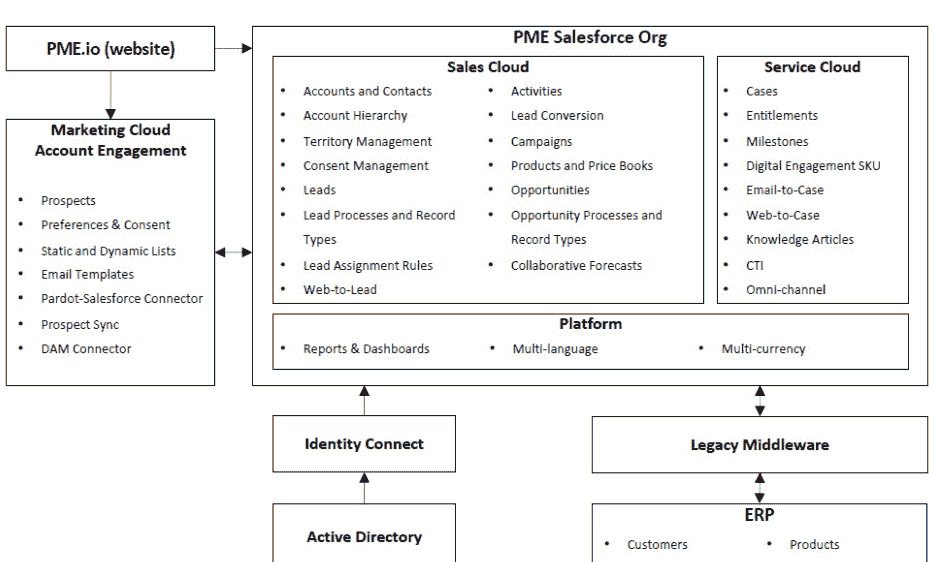

图 6.1 – PME 的目标解决方案架构

PME 目标解决方案侧重于 **Salesforce Sales Cloud、Service Cloud** 和 **Marketing Cloud Account Engagement**（以前以 **Pardot** 营销）。该解决方案利用开箱即用功能，仅对有限的关键功能进行定制。该解决方案通过 **Web-to-Case** 与 PME 的网站集成，允许客户通过填写表单创建案例。除 Web-to-Case 外，PME 还将利用 Pardot 表单从其网站收集潜在客户。

尽管 PME 的实施合作伙伴提议使用新的现代中间件，例如 **Mulesoft**，但 PME 的领导层表示不会将其作为初始 Salesforce 实施的一部分。他们意识到这需要在某个时候完成，并决定将其列入路线图。

为了使用户管理高效，PME 将配置并集成 Salesforce **Identity Connect** 以集中配置和取消配置用户并管理其访问权限。

## 总结

在本章中，你取得了很大进展。你了解了 Salesforce 项目开发阶段的关键里程碑和活动。接下来，你学习了如何将业务流程分解为具有验收标准的用户故事。然后，你了解了对 Salesforce 项目至关重要的 Salesforce 架构制品。最后，你学习了如何评估和解释用户故事的拟议解决方案并说明你的目标解决方案架构。

现在你已经为 Salesforce 项目建立了基础架构跑道和解决方案设计，可以继续进行 Salesforce 实施的下一章，第 7 章，*Building and Testing Your Initial Release*。

## 构建和测试你的初始发布

在本章中，我们将介绍如何构建和测试你的 Salesforce 解决方案以进行初始发布。我们将介绍你的解决方案在底层包含的内容、可用的 Salesforce 开发模型和沙盒。然后我们将描述敏捷团队角色、敏捷仪式的重要性以及如何有效地管理你的开发流程。我们将介绍你可以并且应该考虑建立的治理机制，以指导你的 Salesforce 项目及其过程中可能发生的变更。我们将描述你在开发阶段应熟悉的各种测试类型。最后，我们将介绍创建数据迁移计划的步骤。

你将了解 Salesforce 开发生命周期以及如何组织由内部和外部成员组成的敏捷团队，如何促进敏捷仪式，以及如何管理 Salesforce 项目的交付。你还将学习如何区分 Salesforce 解决方案的不同测试类型。然后，我们将讨论衡量进展的方法。最后，你将学习如何为数据迁移规划执行尽职调查。

我们将跟随 **Packt Manufacturing Equipment (PME)** 的 Salesforce CoE，它监督并与公司的实施合作伙伴协作。

在本章中，我们将介绍以下主要主题：

- 了解团队成员的角色和职责
- 规划你的构建阶段
- 设置你的开发模型和环境
- 建立你的开发流程
- 在开发阶段管理你的 Salesforce 项目

## 准备你的数据迁移计划

开始吧！

## 了解团队成员的角色和职责

团队中的人将决定你的 Salesforce 项目成败。确保你投入资源使角色和职责明确，流程得到优化以尽可能有效地交付价值，并且你拥有学习和成长的心态以持续改进你的设置。

在上一章中，业务分析师和架构师与你的业务和技术利益相关者互动，将 Salesforce 项目的整体范围分解为用户故事并创建解决方案设计制品。

在本章中，我们将介绍一种混合敏捷交付方法，并且由于我们处于开发阶段，我们将更深入地探讨其敏捷方面。

你将开始配置和开发你的 Salesforce 解决方案。根据你选择的交付方法，一些项目成员可能尚未入职——但他们即将入职。

让我们先来看看常见的 Salesforce 项目和敏捷团队成员角色及其主要职责：

- **产品负责人 (PO)：**
  - 拥有并管理其敏捷团队的待办事项列表，并在冲刺计划前对待办事项列表进行优先级排序。PO 还负责

从业务角度的利益相关者管理和发布管理。

- 负责回答功能顾问和开发人员的提问，以对用户故事提供澄清和进一步细节。
- 负责根据验收标准验证已开发的用户故事。
- 负责在产品演示中（与业务分析师一起）汇总利益相关者的反馈，创建用户故事，并将决策传达回利益相关者。

## 提示
如果您计划以冲刺方式进行开发——这是本章的底层假设——请确保您分配一名 *胜任且有权力的产品负责人* 在整个项目期间持续在敏捷开发团队中工作。您的产品负责人对于积压工作细化和验证开发团队开发的用户故事至关重要。

## The scrum master:
- 促进敏捷仪式并指导团队成员理解其角色和职责、流程、敏捷仪式和价值观。
- 移除障碍和阻碍，或在团队内部无法解决时升级问题。
- 应努力保护开发团队免受会议和行政工作的干扰，以便他们专注于构建解决方案。
- 这通常是由您的实施合作伙伴履行的角色。许多实施合作伙伴都有其遵循的开发方法——因此，让他们配备 Scrum Master 角色是有意义的。如果您与实施合作伙伴的合同中包含任何固定价格和按时交付的方面，则该角色必须为外部角色以确保问责。

### The development team:
这由执行重要低层解决方案设计、开发、测试和用户故事部署的人员组成。开发团队的每个成员可以根据其技能组合以及您的 Salesforce 项目的性质和范围承担一个或多个职责。以下是在您的 Salesforce 项目开发团队中会找到的一些常见角色和职责：

### The functional consultant:
- 负责在 Salesforce 平台上开发声明式解决方案（点按式）。
- 可能精通一个或多个 Salesforce 产品或 CRM 的子领域。没有功能顾问精通所有云，因此请确保您的团队拥有与您的 Salesforce 项目范围相匹配的相关知识和经验。
- 这通常是由您的实施合作伙伴履行的角色，但如果您拥有具备 Salesforce 声明式开发技能的内部资源，您可以选择将他们纳入敏捷团队。再次注意您与实施合作伙伴合同中的规定。

### The developer:
- 负责在 Salesforce 平台上开发程序化（代码）解决方案。
- 可能精通一个或多个 Salesforce 产品和/或编程语言。开发人员精通所有产品和技术的情况并不常见。例如，作为 Marketing Cloud 开发人员，编码 AMPscript 与在核心平台上编码 Apex 并构建 **Lightning web components**（LWC）大不相同。请确保您的开发人员拥有与您的 Salesforce 项目范围相匹配的相关知识和经验。
- 这通常是由您的实施合作伙伴履行的角色，但如果您拥有具备合适开发技能的内部资源，您可以选择将他们纳入敏捷团队，同时注意您与实施合作伙伴的合同。

In a *Scrum* 模式下，产品负责人、Scrum Master 和开发团队 *共同负责* 确保架构健全且解决方案质量高、无缺陷，并负责发布、监控以及支持变更和采用。

然而，对于企业项目——包括 Salesforce 项目——在您的 Salesforce 项目的开发和推广阶段，将以下专业角色作为项目的一部分至关重要：

### The Salesforce architect:
- 在混合敏捷交付方法中，您会分配时间和精力来创建一定程度的前期解决方案架构。常见的情况是，情况和需求发生变化或假设被证明不正确。在任何这些情况下，让一个或多个架构师（解决方案架构师和/或技术架构师）提供支持，帮助开发团队提出替代或新的解决方案 *确保速度和与目标架构的一致性*。
- 根据您的 Salesforce 项目（或项目组合）的规模，架构师可能部分或完全分配到您的项目，但通常不需要完全分配到单个敏捷团队。

### The business analyst (BA):
- 在开发阶段，业务分析师与您的产品负责人合作完善用户故事并使它们 **准备好进行开发**。就绪的定义通常包括用户故事角色、需求、目的、额外背景和支持文档，以及至关重要的验收标准。根据您前期架构的程度和用户故事解决方案设计的水平，您的流程可能涉及业务分析师将用户故事分配给解决方案或技术架构师，在用户故事满足就绪定义之前提供解决方案设计。
- BA 的角色有时由开发团队中的功能顾问承担，因为他们——典型地——更“以业务为导向”，因此更适合与产品负责人和其他业务利益相关者互动，以支持他们创建用户故事。

## 重要说明
许多功能顾问也可以担任出色的业务分析师。但并非总是如此。与您的实施合作伙伴合作，确保您的敏捷团队拥有扎实的业务分析技能，因为业务分析师在您的 Salesforce 项目的成功中发挥着关键作用。

## The quality assurance (QA) specialist (tester):
- 质量保证专家负责 *根据验收标准测试用户故事*。他们通过根据用户故事的验收标准编写正向和负向测试用例并执行测试用例来评估其是否通过或失败来实现这一点。
- 质量保证专家（或大型项目中的测试经理）将设计您 Salesforce 项目的整体测试策略和测试制度。
- 经验丰富的质量保证专家也是 *试图破坏解决方案* 和流程的专家，这正是您希望他们在开发阶段所做的。您希望在开发阶段尽早了解风险并识别 **缺陷**（错误），以便现在修复，而不是在 **用户验收测试（UAT）** 中，或更糟的是在生产环境中，从而影响生产力、危及采用，最终影响您在 Salesforce 上的投资价值。

### The change manager:
- 变更经理将与您的敏捷团队、架构师、业务利益相关者和项目发起人合作，共同创建 *特定上下文的变更管理策略和计划*。我们将在 *第 10 章、沟通、培训和支持以推动采用* 中介绍变更管理规划的具体内容。

### The project manager (PM):
- 项目经理负责您 Salesforce 项目的整体交付。这包括确保项目中及时提供充足的资源、管理问题、减轻风险、报告项目进展以及管理您的 Salesforce 项目的预算。
- 当您与实施合作伙伴合作时，拥有内部客户方项目经理与实施合作伙伴的项目经理合作是有益的。
- 根据您 Salesforce 项目的规模和敏捷团队数量：
  - Scrum Master 和项目经理角色可能由实施合作伙伴的一名人员担任。
  - 实施合作伙伴的 **客户经理** 可能成为项目组织的一部分以与您的

内部项目领导和赞助商需规划超出当前实施项目的范围，担任风险和问题的升级联系点，并负责管理商业关系和合同。

接下来，让我们讨论如何规划开发。

## 规划你的构建阶段

在纯敏捷交付方法论中，团队会持续规划工作——要么在冲刺计划（Scrum）中进行，要么在新的用户故事满足 **就绪定义** 且有能力承接时直接开始新工作（Kanban）。

然而，由于你选择了某种混合敏捷交付方法论，你可能希望对构建阶段的预计持续时间有一个大致了解——既用于预算，也用于推广计划。

在本节中，我们将讨论各种 **估算开发工作量** 方法的优缺点，以及如何规划开发。

让我们来看两种估算工作量的方法：

- **以时间格式估算开发工作量：**
  - 在上一章中，你将整体范围分解为用户故事并为每个故事提供了解决方案。如果没有，请回头审阅此流程。
  - 要知道总的预计开发工时，你需要让每个用户故事都按 *开发类型*（配置、数据和定制）进行估算（时间：小时）。本质上，为了使估算具有一定准确性从而可用于规划，每个用户故事在估算前都需要完成解决方案设计。
  - 一旦所有故事都估算完毕，你按史诗汇总估算，然后再按主题/领域汇总所有史诗以得知总数。
  - 需要注意的是，在此阶段，估算仅仅是估算。只有在故事或冲刺完成时，你才会知道实际花费了多长时间。

### 重要提示

在开发阶段汇总估算工作量——从而估算成本时，有时超过了 Salesforce 项目的原始预算。这通常并非因为实施合作伙伴试图压榨你。通常是因为顾问提出问题并挖掘出在范围详细化之前你尚未意识到的需求、规则、例外情况、边界情况和使能条件。

### 故事点：

- 故事点与以时间格式估算截然不同。用户故事的故事点 *描述了敏捷团队为细化、设计、开发、测试、部署和发布该用户故事所期望的总工作量、复杂性、风险和不确定性的混合*。正如你所见，故事点概念远远超出了以用户故事开发时间为重点的工时估算模型。
- 故事点的一个关键方面是它们 *相对于敏捷团队共同工作的历史*。这也意味着在前期为所有用户故事分配故事点并不是有意义的练习。
- 故事点通常在冲刺计划中分配给用户故事。我们将在 *从敏捷仪式中最大化价值* 部分稍后回到这一点。
- 使用故事点适用于前期较少投入进行用户故事级解决方案设计的项目。

在估算完你的开发工作量后，让我们继续创建你的开发计划。

## 起草你的临时开发计划

假设你有项目的预算和截止日期，你需要一个开发计划来了解如何遵守它们。

一旦你对每个用户故事进行了估算，从而对每个史诗进行了估算，你需要考虑可用的开发能力。这是指你的功能顾问和开发人员可用于开发任务的时间。你需要关注按开发类型划分的开发估算。接下来，你需要考虑敏捷仪式和可能的待办事项列表细化的时间——尽管这些会议很重要——但时间不可用于开发。两者之间的差异称为冲刺效率，通常在 50% 到 70% 之间，具体取决于你选择的交付方法论，以及前期用户故事定义、详细化和提供解决方案的程度。

### 提示

作为一般经验法则，你不应填满超过 ~85% 的敏捷开发团队的净开发冲刺能力（在应用冲刺效率后）。原因是在冲刺过程中——当你看到解决方案成形时——你会被启发去做更多事情，或修改在研讨会上看起来合理但最终对用户并不理想的流程。

如果项目中可用的开发能力（资源）与总估算工作量或时间表不匹配，你有三个选择：

- *优先考虑* Salesforce 解决方案初始版本范围内的用户故事。
- 与实施合作伙伴合作 *寻找替代方案*——为某些用户故事提供更手动的解决方案选项。
- *增加预算*，通过分配额外的开发资源来按初始时间表交付项目。增加开发资源仍能带来额外能力的上限取决于项目的性质、范围（领域数量）以及开发设置的复杂程度。我们将在下一节介绍开发模型和流程。或者，你也可以考虑延长构建阶段以交付范围。

在确定了范围和可用的开发能力后，你就可以通过考虑依赖关系，按冲刺分配史诗来创建你的临时开发计划。

让我们来看一个示例公司 PME 的案例：

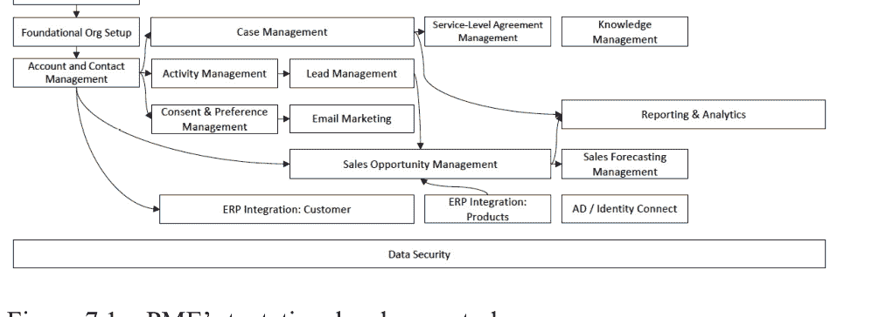

图 7.1 – PME 的临时开发计划

*PME 的开发计划在功能史诗和技术使能之间存在依赖关系。除了功能范围外，在实际开发开始之前，还需要建立开始开发的技术基础。这包括为开发管道设置技术工具、创建开发环境（沙盒），以及为开发团队和产品负责人创建用户和测试用户。*

在创建完开发计划后，让我们设置你的开发生命周期和部署流程。

## 设置你的开发模型和环境

**开发模型**和环境是你的**部署模型**的一部分。部署意味着将解决方案的技术组件从一个环境移动到另一个环境，最终移动到生产环境。你使用不同的环境——**沙盒**——在开发生命周期中执行不同类型的测试。其目的是确保解决方案在到达生产环境时端到端按预期工作。

让我们开始深入了解 Salesforce 的内部结构。

## 了解你的 Salesforce 解决方案的组件

Salesforce 提供的产品，如 Sales Cloud 和 Service Cloud，是基于云的 **软件即服务（SaaS）** 产品。这意味着你的 Salesforce 组织——取决于你购买的许可证——附带标准对象和标准字段 **开箱即用（OOTB）**。

Salesforce 也是一个 **平台即服务（PaaS）**，这意味着你可以在 Salesforce 内扩展、增强、配置和定制 OOTB 组件以适应你的业务需求和流程。这包括创建自定义对象和字段及自动化，配置和定制 **用户界面（UI）**。你也可以使用 Salesforce 平台构建自定义应用和集成。能够快速配置和定制 Salesforce 以适应你的业务需求的配置和定制能力，是 Salesforce 成为强大平台的原因之一。

为了更好地理解解决方案的配置和定制，我们需要了解核心 Salesforce 平台的底层架构，该架构基于 **模型-视图-控制器（MVC）** 架构。

让我们通过一些示例更深入地了解 MVC 的构成：

|  | 模型（数据结构） | 视图（UI） | 控制器（逻辑） |
|---|---|---|---|
| 开箱即用组件 | 标准对象、标准字段和标准选择列表值 | 标准应用、默认页面布局和 Lightning 记录页面 | 标准重复/匹配规则和线索转换 |
| 配置组件（无代码） | 自定义对象和自定义字段（包括关系字段）、自定义元数据类型和自定义设置 | 自定义应用、页面布局、Lightning 记录页面和屏幕流 | 业务逻辑：流程、流程构建器（正在淘汰）和工作流规则（正在淘汰） 集成：连接器、带外发消息的流程和增强型外部服务 |
| 自定义组件（低代码/专业代码） |  | LWC、Visualforce（VF）页面、Aura 组件、Canvas 应用和 iFrame | 业务逻辑：Apex 触发器、Apex 类和 Salesforce 函数 集成：平台事件， |

|  |  |  |  |
|---|---|---|---|
|  |  |  | 增强的外部服务、Web 服务、OData 和标准 API |
| AppExchange 组件 | 可由配置和定制 MVC 组件的组合构成 |  |  |

表 7.1 – Salesforce 解决方案的 MVC 组件

在了解了构成 Salesforce 解决方案的技术组件后，让我们看看为您开发和部署解决方案有哪些选项。

## 介绍 Salesforce 中的开发模型

开发模型是将解决方案通过环境迁移的方法，您可以使用不同的模型，每个模型都有其自身的考虑因素。

下表比较了可用的 Salesforce 开发模型：

| 开发模型 | 真实来源 | 发布制品和部署方法 | 复杂性、灵活性和可扩展性水平 |
|---|---|---|---|
| 手动部署 | Salesforce 生产组织 | 手动重新创建配置 | 极低 |
| 变更集开发模型 | Salesforce 生产组织 | 使用变更集部署的元数据 | 低 |
| 组织开发模型 | Salesforce 生产组织或源代码控制仓库（如果使用） | 使用 Salesforce CLI 或其他 DevOps 工具（见下一个提示框）部署元数据的 .zip 文件 | 中等 |
| 模块化基于包的开发模型 | 源代码控制仓库 | 包含一组逻辑组件以支持用户组功能的未锁定包，通过安装未锁定包的最新版本进行部署 | 高 |

表 7.2 – Salesforce 开发模型比较

您应已与实施合作伙伴共同做出关于 Salesforce 项目使用哪种开发模型的审慎决定。

## 提示

若干 **商用现成 (COTS)** DevOps 或 CI/CD 工具可用于完成大部分繁重工作并提供有关最常见部署错误的有用见解。一些最受欢迎的产品包括 *Gearset*、*Copado*、*Salto* 和 *AutoRABIT*。请自行研究并评估在项目生命周期的这个阶段 DevOps 工具是否对您的 Salesforce 项目有益。

关于开发模型和 DevOps 工具的决策需要考虑谁将在解决方案的初始发布 *之后* 管理您的 Salesforce 组织和持续改进。如果您计划自行管理 Salesforce 组织，所选的开发模型应与可用资源的胜任能力——或计划的培训和赋能——保持一致。

让我们看看在 Salesforce 中进行开发和测试时应考虑的环境。

## 了解 Salesforce 沙盒

创建 Salesforce 沙盒时，您是在创建 Salesforce 生产环境的副本。您也可以克隆沙盒并以这种方式创建新的沙盒。

如果您的 Salesforce 程序/项目遵循基于组织的开发模型或基于包的开发模型，您应使用版本控制仓库作为真实来源，从中将元数据迁移到新的沙盒。

您需要使用沙盒将开发和测试环境彼此分离并与生产环境分离。您绝不应在生产环境中开发，因为损坏的功能的影响可能会影响业务运营、损坏您的数据并危及安全合规性。

您需要为开发和不同类型的测试提供单独的环境——确定使用哪些沙盒被称为您的 **环境策略**。

让我们看看我们的示例公司 PME 的沙盒设置和部署流程，该公司有多个开发流，多个团队在 Salesforce 解决方案上工作：

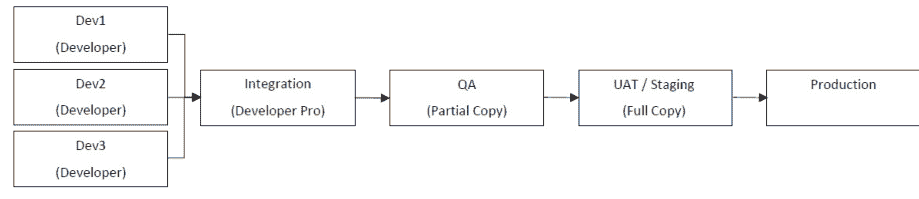

图 7.2 – PME 的沙盒设置

让我们在下表中查看可用 Salesforce 沙盒类型之间的主要差异：

| 沙盒 | 完整沙盒 | 部分复制沙盒 | 开发者专业版沙盒 | 开发者沙盒 |
|---|---|---|---|---|
| 适用用途 | 系统集成测试 (SIT)、UAT、批量数据、性能或负载测试、预发布和培训 | QA、SIT、UAT 和培训 | 开发和 QA | 开发和 QA |
| 刷新时包含 | 元数据和所有数据 | 元数据和示例数据 | 元数据 | 元数据 |
| 可用存储 | 与生产环境相同 | 数据：5 GB 文件：与生产环境相同 | 数据：1 GB 文件：1 GB | 数据：200 MB 文件：200 MB |
| 沙盒模板 | 可用 | 必需 | 不可用 | 不可用 |
| 刷新间隔 | 29 天 | 5 天 | 1 天 | 1 天 |
| 按 Salesforce 净支出百分比计算的成本 – 每增加一个沙盒 | 30% | 20% | 5% | 不适用 |

## 表 7.3 – Salesforce 沙盒类型概览

您可用的不同沙盒类型数量取决于 Salesforce 组织的版本。您可以购买额外的沙盒。
请参阅 *按类型划分的沙盒许可和存储限制* **Salesforce 帮助** 文章，网址为 https://help.salesforce.com/s/articleView?id=sf.data_sandbox_environments.htm&type=5。

如果您使用基于组织的开发模型或基于包的开发模型进行开发，您可以选择使用 **scratch orgs**。它们是基于配置文件创建的短暂（1-30 天）开发环境。与使用传统的 Salesforce 沙盒相比，使用 scratch orgs 需要更高级的技能。

## 提示

您可以通过访问 Trail 混合 *架构师之旅：开发生命周期和部署* 页面了解更多关于 Salesforce 开发模型和环境的信息，网址为 https://trailhead.salesforce.com/users/strailhead/trailmixes/architect-dev-lifecycle-and-deployment。

您可以在 *Salesforce DX 开发者指南* 文档中了解更多关于 scratch orgs 的信息，网址为 https://developer.salesforce.com/docs/atlas.en-us.sfdx_dev.meta/sfdx_dev/sfdx_dev_develop.htm。

在确定开发模型并设置沙盒后，让我们转向您的开发流程。

## 建立您的开发流程

开发流程的关键组件之一是 **sprint**。sprint 是 **Scrum** 中使用的术语，用来描述预定义的时间段，目标是在此期间开发可工作的软件。我们已经提到，sprint 的持续时间并非一成不变——可以决定其持续 1-4 周。让我们看看在确定 sprint 持续时间时应考虑什么：

- 在 sprint 期间用户故事是否需要细化？
  - *如果需要*，这将占用开发时间。采用较短（1-2 周）的 sprint 持续时间将使预期 sprint 效率超出合理范围，因为细化和敏捷仪式带来的开销大于可用于开发的时间。如果您需要持续的待办事项列表细化会议，请增加 sprint 持续时间。
  - *如果不需要*，也就是说您已提前细化并提供用户故事的解决方案，那么您可以选择较短的 sprint 持续时间，不过在构建初始版本时不建议采用 1 周的 sprint 持续时间。

## 重要说明

人们普遍误以为敏捷比瀑布需要更少的纪律。恰恰相反：运行纯敏捷设置需要巨大的纪律、明确定义的流程以及共同认可的就绪和完成定义。在瀑布模型中——在项目的任何一个阶段——只有一个总体任务，例如设计解决方案。在纯敏捷中，您的团队需要经历整个开发生命周期（或大部分）从用户故事创建、设计、构建、部署、测试到验证。由于许多步骤由不同的团队成员执行，需要高度的纪律来确保顺畅的交接和清晰的流程。运行纯敏捷设置的好处也与团队的综合经验、敏捷成熟度和纪律直接相关。

让我们更详细地深入开发流程。

## 从敏捷仪式中最大化价值

为了充分利用你的敏捷仪式，你首先需要对它们的性质、目的和价值有扎实的理解。

让我们来看看敏捷仪式：

- **冲刺计划：** 冲刺计划的目标是拥有一个 *已承诺的冲刺待办事项* 的用户故事以及一个表述清晰的冲刺目标。
- 在冲刺计划之前，产品负责人应对待办事项清单进行排序——这有时会与业务分析师一起在 **待办事项细化会议** 中完成。
- 冲刺计划的典型议程如下：
  - 审查冲刺的团队产能：
    - 如果你使用时间格式估算用户故事，请考虑开发团队的可用资源并考虑冲刺效率。
    - 如果你使用故事点，也要考虑可用资源，并根据之前的冲刺速度调整冲刺的目标故事点。对于第一次冲刺，这很棘手，因为没有历史记录：在[content]
## 从敏捷仪式中最大化价值

为了充分利用你的敏捷仪式，你首先需要对它们的性质、目的和价值有扎实的理解。

让我们来看看敏捷仪式：

- **冲刺计划：** 冲刺计划的目标是拥有一个 *已承诺的冲刺待办事项* 的用户故事以及一个表述清晰的冲刺目标。
- 在冲刺计划之前，产品负责人应对待办事项清单进行排序——这有时会与业务分析师一起在 **待办事项细化会议** 中完成。
- 冲刺计划的典型议程如下：
  - 审查冲刺的团队产能：
    - 如果你使用时间格式估算用户故事，请考虑开发团队的可用资源并考虑冲刺效率。
    - 如果你使用故事点，也要考虑可用资源，并根据之前的冲刺速度调整冲刺的目标故事点。对于第一次冲刺，这很棘手，因为没有历史记录：在处理用户故事时请依赖开发团队的评估。
  - 接下来，产品负责人一次呈现一个用户故事，开发团队提出澄清问题。

### 提示

你可能需要也可能不需要用户故事满足你的就绪定义才能使其有资格参与冲刺计划——并且能够被拉入冲刺。如果允许这样做，请确保产品负责人、业务分析师和架构师在冲刺开始时分配时间来使它们为开发做好准备。

- 开发团队将用户故事拉入冲刺待办事项清单，直到开发团队的产能满足为止。
- 如果你使用时间格式估算用户故事，当拉入冲刺的用户故事的累计总和达到团队在冲刺中的产能时，产能即满足。
- 如果你使用故事点方法，团队成员使用 **故事点扑克** 为用户故事提供估算，其中使用斐波那契数列中的数字。如果估算接近，团队可以轻松就故事的故事点达成一致并继续下一个用户故事。如果估算差异很大，估算高和低的团队成员会说明其估算的理由。这是一个很好的方式来确保团队成员对用户故事有共同的理解，并可能发现对所有成员来说并不明显复杂性。团队就故事的故事点达成一致并继续。

### 提示

对于虚拟故事点扑克，https://www.scrumpoker-online.org 是一个很棒的在线工具。

- 当团队的故事点产能满足时，被拉入冲刺的故事即被承诺。
- **每日站会**：这是一个简短（~15分钟）的会议，通常每天早上举行，每个敏捷团队成员回答三个简单问题：我昨天做了什么来推进冲刺目标，我今天计划做什么来推进冲刺目标，以及什么阻碍在阻止我？
- 每日站会 *不是项目状态会议*，也不是解决阻塞问题的会议。已识别的行动应在站会后离线执行。
- **冲刺回顾（演示）**：冲刺回顾是你的敏捷团队向更广泛的利益相关者展示本冲刺完成工作的会议。冲刺回顾有两个主要目的：
  - 向选定的终端用户（变革推动者）展示你的解决方案，从而在开发阶段嵌入变革管理。
  - 获取对解决方案的反馈，可以评估并可能纳入后续冲刺。这为冲刺回顾的参与者创造了归属感——为他们在推出时充当你解决方案的大使奠定了坚实的基础。

### 提示

理想情况下，敏捷团队的产品负责人主导冲刺回顾，演示开发的内容，并对参与者的反馈作出回应。这将确保解决方案所有权清晰，并使其逐渐为你的产品负责人和你的公司所内化。

虽然整合参与者反馈可能是你的实施合作伙伴的责任，但你的产品负责人最终负责确定每个反馈项的优先级并将决策传达回利益相关者。

- **冲刺回顾**：在本次会议中，敏捷团队成员、产品负责人、Scrum Master 和开发团队评估过去的冲刺进行得如何，以及他们可以在持续改进的精神下做出哪些改进来优化开发流程。
- 它由 Scrum Master 促进，Scrum Master 还负责确保在冲刺回顾中商定的行动得到执行。

让我们看看冲刺之前和期间用户故事的流程。

## 管理你的看板

你敏捷团队如何管理用户故事的流程对冲刺速度有很大影响。你的敏捷团队成员应了解你的开发流程，以及至关重要的交接方式。

让我们看看看板可以如何设置（你 Salesforce 项目的具体配置将根据你选择的交付方法而有所不同）：

图 7.3 – 看板列示例

一个新用户故事将从产品待办事项清单列开始。你的产品负责人将与业务分析师一起处理用户故事，使其达到就绪定义。这再次取决于你选择的交付方法，但应满足以下标准：

- 用户故事包含角色、需求和目的且完整。
- 提供了额外的上下文和支持文档。
- 已定义验收标准。
- 在某些开发流程中，用户故事还必须提供解决方案设计并由设计负责人批准。我们将在 *开发阶段管理你的 Salesforce 项目* 部分更详细地介绍这一点。

当用户故事满足你的就绪定义时，你的产品负责人将其移至 **就绪** 列。故事已准备好进行冲刺计划。

用户故事在冲刺计划期间被拉入 **冲刺待办事项清单** 列。随着冲刺开始，开发团队会挑选顶部的用户故事并将其移至 **开发** 列。每个开发团队 *成员* 在同一时间只能有一个用户故事在开发中。

### 提示

虽然实际的 Salesforce 配置和开发不在本书范围内，但还有几本很棒的书籍涵盖了这些主题，包括 Enrico Murro 的 *使用 Salesforce 进行低代码应用开发*（https://www.amazon.co.uk/Hands-Low-Code-Application-Development-Salesforce/dp/1800209770）。

如果开发团队成员被阻止完成用户故事的开发，他们应将其移至 **阻塞** 列并通过在用户故事上写评论通知 Scrum Master。Scrum Master 将优先解决阻塞问题。

### 提示

为了最大限度地降低用户故事变得陈旧或过时的风险，并减少因依赖关系而导致的等待时间，你应力求让用户故事在开发中（在看板列的冲刺待办事项清单右侧）的停留时间尽可能短。确保这一点的方法是让所有敏捷团队成员从看板 *右侧* 开始处理分配给他们的用户故事。例如，你的产品负责人应 *优先* 验证用户故事并将其移至 **已完成** 列 *之前* 再专注于使用户故事为开发做好准备。同样，开发人员应 *优先* 处理质量保证专家发现的缺陷 *之前* 再开始新用户故事的开发。

当用户故事开发完成并部署到 QA 沙盒时，开发团队成员将用户故事移至 **测试** 列并在用户故事上写下评论，让质量保证专家知道它

准备好进行测试，并附带任何具体说明。在某些情况下，用户故事的开发人员需要提供测试脚本。

测试通过后，QA 专家会将用户 story 移至 **Validating** 列，供产品负责人（PO）根据验收标准验证用户故事。如果用户故事未通过测试，QA 专家将创建缺陷问题描述失败原因，然后将用户故事移回 Development 并重新分配给开发人员以修复问题。

当用户故事由 PO 验证后，PO 将把用户故事移至 Done。

## 重要说明

本章描述了在构建 Salesforce 解决方案初始版本时的用户故事流程——您尚未将其部署并发布到生产环境供用户使用。我们将在 *第 9 章*、*部署您的发布并将数据迁移到生产环境* 中介绍该流程。

初始版本在生产环境上线后，您将进入持续改进阶段，持续开发和部署用户故事。在这种设置下，您完成的定义将包括比本章所述更多的步骤。我们将在 *第 12 章*、*发展您的 Salesforce 组织和 DevOps 能力* 中更详细地讨论这一点。

接下来，让我们看看如何在开发阶段管理您的 Salesforce 项目。

## 在开发阶段管理您的 Salesforce 项目

在 Salesforce 项目的开发阶段有很多事情在发生，全面理解并获得概览可能会让人不堪重负。您在构建和测试初始版本中的责任很简单：

创建环境、结构和流程，以最大化开发团队的高质量价值产出。

在高层次上，您希望确保您的敏捷开发团队是：

- **建设正确的事情**：这意味着确保您的 Salesforce 解决方案将：
  - 得到终端用户的认可并被使用
  - 满足您在商业案例中设定的目标和财务指标
- **高效**：这涉及确保您的敏捷开发团队以尽可能高效的方式构建解决方案：
  - **价值**：产出 x 质量
  - **成本效益高**

在以下章节中，我们将分解这在实践中意味着什么。

## Salesforce 项目治理

实际上，您需要在 Salesforce 项目中管理的两个关键治理方面是：

- Salesforce 项目 *交付治理*
- Salesforce *平台治理*

为了按照这些方面交付您的 Salesforce 项目，您应考虑建立以下治理机制：

- **设计授权 (DA)**：在此论坛中，来自开发团队成员或架构师的拟议解决方案设计会持续审查，以确保引入到您的 Salesforce 组织中的解决方案与目标解决方案架构一致，遵守您定义的开发标准，并遵循声明式和编程式开发与架构的通用最佳实践。
- DA 的参与者：
  - DA 有许多配置，但需要注意的关键是它不仅仅是一次技术会议。您的 PO(s) 参与介绍用户故事（或新史诗）的背景至关重要。
  - 技术架构师和解决方案架构师应参与审查拟议的解决方案设计，并向开发团队提供反馈和改进设计的建议。
- DA 的重点：
  - DA 应从基于风险的角度关注拟议的解决方案，其中包括以下解决方案组件：
  - 代码
  - 数据模型变更
  - 安全和数据共享
  - 复杂自动化
  - 集成

DA 应注意汇总拟议解决方案的定制程度。

- **变更控制委员会：** 随着您在开发阶段进行冲刺，您将更熟悉您的 Salesforce 解决方案。您的 PO 很可能会受到启发，并希望在原计划范围之外添加额外功能。为了管理这一流程（在固定价格/固定范围项目中很常见），您可以建立变更控制委员会来处理和管理开发阶段的变更请求。
- 应设定变更控制委员会应参与的变更级别的阈值：
  - **小变更：** 授权您的敏捷团队管理这些
  - **中等变更：** 可能根据其对项目时间线和风险的影响将这些提交给变更控制委员会
  - **大变更：** 这些本质上会影响项目时间线，必须提交给变更控制委员会
- 建议参与者：PO、项目发起人、PM 和 Salesforce 架构师
- **指导委员会：** 这是项目的最高升级点。指导委员会对项目负责，并通过为 PM 和架构师提供指导和支持来执行此职责。它定期（每两周或每月）召开会议执行以下工作：
  - 跟踪开发进度和状态与计划的对比
  - 跟踪项目支出与预算的对比
  - 处理问题并降低风险

## 重要说明

请将开发团队成员与此次项目会议隔离。

## 重要说明

您 Salesforce 项目的最优交付治理 *配置* 取决于 Salesforce 项目的性质和范围以及敏捷团队的数量。如果您有多个团队或流，您应考虑遵循更先进的 **规模化敏捷框架** (**SAFe**) 配置之一。

让我们更深入地探讨测试您的 Salesforce 解决方案。

## 管理您的 Salesforce 解决方案的质量

您的实施合作伙伴可能负责其交付的解决方案的质量，但贵公司最终对要求公司用户、客户和合作伙伴使用和交互的解决方案负责。因此，了解关键的测试和质量保证方法非常重要。

让我们回顾一下您需要了解的 Salesforce 中的两种测试类型：

- **用户故事测试** (**功能测试**)：这是一种常用的手动测试方法，其中单个功能（或用户故事）被测试以确保其按预期工作。测试人员应确保正向和负向测试用例都能证明解决方案有效。我们在本章中 *管理您的看板* 部分之前已描述了详细信息——应为每个配置或开发的功能执行此操作。
- **单元测试：** 这是 Salesforce 强制执行的测试类型，要求每次部署（带代码）至少有 75% 的测试覆盖率。但它也可以——并且应该——用于测试业务关键流程，例如线索记录创建、联系人记录创建和线索转换。为配置功能创建测试类的前期工作量远远超过在 UAT 或生产环境中修复关键流程故障的痛苦。

## 重要说明

您和您的实施合作伙伴可以并且应该执行许多其他类型的测试，包括 SIT、**性能测试** 和 **负载测试**。然而，它们超出了本书的范围。如果您想更深入地了解软件测试的迷人世界，**ISTQB** 和 **TMAP** 是两种最广泛使用的测试框架。对于大型 Salesforce 项目，贵组织投资建立测试自动化可能是值得的。与 Salesforce 架构师合作，调查使用 **Provar** 或 **Selenium** 等工具的可能性。

在开发阶段结束时，或在推广阶段开始时，您将进行 UAT，以确保更大群体的预期终端用户在发布到生产环境之前测试并接受您的 Salesforce 解决方案。我们将在 _第 9 章_、_部署您的发布并将数据迁移到生产环境_ 中介绍这一点。

## 提示

随着您在 Salesforce 项目的各个阶段推进，您可能会遇到阻力并收到反馈。虽然重要的是 _认真对待反馈——可能做出必要的更改——_ 并尝试了解阻力的根本原因，但同样重要的是您也要 _坚定信念_ 于 Salesforce 项目的愿景，并相信您在项目预开发阶段的努力和分析。

让我们看看跟踪 Salesforce 解决方案开发进度的不同方式。

## 在开发阶段衡量进度

之前，您已估算了 Salesforce 解决方案范围的开发工作量。为了了解进展情况，请使用以下关键报告和 KPI：

- **燃尽图**：显示冲刺范围剩余的故事点或工时。
- **版本报告**：预测产品待办事项列表中剩余用户故事的完成日期。对于您的 Salesforce 项目而言，要使版本报告有意义，您需要对所有用户故事进行估算（使用故事点或工时）。支持敏捷开发流程的工具会根据团队的交付一致性提供最佳情况和最坏情况的预测。
- **冲刺速度**：根据您的估算方法，您可以通过以下方式衡量冲刺速度：
  - 冲刺中完成的故事点的总和。
  - 冲刺中完成的故事的估算开发工时的总和。
- **增加的范围**：虽然增加的范围可能有价值，但它会降低效率，并增加项目按时交付的风险。您需要了解并管理增加范围的两个层面：
  - **新范围**：为了管理范围蔓延并提高开发效率，跟踪添加到产品待办事项列表中的 *新用户故事* 的数量（和估算）是个好主意。
  - **冲刺后期范围**：在 *冲刺计划之后* 添加到冲刺待办事项列表中的用户故事未在冲刺计划中讨论，因此开发团队成员无法评估并承诺交付它们。更糟糕的是，开发团队需要花费时间来了解用户故事的内容以及如何解决它们。

### 重要提示

虽然试图让开发团队成员“工作更快或更聪明”以在更短时间内交付更多成果很诱人，但几乎总是更有效的策略是超越开发团队，改进诸如 *组织对齐、产品负责人赋能以及团队间依赖关系的消除* 等领域。

让我们继续讨论您的数据。

## 准备您的数据迁移计划

作为预开发阶段工作和分析的一部分（在第 2 章 *定义您的 Salesforce 项目性质* 中介绍），您已确定目前用于支持业务能力的 *系统*。由于您正在基于 Salesforce 平台开发新解决方案，现在的任务是确定需要从您的 **遗留系统** 迁移到 Salesforce 的数据以及如何迁移它。

您的数据迁移策略应回答以下关键问题：

- 您将从哪些 *系统* 迁移数据？
- 您将移动哪些 *数据*？
- 您将如何从遗留系统 *提取* 数据？
- 您的数据 *映射* 到哪些 Salesforce 对象——数据将驻留在何处？
- 您将如何 *转换* 您的数据以使其可被 Salesforce 使用？
- 您将如何将数据 *加载* 到 Salesforce？

首先列出所有遗留系统和数据（对象），并记录每个对象中的记录数。

### 重要提示

确保识别任何潜在的 **大容量数据 (LDV)** 对象，因为它们会影响您决定如何从遗留系统提取数据以及如何将其加载到 Salesforce。有关 LDV 及其对 Salesforce 组织影响的更多信息，请参阅文章 *大容量数据部署的最佳实践*，网址为 https://developer.salesforce.com/docs/atlas.en-us.salesforce_large_data_volumes_bp.meta/salesforce_large_data_volumes_bp/ldv_deployments_introduction.htm。

如果您已决定 *分阶段推出项目*（作为预开发阶段分析的一部分，在 *第 3 章、确定如何交付您的 Salesforce 项目* 中），您需要确定在各种推出中用户组的记录数。

然后您需要了解如何以何种格式从遗留系统提取数据。某些系统可以连接到数据 **提取转换加载 (ETL)** 工具，例如 Informatica，这可以加快提取和转换速度。

接下来，映射数据将驻留在哪些 Salesforce 对象中。这可能是一项棘手的练习，因为 **数据模型** 和 **数据规范化** 的级别在不同系统之间有所不同。请聘请 Salesforce 架构师或 **数据迁移专家** 来支持您完成此工作。

### 提示

创建一份 **数据字典**，描述 Salesforce 解决方案中使用的所有对象和字段。确保它与开发团队保持一致并持续更新。

您现在知道了数据的来源和目标，以及每个属性或字段的数据格式差异，并且可以确定转换方法以使数据为 Salesforce 做好准备。

接下来，您需要确定如何将数据加载到 Salesforce。可用选项很多——其对您 Salesforce 项目的适用性取决于诸如数据集的大小（包括任何 LDV）以及您的 **数据迁移窗口** 长短等因素。这就引出了最后一点：数据迁移规划。

一些企业仅在白天营业时间营业，这使得晚上、夜间和周末成为数据迁移窗口的合适选择，而不会中断业务。但如果您不在单一时区运营，或者您的用户可能也在晚上和夜间工作呢？在这种情况下，您将面临一些艰难的决定和两个总体选项：

- 您可以尝试以精细调整的累积方式规划和安排数据迁移时间：
  - 这需要高级编排和规划，并且需要在预生产沙箱中进行多次 **演练**，以在上线时将数据移至生产环境之前优化执行。
  - 这种方法还有另一个风险。如果数据迁移延迟，业务最终仍会被中断。
- 接受对业务中断的影响。其好处是您可以在迁移数据时安排用户培训。

### 提示

在上线时最大化您的数据迁移的关键提示：

- 在开发阶段早期开始数据迁移规划以定义您的策略。
- 优先考虑数据清洗。数据质量是许多公司的重大挑战。您投入在清理数据和删除重复项上的时间将增强用户体验并提高 Salesforce 组织的整体性能，从而带来更好的采用率。
- 您的数据迁移策略应与您的开发原则保持一致。确保负责数据迁移策略的人员与敏捷开发团队之间保持密切协作。

我们将在 *第 9 章*、*部署您的版本并将数据迁移到生产环境* 中介绍数据迁移准备工作。

### 提示

为了更深入地了解将数据迁移到 Salesforce 的复杂性以及一般管理方法，您可以阅读由 Ahsan Zafar（CTA）撰写的 *Salesforce Data Architecture and Management Data* 书籍（https://www.amazon.com/Salesforce-Data-Architecture-Management-effectively/dp/1801073244）。

让我们总结本章。

## 摘要

您已完成了大量活动，从解决方案设计到构建和测试 Salesforce 解决方案的用户故事。您还创建了一个计划，以便在向用户推出 Salesforce 解决方案时将数据从遗留系统迁移到 Salesforce。完成这些活动后，您应评估 Salesforce 项目的状态，因为您即将接近 *第 2 部分、开发阶段* 的结束。

在下一章中，我们将讨论您在 Salesforce 项目开发阶段可能遇到的典型问题以及如何减轻和克服它们。您还将获得一份清单来评估 Salesforce 项目的状态。

## 开发阶段应避免的常见问题

在之前的两章中，您介绍了 Salesforce 项目开发阶段的活动：详细说明版本的范围、创建解决方案设计、建立团队的开发流程、完成版本的构建和测试，以及创建数据迁移计划。

在本章中，我们将讨论 Salesforce 项目开发阶段经常遇到的问题。我们还将介绍防止或减轻此类问题出现的策略。

在 *第 5 章*、*预开发阶段应避免的常见问题* 中，您已了解 **根本原因分析 (RCA)**，我们将继续使用该方法来剖析开发阶段面临的常见问题。在本章结束时，您将获得一套 **检查清单**，以便在完成开发阶段时评估 Salesforce 项目的状态。

本章将涵盖以下主要主题：

- 开发阶段的常见问题及其根本原因
- 评估 Salesforce 项目的状态

开始吧！

### 开发阶段的常见问题及其根本原因

让我们从查看开发阶段最常见的问题开始——用鱼骨图说明：

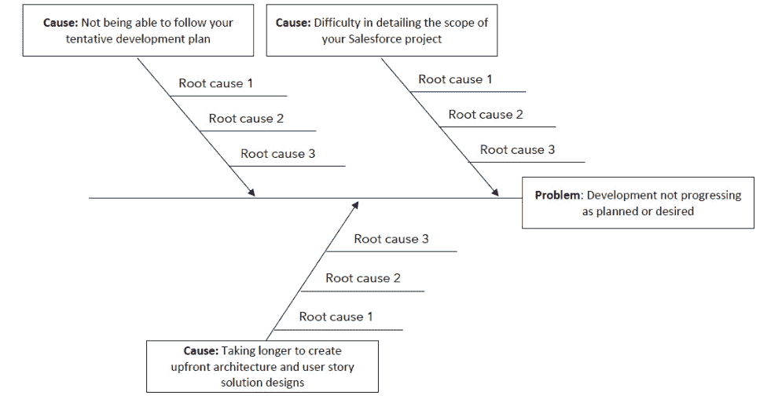

图 8.1 – 开发阶段常见问题的鱼骨图

接下来，我们将讨论每个常见问题的可能根本原因以及缓解和预防策略。

## 无法遵循暂定的开发计划

在表 8.1 中，您可以找到可能导致无法遵循 Salesforce 项目暂定开发计划的根本原因，以及如果您已遇到该问题时的缓解策略：

| 可能的根本原因 | 缓解和预防策略 |
|---|---|
| 组织的要求和优先级发生变化。 | 授权并期望您的 Salesforce 产品负责人 (PO) 挺身而出、主动承担责任，并获得业务利益相关者对初始版本优先级的认可。 |
| 由于对预算与价值的错误二分法理解而削减或最小化技术使能因素。 | 确保您聘请 Salesforce 架构师提供建议，指出哪些技术使能因素是您 Salesforce 解决方案的 *先决条件*。 |
| “范围蔓延”或在途变更请求。 | 实施清晰的变更请求管理流程——为中大型 Salesforce 项目建立一个具有定期会议节奏的变更控制委员会来评估和处理变更请求是良好的实践。 |
| 在初始冲刺中过度优化功能史诗，导致剩余史诗受损。 | 鼓励您的 PO 从全局考虑，并为 Salesforce 解决方案的所有外部和内部角色及终端用户提供端到端解决方案。确保开发工作（投资）与 Salesforce 项目范围内能力的战略重要性保持一致。 |
| 在开发阶段及以后，所有项目团队成员的文档维护和可见性较差。 | 虽然讨论起来不够令人兴奋，但可见且最新的文档是开发效率的催化剂。优先建立良好的结构，使所有项目成员都能访问并对需求和解决方案文档进行评论（并选择角色更新）。 |
| 对团队成员开发原则和指南的建立、培训和沟通不足。 | 建立您的指南。然后在项目的入职材料/演示文稿中添加一个部分，其中包含对指南的引用。传达指南并持续调整和改进它们。 |
| 约束和瓶颈阻碍进展。 | 调查约束的性质——您看板中每个列的用户故事周期时间。您的敏捷开发团队成员很可能清楚根本原因是什么，因此您需要做的就是询问、倾听并迅速采取行动解决瓶颈。这可能涉及重新调配资源、修改开发流程，或增加人手不足的角色。 |
| 技术工具和开发环境（沙盒）策略阻碍了您的开发团队。根本原因可能从开发人员在部署到公共 QA 沙盒时配置相同组件并覆盖彼此的更改，到开发团队使用变更集部署元数据不等。 | 与分配给您 Salesforce 项目的 Salesforce 技术架构师合作，并期望他们识别具体的根本原因并提出变更建议，以改进所使用的开发流程和工具。我们将在第 12 章《发展您的 Salesforce Org 和 DevOps 能力》中更详细地讨论此主题。 |
| 忽视变更管理工作。 | 确保所有利益相关者群体都代表在项目中并了解您的 Salesforce 项目。 |
| 冲刺评审（演示）中利益相关者参与度低且反馈不佳。 | 考虑以下行动：- 邀请相关利益相关者参加相关演示 - 将用户故事分组以讲述更大的整体故事 - 使用业务语言并使用真实的测试数据——关注用户故事的业务价值，而非开发的技术复杂性和精妙之处 |
| 开发估算的潜在假设被证明是错误的。由于在冲刺计划前需要更多回溯精炼会议，预期的冲刺效率可能低于预期。 | 迅速尝试了解假设是否普遍错误，这意味着所有用户故事的估算都错误或过低，还是只有部分用户故事受错误假设影响。根据情况调整您的开发计划。 |
| 开发团队时间分配和技能不足：Scrum Master、业务分析师、开发人员和 QA 专家。 | 为什么这是最后一点？这些团队成员很可能是交付 Salesforce 项目经验最丰富的人。虽然您可能会遇到缺乏经验的 Salesforce 专业人员，但您的 Salesforce 项目落后于暂定开发计划的根本原因很可能通过查看此前的要点找到并解决。 |

表 8.1 – 无法遵循暂定开发计划的可能根本原因

让我们来看开发阶段的下一个常见问题。

## 前期架构和用户故事解决方案设计耗时过长

在表 8.2 中，您可以找到可能导致为 Salesforce 项目范围内的用户故事创建前期架构和解决方案设计耗时超出预期的根本原因：

| 可能的根本原因 | 缓解和预防策略 |
|---|---|
| 与实施合作伙伴的架构师互动的内部技术资源分配不足。 | 技术架构如集成策略、集成模式确定、数据主数据管理和身份与访问管理 (IAM) 都需要与您企业的实践和能力保持一致。来自您 IT 组织的资源不足是 Salesforce 项目的风险。 |
| 您在开发前阶段做出的技术假设被证明无效。 | 正如我们在本书的开发前阶段所讨论的，在开始 Salesforce 项目的开发阶段之前，您会做出很多假设。如果发现某个假设错误，请评估影响并相应调整设计和/或计划。 |
| 用户故事及其验收标准的质量不适合进行解决方案设计。 | 让您的 Salesforce 项目的 PO 参加关于用户故事概念的速成课程——理想情况下，由业务部门主办此会议。此外，您的 PO 可以查看该主题的 Salesforce Trailhead 模块：https://trailhead.salesforce.com/content/learn/module/story-creation/construct-a-user-story。 |
| 分配具有 Salesforce 架构复杂性技能和经验的资源不足。 | Salesforce 是一个庞大的平台，涵盖传统 CRM、分析、集成、PaaS 能力以及协作工具。您很少遇到精通所有方面和产品的架构师。确保您的 Salesforce 项目拥有充足的 Salesforce 架构师资源。 |
| 在确定开发模型、沙盒和开发生命周期以及部署策略方面存在困难。 | 与实施合作伙伴的技术架构师合作，并期望他们主导这些主题的分析和建议。您的高级 IT 领导者和利益相关者应密切参与讨论并认可所做决策，因为这会影响您的长期成本和运营模式。 |
| 您的 Salesforce 项目范围过大（8 个以上 2 周的冲刺），项目团队难以在前期充分理解并有效设计和估算。 | 考虑将您的 Salesforce 项目分阶段进行，分为两个或多个更大的发布。或者，考虑仅为初始冲刺创建用户故事级别的解决方案设计，并为单独的并行设计流分配资源。如果您选择采用后者方法并设立单独的设计流，则必须在冲刺开始前由设计负责人完成并审查该冲刺的用户故事解决方案设计至关重要。否则，存在用户故事在冲刺期间无法完成的延期风险，进而需要更多冲刺并延长开发计划。 |

表 8.2 – 前期架构和用户故事解决方案设计耗时过长的可能根本原因

让我们跳到开发阶段的下一个常见问题。

## 在详细规划 Salesforce 项目范围时遇到的困难

如果您尚未详细规划 Salesforce 项目的范围，您可以继续阅读以了解需要注意的事项——然后回顾第 6 章《详细规划初始版本的范围和设计》。

在下面的表格中，您可以找到导致您在详细规划 Salesforce 项目范围时遇到困难的可能根本原因，以及如果您已面临该问题时的缓解策略：

| 可能的根本原因 | 缓解和预防策略 |
|---|---|
| Salesforce 项目的愿景和初始高层范围不明确或在开始开发阶段前未确定。 | 与 Salesforce 项目的赞助者一起识别并对齐愿景和高层范围。 |
| 团队成员未得到妥善入职和介绍 Salesforce 项目。 | 创建一份入职简报，其中包含关键项目信息，以便新项目团队成员了解您的 Salesforce 项目。至少包括 Salesforce 项目的愿景和性质、项目团队成员的角色和职责、交付方法、开发指南、用于开发和部署的工具和流程，以及可用的项目文档（范围、需求、用户故事和设计）。 |
| 为 Salesforce 项目分配的内部资源不足。经常情况下，一个组织在实施 Salesforce 的同时，还希望尝试敏捷或混合敏捷交付方法——并且在整个项目中对内部资源所需参与程度感到不堪重负。具体来说，您的 PO 可能缺乏经验、技能、时间分配，或承担该角色重大责任所需的授权/授权。 | 这种情况没有简单的解决办法。为了拥有终端用户愿意使用且能改善客户与贵组织互动体验的 Salesforce 解决方案，您需要*投入关键内部资源的时间*来提供输入共同创建解决方案。如果这些人从未参与过敏捷或混合敏捷项目，请确保他们在分配到项目前得到适当的提升技能/培训，并考虑聘请敏捷教练加入您的项目。 |
| 项目团队中业务分析资源不足。经常情况下，有经验的功能顾问被要求充当业务分析师来开展研讨会、收集需求并挑战组织的假设和旧的工作方式。然而，扎实的业务分析技能与 Salesforce 平台上的声明式开发是不同的。虽然一些功能顾问是优秀的业务分析师，但并非全部如此。 | 为了解决这个问题，与您的实施合作伙伴合作，确保您拥有足够的业务分析技能来支持和指导您的 PO 创建用户故事和扎实的验收标准。 |

表 8.3 – 详细规划 Salesforce 项目范围困难的可能根本原因

接下来，让我们评估您在开发阶段的 Salesforce 项目。

## 评估您的 Salesforce 项目状态

我们已涵盖了 Salesforce 项目开发阶段的许多主题和活动。如果您的项目陷入停滞，或您对进展不满意，以下小节将帮助您评估 Salesforce 项目的状态。对于每个无法勾选的项目，请返回相应的章节并完成活动以继续推进您的 Salesforce 项目。

## 开发阶段 Salesforce 项目检查清单

在开发阶段，您应已完成以下操作。在详细规划发布范围时，您应：

-   确保所需内部资源已分配给您的 Salesforce 项目
-   让终端用户参与共同创建将由您的 Salesforce 解决方案支持的业务流程
-   确保 Salesforce 项目的产品负责人具备合适的资质并获得授权，能够代表业务利益相关者详细说明用户故事并提供验收标准

接下来，您应完成以下活动以创建解决方案的架构和设计：

-   确定在开始开发前您希望创建多少 **架构跑道**
-   确保由 *第 6 章《详细规划初始版本的范围和设计》* 中描述的工件由您的内部 Salesforce 项目团队成员创建并理解
-   了解您的 Salesforce 解决方案将定制到何种程度以及对可维护性的影响

接下来，您应完成以下活动以建立团队的开发流程，完成发布的构建和测试：

-   确保 Salesforce 项目中的每个人都了解彼此的角色和职责
-   了解了 Salesforce 解决方案的开发工作量（假设您选择按时间估算而非故事点）
-   创建了初步开发计划，根据估算的开发工作量将 Salesforce 项目范围内的史诗分配到冲刺中
-   确定了将使用哪些敏捷仪式以及如何最大化其价值
-   为用户故事定义了 **就绪定义 (DoR)** 和 **完成定义 (DoD)**
-   确定了看板的使用实践

接下来，您应考虑建立以下机制来管理 Salesforce 解决方案的开发：

-   一个 **设计权威机构**，以确保拟议的解决方案符合目标解决方案架构和开发指南
-   一个 **变更控制委员会**，作为讨论并批准或拒绝拟议变更或新请求范围的论坛
-   一个指导委员会来指导和治理 Salesforce 项目的交付
-   确保已建立充分的测试制度以保证 Salesforce 解决方案的高质量
-   了解在开发阶段跟踪和理解进展的关键方法
-   如果您的 Salesforce 项目有多个轨道或流，已有意识地考虑使用正式框架（如 **规模化敏捷框架—SAFe**）
-   完成了创建数据迁移策略和计划的步骤

让我们总结本章和开发阶段。

## 摘要

在本章中，您已熟悉开发阶段经常遇到的常见问题，并学习了如何缓解或防止其出现。您还通过检查清单评估了 Salesforce 项目在开发阶段的状态。

在您的 Salesforce 项目状况良好后，您已准备好进入 Salesforce 之旅的下一步——推广阶段，从 *第 9 章《部署发布并将数据迁移到生产环境》* 开始。
