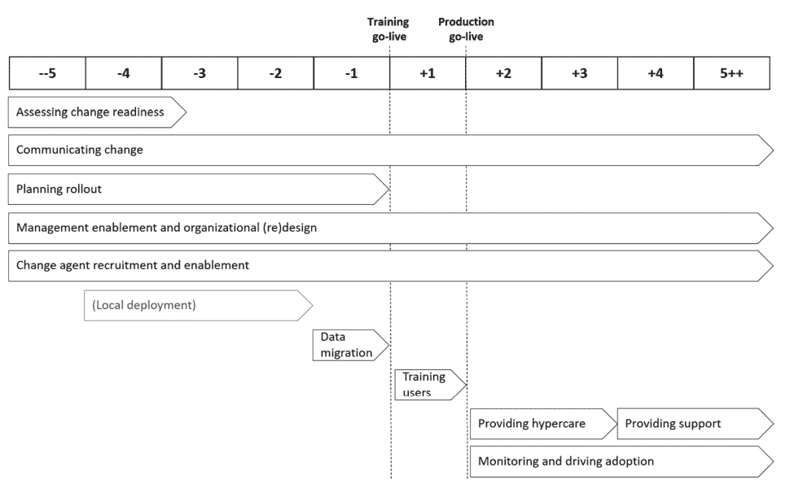
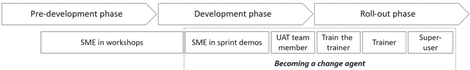
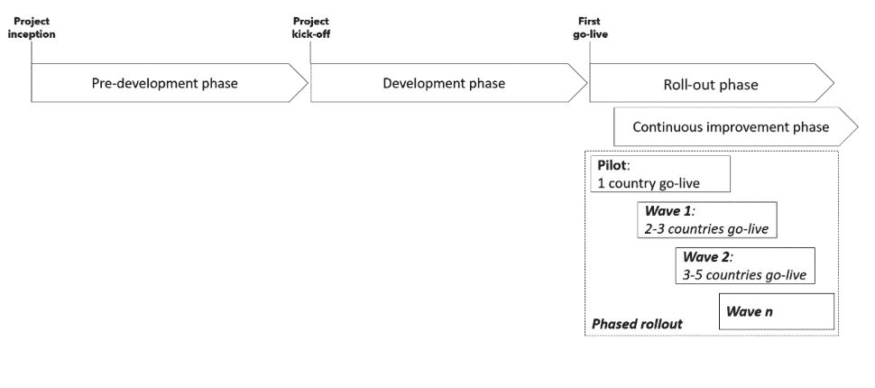

## 沟通、培训与支持以推动采用

在本章中，我们将重点关注准备您的 **变更管理计划模板**，以及规划您的 **推广** 活动分为 **阶段** 或 **波次**。作为此过程的一部分，您将重申随着 Salesforce 解决方案取代现有工作方式而发生的变化——并准备组织赋能计划来管理这些变化。我们将介绍各种培训模式以及使用每种模式时需要考虑的问题。然后，我们将介绍如何在上线后初期提供超配支持，以及如何以及何时过渡到生产支持运营。接下来，我们将讨论如何监控和推动采用。最后，我们将探讨如何开始评估和比较所实现收益与原始商业案例。

您将学习如何为推广设计变更管理和培训计划。然后，您将学习如何为使用您解决方案上线的人员提供高效的超配支持，以及如何监控和推动采用。

我们将跟随我们的案例公司，**Packt Manufacturing Equipment (PME)**，观察其 Salesforce 解决方案推广的进展。

到本章结束时，您将了解需要计划和执行的关键活动，以确保通过让用户在 Salesforce 中工作来释放业务价值。

本章将涵盖以下主要主题：

- 规划、沟通和管理变更
- 提供超配支持和管理生产支持
- 监控和推动 Salesforce 解决方案的采用

开始吧！

## 规划、沟通和管理变更

简而言之，以下活动的目的是确保您希望通过在 Salesforce 上的投资实现的业务价值得到释放、实现并最大化。

开始吧！

### 了解即将到来的变更规模

在 *第 3 章*、*确定如何交付您的 Salesforce 项目* 中，在项目的预开发阶段，您已确定将因您的 Salesforce 解决方案而受到变更影响的参与者。自那以后发生了很多变化。您已完成预开发和开发阶段，许多假设和假设性流程和解决方案可能已经改变——以更好地适应您的业务需求。

在开发阶段，您理想中应该做的是与 **业务变更顾问** 合作，以确定新解决方案和流程与当前工作方式有何不同，以及对谁不同。

以下是 Salesforce 解决方案实施时受变更影响的典型利益相关者：

- 终端用户
- 终端用户经理
- 地方组织的领导层
- 全球领导层
- 应用管理员工
- 数据、BI、报告和分析员工

在您确定了将受变更影响的利益相关者后，让我们继续前进并为即将到来的变更做好准备！

### 准备您的变更管理计划模板

传统上，上线是指用户首次登录 Salesforce 生产环境并在其中执行工作的时点。

但这有什么价值呢？不一定有。上线本身并不等于采用，也绝不保证对您解决方案的最佳、正确使用。

上线的传统定义在语义上可能是准确的，然而，从变更管理和业务价值的角度来看，您的大多数未来终端用户从未见过或使用过您的解决方案，也不知道您解决方案的功能、局限性和潜力。

随着您推广解决方案，利益相关者的变更将会发生。确保您在变更发生前制定管理计划。保持计划简单，并在从推广中学习时进行更新。

在图 10.1 中，您可以看到需要考虑和规划的上线众多活动，以便使入职和变更之旅尽可能顺利——最终收获 Salesforce 投资的收益。顶部数字代表相对于上线的周数：

图 10.1 – 相对于上线的变更管理活动

让我们逐一介绍每个活动：

- **评估变更准备度**：与来自不同利益相关者群体的有限人数进行访谈，以评估他们对改变到新系统中的新工作方式的情绪、准备感以及兴奋或担忧程度。根据评估结果，启动适当行动并相应沟通。

**提示**

请查阅来自 **The Salesforce Way** 的 *Salesforce 变更准备度评估* 文档，网址为 https://www.salesforce.com/content/dam/web/en_us/www/documents/services/the-salesforce-way-change-readiness-assessment.pdf。

- **沟通变更**：为上线用户组（群）的背景创建沟通计划。您应与当地领导层互动，以了解影响组织的环境和情况——同时参考您的变更准备度评估结果：
  - 您的沟通计划应包括向 *谁* 沟通 *什么*、*何时* 沟通以及来自 *哪个发送者*（理想情况下为当地领导层或 **变更代理**，也称为 **倡导者**）。以下是您可以沟通的一些示例：
    - *培训前*：在不过度承诺的情况下营造兴奋感，同时管理期望。
    - *培训期间*：培训课程中的关键顿悟喜悦时刻。
    - *培训后*：
      - 用户的成功案例。提示例如“您知道您可以在 Salesforce 中执行或查看此操作吗？”
      - 如果您已配置或启用了其中任何一项，则提供 Salesforce 生产力提示——**电子邮件模板**、**快速文本** 或 **宏**。
      - 对报告的错误/请求的新功能作出回应。
      - 关键采用指标，例如按终端用户组划分的最高和最低采用率。
  - 在沟通中，保持营造兴奋感和管理期望之间的健康平衡——人是复杂的存在，能够同时持有多种感受：恐惧、兴奋、渴望变革，同时也对其产生抵触。
  - 请记住您在 *第 1 章*、*为您的 Salesforce 项目创建愿景* 中建立的 Salesforce 项目的目的和愿景。

在您的沟通中，持续为用户组回答这个关键问题：“*对我有什么好处？*”

**重要说明**

确保与 *所有* 利益相关者群体沟通——并根据每个群体量身定制沟通内容，并使用最合适的渠道（即沟通渠道）。

将您的利益相关者代表与业务变更顾问以及采用和沟通专家召集在一起，为每个利益相关者群体创建 **基于角色** 的沟通内容。这将使您更好地理解和共情利益相关者，并制定针对性、相关且有效的沟通内容以实现最大影响。

- **规划推广**：这包括根据 Salesforce 解决方案涉及的角色识别个人用户，以及执行 *图 10.1* 中所示活动所需参与的所有资源。您需要规划活动的时机，以确保每个人都可用。请注意任何语言方面的考虑。
- **管理赋能**：管理层的赋能和认可对推广的成功至关重要。您应使管理者能够应对其团队成员在推广和 Salesforce 解决方案使用过程中可能遇到的抵触和担忧。这包括向管理团队教育 Salesforce 解决方案的目的和功能，以及处理可能出现的任何普遍的变革恐惧——以及管理者如何帮助缓解它。初始培训后，用户经理是帮助支持和鼓励使用您解决方案的关键。
- **组织（再）设计**：在本节开始时，您已确定将受变更影响的利益相关者。变更的程度取决于 Salesforce 解决方案的性质：

- 您的解决方案将要求员工使用新系统（Salesforce）。此变更可通过充分培训来管理（我们将在下一节中介绍）。
- 然而，如果您的新解决方案要求用户以新的方式（就流程而言）工作，与以往截然不同，并且更侧重于增值活动而非基础的数据录入和更新，则此变更可能需要员工可能拥有也可能不拥有的新技能和能力——并且他们对获取这些技能的易感程度可能高也可能低：
  - 识别当前员工能力方面的差距并制定必要的培训计划（非 Salesforce）。
  - 更新职位描述，确保未来招聘时考虑到这些职位所需的新技能。
  - 对于任何当前不具备未来所需技能且不易获得这些技能的员工，制定重组计划，为他们在组织内部寻找替代机会。
- **变更推动者招募与赋能**：如前所述，您应在整个 Salesforce 项目中让终端用户代表参与——以了解他们的情况并设计和构建改善其日常工作的解决方案。利用和赋能**变更推动者**是帮助终端用户解答问题的绝佳方法——因为他们了解使解决方案按其方式运作所考虑的因素。

## 重要说明

尽早在项目中招募并赋能未来的变更推动者。如 *图 10.2* 所示，成为一名有效的变更推动者的旅程始于开发前阶段，并贯穿开发和推广阶段。

图 10.2 – 变更推动者的旅程

- **本地部署：** 如果您向多个地区推广，您可能决定创建一个“ MVP 模板”，该模板需要修改后才能用于本地使用。这通常包括以下内容：
  - **用户和本地化设置：** 设置以下方面的配置：
    - **用户管理与访问：** 本地 **角色层级**、**队列**、**公共组** 和 **共享规则** 配置、本地货币设置，当然还包括使用当前 **配置文件** 和 **权限集** 以及用户区域设置创建和配置用户。
    - **本地化：** 您可能创建了一个允许支持 *某些* 流程变异的解决方案。这可能需要本地配置，例如 **自定义设置** 和/或 **自定义元数据类型** 记录来保存参考配置数据以及翻译。
  - **本地集成：** 如果您的本地组织拥有独立的后端系统或其他需要与 Salesforce 集成的系统，您需要在 Salesforce 项目的开发阶段就开始对此进行分析。
  - **数据迁移：** 如果您向不同的本地组织推广，您需要为每次推广创建并协调数据迁移计划。

我们将在以下章节中介绍 *图 10.1* 中显示的剩余活动——**培训用户**、**提供超期护理**、**提供支持** 和 **监控并推动采用**。

本章中 Salesforce 项目的许多活动都是并行进行的，因此请保持所有工作同时推进以实现目标。一位智者曾说过，“perfect planning prevents poor performance”，这对于推广来说绝对适用。

让我们深入了解如何分阶段推广！

## 分阶段推广您的 Salesforce 解决方案

虽然您可以为进一步的推广重用变更管理模板的许多元素，但您需要为推广的每个 *波次* 执行所有活动。因此，将一些本地组织分组或聚类到一个 **推广波次** 中是合理的。

分阶段推广方法有很多好处，但在选择时有一些重要的考虑因素。选择分阶段推广方法的主要后果是 **并行系统**。让我们先考虑在推广阶段可能需要并行系统的关键原因：

- 您的初始 Salesforce 版本（MVP）不支持遗留系统当前涵盖的所有功能
- 不同地区将在不同时间点推广您的 Salesforce 解决方案，导致不同地区使用不同的系统
- 不同职能用户组（营销、销售和客户服务）将在不同时间点推广您的 Salesforce 解决方案，导致不同职能用户组使用不同的系统

可能有许多原因和情况需要您保持两个系统同时运行。无论原因如何，并行运行可能产生以下影响，具体取决于 Salesforce 解决方案的性质和推广计划：

- 同时使用两个系统的用户意味着他们将在两个系统中更新和输入新数据，导致数据不同步：
  - 这可以通过定期进行增量数据迁移或（如果在经济上可行）在两个系统之间创建临时集成来缓解，直到旧系统可以退役：
    - 有时旧系统仍可访问但处于只读状态，以便用户在需要时可以参考遗留数据。如果采用这种方法，应将其限制在上线后的短时间内。
- 另一个考虑因素是与第三方系统集成的可行性：
  - 新的 Salesforce 系统和遗留 CRM 是否可以同时与其他系统集成？
  - 如果不能，选择 Salesforce 还是遗留 CRM 连接到第三方系统是一个重要的决策。

在图 10.3 中，您可以看到我们的示例公司 PME 如何选择分阶段推广其 Salesforce 解决方案：

图 10.3 – 分阶段推广与持续改进重叠的示例

*PME 决定最初仅在一个国家上线——试点国家。*

*其方法有三个主要优势。首先，项目团队计划和执行所有推广活动所需的努力更少（第一个国家使用该解决方案的人数较少）。其次，它允许项目团队收集有关解决方案的宝贵反馈，可用于在 Salesforce 项目进入持续改进阶段时确定变更的优先级。第三，项目团队可以测试变更管理和推广计划——并可在进一步推广之前据此进行优化。*

*随着 PME Salesforce 项目团队向试点国家推广，他们优化其方法以使其工业化——使他们能够以递增的波次加速推广，每波次涉及的国家更多。*

## 提示

与您公司的领导团队或 **项目管理组织（PMO）** 保持一致，以了解哪些限制或并行项目或举措可能会影响您希望推广的本地组织。在准备分阶段推广计划时纳入这些考虑因素。

此外，您应与本地组织的领导密切合作，以协调并确认其组织的变更管理和推广计划。

让我们更仔细地看看用户培训！

## 培训您的用户

用户培训是 Salesforce 项目中的一个关键里程碑——如果您已为即将到来的变更很好地准备了利益相关者，那么最终能够使用 Salesforce 可以成为庆祝的理由！

培训是需要投入最多努力且在短时间内具有最大影响潜力的变更管理活动，因此请确保相应地计划和优先考虑它。

在下表中，您可以比较不同的培训方法，以考虑哪种方法最适合您的 Salesforce 项目：

| 培训方法 | 培训类型 | 准备工作量 | 效果 | 适用用途 |
|---|---|---|---|---|
| 直接面对面培训 | 讲师主导 | 高 | 高 | 初始终端用户培训 |
| 直接虚拟培训 | 讲师主导 | 中 | 中 | 面对面培训的更便宜替代方案。适合培训支持角色（BI/报告人员、人力资源和财务）。 |
| 培训培训师 | 讲师主导 | 中 | N/A | 在直接终端用户培训之前并与其结合使用 |
| 同伴互助 | 同伴主导 | 中 | 高 | 直接终端用户的绝佳方法 |

| 培训 |  | （尚不可扩展） |  | 培训跟进以及为培训新员工和角色变动的员工 |
|---|---|---|---|---|
| 培训视频 | 在线学习 | 中等 | 中等 | 直接面向终端用户培训的补充 |
| Salesforce Trailhead | 在线学习 | 低 | 中等 | 适用于您的 Salesforce 管理员和生产支持人员 |
| Salesforce MyTrailhead | 在线学习 | 高 | 中等 | 直接面向终端用户培训跟进以及培训新员工和角色变动员工的绝佳方法 |
| 应用内指导 | 在岗培训 | 低/中等 | 中等 | 直接面向终端用户培训的补充 |

表 10.1 – 常见培训方法及适用用途

利用培训师培训模式，结合直接面向终端用户的培训，可以加速培训，因为它允许您同时开展多个培训课程。

## 重要说明

- 人们对学习方法的偏好各不相同，因此在培训计划中应包含多种培训方法。
- 如果您向从未使用过的人推出 Salesforce 解决方案的初始版本，则必须提供一种直接面向终端用户的培训形式或其他形式。
- 无论您选择哪种培训方法，都需要确保本地领导出席培训课程。您 Salesforce 项目的执行赞助人（或另一名高级管理人员）应在进行系统培训之前介绍新 Salesforce 解决方案的愿景和目标。
- 如果您在培训方法组合中包含视频，请确保保持简短（~30-120 s），让每个视频涵盖端到端流程中的小步骤。
- 您可以考虑为每个角色创建一页纸文档（有时称为 **速查表**），列出关键主题培训领域。
- 确保建立培训材料治理流程，以便随着解决方案的演进不断更新这些材料。
- 确保为未来的 Salesforce 管理员和更广泛的 IT 组织规划并执行培训：
  - 这包括应用程序管理员工，以及数据、BI、报告和分析员工。
  - 为未来的 Salesforce 管理员和应用程序管理员工提供 Salesforce 管理以及您 Salesforce 解决方案范围内的云的培训，并鼓励和支持他们获得认证。
  - 在初始版本中将解决方案移交给您的应用程序管理员工。除了解决方案支持的流程外，还要关注所需的用户管理和维护。

接下来，我们将介绍培训和上线后如何支持您的用户！

## 提供超护理并管理生产支持

用户培训后的时期至关重要且脆弱。因此，需要提高支持水平，以便能够快速响应终端用户面临的问题和疑问。这一阶段称为 **超护理** – 让我们深入了解！

### 提供超护理

超护理既是您 Salesforce 项目中的一个阶段，也是其能力之一。

让我们将其能力分解为各个部分：

- **超护理流程：** 当您的用户开始在 Salesforce 中工作时，他们可能会遇到困难、面临问题，并需要超出您提供的培训和培训材料的进一步帮助。务必告知用户应遵循的获取帮助流程。它可能与您在 SIT 和 UAT 中使用的流程类似，因此可将其作为起点。
- 根据您的设置和可用资源，您需要确定超护理流程中涉及哪些层级。请要求终端用户在提交错误时说明优先级/严重程度，以便您的超护理团队据此优先处理：
  - 根据您的项目设置以及与实施合作伙伴的合同，为每个定义的严重程度定义具体的 **服务等级协议 (SLA)** 可能很有帮助，以便终端用户知道预计何时审查和/或解决其错误。
- 您希望用户使用预定模板提交问题（潜在错误）（请回顾 *推动您解决方案的 UAT* 部分的 *第 9 章*，《部署您的版本和将数据迁移到生产环境》）。
- 同样，您还应制定用户如何沟通新想法或变更请求的流程：
  - 根据组织的成熟度和终端用户的情况——即他们是否难以区分错误和变更请求——您可以选择只提供一个模板供他们提交错误和变更请求。
- **超护理人员：** 接收提交的错误的人员可能有所不同；可能是您实施合作伙伴的 *业务分析师*，您自己的 *Salesforce 应用程序管理团队*，或您的 *产品负责人*。想法应由您的产品负责人接收和审查，结果应反馈给报告人。以下是超护理中的不同职责以及负责修复合格且已优先处理的错误的角色：
  - 您需要有功能顾问、开发人员和 QA 专家可用（每种至少一人）——每种资源的数量取决于您 Salesforce 项目的性质和规模。
  - 您需要让您的 PO(s) 完全可用——对于上线 Salesforce 解决方案的每个业务领域各配备一名。
  - 最佳实践还包括在修复需要更复杂的解决方案重新设计时，有架构师（或至少一名）可用。
- **超护理系统：** 您还应确定用户应使用什么系统提交错误和想法：
  - 对于错误报告，您可以使用 Salesforce `Cases`（这需要配置以适应您的组织和流程）或您的服务台票务系统。重要的是，经过分类需要解决的错误应注册并在您用于管理开发活动的系统中跟踪——例如，*Jira* 或 *Azure DevOps*。
  - 对于新想法，您可以利用 Salesforce 的 `case` 对象（需要配置以适应您的组织和流程），该对象允许用户在 Salesforce 中创建 Case 记录，以便您评估和响应。
- **超护理数据**: 从这些系统中，您应监控和分析错误和想法的数量、趋势和解决情况。

### 提示

与其痴迷于孤立的用户反馈、批评和变革阻力，不如对用户反馈采取平衡的方法；注意有效的关切和改进建议——重要的是——*耐心且富有同理心地回应所有用户反馈！*

随着您将 Salesforce 解决方案推广到更多用户，您的组织和实施合作伙伴在超护理期间支持新用户的能力将不断提高。

在介绍了超护理是什么以及如何执行之后，让我们讨论如何以及何时过渡到持续支持！

## 过渡到持续生产支持

超护理比常规的持续生产支持更昂贵。因此，在超护理错误开始减少后，可能会诱使您迅速过渡到生产支持。

回顾上一章中我们对成功推广的定义——以最大化您在 Salesforce 上的投资价值：

成功推广阶段应定义为您的组织、客户/合作伙伴和用户使用并从 Salesforce 解决方案中获得价值，并且它实现了您在 *第 4 章，获取资金并与 Salesforce 和实施合作伙伴合作* 中概述的目标业务成果的时刻。

在决定从超护理过渡到持续生产支持之前，您应考虑以下四个要点：

1. 您是否已 *定义并协调* 持续生产支持的流程，并为其分配了足够的资源——与您的 Salesforce 解决方案的性质、所需维护以及使用该解决方案的用户数量成比例？

2. 负责持续生产支持的 *团队* 是否…：
   - 将是内部团队还是由外部合作伙伴作为托管服务提供？
   - 已接受您 Salesforce 解决方案的培训？
   - 已加入错误和想法流程？

### 重要说明

您分配给超护理的团队可能包括 Salesforce 解决方案开发团队中的一些成员。他们是 Salesforce 解决方案的专家，因此是重现错误、排除故障和修复错误的最佳和最快人员。如果过早过渡，很可能其中一些资源将被分配到其他项目。

3. 您是否达到了 *采用* 目标？
   - 关键的是，在考虑过渡到持续生产支持之前，请先阅读下一节。

4. 您是否开始实现您在 Salesforce 项目商业案例中概述的 *业务成果*？

除非您能自信地对全部四个要点都大声说出 *是！*，否则您应犹豫是否从超护理过渡到持续生产支持。

接下来，让我们转向重要的采用主题！

## 监控并推动 Salesforce 解决方案的采用

与提供超级关怀和支持并行，您应密切监控并尝试了解 Salesforce 解决方案的采用情况。

正如上一节中 *第 4 点* 所提到的，在达到采用目标之前，不应考虑从超级关怀过渡到持续生产支持。为什么不呢？如果您的解决方案在推出阶段的超级关怀阶段未被采用，您如何确保之后会被采用，其责任又在谁？当您的项目进入持续改进阶段时，许多利益相关者的关注点将转向新功能开发，而您的推出/本地部署团队则需为下一波做准备。

出于这些原因，我建议您——作为 Salesforce 实施的负责人——扩大超级关怀的范围，以及何时结束。

让我们超越简单的定量错误报告和登录指标！

## 定义和衡量采用

根据牛津学习词典，动词 **adopt** 在采用方法上下文中的含义如下：

> *“Adopt something to start to use a particular method or to show a particular attitude towards somebody/something.”*

我们可以将该定义翻译为 Salesforce 上下文中的以下内容：

> *“Enabling users to perform work in Salesforce and to perceive it to be a valuable improvement for their work life.”*

让我们将定义进一步拆分为其两个部分，以及在 Salesforce 上下文中您可以衡量和跟踪采用的一些关键方式：

1. **在 Salesforce 中执行工作**：您需要跟踪预期用户是否在使用您的解决方案——以及效果如何。这涉及跟踪两个参数：
- Logins:
  - Daily, weekly, and monthly
- Usage:
  - **Efficiency**: The number of records created – for example, **Leads**, **Opportunities**, **Cases**, and **Tasks** measured per timeframe (hour, day, or week).
  - **Effectiveness**: This could include the number of converted **Leads**, **Opportunities** closed (won/lost), and **Cases** closed per timeframe (hour, day, or week).

### 提示

对您相关的具体指标取决于 Salesforce 解决方案的性质以及其预期面向的用户（或客户和合作伙伴）。与您的变革和采用顾问合作，以确定适合您的指标。您可以使用 Salesforce Labs 提供的免费 Salesforce 采用仪表板衡量和跟踪（大部分）定量的、客观的采用指标：

https://appexchange.salesforce.com/appxListingDetail?listingId=a0N30000004gHhLEAU

2. **认为 Salesforce 是有价值的改进**：采用的同义词是 *embracing*。您应尝试了解用户对您的 Salesforce 解决方案的感受以及他们拥抱该解决方案的程度。
一些很好的方法包括调查和访谈：

### 1. Survey:
- i. Ask your users the classic **Net Promoter Score (NPS)** question, “How likely are you to recommend using Salesforce to one of your colleagues?” or a variation, “How likely are you to recommend using Salesforce to someone in your network?”
- ii. Ask for comments – for example, “What’s the best thing and the worst thing about the solution?”
- iii. Ask whether they have noticed any improvements in the solution lately.
- iv. Use the end of the survey as an opportunity to remind your users how they can get help, report bugs, or make suggestions.

### 提示

对您调查回复的趋势将提供极好的洞察。在上线后最初几个月每周发送调查，然后每 1-3 个月一次。

### 2. Interview:
- i. As many facets and factors influence a quantitative measure of adoption and the answers to surveys, you should try to understand what the underlying reasons may be.

### 提示

并非所有人在系统出现问题时都愿意提交错误。这仍然会损害他们的采用；您只是不知道。为避免这种盲点，请确保您定期（在超级关怀期间每天）检查任何 **Flow Error** 电子邮件（这些发送给最后修改流程的管理员的电子邮件或 Apex 异常电子邮件收件人）以及 **Apex Exception** 电子邮件（您在 `Setup` 中设置接收这些电子邮件的电子邮件地址）。

如果您收到有关页面加载时间或整体性能问题的投诉，请设置报告以跟踪关键指标，例如 **Experienced Page Time (EPT)**。请查看 *Measure Performance for Your Salesforce Org* 帮助文章，其中描述了如何设置它，网址为 https://help.salesforce.com/s/articleView?id=sf.technical_requirements_measuring_ept.htm&type=5。

您应与您的执行赞助商、当地国家领导层和变革推动者分享采用指标。与您的变革和采用顾问合作，以确定行动和举措来帮助改善 Salesforce 解决方案的采用。

## 为采用设定目标并评估原始商业案例

您的目标应该是拥有一个不仅被使用，而且被接受，甚至员工引以为傲的 CRM 系统。提供卓越的解决方案和用户体验不仅能提高员工满意度和留存率，对业务也非常有益！

现在，罗马不是一天建成的，但您应该开始看到关于 Salesforce 解决方案的积极情绪趋势。

对于定量的、客观的使用指标，您需要将目标与您在 *第 4 章，获得资金并与 Salesforce 和实施合作伙伴合作* 中作为原始商业案例一部分定义的 KPI 目标相关联。

随着超级关怀的进展，您应该——在组织开始使用新系统导致性能初步下降之后——开始看到业务绩效改善。在上线后多久（例如 1、3、6 或 12 个月）开始实现您在 Salesforce 项目商业案例中列出的业务成果，取决于解决方案的性质、您从中迁移的成熟度水平，以及当然，您是否 *按书本* 开展 Salesforce 项目。

## 摘要

阅读本章后——并制定了自己的变革管理和推出计划——您已为 Salesforce 项目的成功首次上线以及后续的成功推出做好了准备。您准备并执行了组织使能计划，以管理即将到来的变革规模。您确定了整体培训计划，并确定了将为用户提供的培训方法。您已了解如何在上线后提供超级关怀以及何时过渡到持续生产支持。最后，您已了解如何监控和推动采用，并开始评估收益与 Salesforce 项目原始商业案例的比较。

在下一章中，我们将讨论在推出 Salesforce 解决方案时可能遇到的典型问题，以及如何减轻和克服它们。您还将获得一份检查清单，以评估 Salesforce 项目在推出阶段的状态。
