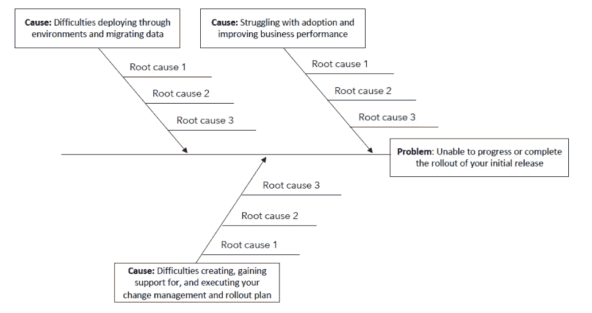

## 推出阶段应避免的常见问题

前两章涵盖了 Salesforce 项目推出阶段的活动。在本章中，我们将讨论该阶段 Salesforce 项目中经常面临的一些常见问题。我们还将介绍减轻问题或完全防止其出现的策略。

在 *第 5 章*，*在预开发阶段应避免的常见问题* 中，您被介绍了 **root cause analysis**，我们将继续使用该方法来剖析常见问题。

在本章结束时，您将获得一套 **checklists**，以便在项目完成推出阶段时评估 Salesforce 项目的状态。

本章将涵盖以下主要主题：
- 推出阶段的常见问题及其根本原因
- 评估 Salesforce 项目的状态

让我们开始吧！

## 推出阶段的常见问题及其根本原因

让我们开始通过鱼骨图来查看一些最常见的无法推进或完成推出阶段的问题：

图 11.1 – 推广阶段常见问题的鱼骨图

让我们讨论每个常见问题的可能根本原因以及缓解和预防策略。

## 在环境中部署和迁移数据时遇到困难

在表 11.1 中，您可以找到项目在环境部署和数据迁移方面遇到困难的可能根本原因——以及如果您已面临该问题时的缓解策略：

| 可能的根本原因 | 缓解和预防策略 |
|---|---|
| 部署和 SIT 可用资源不足。 | 提前确保所需内部和合作伙伴资源已分配并预订，用于他们预期参与的会议和活动，以执行部署和 SIT。 |
| 部署、UAT 和数据迁移的规划和执行不足。 | 角色和职责的规划与对齐是成功部署、SIT、UAT 和数据迁移的前提。它要求您的 PM、BA、QA 专家以及 **技术架构师 (TA)** 继续紧密合作。虽然您的 BA、QA 和 TA 应该了解执行所需的所有细节和应急方案，但确保所有相关资源保持一致、达成一致并了解各自职责是您 PM 的责任。在尝试将您的 Salesforce 解决方案部署到生产环境并迁移数据之前，请确保您拥有详细的部署计划/清单（即 Runbook）以及数据迁移计划。有关更多详细信息，请参阅 *第 9 章，部署您的版本并将数据迁移到生产环境*。 |
| 对与您的 Salesforce 解决方案集成的系统进行更改或部署导致与您的 Salesforce 部署冲突。 | 您可以通过了解组织内可能影响项目并导致与 Salesforce 解决方案产生依赖关系的其他举措来预防此问题。理想情况下，您的敏捷团队是一个 **跨职能团队**，具备与您的 Salesforce 解决方案相关的技术和系统方面的知识和专业技能。我们将在下一章进一步讨论跨职能团队。如果您发现自己正处于部署到 SIT、UAT 或——最坏情况——生产环境的中间阶段，您需要快速了解目标环境与较低环境相比有何不同。这最好由您的 Salesforce 技术架构师和 Salesforce 集成开发人员，以及外部系统的相同角色，连同您的 QA 专家一起完成。通常，在确定冲突的技术根本原因时，解决问题的方案就会变得清晰。棘手的部分通常是识别根本原因，并且根据部署类型（SIT、UAT 或生产环境），问题的严重程度不同。理想情况下，您在 SIT 中识别出问题（作为开发冲刺的一部分或开发后专门的 SIT），在这种情况下，您可以按照开头所述进行操作。同样，如果您正在部署到 UAT 沙盒（或执行 UAT）。不过，这里压力更大，因为用户通常会被分配并计划执行 UAT，随后进行培训。这意味着您需要快速了解修复需要多长时间，并评估是否需要更改计划。如果您正在部署到生产环境，您需要评估修复时间是否会影响您整体的部署和数据迁移计划——最终影响您的上线日期。 |
| 您未能制定可靠的数据迁移计划，也未执行任何（成功的）数据迁移演练。 | 这相当于在没有任何训练的情况下跑马拉松——或者更贴切地说——在未经测试的情况下将配置和代码投入生产。如果您已因此根本原因遇到数据迁移问题，您需要决定以下其中一种行动方案： - 继续进行正在进行的数据迁移——存在巨大的不足风险——并且您将不得不花费大量时间和资源（金钱）在上线后执行大量数据补丁。 - 推迟您的上线和数据迁移，为您提供时间进行演练以完善您的数据迁移计划。 |

> 根据经验，第二种选择在长期来看（几乎）总是更好的选择。

表 11.1 – 在环境中部署和迁移数据时遇到困难的可能根本原因

让我们来看推广阶段的下一个常见问题。

## 创建、获得支持并执行变更管理及推广计划时遇到困难

在表 11.2 中，您可以找到 Salesforce 项目变更管理和推广遇到困难的可能根本原因——以及如果您已面临该问题时的缓解策略：

| 可能的根本原因 | 缓解和预防策略 |
|---|---|
| 创建变更管理模板和沟通计划困难。 | 不要让完美阻碍了良好——从小处着手，尝试并在学习过程中调整和完善您的变更管理模板和沟通计划。 |
| 您在 Salesforce 项目的商业论证中为变更管理分配的预算不足。 | 不幸的是，这比不常见更常见，因为许多组织将 Salesforce 实施视为 *购买标准 SaaS 系统的许可证并为用户配置权限*。这是一个危险的迷思。事实是，随着您在组织中推广 Salesforce，变革将会发生。您投入变更管理的努力和资源决定了成功程度的差异（最大化您的 Salesforce 投资价值）。最坏的情况是，您冒着组织无法支持变革并采用 Salesforce 的风险。如果您的组织认真对待 Salesforce 的实施和推广，请将项目视为 IT 和组织变革转型各占一半。 |
| 规划推广波次困难。 | 尝试按用户数量、收入和数字化成熟度对国家进行分组或细分。从一个用户数量和数字化成熟度适中的试点国家开始，规模较小。然后，随着您能够工业化本地部署和数据迁移执行，并完善变更管理模板和沟通计划，按递增波次分阶段进行推广。请参阅 *第 10 章*、*沟通、培训和支持以推动采用* 中的 *分阶段推广您的 Salesforce 解决方案* 部分。 |

表 11.2 – 创建、获得支持并执行变更管理及推广计划时遇到困难的可能根本原因

让我们跳到推广阶段的下一个常见问题。

## 采用困难且业务绩效提升受阻

在表 11.3 中，您可以找到 Salesforce 解决方案采用率低以及未能达到原始商业论证目标的可能根本原因——以及如果您已面临这些问题时的缓解策略：

| 可能的根本原因 | 缓解和预防策略 |
|---|---|
| 您的变更管理努力未能充分做到以下几点： - 激发并 *激励* 您的用户接受 Salesforce 解决方案为他们带来的积极变革——体现在您 Salesforce 项目的愿景（为什么）中 - *缓解* 用户对 Salesforce 解决方案带来的变革的 *恐惧*。 | 从您的变更管理努力和推广过程中获得的见解中学习。以以下方式解决每个要点： 1. 调整您的变更管理方法和沟通方式，更侧重于 Salesforce 解决方案将为用户工作生活带来的改善——例如，它可能减少手工工作，让他们能够专注于更有刺激性、更有成就感（并创造价值）的工作。请参阅您在 *第 1 章，创建您的 Salesforce 项目愿景* 结尾处建立的愿景。 2. 坦诚地说明作为您 Salesforce 项目带来的变革的一部分需要进行任何重组变更，以及受影响人员如何转向公司内部或外部的其他角色。对于您正在培训并支持使用 Salesforce 的人员，请确保任何计划进行的重组已经完成。 |
| 您的变更管理举措与管理相关 | 您迫切需要获得团队层级和领导层的支持并参与推广 Salesforce 解决方案。他们的参与应包括以下内容： |

组织赋能未执行或未有效执行。

- 1. 在培训课程和上线前，与员工的直接主管进行沟通。
- 2. 通过亲临现场并主持会议来引领变革，强调他们对拟议的 Salesforce 解决方案的支持。
- 3. 让您的本地领导团队与您的团队、超护理团队和支持团队以及本地代理人一起参与，以了解他们组织对您 Salesforce 解决方案的采用情况及其感受

您在开发阶段和 UAT 中未充分让用户参与，因此您未能确保良好的用户体验，从而使他们成为您项目和 Salesforce 解决方案的倡导者。不幸的是，这在 Salesforce 项目中是一个常见问题。

您需要做的是开始让用户参与并与用户互动。
您的方法可以与下一条中推荐的方法类似——但与其经历孤立的抵制，您更可能看到广泛的抵制 pockets，您的努力和做法应反映这一点。

您有一小部分用户抱怨并对您的解决方案评价不佳，而沉默的大多数用户认为它对工作生活是一个很好的改进。

在这里，您应该尝试对受挫的用户群体进行外科式干预。对一个角色组的用户进行这些干预，以了解他们遇到的痛点。
这可能是缺乏关于如何利用 Salesforce 为自己带来优势的培训。也可能是他们担心重组。

| 问题 | 建议 |
|---|---|
| 您有一小部分用户抱怨并对您的解决方案评价不佳，而沉默的大多数用户认为它对工作生活是一个很好的改进。 | 无论他们的主要关切是什么，都要解决这些问题，例如提供更多培训或保证组织变革即将到来，他们可以熟练掌握新的工作方式并利用它更好地完成工作。观察这些干预措施如何改善组织对您解决方案采用的整体情绪——在变更管理计划模板中记录方法及结果以便后续推广 |
| 一些用户并未按预期使用您的 Salesforce 解决方案。相反，他们可能会寻找捷径来“完成工作”。这可能是由于培训问题或业务流程在解决方案设计中未得到充分解决所致。 | 首先，您应了解您的解决方案是否支持用户的预期业务流程。如果不是这种情况，您需要进行技术修复以缓解“错误使用系统”的问题，并支持用户正确使用...如果系统确实支持用户的预期流程——意味着它按设计工作——您需要对用户进行进一步培训，以帮助他们充分利用新系统。 |
| 您的數據遷移未得到良好規劃或執行，導致用戶的歷史 Salesforce 數據不完整或不連貫。 | 确定数据混乱是由于迁移还是 Salesforce 中的流程自动化所致。为解决此问题，您需要快速收集信息并分析受影响的数据及根本原因。如果确实是由于从旧系统迁移数据不佳所致，您需要执行数据补丁以改善数据质量。 |
| 在开发阶段，您的數據報告策略未得到充分优先考虑，因此您的用户和管理人员缺乏对其业务进行控制所需的运营绩效的连贯洞察。 | 这是一个特别棘手的问题，因为当今和未来的企业成功之处在于能够利用并根据客户和整体业务的 360 度视角的洞察采取行动。我们将在第 13 章《管理您的 Salesforce 数据与客户 360 的成果》中更深入地探讨如何利用您的数据。目前，您需要优先为组织创建报告和仪表板以便管理业务。请考虑以下方法： |

在开发阶段，您的數據報告策略未得到充分优先考虑，因此您的用户和管理人员缺乏对其业务进行控制所需的运营绩效的连贯洞察。

利用并根据客户和整体业务的 360 度视角的洞察采取行动。我们将在第 13 章《管理您的 Salesforce 数据与客户 360 的成果》中更深入地探讨如何利用您的数据。目前，您需要优先为组织创建报告和仪表板以便管理业务。请考虑以下方法：

- 1. 首先了解您的业务职能或角色的流程和 KPI——这应是您 Salesforce 解决方案的原始商业案例
- 2. 如果 Salesforce 是跟踪或计算 KPI 的唯一数据源——并且报告要求简单——请利用标准 Salesforce 报告和仪表板。另一方面，如果跟踪和计算 KPI 所需的数据在 Salesforce 之外——并且报告要求复杂——请考虑利用 Salesforce CRM Analytics（Salesforce 平台的一部分）或外部商业智能（BI）平台（您企业系统环境的一部分），例如 Microsoft Power BI、IBM Cognos Analytics 和 QlikSense。

您可以查看以下链接以查阅帮助文章 Reports and Dashboards Limits, Limit Allocations：https://help.salesforce.com/s/article/language=en_US&id=sf.rd_reports_dashboards_limit

大多数用户认为所提供的培训质量不佳并作出报告。

您应在每次培训课程结束后征求反馈。根据受训人员的背景和文化，这应能让您了解所提供培训的（感知）质量以及对培训计划和交付方式的适当修改。最低限度，准备面对面和虚拟培训（面对面或虚拟）的材料，并至关重要的是，使材料易于用户获取，并

定期更新。

您因以下原因无法提供足够的超护理：

请参阅以下每项的缓解或解决措施

相对于分配的团队而言工单量过大，您的超护理团队花费超过 90% 的时间接收错误、处理它们并向错误报告者反馈——而这一比例并未显著下降。其后果是您的团队没有时间进行

主动分析和干预以了解并强化

1. 尽管资源稀缺，您需要优先安排团队部分时间来调查工单数量和性质的根本原因。可能报告了大量“重复”错误。为缓解此问题，请确保系统地将每个报告的错误映射到用户故事。由一名支持团队成员一次性处理重复项。用户培训可能不足且需要更新；培训材料的可用性和位置应重新传达。如果您没有看到超护理对团队造成的负担有所减少，请在继续进行根本原因分析、访谈选定用户并将发现应用于改善采用的同时考虑增加资源。
2. 确保向所有用户传达所需的错误报告模板，并传达报告流程。如果错误以其他方式报告，请礼貌地告知报告者正确的模板和流程。
3. 推荐的做法是从开发团队向支持团队进行软移交——从用户管理开始并分析变更请求，以便支持团队成员逐步熟悉您的用户、Salesforce 解决方案、设置。分析变更请求将使他们熟悉解决方案支持的流程。一旦他们熟悉您的解决方案，请让他们与开发人员一起对报告的错误进行分类。让支持团队开始建立常见问题解答（FAQ）和答案知识库。随着其能力的提升，逐步将越来越多的错误分配给支持团队。

用户采用。

- 2. 错误报告和变更请求未按正确格式提交，您的团队花费不必要的时间收集信息以重现错误、找到根本原因并修复它们。
- 3. 您在上线后不久就将提供超护理的责任从开发团队转移到您的应用管理和支持团队，且没有适当的解决方案移交会议来

向您的团队介绍 Salesforce 解决方案。这是为降低实施项目成本而采取的尝试。然而，快速移交超护理是一种风险较高的做法。开发团队成员是您 Salesforce 解决方案的专家，因此能够比任何新的支持团队成员更快地排查报告的错误。

您被解决方案所需的维护工作压得喘不过气——可能是用户配置

根据所需维护的性质，您应考虑以下步骤：

- 1. 分析投资身份和访问管理解决方案是否合理。这将减轻因内部职位变动而设置用户和更改现有用户访问权限所需的大量手工工作。

对于新员工，2. 为岗位变动的员工更新用户权限，或更新参考数据或主数据。任何这些都可能导致您的超护理和持续支持团队花费时间在非增值活动上，而非推动采用并支持您的用户。

如果参考数据或主数据的真实来源在另一个系统中，请考虑投资集成，以减轻应用程序管理目前正在进行的手动“转椅式”集成工作。

| Root cause | Recommendation |
|---|---|
| 您无法掌握解决方案的实际采用情况，因为它因国家、角色和用户画像而异。因此，您难以确定优先访谈对象以了解低采用的原因。 | 这里，您需要执行以下操作：1. 回顾 *定义和衡量采用部分* *第10章，沟通、培训和支持* *推动采用*，为项目团队和利益相关者创建出色的采用和用户跟踪仪表板。2. 跟踪用户对 Salesforce 的采用情况——登录和使用情况——并比较各本地组织中按组（业务职能）划分的用户采用情况。将此数据与您应已发送的调查相结合，以衡量用户对 Salesforce 解决方案的感受。创建一个包含四个方框的矩阵：*定期使用且喜欢*、*定期使用但不喜欢*、*不定期使用但喜欢*，以及*不定期使用且不喜欢*。3. 根据不同方框中的用户细分定制您的方法。与采用率较高的本地组织中的大使进行对话，了解他们特别喜欢 Salesforce 解决方案的地方——在与采用率提升困难的其他用户群体沟通时突出这些要点。优先访谈采用困难最大的用户，以了解其主要痛点和顾虑。 |
| 在生产环境中报告的关键错误，这些错误在 SIT 或 UAT 中存在或未存在/被发现。 | 如果错误在 SIT 或 UAT 中不存在或未被发现，请重现错误并对业务流程进行回归测试。如果错误存在或被发现，您需要以下事项：1. 修复错误并对业务流程进行回归测试。2. 调查错误是如何重新出现的根本原因，然后进行修复。 |
| 用户无法区分错误和新想法，因此将新想法报告为错误。 | 在决定“只是修复错误”之前，分析它是否真的是错误、增强功能，还是只是“流程问题”。您可以通过将测试的功能追溯到用户故事或测试用例来做到这一点。这可能是您的产品负责人应将修复价值与其它待办事项进行优先排序的情况。如果不是，可能是测试用例写得不正确、变更请求或功能请求。无论此分析的结果如何，对于 Salesforce 解决方案的采用和用户感受而言，向报告者传达是否正在进行（或未进行）以及原因非常重要。考虑为用户提供一个统一的模板用于报告错误和新想法。 |
| 非功能性需求（NFRs）未提前定义，且用户反映其 Salesforce 解决方案繁琐，与其旧系统相比需要更多点击。用户还可能报告性能问题，例如页面加载或更新缓慢。 | 您可以按以下方式处理此问题：1. 定义 NFRs。如果此时利益相关者无法做到，请尝试识别 Salesforce 解决方案中（据报告）最繁琐的流程。然后，记录在旧系统中完成相同业务流程所需的点击次数或持续时间。2. 识别 Salesforce 解决方案中完成时间（明显）比旧系统更长的流程。3. 识别最繁琐且耗时最长的流程步骤，并找到简化或自动化的解决方案。4. 根据改进效果与工作量的对比，对潜在变更进行优先级排序。5. 向各层级利益相关者传达您的努力和计划。如果用户报告性能问题，您需要找到其根本原因。这些原因可能从低效的后端或前端设计到次优的集成模式或实现不等。无论根本原因是什么，一旦识别出来，请遵循步骤 4-5 来解决问题。 |

您在评估原始商业案例以了解项目是否成功方面遇到困难——要么是因为没有创建商业案例，要么是因为它没有包含作为商业案例基础的 KPI 目标。

如果您没有创建商业案例，您将处于盲目状态，无法知道投资是否正在产生回报。您可以做的是跟踪上线后几个季度业务的表现，并与上线前表现进行比较。请注意以下两点：

1. 不要将相关性等同于因果性——有无数因素在正面和负面影响您的业务表现。
2. 推广 Salesforce 不会（必然）在一周或一个月内立即改善业务表现。用户需要时间适应在新系统中的工作方式。请记住，他们可能花费了数年时间精通“旧”工作方式，无论支持他们的系统是什么，他们可能没有。

为解决此问题，您应执行以下操作

商业案例已创建，但您的业务表现参差不齐，您难以真正理解原因。

1. 按 Salesforce 项目范围内的业务职能和地理区域分解整体商业案例。
2. 重要的是，尝试了解哪些其他因素可能影响不同业务职能和地理区域的业务表现——以下可能是关键驱动因素和根本原因。某些地理区域是否未达到 KPI 目标？它们是否达到了 KPI 目标，但未达到采用目标或反之？整体市场是在增长还是放缓？
3. 创建一个网格，以了解哪些国家/业务职能的表现优于原始商业案例中的目标，哪些表现不佳。
4. 如果业务表现与 Salesforce 解决方案的采用和使用之间存在相关性，则这是证明因果关系的先决条件。
5. 与团队和本地团队分享您的发现，并制定适当的行动方案以改善业务表现。

表 11.3 – 难以采用和改善业务表现的可能根本原因

接下来，让我们评估 Salesforce 项目在推广阶段的情况。

## 评估您的 Salesforce 项目状态

Salesforce 项目的推广阶段涉及大量主题和活动。如果您遇到困难，或对推广进度不满意，本节将帮助您评估 Salesforce 项目的状态。对于您无法核对的每项内容，请返回相应章节并完成活动以继续推进您的 Salesforce 项目。

## Salesforce 项目推广阶段检查清单

在推广阶段，您应已完成以下活动。

在通过环境部署 Salesforce 解决方案时，您应已执行以下操作：

- 确保您已完善部署计划和检查清单，也称为部署运行手册：
  - 关键包括如何验证和签署您的部署
- 执行 SIT 以识别并解决并发流和/或已在生产环境中的合并冲突

接下来，您应已完成以下活动以执行解决方案的 UAT：

- 确定谁应参与并推动 UAT
- 定义并明确验收测试团队应遵循的流程以及用于报告错误和变更请求的模板
- 向错误和变更请求报告者反馈状态以及您打算如何处理它们

接下来，您应已完成以下活动以检查数据迁移准备情况：

- 在暂存环境中成功执行至少一次数据迁移的演练
- 确保执行数据迁移的团队了解其任务并已安排时间——包括负责签署数据迁移的业务和技术利益相关者
- 传达数据迁移计划及其相关的任何预期停机时间
- 制定在迁移失败或耗时超过接受范围时的回退计划

接下来，您应已通过以下方式规划、传达并管理即将到来的变更：

- 明确了解将发生什么变化以及针对哪些利益相关者
- 如果向多个地理区域推广，则创建分阶段推广计划
- 创建变更管理计划模板，并在分波推广过程中根据进展进行调整，包括每个推广波：
  - 变更准备度评估
  - 沟通计划
  - 整体推广计划
  - 管理和组织赋能计划
  - 变更代理招募和赋能
  - 本地技术部署计划
  - 本地数据迁移计划

接下来，您应已完成以下培训用户准备工作：

-   确定了培训方法的组合以最大化影响力
-   考虑并规划了对用户以及本地领导层的培训
-   沟通了培训计划并获得了本地组织的确认 - 并执行了该计划
-   对应用管理、支持团队、数据、BI、报告和分析人员进行了培训并赋能

接下来，你应已完成以下准备工作以提供超期关怀并管理生产支持：

-   确定了超期关怀和持续支持流程
-   分配了资源并明确了角色和职责
-   决定了从超期关怀过渡到持续支持的标准 – 实现采用目标

最后但绝非最不重要，你应执行以下活动以监控并推动 Salesforce 解决方案的采用：

-   创建了报告和仪表板以跟踪 Salesforce 的登录和使用情况
-   发送并分析了调查问卷的回复以了解用户对 Salesforce 的感受
-   进行了访谈以更好地了解用户对 Salesforce 解决方案的看法和改进建议
-   对抗拒变革的个人或用户群体进行干预 – 以了解根本原因并赋能和支持他们在 Salesforce 上取得成功
-   评估了业务相对于 Salesforce 项目原始商业案例的表现 – 并看到其趋向于该目标

你可能会在 Salesforce 项目的推广阶段遇到重大阻力。如果你一直按部就班地推进 Salesforce 项目，你已非常接近（即时）终点线 – 为你的组织提供更优的 CRM 解决方案以释放更大的业务价值。

不要忘记在继续尝试变革举措和干预措施的同时，对自己和团队表示祝贺 – 并为未来的推广阶段调整你的方法。

## 摘要

在本章中，你已熟悉推广阶段经常遇到的常见问题，并学会了如何减轻或防止其出现。你还通过阶段检查清单评估了 Salesforce 项目的状态。

在 Salesforce 解决方案的推广工作进展顺利的情况下，你已准备好将 Salesforce 项目提升到下一个阶段，即持续改进阶段，从第 12 章《演进你的 Salesforce Org 和 DevOps 能力》开始。
