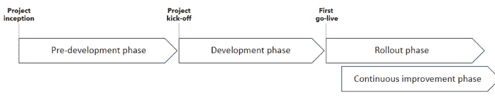
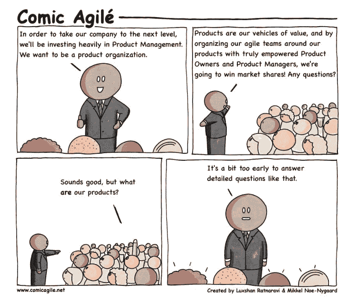
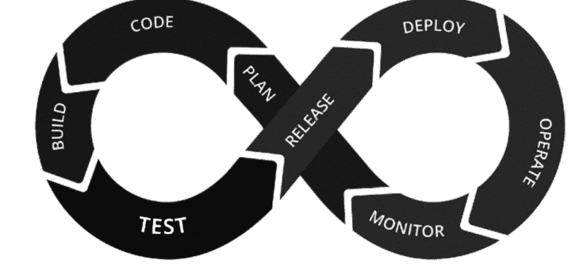

## 演进你的 Salesforce Org 和 DevOps 能力

在前几章中推广 Salesforce 解决方案之后，在你的 Salesforce 项目的 *第 4 部分，持续改进阶段* 中的本第一章中，你将了解持续改进阶段的性质和活动。然后，我们将介绍产品型组织的概念以及它对 Salesforce 项目成功的重要性。接下来，我们将介绍持续改进阶段的项目和平台治理。最后，我们将介绍 DevOps 以及如何演进你的 Salesforce **DevOps** 能力。

读完本章后，你将了解持续改进阶段的关键活动。你将学习为何应努力成为产品型组织，以及如何开始组织的 **转型**。在阅读并应用这些概念后，你将能够更新和维护你的 Salesforce 路线图，并在 Salesforce 平台上管理技术债务。你将能够增强你的 Salesforce DevOps 能力，以便在 Salesforce 项目的持续改进阶段取得成功。

在本章中，我们将介绍以下主要主题：

-   持续改进阶段概述
-   将组织转变为产品型组织
-   治理你的 Salesforce 项目和平台
-   演进你的 Salesforce DevOps 能力

开始吧！

### 持续改进阶段概述

Salesforce 项目的这一阶段始于你与首批用户上线之时，如图 12.1 所示，并且不会结束（除非你的组织决定停止使用 Salesforce）。

图 12.1 – 与推广同步的持续改进

我们可以总结关键的持续活动如下：

-   将组织转变为产品型组织
-   治理你的 Salesforce 项目和平台
-   演进你的 Salesforce DevOps 能力
-   管理和治理数据质量
-   利用你的 C360 数据以最大化 Salesforce 投资
-   领导并激励组织内的同行

最后三个主题将在下一章中介绍。

让我们从产品型组织开始。

### 将组织转变为产品型组织

在过去十年中，数字化转型举措 – 近期因 COVID-19 大流行而加速 – 已在中大型组织中变得无处不在。文献很快指出这些举措的失败率 – 原因通常被归结为缺乏用户参与、跨职能协调、高层承诺和战略一致性。这些领域中的大多数都由 **产品型组织** 所解决。

**产品管理** 的概念起源于宝洁公司，Neil McElroy 写了一份备忘录，要求招聘人员并围绕单一产品或品牌进行组织。*品牌经理* 的最终责任是管理产品生命周期、销售和促销 – 由实地测试和客户互动支持。自那以后，出现了许多额外且互补的概念、理论和实践，包括看板（1940 年代）、Kaizen（战后）、敏捷宣言（2001 年）、DevOps（2007 年）和精益创业（2011 年）。

### 提示

如果数字产品管理和产品型组织的概念对你来说完全陌生，你可以从阅读 Eric Ries 的 *The Lean Startup* 和 Marty Cagan 的 *Inspired: How to Create Tech Products Customers Love* 开始你的学习之旅。

这都很好，但这一切与现代技术产品型组织有何关系？让我们从一些定义开始。

产品型组织是一个不断努力改进其产品组合的组织，其产品组合由功能组成，以为客户提供利益。

让我们将其翻译到 Salesforce 项目的背景下：

它是一个不断努力改进其 Salesforce 解决方案以为其 Salesforce 用户（员工、客户和合作伙伴）提供价值的组织。

根据 *Open Agile Architecture* 中的 **敏捷成熟度模型** – **The Open Group** 的标准，你可以在 https://pubs.opengroup.org/architecture/o-aa-standard-single/ 查看 – 组织若不采用产品驱动型组织的特性和实践，就无法进入敏捷成熟度的更高水平。

### 重要说明

虽然大量文献主要关注为外部客户打造优秀产品，但产品型组织的概念和实践可以很容易地转化为为你的外部客户和合作伙伴以及所有内部用户构建 Salesforce 产品。

让我们先开始识别你的 Salesforce 平台的产品。

### 了解你的产品

数字产品是传递价值的载体。这可能显得模糊和抽象，这也是许多组织难以定义其产品的原因，如图 12.2 所示：

图 12.2 – Comic Agile #218 – 产品型组织

闲话休提，你组织的 *Salesforce 产品* 具体是什么，取决于你组织、用户、客户和合作伙伴的性质。

让我们看一个在 Salesforce *平台* 上为 PME 的 *客户* 构建的 *产品* 示例：

- 面向 PME 的 *销售代表* 的 Salesforce *应用*
- 面向 PME 的 *客户服务代表* 的 Salesforce *应用*
- 一个 **Commerce Cloud** *商店前端*，具有自助功能，供 PME 的 *客户* 下单和记录案例
- 一个 Salesforce **Experience Cloud** *站点*，供 *分销商* 与 PME 协作处理线索和商机

接下来，让我们达成一致。

## 使你的 Salesforce 平台的愿景、战略和所有权保持一致

好消息是，如果你初始 Salesforce 版本的开发和推广与本书前几节所述类似，那么你已经 *完成* 了作为产品组织所需采取的 *行动* 的一部分。你已指派并授权 **产品负责人** 负责向用户提供的产品。

现在，*作为* 产品组织 *做事* 和 *行动* 与 *成为* 产品组织并不相同——转型涵盖多个维度，包括以下关键要素：

- 对 Salesforce 用户痛点和需求的深入且不断增长的 *洞察*，以及你提供的产品（Salesforce 解决方案）如何让他们的工作更轻松、更高效
- *组织对齐*，以从项目制组织转型为产品组织，其中包括以下内容：
  - 将你的业务战略与 Salesforce 平台和产品战略保持一致。
  - 将你的资金模式从资助项目（工作说明书）*转变为* 资助 **跨职能产品团队**，这些团队持续交付增量价值。这至关重要地包括将资金与产品负责人授权挂钩，以优先考虑路线图项目——该项目源于用户洞察与组织战略意图之间的微妙平衡。
  - 利益相关者对 Salesforce 产品路线图的认可和参与。
  - 成熟你的 Salesforce 平台治理结构，由 Salesforce **卓越中心 (CoE)** 驱动
  - 重新定义你的 (IT) **运营模式** 并提升 Salesforce DevOps 能力

在你的平台和产品愿景、战略和所有权保持一致后，让我们设定一些目标。

## 为你的 Salesforce 平台和产品设定目标

Salesforce 是一个广泛的 SaaS 云和附加组件套件，也是 PaaS。这意味着你可以扩展和增强 **开箱即用 (OOTB)** 功能和应用——并自行构建。

对于大多数组织而言，投资 Salesforce 是将统一和整合到一个 CRM 平台的战略决策。它们的愿景很少是让 Salesforce 平台仅为单一用户群体提供一种解决方案（云、产品或应用）；而是成为拥有多个产品供多个用户群体使用的 **战略平台**。

如果这也是你组织的目标，这意味着你需要在 Salesforce *平台* 和 *产品* 两个层面考虑并使你的愿景和战略保持一致。

### 提示

如果你组织的愿景和战略对你来说还不够清晰，请与 Salesforce 计划的赞助人沟通。你也可以回顾 *第 1 章，创建你的 Salesforce 项目愿景*，以获取方法并获得灵感来确定 Salesforce 计划和平台的愿景。

在你的 Salesforce 平台和产品战略保持一致后，你需要为你的 Salesforce 平台和产品设定 **产品目标**。

如果你有多个产品且有不同的产品负责人，你应该在 Salesforce 平台层面以及每个产品领域为其定义产品目标——例如，销售、客户服务、现场服务、商务和数字营销。

### 重要说明

**在跨职能敏捷团队中组织**——一个敏捷团队需要且只能有一个 PO，且一个敏捷团队只有一个待办事项。开发人员（功能型或程序型）应仅是其中一个敏捷团队的成员（Scrum Master 和 QA 专家最多可服务两个团队）。原因很简单；如果开发人员属于多个敏捷团队——拥有不同的 PO——就会出现开发人员应如何决定处理哪个产品待办事项的问题。解决这个难题需要 Scrum Master 之间进行低效的跨团队规划来确定每个团队的能力分配，更不用说开发人员日常上下文切换造成固有的低效。

平台和产品目标的目的是帮助指导你的团队确定下一步优先构建什么。

### 重要说明

尽管在本节中我们一直在讨论组织转型以成为产品组织，但如果你组织的产品组织概念完全陌生，你可以选择从 Salesforce 计划和平台开始，为你的组织引领方向。

警惕潜在的抵制，花大量时间与利益相关者互动、讨论和分享概念以让他们加入。你的 Salesforce 计划赞助人需要在该过程中深度参与。

在本节中，你了解了产品组织、如何转型成为产品组织，以及如何使组织战略与 Salesforce 平台战略和愿景保持一致。让我们介绍持续改进阶段的治理，以及如何创建路线图并将其与你的战略和产品目标联系起来。

## 管理你的 Salesforce 计划和平台

随着 Salesforce 计划和平台为你的组织服务而发生许多变化，拥有稳固的治理对于稳定和增长至关重要。

让我们先来看看 Salesforce CoE 在 Salesforce 计划和平台治理中的作用。

## 更新你的 Salesforce CoE

你的 Salesforce CoE 仍然是负责监督 Salesforce 计划的总体治理机构。它整合知识、工作方式指南和变更管理，并管理业务、技术和数据治理的治理结构和论坛。

在持续改进阶段，你的 Salesforce CoE 中的关键领导角色如下：

- **Salesforce 平台负责人**：这是 Salesforce 平台及其路线图的负责人和总体责任人：
  - 有些组织也将此角色称为 **首席产品负责人** 或 **产品经理**。如果你的 Salesforce 平台为不同用户群体提供多个不同的解决方案，你可能有这些产品的不同产品负责人：
    - 尽管你可能有多个产品，但你可以按领域或能力对其进行分组，以简化所有权和产品管理结构。

### 重要说明

必须将计划、平台和产品资金授权直接与平台和产品负责人挂钩，以赋能他们并实现所有权。

你可能会认为这样的授权只能给予组织内的高级领导——你绝对是正确的。Salesforce 平台和产品负责人确实是适合资深、经验丰富的专业人士的高级职位。

- **Salesforce 平台架构师**：他们负责 Salesforce *平台* 的架构愿景，以及你 Salesforce 组织的性能、可靠性、安全性和灵活性。
- **Salesforce 计划负责人**：他们负责组织和构建 Salesforce 计划、资源配置和预算编制，并促进治理论坛。

**Salesforce 计划赞助人**：这是来自你组织高级领导层的执行赞助人，提供指导和支持。

请回顾 *第 3 章*，*确定如何交付你的 Salesforce 项目*，以了解 CoE 的基础设置。

管理、治理和利用你的 Salesforce 数据将在 *第 13 章*，*管理你的 Salesforce 数据以收获 Customer 360 的成果* 中介绍。

让我们看看你的合作伙伴模式。

## 在持续改进阶段调整你的合作伙伴模式

当你从初始 Salesforce 版本的开发和推广过渡到持续改进阶段时，有许多原因需要考虑修改你的合作伙伴模式：

- **能力**：你初始版本的实施合作伙伴具备资格和能力支持你在 MVP 技术范围内的实施，但未涵盖 Salesforce 路线图上的即将推出的能力：
  - 这是有道理的，因为大多数实施合作伙伴能够支持 Sales Cloud 和 Service Cloud 等核心 Salesforce 云的实施，但并非所有人都精通 **Commerce Cloud**、**Mulesoft**、**Revenue Cloud (CPQ)**、**Field Service Lightning** 和 **Marketing Cloud** 等产品
- **内部策略**：组织通常设有内部团队，专注于 Salesforce 管理、用户管理、持续维护、支持，以及对 *现有* 当前受支持能力的变更和新功能请求的开发：

- 很少有组织具备规模，使其内部团队能够覆盖前面提到的所有项目，同时还具备推动大型举措（如为新用户群扩展新云）所需的业务和技术技能

接下来，考虑以下哪些领域最适合由你的内部团队、合作伙伴或两者结合管理：

- 基础用户管理和简单的服务台工单
- 管理小型变更请求
- 系统监控和评估 Salesforce 每年的三次发布
- 敏捷产品团队交付新功能
- 技术设计治理
- 项目管理与中期规划
- 变更管理与沟通

在确定时，考虑每个领域是否在贵组织的核心能力范围内。如果某个领域不在核心能力范围内，请考虑利用合作伙伴的专业知识。

在 Salesforce CoE 和合作伙伴模式确定后，让我们继续讨论你的 Salesforce 路线图。

## 重新审视和维护你的 Salesforce 路线图

回顾你在 *第 2 章，定义你的 Salesforce 项目的性质* 中创建的路线图。在 Salesforce 之旅的预开发阶段的业务负责人，可能已在初始 Salesforce 实施的开发阶段成为产品负责人。

初始版本开发并正在推广后，他们应该做什么？回到老工作？不！还有一项伟大（且持续）的任务需要完成，以进一步改进并最大化 Salesforce 平台和产品为用户和组织带来的价值。

以下是平台负责人和产品负责人（们）需要理解、整合并最终优先排序的待办事项来源：

- **在 Salesforce 计划的持续改进阶段开始时**（在首个版本初始上线后不久），执行以下操作：
  - 审查贵组织最初为 Salesforce 项目考虑的功能：
    - 如果你按范围分阶段推出 Salesforce —— 例如按业务领域（例如销售、服务和营销）—— 你将把这些作为路线图的输入
  - 在初始实施的不同阶段被取消范围的项目：
    - 前期架构阶段中被取消范围的史诗和用户故事
    - 开发阶段在冲刺演示和 UAT 中捕获的功能或变更请求
    - 在推广阶段的培训期间以及超护理期间捕获的功能或变更请求
- **持续改进你的 Salesforce 产品：** 持续改进 Salesforce 平台产品的输入来源包括以下内容：

- 来自用户的变更请求
- 来自用户的新的功能请求
- 变化的战略和优先级
- 变化的市场条件
- 组织变更
- 技术创新 —— 对于大多数 Salesforce 产品每年有三次发布，有大量新功能可供考虑利用（如果它们能为用户和组织增加价值）；毕竟，你为此付费了

大多数组织难以将新的中大型功能请求转化为现有 Salesforce *产品* 的新能力（史诗）。这很有道理 —— 你的组织为包含许多开箱即用功能性的许可证付费，这些功能性可以通过配置和定制来使工作更轻松、更高效。此外，随着用户开始使用 Salesforce，他们会投入精力使其发挥自身优势，因此会提出更多功能请求。

确保你有一个结构化的流程来倾听、收集和评估反馈，以及传达你的决策。

### 提示

考虑使用 **产品管理系统** 作为产品经理（Salesforce 平台和产品负责人）功能专用的记录系统，并帮助他们创建和维护路线图。

让我们看看如何区分不同产品待办事项类型的性质：

| 类型 | 产品待办事项示例 | 决策模型 | 提前期目标 |
|------|------------------|----------|------------|
| 主题 | 请求新的 Salesforce *产品*（例如，新的 Salesforce 云，如 **Service Cloud**、**Marketing Cloud** 和 **Commerce Cloud**，或主要附加组件如 **CPQ** 和 **Field Service Lightning**）以支持 Salesforce 平台上的新用户群。这些可能是你决定分阶段稍后实施的原始路线图想法，或基于创新和 Salesforce 提供的服务而提出的新请求。 | 类似于本书中 *第 1 部分，预开发阶段* 描述的过程 | 一个或多个程序增量。或者，遵循混合交付方法来构建新解决方案的首个版本。 |
| **史诗** | 支持 *当前使用云* 上新能力的新、较大的功能请求。原始路线图史诗，分阶段在现有云上稍后实施。 | Salesforce PO 基于收益假设分析与 **项目委员会** 共享的史诗优先级排序 | 一个或多个冲刺，但少于一个程序增量。 |
| **用户故事** | 对 *当前支持功能* 上现有功能的变更请求和增强请求。也为新史诗创建。 | PO 通过按业务价值和与产品目标的一致性对 **产品待办事项** 进行排序来确定。 | 必须能够在一个冲刺内完成。如果不能，则拆分为更多用户故事。 |

表 12.1 – Salesforce 产品待办事项类型

如表 12.1 所述，添加一个全新的主题（新的 Salesforce 云或主要附加组件）是一项庞大的工作，你应考虑以与本书前几部分所述大致相同的方式进行。

### 提示

当你评估新功能和增强功能的请求时，请查看 Salesforce Roadmap Explorer，网址为 https://architect.salesforce.com/roadmaps/roadmap-explorer，以查看是否有任何即将发布的版本可能支持该请求。

通常计划采用新的开箱即用功能比自行构建更好。请注意，路线图浏览器描述的是意图，而非承诺 —— 请据此做出决策。

你需要一个结构和流程来持续收集、筛选和优先排序新请求。SAFe 提供了不同的配置来管理新想法，例如带有 **程序 KanBan** 的 **项目委员会**，以及定期节奏来审查、提供反馈并支持史诗向下一阶段的进展。PO 应该能够快速解释其决策和优先级排序，因为史诗的收益假设如何与产品目标挂钩应该一目了然。因此，项目委员会并非旨在成为决策机构，也不应成为冗长讨论和演示的论坛。

### 提示

你的 PO 可以，除了收益假设和史诗与产品目标的一致性之外，使用 **加权最短作业优先（WSJF）** 模型，如 SAFe 框架所述。你可以在此处阅读更多相关信息：https://www.scaledagileframework.com/wsjf/。

你应确定如何将路线图史诗推进到开发管道。有不同的选项可以将 Salesforce 路线图转化为中期计划。根据 Salesforce 计划的规模和敏捷团队的数量，你可以选择较小的或较大的规划设置。

两个大型敏捷设置常见框架是 **Large-Scale Scrum (LeSS)**（[https://less.works/](https://less.works/)）和 SAFe 的 **程序增量（PI）规划**（[https://www.scaledagileframework.com/pi-planning/](https://www.scaledagileframework.com/pi-planning/)）。

### 重要说明

你应选择一个适合 *你的* 组织需求、背景和敏捷成熟度以实现持续改进的框架。

让我们现在转向难以捉摸的技术债务概念。

## 管理技术债务

技术债务最好通过其症状和产生方式来描述。

技术债务的症状 —— 或影响 —— 包括系统可用性下降、性能变慢、数据损坏以及安全风险和问题增加。这些症状表现为错误报告数量增加、采用率下降以及创新速度放缓。

技术债务以以下方式产生或累积：

- 基于以下原因对 Salesforce 平台进行不良更改：
  - *设计不良* 的解决方案，其维护程度高，超过了解决方案本身的好处
  - *治理不良* 的解决方案，已超出其原始用途的范围
- 为 *错误的问题* 创建出色的解决方案：
  - 如果解决方案设计良好但未解决正确的问题，它不会带来业务价值，只会造成混乱 —— 技术债务

- *不做任何更改* 对你的 Salesforce 平台：
  - 世界正以加速的速度变化，组织也在变化以保持领先或跟上这些变化。如果您向用户提供的产品——您的 Salesforce 解决方案——没有随组织一起变化，它们最终实际上会成为技术债务。

不可能没有技术债务，而且消除现有债务并不是一次性活动；相反，这是一项持续的管理工作。这并不意味着你应该无所作为——恰恰相反！

你需要实施 *治理结构* 来限制引入到 Salesforce 平台的新技术债务量，并 *持续修复* 组织中阻碍进展的债务。

## 重要说明

确保您的 Salesforce 平台架构师与平台负责人和产品负责人(们)密切合作，以确保架构原则和技术使能（参见 [第 2 章](Chapter 2)，*定义您的 Salesforce 项目的性质*）包含在对 Salesforce 平台的更改和新解决方案中。

我们将在 [第 14 章](Chapter 14)，*持续改进阶段应避免的常见问题* 中讨论防止和缓解技术债务的常见问题和策略。

在建立了您的 Salesforce 路线图——在功能特性、技术使能和重构以管理技术债务之间取得平衡——之后，让我们现在转向您的 Salesforce DevOps 能力。

## 演进您的 Salesforce DevOps 能力

为了在 Salesforce 计划的持续改进阶段实现成功并安心地释放更多 Salesforce 投资的价值，您需要了解并提升组织的 DevOps 能力。

您在初始 Salesforce 发布开发和推广阶段使用的流程和能力适用于这些阶段——初始实施和推广。*现在*，您需要设置 Salesforce 计划，以便能够 *持续* 收集反馈、构建、发布并确保新功能的使用和采用——同时确保您的 Salesforce 组织具有性能、可靠性和安全性。

让我们先介绍 DevOps。

## 介绍 DevOps

2004 年，Charles A. O’Reilly III 和 Michael L. Tushman 发表了一篇题为 *兼具双重能力的组织* 的论文（您可以在此处阅读论文：https://hbr.org/2004/04/the-ambidextrous-organization）。

**兼具双重能力的组织** 的特征是能够同时很好地完成两件不同的事情。那两种能力是什么呢？*管理运营* 的能力以及 *发展组织* 的能力。听起来熟悉吗？是的，这与 DevOps 非常相似——这一运动直到 2007-2008 年几年后才真正开始。

该论文证明，兼具双重能力的组织在其行业同行中表现最佳，其中 90% 的组织始终实现了其设定的目标。

毫不奇怪，我发现那些在实施和演进 Salesforce 方面最成功的组织，是能够在创建可用、高性能、可靠且安全的 Salesforce 平台的同时，持续为用户提供增量业务价值的组织。这就是脚踏实地同时仰望星空的情况。

虽然兼具双重能力的组织的理论是对整个企业的一般理论，但 DevOps 关注且一直关注的是 IT 系统的开发和运营领域。

## 理解 DevOps 的原则和目标

随着敏捷交付方法自 2000 年代和 2010 年代兴起以来变得越来越普遍，开发团队交付新功能的速度加快了。尽管听起来很棒，但这在某种程度上是以降低系统可靠性为代价的。这意味着用户体验更不稳定，同时也给 IT 运营团队带来头痛。

DevOps 运动应运而生，通过将 IT 开发和运营团队以及 *业务* 结合起来，以促进一种 *整体思维和共同目标*，即在保持稳定运营的同时如何交付价值，如图 12.3 所示的持续 DevOps 循环所示：

图 12.3 – 持续 DevOps 循环的八个步骤

根据 2022 年 **DevOps 研究与评估 (DORA)** 的 *DevOps 现状*，有五个指标可以衡量组织的 DevOps 能力：

- 一个指标与 *运营绩效* 相关：
  - **可靠性**：涵盖可用性、延迟、性能和可扩展性
- 四个指标与 *软件交付绩效* 相关：
  - **变更前置时间**：从变更提交到发布到生产的时间
  - **部署频率**：部署到生产环境的频率
  - **变更失败率**：部署失败或需要热修复或其他返工才能正常工作的部署所占百分比
  - **平均恢复时间**：这与前一个指标相关——衡量变更失败或事件后恢复服务所需的时间

## 提示

您可以在此处阅读完整的 2022 年 DORA DevOps 现状报告：
https://services.google.com/fh/files/misc/2022_state_of_devops_report.pdf.

现在让我们转向 Salesforce。

## 提升您的 Salesforce DevOps 能力

那么，在 Salesforce 平台环境中，DevOps 意味着什么？它是在优化如何向 Salesforce 平台和产品的用户交付价值。

那么，持续改进阶段有什么不同？在混合敏捷模型中，在开始之前就提前定义了史诗和用户故事，并在推广阶段的专门阶段进行开发和测试，然后进行 SIT、UAT、生产发布和用户入职。现在，在持续改进阶段，您应旨在采用 DevOps，以便能够执行所有这些步骤并频繁发布更改。

让我们分解 DevOps 流程的八个步骤（参见 *图 12.3*），看看它在 Salesforce 环境中意味着什么，以及您的组织可以考虑使用哪些工具来支持它。

## 精简您的 Salesforce 运营

虽然 DevOps 绝对是一个集成流程，但其中有些部分主要侧重于运营，有些则侧重于开发。

我们将从 Salesforce *运营* 开始，也称为 **Salesforce 管理**，原因很简单：如果出了问题，就无法有效地进行开发。

Salesforce 管理的目标是确保可靠性、性能和安全性。

核心 Salesforce 管理包括以下内容：

- 管理您的 Salesforce 生产环境并为用户提供支持
- 可能管理生产支持环境
- 用户管理：
  - 为新入职和离职人员进行配置和取消配置
  - 员工更换角色，需要新的权限集、组和队列成员资格

## 提示

阅读 Salesforce 管理员博客文章，了解用户管理的未来，网址为 https://admin.salesforce.com/blog/2022/the-future-of-user-management。

根据组织的规模，Salesforce 管理还可能包括以下内容：

- 管理、维护和创建沙盒——包括数据
- 处理用户的新功能请求
- 处理用户的错误报告
- 维护培训材料
- 新用户/员工培训后问题的第一线支持
- 每次 Salesforce 发布时每年三次回归测试关键流程
- 报告和仪表板的支持和创建
- 管理数据并执行数据加载请求（我们将在 *第 13 章，管理您的 Salesforce 数据以收获客户 360 的成果* 中更详细地介绍数据管理和治理）

## 提示

虽然为用户确保稳定、安全和可靠的 Salesforce 组织至关重要，但请注意不要让自己陷入困境——变得过于僵化，过度优化管理流程，或为 *运营* 分配过多资源而牺牲 *开发* 的资源。

运营的另一个关键方面是 **监控**，它应与 Salesforce 开发交织在一起。监控的目标是观察采用情况、系统性能、可靠性和安全性。至关重要的是，目标还包括 *持续收集改进反馈*。

The following activities describe the ways you should be monitoring your Salesforce org:

- 跟踪并了解您的 Salesforce 产品采用情况和使用情况
- 监控平台性能和安全性

### 提示

Check out the SalesforceBen article for free ways to monitor your Salesforce organization at https://www.salesforceben.com/free-ways-to-monitor-your-salesforce-org/.

- 定期进行技术和安全审计
- 监控收到的功能请求
- 监控收到的错误
- 促进冲刺回顾和演示

### 提示

Here are a few ideas you can use to improve how you collect feedback:

- 促进用户反馈论坛。
- 与 Salesforce 产品用户中的超级用户代表保持定期节奏。按 Salesforce 产品和用户组举办论坛。
- 您应为用户和其他利益相关者提供简单的模板和方法，以便提交新的功能请求以及对现有功能的更改。
- 使用 a **product management system** to consolidate user feedback, validate ideas, create roadmaps, and integrate with your development tool. Leading product management system vendors include **Productboard**, **Aha!**, and **JIRA Discovery**。

- While development-focused tools such as Jira and Azure DevOps have some of the same features as a dedicated product management system, their focus – and specialism – is to support the agile development process, *not* user insights collection, ideas validation, prioritization, and Salesforce product roadmap creation.

Let’s move on to the development of new features for your Salesforce platform users.

## Optimizing your Salesforce development process

The Salesforce development process starts with **planning**. The goal of planning is to order the product backlog and get the user stories towards the top of the product backlog to meet the **definition of ready**.

The definition of ready is unique to each organization. Let’s see how our scenario company, **Packt Manufacturing Equipment (PME)**, defined their definition of ready:

- 用户故事标题、需求、目的、上下文和细节
- 其相关的史诗
- 验收标准
- 业务价值
- 解决方案设计

### 提示

You should also consider requiring user stories to state any required maintenance of the solutions proposed.

- **Change impact**, assessed for the following:

- **User impact**: How big a change does this user story provide for users?
- **Technical impact**: How much does the user story impact your technical architecture?
- **Regression test impact**: How much does the user story change and interfere with the business process in context? Technically, how many metadata components does the user story interfere with or change?

### 提示

There are many tools available to help you analyze the technical and potential regression test impact, including **Elements Cloud**, **Metazoa**, **Salto**, and **Happy Soup**.

- If the nature of the user story requires it, its solution design is reviewed by the **design authority (DA)**

### 提示

You can opt to only require the DA to review user stories where the solutions contain changes that potentially pose a greater technical and security risk to your Salesforce platform. These can include data model changes, security and sharing model changes, integrations, programmatic development, and complex automations. You can read more about setting up a design authority in the *Governing your Salesforce project in the development phase* section in *Chapter 7*, *Building and Testing Your Initial Release*.

Why is it important for user stories to meet the definition of ready before starting development? Because you need to know what is going to be developed and released is based on a clear understanding of user needs. Moreover, that it is designed in line with both your development guidelines and best practices, and in a way that ensures users will want to use it.

You may decide to hold regular **backlog refinement** sessions to support your product owner in creating and qualifying product backlog items and to order their product backlog. In a backlog refinement session, a product owner, a business analyst, a customer experience expert, and perhaps a solution architect will typically do the following:

- Create and qualify product backlog items
- Assess change requests and user feedback forum input
- Review incoming bugs
- Break new epics into user stories
- Assign stories for solutioning ahead of design authority sessions
- Order the backlog ahead of sprint planning

### 提示

Your product owner can use the following methods and measures to qualify user stories and determine their order in the product backlog:

- How each item ties back to the product goals
- The business value it delivers

If you are using Scrum, **sprint planning** will happen on a regular cadence (every 1–4 weeks), with the goal of determining a sprint goal and defining the sprint backlog by filling it up with user stories to the capacity of the agile development team. You may recall the options for defining and measuring sprint capacity in *Chapter 7, Building and Testing Your Initial Release*. To progress your agile maturity, you should consider using the pure agile concept of story points.

Sprint planning goes as follows:

1. Before sprint planning, the PO orders the product backlog.
2. The PO presents the user story at the top of the product backlog.
3. Story points are assigned using **scrum pokering**.

### 提示

For virtual story point pokering, https://www.scrumpoker-online.org is a great online tool.

4. The user story is assigned to the sprint backlog by the scrum master.
5. The process is repeated until team capacity (story points) are assigned.

### 提示

The first sprint planning when you introduce story point pokering will be an abstract exercise, as your team members won’t (yet) have a common, shared frame of reference of what the nature of a seven-story-point user story is. Neither does your team have a history of sprints to know what their capacity is. The important thing is just to get started – take a leap of faith. The common frame of reference is typically established quite quickly, within one or two sprint planning sessions. For development capacity, you need to go with a vote of confidence from the team members in the first sprint planning. Experienced developers have a good gut feeling of how big, complex, and risky different user stories are, and they will share when they are losing confidence in the team’s ability to complete the sprint backlog.

Next is **coding** or the actual development done by functional consultants and developers. The goal with development – not surprisingly – is to configure and develop solutions on your Salesforce platform.

Refer to the *Setting up your development model and environments* section in *Chapter 7*, Building and Testing Your Initial Release.

After development comes **building** or **continuous integration**, which entails merging the newly created or changed metadata with the existing version of your Salesforce source, and identifying any merge conflicts and resolving them. Refer to the *Deploying your Salesforce solution through environments section in Chapter 9, Deploying Your Release and Migrating Data to Production, to read more about **system integration testing (SIT)**.*

When choosing your deployment (CI/CD) setup and tooling, you face the same challenge as when deciding how to build your Salesforce features – use OOTB Salesforce, buy and use an AppExchange solution, or build your own solution. Let’s understand the options as of January 2023:

- **Salesforce OOTB deployment tools**: Salesforce’s own tools include the following:
  - **Change Sets**: A legacy deployment tool. It’s cumbersome, inflexible, and doesn’t rely on a **version control system (VCS)**.
  - **DevOps Center**: This recently released feature (GA in winter 2023) has some capabilities somewhat similar to the **COTS (Commercial Off The Shelf)** tools described further on:
    - It currently does not include features such as impact analysis, data migration, and choosing delta or full deployment, and can’t be extended in the same way you potentially could if you built your own or were supported by some of the COTS CI/CD vendors.
- **Buying a COTS CI/CD solution**: Investigate which one of the many vendor solutions is best for your organization. Popular vendors include the following:
  - **Gearset, Copado, Salto, Metazoa, and AutoRABIT**
- **Building your own CI/CD pipeline**: This provides full flexibility but requires a dedicated team to manage and improve the setup.

## 重要说明

委派 Salesforce 技术架构师和/或 DevOps 架构师来分析哪种 DevOps 工具和路线图最适合您的组织，同时考虑您的资源、能力以及 Salesforce 平台的规模。

提及的大多数 COTS CI/CD 工具都利用基于 Git 的版本控制系统。设置 VCS 是实施 DevOps 的基本先决条件步骤之一。为 Salesforce 设置和使用 VCS 对非技术团队成员来说可能具有挑战性。因此，在选择工具时请注意您预期的团队成员——并确保为如何使用它分配培训时间。

为帮助您选择行动方案，请阅读 Gearset 的博客文章 *《哪种 Git 托管提供商适合您的 Salesforce 团队？》*，网址为 https://gearset.com/blog/which-git-hosting-provider/。

在成功构建或集成组件后，下一步是 **测试**。测试的目标有三方面：

- 测试用户故事的单个功能：
  - 这包括正向和负向测试用例
- 对用户故事所属流程进行回归测试，以检查其是否按预期工作
- 单元测试

在考虑实施自动化测试工具时，请注意，无论您如何执行回归测试，随着新功能添加到您的 Salesforce 组织中，测试都需要定期更新，这需要在投资中予以考虑。可考虑的选项包括 **Provar**、**Testim** 和 **Selenium**。

下一步是 **部署** 到生产环境，即将合并、集成并经过测试的解决方案部署到您的 Salesforce 生产环境中。DevOps 中部署的目标是持续部署，这意味着合并并经过测试的解决方案应尽可能频繁、快速地部署，以最大限度降低其过时的风险。

最后，还有将解决方案发布给用户的问题 **发布**。

为什么要将部署和发布分开？并非总是如此，但从概念上讲是有意义的。仅仅部署解决方案并不能保证用户会使用它们。发布的目标是能够 **按需发布**（当您和用户准备好时）并确保使用和采用。

在 Salesforce 中，**自定义设置**、**权限集** 和 **自定义权限** 是实现按需发布的 **功能标志** 的常见方式。

## 提示

了解有关使用自定义权限进行功能标记的更多信息，请查看此博客文章 https://blog.texei.com/why-we-should-use-custom-permissions-a8b5c22bbe94。

为了确保用户会使用（并且想要使用）您的新功能，您需要帮助、指导和支持他们——变更管理不会在 Salesforce 计划的持续改进阶段停止。您的变更管理工作应与变更的规模相符。

根据变更的性质和规模，您的变更和沟通工作可能包括以下内容：

- 发布说明
- 培训
- 视频

## 提示

为了增强用户采用并最大限度地减少对同步培训的需求，请考虑使用 Salesforce **应用内指导** 或更复杂的 AppExchange 解决方案，例如 **Improved Help**。

至此，您已完成了从运营到发布的循环。让我们现在反思并评估您当前的 Salesforce DevOps 设置。

## 反思您的 Salesforce DevOps 之旅

您的 DevOps 系统以及其他来源将告诉您您的 DevOps 能力在提供稳定运营环境的同时不断创新以造福用户和组织方面表现如何。完善 DevOps 能力的旅程永无止境。

提示

在 [https://www.devops-research.com/quickcheck.html](https://www.devops-research.com/quickcheck.html) 参加 **DORA DevOps Quickcheck Quiz**，看看您组织的 Salesforce DevOps 设置与行业同行相比如何。

尽管硬核 DevOps 指标会告诉您 DevOps 设置的性能如何，但请务必同时衡量您的 Salesforce 团队成员对工作生活的满意度。团队的工作满意度本身就是一个重要的追求目标，并且对 Salesforce 计划的成功也有巨大影响。

重要说明

采用 DevOps 思维和实践需要重新定义您的（IT）运营模式以及 IT 开发部门、运营部门和业务利益相关者如何协作以及如何组织。

现在让我们总结本章！

## 摘要

我们在本 Salesforce 计划的 *第 4 部分，持续改进阶段* 的第一章中涵盖了大量主题。首先，您了解了持续改进阶段活动的性质。然后，我们介绍了产品组织的概念，为什么您应该努力成为其中之一，以及如何开始组织转型。接下来，我们讨论了持续改进阶段的计划和平台治理。最后，我们谈到了 DevOps 的历史以及如何发展您的 Salesforce DevOps 能力。

您现在已顺利过渡到 Salesforce *计划* 的持续改进阶段——超越了最初的 *项目* 实施。随着您实施本章中概述的概念和结构，您应该开始看到向用户交付价值的速度增加以及更可靠的系统。

在下一章中，我们将介绍管理并利用您的 **Customer360 数据** 以释放 Salesforce 投资的全部潜力。
