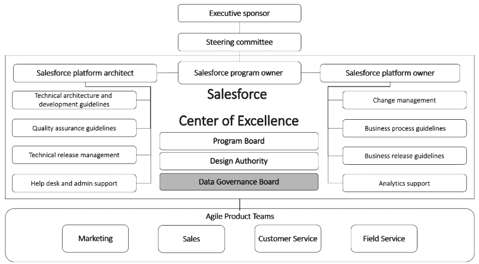
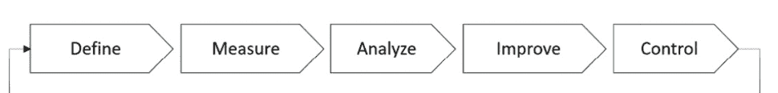

## 管理您的 Salesforce 数据以收获 Customer 360 的成果

在本 Salesforce 计划的 *第 4 部分，持续改进阶段* 的本章中，我们将介绍如何管理您的 Salesforce 数据以及如何利用它来最大化 Salesforce 投资的价值。首先，我们将介绍 Salesforce 数据的生命周期以及如何管理其质量、访问和使用。接下来，我们将探讨在不同领域利用 Salesforce 数据的众多用例，使用不同的 Salesforce 功能和技术提供更好的用户和客户体验。最后，我们将展示您如何通过展示成功实施、运行和利用的 Salesforce 计划和平台的价值来激励组织中的同行。

您将了解管理 Salesforce 数据生命周期意味着什么，以便优化用户和客户体验以及 Salesforce 组织的性能并确保 **业务连续性**。您将了解 **数据质量属性** 以及如何提高 Salesforce 数据的质量。您将了解您的 Salesforce **卓越中心 (CoE)** 如何通过建立和运行 **数据治理委员会** 来构建其 **数据治理** 工作——当您的数据及其质量得到良好管理和治理时，您就可以开始收获您的 **Customer 360**——客户的视图（和数据）的成果。您将了解如何利用您可用的 **Customer 360** 数据来自动化流程并创建卓越的个性化体验，从而推动理想的业务成果——释放 Salesforce 投资的全部价值。您还将了解如何 **激励** 和 **领导** 您的组织进行更广泛的数字化转型之旅。

在本章中，我们将涵盖以下主要主题：

- 管理和治理您的 Salesforce 数据
- 利用您的 C360 数据以最大化 Salesforce 投资回报
- 领导并激励您组织中的同行

开始吧！

### 管理和治理您的 Salesforce 数据

**数据** 是现在和未来的商业货币。有些人甚至会认为，除了员工之外，它是您组织最宝贵的资产。

尽管它很重要，但许多组织在真正利用其可用的数据方面存在困难。除了数据孤岛之外，我认为数据管理和其数据质量的 **治理** 是阻止组织在 Salesforce 中发挥全部潜力的最大挑战。

让我们直接深入了解您的数据生命周期。

### 管理 Salesforce 数据的生命周期

为了能够有效地管理和治理您的 Salesforce 数据，我们首先需要了解一些定义和概念。

让我们先了解您在 Salesforce 组织中管理的不同 **数据类别**：

- **主数据**：这是通常属于企业内多种类型系统的数据，因此需要在一个系统中进行主数据管理：
  - 示例包括客户、供应商、产品和资产

- **交易数据**: 这是与客户、合作伙伴和供应商开展业务时产生的数据：
  - 示例包括商机、报价、订单、付款、案例和活动
- **元数据**: 您的 Salesforce Org 由元数据组成——您所做的配置和定制以使 Salesforce 为您的组织服务。
- **参考数据**: 此数据是主数据的必要补充（但*不是*同一回事），因为它为交易数据提供上下文。它可能以 **元数据** 或 **配置数据** 的形式出现：
  - 示例包括州和国家选择列表值、ISO 代码、忠诚度计划层级、客户细分名称和分类
- **报告数据**: 这包括您仅为报告目的而创建的任何数据。

## 重要提示

务必将您的 Salesforce 参考数据与组织的企业架构师和数据架构师保持一致，以确保系统间的一致性。

在 *第 6 章，详细说明初始版本的范围和设计* 中，我们介绍了 **数据字典** 的概念。确保在初始 Salesforce 版本之后继续保持其最新状态，以便为利益相关者——Salesforce 数据的消费者——增加价值，并加速持续改进团队的开发工作。

对于 Salesforce 数据对象的每个类别，您需要考虑 Salesforce 数据的生命周期——按数据类别和对象。因此，让我们就数据生命周期达成共识：

- **创建**: 数据何时创建，谁可以创建记录？
  - 如果数据是系统生成的，什么会触发它？
- **存储**: 数据何时存储在您的 Salesforce Org 中，需要什么级别的加密（如果有）？
- **使用**: 谁需要访问数据，用于什么流程，多长时间？
  - 您的组织需要、想要或被允许存储这些信息多长时间？
- **归档**: 何时保留数据在 Salesforce 中不再具有增值？您有哪些流程和工具（例如批处理作业或企业工具）来管理定期归档（和备份流程）？

## 提示

考虑使用企业级 Salesforce 备份和恢复解决方案以确保业务连续性以及性能和合规性。领先的供应商包括 **OwnBackup** 和 **Odaseva**。

- **删除**: 数据何时不应再存在于 Salesforce 中或组织中？

这些概念讲完后，让我们继续讨论数据质量。

## 管理您的 Salesforce 数据质量

**数据质量** 有两个方面。如果您的数据质量总体良好，这将有助于提供愉悦的用户和客户体验，并最终带来良好的业务成果。相反，如果数据质量总体较差，则相反的情况会带来风险。

让我们先看看您的 **数据质量治理** 工作可以追求的 **目的**：

- 确保良好的用户和客户体验
- 使数据能够可靠地用于以下目的：
  - 报告和分析
  - 沟通
  - 自动化
- 遵守法律法规或行业标准

数据质量治理的目的明确后，让我们来看一下定义数据质量的维度：

- **准确性**: 您的数据在多大程度上代表真相？
- **时效性**: 数据多久更新一次？何时创建？
- **完整性**: 所有（相关）字段填充的程度如何？
- **一致性**: 捕获的信息一致性如何？
- **重复**: 每个对象的重复记录百分比是多少？
- **使用情况**: 用户在多大程度上使用数据进行自动化和分析？

需要注意的是，数据质量不是二元的，而是一个从非常低到非常高的光谱。没有任何组织能在所有数据质量属性上始终获得 100% 的分数。

## 提示

您可以通过在 Trailhead 上学习 *数据质量* 模块来了解更多关于数据质量的信息：
https://trailhead.salesforce.com/content/learn/modules/data_quality.

作为您 Salesforce CoE 的一部分，您应该有一个论坛，一个负责监督您推动数据质量工作的治理机构。该机构就是您的 **数据治理委员会**。

在下图中，您可以看到我们的示例公司 **Packt Manufacturing Equipment (PME)** 如何在其 Salesforce 计划的持续改进阶段组织其 Salesforce CoE：

图 13.1 – 带有数据治理委员会的 PME 的 Salesforce CoE

PME 的 Salesforce 数据治理委员会在其 CoE 内运作，由数据管理员、领域数据所有者和敏捷产品团队的产品负责人组成。由于治理是一种理念而非管理/决策职能，该委员会的章程是制定指导方针和原则，以进一步提升 PME 的 Salesforce 数据管理和质量改进能力。PME 的数据治理委员会还审查任何分析的输出并探索改进这些能力的举措。

考虑使用精益六西格玛 **DMAIC** 框架，您应执行以下关键活动来提高 Salesforce 数据质量：

图 13.2 – 精益六西格玛 DMAIC

## 提示

要了解有关 DMAIC 框架的更多信息，请访问此处：
https://kanbanize.com/lean-management/six-sigma/dmaic.

让我们逐步了解每个步骤！

## 定义

您的 **数据管理员** 应主导定义组织在 Salesforce 平台支持的所有领域的数据质量目标。您的 **数据管理员** 不应单独进行此练习，而应与 **数据所有者**——数据的消费者和平台各领域的代表——一起合作。

您可以使用数据质量目标模板来使目标具体化并付诸实践：

*[Field_Object_RecordType] 应为 [Quality Definition]，以便 [Stakeholder] 能够 [achieve business value]*

一个实用的数据目标示例如下：

*“Record Type 为 Bill-To 的 Account 对象上的‘账单地址’”应“至少每年核实一次”，以便“财务团队”能够“以最低风险开具发票”*

## 衡量

一旦您定义了数据质量目标，就需要跟踪您在这些目标上的表现。

您可以在一定程度上使用免费工具来跟踪和衡量数据质量。包括以下内容：

- *数据质量分析仪表板* 来自 **Salesforce Labs**，您可以在此处找到：https://appexchange.salesforce.com/listingDetail?listingId=a0N300000016cshEAA&tab=e
- *ZoomInfo Field Trip – 发现未使用的字段并分析数据质量* 由 **ZoomInfo** 提供，您可以在此处查看：https://appexchange.salesforce.com/listingDetail?listingId=a0N3000003HSXEEA4&tab=e

要将数据质量提升到下一个水平，您可以考虑投资 Delpha 等付费解决方案，它提供重复记录的自动和手动合并。您可以在此处查看：https://appexchange.salesforce.com/listingDetail?listingId=a0N3A00000FMpuXUAT&tab=e.

## 分析

一旦您有了跟踪数据质量的好方法，就需要分析它以发现趋势和差距。分析的结果应是改进数据质量的想法或举措。

根据您的 Salesforce CoE 设置和改进想法的性质，您可以决定执行以下任一操作：

- 定期审查数据质量分析（例如每月）
- 审查数据质量改进举措的临时输入

根据 Salesforce 设置和 CoE 的规模，设置报告并跟踪数据质量的责任可能在于您的 Salesforce 管理员、中央或本地数据分析师，或 BI/分析团队。

## 改进

您的 Salesforce 管理员或其他合格人员应根据分析结果清理数据。

这可能从记录创建和更新到提高 Salesforce 数据质量不等。也可能涉及归档或删除被认为不必要或不符合保留要求的数据，或提高 Salesforce 性能和用户体验。

## 控制

您的 **数据管理员** 应向您的 Salesforce（领域）产品负责人以及您的 Salesforce 平台负责人（PO）推荐举措。PO 可以与您的 Salesforce 平台架构师一起评估并确定应采取哪些举措以减轻和最小化未来数据质量不佳的风险——并加以改进。

举措可能包括以下内容：

- 为确保流程合规性和质量而进行流程再培训。
- 修改您的应用程序和系统架构及配置。这可能包括创建/更新验证规则、自动化、记录访问更改以及更改用户权限。

您可以考虑实施工具来自动化常规数据操作。一些可考虑的工具包括以下内容：

- Salesforce **Scheduled Flows** 是一个（相对）简单的声明式工具，原生于 Salesforce（需注意其容量和调度限制）
- **ETL** 工具如 **MuleSoft** 和 **Informatica** 则完全处于光谱的另一端

对于涉及公开业务信息（如地址）之类的用例，请在 **AppExchange** 上搜索用于同步数据的应用。这些解决方案需要付费，因此请权衡应用的成本与 Salesforce 团队（手动）更新数据所需的时间成本。

如果你的 Salesforce 团队定期执行相同的数据清洗/更新操作，那么投资某种形式的简单自动化通常是一个直接的商业案例。

在考虑删除未使用的字段并 *与你的产品负责人以及潜在的终端用户代表进行验证* 时，请务必在此之前进行尽职调查，包括影响分析。

### Tip
作为最佳实践，请分两步删除字段。首先，从页面布局或动态表单中移除该字段并移除字段级安全访问权限。一个月后，如果没有利益相关者询问该字段去哪了或抱怨仪表板中缺少信息，请先备份包含该字段数据的任何记录，然后再删除该字段。

数据管理和治理是 Salesforce 项目持续改进阶段最重要的活动之一。接下来，我们将看看你如何逐步开始改进。

## 开始数据质量治理
你管理 Salesforce 数据及其质量的好坏并非二元对立——它是一个光谱。

如果你发现自己主要是在救火——例如进行响应式数据加载来纠正糟糕的数据质量——那么你在成熟度光谱中更接近低端。别担心，这意味着你有很大的改进潜力——这将为你的用户、客户和组织带来巨大好处。

### Tip
要了解你的组织在数据管理方面的成熟度如何，请查看来自 *Experian* 的这篇文章： https://www.edq.com/blog/data-maturity-how-mature-are-you/.

那么如何开始呢？让我们来看一个可考虑的方法：

- 1. 成立一个 Salesforce **数据治理委员会**，并将其锚定在你的 Salesforce CoE 内部。
- 2. 确定其章程，分配足够的资源，并确保从一开始就获得业务利益相关者的认可和参与。
- 3. 与业务利益相关者合作，了解对他们而言最重要的哪些数据和哪些 KPI（可参考 *第 4 章*，*获得资金并与 Salesforce 和实施合作伙伴互动*，以获取灵感）。
- 4. 评估并确定将使用哪些工具来支持你分析和管理 Salesforce 数据。
- 5. 从此以后，遵循本章前面介绍的 DMAIC 模型。
- 6. 最后，不要试图一次性确定、分析和修复所有问题：
  - 1. 类似于你为用户提供新功能而演进的 Salesforce DevOps 能力，你应努力通过持续改进数据质量来 **提供持续、增量的价值**

### Tip
要了解更多关于 Salesforce 数据管理和数据质量的信息，你可以阅读以下内容：

- *Salesforce Data Architecture and Management* 作者 Ahsan Zafar（CTA）(https://www.amazon.com/Salesforce-Data-Architecture-Management-effectively/dp/1801073244)
- Salesforce 的文章 *Data Management Best Practice Guide*，链接在此： https://help.salesforce.com/s/articleView?id=000393223&type=1

接下来，让我们转向如何享受你在 Salesforce 及其数据质量方面的投资成果。

## 利用你的 C360 数据最大化 Salesforce 投资回报
让我们先评估你组织的数据利用成熟度，然后开始讨论正事。

你可以利用手头数据的不同方式。如果你思考自己如何使用 Salesforce 数据，你很可能会将其归类到以下某个阶段：

- **描述性**：*知道发生了什么*
- **诊断性**：*知道为什么会发生*
- **预测性**：*预见可能发生什么*
- **规范性**：*建议采取行动来管理或利用预测可能发生的情况*
- **认知性**：*基于正在发生的事件和/或基于预期采取行动*

### Important note
你不能从描述性分析直接跳到认知分析。你必须逐步通过各个阶段。掌握每个层级并从中获得价值的关键成功因素是高质量的数据以及对该举措带来的准确性和价值进行持续验证。验证部分经常被试图跳过步骤的组织所忽略。验证最好由具有远见、努力为业务开拓下一个前沿的人以及对用例有深入了解和背景的人共同完成。这些可能是领域超级用户，他们最渴望摆脱基础、重复的任务或希望改进销售或服务流程。

理论部分讲完后，让我们深入探讨如何利用你的 Salesforce 数据为用户和组织释放价值。

利用 Salesforce C360 数据主要有两种方式。如下所示：

- **知识和洞察：**
  - 作为优化、数据驱动决策的基础
- **自动化：**
  - 用户的重复性、响应式手动任务
  - 响应式或主动式操作

### Important note
这两种方式不应被视为独立或脱节的，前者是后者的催化剂。随着你的组织在利用 C360 数据方面的能力成熟，微妙的界限会逐渐消失，看起来会淡化。

让我们看看利用 Salesforce C360 数据的潜在用例。

接下来，让我们按业务领域和跨业务领域探索一些最明显和常见的利用 Salesforce C360 数据的用例：

- **营销**：用例包括营销运营洞察和自动化，包括由事件触发的启动或推进客户旅程。
- **销售**：用例包括由 Sales Cloud **Einstein** 驱动的销售生产力，用于洞察哪些线索最有可能转化以及哪些商机最有可能成交。对于商务而言，产品推荐是 Einstein 的一个很好的用例。
- **服务**：利用 Salesforce 数据来提高服务组织效率的用例众多。关键用例包括案例管理生产力，例如通过自动化案例创建（web-to-case、自助服务）或将 Einstein Case Classification 与 **Omnichannel** 基于技能的路由相结合来进行案例分配。如果你目前正在为客户提供（或考虑提供）聊天功能，你应考虑实施聊天机器人，使客户能够自助服务，从而将简单案例从在你的 Salesforce 组织中创建中转移出去。从菜单驱动的聊天机器人开始，随着你收集更多聊天数据，逐步过渡到基于意图的 **AI 聊天机器人**。
- **跨领域**：对于所有领域，你都可以利用 Salesforce 平台功能来实现更高水平的生产力。这些包括 **Next Best Action**、**CRM Analytics Predictions** 和 **Salesforce Genie***，等等，还有很多。

### Tip
*Salesforce Genie 是 Salesforce 的一个新层或产品套件。你应自行研究并根据可用的产品信息做出任何决策。了解有关 Salesforce Genie 的更多信息，请访问 https://www.salesforce.com/products/genie/overview/.

要了解更多关于 AI 和 Salesforce 的信息，你可以阅读 Lars Malmqvist（CTA）撰写的 *Architecting AI Solutions on Salesforce*（https://www.amazon.com/Architecting-Solutions-Salesforce-state-art/dp/1801076014/）。

除了在你的 Salesforce 组织 *内部* 的分析和自动化用例外，让我们考虑与 *外部* 系统集成并自动化流程的用例：

- **MuleSoft RPA**：使用 MuleSoft，其中包括使用 **光学字符识别 (OCR)** 处理收到的文档并将其转换为系统可消费的数据：
  - 用例可能包括通过 PDF 接收订单，而不是人工手动创建订单，MuleSoft 可以为你完成。
- **MuleSoft Composer**：一种声明式（无代码）解决方案，使管理员和功能顾问能够设置跨系统流程自动化：
  - 尽管 Composer 是一种声明式解决方案，但请确保遵循与任何集成相同的设计治理严谨性——要求解决方案设计由你的 **Design Authority** 审查。
  - 用例包括将案例更新发布到 Slack 频道。需要考虑的几点如下：
    - Composer 设计用于低量流程，而非批处理或批量用例。
    - 没有用于测试的沙箱概念，因此在通过将 Composer 流程连接到生产环境来“启用集成”时要谨慎。

**MuleSoft Anypoint**：Anypoint 是领先的企业级中间件（ESB）和 ETL 工具，是 Salesforce 产品组合的一部分。如果您在企业架构路线图中没有中间件或 ETL，您希望追求诸如 **API 驱动的连接/API 经济** 之类的 IT 战略，并且您已在使用 Salesforce 作为 CRM，您应考虑 MuleSoft。

接下来，让我们优先考虑您的举措。

## 优先考虑您的分析和自动化举措

在您确定利用 Customer 360 数据的潜在举措时，了解在优先考虑要推进的举措时应考虑什么内容会很有用。

让我们介绍每种类型举措的总体目标和您应考虑的要点：

| 举措类型 | 关键目标 | 创建举措商业案例时需考虑的关键要点 |
|---|---|---|
| Analytics | 获取洞察以优化决策 | 不知道（提前或立即）有什么风险？对于这些举措，将不同举措的风险绘制在简单的 影响-可能性 矩阵上，将为您提供指导，以选择最有价值的分析举措进行投资。将此与在 Salesforce 中交付洞察的努力进行权衡。 |
| Efficiency | 缓解基础任务 | 该任务每月或每年发生多频繁？耗时（以分钟计）多长？推算出以计算所有受益于自动化的用户可节省的潜在时间。将此与在 Salesforce 中交付自动化的努力进行权衡。 |
| **收入** | 推动销售 | 更快、更好、更可靠的洞察或自动化将如何提高您的商机胜率和平均交易规模，或减少其成交时间？在考虑您组织的平均毛利率的情况下，将其与在 Salesforce 中交付自动化的努力进行权衡。 |

表 13.1 – 按举措类型划分的商业案例考量

仅保留 **一个** 产品待办事项列表，用于优先考虑您的数据分析和自动化举措，以及其他 Salesforce 开发举措。

## 重要说明

规范 AI 开发和使用的法律是一个快速发展的法律领域。与您的法务团队密切合作，了解您在管理客户数据和 AI 服务方面需要遵守的法律。

让我们继续本章的最后一个主题——灵感！

## 领导并激励您组织中的同行

当您为利益相关者提供价值时，消息会传开，您的平台、您的项目和您的团队正在为组织带来改进。

很可能，当这种情况开始发生时，您——以及您的 Salesforce 项目和团队——将已发展出交付新功能（DevOps）的能力，以及分析和潜在的 AI 服务（DataOps 和 AIOps）。

谦虚地接受赞扬，并分享您取得今天成就之旅中的知识和经验；您已成为组织的前沿，领导其难以捉摸的 **数字化转型**。

让我们总结本章！

## 摘要

我们在本章中涵盖了 Salesforce 项目持续改进阶段的许多主题。首先，您学习了如何管理 Salesforce 数据的生命周期并治理其质量，以为您的分析和自动化举措取得成功奠定基础。接下来，您探索了利用 Salesforce C360 数据的许多用例。

您现在已深入了解需要持续执行和发展的 方法和活动，以便从 Salesforce、数据、分析和自动化举措的投资中 **最大化业务价值**。

成功交付这些举措将帮助您激励组织内的同行，并让您承担更广泛、更大的举措。

在下一章中，我们将讨论您在 Salesforce 项目持续改进阶段可能遇到的典型问题，以及如何减轻和克服这些问题。我们还将提供评估 Salesforce 项目状态的清单。
