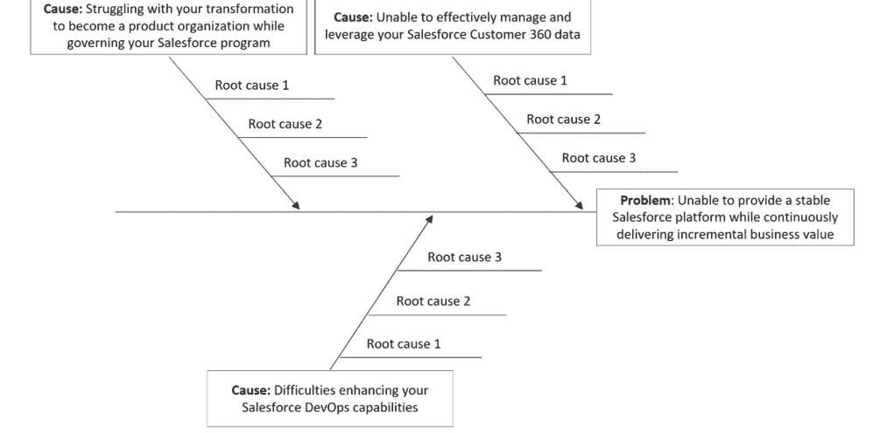

## 持续改进阶段应避免的常见问题

在前两章中，我们介绍了您将在 Salesforce *项目* 持续改进阶段执行的活动。

在本章中，我们将讨论 Salesforce 项目永续阶段最常见的问题。我们还将介绍防止或减轻这些问题出现的策略。

在 *第 5 章，应避免的预开发阶段常见问题* 中，您已了解 **根本原因分析**，我们将继续使用该方法来剖析常见问题。

本章结束时，您将获得一套 **检查清单**，您可以定期参考以评估 Salesforce 项目在持续改进阶段的状态。

本章将涵盖以下主要主题：

- 持续改进阶段的常见问题及其根本原因
- 评估 Salesforce 项目的状态

开始吧！

## 持续改进阶段的常见问题及其根本原因

让我们首先查看在持续改进阶段无法在持续交付增量业务价值的同时提供稳定 Salesforce 平台的一些最常见问题——用鱼骨图说明：

图 14.1 – 持续改进阶段常见问题的鱼骨图

接下来，我们将讨论每个常见问题的可能根本原因以及减轻和预防的策略。

## 在治理 Salesforce 项目的同时努力实现向产品型组织的转型

在表 14.1 中，您可以找到可能导致您在治理 Salesforce 项目的同时努力实现向产品型组织转型的原因——以及如果您已面临该问题时的缓解策略：

| 可能的根本原因 | 缓解和预防策略 |
|---|---|
| *高级管理层未参与或未认同向产品型组织转型的概念和价值，因此看不到转型的必要性。* | 产品型组织的概念、原则和方法是释放 Salesforce 项目价值的关键（请参阅 *第 12 章，发展您的 Salesforce 组织和 DevOps 能力* 中的 *将您的组织转型为产品型组织* 部分）。如果您向高级管理层推介该概念的原始方案没有以起立鼓掌结束，请不要气馁——这种情况很少发生。组织转型是一项重大变革，应如此对待。与全有或全无的方法不同，这里有一个更易接受的行动方案供您考虑：获得授权，仅针对您的 Salesforce 项目试验产品型组织概念，而非整个组织。如果针对整个 Salesforce 项目不可行，请尝试获得一位高级经理/部门的认可，为业务领域试验该方法。在您的 Salesforce 项目范围内——在您的控制范围内——尽可能纳入尽可能多的产品型组织实践。随着您开始看到积极成果，请与您的同行和高级管理层分享——出于激励的目的。与您的同行和高级管理层互动时，持续使用产品型组织的语言。这将逐渐传播该概念，您的利益相关者将通过渗透慢慢采纳它。 |
| 您的组织继续 *资助* 零散的项目，而非整个 Salesforce 项目，包括一致的敏捷产品团队。 | 这与前一个根本原因密切相关。资助持续交付价值的敏捷产品团队是成为产品型组织的基础。如果您的组织传统上使用基于全面 BRD 的水瀑项目方法论，转向自主的敏捷产品团队将会显得激进——并且不太可能立即得到高级管理层的支持。您需要做的是保持决心目标保持不变，同时提出妥协方案。可以是实施中期规划机制，例如 SAFe 项目增量。纯粹的敏捷主义者会很快称 SAFe 为规模化水瀑框架。虽然这可能是（部分）正确的，但即使是“做事方式”上的微小改变也比没有改变好，因为它将让您踏上旅程。这样，您就是将 SAFe 作为交付转型之旅转型架构中的一个组件来利用。随着进展，突出这种新工作方式对您组织的益处。灌输并鼓励精益求精（kaizen）的理念（日本的通过 |

(持续改进) 并使用冲刺回顾来了解你可以做出哪些改变以改进你的工作方式。

你的 Salesforce 项目和平台的 *愿景* 和 *战略* 与你组织的 *愿景* 和 *战略* 脱节或不一致。因此，你难以为你的 Salesforce 平台及其产品设定目标。

这一根本原因的症状是，你的 Salesforce 团队可能非常高效——以令人印象深刻的速度产出用户故事——但你的 Salesforce 项目 *并未被视为为组织创造价值*。

在持续改进阶段，Salesforce 项目的对齐是成功的关键。

那么，你可以做些什么来实现对齐？

参考你在开始开发初始版本之前准备的原始商业案例。阅读 *第 4 章*，*获取资金并与 Salesforce 和实施合作伙伴展开合作*，以重新审视商业案例的组成部分，同时阅读 *第 1 章*，*为你的 Salesforce 项目创建愿景*，以理解并（重新）定义你的 Salesforce 项目的愿景。

你应该对 Salesforce 产品的客户（用户）——即你的 Salesforce 平台服务的对象——有非常清晰的认识。

你可以使用 **Jobs-To-Be-Done (JTBD)** 框架，在其中你可以在以下维度上完善他们的角色描述：

- **JTBD**：你的角色（用户）需要完成的职能性和情感性工作。
- **Pains**：这些角色面临的风险和障碍。考虑你的产品如何帮助缓解这些痛苦。
- **Gains**：期望的结果是角色所追求的利益。

确保你的敏捷产品团队、Salesforce CoE 以及更广泛的利益相关者都能访问并理解角色描述。

丰富的角色模型是很好的对话开端——尤其结合业务流程图中的泳道——以了解你的 Salesforce 产品为何是或应该是某种特定方式。

你为以下核心 Salesforce CoE 角色申请了资金：

- Salesforce program owner
- Salesforce platform architect
- Salesforce platform owner (chief product owner)
- Salesforce product owners for each agile product team

但你未能获得全部预算的批准。你可能只获得了为其中 2 或 3 个角色配备人员的资金。

没有适当的资金，你就无法雇用人员来监督、管理并为你的用户、客户和组织持续交付改进。

资金需要涵盖你的 Salesforce CoE 以及敏捷产品团队和潜在的新项目。

为了务实并最大化利用资金，你有以下选择，每个选择都有需要考虑的弊端：

- 合并平台负责人和项目负责人角色。这通常是首选的折中方案。请注意由此产生的关注度降低，如果由不同人员负责 Salesforce 项目内的不同方面，你本可以拥有更集中的关注。
- 让某些角色在你的 Salesforce 项目上的分配少于全职。这也会导致关注度降低，因为这些角色会有其他竞争性优先事项。

无论你的资金如何，都要充分利用它。随着你推进 Salesforce 项目并交付价值，你可以塑造商业案例以达到新的高度。

你的 Salesforce 产品路线图的拥有权和决策授权仍在高级领导层——或部门/区域负责人的集体手中。此外，你的产品路线图是基于时间的版本发布表示。

如果优先级排序和决策是（纯粹）自上而下而非自下而上，你可能会构建无法验证为客户（用户）创造价值的功能。另一个后果是难以定期更新路线图。更好的做法——也是你需要尝试说服高级管理层的——是你的产品路线图应代表产品演进的意图。与其自上而下的优先级排序，你应致力于赋能产品负责人，让他们与终端用户互动以创建更具影响力的路线图，该路线图可以定期更新并——重要的是——传达给你的利益相关者。

你的运营模式——以及其中的合作伙伴模式——不支持或与你的 Salesforce 项目雄心不一致。这一根本原因的迹象是，你的组织，包括你的 Salesforce CoE，缺乏实现产品型组织愿景的能力。

如果你对 Salesforce 路线图有宏伟的雄心——意味着你希望交付许多代表用户巨大业务价值的功能——但没有支持它的运营模式，这只是空想。考虑你打算让谁参与路线图的持续交付。参考第 12 章《演进你的 Salesforce 组织和 DevOps 能力》中“持续改进阶段调整你的合作伙伴模式”部分，以反思你 Salesforce 项目的未来运营和合作伙伴模式。

你在产品开发能力（如何构建）上的投资过度，而牺牲了产品发现（构建什么以及为什么）。如果没有成熟的手段和经验丰富的人员与用户互动以了解他们需要完成的工作、以及他们的痛苦和收益，你将难以理解他们的感受——从而交付次优的解决方案。

避免将 Agile（一种思维方式和用于协作设计、构建和测试事物的各种方法论的统称）混淆为确定构建什么以及为什么的方法。是的，《敏捷宣言》指出用户互动是关键，但并未进一步描述如何做到。

以下是你可以增强产品发现能力的一些方法：

- 确保客户体验设计师是你的敏捷产品团队的一部分。
- 针对不同的用户群体（角色）定期举办用户反馈论坛，在获取现有功能和使用的反馈之外，邀请他们分享对产品待办事项优先级排序的看法。在规划路线图时考虑他们的反馈。
- 保持用户反馈渠道畅通——并怀着感激之情回应。

你的敏捷开发团队及其产品负责人陷入了构建陷阱，认为所有问题和功能请求只能通过技术解决方案解决。

技术很棒，许多问题可以在 Salesforce 等平台上相对快速地解决。但事实是，并非所有问题都需要技术解决方案。

表 14.1 – 在治理 Salesforce 项目的同时，将组织转型为产品型组织时可能遇到的困难的可能根本原因

| 可能的根本原因 | 缓解和预防策略 |
|---|---|
| 你的敏捷开发团队及其产品负责人陷入了构建陷阱，认为所有问题和功能请求只能通过技术解决方案解决。 | 在考虑解决方案类型之前，进行研究和分析以了解需要实现什么以及为什么。只有这样你才能确定最佳的解决方案类型可能是什么。它可能是技术解决方案，但通常可能是培训、沟通或第三种解决方案类型。 |
| 你（出于好意）逐字实施了 SAFe 或其他框架以扩展敏捷，相信它会自动使你的组织敏捷。相反，你因规划和仪式（会议）而被开销淹没。 | 框架应为你服务，而不是相反。你应——审慎地——调整在你的组织环境中有意义的框架部分，并使其成为你自己的。如果你的 Salesforce 项目是你的组织首次接触敏捷，请考虑聘请合作伙伴指导你在规模化敏捷方面的转型之旅。 |

让我们跳到持续改进阶段的下一个常见问题。

## 提升 Salesforce DevOps 能力方面的困难

在表 14.2 中，你将找到可能导致你难以提升 Salesforce DevOps 能力的根本原因——以及如果你已面临该问题时的缓解策略：

| 可能的根本原因 | 缓解和预防策略 |
|---|---|

## 你*并未演进*你的 Salesforce *DevOps 能力*。

DevOps 本身就是一个不断演进的领域。Salesforce 平台及其相关技术亦然。如果你没有利用这些改进，就无法充分发挥你在平台上的投资价值——以造福你的用户和组织。

这意味着 DevOps 不是你做的事情，而是一种你应努力持续改进的能力。

开始的地方可能让人感到不知所措，因此请将以下步骤作为起点考虑：

- 1. 梳理你当前的 DevOps 流程。
- 2. 识别能够带来最大价值的改进领域——改进 DevOps 指标（参考 DORA）。这些领域可能是 *第 12 章*、*演进你的 Salesforce 组织和 DevOps 能力* 中提到的 *增强你的 Salesforce DevOps 能力* 部分的任何一项。
- 3. 理解这是一段旅程，因此以*增量*方式实施改进——采用 DevOps 不意味着你必须一次性做出重大改变。相反，迈出一个小步就能带来明显的回报。
- 4. 评估改进所实现的收益并继续前行。

## 你难以实现新发布功能的*采用*。

问题可能不在于功能本身，而在于它们发布的方式。

你需要做的是在发布新功能时记住变更管理、沟通和培训。

请参考 *第 10 章*、*通过沟通、培训和支持推动采用* 中的 *规划、沟通和管理变更* 部分，以获取有关发布新功能时应如何做的灵感。在持续改进阶段要留意并校准你的工作——遵循与新功能所代表的变更影响相称的比例原则。
确保你创建报告来跟踪并*了解*用户如何采用你的新功能。用用户访谈补充使用报告，以了解采用情况以及改进的潜力。

### 你的生产环境*部署时长*在增加和/或从新请求到发布的*前置时间*很高或在增加。

因此，你难以实现你的 *sprint 或 PI* 目标。

如果你将此作为根本原因面对，许多后果使得采取行动加以补救变得势在必行：

- *不满意的 Salesforce 团队成员*（你平台的守护者）
- 组织对你的 Salesforce 计划失去信任，最终导致资金流失
- 等待新功能的时间过长
- 团队成员的时间资源被浪费，这些时间本可用于开发新功能
- 部署失败的高风险
- 采用率降低的高风险

通常，问题与未演进你的 DevOps 能力有关。

考虑以下方法以减少部署和前置时间：

- 回顾并以 DevOps 的原则为目标——更小、更频繁的发布可降低部署和变更管理工作的风险和复杂性
- 努力从完整部署转向部分、更小的部署
- 使用约束理论来减少 DevOps 流程中的瓶颈
- 对团队成员进行 CI/CD 工具的培训和提升技能（并为 QA 制定检查），或外包技术部署管理
- 考虑通过在 CI/CD 流水线中设置高级脚本来自动化手动部署任务（不可部署的组件）

如果出于任何原因，你的 Salesforce 计划目前无法过渡到更小、更频繁的发布，你需要提高保持部署计划（运行手册）更新的警惕性。

### 你难以将*翻译*功能请求——大和小——转化为适当的产品待办事项或项目，因此你难以为请求决定适当的交付方式。

如果你无法有效对请求进行分类，并在对请求的初步资格评估中对其进行估算，你将面临无法推进的风险。更糟的是，你可能会将一个请求误认为是一个大项目——并花费（浪费）许多人的时间来决定如何最好地实施它——而实际上这是一个只需简单修复的小请求。在相反的情况下，对快速交付的期望很快就会转为失望和延迟。

虽然你应采用更纯粹的敏捷交付方法来对 Salesforce 解决方案支持的现有能力进行产品*演进*，但它并非适用于所有计划的最佳方法。

让你的产品负责人、业务分析师、客户体验设计师和解决方案架构师组合参与，以评估请求并将其转化为适当的产品待办事项或项目。

为组织你的产品待办事项层级制定框架。一个示例描述在 *表 12.1 - Salesforce 产品待办事项类型* 中。

参考 *第 3 章*、*确定如何交付你的 Salesforce 项目* 的 *理解交付方法* 部分。

如果你评估请求构成一个独立项目，请遵循本书的 *第 1-3 部分*。如果不是，请参考 *第 12 章*、*演进你的 Salesforce 组织和 DevOps 能力*；你的敏捷产品团队应根据你的 DevOps 流程交付。

### 难以管理多个*并发*敏捷产品团队和长期项目。

这可能是由于你仍在将初始（MVP）发布推广到更多地理区域的过程中。

如果你遇到此问题，你可能会难以*优先*或分配资源以持续改进你的 Salesforce 产品，以及由于同时运行太多承诺而导致团队倦怠和交付风险。

需要记住的关键是基于手头资源所能实现的现实假设来管理期望的古老艺术。如果期望超过当前可能实现的，要么降低期望（移动推广时间表），要么增加更多资源——用于推广或持续改进。

并发流和长期项目的先决条件是复杂的 CI/CD 流水线和工具。务必咨询技术架构师和 DevOps 专家，为你的 Salesforce 计划实现雄心提供最佳行动方案指导。

### 你的产品路线图不包括技术使能器，也称为*架构跑道*。

这通常发生在没有 Salesforce 架构师（平台、技术、解决方案）参与更新 Salesforce 产品路线图或评估新功能请求时。
没有技术跑道，交付风险和潜在的技术债务会累积——从长期来看阻碍你的敏捷性。
你需要建立让 Salesforce 架构师参与评估新请求流程的做法。
接下来，你需要为中等和大型待办事项——以及任何项目型计划——的前期架构和设计分配适当的时间和架构资源。

### 你没有结构化的方法来持续处理*技术债务*。

这通常与缺乏架构跑道密切相关。
未解决和管理的技术债务的症状表现为你的团队成员因日益增加的维护和中间缺陷修复需求而不堪重负。与此同时，你的利益相关者可能在等待新功能开发和发布时耐心受考验。
如 *第 12 章*、*演进你的 Salesforce 组织和 DevOps 能力* 中 *管理技术债务* 部分所述，这主要源于：

- 基于设计不良的解决方案对 Salesforce 平台进行的更改，这些解决方案需要高程度的维护，其成本超过了解决方案本身的好处
- 被扩展超出其预期和适用范围的治理不善的解决方案

你可以采取的措施是*预防*和*缓解*的结合：

- 你的 PO 应初步审查和确认缺陷和新功能请求。如果不是有效缺陷（损坏的功能）或与产品目标一致的新请求，就不应为其实施解决方案。
- 实施设计权威机构，在开发开始前审查拟议的解决方案设计。
- 确保开发指南已到位、已传达、被理解并被使用。它们还应持续更新和完善。

- 要求敏捷产品团队成员在待办事项中明确说明其拟议解决方案所需的维护工作量以供审查。挑战需要维护的解决方案以及相应的业务需求——或完全缺少该部分的情况。
- 为持续重构分配 PI 或冲刺容量的 15%-25%。这可以通过在冲刺中包含重构待办事项来实现，也可以通过在每个计划增量结束时设立专门的“重构”冲刺来实现。虽然后者对 DevOps 友好度较低，但有时更容易理解、管理、规划（因此会发生）——使其成为最佳 DevOps 方法的有吸引力的替代方案。

你可以阅读 *Ian Gotts* 的这篇文章以进一步了解技术债务：

https://medium.com/salesforce-architects/how-architects-can-help-reduce-technical-debt-c0814bf8eaa.

文档和培训材料在上线后初期维护不善。

这是一个显而易见的原因造成的问题；没有文档，新成员将难以理解你的 Salesforce 平台做什么以及为什么。现有的团队成员了解任何更改的基线也是一个问题。

培训材料——无论格式如何——对于现有用户和新用户的采用至关重要。

保持文档和培训材料处于良好状态，依赖于你的人、流程和工具。

在用户故事的完成定义中纳入更新文档（例如，业务流程图、数据模型、数据字典、培训文档等）。

对于文档，请考虑具有预建 Salesforce 模板可供开始使用的协作工具，例如 **LucidChart**。

考虑利用组织分析工具，例如 **Elements Cloud**、**Salto** 和 **Metazoa**。

你被错误淹没，并且在解决一个错误后，你后来又遇到了相同或类似的错误。

你的错误报告可能从性能不佳的报告和损坏或不连贯的 *自动化* 到 *杂乱的 UI* 和繁琐的 *导航* 不等。

修复错误繁琐且耗时。虽然对于某些人来说，排查故障并找出错误根源在精神上可能令人兴奋，但实际上这是浪费时间。修复错误不是浪费，但如果能预防，时间本可以更好地利用。

如果你遇到大量错误，应该怎么办？

- 1. *修复*：花相应比例的时间调查错误的根本原因，使用 **5 Whys 方法** 来发现并修复看似技术问题背后的人为原因。在这里查看 Eric Ries 关于该方法的视频：https://hbr.org/2012/02/the-5-whys.html。
- 2. *预防*：实施设计权威，在开发开始前审查拟议的解决方案设计。此外，投入时间改进开发标准、指南、测试框架和开发人员入职流程。

表 14.2 – 增强 Salesforce DevOps 能力困难的可能根本原因

让我们跳到持续改进阶段的下一个常见问题。

## 无法有效管理和利用你的 Salesforce Customer 360 数据

在 *表 14.3* 中，你将找到可能导致你无法有效管理和利用你的 C360 数据的可能根本原因——以及如果你已面临这些问题时的缓解策略：

| 可能的根本原因 | 缓解和预防策略 |
|---|---|
| 你收到许多关于 *数据质量不佳* 的报告，并且你难以识别根本原因。 | 高品质数据是你想用 Salesforce 做任何事情的基础。遵循 *第 13 章*、*管理你的 Salesforce 数据以收获 Customer 360 的成果* 中 *管理你的 Salesforce 数据质量* 部分所述的 DMAIC 方法。  你可以通过以下方法尝试识别数据质量不佳报告的根本原因： - 1. 确定被报告数据质量不佳的对象（们）的 *数据类别* 是什么。 - 2. 了解报告中数据质量的 *维度* 哪方面不佳。 - 3. 评估数据质量有多差。如果确实非常差且对业务有重大影响，请继续。 - 4. 了解对象相关的 *业务流程*。 - 5. *分析* 以找到可能导致根本原因的趋势和模式。可检查的地方包括数据生命周期（质量问题是在记录创建、处理或使用时出现？）、记录类型、创建者或所有者的角色、销售组织、区域、类别、阶段/状态、数据访问权限和权限： &nbsp;&nbsp;- 1. 同时检查报告者和创建和编辑数据的人员——有时，问题不是数据质量，而是数据访问或权限。 &nbsp;&nbsp;- 2. 对于核心 *核心* 交易对象（Lead、Opportunity 和 Case）；*年龄* 是关键的数据质量维度和通用 KPI 追踪指标。 |
| 你在建立数据治理机构并在组织内确立所有权方面遇到困难。 | 你需要确保 *数据所有者* 分配并拥有其业务领域的数据。如果不是这样，请在你的 *Salesforce 数据治理委员会* 中提出问题，以便为数据所有权提供资源。 |
| 你难以 *优先安排* 你的数据质量改进工作。 | 在 *第 13 章*、*管理你的 Salesforce 数据以收获 Customer 360 的成果* 中 DMAIC 的 *定义* 部分，我们研究了 *数据质量目标* 的概念。如果你已为组织设定了这些目标，那就是你应该努力提高质量的数据。  如果你尚未建立数据质量目标，以下类型的数据应考虑优先排序： - 个人数据（Contacts 和 Leads），用于通信，因此如果数据质量不佳，你将面临糟糕的客户体验、满意度，最终影响客户生命周期价值。 - 跨组织具有影响和使用的主数据。这可能包括 Accounts、Products 和 Assets。 - 包含任何类型财务信息的数据（报价、订单、发票和付款）。 - 集成数据——如果你将数据发送到企业内部或外部的其他系统，请确保其质量很高。接收数据也一样——确保你能信任其质量，或在录入时进行验证。 - 参考数据。  其他类型的数据可能对你的组织极其重要，因此在设定数据质量目标时务必进行评估。 数据始终保持高质量是目标。但当你需要优先改进时，请考虑数据需要在何时准确完整。例如，Lead 在创建时可能不需要 100% 完整——只需足够联系并确认信息和兴趣即可。在 Lead 转换时，质量则需要很高。 |

数据模型更改在引入时几乎没有或根本没有考虑其对集成、自动化或用户体验的影响——更不用说你的分析服务了。

确保包含数据模型更改的任何用户故事在开始开发前由你的设计权威提出并审查。

将此准则传达给所有团队成员——内部以及外部。

你难以找到利用 Customer 360 数据的灵感。

请参考第 13 章《管理你的 Salesforce 数据以收获 Customer 360 的成果》中《利用你的 C360 数据以最大化 Salesforce 投资回报》部分。

此外，你可以通过多种方式获得灵感，包括：

- 与 Salesforce 生态系统互动——通过参加团体活动参与 Trailblazer 社区：https://trailblazercommunitygroups.com/
- 阅读书籍，例如 Lars Malmqvist 所著的 Architecting AI Solutions：https://www.amazon.com/Architecting-Solutions-Salesforce-state-art/dp/1801076014/ref=tmm_pap_swatch_0?_encoding=UTF8&qid=&sr=
- 访问 Salesforce AI Research 网站以获取更多灵感：https://www.salesforceairesearch.com/

你在清楚了解用例、其上下文以及该举措的消费者/受益者（用户、客户）之前就启动了数据分析、自动化或 AI 举措。

如果你不完全了解数据分析举措的上下文，就无法开发出切中要害的解决方案。

最好的情况是，用例是通用的，你的解决方案遵循该模式的通用最佳实践。最坏的情况是，你的解决方案偏离目标，留下绝望和技术债务的痕迹。

不能强调太多，但在设计解决方案时要让你的预期用户参与——同样适用于数据分析、自动化和 AI 举措。

你启动了数据分析、自动化或 AI 举措，而未确保适当的数据质量。

这是导致糟糕体验、错误、低满意度以及潜在收入损失的失败配方。

你不应在未为所利用数据的质量设置护栏的情况下开发数据分析、自动化或 AI 举措。

你难以管理、维护和改进你的数据分析和 AI 部署，例如聊天机器人或 Einstein 预测。

AI 解决方案需要持续监控和改进才能发挥最大效益。持续改进也是跟上你的业务、客户和用户所必需的。

因此，你需要考虑大约 10%-20% 的初始设置工作量的持续维护工作。

| | |
|---|---|
| 您在利用 Customer 360 数据的努力中难以看到 *进展*。 | 累积边际收益的原则同样适用于数据分析、自动化和人工智能举措。您成功交付的每项举措——每个功能、每次数据质量改进和每个分析能力——都会促进并放大您和 Salesforce 同事为组织带来的成功和价值。请记住，这是一段旅程——继续不断向前向上推进，结果就会随之而来。 |

表 14.3 – 无法有效管理和利用您的 Salesforce Customer 360 数据的可能根本原因

接下来，让我们评估您在持续改进阶段的 Salesforce 项目状态。

## 评估您的 Salesforce 项目状态

我们已在您 Salesforce 项目的持续改进阶段涵盖了大量主题和活动。如果您遇到困难，或对进展不满意，以下部分将帮助您评估 Salesforce 项目的状态。

对于您无法勾选的每项，请返回相关章节并完成活动，以提升能力，最大化投资回报。

## 持续改进阶段 Salesforce 项目检查清单

*开始时*，在 Salesforce 项目的持续改进阶段——在 Salesforce 首次上线后——您应完成以下步骤：

- 确保您的 Salesforce 项目和平台愿景与组织的愿景和战略保持一致
- 使用核心角色更新您的 Salesforce CoE
- 理解产品型组织的概念
- 了解 Salesforce 平台和产品的客户（用户）是谁
- 了解您的 Salesforce 产品是什么
- 招募或指定 Salesforce 产品负责人，并赋予他们真正拥有其产品的权力
- 为您的 Salesforce 平台和产品设定目标——与平台愿景保持一致
- 从为离散项目（工作说明书）提供资金转变为为由敏捷产品团队组成的 Salesforce 项目提供资金
- 更新您的运营和合作伙伴模式
- 更新您的 Salesforce 路线图
- 建立跨职能敏捷产品团队
- 评估您的敏捷成熟度和 DevOps 能力——并启动演进行动

在整个持续改进阶段，您应 *持续地* 执行以下操作：

- 增强您对产品型组织的理解并推动活动，推动组织向其转型
- 通过深入了解 Salesforce 用户的待办工作、痛点和收益来完善人物画像描述，并定期组织用户反馈论坛
- 监控并了解用户对新功能和现有功能的采用和使用情况
- 通过以下方式管理 Salesforce 平台的健康状况：
  - 组织定期设计权威会议以审查新提出的解决方案
  - 执行定期健康检查
  - 保持文档最新
  - 定义并传达开发标准和指南
- 朝着更小、更频繁的发布迈进
- 定期评估您的 Salesforce DevOps 能力并推动提升行动
- 通过运行数据治理委员会来管理 Salesforce 数据质量工作
- 使用 DMAIC 框架改进 Salesforce 数据质量
- 通过确定数据分析举措最常见的性质（描述性-诊断性-预测性-规范性-认知性）来评估您的数据成熟度
- 实施新的数据分析、自动化和人工智能举措并持续改进
- 增强您的数据分析、自动化和人工智能能力以利用 Customer 360 数据
- 管理、监控、维护和改进您的数据分析、自动化和人工智能举措
- 激励组织内的同行和领导层
- 激励并与 Salesforce Trailblazer 社区互动
- 分享您的知识和经验

让我们总结本最后一章。

## 摘要

在本章中，您已熟悉 Salesforce *项目* 持续改进阶段面临的一些最常见问题。如果您在自己的 Salesforce 项目中遇到一个或多个提及的问题，您现在知道如何减轻或完全防止其出现。

您还通过阶段检查清单评估了 Salesforce 项目的状态，以便知道将精力集中在哪些方面进行改进。

随着您的 Salesforce 项目和平台不断发展，我留给您最后一点提示：

我们在工作和个人生活中都会面临挑战、风险和问题。我们处理它们的方式塑造了我们和我们的组织。

我写这本书是因为我想分享我在帮助组织实施 Salesforce 并最大化其投资回报时学到的经验。我的目的是提供我所见过有效和无效做法的见解，以便您能从中学习，并在与 Salesforce 合作的时间中获得最大收益。

如果您发现本书的某些部分有用，或者对某些部分有不同看法，我很乐意听取并从中学习。我邀请您请分享您的观点，以便我们共同创造 *#BetterSalesforceDelivery*。
