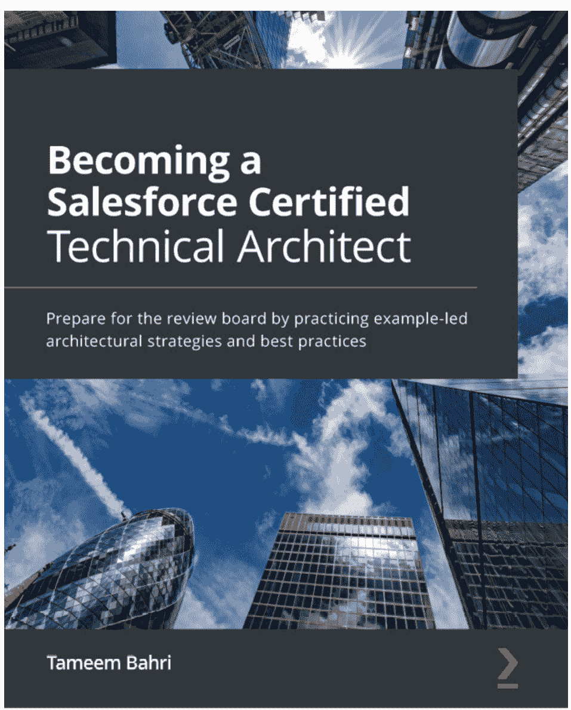
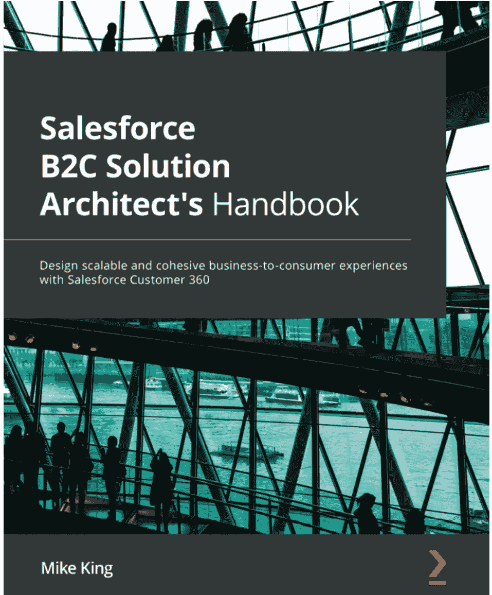

## 索引

*由于本电子书版没有固定分页，以下页码仅供参考，基于本书印刷版的超链接。*

### A

- 可访问性管理 35
- 账户和联系人管理 22
- 客户经理 (AE) 81
- Active Directory (AD) 37
- 基于活动的成本核算模型 76
- 参与者图 82
- 增加范围 142
- 级别 142
- 附加组件 40
- 参考链接 40
- 采用 180
- 采用 59
- 敏捷仪式
- 每日站会 135
- 冲刺计划 134
冲刺回顾 135
冲刺评审 135
价值，最大化 134
敏捷成熟度模型 205
敏捷团队
业务分析师 53
开发人员（编码员） 53
功能顾问（配置人员） 53
产品负责人（PO） 53
QA 专家（测试员） 54
Scrum 主管 53
Aha! 219
双元组织 215
Apex 异常 181
AppExchange 117
URL 41
适当级别
确定，前期架构的 115, 116
架构跑道 116, 151
Atlassian JIRA 112
自动化测试 160

### B

- 待办事项细化会议 134, 220
- 备份和恢复 35
- 批量数据同步（BDS） 114
- Blocked 列 137
- 燃尽图 141
- 业务分析师 53
- 业务能力 22, 23
分类 23
成熟度 23
业务能力，针对 Salesforce 项目
Salesforce 特别工作组角色，定义 24
商业案例
创建，以确保资金 70
KPI 和目标，确定 70, 71
业务发展代表 81
业务治理 66
业务需求文档（BRD） 52, 112
业务资源 107

### C

- 能力，由 Salesforce 解决方案支持
定义 22
- 资本支出（CAPEX） 75
- 精英中心（CoE） 100, 207
- 认证技术架构师（CTA） 115
- 倡导者 170
- 变革推动者 170, 171
- 变更控制委员会 139, 152
- 变更管理 59
活动，按 Salesforce 项目阶段的时间安排 62
利益相关者，受影响的识别 61
策略，确定 59
变更管理框架
使用 62, 63
变更管理计划模板
前开发阶段 168
准备 168
准备，活动 169-172
推出，Salesforce 解决方案的分阶段 173, 174
用户，培训 175, 176
章程
起草，针对 Salesforce CoE 64
速查表 176
首席执行官（CEO） 80
首席财务官（CFO） 80
首席信息官（CIO） 80
首席产品负责人 111, 209
CI/CD 管道
构建 222
云 40
Commerce Cloud 206, 210
商用现成产品（COTS） 35, 131
公司未来的业务流程
共同创建 108-110
用户故事，撰写 110, 111
用户故事，详细说明 111, 112
用户故事，评审 111, 112
并发系统 173
配置、定价和报价（CPQ）解决方案 37, 158

配置解决方案 117

整合解决方案架构
说明 119

内容管理系统 (CMS) 系统 37

持续改进阶段 4
清单，用于 Salesforce 项目 259, 260
问题 242
概述 204
合作伙伴模式，修改 210, 211
持续改进阶段问题
Salesforce Customer 360 数据，无效管理 254-258
Salesforce DevOps 能力，增强困难 248-254
转变困境，用于产品组织 242-248

持续集成 222

Conway 定律 74

COTS CI/CD 解决方案
采购 222

COTS（Commercial Off The Shelf）222

跨职能敏捷团队
组织 208

跨职能产品团队 207

Customer 360 数据
分析，优先排序 237, 238
自动化举措，优先排序 237, 238
利用，以最大化 Salesforce 投资回报 235-237
利用，用例 236, 237

客户数据平台 (CDP) 88

定制解决方案 117

## D

每日站会 135

数据 228

数据架构师 60

数据分类
主数据 228
元数据 228
参考数据 228
报表数据 228
交易数据 228

数据字典 143, 229

数据驱动型企业 60

数据迁移计划
准备 142-144

数据迁移准备情况
评估 164-166
签署批准以上线 166

数据迁移窗口 143

数据模型 143

数据规范化 143

数据安全 35

数据源 36

数据虚拟化 (DV) 114

数据仓库 (DWH) 36

完成定义 (DoD) 152

就绪定义 (DoR) 152

交付方法
混合敏捷 55
纯敏捷 53
纯瀑布 52
选择 48

Delpha 232

设计权威 (DA) 138, 139, 152, 220

设计模式
参考链接 115

开发人员（编码员）53

开发列 136

生产环境开发 49

开发模型和环境
设置 128

开发模型 130
在 Salesforce 中 130, 131

开发阶段 4
常见问题 145-150
进度，衡量 141
Salesforce 项目，评估 151
Salesforce 项目，治理 138

开发阶段，Salesforce 项目
持续时间 106, 107
关键活动 106
里程碑 106
概述 105
Salesforce CoE 的角色 107, 108

开发流程
建立 133
Kanban 看板，管理 136, 137
从敏捷仪式中最大化价值 134

DevOps 215, 216
目标 216, 217
原则 216, 217

DevOps 研究与评估 (DORA) 216

数字资产管理系统 (DAM) 37

DORA DevOps 快速检查测验
参考链接 224

Drucker 组织变革领导力学院 62

## E

Elements Cloud 220

客户经理 125

企业架构师 60

企业级 Salesforce 项目 49

企业项目 48, 49
类型 48

企业资源规划 (ERP) 系统 36

环境策略 131

估算开发工作量
方法 126
方法，优势 126
方法，劣势 126

ETL 工具 143
Informatica 233
MuleSoft 233

事件驱动架构 88

高层赞助人 65

Experience Cloud 40, 206

体验页面时间 (EPT) 181

## F

有缺陷的测试数据 164

功能标志 223

Field Service Lightning 210

固定预算固定范围模型 56

Flow 错误 181

功能架构图 119

功能顾问（配置人员）53

## H

Happy Soup 220

高层业务流程
想象由 Salesforce 解决方案支持的业务能力 31-33
创建当前业务能力概述 25, 26
确定 24, 25
构建 RAID 日志 33, 34
促进研讨会 26-31

高层技术范围
AppExchange 41
确定 39
构建假设的高层系统架构 41-44
目的 39

高层技术范围，Salesforce 许可类型
组织版 39
Salesforce 附加组件 40
Salesforce 云 40

混合敏捷 55, 106
选择，考虑 56

超级关怀期 176
能力 177, 178
提供 177

假设技术范围 39

## I

身份和访问管理 (IAM) 34

实施 51

实施合作伙伴 41
合同签订 88-90
参与 83
信息征询请求 (RFI) 85
建议征询请求 (RFP) 85-87
选择 87, 88
选择流程 84, 85
类型 83

Improved Help 224

In-App Guidance 224

独立软件供应商 (ISVs) 41

行业参考架构模板 115

内部策略 210

初始发布
范围 108
创建解决方案设计 113

国际标准化组织 (ISO) 87

问题 94

问题，在预开发阶段 94
分析 98
Salesforce 项目，定义 97, 98
为 Salesforce 项目确保资金 95, 96

ISTQB 141

迭代 53

## J

JIRA Discovery 219

John Kotter 的变革领导 8 步流程 62

## K

Kanban
参考链接 55

Kanban 看板
管理 136, 137

关键绩效指标 (KPIs) 70

## L

大数据量 (LDV) 对象 143

大规模 Scrum (LeSS)
参考链接 214

精益六西格玛 DMAIC 框架
参考链接 231
使用 231

Lightning Web 组件 (LWC) 123

负载测试 141

本地化 34

LucidChart 115

## M

Marketing Cloud 210

Marketing Cloud 账户参与 119

Marketing Cloud AE 81

主服务协议 (MSA) 89

Metazoa 220

Microsoft Azure DevOps 112

最小可销售产品 (MMP) 51

最小可行产品 (MVP) 50
在各层级应用 50

模型-视图-控制器 (MVC) 129

MuleSoft 119, 210

## N

净推荐值 (NPS) 181

不披露协议 (NDA) 87

非功能需求 34-36

## O

持续生产支持
过渡到 178, 179

Open Agile Architecture
参考链接 205

运营支出 (OPEX) 75

组织
激励同行 239
领导同行 239
转变为产品组织 204, 205

即开即用 (OOTB) 114, 128, 207

## P

Packt 制造设备 (PME) 7, 8, 71, 118, 219
挑战 8
客户 11
环境 8
产品和服务 11
情况 8
总结战略状况 15, 16
战略分析 12
结构 8-11
SWOT 分析 16
临时开发计划 128

Packt 制造设备 (PME)，战略分析
财务表现 14, 15
市场发展 14
PESTLE 分析 12
波特五力 13, 14

Pardot 119

合作伙伴模式
在持续改进阶段修改 210, 211

合作伙伴关系管理 (PRM) 41

性能测试 141

个人身份信息 (PII) 35

PESTLE 分析 12
经济因素 12
环境因素 13
法律因素 13
政治因素 12
社会因素 12
技术因素 13

按地理区域分阶段
优势 59
劣势 59

按范围分阶段 58
优势 58
劣势 58

试点 51

平台即服务 (PaaS) 129

平台负责人 (PO) 233

PME 的目标解决方案架构 119

PMP 认证
参考链接 52

预开发阶段 4
活动 5, 48
持续时间 6
迭代 19, 44, 67, 90
关键里程碑 5
概述 4
Salesforce 工作组 6

准备阶段 106

预原型 51

价格-销量-组合 (PVM) 分析 15

PRINCE2
参考链接 52

流程协调 30

产品待办事项列 136

产品待办事项 (PBIs) 53, 212

Productboard 219

产品目标 208

产品信息管理系统 (PIM) 37

产品管理 205

产品管理系统 212, 219

产品经理 209

产品组织 204
组织，转变为 204, 205

产品负责人 (PO) 53, 107, 207
职能 111

产品愿景 53

损益 (P&L) 影响预测 78
回本时间 79

项目看板 213

项目增量 (PI) 规划
参考链接 214

项目 KanBan 213

项目启动 106

项目管理办公室 (PMO) 174

项目分阶段方法 57
按地理区域分阶段 58
按范围分阶段 58

概念验证 (PoC) 51

Prosci ADKAR® 模型 62

原型 51

Provar 141, 160, 223

采购订单 (PO) 89

纯敏捷 53, 106
选择，考虑 56

纯敏捷交付
与纯瀑布对比 54

纯瀑布 52, 106
与纯敏捷交付对比 54

## Q

QA 专家（测试员）54

## R

就绪列 136

发布 51

按需发布 223

可靠性 36

远程过程调用即发即弃 (RPI-FF) 114

信息征询请求 (RFI) 85

建议征询请求 (RFP) 85

Revenue Cloud (CPQ) 210

风险、假设、问题和决策 (RAID) 99

- 角色层级 114
- 推广方法 51
- 推广阶段 4
- 问题 184
- 问题、缓解和预防策略 184-196
- 根本原因 184-196
- 推广波次 173
- 根本原因分析 94
## S
- SAFe（规模化敏捷框架）
- 参考链接 55
- Sales Cloud 40
- Salesforce 51
- 参与 81
- 与业务发展代表互动 81
- 报价评估 83
- 报价请求 82
- Salesforce 管理 217
- Salesforce 架构制品 113-115
- Salesforce 业务分析师 110
Salesforce 业务分析师手册
参考链接 113
Salesforce 卓越中心（CoE）
优势 63
章程起草 64
愿景规划 63
目的 63
在开发阶段的角色 107, 108
更新 209, 210
在推广阶段的角色 157
确定结构和职责 64-66
Salesforce 变革准备度评估文档
参考链接 169
Salesforce CoE 目标运营模式
确定 75, 76
因素 75
Salesforce Customer 360 数据管理不善
根本原因及缓解/预防策略 254-258
Salesforce 数据
治理 228
生命周期管理 228, 229
管理 228
Salesforce 数据质量
分析 232
控制 233
定义 232
维度 230
治理 229-231
改进 233
衡量 232
Salesforce 数据质量治理
目的 230
工作方式 234, 235
Salesforce 交付方法
选择 55, 56
Salesforce 开发模型 130, 131
Salesforce 开发流程
优化 219-223
Salesforce DevOps 能力
增强 217
演进 215
Salesforce DevOps 能力增强困难
根本原因及缓解/预防策略 248-254
Salesforce DevOps 之旅
反思 224
Salesforce 图示框架
参考链接 115
Salesforce DX 开发者指南
参考链接 133
Salesforce Genie 237
参考链接 237
Salesforce 帮助
参考链接 132
Salesforce Identity Connect 119
Salesforce 实施合作伙伴模式
选择 74
Salesforce 实施以改变业务能力
组件 60, 61
Salesforce Labs 41
Salesforce OOTB 部署工具 222
Salesforce 运营
精简 217-219
Salesforce ops 217
Salesforce 组织 4
Salesforce 组织监控方式
参考链接 218
Salesforce 平台
治理 209
对齐所有权 207
识别产品 206
对齐战略 207
对齐愿景 207
Salesforce 平台和产品
设定目标 207, 208
Salesforce 平台架构师 209
Salesforce 平台负责人 209
Salesforce 项目群
在持续改进阶段的检查清单 259, 260
治理 209
状态评估 258
Salesforce 项目群负责人 65, 209
Salesforce 项目群路线图
创建 66
维护 211-213
重新审视 211-213
Salesforce 项目群赞助人 209
Salesforce 项目
在预开发阶段的检查清单 99, 100
考虑因素 17, 18
持续改进阶段 4
开发阶段 4, 105
评估 98
在开发阶段的治理 138
提供超护理 177, 178
生命周期 3
阶段 4
预开发阶段 4
推广阶段 4
状态评估 196
团队成员角色和职责 122
比较培训方法 175, 176
过渡到持续生产支持 178, 179
创建愿景 18
定义愿景 17
Salesforce 项目构建阶段
创建开发计划 127, 128
规划 125, 126
Salesforce 项目商业论证
估算成本影响 73, 74
创建 71, 72
预测财务影响 77-79
展示 79, 80
估算收入影响 72, 73
Salesforce 项目开发阶段
检查清单 151
评估 151
Salesforce 项目开发团队角色和职责 123
开发人员 123
Salesforce 项目治理 138
变更控制委员会 139
设计授权机构（DA）138, 139
指导委员会 140
Salesforce 项目在推广阶段
检查清单 196-198
Salesforce 项目阶段
变更管理活动时机 62
Salesforce 项目产品负责人（PO）
角色和职责 122
Salesforce 项目推广阶段
活动和里程碑 156
持续时间 156
概述 155
Salesforce CoE 角色 157
Salesforce 项目
变更程度 60, 61
术语 50, 51
与 Salesforce 项目群对比 50
Salesforce 项目业务分析师（BA）
角色和职责 124
Salesforce 项目变更经理
角色和职责 125
Salesforce 项目 Scrum Master
角色和职责 122
Salesforce 项目项目经理（PM）
角色和职责 125
Salesforce 项目质量保证（QA）专家
角色和职责 124
Salesforce 项目 Salesforce 架构师
角色和职责 124
Salesforce 项目愿景声明
标准 18
Salesforce Roadmap Explorer
参考链接 213
Salesforce Sales Cloud 119
Salesforce 沙盒 131, 132
Salesforce Scheduled Flows 233
Salesforce 解决方案
定义和衡量采用 180-182
监控和推动采用 179
定义能力 22
  - 汇总能力 37, 38
  - 组件 128-130
  - 通过环境部署 157-159
  - 确定高层技术范围 39
  - 非功能需求 34-36
  - 治理质量 140, 141
  - 设定采用目标 182
  - 技术使能 34-36
  - 单元测试 140
  - 用户故事测试 140
  - Salesforce 解决方案架构师 110
  - Salesforce 解决方案部署
  - 执行 SIT 159, 160
  - Salesforce 特别工作组 6
  - 在 Salesforce 项目业务能力中定义角色 24
  - 角色和职责 6
  - Salto 220
  - 沙盒 128
  - 规模化敏捷框架（SAFe）152
  - 规模化敏捷框架（SAFe）配置 140
Scratch 组织 132
Scrum 133
参考链接 55
scrum master 53
scrum 估点 221
Selenium 141, 160, 223
Service Cloud 40, 119
服务等级协议（SLA）177
单点登录（SSO）35
社交登录 35
软件即服务（SaaS）128
解决方案 51
解决方案设计
为初始版本创建 113
解决方案工程师（SE）81
速度/性能 36
sprint 133
Sprint Backlog 列 136
Sprint Backlog Kanban 列 137
sprint 效率 127
sprint 目标 53
sprint 规划 53, 134, 221
sprint 回顾 135
sprint 评审 135
目的 135
sprint 速度 141
工作说明书（SoW）89
指导委员会 65, 140
故事点估算 53, 134
参考链接 135
故事点 126
战略平台 207
战略分析 12
优势、劣势、机会和威胁（SWOT）分析 15
主题专家（SMEs）26
系统集成测试（SIT）52, 141, 222
执行 159, 160
系统集成商（SIs）41
## T
技术债务
管理 214, 215
技术使能 34-36
确定以支持已识别的业务能力 34
技术治理 66
技术资源 107
技术栈 26
条款和条件（T&Cs）89
Testim 223
Testing 列 137
按时按材模式 56
transformation map（T-Map）66, 141
产品组织的转型困境
根本原因及缓解/预防策略 242-248
Trello 112
## U
前期架构
确定适当级别 115, 116
创建的好处 115
用户验收测试（UAT）52, 125, 141, 161
规划设置 161-164
用户界面（UI）129
用户故事 53, 136
撰写 110, 111
详细说明 111, 112
评审 111, 112
编写注意事项 110
用户故事解决方案设计
创建 116
评估 116, 118
选择注意事项 117
用户故事测试 140
用户培训 175
## V
Validating 列 137
版本控制系统（VCS）222
版本报告 141
虚拟故事点估算
参考链接 221
易变、不确定、复杂、模糊（VUCA）54
## W
网站 37
Web-to-Case 119
加权最短作业优先（WSJF）
参考链接 213
## 为什么订阅？
- 花更少时间学习，花更多时间编码，借助来自 4,000 多名行业专业人士的实用电子书和视频
- 使用专为你打造的技能计划提升学习效果
- 每月获得一本免费电子书或视频
- 全文可搜索，便于快速获取重要信息
- 复制粘贴、打印和书签保存内容

你知道吗，Packt 为每本出版的图书提供电子书版本，支持 PDF 和 ePub 格式？你可以在 packtpub.com 升级到电子书版本，作为印刷图书客户，你有权享受电子书折扣。欲了解更多详情，请联系 customercare@packtpub.com。

在 www.packtpub.com，你还可以阅读一系列免费技术文章，订阅各类免费通讯，并获得 Packt 图书和电子书的独家折扣和优惠。

## 你可能会喜欢的其他书籍

如果你喜欢这本书，你可能也会对 Packt 出版的其他这些书籍感兴趣：

<packt>

第一版

### Salesforce 业务分析师手册

用于卓越用户体验和采用的经过验证的业务分析技术和流程

SRINI MUNAGAVALASA

Salesforce 业务分析师手册

Srini Munagavalasa

ISBN: 9781801813426

- 创建路线图以交付一组高层需求
- 根据业务价值优先排序需求
- 识别流程中的改进机会
- 通过会议室试点传达您的解决方案设计
- 构建需求追溯矩阵
- 进行用户验收测试和系统集成测试
- 开发培训资料，以便客户能够轻松使用您的系统
- 实施售后支持模式以留住客户

<packt>

第一版

### Salesforce 反模式

通过学习平台上常见的错误来创建强大的 Salesforce 架构

LARS MALMQVIST

ISBN: 9781803241937

- 通过识别平台内和平台外功能及接口方面的常见错误来创建平衡的系统架构
- 避免 Salesforce 平台上反模式引发的安全问题
- 发现常见的数据架构问题并找到直观的解决方式
- 避免在解决方案架构中过度定制和定制不足的双重陷阱
- 探索部署设置、测试策略和架构治理中常见的错误
- 理解为什么糟糕的沟通模式在架构中如此容易被忽视

### 成为 Salesforce 认证技术架构师

通过实践以示例为导向的架构策略和最佳实践为评审委员会做准备

Tameem Bahri

成为 Salesforce 认证技术架构师

Tameem Bahri

ISBN: 9781800568754

- 探索数据生命周期管理并在 Salesforce 生态系统中有效应用
- 设计适当的企业集成接口以构建您的连接解决方案
- 理解身份和访问管理的核心概念
- 开发可扩展的 Salesforce 数据和系统架构
- 为您的解决方案设计项目环境和发布策略
- 阐述与您的解决方案相关的优势、局限性和设计考虑因素
- 发现准备 Salesforce CTA 评审委员会考试的技巧、窍门和策略

### Salesforce B2C 解决方案架构师手册

使用 Salesforce Customer 360 设计可扩展且连贯的企业对消费者体验

Mike King

ISBN: 9781801817035

- 探索关键的 Customer 360 产品及其集成选项
- 选择最佳集成架构以统一数据和体验
- 设计客户的单一视图以支持服务、营销和商务
- 规划关键需求、设计决策和实施顺序以避免次优解决方案
- 将 Customer 360 解决方案集成到单一事实来源解决方案中，例如主数据模型
- 通过编排数据和用户流程来支持需要多个组件功能业务需求

## Packt 正在寻找像您这样的作者

如果您有兴趣成为 Packt 的作者，请访问 [authors.packtpub.com](authors.packtpub.com) 并立即申请。我们已与数千名开发人员和技术专业人士合作，就像您一样，帮助他们与全球技术社区分享他们的见解。您可以提交通用申请、申请我们正在招聘作者的特定热门主题，或提交您自己的想法。

## 分享您的想法

现在您已完成 *Salesforce 端到端实施手册*，我们很想听听您的想法！如果您从 Amazon 购买了本书，请 [点击此处直接前往亚马逊评论页面](click here to go straight to the Amazon review page) 为本书分享您的反馈或在您购买的网站上留下评论。

您的评论对我们和技术社区非常重要，并将帮助我们确保提供优质的内容。

## 下载本书的免费 PDF 副本

感谢您购买本书！

您喜欢随时阅读但无法随身携带印刷书籍吗？

您的电子书购买与您选择的设备不兼容吗？

不用担心，现在每本 Packt 书籍都免费提供无 DRM 的 PDF 版本。

随时随地在任何设备上阅读。从您喜爱的 technical 书籍中直接搜索、复制和粘贴代码到您的应用程序中。

福利还不止于此，您可以每天通过电子邮件独家获取折扣、新闻通讯和优质免费内容。

按照以下简单步骤获取福利：

- 1. 扫描二维码或访问下方链接

https://packt.link/free-ebook/9781804613221

- 2. 提交您的购买证明
- 3. 就这样！我们会直接将您的免费 PDF 和其他福利发送到您的电子邮件

## 你可能会喜欢的其他书籍

## 你可能会喜欢的其他书籍
