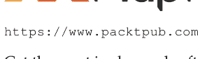

## Credits

**Author**
Johan Yu

**Copy Editor**
Stuti Srivastava

**Reviewers**
Chamil Madusanka
Tom Blamire

**Project Coordinator**
Prajakta Naik

**Commissioning Editor**
Merint Mathew

**Proofreader**
Safis Editing

**Acquisition Editor**
Karan Sadawana

**Indexer**
Francy Puthiry

**Content Development Editor**
Siddhi Chavan

**Production Coordinator**
Nilesh Mohite

**Technical Editor**
Tiksha Sarang

## Foreword

Before you dive into Johan's amazing book about Salesforce technology, I want to invite you to be a part of something special. We are in the midst of a major shift, and we're leaning into it with the full power of Salesforce. Our mission is to empower people to blaze their own trails, as well as to motivate and educate everyone in our community with how we live our values of trust, growth, innovation, and equality.

If you're reading this book, you are a Trailblazer and have more power than ever to make positive changes happen in your companies, communities, and careers. Doing well and doing good is about the power of working together to help companies be better for their customers, and businesses and to be major drivers of change. We want every individual to realize their full potential in their careers and lives. With this shift, we can generate hundreds of billions of dollars in GDP, create millions of new jobs, and help new Trailblazers learn the skills they need to succeed.

I'd like to introduce you to a few of the concepts that are central to this shift and core to our community: Ohana, Trailblazer, and Equality.

**Ohana:** This is defined broadly as "family" in Hawaiian, but at Salesforce, it means to connect, collaborate, learn, and have fun together. As one Salesforce Ohana, we all need to be Trailblazers, moving forward together on the same trail with the intentional purpose of delivering customer success and a path into the Salesforce economy. This, in turn, will generate hundreds of billions of dollars in GDP, create millions of new jobs, and help new Trailblazers learn the skills they need to succeed.

**Trailblazer:** This is a pioneer; an innovator; a lifelong learner; a mover and shaker; a leader who leaves a path for others to follow; and, most importantly, someone who inspires and drives change, and is committed to making the world a better place. This is all about being your best through a constant commitment to learning and giving back--and that's what this community is all about.

**Equality:** At Salesforce, works together with our whole Ohana--our employees, customers, partners, community organizations, and the whole tech industry--to build a path forward to equality for all. We are taking action across four key pillars: equal pay, equal opportunity, equal education, equal rights.

Let me leave you with this--ask yourself what will you learn this year? What will you teach? Will you be a mentor or a mentee? What’s the Salesforce path you want to follow? I encourage you to BE BOLD in your life, career, and community--be a part of this amazing shift!

**Erica Kuhl**
Vice President, Community - Salesforce

## About the Author

**Johan Yu** has more than 19 years of experience working in the IT sector across MNCs and at a leading Salesforce consulting company in the Asia-Pacific region. He has spent more than 12 years working with Salesforce technology, starting his career as a developer, team leader, and technical manager, among many other challenging roles.

Based in Singapore, Johan holds 12X active Salesforce certifications, ranging from Administrator to Architect/Designer certifications. In his spare time, he enjoys writing blogs and answering questions in the Salesforce Success Community.

In May 2014, Johan became the first Salesforce MVP, not only from Singapore, but also from Southeast Asia. He is also the leader of the Salesforce Singapore User Group and is keen to help members solve issues related to configuration, implementation, and adoption, until more technical issues arrive.

> > First of all, I am grateful to Almighty God for enabling me to complete this book. After living and breathing with Salesforce technologies for more than a decade, it’s a miracle and my happiest moment to write my second book on Salesforce. I would like to thank the creator of Salesforce for the invention of such a great technology. Thanks to the Salesforce MVP family and the entire Salesforce team for building a great Salesforce community around the world #ohana. I wish to express my sincere gratitude to my reviewers, Chamil Madusanka and Tom Blamire, for completing the review and feedback of this book. I would also like to thank the whole Salesforce Singapore User Group family; my co-leaders; my buddies Vladimir Vujatovic, Chrisila Low, and Raphael Fraga for the dedication to the community; and many Salesforce User Group leaders around the world--I can’t name each of you. Another big thanks to the team at Packt for their guidance and support which made this book happen. I would also like to thank my employer, church, family, and friends. Thanks to Ps Jacub Suria and Ps Yenny Sari, Minister of the Indonesian Family Church, Singapore, for the down-to-earth kindness and passion in giving all of us sermons and tasty food! Lastly, huge thanks and love to my wife, Novida Lunardi, for being a part of my life--her understanding, continued support, and encouragement helped me get this book completed.

**Tom Blamire** is a dedicated Salesforce administrator and evangelist who accidentally fell into Salesforce in 2014. He has come from an office administration background, working in various industries, and tries to apply that knowledge and skillset to every organization he has worked in.

I would like to thank Johan for initially asking me to be a part of this amazing adventure; my GIF Squad colleagues, Amy, Ben, Stuart, Pat, Bill, Justice, Stacey, Monica, Melinda, and Sam for their continued support, loyalty, inspiration, and dedication to the cause; Marc Benioff and Parker Harris for making the greatest platform on earth and helping change the lives of so many people for the better; the Salesforce Success Community, Trailhead, and Awesome Admin Jobs Team for doing what you do on a day-to-day basis and constantly supporting the #salesforceohana; Tony Prophet and team for helping to make the world a more educated and less critical place to be; and, most importantly, thank you to my wife and unborn son for everything, as without you, life would be a dark and empty place to be.

## www.PacktPub.com

For support files and downloads related to your book, please visit www.PacktPub.com.

Did you know that Packt offers eBook versions of every book published, with PDF and ePub files available? You can upgrade to the eBook version at www.PacktPub.com and as a print book customer, you are entitled to a discount on the eBook copy. Get in touch with us at service@packtpub.com for more details.

At www.PacktPub.com, you can also read a collection of free technical articles, sign up for a range of free newsletters and receive exclusive discounts and offers on Packt books and eBooks.



https://www.packtpub.com/mapt

Get the most in-demand software skills with Mapt. Mapt gives you full access to all Packt books and video courses, as well as industry-leading tools to help you plan your personal development and advance your career.

# Why subscribe?

- Fully searchable across every book published by Packt
- Copy and paste, print, and bookmark content
- On demand and accessible via a web browser


# 客户反馈

感谢您购买本 Packt 出版的图书。在 Packt，质量是我们编辑流程的核心。为帮助我们改进，请在该书的 Amazon 页面 https://www.amazon.com/dp/1788297385 上留下诚实的评价。

如果您想加入我们的常驻审阅者团队，您可以发送电子邮件至 customerreviews@packtpub.com。我们会以免费的电子书和视频作为回报，感谢您宝贵的反馈。帮助我们不断改进产品！


操作按钮 225

## 订阅报告

在 Lightning Experience 中订阅报告的动手练习 228

## 摘要

# 第9章：在 Lightning Experience 中构建仪表盘

## Salesforce 中的仪表盘简介

内置组件 232

仪表盘可访问性 232

运行用户 233

动态仪表盘 233

新体验 234

## 打开仪表盘

“仪表盘”选项卡 236

“仪表盘”菜单 238

“文件夹”菜单 240

收藏图标 241

搜索文本框 242

## 导航到仪表盘

在仪表盘构建器中拖放 245

## 刷新仪表盘

安排仪表盘刷新 248

## 创建你的第一个仪表盘

创建仪表盘的动手练习 253

编辑和维护仪表盘的动手练习 258

## 仪表盘组件

定义仪表盘组件 263

表格 265

漏斗图 266

仪表图 267

堆叠条形图 268

散点图 269

累积折线图 270

组合图 270

报告作为数据源 271

## 摘要

# 第10章：学习高级仪表盘配置

## 实现仪表盘筛选器

了解仪表盘筛选器 275

向仪表盘添加筛选器的动手练习 276

## 查看仪表盘

安排报告快照 ........................................ 343

摘要和计划 .................................................... 345

报告快照的历史记录和监控 ............................. 347

历史数据报告 ............................................ 348

## 摘要

# 第12章：Salesforce1 移动应用中的仪表盘和报告

## Salesforce1 移动应用简介

## 在 Salesforce1 应用中处理仪表盘

刷新仪表盘 ................................................. 355

动态仪表盘 .................................................... 356

仪表盘筛选器 ..................................................... 357

将仪表盘快照共享到 Chatter 信息流 ............................. 358

更改组件图表类型 ....................................... 360

图表详细信息和报告 ................................................ 361

## 在 Salesforce1 应用中处理报告

报告菜单项 ....................................................... 363

从仪表盘向下钻取 ............................................ 364

向下钻取到记录 .................................................. 366

## 离线访问

Salesforce1 应用的局限性 .................................. 366

摘要 ................................................................ 367

## 索引

## 前言

本书面向在日常工作中使用 Salesforce Lightning Experience 或在 Salesforce 中分析数据的 Salesforce 管理员、业务用户和管理者。它涵盖了 Salesforce Lightning Experience 中与报告和仪表盘相关的所有内容。本书将使业务用户受益，他们将获得从创建基本报告到高级报告和仪表盘配置的知识。管理员将学习报告和仪表盘的完整概念、对象模型、与报告和仪表盘相关的权限、报告存储以及历史数据报告。

报告和仪表盘是 Salesforce 平台（包括 Sales Cloud、Service Cloud 和 Force.com）中最强大且易于使用的功能之一，业务用户能够在几分钟内根据需要创建和自定义报告和仪表盘。

业务用户应具备基础知识，或应在日常工作中使用 Salesforce，例如登录系统、在 Salesforce Lightning 环境中导航、创建和编辑数据以及运行报告。管理员应具备自定义 Salesforce 的基础知识，例如 Setup 菜单、选项卡、用户配置文件、权限集以及标准对象和自定义对象。

### 本书涵盖内容

第1章，*Salesforce 报告和仪表盘基础*，提供了 Salesforce Lightning Experience、对象模型、Setup 菜单导航以及报告和仪表盘导航的基本概述。

第2章，*报告和仪表盘中的概念与权限*，讨论了数据可见性与生成的报告结果之间的关系，接着介绍了报告和仪表盘的存储，以及报告和仪表盘的权限。

第3章，*在报告和仪表盘中实现安全性*，讨论了如何保护存储在 Salesforce 中的报告和仪表盘并限制其访问权限。

第4章，*创建和管理报告*，涵盖创建新报告所需的基本技能，包括选择报告格式、向报告添加筛选器以及动手创建简单报告。

第5章，*理解报告类型*，将报告类型解释为报告的基础，它还将决定对象和字段的可用性，包括生成报告中的数据。本章介绍了标准报告类型，包括创建自定义报告类型。

第6章，*高级报告配置*，讨论了使用分桶字段和自定义汇总公式对报告中的数据进行分类。

第7章，*在报告和页面中添加图表*，介绍了 Lightning Experience 报告中可用的图表类型、向报告添加图表以及在记录页面上使用相同图表。

第8章，*处理报告*，涵盖在“报告”选项卡下处理报告和可用项目、报告文件夹以及运行报告后可以配置的内容。

第9章，*在 Lightning Experience 中构建仪表盘*，涵盖打开和搜索仪表盘，以及导航、构建和刷新仪表盘及其组件。

第10章，*学习高级仪表盘配置*，解释了仪表盘中的高级功能，包括仪表盘筛选器、动态仪表盘、向下钻取，以及从 AppExchange 获取其他仪表盘。

第11章，*报告和仪表盘的高级提示与技巧*，涵盖报告和仪表盘中的协作、使用 URL 参数筛选报告、字段历史跟踪以及设置报告快照。

第12章，*Salesforce1 移动应用中的仪表盘和报告*，展示了如何使用 Salesforce1 移动应用随时随地访问报告和仪表盘，包括无互联网的离线访问。

### 本书所需准备

充分利用本书的最佳方法是亲身体验所有练习。你需要以下内容：

- 一个 Salesforce 账户。建议使用 Enterprise 版或更高版本。不过，出于测试和学习目的，Sandbox 实例和 Developer 版已足够。
- 一个 Web 浏览器。
- 一个互联网连接。
- 一台计算机。
- 一部手机——iOS 或 Android。

### 本书面向的读者

本书面向业务分析师、报告分析师、销售代表、销售运营人员和 Salesforce 管理员。本书也适用于希望使用 Lightning Experience 深入学习 Salesforce 报告和仪表盘的用户。你将获得与 Salesforce 中报告和仪表盘相关的知识，从创建基本报告和自定义报告开始，逐步深入 Salesforce Lightning Experience 中最先进的报告和仪表盘。

### 约定

在本书中，你会发现多种文本样式，用于区分不同类型的信息。以下是这些样式的一些示例及其含义说明。

文本中的代码词、数据库表名、文件夹名、文件名、文件扩展名、路径名、虚拟 URL、用户输入和 Twitter 句柄显示如下：“创建 Account 报告，并使用 No of Won Opportunity 字段作为报告筛选器。”

任何命令行输入或输出都按如下方式编写：

```
SELECT Id FROM Report USING SCOPE allPrivate WHERE OwnerId =
'00541000001cTYgAAM'
```

新术语和重要词汇以粗体显示。你在屏幕上看到的文字，例如菜单或对话框中的文字，会以如下形式出现在文本中：“导航到“报告”选项卡，然后点击“新建报告”按钮。”


警告或重要说明显示如下。


提示和技巧显示如下。


