# Salesforce 报表和仪表板的 fundamentals

本章将为您提供 Salesforce 云技术的总体概述，包括云平台的优势、Salesforce Lightning Experience 的介绍、将 Salesforce 扩展到客户关系管理 (CRM) 之外，以及导航 Salesforce 报表和仪表板。我们还将涉及 Salesforce 架构、设置菜单和 Lightning Experience 用户界面。

本章包含适用于业务用户和 Salesforce 系统管理员的信息。本章中的一些主题讨论了系统管理员专用的功能，但业务用户可能会对更好地了解 Salesforce 架构感兴趣。

在整本书中，我们将提供笔记和提示来帮助您轻松理解 Salesforce 技术。在接下来的几章中，我们将介绍构建高级报表和仪表板的各种技能，以满足您在 Lightning Experience 中的业务需求。动手活动将是大多数章节的一部分，而创建和管理报表和仪表板将在第 4 章《创建和管理报表》及以后进行介绍。

本章将涵盖以下主题：

- Salesforce 的概述和优势
- Salesforce Lightning Experience
- Salesforce 对象模型
- 导航到设置菜单
- 导航到报表和仪表板

以下是 Salesforce 目前提供的一些云产品：

- **Sales Cloud**：Sales Cloud 自动化您的销售流程
- **Service Cloud**：Service Cloud 提供进化的客户服务流程
- **Marketing Cloud**：Marketing Cloud 得益于数字营销自动化
- **Community Cloud**：Community Cloud 与您的客户和合作伙伴连接
- **Wave Analytic**：Wave Analytic 为业务用户和分析师提供分析
- **App Cloud**：App Cloud 允许您为业务需求构建应用程序
- **IoT Cloud**：IoT Cloud 用于存储和处理**物联网 (IoT)** 连接设备的 数据
- **Commerce Cloud**：Commerce Cloud 使您能够构建统一的购物体验

随着 Salesforce 不断收购和构建新产品，以上列表可能会随时更改。

简而言之，与其他本地应用程序相比，使用 Salesforce 的优势如下：

- 更快的实施计划
- 更低的维护成本，因为您无需购买或支持内部服务器，也无需为其维护资源
- 可扩展性和稳健性
- 安全且高性能
- 易于使用 AppExchange 上的预构建解决方案扩展功能
- 可从台式机、笔记本电脑、平板电脑和移动应用程序访问
- 面向中小型企业的企业级应用程序

## Salesforce Lightning Experience

Lightning Experience 是一种现代、快速且美观的用户界面，旨在帮助您的销售用户提高生产力和效率。它以销售为中心构建，专注于帮助销售代表更自然地日常工作。有了 Lightning Experience，您的用户将获得直观且智能的用户界面。

Lightning Experience 采用经过验证的 Salesforce1 移动应用程序技术构建。您的销售代表已经使用移动设备输入潜在客户、记录客户会议后的任务和笔记、运行报表和仪表板等。Lightning Experience 将所有这些来自移动体验的酷炫功能带入了计算机网络浏览器。

## 让我们使用正确的术语

在许多情况下，Lightning Experience 简称为 Lightning，尽管 Salesforce 平台中有许多以“Lightning”开头的项目，例如 Lightning 登录、Lightning 应用构建器、Lightning for Outlook、Lightning 组件、Lightning 同步等。其中一些仅适用于 Lightning Experience，但其他一些在 Lightning Experience 和旧版 Classic 用户界面中都可以使用，例如 Lightning Sync 用于在您的电子邮件服务器与 Salesforce 之间同步用户联系人和事件。

为了明确，当您遇到 Salesforce 社区中的某个人，他问您是否使用 lightning 时，他很可能指的是 Lightning Experience。为了使用正确的术语，它是 Lightning，而不是 Lightening 或 Lighting。

## Lightning Experience 之前是什么？

如果您注意到了，我们在 *让我们使用正确的术语* 部分中提到了经典用户界面这个术语。是的，就是它——在 Lightning Experience 推出之前，Salesforce Classic 已服务多年。Salesforce Classic 仍然存在，并被许多客户广泛使用，但主要是，Salesforce 在最近版本中引入的新功能仅适用于 Lightning Experience。

如果您仍在使用 Classic，Salesforce 敦促您迁移到 Lightning。为什么我使用迁移这个术语？因为用户界面完全不同，并且您现有的一些自定义可能无法工作，例如由您的 Salesforce 合作伙伴或 IT 团队构建的 JavaScript 按钮。您应在做出决定前咨询您的 Salesforce 成功经理、合作伙伴或 IT。

由于用户界面与 Classic 完全不同，您的用户手册、培训视频和材料等需要更新，因此请使用适当的项目管理来规划此旅程，以推出 Lightning Experience。

## 让我们打开 Lightning Experience

本节面向仍在 Salesforce Classic 中操作的系统管理员——只有系统管理员才有权限启用 Lightning Experience。如果您已在 Lightning Experience 上，可以跳过本节。

让我们进行一个快速的动手练习，了解如何启用 Lightning Experience：

1. 点击 **Setup** 导航到设置菜单，然后点击左上角菜单中的 **Lightning Experience**：

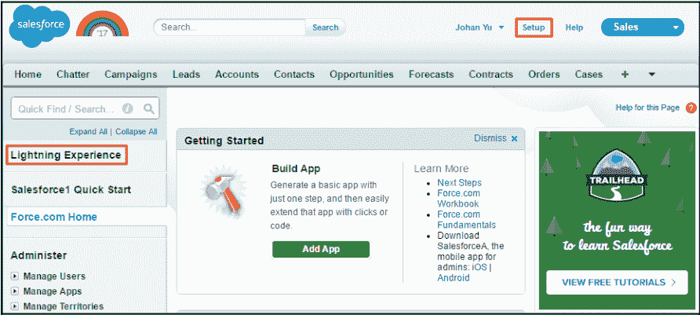

2. 滚动到页面底部，查找 **Lightning Experience**，然后切换以启用它：

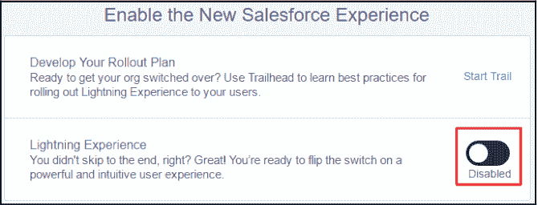

3. 点击 **Finish Enabling Lightning Experience** 以确认：

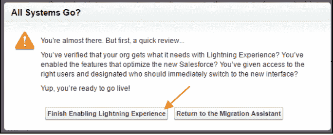

4. 一旦 Lightning Experience 启用，请注意开关变为绿色，标签更改为 **Enabled**：

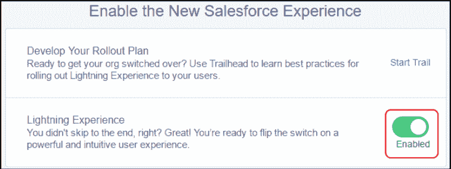

5. 点击右上角的姓名；您会注意到添加了一个新菜单 **Switch to Lightning Experience**，如下图所示：

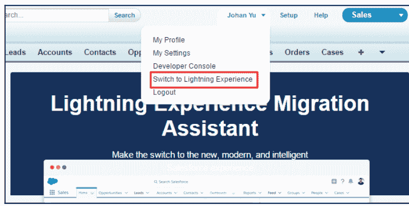

6. 完成！现在从菜单中点击 **Switch to Lightning Experience** 开始探索现代的 Lightning Experience。
7. 此动手练习将允许您作为系统管理员（包括其他系统管理员）尝试并探索贵组织的 Lightning Experience。您的普通用户在您为他们配置之前将看不到新的菜单 **Switch to Lightning Experience**。
8. 要为业务用户启用 Lightning Experience，作为系统管理员，您可以选择按配置文件启用（针对该配置文件中的所有用户）或按权限集启用（按用户分配）。
9. 要按配置文件启用，点击配置文件上的 **Edit**，滚动到 **Administrative Permissions** 部分，查找 **Lightning Experience User** 权限；启用它，然后保存配置文件。
10. 要按权限集启用，相同的权限 **Lightning Experience User** 分配给需要切换到 Lightning Experience 的特定用户。

系统管理员的最佳实践是在为所有 Salesforce 用户启用之前先评估 Lightning Experience，并找出切换到 Lightning Experience 时可能无法工作的功能的差距。在启用 Lightning Experience 用户之前，另一个最佳实践是仅为一组试点用户启用，获取他们在使用 Salesforce 作为日常工作一部分时的反馈。如果用户具有不同类型的配置文件，权限集将是选项。

Salesforce 提供一个工具来帮助你检查组织对 Lightning Experience 的准备情况。在 Lightning Experience 设置菜单中，点击“检查你的 Lightning Experience 就绪情况”下的 **评估（Evaluate）** 链接。Salesforce 将把一份就绪情况报告通过电子邮件发送给你。

## 切换到 Lightning Experience

一旦启用了 Lightning Experience 并分配了权限，先点击你的姓名，再点击 **切换到 Lightning Experience**，如下图所示：

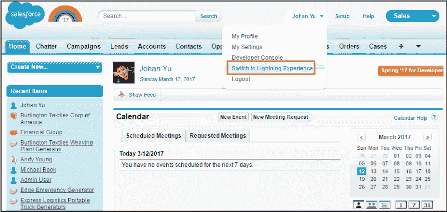

截至目前，并非所有 Classic 中的功能在 Lightning Experience 中都可用；你可能需要在必要时切换回 Classic。例如，回收站在 Lightning Experience 中不可用。要切换回 Classic，点击你的头像，然后点击“切换到 Salesforce Classic”。你可以使用相同的路径切换回 Lightning Experience：

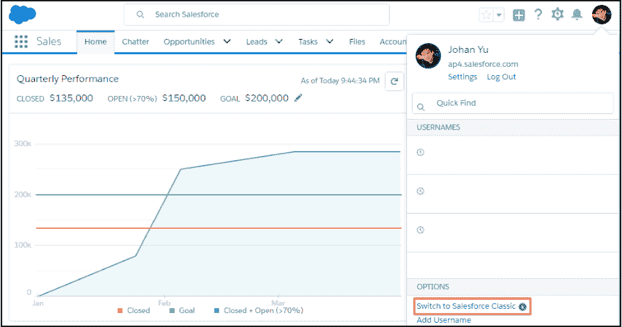

Summer '17 版本为管理员提供了移除用户切换回 Classic 的切换器（switcher）的能力。如果你不是系统管理员，请联系你的系统管理员；如果你是系统管理员，则有一个新的权限控制此功能——该权限名为“在配置文件中隐藏切换到 Salesforce Classic 的选项”。

## Salesforce 对象模型

无论用户界面是什么，Classic 还是 Lightning Experience，后端数据库都是相同的。你在 Classic、Lightning Experience 甚至 Salesforce1 移动应用中都会看到相同的数据。所有可构建的报告和仪表板都基于你的 Salesforce 组织中实现的对象模型，从对象关系到字段类型级别。在学习构建高级报告和仪表板之前，将此作为基础来了解至关重要。

本节将讨论 Salesforce 中的对象模型。对象是 Salesforce 中的关键组件，它们允许你存储数据。类似于数据库中的表，一个对象由多个字段组成以存储数据。你可以将某些字段设为必填，而另一些字段将由系统自动填充，例如**ID**、**创建日期**、**创建者**、**最后修改日期**和**最后修改者**。

你可以将对象类比为表，字段类比为表中的列，记录类比为表中的行。在下表中，字段 1 存储所有名字的值，字段 2 存储出生日期，依此类推：

| 记录 | 字段 1 | 字段 2 | 字段 3 |
|---|---|---|---|
| 记录 1 | John | 6月29日 | ... |
| 记录 2 | May | 12月10日 | ... |
| 记录 3 | Steve | 2月24日 | ... |

Salesforce 中有两类对象：

- 标准对象
- 自定义对象

### 标准对象

当你订阅 Salesforce 时，默认会提供标准对象；这取决于你订阅的云类型。每个对象在特定功能上都有其独特性，并且对象之间具有内置的关系。以下是你订阅 Sales 和 Service Cloud 时的一些主要标准对象：

- **Account**：Account 用于存储你的公司与之交互的业务和组织的信息。
- **Contact**：Contact 存储与你共事的人员信息——潜在客户、客户或供应商。
- **Opportunity**：Opportunity 用于存储与客户的销售交互信息；这通常被称为**销售周期**。
- **Lead**：Lead 用于存储可能成为你公司客户或合作伙伴的人员信息。
- **Case**：Case 存储与你提供的产品或服务相关的客户交互信息。
- **Campaign**：Campaign 存储你公司的营销活动和响应信息。

其他一些标准对象包括 Activity、Asset、Contract、Quote、Order、Products 和 Price Book。

每个标准对象都带有基于对象用途的默认字段，例如，**Opportunity 中的阶段**、**Contact 中的移动电话** 等等。你可以在标准对象中创建自己的字段；这称为**自定义字段**。你可以创建的字段的最大数量取决于你订阅的 Salesforce 版本。

你可以将 Salesforce 版本升级到更高版本，例如从 Professional Edition 升级到 Enterprise Edition，只需联系你的客户经理（Account Executive）并支付增加的订阅费用即可。你将继续使用相同的组织、现有的数据库和自定义配置。但如果你计划降级到较低版本，实际上是不可能降级的。在合同结束时，Salesforce 会为你提供一个全新的组织，你需要在其中重新配置并迁移所有数据。

### 自定义对象

自定义对象是在组织内创建的对象，用于存储该组织业务特有的数据，这些数据无法使用标准对象存储。只有具有管理员访问权限的用户才能创建自定义对象。大多数 AppExchange 软件包都会创建和使用自定义对象，因为它们提供特定的业务流程。与标准对象一样，自定义对象用于在 Salesforce 中存储特定数据。

不要创建自定义对象来替代标准对象提供的功能。例如，如果你创建自定义 Lead 对象，你将浪费 Lead 对象提供的所有功能，例如 Lead Conversion（线索转换）。

可以创建的自定义对象的数量是有限的，具体取决于你订阅的 Salesforce 版本。如果你具有管理员权限，则可以在 Salesforce 中通过简单的点击（Point and Click）创建对象和字段，而无需像传统数据库那样编写复杂的 SQL 脚本。

在标准对象中，可用的标准字段取决于对象，但每个自定义对象都带有以下少量标准字段，这些字段对所有自定义对象都是相同的：

- ID
- 名称
- 创建者和创建日期
- 最后修改者和最后修改日期
- 所有者（如果该对象不是主从关系（Master-Detail Relationship）中其他对象的子对象）

与标准对象一样，你可以在自定义对象中创建自定义字段。

请按设计用途使用标准对象。例如，Salesforce CRM 提供了标准的 Account 和 Contact 对象，因此不要创建自定义字段，例如在 Account 中创建联系人电子邮件地址。

### 对象关系

你可以在 Salesforce 中将一个对象关联到其他对象。例如，将自定义对象 Expense 关联到自定义对象 Project。通过这种关系，你将知道哪条费用记录用于哪个项目。在此示例中，Project 被视为父对象，Expense 为子对象。从记录层面来看，一个父对象可以拥有多个子对象，而一个子对象只能拥有一个父对象。要从子对象构建这种关系，需要创建一个指向父对象的查找关系（Lookup Relationship）或主从关系（Master-Detail Relationship）字段。

Salesforce 中有三种类型的对象关系，如下所示：

- 主从关系（Master-Detail Relationship）
- 查找关系（Lookup Relationship）
- 层次关系（Hierarchical Relationship）

下表对主从关系和查找关系进行了比较：

| 主从关系 | 查找关系 |
|---|---|
| 你可以在两个自定义对象之间，或在自定义对象与标准对象之间定义主从关系（标准对象必须为父对象）。 | 你可以在任意两个对象之间定义关系，无论是标准对象还是自定义对象。 |
| 当主对象（父对象）中的记录被删除时，与该主记录相关的所有明细对象（子对象）记录也将被删除。 | 你可以配置子对象，以便在父对象被删除时，要么清除子记录中的父记录值，要么不允许删除父记录。 |
| 所有子记录都必须有一个关联的父记录。 | 父记录可能不是必填的，但你可以配置为必填父字段。 |
| 子记录的所有权由关联的父记录决定；子记录没有所有者。 | 每条子记录都有一个所有者。 |
| 明细记录继承主记录的共享和安全设置。 | 关联的父记录和子记录之间没有安全共享或继承。 |
| 你可以将现有自定义对象关联为子对象，但子对象中不应存在任何记录。 | 要将一个对象关联到另一个对象，对子对象的现有记录数量没有任何验证。 |
| 如果父对象中有 Roll-Up Summary 字段，则子记录中的创建、编辑或删除操作将触发父对象中的编辑操作。如果父对象中有验证规则，则该验证规则也会被触发。 | 你无法使用 Salesforce 开箱即用的功能在查找关系中创建 Roll-Up Summary。 |
| 支持跨对象工作流；你可以定义使用子记录的值更新父记录中的字段。 | 不支持跨对象工作流。 |
| 能够配置子记录以允许重新指定父记录为新父记录。 | 子记录始终可以重新指定父记录为另一条父记录。 |
| 能够配置共享设置，以允许根据父记录上的权限创建、编辑或删除相关的明细记录。 | 父对象和子对象之间没有共享设置依赖关系。 |

要为已包含记录作为子对象的现有对象创建主从关系，可以先将其设为查找关系，为所有子记录填充父字段，然后再将关系更改为主从关系。

层级关系是仅适用于用户对象的特殊查找关系。它允许用户使用查找字段将一个用户与另一个用户关联，且该关联不会直接或间接指向自身。例如，您可以创建一个自定义层级关系字段来存储每个用户的汇报经理。

您可以使用单个自定义对象中的两个主从关系构建多对多对象关系；这被称为**连接对象**。

## 字段类型

Salesforce 提供各种数据类型以适应您的业务模型。其中一些是内置业务逻辑的，例如电子邮件必须遵循有效的电子邮件格式，URL 必须遵循有效的 URL 格式；无效值将被系统自动拒绝。对于每种数据类型，您可以确定要指定的附加选项，包括必填、唯一、区分大小写、外部 ID 和默认值。

以下是 Salesforce 数据类型的列表：

- Auto Number
- Formula
- Roll-Up Summary if an object is the parent in Master-Detail Relationship
- Hierarchical relationship--only for a User object
- Lookup Relationship
- Master-Detail Relationship
- Checkbox
- Currency
- Date
- Date/Time
- Email
- Geolocation
- Number
- Percent
- Phone
- Picklist
- Picklist (Multi-Select)
- Text
- Text Area
- Text Area (Long)
- Text Area (Rich)
- Text (Encrypted)
- URL

## 导航到设置菜单

登录 Salesforce 后，点击窗口右上角的齿轮图标，然后点击设置链接。这将在 Web 浏览器的新标签页中打开设置页面。

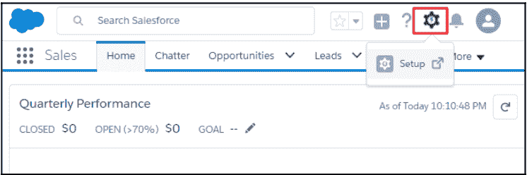

在左侧面板中，有许多用于配置 Salesforce 的链接。这些链接可分为三大类：ADMINISTRATION、PLATFORM TOOLS 和 SETTINGS。每个类别都有许多菜单。对于每个菜单，先点击箭头 >，点击菜单以打开子菜单。

如果您不是系统管理员，您可能会在设置页面中看到更少的菜单选项，或者您可能根本看不到设置页面——这取决于授予您的权限。

如果您知道一个设置名称，但不记得它位于何处，或是否属于某个菜单，您可以将设置名称输入到面板顶部的快速查找文本框中；这将快速过滤所有设置菜单，如以下屏幕截图所示：

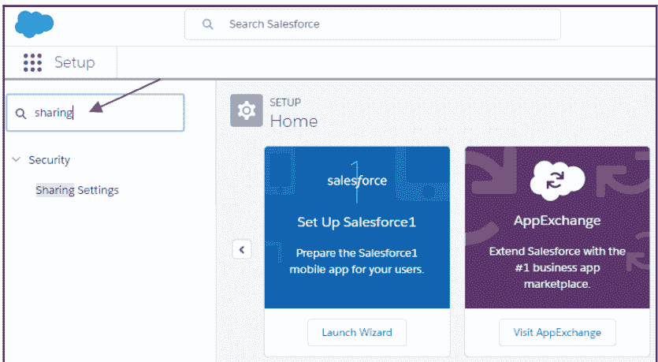

中心面板显示在设置页面中最近使用的最后十个项目（不是记录）。点击该面板中的任何链接以打开相关的设置项。右上面板将为管理员提供快速快捷方式，以快速创建单个或多个用户、自定义对象、自定义标签、电子邮件模板和工作流流程。

## 导航到报表和仪表板

Salesforce Lightning Experience 中的 **Reports** 和 **Dashboards** 选项卡位于不同的选项卡下，如此屏幕截图所示：

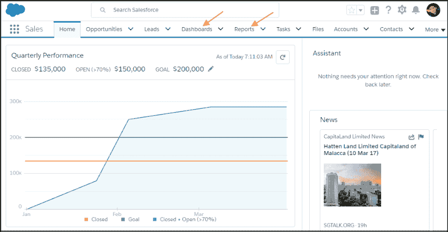

您可能会想，“为什么我在 Salesforce 中看不到这些选项卡？”。以下是两个原因：

- 请确保您的 **Profile** 或 **Permission Set** 对 **Reports** 选项卡和 **Dashboards** 选项卡的设置是 **Default On** 或 **Default Off**，而不是 **Tab Hidden**。您需要向您的 Salesforce 系统管理员确认此设置。
- 从选项卡行中的左上角打开 **App Launcher**（在徽标下方）；该图标为九个点组成的正方形。如果您能在此处找到报表和仪表板链接，则表示您打开的应用未添加报表和仪表板项。您可以从此处访问，或请您的管理员将这些项添加到应用中，如以下屏幕截图所示：

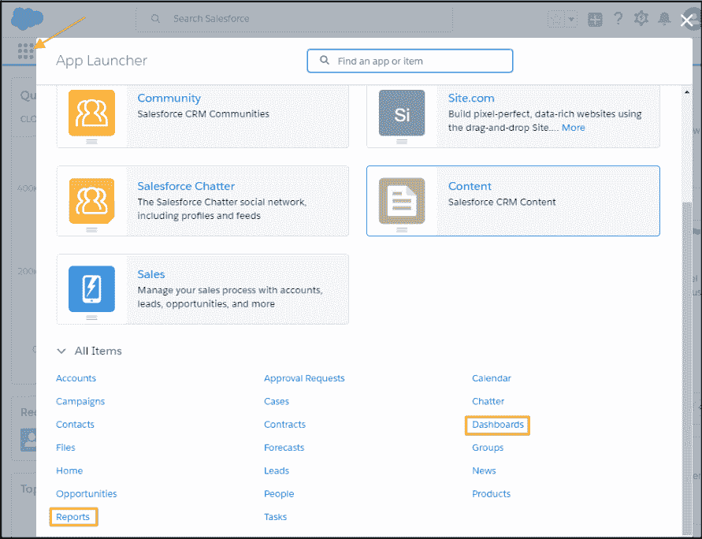

## 报表 / 仪表板选项卡和菜单

当您点击 **Reports** 选项卡时，默认情况下，您将看到最近打开的报表列表。在左侧面板中，您会找到一个包含以下项目的菜单：

- **Created by Me**
- **Private Reports**
- **Public Reports**
- **All Reports**

在 **FOLDERS** 子部分中存在以下文件夹：

- **Created by Me**
- **Shared with Me**
- **All Folders**

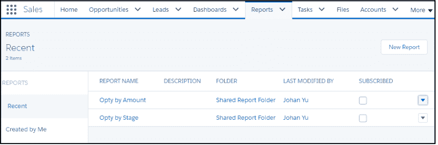

如果您有创建报表的权限，您将在此页面的右上角看到 **New Report** 按钮。

要运行报表，只需点击报表名称，它将打开报表。生成的报表是从您的组织中提取的实时数据。

在主面板中，有几个列——**REPORT NAME、DESCRIPTION、FOLDER、LAST MODIFIED BY 和 SUBSCRIBED**——以及一个箭头可对报表执行一系列操作。我们将在本书的接下来的几章中讨论这些项目的大部分内容。

当您点击 **Dashboards** 选项卡时，同样适用。您将在主面板中找到列 **DASHBOARD NAME、DESCRIPTION、FOLDER 和 LAST MODIFIED BY**。

## 添加到收藏夹

请注意，大多数选项卡旁边都有一个箭头。点击箭头将列出所有最近打开的记录。报表和仪表板同样适用——当您打开报表或仪表板时，它将被添加到最近记录中。

当您的报表或仪表板打开时，您可以通过点击 **Add Favorite**（星形图标）将该报表或仪表板加入书签，报表或仪表板将被添加到您的个人收藏列表中，如以下屏幕截图所示：

现在查看页面顶部的 **MY FAVORITES**（星形图标）按钮。点击星形图标旁边的箭头，您将找到之前添加到收藏夹的报表或仪表板。您可以通过点击 **Edit Favorites** 链接将其从收藏列表中移除：

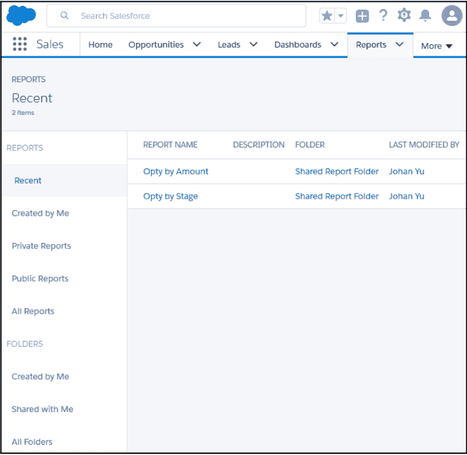

报表中也存在相同的行为——您还可以为仪表板添加书签，它们将被添加到收藏图标中。您点击收藏图标旁边的箭头即可查看它。

## 总结

在本章中，我们首先讨论了 Salesforce 架构、使用 Salesforce 技术的好处以及 Salesforce 提供的多种产品。Lightning Experience 是最新的用户界面，它在旧的 Salesforce Classic 用户界面之上提供了许多增强功能和更高的生产力。我们讨论了如何切换到 Lightning Experience，并提供了如果您是 Lightning Experience 的新手，如何将其推广给用户的建议。

我们继续讨论 Salesforce 对象模型、数据在 Salesforce 中的存储方式、对象类型以及标准对象与自定义对象之间的区别。关于如何关联对象、对象之间使用主从关系和查找关系的关系，以及两种关系模型之间的比较等主题都得到了深入解释。您还了解了对象的多种字段类型。

接下来，我们解释了如何导航到设置菜单，提供了菜单上 **Quick Find** 的提示，并提到了主面板中最近打开的设置菜单。章节末尾，我们向您展示了在 Salesforce 中查找报表和仪表板的位置，并给出了如果找不到它们的原因。然后我们分享了如何导航到 **Reports and Dashboards** 选项卡，以及选项卡旁边的箭头后面。最后，我们以如何在 Lightning Experience 中使用收藏图标为报表和仪表板添加书签，以及如何利用该功能结束。

在下一章中，我们将介绍 Salesforce 中报表和仪表板的概念，报表和仪表板如何存储，与报表相关的后端数据，与报表和仪表板相关的权限，以及围绕它们的内置安全性。

