# 2

## 报表与仪表盘中的概念和权限

本章将解释 Salesforce 中报表和仪表盘的概念，并讨论生成报表和仪表盘的数据来源。我们还将继续讲解 Salesforce 中报表和仪表盘的存储机制，并说明报表和仪表盘文件夹的类型。

接下来我们会继续讨论权限，权限是一种基本设置，用于控制用户在 Salesforce 中能执行的操作。报表和仪表盘也是如此；许多权限都围绕报表和仪表盘展开，例如创建和修改报表、导出报表、安排报表计划等。

到本章结束时，你将深入理解如何将数据用于报表和仪表盘、与用户相关的权限，以及如何使用 Profile 和 Permission Set 向用户授予权限。

在本章中，我们将提供注释和提示，帮助你理解重要内容。本章涵盖的主题如下：

- 报表和仪表盘的数据
- 生成报表和仪表盘
- 报表和仪表盘文件夹
- 报表权限
- 仪表盘权限

## 报表和仪表盘的数据

先说最重要的事。你只能针对 Salesforce 组织中已存在的数据生成报表，除非你购买了 Salesforce Connect 来连接外部数据库，将组织外部存储的数据映射到你的 Salesforce 组织中；外部数据源也可以是另一个 Salesforce 组织。你的报表质量取决于数据质量、数据清洁度和完整性。因此，系统采用率是在 Salesforce 中获得优质数据和报表的最关键因素之一。

一旦创建了报表，你可以将其私有保存、与其他用户共享、在报表中的数据发生变化并满足设定条件时订阅通知，也可以将其安排为定时发送给自己和其他用户。

在 Salesforce 中，报表是构建仪表盘的基本要求。仪表盘中的每个组件都需要有一个报表作为数据源。你可以在同一个仪表盘中的多个组件中重复使用同一个报表，也可以在多个仪表盘之间共享该报表。

你可以使用对象中可用的任何字段（无论字段类型是什么），也可以使用多个对象中的字段来创建报表。你需要对该对象和字段具有读取访问权限，但不需要拥有编辑数据的权限。如果你需要了解更多关于对象、字段和字段类型的信息，请参阅第 1 章《Salesforce 报表和仪表盘基础》中的“Salesforce 对象模型”一节。正如你现在所看到的，对象和字段是创建报表的基础。

## 生成报表和仪表盘

当你点击一个报表时，Salesforce 会在几秒钟内即时生成该报表，报表中显示的数据是来自你 Salesforce 组织的实时数据。但如果我想查看昨天或上周的数据呢？不行，你只能针对当前数据生成报表。如果你想查看历史数据，可以设置 Reporting Snapshot 或 Field History，但这不是某一特定日期的完整数据快照。

在报表中，你只能看到你拥有访问权限的对象和字段，即使该报表是由其他人创建的。这意味着，对于同一个报表，你看到的字段或列可能会少于其他用户，因为你没有这些字段的权限。

同样，对于数据集，如果某条记录在 Salesforce 中对你是不可见的，你在报表中也不会看到它。这被称为对象共享设置和对象权限。

然而，仪表盘的情况则有所不同。当你打开一个仪表盘时，它显示的是截至上一次仪表盘刷新时的数据。如果仪表盘最后一次刷新是由你的同事完成的，你将看到的是你同事上次刷新时的数据，你也可以手动刷新。Salesforce 提供了自动刷新仪表盘的功能，但存在一定限制。

## 报表和仪表盘文件夹

报表和仪表盘存储在 Salesforce 中的什么位置？它们存储在**文件夹**中。你可以创建和存储的报表与仪表盘数量没有限制。为报表创建的文件夹只能用于存储报表，而为仪表盘创建的文件夹只能用于存储仪表盘。为了简化本书内容，我们称之为报表文件夹和仪表盘文件夹。

你可以在这里把文件夹想象成类似于 Windows 资源管理器中的文件夹，但没有驱动器，也没有子文件夹，它不存储文件，而是根据文件夹类型用来存储报表或仪表盘。作为文件夹管理员，你可以将文件夹的可见性共享给特定用户、角色、角色及其下属，或公共组。

Salesforce 中用于报表和仪表盘的文件夹类型：

- 私有文件夹
- 未归类的公共文件夹（仅用于报表）
- 公共文件夹

### 私有文件夹

私有文件夹是每个 Salesforce 用户都可使用的特殊文件夹，对于报表文件夹，它也被称为**我的个人自定义报表**文件夹。对于仪表盘，它被称为**我的个人仪表盘**（Classic 界面）或**私有仪表盘**（Lightning Experience 界面）。在 Lightning Experience 中，存储在此文件夹中的报表被称为**私有报表**。

### 未归类的公共文件夹

Classic 中的**未归类的公共报表**文件夹，在 Lightning Experience 中也被称为**公共报表**文件夹，是另一个特殊的报表文件夹。存储在此报表文件夹中的报表可供所有用户访问。如果你还拥有创建和自定义报表的权限，你就能将报表存入此文件夹。

### 公共文件夹

要创建公共文件夹，你需要拥有创建报表文件夹或仪表盘文件夹的权限（我们将在第 3 章《在报表和仪表盘中实现安全性》中讨论与文件夹相关的所有权限）。公共文件夹是你为存储报表和仪表盘而创建的文件夹；通常，该文件夹会由许多用户共享。

创建新报表后，你需要保存报表才能运行它。你可以将报表存储在公共文件夹中，以便与同事共享，供将来使用或其他用途，例如作为仪表盘的数据源，或用于电子邮件发送。根据用户权限和文件夹级访问权限，这将决定文件夹对用户是否可见、可访问——是只读还是可读写。请记住，报表的可访问性是在文件夹级别配置的，而不是在报表本身中配置的。

当文件夹对用户可见时，该用户将能够查看并运行存储在该文件夹中的所有报表。因此，控制不是按报表进行的，而是按文件夹进行的。

当你从 AppExchange 安装应用时，某些应用会自带的报表，这些报表将存储在其自己的文件夹中。该文件夹会在你安装应用时创建。

## 报表与仪表盘中的概念和权限

点击“报表”选项卡，然后点击“所有文件夹”，即可查看你有权访问的所有报表文件夹。让我们比较一下不同用户的情况。以下截图来自一个管理员，该管理员可以访问所有文件夹：

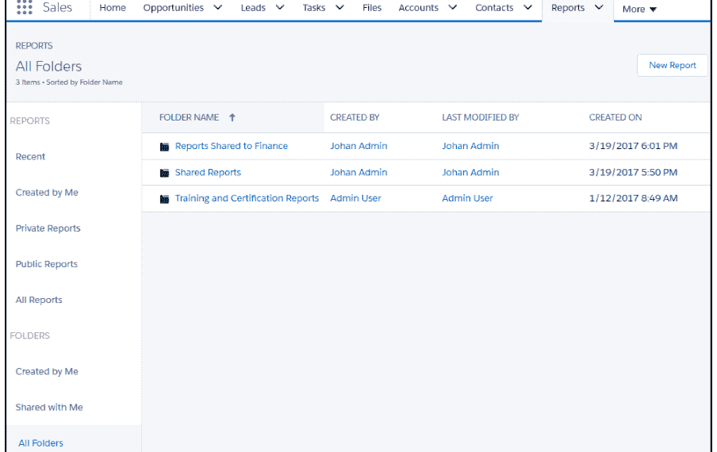

将上面的截图与下面这张来自销售用户的截图进行比较。该销售用户只能看到一个文件夹，而不是像上面的截图那样看到三个文件夹。报表文件夹管理员可以为每个用户设置文件夹可访问性：

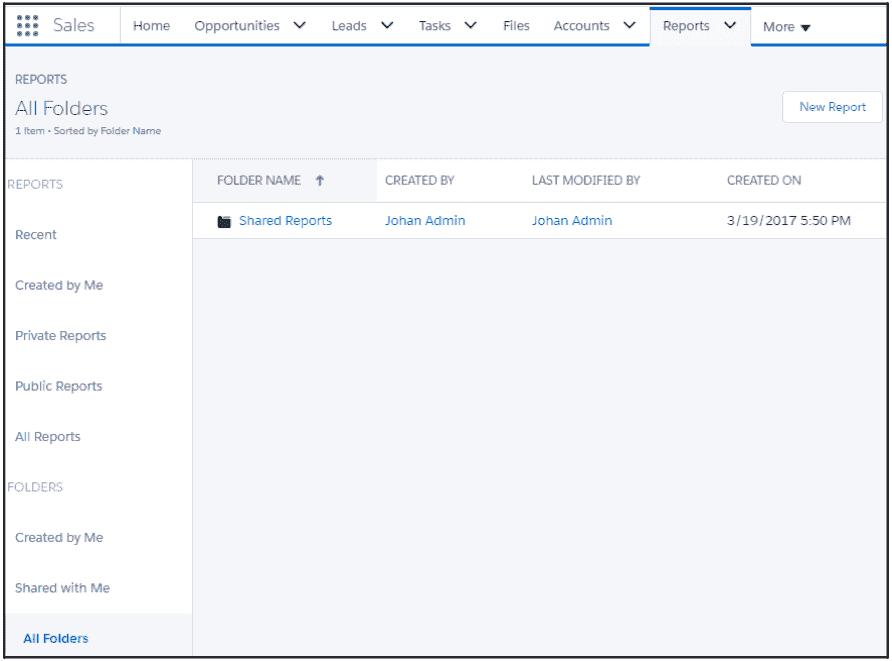

每个公共文件夹只能存储报表或仪表盘，不能同时存储两者。一个好的做法是为报表名称和文件夹名称制定良好的命名模式，例如，用 “NA Sales Reports” 作为存储所有北美销售相关报表的文件夹名称，用 “EMEA Sales Dashboards” 作为存储所有与 EMEA 销售相关的仪表盘文件夹名称。这将帮助你和其他用户轻松找到报表，并保持内容井然有序。

## 标准报表和报表文件夹

当你开始使用 Salesforce 时，默认情况下，Salesforce 自带许多用于不同目的的标准报表。它们按对象名称和用途进行存储和分类，例如“客户和联系人报表”、“机会报表”等。

从 Summer '17 版本开始，带有文件夹的标准报表仅在 Classic 中可见，在 Lightning Experience 中尚不可见。

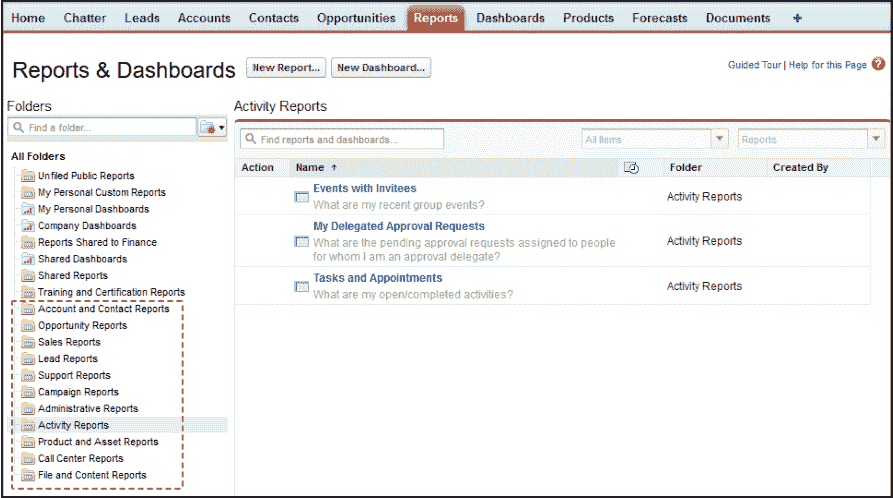

上面的截图来自 Classic（请参阅*第1章，Salesforce 报表和仪表板基础知识*中的*切换到 Lightning Experience*部分，了解如何在 Classic 和 Lightning Experience 之间切换）。请注意，在 Classic 中，当你点击**报表**选项卡时，你会看到来自报表和仪表板的内容，并且你可以通过查看文件夹名称前的不同图标轻松区分报表文件夹和仪表板文件夹。

在 Classic 中，你可以在选项卡内进行搜索，而在 Lightning Experience 中，报表和仪表板位于不同的选项卡中。选项卡中没有搜索框，但你可以使用全局搜索来搜索报表和仪表板。

## 创建报表和仪表板文件夹

在 Salesforce 中创建报表文件夹和仪表板文件夹非常简单。只要你拥有相应的权限，你应该会在“报表”选项卡中看到“新建文件夹”按钮以创建报表文件夹，并在“仪表板”选项卡中看到“新建文件夹”按钮以创建仪表板文件夹。你需要拥有适当的权限才能创建报表和仪表板文件夹。我们将在本章稍后详细讨论权限。

让我们进行一个快速的动手练习来创建报表文件夹。请记住，每个报表都需要存储在一个文件夹中，因此深入了解文件夹本身对你来说是有好处的。

### 创建报表文件夹的动手练习

确保你拥有创建报表文件夹的适当权限。让我们按照以下步骤创建一个报表文件夹：

1. 导航到“报表”选项卡。
2. 单击窗口右上角的“新建文件夹”按钮，如下面的截图所示：

   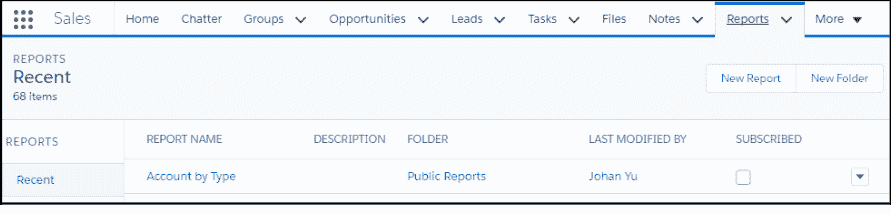

3. 在“名称”中输入 `My First Report Folder` 作为报表文件夹名称。
4. 单击“保存”按钮；将出现一条弹出消息，指示文件夹是否已成功创建。
5. 我们刚刚创建的文件夹 `My First Report Folder` 将显示在**所有文件夹**中，也会显示在**由我创建**的文件夹中，如下面的截图所示：

   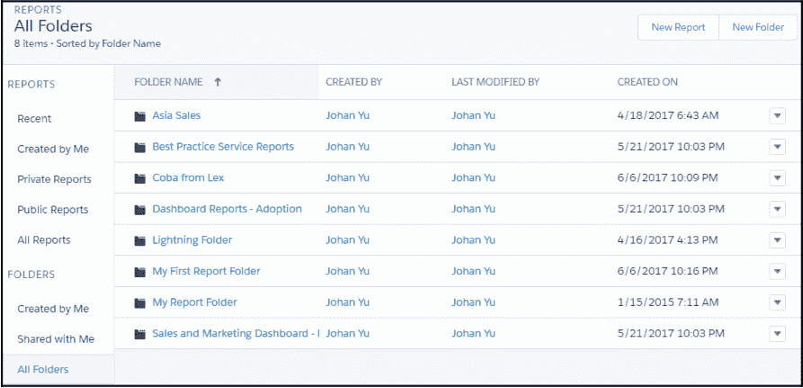

查看上面的截图，让我们逐一了解“报表”下的每个菜单：

- **最近使用的报表：** 这将显示您最近打开的所有报表，因此您的同事将拥有不同的最近打开的报表。
- **由我创建：** 这包含您创建的所有报表，无论这些报表存储在哪个文件夹中。
- **私人报表：** 这是一个安全文件夹，用于存储供您个人使用的报表；存储在此处的报表其他用户无法访问，并且您无法与其他用户共享该文件夹。
- **公共报表：** 这包含所有对所有人可见的报表。

> 提示：由于此文件夹对所有用户可访问，并且任何人都可以编辑或删除它，请注意不要将您的私人或重要报表存储在此文件夹中。

- **所有报表：** 这将显示您有权打开的所有报表。

以下是**文件夹**下的菜单：

- **由我创建：** 这将显示您创建的所有报表文件夹。
- **与我共享：** 这是由您的同事创建但与您共享的报表文件夹列表。
- **所有文件夹：** 这将列出您有权访问的所有报表文件夹，包括由您的同事创建的或作为从 AppExchange 安装应用的一部分而安装的报表文件夹。

## 报表和仪表板文件夹共享

与创建报表和仪表板文件夹相同，从 Summer '17 版本开始，共享公共报表和仪表板文件夹只能在 Classic 中完成。

点击**报表**选项卡，将鼠标悬停在要共享的文件夹上，然后点击文件夹名称旁边的图钉图标——您将看到**共享**选项。如果您只看到**固定到顶部**和**共享**，但没有**编辑**和**删除**，这意味着您不是该文件夹的管理员。我们将在本章中介绍文件夹访问级别。以下是从 Classic 共享报表文件夹的截图：

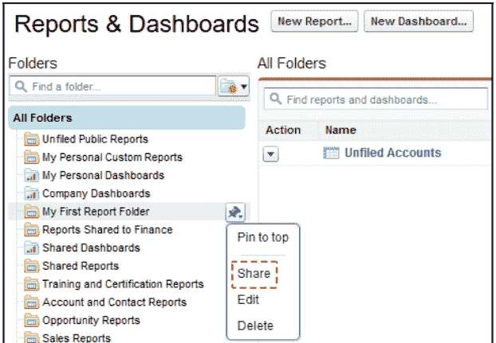

用户可以与**用户、角色、角色及下属或公共组**共享文件夹，并具有**查看者**、**编辑者**和**管理者**的访问级别。查看以下与其他用户共享报表的截图：

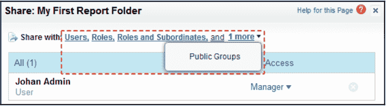

要共享报表文件夹，用户必须满足以下条件：

- 对该报表文件夹具有**管理者**访问级别。
- 拥有“管理公共文件夹中的报表”权限。

> 当您创建文件夹时，您会自动被设置为该文件夹的**管理者**。

报表和仪表板文件夹有三种访问级别，如下表所示：

| 查看者 | 编辑者 | 管理者 |
|---|---|---|
| • 在文件夹树中查看文件夹 • 查看所有内容 • 运行报表，刷新仪表板 | • 拥有**查看者**访问权限的所有权限，以及以下权限： • 编辑文件夹的所有内容 • 向文件夹添加内容 • 从文件夹删除内容 | • 拥有**编辑者**访问权限的所有权限，以及以下权限： • 编辑文件夹名称 • 编辑/删除/移除共享 |

### 共享报表文件夹的动手练习

现在，让我们逐步说明如何共享报表文件夹。

用例：您想将 `My First Report Folder` 文件夹共享给一个角色为 CEO 的用户，访问级别为**查看者**，并共享给一名财务经理，我们将其命名为 **Jack Fin**，作为文件夹的**管理者**（您可以使用其他用户名进行此练习）。假设角色 CEO 存在，并且已经创建了一个名为 `Jack Fin` 的用户。

1. 导航到**报表**选项卡。
2. 点击之前创建的报表文件夹 `My First Report Folder`，将鼠标悬停在报表文件夹名称上，点击图钉图标，然后点击**共享**：

   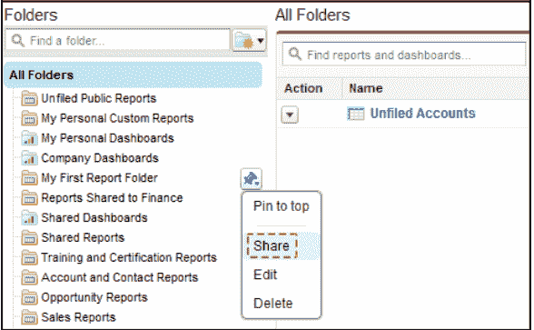

3. 这将打开一个弹出窗口；点击**角色**链接，然后点击 CEO 旁边的**共享**按钮。将访问菜单保留为**查看者**，然后点击**完成**按钮继续。
4. 接下来，点击“用户”链接，搜索 Jack Fin。点击该用户旁边的“共享”按钮。默认访问级别为“查看者”；点击其旁边的箭头，选择“管理者”。现在点击“完成”按钮继续，如下面的截图所示：

   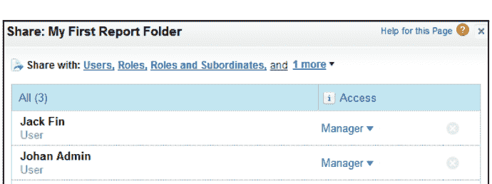

5. 点击“关闭”按钮关闭窗口。

在此动手练习中，您学习了如何与具有“管理者”访问级别的用户以及角色中的用户共享报表文件夹以查看报表。

## 报表权限

当我们在本章前面讨论报表和仪表板文件夹时，您可能已经注意到我们谈到了创建报表、创建报表文件夹等权限。权限是控制用户在 Salesforce 中执行操作（包括报表和仪表板）能力的基本设置。

在我们开始创建报表之前，我们将讨论一些权限，这些权限决定了用户在 Salesforce 中运行、创建、编辑、导出、计划以及订阅报表的能力。

### 运行报表

这是运行报表所需的基本权限。如果没有“运行报表”权限，您将无法在 Salesforce 中运行任何报表。当您尝试点击报表时，您会收到一条错误消息，提示“您没有运行报表的权限。”请检查您是否拥有“运行报表”用户权限，如下面的截图所示：

## 报告和仪表板中的概念和权限

### 运行报表

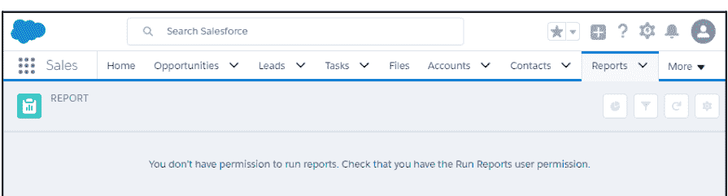

当某个配置文件中的所有用户都需要运行报表时，管理员只需在配置文件下的“常规用户权限”部分启用此权限即可。要将此权限分配给不同配置文件中的用户，请使用权限集。记住，权限集仅按每个用户的基础添加权限，而不会移除权限，并且与用户配置文件无关。

此权限还控制用户访问仪表板的权限。我们将在第 9 章《Lightning Experience 中的构建仪表板》中详细介绍仪表板。如果您无法运行报表，请联系您的管理员以启用此权限。

快速检查：如果您已启用此权限，请单击报表选项卡，然后单击“所有报表”菜单。您应该在几秒钟内看到生成的报表，但如果您看到与上一张截图中类似的错误消息，则表示您没有权限运行报表。如果您完全看不到报表选项卡，请查看第 1 章《Salesforce 报表和仪表板基础》中的“导航到报表和仪表板”部分。

### 创建和自定义报表

“创建和自定义报表”权限控制用户创建新报表或修改现有报表的能力。如果没有此权限，用户在报表选项卡下将看不到“新建报表”按钮。此权限需要“运行报表”权限，因此如果用户的“运行报表”权限被禁用，则“创建和自定义报表”权限也会自动为该用户禁用。同样，当您启用“创建和自定义报表”权限时，“运行报表”权限也会自动启用。

当您启用此权限时，您应该会看到**新建报表**按钮；否则，您将无法创建和自定义报表。如果您需要创建或自定义报表，请与您的管理员联系以启用此权限。以下截图显示用户有权创建报表：

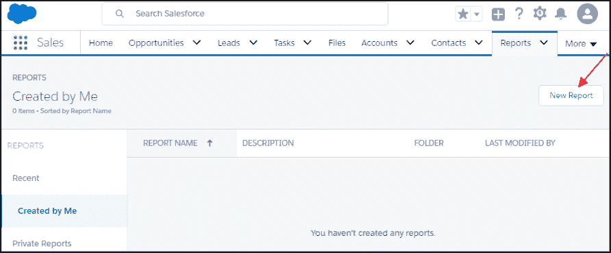

### 导出报表

**导出报表**权限管理用户将报表导出为 Excel 或 CSV 文件格式的能力。与**创建和自定义报表**权限类似，此权限也依赖于**运行报表**权限。禁用**运行报表**权限将自动禁用此权限。但此权限不依赖于**创建和自定义报表**权限，这意味着用户可能能够导出报表，即使她或他无法创建或自定义报表。

当您打开报表并且已启用此权限时，您将在**编辑**按钮旁边的箭头下拉菜单下看到**导出**链接。请考虑以下截图：

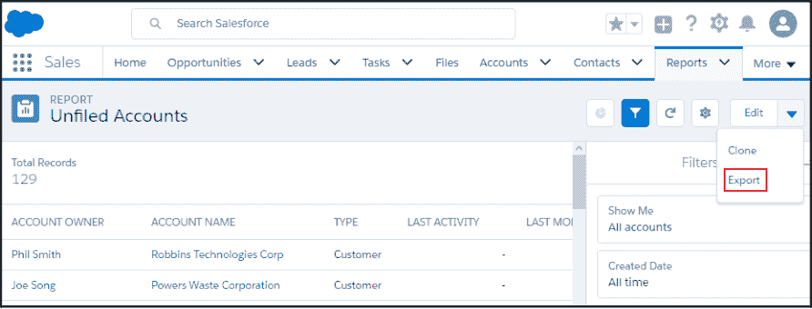

> 💡 **提示**  
> 在 Classic 中，有一个选项可以将报表导出为可打印视图。导出的 Excel 文件将保留格式，并且随报表生成的汇总信息将在 Salesforce 中生成。

### 订阅报表

**订阅报表**权限使用户能够订阅报表以将其发送到其电子邮件地址，而无需打开报表。当您在 Lightning Experience 中订阅报表时，您将按您设置的计划——**每日、每周或每月**——通过电子邮件接收更新的报表结果。

拥有此权限的用户在报表打开后会看到**订阅**按钮，如以下截图所示。我们将在第 8 章 *使用报表* 中详细介绍订阅报表：

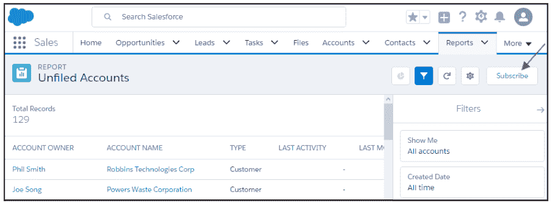

与此权限相关的有两个权限，分别是：

- **通过添加收件人订阅报表**：此权限将允许您添加其他用户以接收电子邮件发送。默认情况下，您包含在内，但在添加其他人时您可以将自己移除。
- **通过设置运行用户订阅报表**：此权限将允许您将运行用户指定为其他人，只要该用户有权访问报表即可。

### 仪表板权限

在上一节查看了报表权限后，让我们现在来看一下 Salesforce 中可用的仪表板权限。仪表板中的权限决定用户在 Salesforce 中打开、创建和编辑仪表板的能力。

#### 运行报表权限

我们在 *报表权限* 部分讨论了**运行报表**权限，我们在这里不会重复，但我们想强调的是，Salesforce 中的仪表板基于报表。Salesforce 中每个仪表板组件都由报表作为后端数据源支持。

要允许用户在 Salesforce 中打开或查看仪表板，用户需要拥有运行报表的权限，并且仪表板查看用户必须有权访问用作仪表板组件数据源的报表。如果没有**运行报表**权限，用户在打开仪表板时会收到错误消息，提示**您没有权限运行报表。请检查您是否具有运行报表用户权限。**

**运行报表**是每个在 Salesforce 中使用报表和仪表板的用户所需的基本权限，即使只是运行或打开报表或仪表板也需要此权限。

#### 创建和自定义仪表板权限

**创建和自定义仪表板**权限控制用户创建新仪表板或修改现有仪表板的能力。如果没有此权限，用户在单击**仪表板**选项卡时将无法看到**新建仪表板**按钮。

此权限也需要**运行报表**权限。如果**运行报表**权限被禁用，则为用户启用**创建和自定义仪表板**是无用的。

#### 管理动态仪表板权限

**管理动态仪表板**权限允许用户创建和编辑动态仪表板。我们将在 *第 10 章，学习高级仪表板配置* 中更详细地了解动态仪表板。但现在，您只需要了解动态仪表板允许已登录用户根据用户权限和角色层级选择其他用户作为查看用户。

在创建或编辑仪表板时，拥有此权限的用户将有选项将仪表板运行用户设置为已登录用户，或允许打开仪表板的用户更改查看用户。以下截图显示了启用动态仪表板：

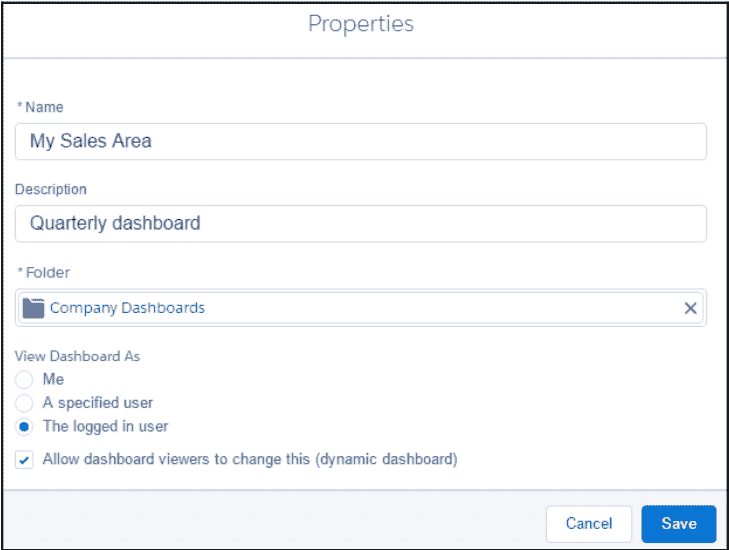

#### 查看我的团队仪表板权限

**查看我的团队的仪表板**权限允许用户查看角色层级中其下属人员拥有的仪表板。

在创建或编辑仪表板时，拥有**管理动态仪表板**权限和**查看我的团队的仪表板**权限的用户可以选择设置**仪表板运行用户**，并启用**允许授权用户更改运行用户**。

当打开动态仪表板时，没有**查看我的团队的仪表板**权限的用户将无法更改仪表板查看用户。然而，拥有此权限的用户将能够更改并在角色层级中输入其团队中的用户作为查看用户。拥有**查看所有数据**权限的用户将能够输入任何其他用户作为查看用户。以下截图显示了如何更改仪表板查看者：

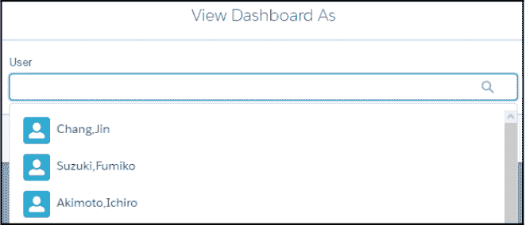

#### 安排仪表板

我们将在 *第 9 章，Lightning Experience 中的构建仪表板* 中讨论仪表板，但现在您应该知道，当您打开仪表板时，它不会显示最新数据，而是显示您上次刷新仪表板的数据、您同事刷新过的数据，或安排自动刷新的数据。

Salesforce 为拥有**安排仪表板**权限的用户提供刷新仪表板的能力，刷新次数有限。我将在 *第 9 章，Lightning Experience 中的构建仪表板* 中分享更多内容，但现在，只需注意我们可以安排仪表板刷新，并将仪表板通过电子邮件发送给自己或发送给其他用户。

截至 Summer ’17 版本，此功能仅在 Classic 中可用，尚未在 Lightning Experience 中提供。

# 总结

在本章中，我们首先讨论了源数据，以及 Salesforce 报告是基于 Salesforce 中的实时数据生成的。它只显示用户拥有访问权限和可见性的数据和字段。构建仪表板需要报告，因为每个仪表板组件都需要一个报告作为数据源。Salesforce 中的仪表板在用户打开时不会自动刷新；用户需要手动刷新，或安排其定时刷新。

接着我们讨论了报告和仪表板在 Salesforce 中的存储方式和存储位置，即文件夹。我们讨论了多种类型的文件夹：私有文件夹、公共文件夹和标准文件夹。我们还讨论了用户对文件夹的访问级别类型。

接下来，我们了解了权限，权限是控制用户在 Salesforce 中能做什么和看什么的基础，包括报告和仪表板。我们讨论了与报告和仪表板相关的多种权限。

在下一章中，我们将说明如何保护已创建的报告和仪表板——供个人使用或与团队共享。我们还将讨论所需的配置，以允许一个包含所有用户的组对报告具有读取访问权限，并允许某些成员修改报告。
