## 在报告和仪表板中实现安全性

本章将说明如何在 Salesforce 中保护报告和仪表板。正如我们在第2章 *报告和仪表板中的概念与权限* 中所讨论的，每个报告和仪表板都存储在一个文件夹中，报告和仪表板的可访问性由存储它们的文件夹控制，而不是由报告或仪表板本身控制。

在上一章中，我们还讨论了与报告和仪表板相关的权限。在本章中，我们将继续讨论与报告和仪表板文件夹相关的权限。与文件夹相关的权限有很多，例如，拥有某些权限的用户将能够查看所有公共文件夹，即使该用户名没有被添加到文件夹中。我们将逐一介绍所有这些场景。

到本章结束时，你将深刻理解如何保护你的报告和仪表板，以及如何确保与团队共享的报告和仪表板是安全的。作为管理员，你将了解与报告和仪表板文件夹相关的多种权限类型，并且这些权限不应对每个用户都启用。

本章涵盖的主题如下：

- 私有报告和仪表板
- 未归档公共报告
- 公共报告和仪表板
- 报告文件夹权限
- 仪表板文件夹权限
- 应用权限

### 保护私有报告和仪表板

私有报告是仅报告所有者（创建报告的用户）可以访问的报告，无论其用户角色或配置文件如何。私有仪表板也是如此。

在第2章《报告和仪表板中的概念与权限》中，我们解释了管理员可能能够访问你的私有报告和仪表板。当“管理员可以以任何用户身份登录”设置启用时，就会出现这种情况——该设置位于“登录访问策略”设置下。你可以将这一场景类比为你的办公电子邮件，电子邮件服务器管理员可以访问它——除非必要，否则他们不应该这样做，并且该活动会被记录。

拥有创建报告或创建仪表板权限的用户可以将他们创建的报告和仪表板存储在各自的私有文件夹中。对于报告，文件夹名为 My Personal Custom Reports；对于仪表板，文件夹名为 Private Dashboards（在 Lightning 中）和 My Personal Dashboards（在 Classic 中）。请看以下截图：

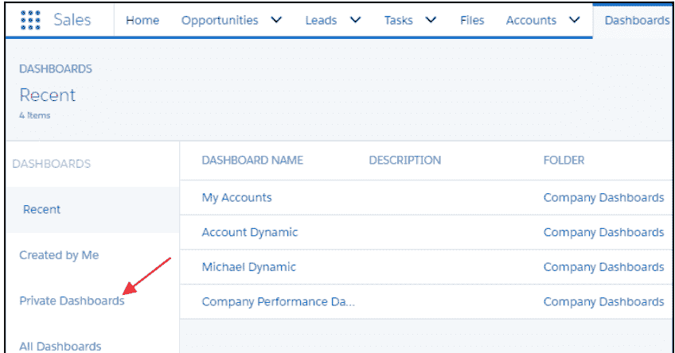

要保护你的个人报告，即确保任何人都无法查看、更改或删除这些报告，请将报告存储在 **My Personal Custom Reports** 文件夹中。即使其他用户拥有 URL，也无法访问该报告。对仪表板同样可以如此——将其存储在 **Private Dashboards** 文件夹中，以便私有访问。请看以下截图：

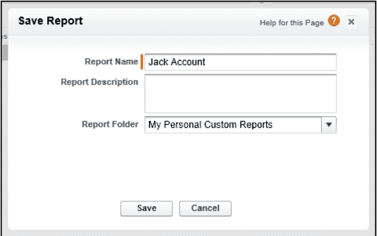

但即使是私有报告，它仍会遵循数据可见性；你只能在报告中看到你自己可见的数据。类似地，当你创建或编辑报告时，只能将你有权限的对象和字段添加到报告中。报告中的对象和字段可见性也受报告类型控制，我们将在第5章 *了解报告类型* 中讨论报告类型。

简而言之，要保护你的私有报告和仪表板，只需将它们存储在个人文件夹中，仅此而已。由于这些报告和仪表板任何人都无法访问，你将无法与其他用户共享它们。

### 使用未归档公共报告

在第2章 *报告和仪表板中的概念与权限* 中，我们简要讨论了 **未归档公共报告**。该文件夹可供任何用户访问，因此任何拥有 **运行报告** 权限的用户都可以运行存储在该文件夹中的报告，并将报告从该文件夹复制（另存为）到其他文件夹（包括用户自己的私有文件夹）。要保护此文件夹，实际上无计可施。

但这并不意味着你可以删除或修改存储在该文件夹中的任何报告。除非你拥有特定权限，否则你只能删除或修改自己创建并存储在该文件夹中的报告——这一点我们将在本章中进一步讨论。

### 使用公共报告和仪表板

我们在第2章 *报告和仪表板中的概念与权限* 中讨论了公共文件夹。存储在公共文件夹中的所有报告和仪表板统称为公共报告和公共仪表板。公共报告是确保你的团队按照定义查看数据的最简单方法之一。例如，报告 **我的团队下一季度销售管道** 将显示你的团队（你本人及你的下属，包括下属的下属——可以将其想象为多层次层级结构）下所有需要在下一季度结束前关闭的商机。你的组织可能有自己的销售管道阶段，也可能有不同的季度周期。使用共享的团队报告，所有销售经理将看到其团队的正确销售管道，而销售代表（个人贡献者）将看到自己的销售管道，并带有定义的阶段和周期。

让我们看以下截图。Michael 是一位销售经理，Jack 是向 Michael 汇报的销售代表。当 Michael 打开报告时，他将看到以下报告：

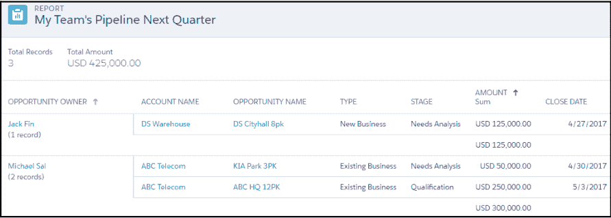

由于 Jack 是角色层级中 Michael 的下属，Jack 的销售管道将出现在 Michael 的报告中。

理想情况下，Salesforce 中的每个用户都有一个由管理员定义的角色。该角色决定了用户在 Salesforce 中的数据可见性。一个角色在其下可以有多个直接下级角色，但在其上只能有一个直接上级角色。这种关系形成了角色层级，它与公司的组织结构图非常相似。由用户拥有的记录，处于记录所有者之上角色层级的用户可以看到该记录。

当 Jack 打开同一份报告时，由于他没有任何下属，他只能看到自己的销售管道，如以下截图所示：

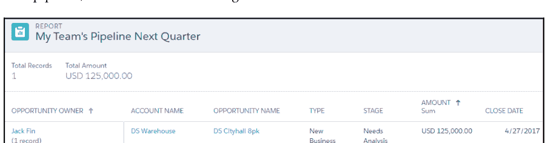

同一类型的报告可用于整个组织。该报告将遵循为所有用户定义的角色层级，从 CEO 一直到销售代表角色。要创建此类报告，从技术上讲，你只需使用筛选条件来显示“我的团队的商机”，如以下截图所示：

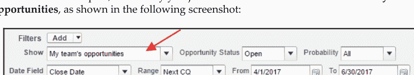

如果报告需要服务公司中的所有用户，请确保其存储在所有用户都可访问的文件夹中，例如全球销售报告。

若要与公司内的所有用户共享文件夹，你可以将其与名为 All Internal Users 的组共享。该组由系统自动生成，所有活跃用户都会作为成员被添加。


为什么我们需要将此报表存储在 **Global Sales Reports** 而不是前面讨论的 **Unfiled Public Reports** 文件夹中？这是为了整理和最佳实践。从专门命名的文件夹中查找报表比将所有报表都放在 **Unfiled Public Reports** 中更容易。随着时间的推移，如果未妥善管理和清理，Unfiled Public Reports 文件夹会因添加了所有报表而变得非常混乱。

团队报表也可以用于个人使用。例如，**My Closed Opportunity This Fiscal Year** 报表将显示运行该报表用户的名下所有已关闭商机——这应显示公司财年内你名下所有赢得和丢失的商机。运行报表时，每个用户都会根据所有权看到不同的商机。管理层可以为报表定义关键指标矩阵，每个团队成员应负责，例如 **Amount、Close Date、Probability** 等。创建这种报表甚至更简单——你只需使用筛选条件来显示 **My opportunities** 即可。请考虑以下屏幕截图：

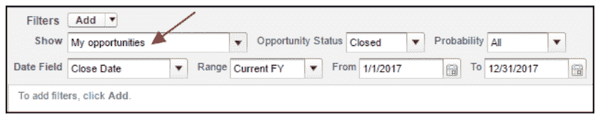

## Sharing and securing public reports and dashboards

在本章前面部分，我们强调报表和仪表板的安全性和可访问性由其报表文件夹定义。因此，最佳实践是将团队的所有报表和仪表板存储在同一文件夹中。如果你是管理该文件夹的人，你需要创建报表文件夹权限，或让你的管理员为你创建报表文件夹，并将 Manager 级别访问权限分配给报表文件夹。这同样适用于仪表板。


创建报表文件夹的人将自动拥有该文件夹的 Manager 级别访问权限。

## The Create Report Folders permission

**Create Report Folders** 权限赋予用户创建新报表文件夹的能力。需要启用 **Create and Customize Reports** 权限才能使用此权限。

当此权限启用时，一旦进入 **Reports** 选项卡，你将看到 **New Folder** 按钮；要创建报表文件夹，请点击该按钮，并在 **Create Folder** 窗口下提供文件夹名称，如以下屏幕截图所示：

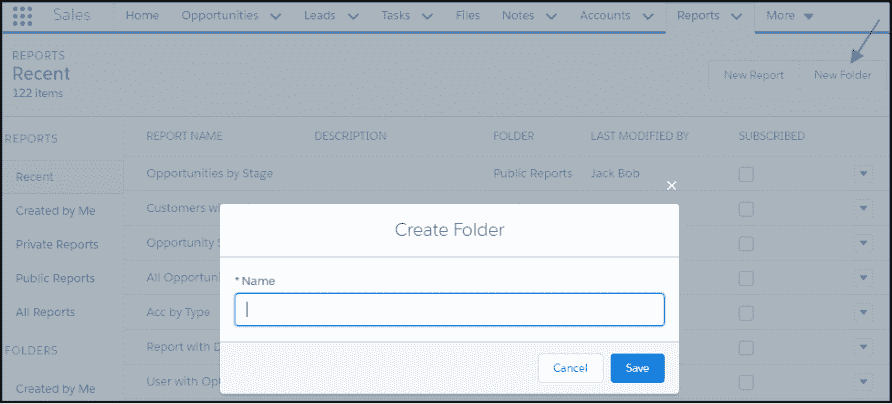

## The View Reports in Public Folders permission

**View Reports in Public Folders** 权限赋予用户查看和访问所有公共报表文件夹的可见性，即使该用户未列在该特定报表文件夹的共享访问列表中。当你通过报表文件夹中的 Share 菜单检查时，具有此权限的用户名将不会在那里列出。

此权限仅限于查看报表，不能创建新报表并存储到该文件夹，或自定义该文件夹中的现有报表。此权限不应授予标准用户。

## The Manage All Private Reports and Dashboards permission

此权限与用户通过 Salesforce Lightning（包括 Classic）用户界面访问报表的能力无关。此权限的目的是报表清理，其中包括私有报表。

随着时间的推移，报表和仪表板会逐渐不再使用，或用户变得不活跃并在他们的私有文件夹中留下过时的报表和仪表板。有了此权限，用户能够查询并删除保存在其他用户私有文件夹中的报表和仪表板。

我们不会在本书中讨论查询，但作为参考，使用 WHERE 关键字在 USING SCOPE allPrivate 之后，并指定 WHERE 关键字之后的 OwnerId，例如：

```
SELECT Id FROM Report USING SCOPE allPrivate WHERE OwnerId =
'00541000001cTYgAAM'
```


执行 **Salesforce Object Query Language (SOQL)** 有许多选项，从使用 Developer Console、Data Loader 到一个著名的免费工具 **Workbench**。你可以通过 `http://workbench.developerforce.com/login.php` 打开 Workbench。

## Dashboard folder permissions

现在我们已经在前一节中看到了与报表文件夹相关的权限，让我们继续了解与仪表板文件夹相关的权限。它们非常相似——仪表板文件夹中的权限决定了用户在 Salesforce 中查看、创建和编辑仪表板的能力。

## The Create Dashboard Folders permission

**Create Dashboard Folders** 权限赋予用户创建新仪表板文件夹的能力。需要启用 **Create and Customize Dashboards** 权限才能使用此权限。

当此权限启用时，一旦进入 Dashboards 选项卡，点击 New Folder 按钮；你只需在 Create Folder 窗口中提供文件夹名称。请考虑以下屏幕截图：

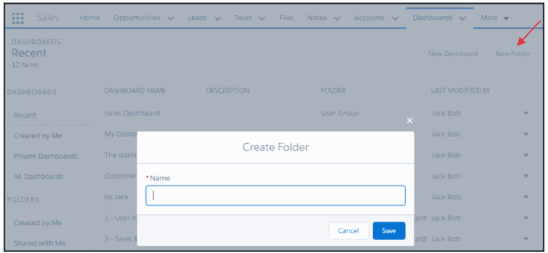

## The Edit My Dashboards permission

我们在一节前面提到了 Edit My Reports 权限。Edit My Dashboards 是一种类似的权限，但针对仪表板。它允许用户编辑、移动、保存和删除他们在公共仪表板文件夹中创建的仪表板。

当用户有权访问文件夹时，用户能够将仪表板保存到该文件夹。用户对该文件夹的访问权限仅为 Viewer。用户还能够在用户具有 Viewer 访问权限的公共仪表板文件夹中编辑和删除自己创建的报表。

此权限不应授予标准用户，因为它会允许用户覆盖其他用户创建的仪表板；访问权限授予的仪表板文件夹仅具有 Viewer 访问权限。

## The View Dashboards in Public Folders permission

**View Dashboards in Public Folders** 权限赋予用户查看和访问存储在公共仪表板文件夹中的所有仪表板的可见性，即使用户未列在该特定仪表板文件夹的共享访问列表中。

与 **Edit My Dashboards** 权限类似，此权限也不应授予普通终端用户。

## The Manage Dashboards in Public Folders permission

**Manage Dashboards in Public Folders** 权限需要 **Create Dashboard Folders、View Dashboards in Public Folders 和 Edit My Dashboards** 权限。有了此权限，用户能够访问和编辑存储在公共仪表板文件夹中的所有仪表板。

除此之外，此权限还允许用户共享、编辑和删除任何公共仪表板文件夹。因此，这是一个非常强大的权限。


请谨慎地仅将此权限授予绝对需要它的用户。确保具有此权限的用户不会搞乱其他用户创建的仪表板。

## Applying permission

现在你已经了解了运行报表、创建报表、导出报表、创建仪表板等的能力由权限控制——只有被授予这些权限的用户才能执行此类活动，正如我们在前几节中讨论的那样。

保护报表或仪表板意味着确保报表或仪表板仅对应该有权访问的用户可访问；有些用户可能只需要能够运行报表，而不能修改它。这是在存储报表或仪表板的文件夹中控制，而不是报表或仪表板本身。文件夹的管理者能够配置并与其它用户共享文件夹，并确定他们的访问级别。

本章前面我们还提到，与报表和仪表板文件夹相关的权限类型有很多。有了额外的权限，用户将能够访问所有报表（私有报表和私有仪表板除外），即使用户未被添加到组可访问性中。作为管理员，你应确保仅将权限授予需要它的用户。

以下是通过 **Profile** 和 **Permission Set** 分配权限的差异：

- **Profile**：配置文件中的所有用户都将获得为该配置文件启用的权限。当你需要向同一配置文件中的所有用户授予权限时，这是一个不错的选择，例如运行报表的权限。
- **Permission Set**：管理员可以创建一个仅包含一个权限或包含多个权限的权限集。当你需要向跨配置文件的用户授予某些权限时，这是一个更灵活的选择，例如创建报表文件夹的权限——你可能不希望每个人都能创建文件夹，否则如果不加以控制，你的报表文件夹可能会变得混乱。

## Hands-on exercise for adding permission in a Profile

在此练习中，我们将向名为 **Sales Ops** 的自定义 **Profile** 授予 **Create and Customize Reports** 权限。假设该配置文件已在之前创建。

- 1. 点击左上角菜单中的 **Setup** 齿轮图标，如以下屏幕截图所示：

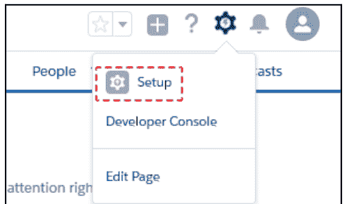

- 2. 点击左侧菜单中的 **Users**，然后点击 **Profiles** 子菜单。


+   3. 查找配置文件名称——在本练习中，我们将使用 Sales Ops 配置文件（在你的环境中可能不同）——然后在配置文件名称前点击 Edit 链接。
+   
+   4. 向下滚动，找到 **Create and Customize Reports** 权限。它位于 **Administrative Permissions** 部分下。选中复选框以授予权限。请参考以下截图：

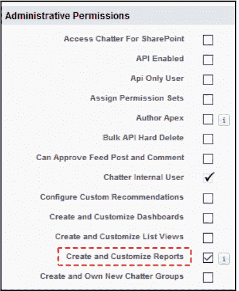

+   5. 点击 **Save** 按钮，即完成。

该配置文件中的所有用户现在都能够运行报表。

## 使用权限集进行权限的动手练习

接下来，我们将创建一个名为 **Regional Admin** 的新权限集。拥有此权限集的用户将能够创建报表文件夹和仪表板文件夹。请按照以下步骤进行此练习：

+   1. 点击左上角菜单中的 **Setup** 齿轮图标。
+   2. 点击左侧菜单中的 **Users**，然后点击 **Permission Sets** 子菜单。

6. 在下一个屏幕中，在文本框中输入 create report，系统将搜索包含输入字符的权限，如以下截图所示：

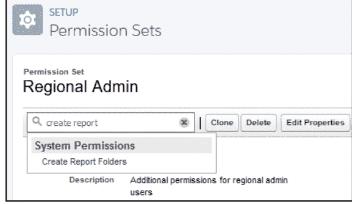

7. 点击 Create Report Folders；它将打开该权限，然后向上或向下滚动以点击 Edit 按钮。

8. 再次找到该权限；勾选其旁边的文本框，如以下截图所示：

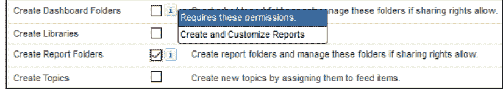

9. 你可能会注意到有一个信息图标，它告诉你该权限需要另一个权限——在本例中，Create Report Folders 权限是 Create and Customize Reports 权限所必需的。因此，Create and Customize Reports 权限将被自动启用到权限集中。

10. 点击 Save 按钮以继续。

11. 点击 **Manage Assignments** 按钮以检查为此权限分配的任何用户。如果想为此权限添加用户，请点击 **Add Assignments** 按钮。

12. 找到需要此权限集的所有用户；点击用户旁边的复选框，然后点击 **Assign** 按钮，如以下截图所示：

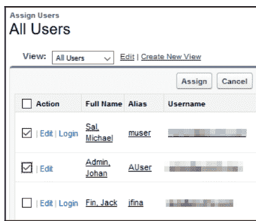

13. 添加到权限集的用户将被显示，点击 **Done** 按钮以结束。

## 总结

在本章中，我们首先从为个人使用保护私有报表和仪表板开始。然后，我们继续讨论 **Unfiled Public Report** 文件夹，其中具有创建报表权限的用户能够在此文件夹中存储创建的报表。此文件夹的一个用途是在真正的文件夹创建之前临时存储报表，但请注意，存储在此处的报表将可供组织中的每个人访问。

接下来，我们继续讨论共享和保护公共报表和仪表板。报表文件夹和仪表板文件夹相关的所有权限也被讨论。

在结束本章之前，我们提供了动手练习，通过 **Profile** 授予权限，该权限适用于具有该配置文件的全部用户，以及通过 **Permission Sets** 授予权限，我们可以在用户配置文件之间灵活地授予权限。
