## 创建和管理报表

你在第 2 章 *Concepts and Permissions in Reports and Dashboards* 中了解了 Salesforce 报表的概念。我们学习了如何从数据源生成报表，报表在 Salesforce 中生成时数据如何显示，报表如何在 Salesforce 中存储，如何与团队或组织中的每个人共享报表，以及如何获取处理报表所需的权限。在第 3 章 *Implementing Security in Reports and Dashboards* 中，我们学习了如何保护我们的报表和仪表板。

在本章中，我们将动手创建报表，讨论处理报表时的更多技术细节，探索在 Salesforce 中可以构建哪些类型的报表，以及创建新报表和维护现有报表是多么容易。我们将从 Salesforce 中可用的多种报表格式开始，报表格式为何与报表相关如此重要，以及每种格式的优点和局限性；然后我们将继续讨论向报表添加筛选器。

到本章结束时，你将获得如何根据需求选择正确的报表格式的知识，并学习如何使用报表筛选器自定义报表。

在本章中，我们将提供注释和提示来帮助你理解重要事项。本章将深入涵盖以下主题：

- 选择报表格式
- 添加报表筛选器

## 选择报表格式

为什么报表格式在创建报表时很重要？每个 Salesforce 报表都是由报表格式构建的，报表格式将决定报表的布局、选项和设置。它还决定报表是否可作为仪表板的数据源。

Salesforce 中有几种报表格式可供使用，从简单的表格报表到复杂的矩阵和联接报表。每种报表格式都有不同的用途和目的。

### 报表格式类型

当你创建新报表时，**Tabular** 是默认选择的报表格式。你可以在任何时候修改报表格式，即使在保存报表之后，但你可能会丢失一些配置项，具体取决于原始和目标报表格式。

Salesforce 中有四种报表格式可用：

- **Tabular**
- **Summary**
- **Matrix**
- **Joined**

让我们分别理解它们。

### 表格报表格式

**Tabular** 报表是在创建新报表时默认的报表格式；此格式被认为是最简单的；它以类似电子表格的方式呈现数据。数据以行和列格式呈现；每一行呈现一条记录，每一列呈现一个字段，列也可以是桶字段或自定义汇总公式。报表可用的字段取决于使用的报表类型。

我们将在 *第 5 章，Understanding Report Types* 中彻底讨论报表类型，而桶字段和自定义汇总公式将在 *第 6 章，Advanced Report Configuration* 中讨论。目前，报表类型将决定报表中可用的字段；它可能包含来自一个对象或来自几个相关对象的全部或部分字段。

尽管 **Tabular** 是最简单的格式，但它为你提供了许多能力，例如按列排序数据、添加筛选器、汇总字段、添加桶字段、记录计数、导出报表、订阅报表等。所有这些功能对 **Summary** 和 **Matrix** 报表也同样适用。**Tabular** 报表的重点是让你查看满足筛选条件的每条记录的详细信息，类似于电子表格。

让我们看一下 **Tabular** 格式的局限性：

- 无分组
- 无图表
- 除非配置了 **Row Limit** 筛选器，否则不能用作仪表板的数据源

与 **Tabular** 格式相关的其他局限性如下：

- 报表生成器预览最多显示 50 行。
- 报表最多显示 2,000 行。要查看所有行，请将报表导出到 Excel。

**Tabular** 报表格式在生成报表时具有最佳的性能表现。以下是 **Tabular** 报表的示例：

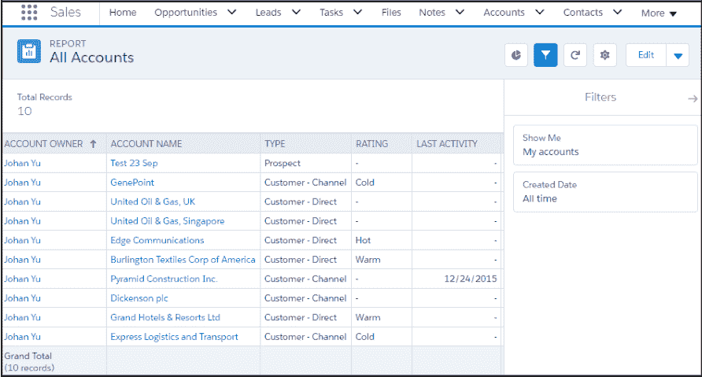

## 创建表格报表的动手练习

让我们考虑一个用例。我们被要求显示按员工人数降序排序的前五个账户，并筛选账户类型包含 Customer。在本练习中，我们假设你有超过五个账户，其类型包含 Customer 文本，并且员工人数已填充：

+   1. 导航到 **Reports** 选项卡并点击 **New Report..** 按钮。
+   2. 选择 **Accounts** 报表类型并点击 **Accounts & Contacts** 类别下的加号。
+   3. 点击 **Create** 按钮以继续。

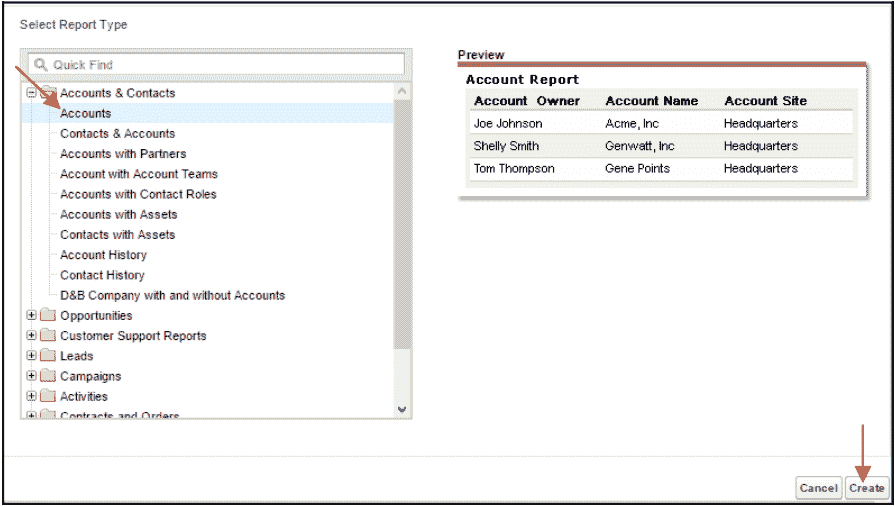

4. 现在我们进入了 **Report Builder**，预览显示有限数量的记录。

- 5. 将“显示”字段更改为“所有账户”。将“日期字段范围”更改为“所有时间”。

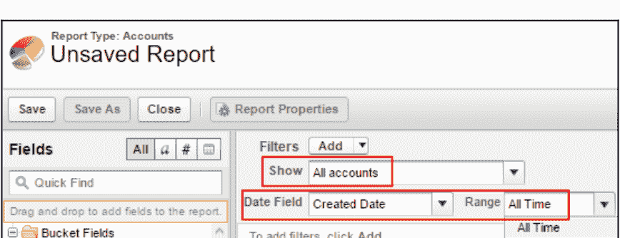

- 6. 将“员工”字段添加到报表区域，并删除不必要的字段，如“上次活动”、“上次修改日期”、“评分”和“账单省/州”。

您可以在左侧面板的“快速查找”文本框中输入字段名称来快速查找字段；文本框下方显示的字段将随您的输入自动筛选。

要向报表添加字段，请双击该字段；如果该字段之前未添加到报表中，它将被添加到最后一列。另一种选择是将字段拖放到报表区域；拖动字段时请注意绿色对勾和红色方块图标。

**提示：**

要从报表中删除字段，请将字段标题拖放回左侧面板的字段区域；或者将鼠标悬停在报表中的字段标题上，单击箭头图标，然后点击“删除列”。

- 7. 点击“筛选器”中的“添加”按钮，然后继续执行以下操作：

  - 从可用字段列表中选择“类型”（您也可以手动输入字段名称，然后选择该字段）。
  - 从运算符列表中选择“包含”。
  - 点击放大镜，从弹出的值中选择**客户**。就我而言，我有**客户 - 直接**和**客户 - 渠道**，但没有单独的“客户”，因此我手动输入“客户”。由于我们这里的运算符是**包含**，这将同时覆盖**客户 - 直接**和**客户 - 渠道**。
  - 点击“确定”按钮进行确认。
  - 点击**添加**按钮旁边的小箭头，然后选择**行数限制为 5，按员工数降序排序**，然后点击“确定”按钮应用。

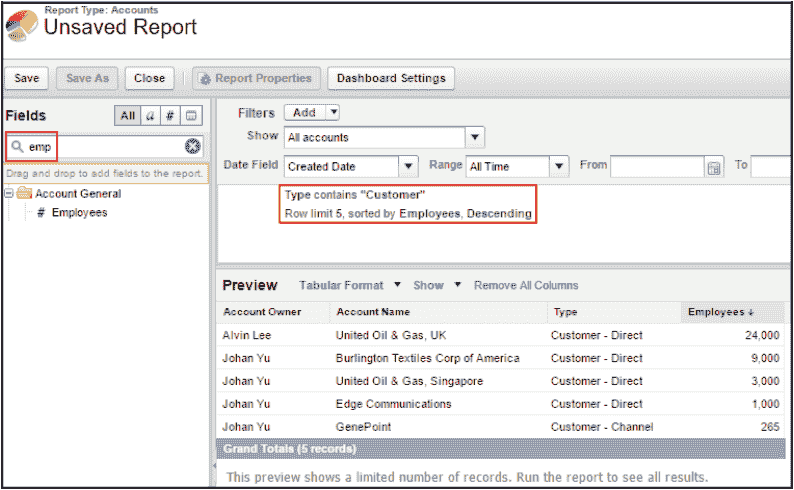

  - 点击**保存**按钮；这将打开一个弹出窗口来保存报表。
  - 将**报表名称**输入为 `Top 5 Customers by No of Employee`。**报表唯一名称**将自动填写。

> 始终建议输入一些**描述**，以备将来参考。

  - 在**报表文件夹**选项中选择**我的个人自定义报表**，这样其他人就无法访问它。
  - 再次点击**保存**按钮以保存报表。
  - 点击**运行报表**按钮，您应立即看到生成的报表。

以下截图显示了生成的报表；您可能看到不同的数据，但结果中应有五条记录，如果您的 Salesforce 组织没有“账户”的“客户”类型，则可能少于五条或没有记录：

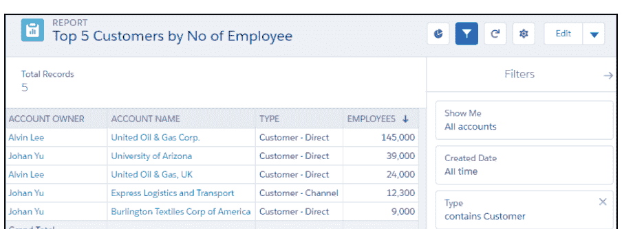

## 汇总报表格式

**汇总**报表与**表格**报表之间的主要区别在于，**汇总**报表能够使用报表可用的任何字段（包括分桶字段）进行分组。如果**汇总**报表中没有定义分组字段，则报表将作为**表格**报表运行。

**汇总**报表被认为比**表格**报表更高级；除了**表格**格式中所述的功能外，**汇总**报表还提供以下额外能力：

- 为了根据值对报表进行分组，您可以使用最多三级分组来对报表进行分组。您还可以汇总数字字段的数据，并显示每个组的记录数。
- 向报表添加图表。
- 将报表用作仪表板的数据源；对于表格报表，只有配置了**行数限制**的报表才可以。
- 按不同字段进行分组排序。
- 探索隐藏单个记录详细信息的能力，以便更轻松地查看汇总的业务数据。

与**表格**报表相比，**汇总**格式报表中不能添加**行数限制**。

以下是一个**汇总**报表的示例：

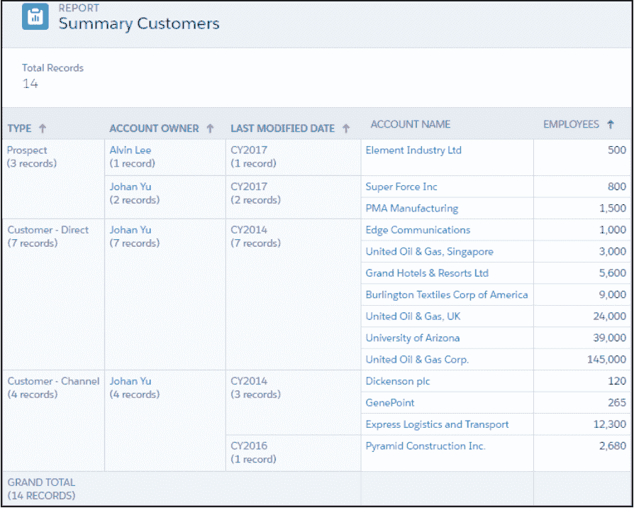

## 创建汇总报表的动手练习

让我们考虑一个用例：显示所有账户，按创建账户的**日历年度**和**账户所有者**进行分组。请按照以下步骤完成此动手练习：

- 1. 导航到**报表**选项卡，然后点击**新建报表**按钮。
- 2. 选择**账户**报表类型，然后点击**账户和联系人**类别下的加号。
- 3. 点击**创建**按钮继续。
- 4. 将**显示**更改为**所有账户**。
- 5. 将**日期字段范围**更改为**所有时间**。
- 6. 将报表格式从**表格**更改为**汇总**。

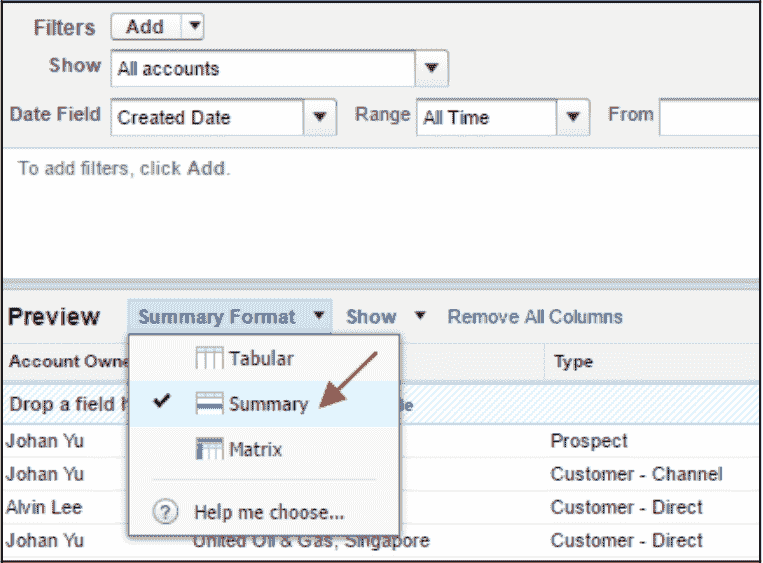

- 7. 点击**筛选器**中的**添加**按钮，然后继续执行以下操作：

  - 从可用字段列表中选择**类型**；您也可以手动输入字段名称，然后选择该字段。
  - 从运算符列表中选择**包含**。
  - 点击放大镜，从弹出的值中选择**客户**。就我而言，我有**客户 - 直接**和**客户 - 渠道**，但没有“客户”，因此我手动输入“客户”。由于我们这里的运算符是“包含”，这将同时覆盖**客户 - 直接**和**客户 - 渠道**。
  - 点击**确定**按钮。

- 8. 将**创建日期**拖到报表中的放置区域。

您可以在**快速查找**文本框中输入字段名称以筛选字段名称。如果您看不到分组区域，请点击**显示**并选择**放置区域**。

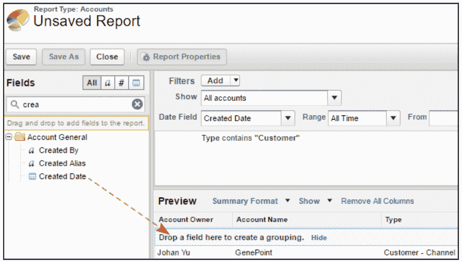

- 9. 将字段添加到分组后，点击放置区域中**创建日期**左侧的箭头，然后导航到**按日期分组 | 日历年度**。**按日期分组**仅在您要分组的字段是“日期”和“日期/时间”字段时可用。请参考以下截图：

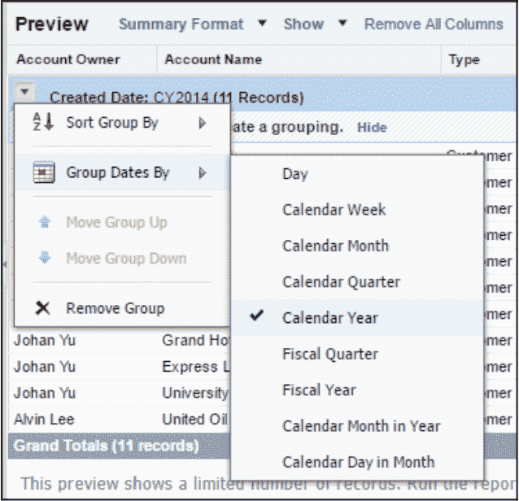

- 10. 将**账户所有者**拖到**创建日期**下方的放置区域。默认情况下，**显示**中的**详细信息**已选中；让我们隐藏该详情。

- 11. 点击**显示**菜单并取消选中**详细信息**：

- 12. 点击**保存**按钮；这将打开一个弹出窗口来保存报表：

  - 将**报表名称**输入为**按创建年份和所有者划分的所有账户**。**报表唯一名称**将自动填写。
  - 始终建议输入**描述**以备将来参考。
  - 在**报表文件夹**中选择**我的个人自定义报表**，这样其他人就无法访问它。
  - 点击**保存**按钮保存报表。

- 13. 点击**运行报表**，您应该会看到类似于以下截图所示的报表：

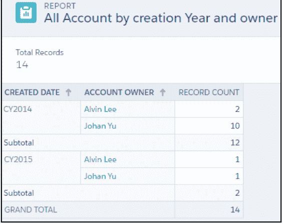

- 14. 默认情况下，**汇总**报表将按第一个分组升序排序，然后按第二个分组升序排序。在我们的练习中，它是**创建日期**和**账户所有者**。您可以通过在报表生成器中编辑报表、点击放置区域中字段旁边的箭头并选择**分组排序依据**（如以下截图所示）来更改排序顺序：

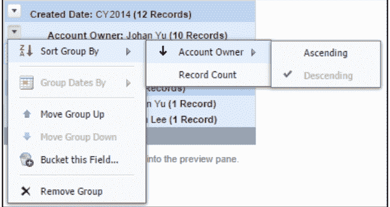

- 15. 要从打开的报表中显示数据详细信息，请点击齿轮图标并在“选项”窗口中勾选**详细信息**；请记住，在本练习的第 11 步中，我们取消了**显示详细信息**。报表将重新生成并显示每条记录的详细信息，但报表分组和排序将保持不变：

**报表：** 按创建年份和所有者划分的所有账户  
**总记录数：** 14

| 创建日期 ↑ | 账户所有者 ↓ | 账户名称 | 类型 | 上次修改日期 |
|---|---|---|---|---|
| 2014年（12条记录） | Johan Yu（10条记录） | GenePoint | 客户 - 渠道 | 5/24/2014 |
| 2014年（12条记录） | Johan Yu（10条记录） | United Oil & Gas, Singapore | 客户 - 直接 | 5/24/2014 |
| 2014年（12条记录） | Johan Yu（10条记录） | Edge Communications | 客户 - 直接 | 5/24/2014 |
| 2014年（12条记录） | Johan Yu（10条记录） | Burlington Textiles Corp of America | 客户 - 直接 | 5/24/2014 |
| 2014年（12条记录） | Johan Yu（10条记录） | Pyramid Construction Inc. | 客户 - 渠道 | 8/21/2016 |
| 2014年（12条记录） | Johan Yu（10条记录） | Dickenson plc | 客户 - 渠道 | 5/24/2014 |
| 2014年（12条记录） | Johan Yu（10条记录） | Grand Hotels & Resorts Ltd | 客户 - 直接 | 5/24/2014 |
| 2014年（12条记录） | Johan Yu（10条记录） | Express Logistics and Transport | 客户 - 渠道 | 5/24/2014 |
| 2014年（12条记录） | Johan Yu（10条记录） | University of Arizona | 客户 - 直接 | 5/24/2014 |
| 2014年（12条记录） | Johan Yu（10条记录） | Super Force Inc | 客户 - 直接 | 4/15/2017 |
| 2014年（12条记录） | Alvin Lee（2条记录） | United Oil & Gas, UK | 客户 - 直接 | 4/14/2017 |
| 2014年（12条记录） | Alvin Lee（2条记录） | United Oil & Gas Corp. | 客户 - 直接 | 4/14/2017 |
| 2015年（2条记录） | Johan Yu（1条记录） | King Inc | 客户 - 直接 | 4/15/2017 |
| 2015年（2条记录） | Alvin Lee（1条记录） | Accurate Glass | 客户 - 渠道 | 4/15/2017 |
| 总计（14条记录） | | | | |

16. 点击下拉箭头中的“保存”以保存报表中的所有更改。通过这样操作，你可以在不通过报表生成器编辑的情况下保存报表：

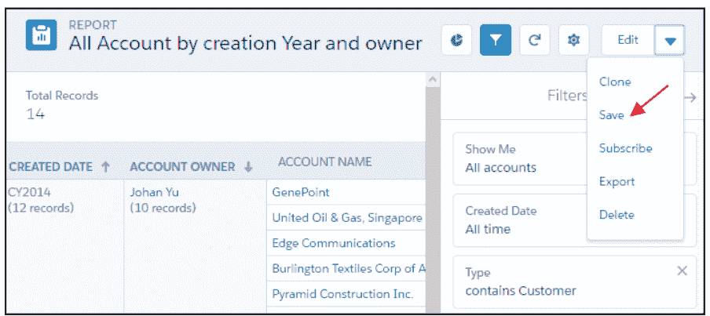

## 矩阵报表格式

矩阵报表与汇总报表非常相似，但增加了按行和列同时分组的能力。你还可以为行和列分别设置最多两个分组级别。

与表格和汇总报表格式类似，你可以在矩阵报表中添加可汇总字段。默认情况下，记录计数会添加到报表矩阵中。当你在矩阵报表中添加汇总字段时，该字段和汇总结果会显示在矩阵中，而不是像汇总或表格报表格式那样显示在列底部。一旦向矩阵报表添加了汇总字段，如果不需要，可以移除矩阵中的默认记录计数。

当你有大量数据需要汇总，并且需要使用矩阵报表比较同一字段中不同值的记录时，此报表格式非常适用。如果矩阵报表至少没有一个行分组和一个列分组，在运行报表时它将显示为汇总报表。

当你将报表从 **Summary** 更改为 **Matrix** 格式时，可以从 **Tabular** 或 **Summary** 报表更改为 **Matrix** 报表：

- 第一级分组将自动变为第一级行分组
- 第二级分组将自动变为第一级列分组
- 第三级分组将自动变为第二级行分组

在以下示例中，我们使用之前创建的相同汇总格式报表 **All Account by creation Year and owner**；报表显示使用相同的数据和条件——只是格式不同。请注意，当你创建 **Matrix** 报表时，记录计数会默认添加。以下屏幕截图向我们展示了从 **Summary** 格式报表转换而来的 **Matrix** 报表：

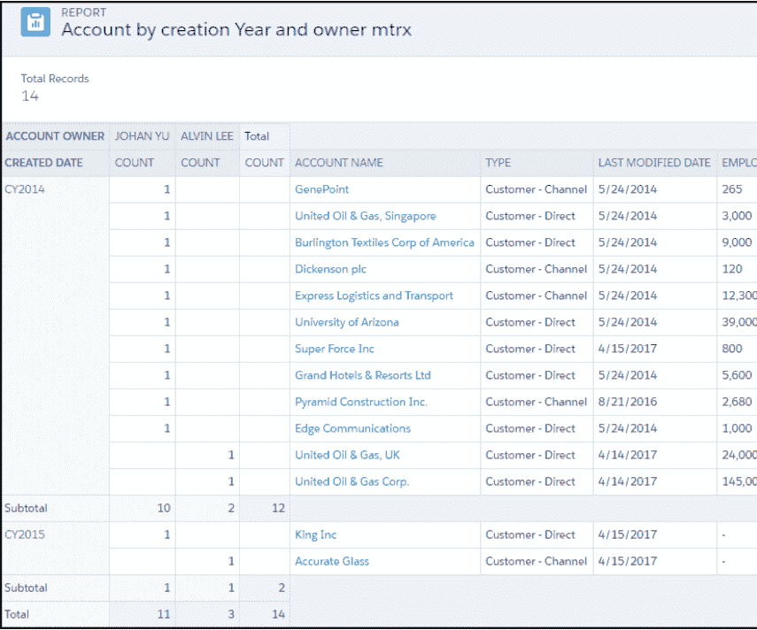

## 创建矩阵报表的动手练习

让我们考虑一个用例：在 **Matrix** 格式中显示所有账户的记录计数，按 **Calendar Year** 的账户创建日期进行行分组，按 **Account Owner** 进行列分组：

- 1. 不要从头创建，让我们修改现有的 **Summary** 报表 `All Account by creation Year and owner` 并将其转换为 **Matrix** 报表。
- 2. 打开 **All Account by creation Year and owner** 报表并点击 **Edit** 按钮，或导航到 **Reports** 选项卡，找到该报表，点击最后一列的箭头，然后点击 **Edit** 以打开报表生成器。
- 3. 将报表格式从 **Summary** 更改为 **Matrix**。
- 4. 汇总报表的第一个分组将自动变为行分组，而第二个分组将变为列分组；在我们的练习中，**Created Date** 将成为行分组，**Account Owner** 将成为列分组。

让我们看一下以下屏幕截图，注意汇总报表的第一级和第二级分组已被转换：

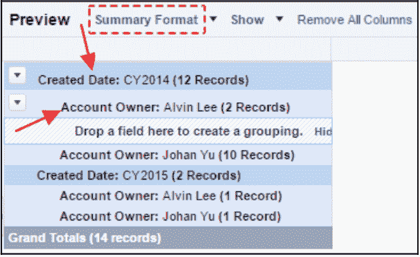

当报表格式从 **Summary** 更改为 **Matrix** 报表时：

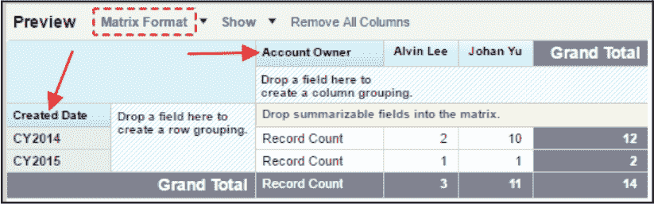

5. 由于该报表最初保存为汇总报表，你只需点击“运行报表”按钮即可以矩阵格式查看报表结果。在 Lightning Experience 中，报表需要在运行前保存：

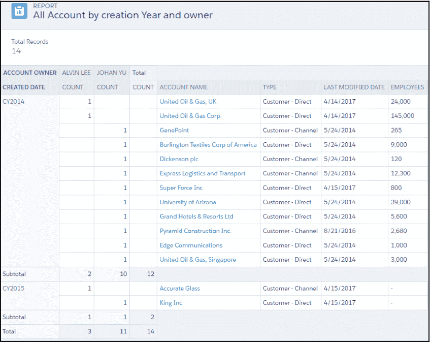

6. 如果你只需要查看报表汇总而不查看任何明细，点击刷新图标旁边的齿轮图标（不是顶部带闪电的齿轮图标），然后取消选中“详细信息”复选框。通常我们在展示报表且只想关注汇总而不需查看明细时需要这样做，如以下屏幕截图所示：

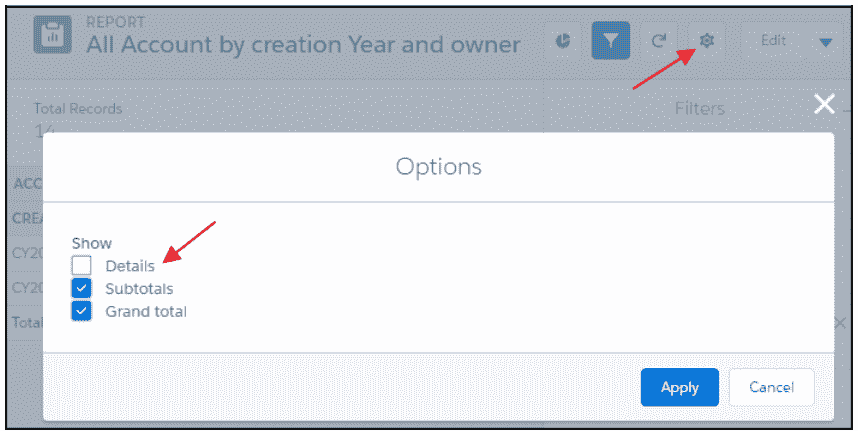

7. 这是仅显示基于创建日期和账户所有者的汇总的报表结果，以矩阵格式呈现：

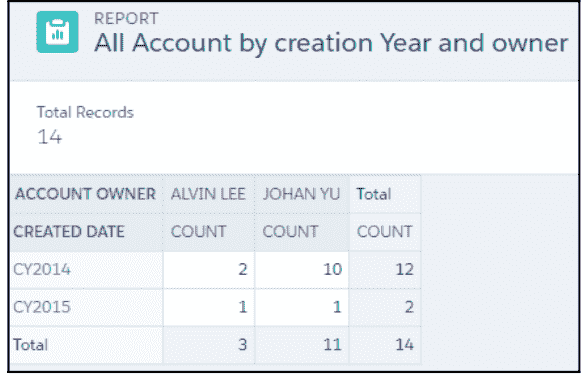

- 8. 如果你在此处点击 **Save**，这将覆盖你之前创建的 **Summary** 报表。因此，不要点击保存，而是点击 **Clone** 将报表另存为新报表，输入新的报表名称，选择文件夹，然后在弹出窗口中点击 **Create** 按钮进行确认。
- 9. 或者，当你在步骤 5 的报表生成器中时，不要点击 **Run Report** 按钮运行报表，而是点击 **Save As** 按钮将报表另存为新报表。

## 向矩阵报表添加汇总字段的动手练习

让我们考虑一个用例：在 **Matrix** 格式中显示所有商机及其总金额，按 **Opportunity Stage** 进行行分组，按 **Opportunity Owner** 进行列分组：

- 1. 导航到 **Reports** 选项卡并点击 **New Report** 按钮。
- 2. 选择 **Opportunities** 报表类型并点击 **Opportunities** 类别下的加号。
- 3. 点击 **Create** 按钮继续。
- 4. 将 **Show** 更改为 **All opportunities**。
- 5. 将 **Date Field** 范围更改为 **All Time**。
- 6. 请注意，**Opportunity Status** 和 **Probability** 过滤器位于 **Show** 旁边；这些特定过滤器仅在使用 **Opportunity** 报表类型时出现。对于此练习，只需将 **Opportunity Status** 的默认值保留为 **Any**，将 **Probability** 保留为 **All**。
- 7. 将报表格式从 **Tabular** 更改为 **Matrix**。

8. 通过将其拖放到“字段”区域外，移除所有字段，只保留商机名称、金额、阶段和商机所有者字段。现在你应该看到与以下屏幕截图类似的内容：

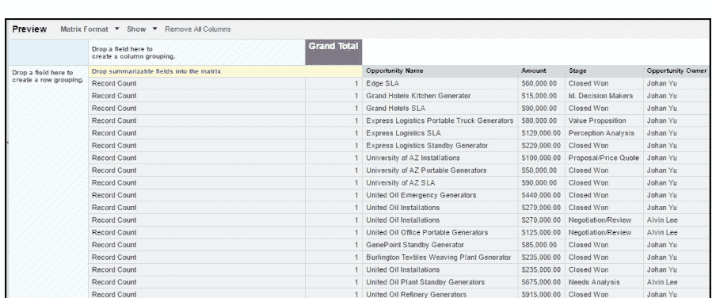

9. 要对金额求和，将鼠标悬停在金额标题上，点击“汇总此字段...”中的箭头图标，选择 Sum，然后点击“应用”按钮，如以下屏幕截图所示：

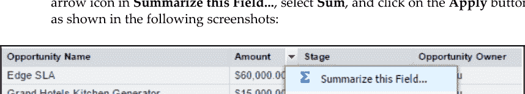

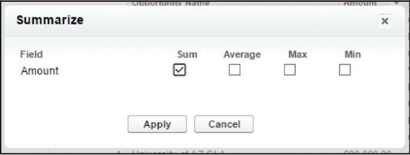

如果要汇总的字段尚未添加到报表中，可以直接将可汇总字段（如货币、数字和百分比）拖入矩阵，系统将提示你按 Sum、Average、Max 或 Min 进行汇总。

你可以通过拖放已汇总的字段来更改添加到矩阵中的字段顺序。要从矩阵中移除已汇总的字段，只需将其拖到左侧面板的字段区域即可。

- 10. 现在你应该在矩阵中看到金额及其值；请参考步骤 11 中的屏幕截图。
- 11. 将 **Stage** 拖为行分组，将 **Opportunity Owner** 拖为列分组，如以下屏幕截图所示：

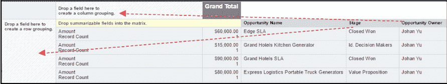

- 12. 请注意，你可以为行分组和列分组分别拖入另一个字段作为第二级分组。
- 13. 由于我们只想关注汇总值，让我们通过点击 **Remove All Columns** 链接旁边的 **Show**，然后取消选中 **Detail** 来隐藏报表明细。

- 14. 接下来，让我们也移除记录计数，因为我们只需要金额值。再次点击 **Remove All Columns** 链接旁边的 **Show**，然后取消选中 **Record Count**。请记住，只有在矩阵中添加了字段作为汇总字段时，我们才能移除记录计数。

- 15. 点击 **Save** 按钮；这将打开一个弹出窗口以保存报表：
  - 输入 **Report Name** 为 `Opportunity by Stage and Owner`
  - **Report Unique Name** 将自动填充
  - 为便于将来参考，输入一些 **Description** 始终是良好做法
  - 在 **Report Folder** 中选择 **My Personal Custom Reports**，这样无人可以访问它
  - 点击 **Save** 按钮保存报表

- 16. 点击 **Run Report**，你应该会看到与以下报表类似的报表：

| OPPORTUNITY OWNER | ALVIN LEE | JOHAN YU | Total |
|---|---|---:|---:|---:|
| **STAGE** | **AMOUNT Sum** | **AMOUNT Sum** | **AMOUNT Sum** |
| Prospecting | $0.00 | $80,000.00 | $80,000.00 |
| Qualification | $0.00 | $115,000.00 | $115,000.00 |
| Needs Analysis | $675,000.00 | $0.00 | $675,000.00 |
| Value Proposition | $0.00 | $330,000.00 | $330,000.00 |
| Id. Decision Makers | $0.00 | $110,000.00 | $110,000.00 |
| Perception Analysis | $0.00 | $120,000.00 | $120,000.00 |
| Proposal/Price Quote | $270,000.00 | $100,000.00 | $370,000.00 |
| Negotiation/Review | $395,000.00 | $0.00 | $395,000.00 |
| Closed Won | $0.00 | $3,716,000.00 | $3,716,000.00 |
| **Total** | **$1,340,000.00** | **$4,571,000.00** | **$5,911,000.00** |

## 创建联合报表的手工练习

让我们考虑一个用例：在一份报表中展示过去一年中与账户相关的所有已赢得商机和案例。请记住，自 Summer '17 版本发布以来，联合报表仅在 Classic 中可用，因此你只能在 Classic 用户界面中执行以下操作：

- 1. 导航到 **Reports** 选项卡并点击 **New Report...** 按钮。
- 2. 选择 **Opportunities** 报表类型；它位于 **Opportunities** 类别下。
- 3. 点击 **Create** 按钮继续。
- 4. 将 **Show** 字段更改为 **All opportunities**。
- 5. 将 **Date Field** 更改为 **Close Date**，并将 **Range** 更改为 **Previous CY**。
- 6. 点击 **Remove All Columns** 链接，点击 **OK** 确认，然后向报表添加以下字段：**Opportunity Name**、**Account Name** 和 **Amount**。
- 7. 点击 **Add** 按钮添加筛选条件，其中 **Won** 等于 **True**。
- 8. 将鼠标悬停在 **Amount** 上，点击箭头，选择 **Summarize the Field...**，选中 **Sum** 复选框，然后选择 **Apply** 按钮。将报表格式更改为 **Joined**。
- 9. 一旦报表格式更改为 **Joined**，**Add Report Type** 按钮将可用，并且 **Opportunity** 块将被添加到报表中。
- 10. 点击标有 **Opportunities block 1** 的块并将其更改为 Won Opportunities Last Year：

## 创建和管理报表

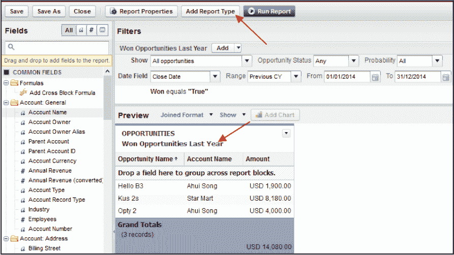

- 11. 点击 **Add Report Type** 按钮继续。
- 12. 在 **Customer Support Reports** 类别下选择 **Cases** 报表类型，然后点击 **OK** 按钮继续。
- 13. 逐一删除案例块中的所有字段，除了 **Subject** 和 **Account Name**。
- 14. 点击块标签 **Cases block 2** 并将其更改为 `All Cases Last Year`。

- 16. 从左侧的 COMMON FIELDS 中，将 Account Name 拖到放置区；Account Name 将自动从两个块中移除。请考虑以下截图：

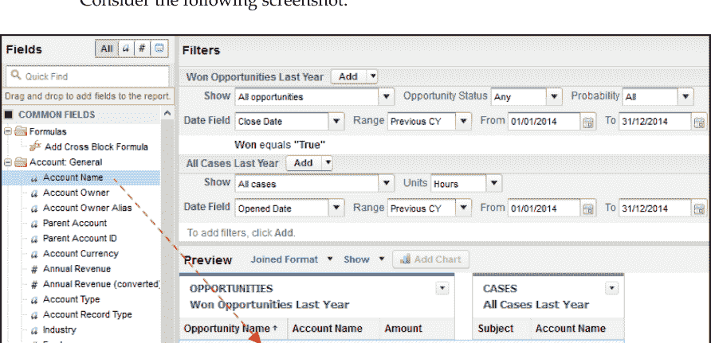

- 17. 默认情况下，Details 将被启用；让我们暂时禁用它。点击 Show 菜单并取消选中 Details。

## 使用报表筛选器

报表是 Salesforce 平台最强大的功能之一；根据你的权限，你可以在几分钟内构建自己的报表，并在无需 Salesforce 管理员或 Salesforce 开发人员帮助的情况下管理它们。

我们在前几章中讨论了与报表相关的许多内容，包括创建报表的权限、与报表文件夹相关的权限，以及呈现报表布局的报表格式。

与报表相关的另一个重要项目是 **report filters**。报表筛选器允许你定义要使用的哪些数据条件，以便根据某些标准将记录包含在报表中。报表中的筛选条件几乎与我们在 Salesforce 的其他功能中发现的筛选条件相似，例如列表视图、工作流规则和 Salesforce 中的其他区域，但报表中的筛选条件甚至更强大。

对于每个筛选条件，你需要设置字段、运算符和值。你可以为报表设置多个筛选器。每个筛选器的默认关系是使用 AND，但你可以使用筛选逻辑来自定义它。

当你在报表构建器中时，如果你点击筛选器的 **Add** 按钮，它将自动添加一个新筛选器，但请注意 **Add** 旁边有一个小箭头按钮；如果你点击此箭头，报表筛选器的可用选项如下：

- **Field Filter**：这与点击 **Add** 按钮的操作相同
- **Filter Logic**
- **Cross Filter**
- **Row Limit**：仅适用于 **Tabular** 报表格式

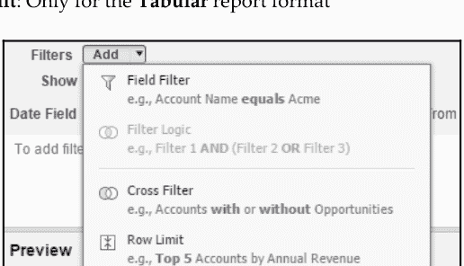

## 字段筛选器

只需在报表构建器中点击 **Add** 按钮即可添加字段作为筛选器，或者你也可以将字段从 **Fields** 面板拖到 **Filters** 面板以添加报表筛选器。

一旦字段被添加到 **Filters** 窗格中，选择运算符然后输入值。

如果你想为筛选值添加多个值，只需使用逗号分隔值即可。

对于每个筛选器，你可以根据该特定筛选器的字段类型输入特殊值。与报表筛选器相关的一些你需要了解的项目如下：

- 筛选值不区分大小写。
- 当你筛选 **Date** 字段时，你可以输入特殊日期值，例如 `TODAY`、`NEXT WEEK`、`LASTWEEK`、`LAST <x> DAYS`、`LAST <x> YEARS` 等等。有关完整的日期格式和日期文字，请参阅此 Salesforce 链接 `https://developer.salesforce.com/docs/atlas.en-us.soql_sosl.meta/soql_sosl/sforce_api_calls_soql_select_dateformats.htm`。
- 对于包含逗号的筛选值，请在文本周围加上引号，例如，`Johan, LLC`；否则，它将作为 `Johan` 或 `LLC` 进行筛选。
- 如果你实施了多币种，你可以在筛选条件中添加货币代码，例如 `USD 2500`、`SGD 8000`、`JPY 10000`。
- 对于选择列表字段，你可以使用放大镜选择一个或多个要包含在筛选器中的选项，或者也可以手动输入。但当你再次编辑筛选器时，使用放大镜时现有选定的值将不会被选中；如果现有值不再有效，请手动在文本框中删除它们。
- 对于多选选择列表字段，输入值并使用分号在值之间分隔以指定精确匹配。
- 你可以通过勾选 **Locked** 复选框来锁定添加的筛选器，这样其他用户在运行报表时将无法更改或删除它们。

如果你无法访问定义为筛选器的字段，它将被从筛选条件中移除，并将基于剩余筛选器显示结果。

## 筛选逻辑

如果报表中有多个筛选器，添加筛选逻辑将允许你使用筛选器之间的逻辑运算符为筛选器指定条件。当你向报表添加筛选器时，默认情况下，所有筛选器都作为 AND 逻辑相关，例如：

- Type 包含 Customer
- Country 等于 United States
- Employees 大于 1000

配置到 Salesforce 中时，它看起来如下：

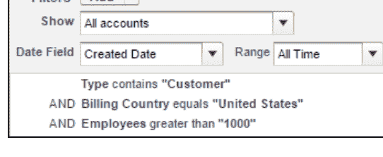

如果注意到，AND 将默认添加到新的筛选器行中。通过筛选逻辑，你可以指定是否使用 AND、OR 或 NOT 运算符。

使用前述筛选条件，报表将生成所有 Type 包含 "Customer"、账单国家等于 "United States" 且员工人数超过 "1000" 人的账户。但如果我们想获取所有 Type 包含 "Customer" 且账单国家等于 "United States" 或员工人数超过 "1000" 人的账户，其中最后一个筛选器（员工）不依赖于 Type 和 Country，该怎么办。

没有筛选逻辑，我们需要创建两个单独的报表并手动合并它们，一个报表筛选条件为 Type 包含 "Customer" AND 账单国家等于 "United States"，另一个报表筛选条件为员工人数大于 "1000"。

- 9. 点击 OK 按钮确认筛选器：

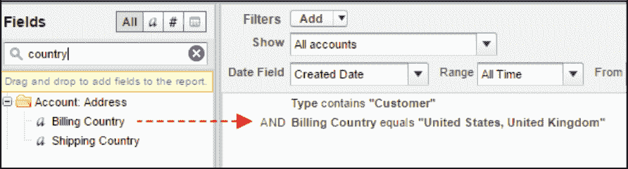

- 10. 在左侧的 **Fields** 文本框中输入 **employees**，将其拖到筛选区域，并勾选 **Locked** 复选框。
- 11. 将运算符更改为 **greater than** 并输入值 1000。
- 12. 点击 **OK** 按钮确认筛选器：

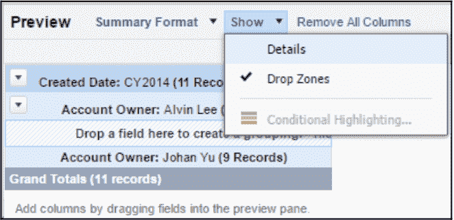

13. 在 **Filters** 中，导航到 **Add** 按钮后点击箭头 | **Filter Logic**。
参考以下截图：

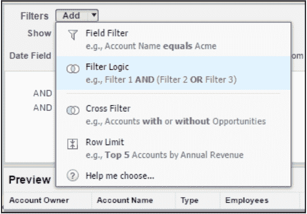

+   14. 默认的过滤逻辑值为 **1 AND 2 AND 3**；手动将其更改为 **( 1 AND 2 ) OR 3**。
+   
+   15. 点击 **OK** 按钮确认过滤逻辑。
+   
+   16. 点击 **Save** 按钮并执行以下操作：
+      - **Report Name** 为 `Account with Filter Logic`
+      - **Report Description** 为 `All Accounts with No of Employee more than 1000, or Customer in US or UK`
+      - **Report Folder** 为 **My Personal Custom Reports**
+   
+   17. 点击 **Run Report** 按钮生成报表。

您可以根据需要增强前述的过滤逻辑；确保其具有正确的括号配对以及正确的值和运算符。 从本次练习中我们学到的另一件事是，我们在过滤值中使用逗号；如果您有多个值，只需在过滤值中添加逗号，例如 **Billing Country equals United States, United Kingdom**。

以下是针对用例需求的报表最终结果，因为我们锁定了所有过滤器；请注意，用户在运行报表时无法更改或删除过滤器。 但如果您有权限编辑报表，请点击 **Edit** 按钮修改已添加的过滤器、删除现有过滤器或添加更多过滤器：

| ACCOUNT OWNER | ACCOUNT NAME | TYPE | EMPLOYEES | BILLING COUNTRY |
|---|---|---:|---|
| Johan Yu | PMA Manufacturing | Prospect | 1,500 | - |
| Alvin Lee | United Oil & Gas, UK | Customer - Direct | 24,000 | - |
| Johan Yu | United Oil & Gas, Singapore | Customer - Direct | 3,000 | - |
| Johan Yu | Burlington Textiles Corp of America | Customer - Direct | 9,000 | USA |
| Johan Yu | Pyramid Construction Inc. | Customer - Channel | 2,680 | France |
| Johan Yu | Grand Hotels & Resorts Ltd | Customer - Direct | 5,600 | - |
| Johan Yu | Express Logistics and Transport | Customer - Channel | 12,300 | - |
| Johan Yu | University of Arizona | Customer - Direct | 39,000 | - |
| Johan Yu | United Oil & Gas Corp. | Customer - Direct | 145,000 | - |
| Johan Yu | Super Force | Customer - Direct | 800 | United States |
| Alvin Lee | Accurate Glass | Customer - Channel | - | United States |
| Johan Yu | Quality Materials | Customer - Channel | - | United Kingdom |
| **Grand Total (12 records)** |  |  |  |  |

**Show Me:** All accounts

**Created Date:** All time

**Locked Filters**

(1 AND 2) OR 3

1. Type contains Customer
2. Billing Country equals United States, United Kingdom
3. Employees greater than "1,000"

## The Cross Filter

使用 **Cross Filter**，您可以为某个对象及其与其它对象和其字段的依赖关系创建报表。 您可以使用 **WITH** 关键字，例如 **All Account WITH Opportunity**。 此外，您还可以使用 **WITHOUT** 关键字创建例外报表，例如 **Account WITHOUT Closed Won Opportunity this year**。 该报表对于销售经理和管理团队评估休眠客户非常重要。

> > 此过滤器在 **Joined** 格式或报表类型不允许可选相关对象的任何报表中都不可用

### Hands-on exercise for using the Cross Filter

没有任何进一步解释，让我们逐步了解如何在报表中创建 **Cross Filter**。

让我们考虑一个用例：**Show all accounts** 且 **Type** 为 **Customer** 并拥有 **Opportunities**：

+   1. 导航到 **Reports** 选项卡并点击 **New Report** 按钮。
+   2. 选择 **Accounts** 报表类型并点击 **Accounts & Contacts** 类别下的加号。
+   3. 点击 **Create** 按钮继续。
+   4. 将 **Show** 更改为 **All accounts**。
+   5. 将 **Date Field Range** 更改为 **All Time**。
+   6. 点击 **Add** 按钮并选择 **Type contains Customer - Direct, Customer - Channel**。
+   7. 点击 **OK** 按钮确认过滤器。
+   8. 在 Filters 中，导航到 **Add** 按钮后点击箭头 | **Cross Filter**。
+   9. 选择 **Accounts with Opportunities**。 这在以下截图中显示：

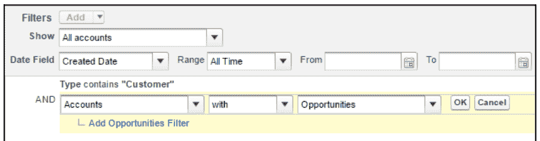

10. 点击 **OK** 按钮确认过滤器。

+   11. 点击 **Save** 按钮：
+   - **Report Name** 为 `Customer with Opportunities`
+   - **Report Description** 为 `All Customer with Opportunities`
+   - **Report Folder** 为 **My Personal Custom Reports**

12. 点击 **Run Report** 按钮生成报表。

让我们使用同一报表并对其进行自定义：

+   1. 打开报表并点击 **Edit** 按钮。
+   2. 点击 **Accounts with Opportunities** 过滤器中的 **Edit** 链接。
+   3. 点击 **Add Opportunities Filter** 链接。
+   4. 选择 **Won equals True**；由于这是选择列表字段，您可以使用放大镜图标选择值。
+   5. 再次点击 **Add Opportunities Filter** 链接。
+   6. 输入 **Close Date greater or equal LAST 365 DAYS**；使用相对日期值是一个好主意，以使报表动态化而不是使用硬编码值。
+   7. 点击 **OK** 按钮确认过滤器。
+   8. 点击 **Run Report** 按钮生成报表。

此报表将生成所有在过去 1 年内 Closed Won 日期在今天之前的 Customers with Opportunity：

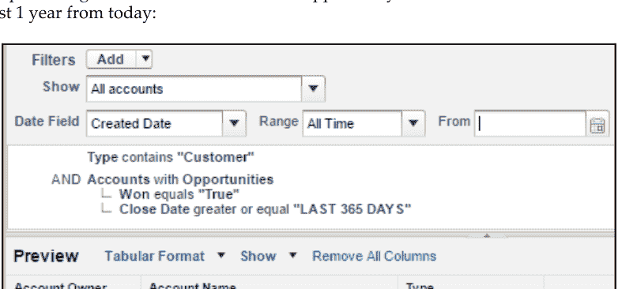

## Hands-on exercise for creating more scenarios using the Cross Filter (2)

让我们使用与前一个相同的报表，通过 **Cross Filter** 查看更多场景。 这里的用例是：管理层希望获取一份没有 Won 机会的 Customers 列表，包括没有 Opportunities 的 Customers。

首先，让我们查看以下两个报表：

+   1. 报表具有以下过滤器 **Account with Opportunities: Won equals True:**

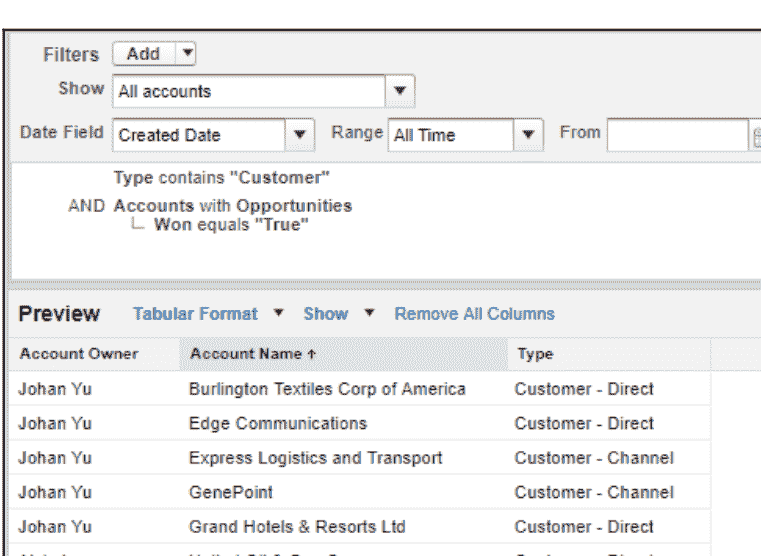

2. 报表具有以下过滤器 Account with Opportunities: Won equals False:

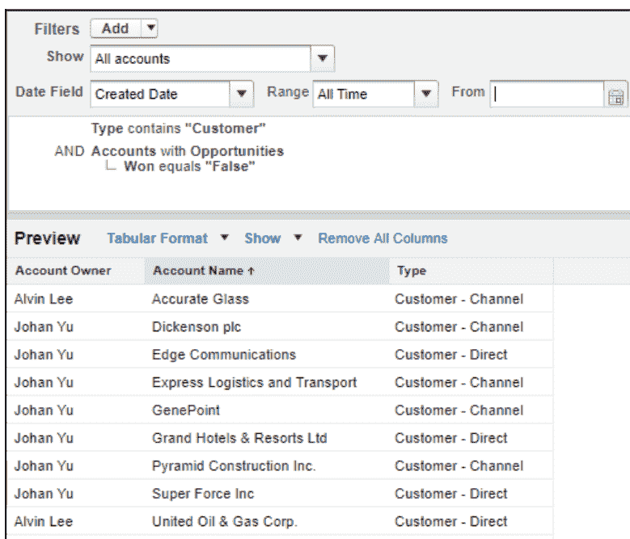

前述截图中的几个账户，Edge Communications、Express Logistics and Transport、GenePoint、Grand Hotels & Resorts Ltd、United Oil & Gas Corp. 和 University of Arizona 同时出现在两个报表中。 这是因为这些账户既有 Stage 为 Closed Won 的机会，也有仍处于 Open 或 Closed Lost 的机会。 请记住，一个账户可能有多个机会。

对于此用例，使用交叉过滤器不是正确的方法。 解决方案是在账户中使用 Roll-up Summary 字段并将其添加到过滤逻辑中。

9. 创建一个 Account 报表并使用 No of Won Opportunity 字段作为报表过滤器；让我们将其命名为 Customer with No Won Opportunities：

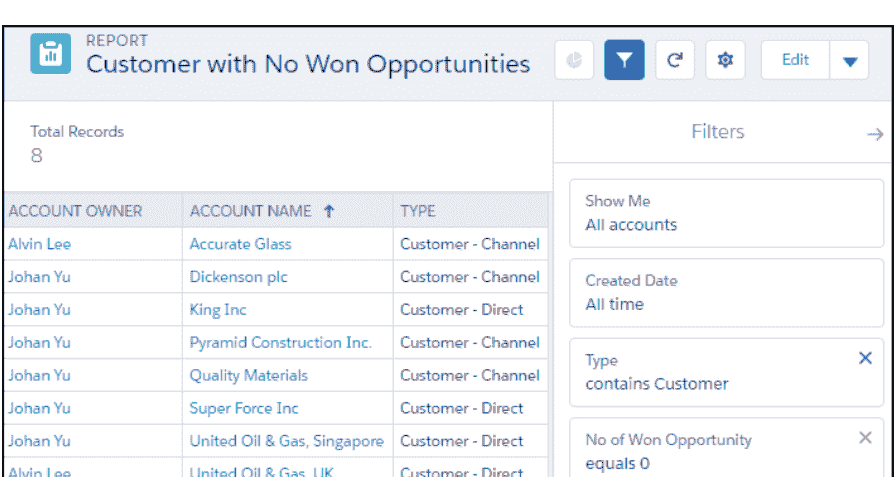

此报表显示我们并非所有场景都适合使用带附加过滤器的 Cross Filter。

## The Row Limit filter

Row Limit 过滤器仅适用于 Tabular 报表。 当您使用 Summary、Matrix 或 Joined 格式报表时，它将不可用。

一旦在 Tabular 报表中添加了行限制，您可以配置 Dashboard Settings。 从 Dashboard Settings 中，选择要在仪表板表格和图表中使用的名称和值。 表格同时显示名称和值，而图表按名称分组。

配置了 Dashboard Settings 的 Tabular 报表可作为 Dashboard 组件的数据源使用。

## Hands-on exercise for adding Row Limit and the Dashboard Settings button

让我们考虑一个用例：创建一个报表，显示员工人数最多的前五名 Accounts 并将报表配置为仪表板的数据源：

+   1. 导航到 **Reports** 选项卡并点击 **New Report** 按钮。
+   2. 选择 **Accounts** 报表类型并点击 **Accounts & Contacts** 类别下的加号。
+   3. 点击 **Create** 按钮继续。
+   4. 将 **Show** 更改为 **All accounts**。
+   5. 将 **Date Field** 范围更改为 **All Time**。
+   6. 从报表中删除不需要的默认字段，只保留 **Account Owner** 和 **Account Name**。
+   7. 通过拖放将 **Employees** 字段添加到报表区域。
+   8. 在 **Filters** 中，点击 **Add** 按钮旁边的箭头 | **Row Limit**。
+   9. 将 **Row Limit** 更改为 **5**，**Sorted By Employees - Descending**。 请考虑以下截图：

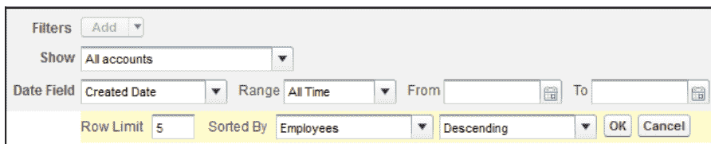

+   10. 点击 **OK** 按钮。 您会注意到 **Dashboard Settings** 按钮出现在顶部行按钮中。
+   11. 点击 **Dashboard Settings** 按钮。
+   12. 选择 **Account Name** 作为 **Name**，**Employees** 作为 **Value** 并点击 **OK** 按钮。 一旦配置了 **Dashboard Settings** 按钮，此报表将能够用作仪表板组件的数据源。 我们将在 *Chapter 8, Working with Reports* 中讨论仪表板。

13. 点击 **Save** 按钮：
    - **Report Name** 为 **Top 5 Accounts by Employee**
    - **Report Description** 为 **Top 5 Accounts with most number of employees**
    - **Report Folder** 为 **Unfiled Public Reports**；这样报告对所有其他用户可见

14. 点击 **Run Report** 按钮以生成报告：

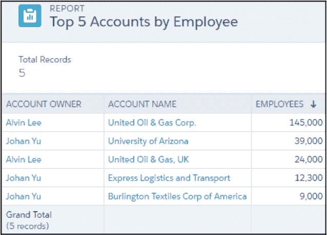

## 按角色层级筛选

对于机会报告，我们有一个额外的报告用于按 **Role Hierarchy** 筛选报告。此筛选器在运行报告时可见，而非在报告构建器中配置报告时可见。

一旦应用筛选器，数据将被筛选以仅显示该角色下用户拥有的机会，包括该角色层级下 **Users** 中的所有用户。

但如果您想筛选特定用户拥有的机会，请通过选择角色然后选择用户来缩小您的 **Role Hierarchy** 筛选器。以下截图展示了使用 **Role Hierarchy** 筛选机会报告：

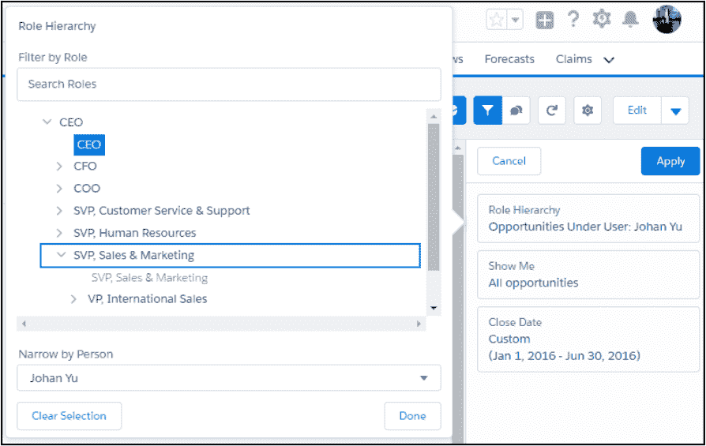

## 按相对日期筛选

如果您需要报告始终使用特定时间范围进行筛选，例如上个月、本月、上季度等，而不是使用固定日期，您可以选择相对日期选项。使用相对日期时，当您创建一个名为上月赢得机会的报告时，您无需每月手动调整关闭日期。

首先，在配置报告时，您需要将日期字段添加到筛选器放置区，而不是日期字段筛选器中的那个；以下截图展示了在放置区筛选器中添加筛选器：

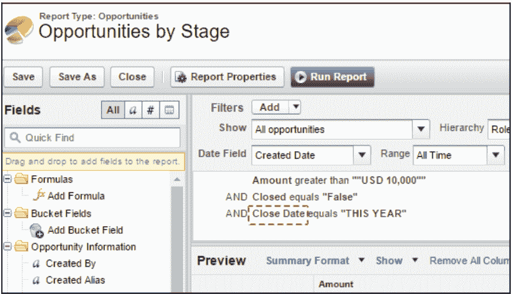

当用户运行报告时，他们也可以在运行时修改此设置：

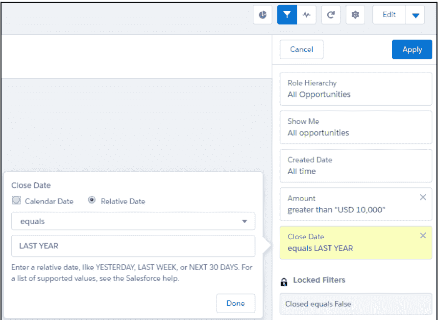

## 通过点击图表筛选

当向报告添加图表时，您是否知道，当您点击图表中的某个细分时，报告将自动使用图表中选定的细分进行筛选？

假设我有一个名为 **Opportunities by Stage** 的机会报告，并已添加图表。以下截图显示了添加了图表的报告：

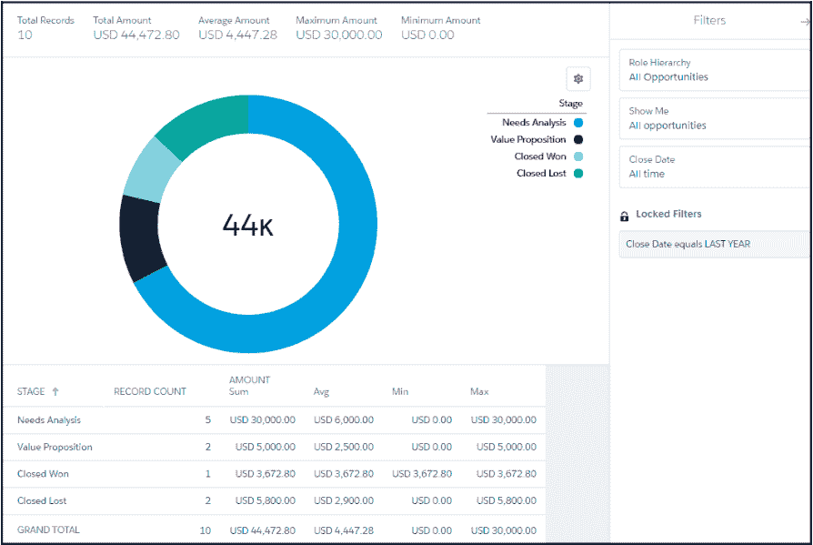

## 锁定筛选器

在报告构建器中向报告添加筛选器时，确定按钮前有一个锁定复选框。这决定了运行报告的用户在查看报告时编辑或删除筛选器的能力。请考虑以下截图：

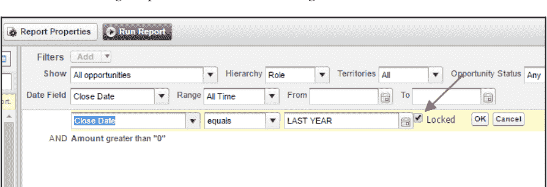

当筛选器被锁定后，它们将显示在锁定筛选器区域下，运行报告的用户将无法编辑或删除它们。请考虑以下截图：

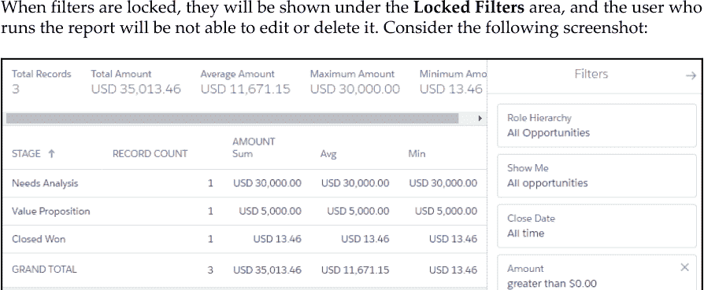

## 总结

在本章中，我们对在 Salesforce 平台上使用报告时组件有了更深入的了解。我们探讨了不同类型的报告格式，并查看了每种格式类型的独特性。我们看到了向报告添加筛选器是多么容易。为了进一步自定义报告，我们可以为 **Tabular** 报告包含 **Filter Logic**、**Cross Filter** 和 **Row Limit**。

尽管本章多次提及仪表板，但我们并未详细讨论它们。仪表板将在 *第 9 章 Lightning Experience 中的构建仪表板* 及以后深入讨论。本章完全专注于报告。

在下一章中，我们将详细讨论报告类型，查看报告类型为何如此重要，以及如何创建报告，正如您在本章中多次阅读到关于报告类型的介绍。
