# 5. 了解报告类型

您已在第 4 章 创建和管理报告 中学习了创建和管理报告。在该章中，我们讨论了选择正确的报告格式以确定报告布局的重要性，并讨论了如何添加报告筛选器、筛选逻辑、交叉筛选和行限制以获得所需的报告结果。

您在前几章中多次阅读到关于报告类型的介绍。在本章中，我们将深入讨论报告类型，从报告类型类别、标准报告类型、自定义报告类型开始，最后通过几个动手练习来创建自定义报告类型、扩展自定义报告类型并通过创建新报告来应用它们。本章还将分享使用自定义报告类型的益处和局限性。

到本章结束时，您将了解报告类型是什么，在创建新报告时需要了解报告类型的哪些知识，如何创建自定义报告类型，以及如何从自定义报告类型中受益。报告类型设置用户界面在 Lightning 和 Classic 中相同，因此本章中的所有截图都适用于两种用户界面。

在本章中，我们将提供注释和提示以帮助您理解重要事项。以下主题将被涵盖：

- Report Type introduction
- Report Type category
- Standard report type
- Custom report type

### Report Type introduction

如前几章所述，每个报告都需要基于一个报告类型构建：

- 什么是报告类型？
- 我们如何检查现有报告使用的报告类型？
- 当我们创建新报告时，选择正确的报告类型有多重要？

所有这些问题都将在本章中得到解答。

Salesforce 报告，包括所有标准报告和自定义报告，都是基于报告类型构建的。报告类型是报告的基础。一旦报告创建完成，您就无法更改报告类型，但如果您有许多需要更改报告类型的报告，您可以聘请开发人员或顾问为您编写脚本，但我们不会在本手册中讨论这些高级主题。目前，如果您需要更改报告类型，您需要将其重新创建为新报告。

报告类型定义了基于主对象和定义的关联对象之间的关系可用于报告的记录集和字段。理想情况下，维护报告类型，包括报告类型的创建、编辑和删除，应属于 Salesforce 管理员的工作范围，而非标准用户。作为系统管理员，您需要考虑可部署并供用户使用的报告类型的数量。提供过多的报告类型会导致用户在选择使用哪个报告类型以及它们之间的区别时感到困惑，因此请确保根据需要进行平衡。

当自定义对象启用报告时，Salesforce 将自动创建报告类型，其报告类型名称等于对象的复数名称，并且该报告类型将存储在其他报告类别文件夹中。

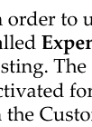

要将自定义对象用于报告类型，请确保为该对象选择启用报告。

为了更轻松地理解报告类型，让我们举一个例子——我们有一个名为 Expense 的自定义对象，其复数标签为 Expenses，您也可以使用其他自定义对象进行测试。该对象有一个指向 Opportunity 的查找关系字段，并且已激活启用报告和跟踪字段历史。让我们快速查看自定义对象设置中的详细信息：

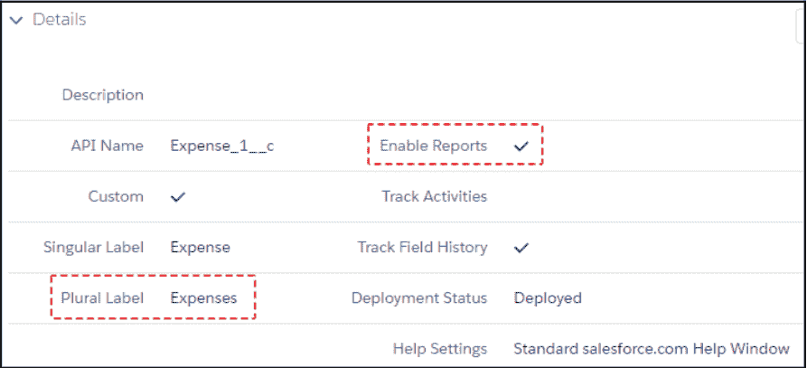

导航到 **Reports** 选项卡并创建新报告；您将看到已创建与 **Expense** 相关的自定义报告类型或多个报告类型：

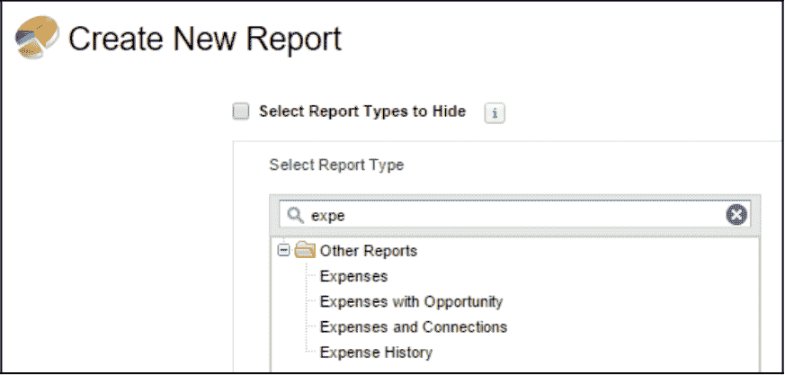

您可以输入报告类型名称进行快速搜索。

在我的组织中，在搜索文本框中输入 **expense** 会筛选出与 Expense 对象相关的四个报告类型。您的组织中可能有所不同，因此如果您看不到相同的结果也没关系，但您应该至少看到一个报告类型。让我们分析我组织中的这四个报告类型：

- **Expenses**：此报告类型将包含与 Expense 对象相关的所有字段
- **Expenses with Opportunity**：此报告类型是自动创建的，因为在我的组织中，Expense 对象有一个指向 Opportunity 对象的查找字段
- **Expenses and Connections**：此报告类型是创建的，因为在我的组织中，我已配置 Salesforce to Salesforce 连接
- **Expense History**：此报告类型是创建的，因为已激活 **Track Field History**；请参阅前面的截图

### 报告类型类别

报告类型类别存储并以文件夹形式呈现。这有助于我们在创建新报告时快速找到正确的报告类型。根据您订阅的 Salesforce 版本，您将获得不同的报告类型类别。

您无法创建新的报告类型类别，但您可以创建自定义报告类型并将其存储在提供的类别之一中；始终是一个好做法将自定义报告类型存储在正确的类别中。

多年来，您可能创建了太多报告类型，但其中许多很少使用或仅使用一次；作为管理员，您可以删除这些报告类型或在创建新报告时将其从用户选择中隐藏；这包括标准和自定义报告类型。

以下是隐藏和删除报告类型的比较：

| 操作 | 删除 | 隐藏 |
|---|---|---|
| 恢复报告类型 | 不可能 | 只需取消隐藏即可 |
| 现有报告 | 全部删除 | 无影响 |
| 开始位置 | **Setup** 菜单 | **Reports** 选项卡 |
| 适用于 | 自定义报告类型 | 所有报告类型 |

就个人而言，我更喜欢隐藏而不是删除自定义报告类型，以防将来某天需要该报告类型或被现有报告使用。

## 理解报表类型

删除自定义报表类型将删除使用该报表类型构建的所有现有报表，包括存储在所有用户私有文件夹中的报表。因此在删除报表类型时要谨慎，并确保它不再被使用。

删除自定义报表类型的最佳实践如下：

1. 隐藏报表类型。
2. 运行报表以检查有多少个活动报表正在使用已识别的报表类型。我们将在本章后面详细讨论这一点。
3. 将报表类型重命名并加上前缀（例如，加上**待删除**以及今天的日期）。此操作的目的是仅在 *x* 个月后没有活动报表使用时才删除报表类型。

报表类型类别结构与标准报表文件夹非常相似，但不要将两者混淆。

标准报表文件夹包含 Salesforce 原生提供的所有标准报表；你无法覆盖它，但可以修改它并将报表另存为新报表到自定义公共报表文件夹或你的个人报表文件夹。

**报表类型**类别存储所有报表类型，包括标准和自定义报表类型。你可以将自定义报表类型存储到任何**报表类型**类别中，但你无法创建或添加新的**报表类型**类别。

### 隐藏报表类型的动手练习

使用场景：我们可用的报表类型太多，这导致用户在选择使用哪种报表类型以及某些报表类型之间的差异时感到困惑。与其删除自定义报表类型从而自动删除使用该报表类型创建的报表，不如只隐藏不再需要的现有报表类型。

1. 转到**报表**选项卡。
2. 点击**新建报表**按钮。
3. 点击**选择要隐藏的报表类型**复选框。
4. 点击报表类别名称前的 + 图标以展开该类别中的所有报表类型。对于本练习，点击**账户与联系人**。
5. 报表类型带有绿色对勾表示该报表类型在创建新报表时可用，而带有黄色叉号的表示不可用。
6. 点击报表类型名称可在可见和隐藏之间切换。对于本练习，点击**带资产的联系人**；图标将从绿色对勾变为黄色叉号。基于该报表类型构建的所有现有报表都不会被删除。如果报表类型用作仪表板组件的数据源报表，隐藏报表类型也不会影响仪表板。请考虑以下截图：

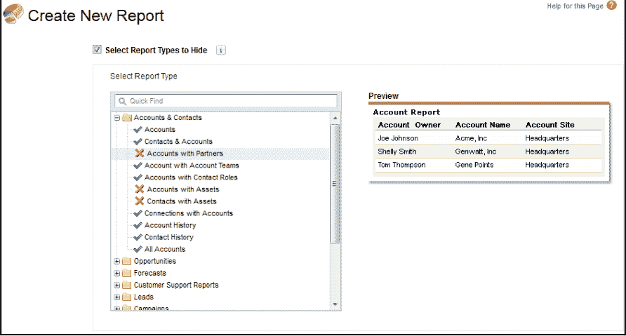

7. 再次点击**选择要隐藏的报表类型**以取消选择；所有被隐藏的报表类型将不再对所有用户在创建新报表时可见。

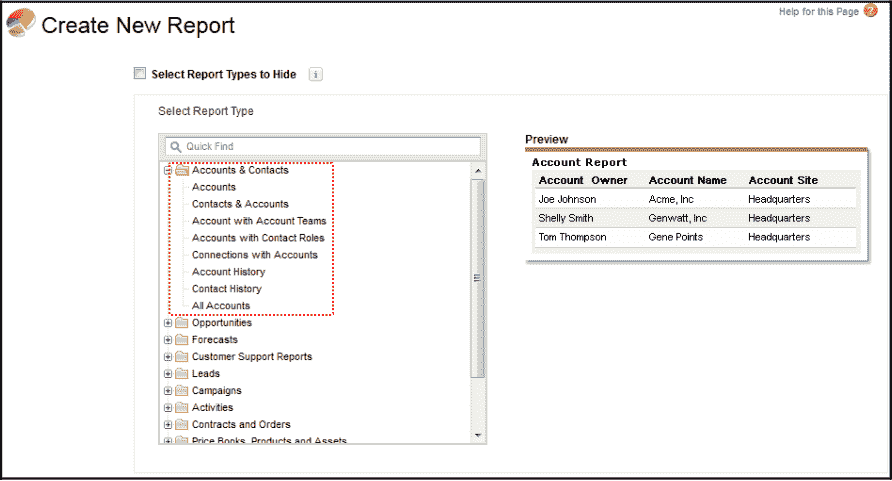

### 标准报表类型

当你从**报表**选项卡点击**新建报表**按钮时，你将看到如下截图中所示的**报表类型**类别列表：

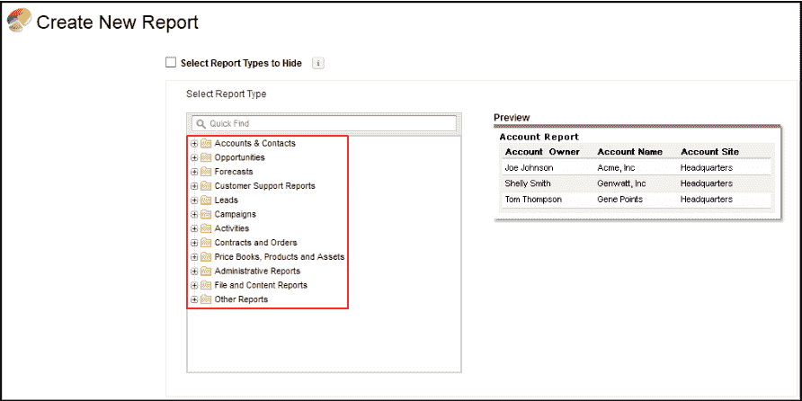

标准报表类型有两种：

- Salesforce 为标准对象提供的报表类型，例如**联系人与账户**。你很容易区分这种报表类型，因为在创建新报表时选择该报表类型时会显示**预览**。

  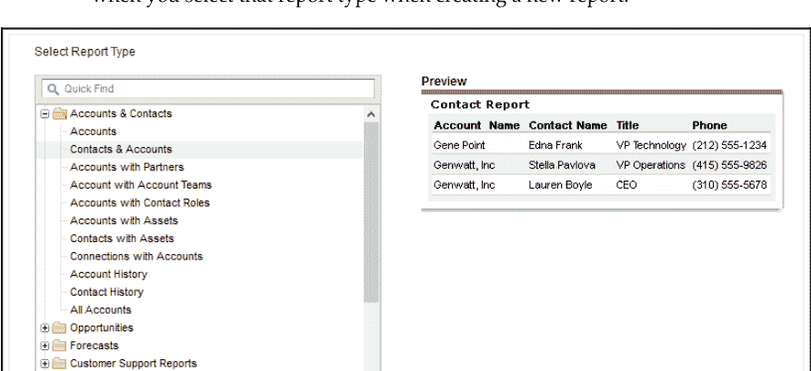

- 当你为自定义对象启用**允许报表**选项时自动生成的报表类型。这种报表类型不会有**预览**，而只会显示**无预览可用**。

当你将一个对象关联到另一个对象且两个对象都已启用报表时，具体会发生什么取决于关系类型。在以下示例中，我们将使用 Customer（自定义对象）作为父对象，Claim（自定义对象）作为子对象。两个对象都已启用报表。让我们更仔细地查看主从关系和查找关系，并看看在建立这些对象之间的关系时报表类型会发生什么。

### 查找关系

当你在对象之间添加查找字段关系时，报表类型相关的行为如下：

- 当你为 Claim 对象激活**启用报表**时，系统将自动创建**索赔**报表类型。
- 当你以查找关系将**Claim**作为子对象关联到 Customer 对象时，系统会将 Customer 字段添加到 Claims 报表类型中。用户将看到 Claims 报表类型中可用的额外客户名称字段，但 Customer 对象的其他字段将不可用于报表。Claims 报表类型将包含有或无 Customer 的所有索赔记录：

  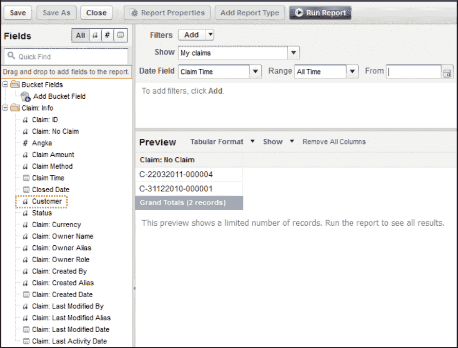

- 现有的**客户**报表类型不会发生变化，因为**Customer**是父对象。
- 一个名为**带客户的索赔**的新报表类型将在**其他报表**类别中创建。此报表类型将包含**Claim**和**Customer**对象的所有可用字段。

  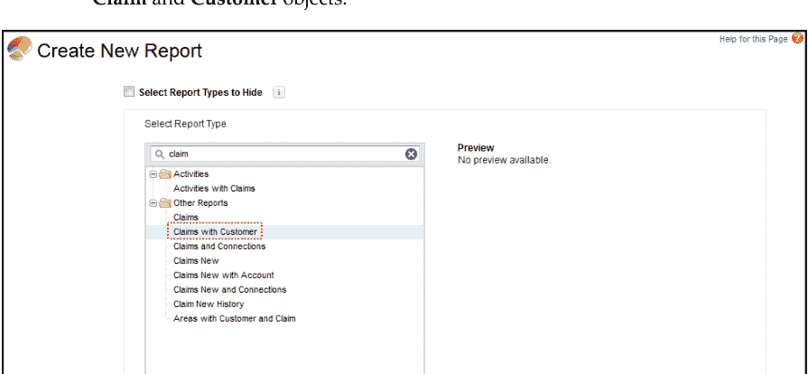

- 此报表类型将仅显示**带客户的索赔**记录；这也意味着没有客户的**索赔**记录将不会出现在生成的报表中。

### 主从关系

当你在对象之间添加主从关系时，报表类型相关的行为如下：

- 当你为 Claim 对象激活**启用报表**时，系统将自动创建**索赔**报表类型。
- 当你以主从关系将**Claims**作为子对象关联到**Customers**对象时，现有的**Claims**报表类型将被移除，因为**Claim**对象在主从关系中成为 Customer 对象的子对象。
- 现有的**Customers**报表类型没有变化，因为 Customer 是父对象。
- 一个名为**带索赔的客户**的新报表类型将在**其他报表**类别文件夹中创建。请注意与前面讨论的**查找关系**部分中自动创建的报表类型的区别。此报表类型具有**Customer**和**Claim**对象的所有可用字段，并将仅显示**带索赔的客户**；这也意味着没有索赔的**客户**记录将不会出现在生成的报表中：

  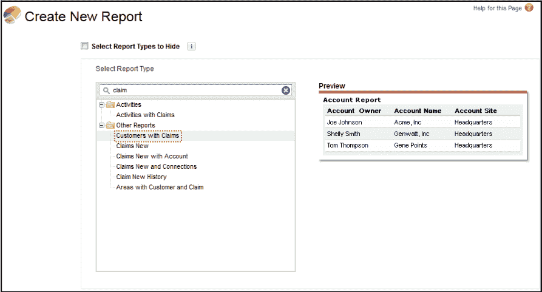

让我们在矩阵中总结前述关系：

| 描述 | 查找 | 主从关系 |
|---|---|---|
| 索赔报表类型 | 无变化，仅添加**客户**字段名 | **索赔**报表类型将被移除 |
| 客户报表类型 | 无变化 | 无变化 |
| 新创建的报表类型 | **带客户的索赔**，包含两个对象的所有字段，仅显示有客户的索赔记录；此处主对象为**索赔** | **带索赔的客户**，包含两个对象的所有字段，仅显示有索赔的客户记录；此处主对象为**客户** |

### 自定义报表类型

报表类型定义了报表可用的记录集和字段。报表类型的来源可以仅来自一个对象，也可以包含相关对象。报表类型还决定只有符合报表类型中定义的条件的记录才会在其中显示。

当提供的标准报表类型无法满足你的报表需求时，你的管理员可以创建自定义报表类型。自定义报表类型支持多级对象关系，从父级对象作为主对象定义，并关联到子对象和孙对象，而不是反过来。

让我们看一个例子——你有一个对象关系**客户 > 索赔 > 索赔付款**；在此关系中，你可以构建自定义报表类型**客户**包含**索赔**和**索赔付款**，而不是**索赔付款**包含**索赔**和**客户**。

使用标准报表类型部分中讨论的**客户**和**索赔**对象，在主从关系中，**带索赔的客户**报表类型将被自动创建。参见以下说明；灰色区域将是使用此报表类型时的报表结果：

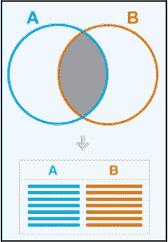

在上图中，A 是客户对象，B 是索赔对象。**带索赔的客户**标准报表类型将在你关联对象时由系统自动创建。此报表类型将仅为**带索赔的客户**生成报表，而**无索赔的客户**将无法在报表中使用该报表类型获得。如果你需要生成包含所有客户的报表，可以使用**客户**报表类型，但**索赔**字段将不会在报表中可用。

## 理解报表类型

在此场景中，自定义报表类型派上用场。我们可以创建一种客户的自定义报表类型，是否包含索赔均可。此报表类型将生成客户信息及索赔信息，即使客户没有任何索赔。此报表类型将生成包含所有客户数据的报表。请参阅以下截图中的灰色区域：

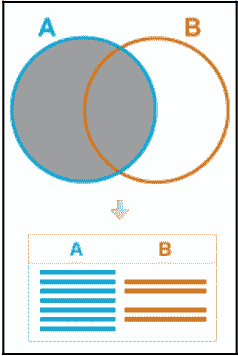

使用自定义报表类型，我们可以定义一个主对象并将其与子对象关联，其中：

- 主对象中的记录必须至少有一个相关对象的记录
- 主对象中的记录可能有也可能没有相关对象的记录

> 自定义报表类型从顶层对象作为**主对象**开始；它仅支持每个层级一个子对象，但允许您创建多层父子层级。
> 
> 使用自定义报表类型，您可以定义哪些对象的字段可用于报表列。如果某个字段从自定义报表类型中移除，该字段将从使用该报表类型构建的所有报表中移除。

## 创建自定义报表类型的动手练习

此练习仅适用于系统管理员或具有**管理自定义报表类型**权限的用户。在此练习中，我们将创建一个新的自定义报表类型，其中**客户**为主对象，它可能有也可能没有**索赔**，索赔可能有也可能没有索赔付款。请确保所有对象都已创建并已启用报表。

- 1. 导航到 **Setup | Feature Settings | Analytics | Reports & Dashboards | Report Types**（或您可以在 **Setup** 菜单的 **Quick Find** 文本框中输入 `report types` 轻松找到该菜单）并单击 **New Custom Report Type** 按钮。
- 2. 在 **Primary Object** 中，所选对象将位于报表类型的顶层层级；在此练习中，选择 **Customers**。

> 记录类型保存后，您将无法更改主对象。

- 3. 输入 **Report Type Label** 和 **Report Type Name**。标签最长可达 255 个字符；对于此练习，将其标记为 `Customers with/without Claims with/without Payment`。名称将自动填充，您可以修改它，但在此练习中保持不变。
- 4. 为自定义报表类型输入 **Description**；您可以输入最多 1,000 个字符。此描述是必填项，并在用户选择报表类型创建报表时显示。提供有意义的描述，以便用户对报表可用数据有清晰了解，例如 `All customers with Claim information`。
- 5. 选择 **Store in Category**；始终将报表类型存储在正确的类别中；为了让用户轻松找到报表类型，选择 **Other Reports**。
- 6. 选择 **Deployment Status**；单击 **Next** 按钮继续。
  - **In Deployment：** 具有此状态的报表类型仅对系统管理员和具有 **Manage Custom Report Types** 或 **Customize Application** 权限的用户可用。在设计和测试阶段选择此选项。报表类型及其报表对所有其他用户隐藏。
  - **Deployed：** 此报表类型及其报表将对所有人可用。测试后且准备让所有用户访问时更改为此选项。
- 7. 单击 **Next** 按钮继续。
- 8. 客户将显示为主对象；单击 **(Click to relate to another object)** 以关联到子对象。在我们的练习中，选择 **Claims**，然后同样关联 Claims 到 **Claim Payments**。
- 9. 单击 **Save** 按钮完成。请考虑以下截图：

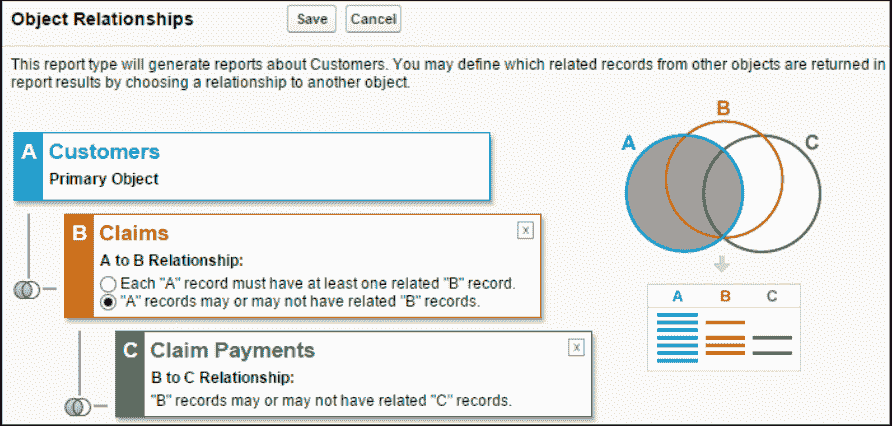

## 理解报表类型

自定义报表类型从顶层对象作为主对象开始，例如，**Customer with Claims**；此报表将获取所有有索赔和无索赔的客户。但如果您想报告所有索赔及客户信息，而不管是否链接到客户 - **Claim with Customers** 呢。

您仍然可以为此场景使用自定义报表类型。将索赔设为主对象而不关联到其他对象，然后使用 **Add fields related via lookup** » 添加来自客户对象的字段。

## 扩展自定义报表类型的动手练习

让我们修改前面创建的 **Customers with/without Claims with/without Payment** 报表类型，以满足以下要求：

- 索赔对象还具有对 **Policy** 自定义对象的查找关系。我们希望从 **Policy** 对象获取状态字段。
- 由于隐私原因，管理层决定不让用户在报表中使用 **Customer** 对象下的名为 **Tier** 的字段。

根据这些要求，让我们打开并编辑创建的报表类型：

- 1. 通过导航到 **Setup | Feature Settings | Analytics | Reports & Dashboards | Report Types**（或您可以在 **Setup** 菜单的 **Quick Find** 文本框中输入 *report types* 轻松找到该菜单）打开创建的报表类型并单击报表类型名称。
- 2. 现在，您应该在该报表类型中看到 **Fields Available for Reports** 部分。单击 **Edit Layout** 按钮将 **Policy Status** 字段添加到报表类型；默认情况下，策略相关字段不会对报表类型可用，如以下截图所示：

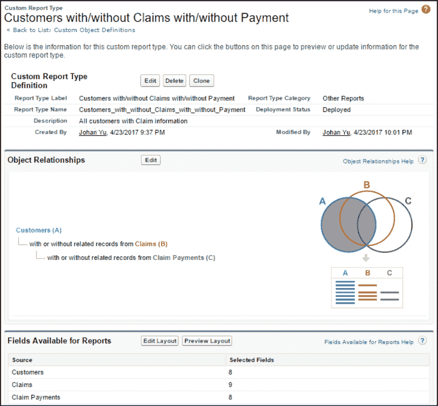

- 3. 将视图更改为 **Claim Fields**，然后在 Lookup 下方单击 **Add fields related via lookup »**。由于 **Policy** 是来自索赔对象的查找字段，您应该在此处看到 **Policy »** 链接。请考虑以下截图：

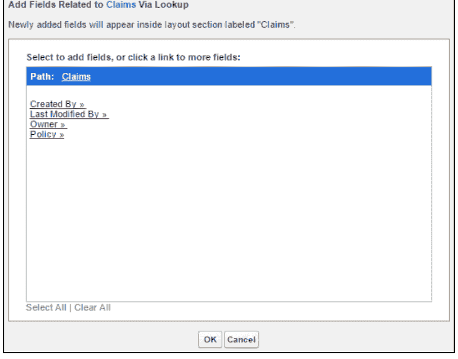

- 4. 选择 **Status** 旁边的复选框，然后单击 **OK** 按钮。
- 5. 现在您应该看到 Status（带放大镜图标）已添加到 Claims 部分。
- 6. 接下来，我们希望从 **Customers** 中移除 **Tier** 字段；只需将 **Tier** 字段拖放到右侧的 **Customers Fields** 面板中，如以下截图所示：

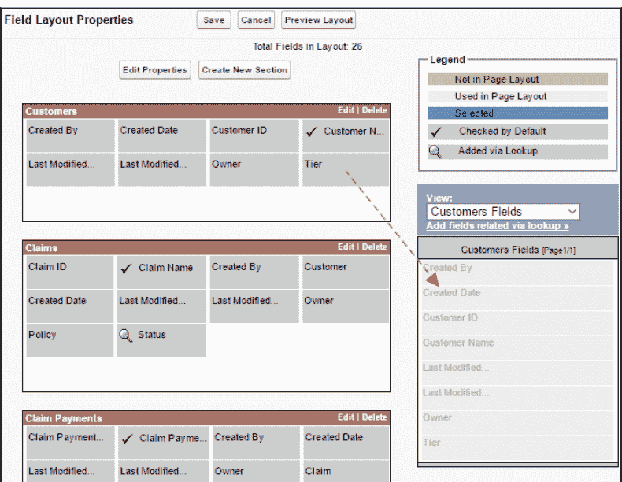

- 7. 单击保存按钮。
- 8. 请注意，在 Fields Available for Reports 部分，Customers 字段现在变为七个字段，Claims 变为 10 个字段。

## 使用自定义报表类型的动手练习

在此练习中，我们将使用前面练习中创建和编辑的报表类型：

- 1. 单击 Reports 选项卡，然后单击 New Report... 按钮。
- 2. 在 Select Report Type 下的 Quick Find 文本框中输入 customer。
- 3. 选择 Customers with/without Claims with/without Payment，然后单击 Create 按钮。
- 5. 选择此报表类型时默认添加了三个字段-- **Customer Name, Claim Name, Claim Payment Name**。以下截图显示有三个字段被选中。因此，如果您想添加更多默认字段，例如 **Policy: Status**，双击该字段并选择 **Checked by Default** 复选框。请考虑以下截图：

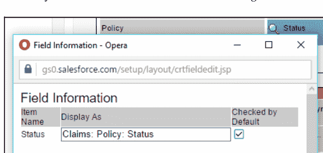

- 6. 我们不打算存储此报表，因此可以忽略此处的报表生成器。但是，如果您想保存报表，请随意将其保存到您的个人报表文件夹。

## 自定义报表类型的限制和优势

在阅读本章时，我们可以利用自定义报表类型实现以下功能：

- 过滤与子对象相关的报表结果
- 使用来自父对象的查找字段扩展报表
- 隐藏字段将不可用于报表
- 设置创建新报表时添加的默认字段

实施自定义报表类型时的一些限制如下：

- 自定义报表类型最多可包含 60 个对象引用。
- 每个自定义报表类型最多可添加 1,000 个字段。
- 报表类型名称的最大长度为 50 个字符，包括空格。

- 有一些标准字段不适用于自定义报表类型，例如**产品计划**字段、个案和机会上的**年龄**字段等。
- 如果在创建报表类型后，向与该报表类型关联的对象添加字段，则新添加的字段默认不会在该报表类型中可用。管理员需要手动将这些字段添加到报表类型中。
- 一个报表类型最多可以关联四级对象关系，每一级只能包含一个对象。

## 自定义报表类型的使用技巧

为了以更低的维护成本充分利用自定义报表类型，作为管理员，在实施报表类型时，你需要注意以下几点：

- 当在对象中创建新字段时，如果需要将新添加的字段添加到某个报表类型，请检查所有现有的报表类型。
- 始终使用能够反映报表类型内容和筛选条件的名称。在本章前面讨论的练习中，我们使用了**有/无索赔且有/无付款的客户**作为名称，它说明了主对象是什么以及它与子对象的关系。
- 始终添加有意义的**描述**。描述是必填项，并且对创建报表的用户可见。
- 自定义报表类型会添加到报表类别的底部。如果你是创建报表类型的人，请提醒具有创建报表权限的用户。
- 记得将报表类型状态改为**已部署**；否则，你的用户在构建报表时将看不到该报表；请参阅*创建自定义报表类型的动手练习*一节。
- 如果当前报表类型需要重大更改，例如添加或编辑对象关系，建议将该报表类型克隆为一个新报表类型，以免影响使用该报表类型构建的现有报表。
- 需要时更改字段分区文件夹名称。默认情况下，分区文件夹名称与对象名称一致。该名称会出现在报表生成器中，因此，当你从报表类型设置中更改它时，报表生成器中的分区文件夹名称也会随之更改。
- 轻松隐藏未使用的报表类型（标准和自定义报表类型），这样你的用户就不会被过多的报表类型所困扰。其中一些可能不再需要，如果你确定它们未在活跃报表中使用，可以在隐藏几个月后将其删除。

## 总结

在本章中，我们详细介绍了报表类型，并探讨了为什么报表类型在构建报表时如此重要。我们还看到，当你为报表启用某个对象时，系统会自动为自定义对象生成新的报表类型。

Salesforce中有两种众所周知的关联类型：当将一个对象与另一个对象关联时，可以使用查找关系和主从关系。我们讨论了这如何影响报表类型。我们介绍了如何扩展父对象中的字段，以及如何移除用户无法在报表中使用的字段。

最后，我们分享了使用自定义报表类型的好处和限制，并意识到其中一个限制是，大多数人在添加新字段时会发现这些字段在报表类型中不可用。管理员需要手动添加它们；而使用标准报表类型时，当添加新字段时，对象的所有字段都会被自动添加。

在下一章中，我们将讨论与报表相关的更高级功能，包括自定义汇总公式、桶字段、向报表添加图表、向页面布局添加图表以及计划报表。
