## 高级报表配置

你在第5章*理解报表类型*中详细学习了报表类型。在该章中，我们介绍了什么是报表类型，以及为什么报表类型对于构建报表如此重要。我们还讨论了报表类型类别、标准报表类型、自定义报表类型，并以一个动手练习结束：创建自定义报表类型、扩展自定义报表类型，以及通过创建新报表来应用它。

在本章中，我们将继续介绍桶字段和自定义汇总公式。与报表类型不同，创建报表时必须选择报表类型；桶字段和自定义汇总公式是可选的，你可以使用也可以不使用它们。但在许多场景下，我们可以利用这些功能来构建高级报表，例如使用自定义汇总公式按月显示百分比增长趋势。

学完本章后，你将完全理解桶字段的好处以及如何使用自定义汇总公式，这将有助于你构建报表。桶字段和自定义汇总公式都适用于Classic和Lightning环境，在Classic和Lightning环境中配置它们没有区别。

在本章中，我们将提供注释和提示，帮助你理解重要内容。将涵盖以下主题：

- 使用桶字段对数据进行分类以用于报表
- 介绍并创建自定义汇总公式
- 自定义汇总公式中可用的函数
- 相关函数：`PARENTGROUPVAL` 和 `PREVGROUPVAL`

### 对报表中的数据进行分类

在第4章*创建和管理报表*中，我们使用**摘要格式**按可用字段将报表分组为多个级别。生成的报表将以分组形式显示，组的数量取决于用于分组的字段返回的值。这意味着，如果报表中没有返回某个值，该值将根本不会显示在分组中。例如，如果你按月份分组，可能会发现某些月份没有记录，因此这些月份不会显示。

如果我们需要将某个字段的多个值归类到一个类别中呢？使用`CASE()`函数创建公式字段可能是一种解决方案，但请思考该公式字段会被多频繁地使用，或者该公式字段是否只用于一个报表？该分类是整个组织的标准，还是仅适用于某个报表？此外，只有系统管理员才能创建公式字段。

如果答案仅是用于一个或极少数报表，而不是整个组织的标准，那么创建新的公式字段并不是一个好方案；此外，一个对象中可创建的公式字段数量是有上限的。对于这两种场景，桶字段就应运而生。

### 桶字段

那么什么是桶字段？它是Salesforce在报表中提供的一项非常强大的功能。它允许你在报表中快速对某个字段的值进行分类，而无需在对象级别创建自定义公式字段。创建桶字段时，你可以根据记录值将多个类别定义到组中；该桶字段不会影响其他报表或对象本身。

例如，在**客户类型**中有以下值：

- **潜在客户**
- **客户 - 直接**
- **客户 - 渠道**
- **渠道合作伙伴/经销商**
- **安装合作伙伴**
- **技术合作伙伴**
- **其他**

你需要将所有包含 Customer 的客户类型归类为**客户**，所有包含 Partner 的**客户类型**归类为**合作伙伴**，所有包含 Prospect 的**客户类型**归类为**潜在客户**，其余归类为**其他**。使用桶字段，你将获得一个新字段，而无需专门在客户对象中创建自定义公式字段。对于此场景，桶字段将包含以下值：

- **潜在客户**
- **客户**
- **合作伙伴**
- **其他**

这些值仅适用于所配置的特定报表。

大多数报表格式都支持桶字段：**表格**、**摘要**和**矩阵**。但是，**联接**报表不支持桶字段。当你将报表格式更改为另一种格式时，桶字段会保留。如果你有一个包含桶字段的报表，然后将报表格式更改为联接报表，则桶字段会被移除。


一份报表中最多可以添加五个桶字段。每个桶字段最多可包含20个桶。

可以使用以下字段类型作为桶字段的源字段：

- **数字、货币、百分比**
- **选择列表**
- **文本**
- **查找**

这包括**公式**字段和**累计汇总**字段，它们返回前面所示的字段类型。

以下字段类型不能用作桶字段的源字段：

- **日期和日期/时间——虽然桶字段不支持这些类型，但你仍然可以通过使用“摘要”和“矩阵”报表中讨论的“分组依据”功能来实现与桶字段类似的概念**
- **复选框——你可以创建一个返回1或0的自定义公式字段，或者一个返回文本“是/否”或“真/假”的自定义公式字段，然后在你的桶字段中使用该自定义公式字段**
- **电子邮件**


- Phone
- Picklist (Multi-Select)
- Text Area, Long Text Area, and Rich Text Area
- URL

## 为报表添加桶字段的动手练习

在本练习中，我们将创建一个 Account 报表，并将包含 Customer 的所有 Account Type 分类为 Customer，将包含 Partner 的所有 Account Type 分类为 Partner，将包含 Prospect 的所有 Account Type 分类为 Prospect，其余的分类为 Other：

- 1. 导航到 Reports 选项卡并点击 New Report... 按钮。
- 2. 选择 Accounts 报表类型并点击 Accounts & Contacts 类别下的加号。
- 3. 点击 Create 按钮继续。
- 4. 将 Show 改为 All Accounts。
- 5. 将 Date Field Range 改为 All Time。
- 6. 点击 Remove All Columns 以清除报表中的所有列。此链接在您想要创建一个没有任何默认字段的新报表时很有用。
- 7. 通过在左侧面板中双击字段来添加 Account Name 和 Account Owner。
- 8. 在左上角面板的 Bucket Fields 下双击 Add Bucket Field（或将其拖到报表区域）。
- 9. 将 Source Column 设置为 Type。
- 10. 在 Bucket Field Name 中输入 Type (Core)。
- 11. 点击 New Bucket 按钮并输入 Customer。对 Partner 和 Prospect 重复相同的操作。
- 12. 选择所有 Type contains Customer 并点击 Move To 按钮。然后选择 Customer，您会注意到所选的 picklist 字段上添加了桶标签。对 Partner 和 Prospect 重复操作。

13. 勾选 Show Unbucketed values as "Other." 以将剩余部分分类为 Other。这在以下截图中显示：

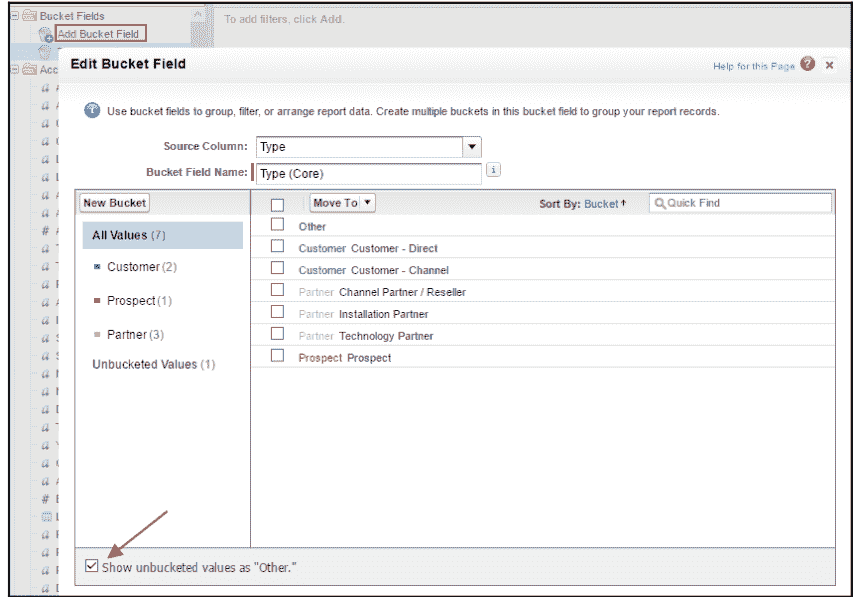

14. 点击 OK 按钮继续。您会注意到报表中新增了一列 Type (Core)，标签前带有桶图标。

15. 点击 Save 按钮并输入以下详细信息：

- Report Name 为 Account with Bucket Fields
- Report Folder 为 My Personal Custom Reports
- 再次点击 Save 按钮

16. 点击 **Run Report** 按钮生成报表。报表将如下所示：

| ACCOUNT NAME | ACCOUNT OWNER ↑ | TYPE (CORE) |
|---|---|---|
| United Oil & Gas, UK | Alvin Lee | Customer |
| United Oil & Gas Corp. | Alvin Lee | Customer |
| Element Industry Ltd | Alvin Lee | Prospect |
| Accurate Glass | Alvin Lee | Customer |
| Mass-100 | Alvin Lee | Other |
| PMA Manufacturing | Johan Yu | Prospect |

17. 点击 **Save As** 按钮：

- **Report Name** 为 **Account with Bucket Fields**
- **Report Folder** 为 **My Personal Custom Reports**

您可以将桶字段视为普通字段，您可以对以下项目使用桶字段：

- 用作 **Summary** 和 **Matrix** 报表的分组
- 用作报表筛选器
- 用于报表排序
- 在导出报表时可用；我们将在本章后面讨论导出报表
- 当您在左侧面板输入以筛选字段时，会包含在字段搜索结果中

## 根据源字段类型创建桶字段

在前面的示例中，我们使用了 picklist 字段作为源字段；然而，不同的字段类型在定义桶字段时会有不同的方法。

在以下各节中，我们将讨论如何使用不同类型的字段作为字段源来创建桶字段。

### Picklist 字段

通过以 picklist 作为字段源创建桶字段，您将能够将 picklist 值分类到更小的类别中。使用 picklist 字段作为桶字段的源字段类型时需要注意以下几点：

- 选择 picklist 值并将其移入桶中
- 一个 picklist 不能被分类到多个桶中
- 并非所有 picklist 字段都可作为桶的源，例如记录类型
- 如果您未选择 **Show unbucketed values as "Other,"**，未被桶捕获的所有值将如以下截图所示：

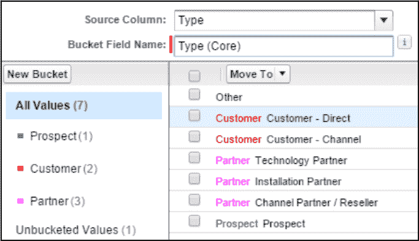

### Currency、Number 和 Percent 字段

通过以货币、数字和百分比作为字段源创建桶字段，您将能够对可以用数字描述的数据进行排序。使用这些字段类型创建桶字段时需要注意以下几点：

- 您需要为小范围和大范围值至少设置两个桶
- 您可以添加多个桶范围，最多总共 20 个桶
- 如果您未勾选 Treat empty <field name>values in the report as zeros，源列的空白值将如下所示：

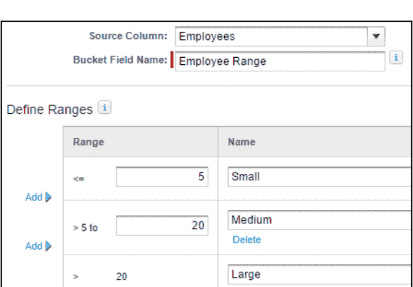

## 编辑桶字段

您可以通过将鼠标悬停在左上角面板中的桶字段上，然后点击铅笔图标来编辑桶字段。您可以通过点击铅笔图标旁边的垃圾桶图标来删除桶字段。

点击铅笔图标将打开桶字段窗口；要从桶字段值中移除所选值，请执行以下步骤：

- 1. 点击该桶；它将显示为该桶所选的所有值。
- 2. 点击复选框以选择该值。
- 3. 点击 Move To 按钮，然后点击 Unbucketed Values 或另一个桶。请考虑以下截图：

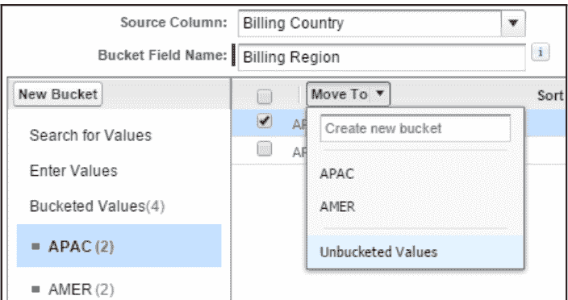

## 自定义汇总公式

不要将报表中的自定义汇总公式与对象的公式字段混淆。它们是完全不同的事物，彼此没有任何关系，尽管它们都有公式。

自定义汇总公式仅在 Summary、Matrix 和 Joined 报表中可用。使用自定义汇总公式可根据报表中可用的数值字段或记录计数计算额外的总计。前面本章讨论的桶字段也是如此。在报表中创建的自定义汇总公式不会影响其他任何地方，也与其它报表无关。

当您需要从 Lookup 或 Master-Detail Relationship 对象获取值时，公式字段才是答案；您不能将自定义汇总公式用于此目的。因此，每当您需要为任何用途（包括报表）从父 lookup 对象获取字段值时，请创建公式字段，然后将其从页面布局中隐藏。但是，只有系统管理员才能创建公式字段。

当您创建自定义汇总公式时，您需要定义返回的格式以及要返回的小数位数。以下是自定义汇总公式可返回的格式选项：

- Currency
- Number
- Percent

只有以下字段类型可用于自定义汇总公式的公式中：

- Currency
- Number
- Percent
- Record Count
- 您还可以使用公式字段和汇总求和字段，这些字段返回上述字段类型
- 与报表中的汇总字段选项类似，您可以在自定义汇总公式中使用这些选项：Sum、Max、Min 和 Average；例如，`Account.Number_of_Branch__c:SUM`

## Summary 和 Matrix 报表中的自定义汇总公式

在 Summary 报表中，自定义汇总公式可以显示在：

- **All summary levels**：这与字段汇总类似
- **Grand summary only**：这与总计相同
- **Grouping**：此选项具有 1 或 2 或 3 级（取决于报表中添加了多少个分组级别）

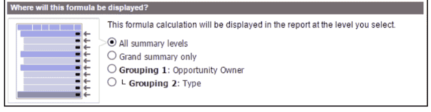

前面的截图取自具有两个分组级别的 Summary 报表，Opportunity Owner 和 Type。

对于 Matrix 报表，自定义汇总公式可以显示在：

- **All summary levels.**
- **A specific row/column grouping level...**；选择此选项后，您将可以选择对行 (A) 和列 (B) 分组使用字段或 Grand Summary。如果您有多个行或列分组级别，您可以选择其中任何一个。

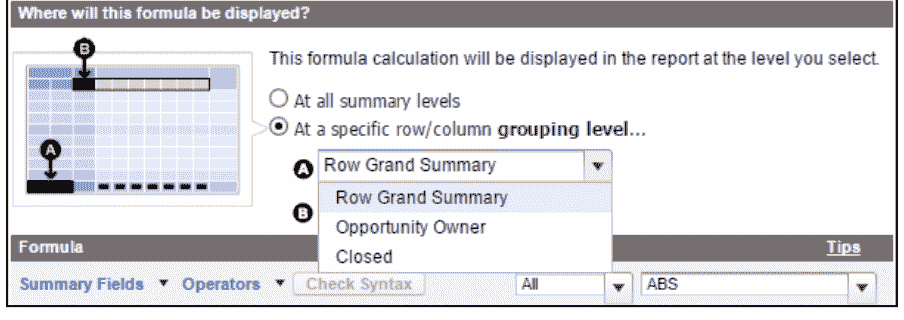

前面的截图取自具有两个行分组级别（标记为 A）的 Matrix 报表，Opportunity Owner（第一级）和 Closed（第二级），以及一个列分组级别（标记为 B）：Type。


## 高级报表配置

- 1. 转到 **Reports** 选项卡并点击 **New Report...** 按钮。
- 2. 选择 **Accounts** 报表类型并在 **Accounts & Contacts** 类别下点击加号。
- 3. 点击 **Create** 按钮继续。
- 4. 将 **Show** 改为 **All accounts**。
- 5. 将 **Date Field Range** 改为 **All Time**。
- 6. 将格式改为 **Summary** 并点击 **Remove All Columns**。
- 7. 从 **Fields** 面板向报表添加 **Account Name** 和 **Type**。
- 8. 将 **Account Owner** 拖到分组区域。
- 9. 在左侧面板的 **Fields** 下双击 **Add Formula**。如下图所示：

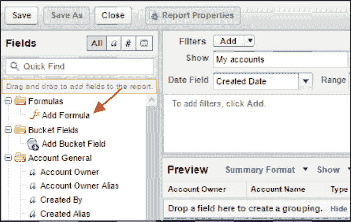

- 10. 输入 **Column Name** 为 `Total Open Opportunities`。
- 11. 输入 **Description** 为 `Total Amount of Open Opportunities`。
- 12. 选择 **Format** 为 **Currency** 和 **Decimal Places** 为 **2**。

## 高级报表配置

- 13. 选择 **Grand summary only**。
- 14. 在 **Formula** 字段中，导航到 **Summary Fields | Total Amount of Open Opportunities | Sum**。请考虑以下截图：

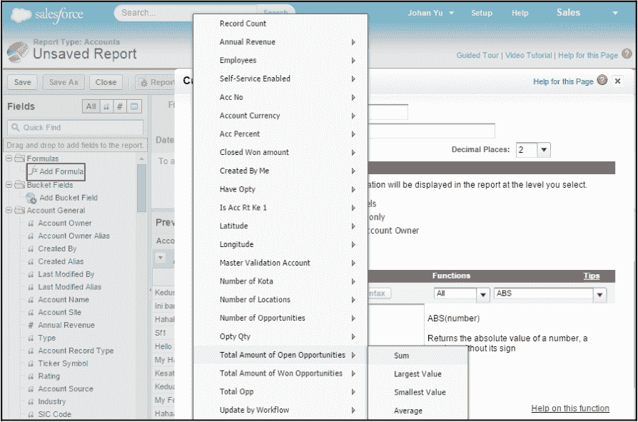

- 15. 公式将自动填充为 **Account.Total_Amount_of_Open_Opportunities__c:SUM**。
- 16. 点击 **OK** 按钮并注意公式和报表列中添加的 **Total Open Opportunities** 选项。
- 17. 请注意，公式汇总字段始终添加到报表的最后一列，并且您无法将其向左移动。
- 18. 将报表保存为 **Open Opportunities**。
- 19. 点击 **Run Report**。

以下是报表结果：

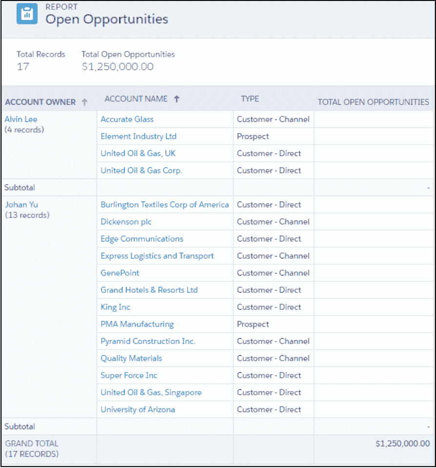

## 高级报表配置

20. 现在让我们通过将鼠标悬停在 **Total Open Opportunities** 公式上然后点击铅笔图标来更改公式。


要编辑或删除公式，当报表处于报表构建器中时，将鼠标悬停在公式上并点击铅笔图标或垃圾桶图标；这与桶字段相同。

21. 从 **Grand summary only** 改为 **All summary levels**。如下图所示：

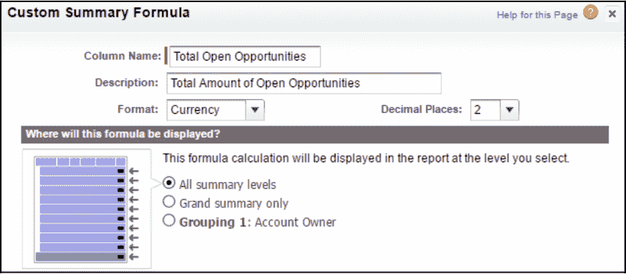

22. 点击 **OK** 按钮然后点击 **Run Report**。

23. 查看以下截图中的更改；Account Owner 的小计值现在已填充：

# REPORT
Open Opportunities

Total Records
17
Total Open Opportunities
$1,250,000.00

| ACCOUNT OWNER | ACCOUNT NAME | TYPE | TOTAL OPEN OPPORTUNITIES |
|---|---|---|---|
| Alvin Lee (4 records) | Accurate Glass | Customer - Channel | |
|  | Element Industry Ltd | Prospect | |
|  | United Oil & Gas, UK | Customer - Direct | |
|  | United Oil & Gas Corp. | Customer - Direct | |
| Subtotal |  |  | $395,000.00 |
| Johan Yu (13 records) | Burlington Textiles Corp of America | Customer - Direct | |
|  | Dickenson plc | Customer - Channel | |
|  | Edge Communications | Customer - Direct | |
|  | Express Logistics and Transport | Customer - Channel | |
|  | GenePoint | Customer - Channel | |
|  | Grand Hotels & Resorts Ltd | Customer - Direct | |
|  | King Inc | Customer - Direct | |
|  | PMA Manufacturing | Prospect | |
|  | Pyramid Construction Inc. | Customer - Channel | |
|  | Quality Materials | Customer - Channel | |
|  | Super Force Inc | Customer - Direct | |
|  | United Oil & Gas, Singapore | Customer - Direct | |
|  | University of Arizona | Customer - Direct | |
| Subtotal |  |  | $855,000.00 |
| GRAND TOTAL (17 RECORDS) |  |  | $1,250,000.00 |

但由于 **TOTAL AMOUNT OF OPEN OPPORTUNITIES** 是 Account 中的汇总求和字段，我们只需将该字段添加到报表并对其进行汇总，就能得到类似的报表结果：

| REPORT Open Opportunities |
| Total Records | Total Total Amount of Open Opportunities | Total Open Opportunities |
| 17 | $1,250,000.00 | $1,250,000.00 |
| ACCOUNT OWNER | ACCOUNT NAME | TYPE | TOTAL AMOUNT OF OPEN OPPORTUNITIES Sum | TOTAL OPEN OPPORTUNITIES |
| Alvin Lee (4 records) | Accurate Glass | Customer - Channel | $0.00 | |
|  | Element Industry Ltd | Prospect | $0.00 | |
|  | United Oil & Gas, UK | Customer - Direct | $0.00 | |
|  | United Oil & Gas Corp. | Customer - Direct | $395,000.00 | |
| Subtotal |  |  | $395,000.00 | $395,000.00 |
| Johan Yu (13 records) | Burlington Textiles Corp of America | Customer - Direct | $0.00 | |
|  | Dickenson plc | Customer - Channel | $15,000.00 | |
|  | Edge Communications | Customer - Direct | $35,000.00 | |
|  | Express Logistics and Transport | Customer - Channel | $200,000.00 | |
|  | GenePoint | Customer - Channel | $60,000.00 | |
|  | Grand Hotels & Resorts Ltd | Customer - Direct | $265,000.00 | |
|  | King Inc | Customer - Direct | $0.00 | |
|  | PMA Manufacturing | Prospect | $0.00 | |
|  | Pyramid Construction Inc. | Customer - Channel | $100,000.00 | |
|  | Quality Materials | Customer - Channel | $0.00 | |
|  | Super Force Inc | Customer - Direct | $80,000.00 | |
|  | United Oil & Gas, Singapore | Customer - Direct | $0.00 | |
|  | University of Arizona | Customer - Direct | $100,000.00 | |
| Subtotal |  |  | $855,000.00 | $855,000.00 |
| GRAND TOTAL (17 RECORDS) |  |  | $1,250,000.00 | $1,250,000.00 |

在这种情况下，除非您需要隐藏每个商机的金额而只获取总计，否则无需创建汇总公式。本次实操中的示例并未展示报表公式汇总的真正威力；除了正常的汇总字段外，我们无法对其进行配置，并且它将始终在所有层级显示。让我们在下一个实操练习中查看汇总公式的更好用法。

## 使用汇总公式的实操练习

让我们考虑一个用例：在 **Summary** 报表中，在所有汇总层级添加 **Total Amount of Closed Opportunities**。假设已在 Account 中从 Opportunity 创建了名为 **Total Amount of Opportunities** 和 **Total Amount of Open Opportunities** 的汇总求和字段，并且 **Total Amount of Open Opportunities** 字段的详细信息已在之前的实操中讨论过，以下是 **Total Amount of Opportunities** 的汇总求和字段详细信息：

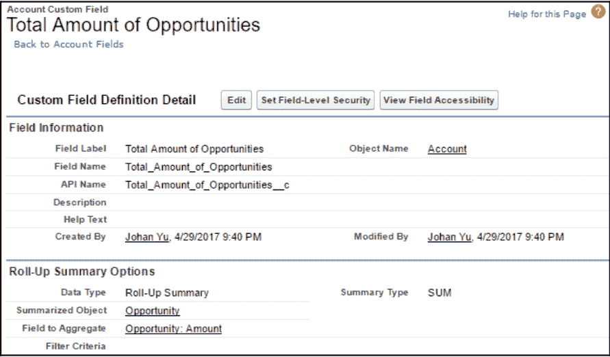

- 1. 创建一个新的自定义汇总公式字段，类似于我们在之前的实操练习中创建的，并将其命名为 `Total_Closed_Opportunities`，公式为：`Account.Total_Amount_of_Opportunities__c:SUM - Account.Total_Amount_of_Open_Opportunities__c:SUM`

2. 为了澄清本次练习，让我们在报表中添加 Total Amounts of Opportunities 和 Total Amount of Open Opportunities 汇总求和字段，然后使用 Sum 对其进行汇总。请考虑以下截图：

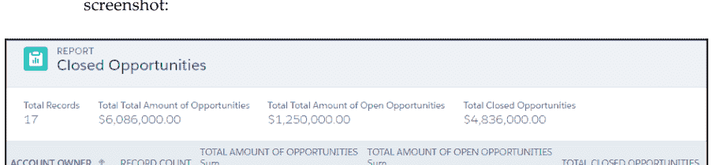

3. 在前面的报表中，Total Amount of Closed Opportunity（汇总公式）等于 Total Amount of Opportunity（汇总求和字段）减去 Total Amount of Open Opportunity（汇总求和字段）。我们在汇总公式之间使用 Subtract 运算符，我们也可以将此技术用于其他公式：

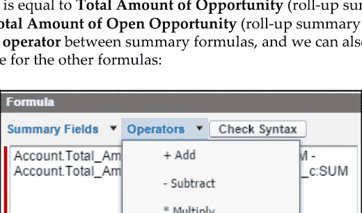

## 高级报表配置

如果您注意到 **Custom Summary Formula** 编辑器中 **Formula** 右侧的区域，有许多函数可用于增强您的公式；它们被归类为 **All, Logical, Math,** 和 **Summary**。我们不会讨论每个可用函数，但让我们在下一节中看一个示例。

## 使用 IF() 函数

IF() 函数归类在 Logical 函数下，此公式的语法为 **IF(logical_test, value_if_true, value_if_false)**。

此函数检查条件是否返回 true。如果是，它将返回定义的第一值；否则，它将返回第二值，例如，`IF(RowCount > 4, WON:SUM, CLOSED:SUM)`。

如果记录数超过四行，此公式将返回 WON 商机的总数；否则，它将返回 CLOSED 商机的总数。WON 和 CLOSED 可从 Opportunity 报表类型获得。

您不必真正输入 `WON:SUM` 和 `CLOSED:SUM` 或您想要使用的其他字段，但从 **Custom Summary Formula** 窗口，导航到 **Summary Fields | <field name> | Sum**。

一旦您点击 **Sum**，它将自动填充到公式中；只需确保将光标放在公式编辑器中即可。


## 高级报表配置

让我们使用前述公式查看报表结果：

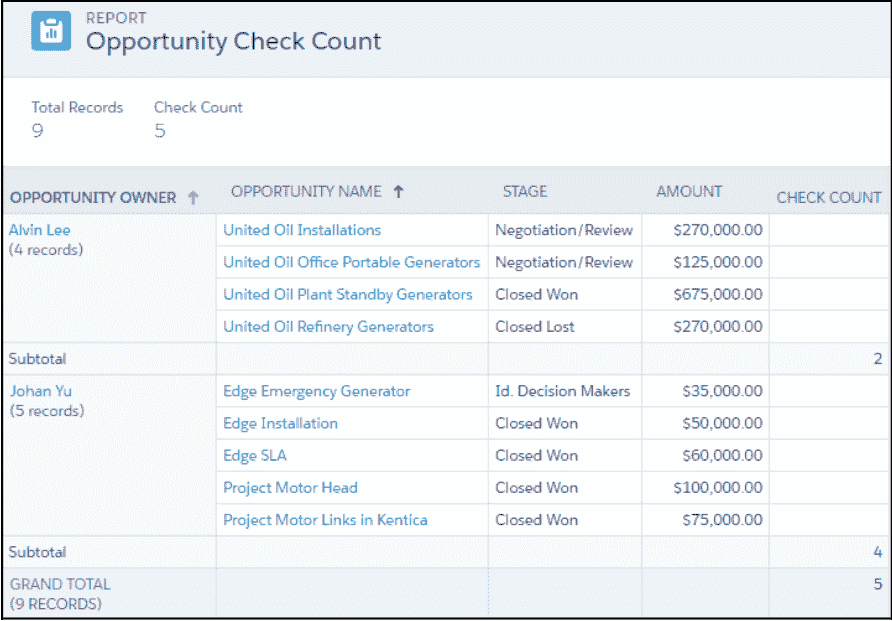

让我们分析前述报表；**Check Count** 是一个汇总公式：

- 对于 **OPPORTUNITY OWNER Alvin Lee**，由于有四条记录，公式将返回 **Alvin Lee** 的已关闭商机数量，为 2。在此练习中，一个商机为 **Won**，一个商机为 **Lost**。
- 对于 **OPPORTUNITY OWNER Johan Yu**，有五条记录；公式将返回 **Johan Yu** 的获胜商机数量，为 4。
- 对于 **GRAND TOTAL**，总记录数为九；公式将返回总的获胜商机数量，为 5：其中 **Alvin Lee** 的一个商机和 **Johan Yu** 的四个商机。

## 使用 MAX() 函数

MAX 函数被归类为数学函数；此公式的语法为 MAX(number,number,...)。

此函数返回所有参数中的最大值，例如，

```
MAX(Opportunity.Projected_Revenue__c:SUM, AMOUNT:SUM).
```

与前面解释的 IF() 函数相同；你只需点按即可获取前述公式填充。在此示例中，我们使用商机报表类型，MAX() 函数通过比较名为 PROJECTED REVENUE 的自定义字段的合计与 AMOUNT 的合计来返回最大值。示例报表如下所示：

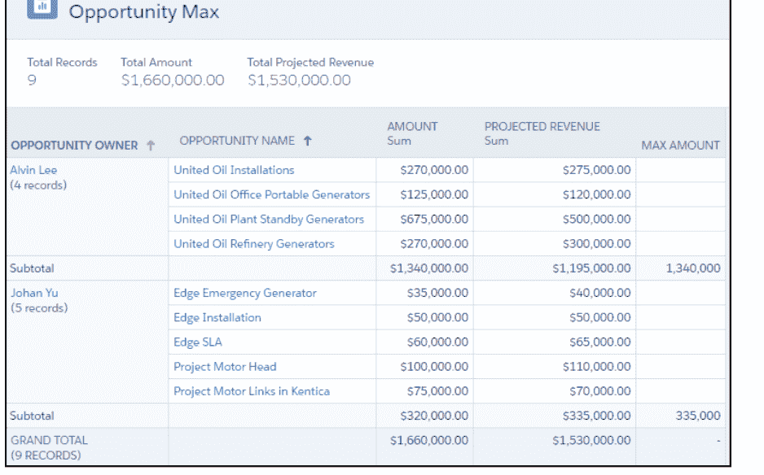

让我们分析前述报表；MAX AMOUNT 是一个汇总公式：

- 我们将 MAX AMOUNT 汇总字段设置为仅在分组级别显示，因此它不会在 GRAND TOTAL 中显示
- 因为这是一个汇总公式，它不会在记录级别比较 **AMOUNT** 值与 **PROJECTED REVENUE** 值，而只在 **Summary** 中比较
- 对于 **OPPORTUNITY OWNER** Alvin Lee，**AMOUNT** 大于 **PROJECTED REVENUE**，因此 **MAX AMOUNT** 等于 **AMOUNT**
- 对于 **OPPORTUNITY OWNER** Johan Yu，**PROJECTED REVENUE** 大于 **AMOUNT**，因此 **MAX AMOUNT** 等于 **PROJECTED REVENUE**。

## 函数公式

Salesforce 中有两种仅在汇总公式中可用且被认为是最强大的报表公式的功能。它们被归类在汇总函数下：`PARENTGROUPVAL` 和 `PREVGROUPVAL`。

### PARENTGROUPVAL() 函数

`PARENTGROUPVAL()` 函数返回指定分组的值；分组级别高于公式显示级别。

公式语法取决于报表格式：

- 在 **Summary** 和 **Joined** 报表中：*PARENTGROUPVAL(summary_field, grouping_level)*
- 在 **Matrix** 报表中：*PARENTGROUPVAL(summary_field, parent_row_grouping, parent_column_grouping)*

### 在汇总报表中使用 PARENTGROUPVAL() 函数

对于 **Summary** 报表，当你选择公式显示为 **All summary levels** 或 **Grand summary only** 时，`PARENTGROUPVAL()` 函数不适用。只能显示为字段分组的公式可以使用此函数。

接下来，我们需要为两个参数 **Summary Fields** 和分组级别填充值。让我们从分组级别参数开始；我会告诉你为什么我先从分组级别而不是 **Summary Fields** 参数开始。

## 高级报表配置

让我们通过一个动手练习来填充参数；在本次练习中，我们有一个 **Summary** 报表，有两个字段分组级别；第一级是 **OPPORTUNITY OWNER**，第二级是 **TYPE**：

1. 确保你选择公式显示为字段分组，而不是所有汇总或总汇总；因为报表有两个字段分组级别，我们将有两个选项。它们是 **Grouping 1: Opportunity Owner** 和 **Grouping 2: Type**；让我们为本次练习选择 **Grouping 2: Type**。
2. 将鼠标放在 **Formula** 编辑器中并从下拉菜单中选择 **PARENTGROUPVAL** 函数。
3. 如果汇总报表中只有一个字段分组级别，父 grouping_level 参数始终为 **GRAND_SUMMARY**，而如果像本次练习中那样有多个级别（两个分组级别），我们将有 **GRAND_SUMMARY** 和第一个分组级别的字段名称作为父分组级别的选项，在我们的练习中为 Opportunity Owner。
4. 当公式显示选择为第二级分组时，父分组级别中的第一级分组的字段名称将被启用。简而言之，父分组级别的可用性比所选公式显示高一个级别。比较以下截图；第一张是在选择 **Grouping 2: Type** 时：

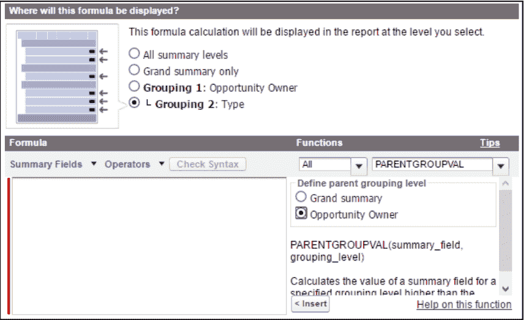

将其与以下截图进行比较。当选择 **Grouping 1: Opportunity Owner** 时，**Opportunity Owner** 在父分组级别中变为禁用：

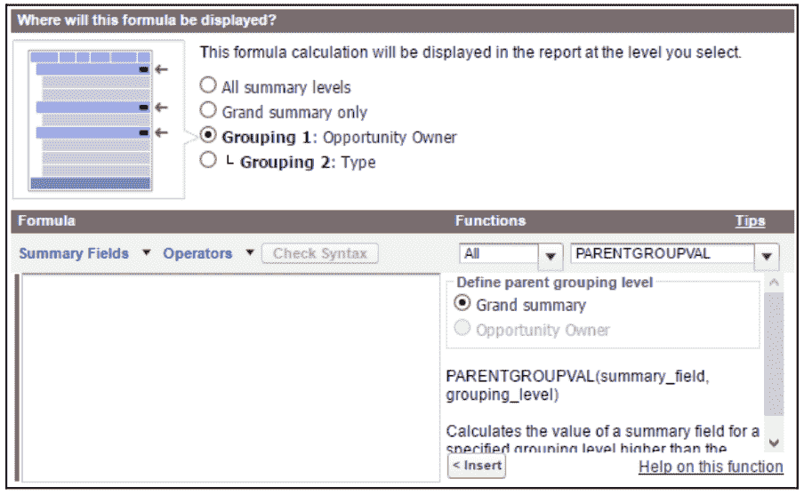

5. 让我们为本次练习选择 **Grouping 2: Type** 并从单选按钮中选择 **Opportunity Owner** 作为父分组级别。
6. 单击 **< Insert** 按钮，你将在我们的示例中获得公式添加：**PARENTGROUPVAL(summary_field, FULL_NAME)**。
7. 删除 **summary_field** 文本并将其更改为正确的字段汇总。要填充 **summary_field** 参数，将光标放在逗号前，单击 **Summary Fields**，选择你想要使用的字段名称（例如 **Amount**），并选择操作（例如 **Sum**）。现在你的公式应为 *PARENTGROUPVAL(AMOUNT:SUM, FULL_NAME)*。

以下是最终公式。查看以下截图中分组级别之间的关系箭头：

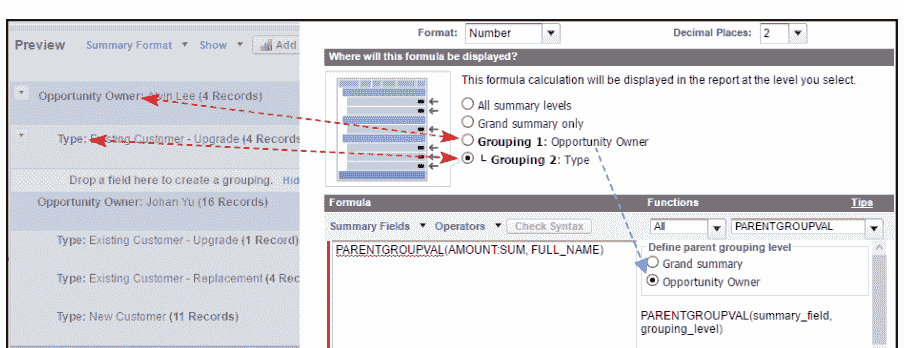

接下来，让我们创建一个新的汇总报表：

1. 按 CLOSE DATE 对报表进行分组（按日历月分组日期），然后按 Opportunity Owner 分组。
2. 添加一个汇总公式并命名为 Amount by Close Date；添加此公式并在 Opportunity Owner（Grouping 2）处显示，公式为 PARENTGROUPVAL(AMOUNT:SUM, CLOSE_DATE):。
3. 将创建的汇总公式添加到报表中。
4. 添加 Amount 字段并将其汇总为 Sum。这在以下截图中显示：

## 高级报表配置

| CLOSE DATE | OPPORTUNITY OWNER | OPPORTUNITY NAME | AMOUNT Sum | AMOUNT BY CLOSE DATE |
|---|---|---|---|---:|---:|
| June 2016 (3 records) | Alvin Lee (1 record) | Pyramid Emergency Generators | $100,000.00 | |
|  |  | Subtotal | $100,000.00 | $265,000 |
|  | Johan Yu (2 records) | Element Stage 1A | $85,000.00 | |
|  |  | Element Stage 1B | $80,000.00 | |
|  |  | Subtotal | $165,000.00 | $265,000 |
| Subtotal |  |  | $265,000.00 | - |
| July 2016 (3 records) | Alvin Lee (1 record) | Element Phase IIa | $38,000.00 | |
|  |  | Subtotal | $38,000.00 | $213,000 |
|  | Johan Yu (2 records) | Project Motor Head | $100,000.00 | |
|  |  | Project Motor Links in Kentica | $75,000.00 | |
|  |  | Subtotal | $175,000.00 | $213,000 |
| Subtotal |  |  | $213,000.00 | - |
| GRAND TOTAL (6 RECORDS) |  |  | $478,000.00 | - |

让我们从截图中分析报表：

- **在 2016 年 6 月**，Total Amount 为 **$265,000.00**。我们看到此值与汇总公式的值相同；这意味着汇总公式的值来自上一级，即 Close Date 的小计。
- **在 2016 年 7 月**，Total Amount 为 **$213,000.00**，与汇总公式中的值相同。
- 公式的值将在报表中 **Opportunity Owner**（即第 2 级）分组中可用，父分组级别为 **CLOSE_DATE**。

接下来，让我们在同一报表中创建另一个类似的公式：

1. 名称为 **Amount by Grand Total**。
2. 选择并在 **Opportunity Owner (Grouping 2)** 处显示汇总公式。
3. 将父分组级别选择为 **Grand summary**。
4. 公式为 *PARENTGROUPVAL(AMOUNT:SUM, GRAND_SUMMARY)*。

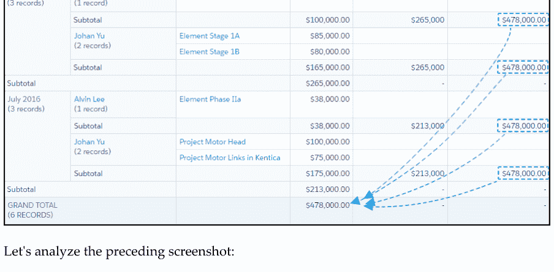

让我们分析前述截图：

- 请注意，汇总公式值与 **GRAND TOTAL** 的值相同。
- 汇总公式显示在 **Opportunity Owner** 分组中，即我们配置的 Grouping 2，值是从 **GRAND_SUMMARY** 复制的（这是 Opportunity Owner 层次结构中上两级）。
- 然而，如果你将公式更改为在 **Close Date**（Grouping 1）中显示，值将与 **GRAND TOTAL** 相同（这是 Close Date 上一级）。参考以下截图：


# 高级报表配置

| CLOSE DATE | OPPORTUNITY OWNER | OPPORTUNITY NAME | AMOUNT Sum | AMOUNT BY CLOSE DATE | AMOUNT BY GRAND TOTAL |
|---|---|---|---|---:|---:|---:|
| June 2016<br>(3 records) | Alvin Lee<br>(1 record) | Pyramid Emergency Generators | $100,000.00 |  |  |
|  |  | Subtotal | $100,000.00 | $265,000 | - |
|  | Johan Yu<br>(2 records) | Element Stage 1A | $85,000.00 |  |  |
|  |  | Element Stage 1B | $80,000.00 |  |  |
|  |  | Subtotal | $165,000.00 | $265,000 | - |
| Subtotal |  |  | $265,000.00 | - | $478,000.00 |
| July 2016<br>(3 records) | Alvin Lee<br>(1 record) | Element Phase IIa | $38,000.00 |  |  |
|  |  | Subtotal | $38,000.00 | $213,000 | - |
|  | Johan Yu<br>(2 records) | Project Motor Head | $100,000.00 |  |  |
|  |  | Project Motor Links in Kentica | $75,000.00 |  |  |
|  |  | Subtotal | $175,000.00 | $213,000 | - |
| Subtotal |  |  | $213,000.00 | - | $478,000.00 |
| GRAND TOTAL<br>(6 RECORDS) |  |  | $478,000.00 |  |  |

从前面的示例中，我们可以很容易理解 `PARENTGROUPVAL()` 函数会从一个或多个更高层级获取汇总值，这也是它被称为 **父组值** 的原因。

接下来，让我们将 `PARENTGROUPVAL()` 函数用于实际操作中；我们希望了解每个月机会总额占总体的百分比。当然，没有自定义汇总公式是做不到的，这里是报表结果：

| CLOSE DATE | OPPORTUNITY OWNER | RECORD COUNT | AMOUNT Sum | % OF TOTAL |
|---|---|---:|---:|---:|
| June 2016 | Alvin Lee | 1 | $100,000.00 | - |
|  | Johan Yu | 2 | $165,000.00 | - |
| Subtotal |  | 3 | $265,000.00 | 55.44% |
| July 2016 | Alvin Lee | 1 | $38,000.00 | - |
|  | Johan Yu | 2 | $175,000.00 | - |
| Subtotal |  | 3 | $213,000.00 | 44.56% |
| GRAND TOTAL |  | 6 | $478,000.00 | - |

**June 2016** 的小计为 **55.44%**；这是通过 *265,000 / 478,000*100* 计算得出的。**July 2016** 同理，为 **44.56%**，计算方式为 *213,000 / 478,000*100*。其背后的公式非常简单，与我们之前使用过的公式并没有太大区别：*AMOUNT:SUM / PARENTGROUPVAL(AMOUNT:SUM, GRAND_SUMMARY)*；简而言之，该公式会将月度小计除以 **GRAND TOTAL**。

# 在矩阵报表中使用 PARENTGROUPVAL() 函数

在 **Matrix** 报表中，此函数的语法为 *PARENTGROUPVAL(summary_field, parent_row_grouping, parent_column_grouping)*。

与 **Summary** 报表相同；当你选择公式显示为 **All summary levels** 时，`PARENTGROUPVAL()` 函数不适用。该函数仅在选择 **At a specific row/column grouping level...** 时适用。

**Summary** 报表中的分组层级参数在 **Matrix** 报表中被拆分为两个参数：**parent_row_grouping and parent_column_grouping**。

让我们创建一个新的 Opportunity 报表，采用 **Matrix** 格式，按 **Close Date** 过滤为 3 个月，然后按 **Calendar Month (column)** 和 **Stage (row)** 分组。参考以下截图：

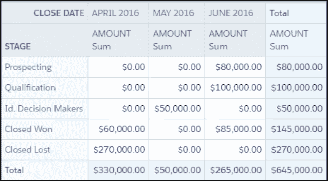

让我们考虑一个用例：我们希望了解每个阶段占 GRAND TOTAL 的百分比：

- 1. 创建一个名为 Total Amount 的公式汇总并显示在 Column Grand Summary 中。参考以下截图：

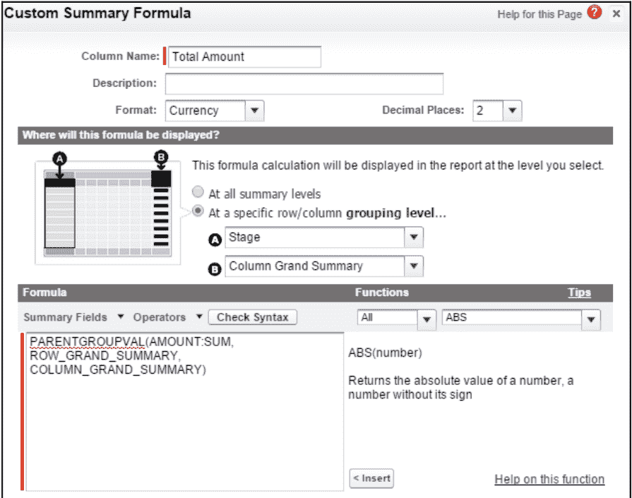

不必担心如何获取参数的关键字；参考前面 Summary 报表中 PARENTGROUPVAL () 的动手练习；当你点击 < Insert 按钮时，关键字会自动填充；然后，将 AMOUNT:SUM 添加为 summary_field。运行报表，你应该会看到与以下截图类似的报表：

| CLOSE DATE | APRIL 2016 |  | MAY 2016 |  | JUNE 2016 |  | Total |  |
| STAGE | AMOUNT Sum | TOTAL AMOUNT | AMOUNT Sum | TOTAL AMOUNT | AMOUNT Sum | TOTAL AMOUNT | AMOUNT Sum | TOTAL AMOUNT |
| Prospecting | $0.00 |  | $0.00 |  | $80,000.00 |  | $80,000.00 | $645,000.00 |
| Qualification | $0.00 |  | $0.00 |  | $100,000.00 |  | $100,000.00 | $645,000.00 |
| Id. Decision Makers | $0.00 |  | $50,000.00 |  | $0.00 |  | $50,000.00 | $645,000.00 |
| Closed Won | $60,000.00 |  | $0.00 |  | $85,000.00 |  | $145,000.00 | $645,000.00 |
| Closed Lost | $270,000.00 |  | $0.00 |  | $0.00 |  | $270,000.00 | $645,000.00 |
| Total | $330,000.00 |  | $50,000.00 |  | $265,000.00 |  | $645,000.00 |  |

这里的 TOTAL AMOUNT 列意义不大；它只是将 GRAND TOTAL 复制到每个阶段的 TOTAL AMOUNT 中，而我们希望了解每个阶段占 GRAND TOTAL 的百分比。

- 2. 编辑报表并更改汇总公式：
  - 将格式更改为 Percent
  - 将公式更改为 AMOUNT:SUM / PARENTGROUPVAL (AMOUNT:SUM, ROW_GRAND_SUMMARY, COLUMN_GRAND_SUMMARY)

因此，我们是将列总计除以 GRAND TOTAL 并显示百分比。报表如下：

| CLOSE DATE | APRIL 2016 |  | MAY 2016 |  | JUNE 2016 |  | Total |  |
| STAGE | AMOUNT Sum | TOTAL AMOUNT | AMOUNT Sum | TOTAL AMOUNT | AMOUNT Sum | TOTAL AMOUNT | AMOUNT Sum | TOTAL AMOUNT |
| Prospecting | $0.00 |  | $0.00 |  | $80,000.00 |  | $80,000.00 | 12.40% |
| Qualification | $0.00 |  | $0.00 |  | $100,000.00 |  | $100,000.00 | 15.50% |
| Id. Decision Makers | $0.00 |  | $50,000.00 |  | $0.00 |  | $50,000.00 | 7.75% |
| Closed Won | $60,000.00 |  | $0.00 |  | $85,000.00 |  | $145,000.00 | 22.48% |
| Closed Lost | $270,000.00 |  | $0.00 |  | $0.00 |  | $270,000.00 | 41.86% |
| Total | $330,000.00 |  | $50,000.00 |  | $265,000.00 |  | $645,000.00 |  |

通过对 **Custom Summary Formula** 进行简单更改，你可以将公式移动到 **Row Grand Summary** 以获取每个月与 **GRAND TOTAL** 比较的百分比：

# Custom Summary Formula

Column Name: Total Amount

Description:

Format: Percent    Decimal Places: 2

# Where will this formula be displayed?

This formula calculation will be displayed in the report at the level you select.

At all summary levels

At a specific row/column grouping level...

A Row Grand Summary

B Close Date (by Calendar Month

# Formula

# Functions

# Tips

Summary Fields  Operators  Check Syntax

All  ABS

```
AMOUNT:SUM /
PARENTGROUPVAL(AMOUNT:SUM,
ROW_GRAND_SUMMARY,
COLUMN_GRAND_SUMMARY)
```

ABS(number)
Returns the absolute value of a number, a number without its sign

< Insert

Help on this function

# Advanced Report Configuration

注意 A 和 B 已更改；公式保持不变，这里是报表：

| STAGE | APRIL 2016 AMOUNT | APRIL 2016 TOTAL AMOUNT | MAY 2016 AMOUNT | MAY 2016 TOTAL AMOUNT | JUNE 2016 AMOUNT | JUNE 2016 TOTAL AMOUNT | Total AMOUNT | Total TOTAL AMOUNT |
|---|---|---:|---:|---:|---:|---:|---:|---:|
| Prospecting | $0.00 |  | $0.00 |  | $80,000.00 |  | $80,000.00 |  |
| Qualification | $0.00 |  | $0.00 |  | $100,000.00 |  | $100,000.00 |  |
| Id. Decision Makers | $0.00 |  | $50,000.00 |  | $0.00 |  | $50,000.00 |  |
| Closed Won | $60,000.00 |  | $0.00 |  | $85,000.00 |  | $145,000.00 |  |
| Closed Lost | $270,000.00 |  | $0.00 |  | $0.00 |  | $270,000.00 |  |
| Total | $330,000.00 | 51.16% | $50,000.00 | 7.75% | $265,000.00 | 41.09% | $645,000.00 |  |

该报表显示了每个月的总金额占 **GRAND TOTAL** 的百分比。

# PREVGROUPVAL() 函数

PREVGROUPVAL() 函数返回同一层级层次结构中前一个分组的值。这使你能够准备显示例如月度机会对比的报表；与 PARENTGROUPVAL() 函数的主要区别在于返回值的层级更高。

PARENTGROUPVAL() 函数的公式语法适用于所有报表格式：

*PREVGROUPVAL(summary_field, grouping_level [, increment]).*

获取 PARENTGROUPVAL() 函数公式参数的导航和提示与获取 PARENTGROUPVAL() 函数的几乎没有区别。语法中唯一的区别是增加了一个可选参数 **incremental**。如果我们跳过此参数，它将使用默认值 1。increment 是当前汇总之前列或行的数量；**minimum** 和默认值是 1，而最大值是 12。

虽然语法与 PARENTGROUPVAL() 函数几乎相似，但功能完全不同。两个函数服务于不同的目的，使我们的报表更加强大。

与 PARENTGROUPVAL() 函数相同；当你选择显示此公式为：At **All summary levels, Grand summary only** 时，此函数不适用。它仅适用于 **Summary** 报表中的字段级分组，以及 **Matrix** 报表中的 **specific row/column grouping level**。


## 在摘要报告中使用 PREVGROUPVAL() 函数

要获取 PREVGROUPVAL() 函数中参数的关键字，请执行以下步骤：

- 从下拉函数菜单中选择 **PREVGROUPVAL**。
- 对于**摘要**报告，就像 **PARENTGROUPVAL** 一样，您可以在符合条件的分组级别下选择字段；如果您有多个分组级别，我们将在后面的动手练习中详细介绍。
- 点击**插入**按钮；您将获得使用所选参数创建的公式，例如 `PREVGROUPVAL(summary_field, CLOSE_DATE)`。
- 点击**汇总字段**，然后选择您想要的字段和操作，例如 **AMOUNT:SUM**。
- 当您点击**插入**按钮时，增量参数默认不会被添加；您可以在需要时手动添加。

让我们创建一个**摘要**报告：

- 1. 使用**机会**报告类型。
- 2. 按**阶段**和**关闭日期**分组（按**日历月**对日期分组）。
- 3. 添加汇总公式，并将其命名为“上月赢单”，公式如下：`PREVGROUPVAL(AMOUNT:SUM, CLOSE_DATE)`。
- 4. 在本练习中，我将过滤报告，仅显示 **关闭日期** 在两个月内的机会；这只是为了简化，以减少报告中的数据。详情请参见以下截图：

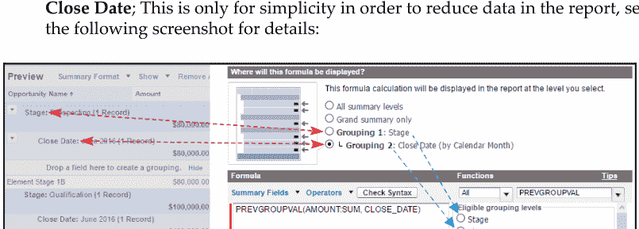

- 5. 将汇总公式添加到摘要报告。
- 6. 添加“金额”字段并使用“求和”汇总。您将看到类似以下报告的内容：

| 阶段 ↑ | 关闭日期 ↑ | 机会名称 ↑ | 金额 求和 | 上月赢单 |
|---|---|---|---|---|
| 发掘 | 2016 年 5 月 | Element Stage 1A | $85,000.00 |  |
|  |  | Grand Hotels Kitchen Generator | $15,000.00 |  |
|  | 小计 |  | $100,000.00 | - |
|  | 2016 年 6 月 | Element Stage 1B | $80,000.00 |  |
|  | 小计 |  | $80,000.00 | $100,000.00 |
| 小计 |  |  | $180,000.00 | - |
| 资格认定 | 2016 年 6 月 | Pyramid Emergency Generators | $90,000.00 |  |
|  | 小计 |  | $90,000.00 | $80,000.00 |
| 小计 |  |  | $90,000.00 | - |
| 确定决策者 | 2016 年 5 月 | Edge Emergency Generator | $35,000.00 |  |
|  | 小计 |  | $35,000.00 | $90,000.00 |
| 小计 |  |  | $35,000.00 | - |

让我们分析一下前面的报告：

- 第一个小计是 2016 年 5 月的发掘；总计小计为 $100,000.00，因为这是第一个分组，所以 `PREVGROUPVAL()` 函数没有返回值。
- 第二个小计是 2016 年 6 月的发掘；总计小计为 $80,000.00。现在 `PREVGROUPVAL()` 函数将指向第一个分组，金额为 $100,000.00。
- 第三个小计是 2016 年 6 月的资格认定；总计小计为 $90,000.00。`PREVGROUPVAL()` 函数将指向第二个分组，金额为 $80,000.00。
- 第四个小计是 2016 年 5 月的确定决策者；总计小计为 $35,000.00。`PREVGROUPVAL()` 函数将指向第三个分组，金额为 $90,000.00。

我们刚才看到的基于分组顺序，而不是基于分组的数值。

让我们对现有报告的公式做一个小的更改，从 `PREVGROUPVAL(AMOUNT:SUM, CLOSE_DATE)` 改为 `PREVGROUPVAL(AMOUNT:SUM, STAGE_NAME)`，见以下截图：

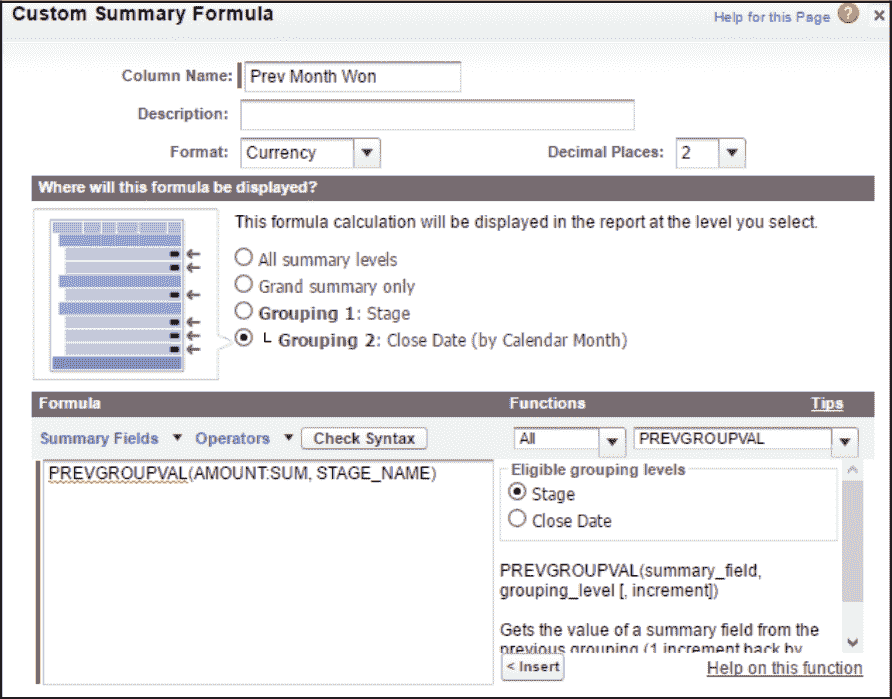

这是生成的报告；请与之前的结果进行比较：

| 阶段 ↑ | 关闭日期 ↑ | 机会名称 ↑ | 金额 求和 | 上月赢单 |
|---|---|---|---:|---:|
| 发掘<br>（3 条记录） | 2016 年 5 月<br>（2 条记录） | Element Stage 1A | $85,000.00 |  |
|  |  | Grand Hotels Kitchen Generator | $15,000.00 |  |
|  | 小计 |  | $100,000.00 | - |
|  | 2016 年 6 月<br>（1 条记录） | Element Stage 1B | $80,000.00 |  |
|  | 小计 |  | $80,000.00 | - |
| 小计 |  |  | $180,000.00 | - |
| 资格认定<br>（1 条记录） | 2016 年 6 月<br>（1 条记录） | Pyramid Emergency Generators | $90,000.00 |  |
|  | 小计 |  | $90,000.00 | $180,000.00 |
| 小计 |  |  | $90,000.00 | - |
| 确定决策者<br>（1 条记录） | 2016 年 5 月<br>（1 条记录） | Edge Emergency Generator | $35,000.00 |  |
|  | 小计 |  | $35,000.00 | $90,000.00 |
| 小计 |  |  | $35,000.00 | - |

这里的不同之处在于，前一个分组的值将来自**阶段小计**，而不是**关闭日期小计**，如之前的报告所示。

接下来，让我们使用之前的公式并添加一个值为 2 的增量参数；公式从 `PREVGROUPVAL(AMOUNT:SUM, CLOSE_DATE)` 改为 `PREVGROUPVAL(AMOUNT:SUM, CLOSE_DATE, 2)`。以下截图显示了一个带有 `PREVGROUPVAL` 公式的**摘要**报告：

## 在矩阵报告中使用 PREVGROUPVAL() 函数

让我们在矩阵报告中使用 PREVGROUPVAL() 函数。

我们想知道每个月的**总金额**增长百分比：

- 1. 创建一个**矩阵**报告，并按**关闭日期**（按**日历月**）作为行分组，**阶段**作为列分组。
- 2. 移除**计数**，并隐藏**详细信息**。仅筛选**未结**和**已赢得**的机会。
- 3. 创建一个名为 `Month by Month`（逐月）的公式汇总；将其分组为**关闭日期**（按**日历月**）和**列总计**。
- 4. 将汇总格式设置为**百分比**，保留两位小数。
- 5. 输入以下公式：`(AMOUNT:SUM - PREVGROUPVAL(AMOUNT:SUM, CLOSE_DATE)) / PREVGROUPVAL(AMOUNT:SUM, CLOSE_DATE)`

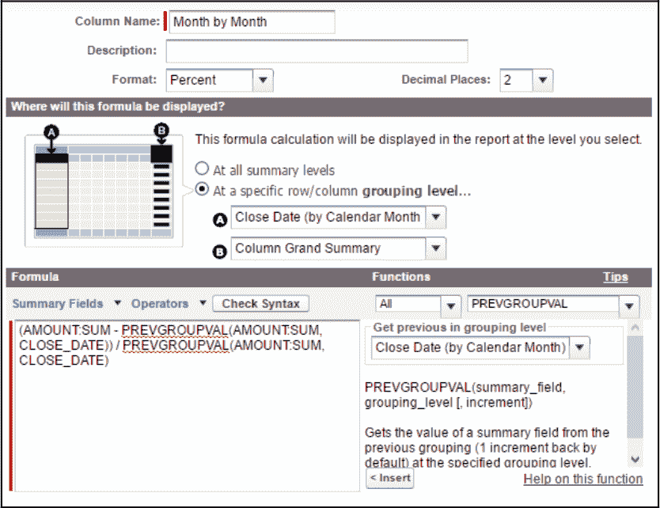

## 高级报告配置

汇总公式将添加到每个月的金额小计旁边；从这里，我们可以轻松查看逐月百分比，并看到所有未结和已赢得的机会的百分比都在增长：

| 关闭日期 | 资格认定 金额求和 | 资格认定 逐月 | 确定决策者 金额求和 | 确定决策者 逐月 | 已赢得 金额求和 | 已赢得 逐月 | 总计 金额求和 | 总计 逐月 |
|---|---:|---:|---:|---:|---:|---:|---:|---:|
| 2016 年 3 月 | $0.00 |  | $15,000.00 |  | $22,000.00 |  | $37,000.00 | - |
| 2016 年 4 月 | $27,000.00 |  | $0.00 |  | $40,000.00 |  | $67,000.00 | 81.08% |
| 2016 年 5 月 | $55,000.00 |  | $50,000.00 |  | $0.00 |  | $105,000.00 | 56.72% |
| 2016 年 6 月 | $80,000.00 |  | $10,000.00 |  | $0.00 |  | $90,000.00 | -14.29% |
| 总计 | $162,000.00 |  | $75,000.00 |  | $62,000.00 |  | $299,000.00 |  |

请注意，2016 年 3 月的公式中没有显示任何值，因为它是第一个值。**2016 年 4 月**与上一个分组（即 **2016 年 3 月**）相比增长了 **81.08%**。**2016 年 5 月**与 **2016 年 4 月**相比增长了 **56.72%**，而最后一个分组与上一个分组相比下降了 **-14.29%**。如前所述，`PREVGROUPVAL()` 函数无法获知上一个分组的值。在此示例中，它显示良好只是因为报告中没有任何跳过的月份。

## 总结

在本章中，我们详细探讨了分桶字段和**自定义汇总公式**。通过分桶字段，我们可以为报告目的对数据进行分类，而无需对对象中的字段进行任何操作。如果某个字段仅用于一两个报告，这将消除管理员创建自定义字段的需求。但是，分桶字段并非用于替代公式字段；您不能在分桶字段中进行公式计算；您可以使用它将值分组到一个分桶中。

分桶字段仅适用于某些字段类型，不同的字段类型将为分桶值配置不同的方式；您可以将范围用于货币、数字和百分比，但不能用于其他类型。

**自定义汇总公式**与自定义公式字段不同。您无法使用**自定义汇总公式**从另一个对象检索值，而且**自定义汇总公式**仅存在于该报告中；它不影响其他报告、对象或字段，并且您不能从其他报告中使用它。

**自定义汇总公式**在**表格**报告类型中不可用，并且当您更改带有汇总公式的报告类型时，现有的汇总公式将被删除，因此请注意这一点。

**自定义汇总公式**中有许多可用的函数；值将仅以数字、货币或百分比形式返回，并且您可以配置返回的小数位数。该公式仅接受有限的字段类型集，但其中包括公式字段和汇总字段。

`PARENTGROUPVAL()` 和 `PREVGROUPVAL()` 函数仅在**自定义汇总公式**中可用。您无法在 Salesforce 中的任何其他公式中找到它们；它们是非常强大的函数。您可以使用 `PARENTGROUPVAL()` 函数从父级分组层次结构中检索分组值，并使用 `PREVGROUPVAL()` 函数从同一层次结构中检索上一个分组的值。

在下一章中，我们将讨论与报告相关的更多功能、向报告添加图表，以及将报告中的图表嵌入父记录页面。


