# 7

## 在报表和页面中添加图表

从第 4 章《创建和管理报表》开始，您学习了如何创建和管理报表，接着在第 5 章《了解报表类型》中继续学习了报表类型，然后在第 6 章《高级报表配置》中使用了桶字段和自定义汇总公式。

在本章中，我们将继续在报表中添加图表，并讨论 Salesforce Lightning 中可用的多种图表类型以及支持添加图表的报表格式类型，并通过一个动手练习来讲解在报表中添加和使用图表。

接下来，我们将讨论如何将报表中的图表添加到记录页面，例如在账户页面中与账户相关的商机或案例；此处的图表将按打开的账户进行筛选，我们还将涵盖对此的动手练习。

到本章结束时，您将完全掌握报表中图表类型的知识，并学会如何添加和编辑图表。您还将了解如何将报表中的图表添加到记录页面布局中。

在本章中，我们将提供注释和提示来帮助您理解重要事项。以下主题将被涵盖：

- Lightning 报表中的图表类型
- 向报表添加图表
- 向记录页面添加嵌入式图表

## 在报表和页面中添加图表

每种图表格式都有其自己的额外功能，例如内联图表，您可以在堆叠条形图中启用累积值，可以将所有条形长度设置为 100%，等等。

让我们了解 Salesforce 中可用的每种图表类型。

### 水平条形图

水平条形图以水平长度显示值，因此此格式适合比较值。当 y 轴上有许多值时，选择水平条形图格式，例如基于每个销售代表的 **金额合计** 和 **NRR 金额合计** 的管道报表。如果我们有 20 名销售代表，图表仍然看起来不错且不会过于拥挤。

当您将鼠标悬停在图表上方时，它会显示条形的更详细信息，包括 x 轴值、y 轴值以及条形相对于总数的百分比。以下屏幕截图显示了水平条形图，以及将鼠标悬停在条形上时显示的信息弹出窗口：

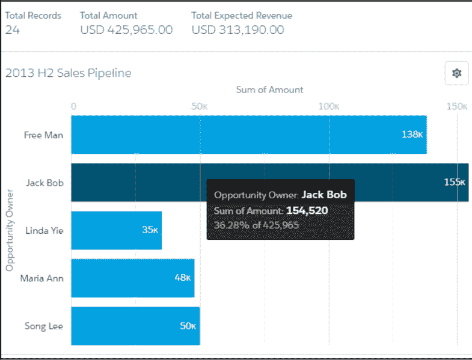

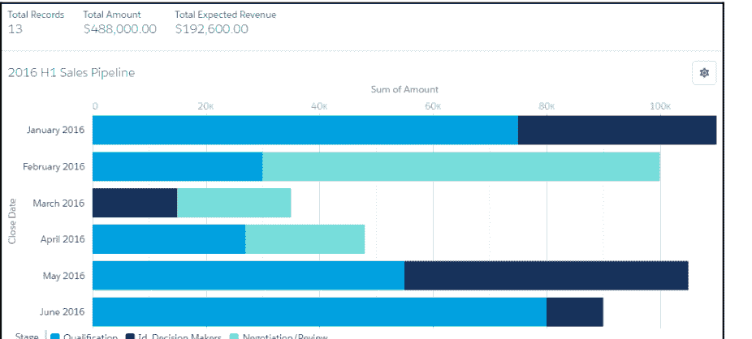

使用堆叠条形图时，您将有将堆叠设置为 100% 的选项；启用后，所有条形将具有相同的长度。前述水平条形图如果修改为水平堆叠条形图，将如以下屏幕截图所示：

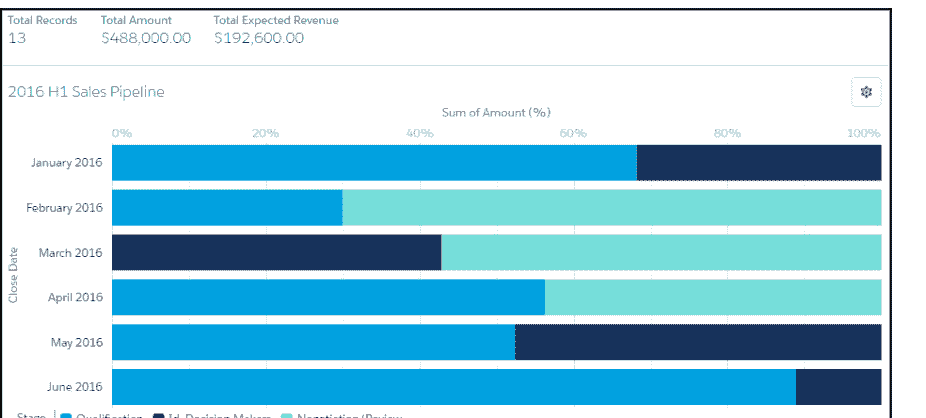

### 堆叠垂直条形图

堆叠垂直条形图与堆叠水平条形图基本相同。它会将条形改为垂直，并交换 x 轴和 y 轴。以下屏幕截图与前一个相同，但为垂直堆叠条形图：

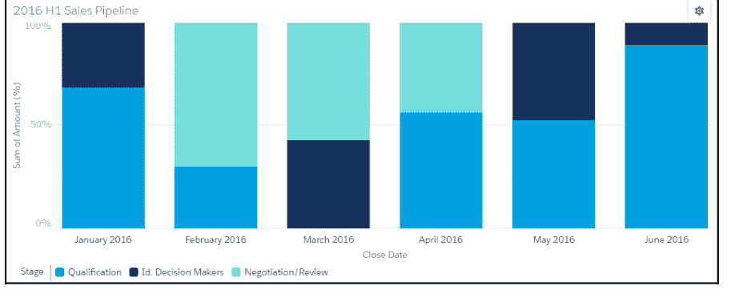

### 折线图

折线图适用于显示某一项目在时间序列中的值变化。以下是按商机负责人分组的商机折线图示例：

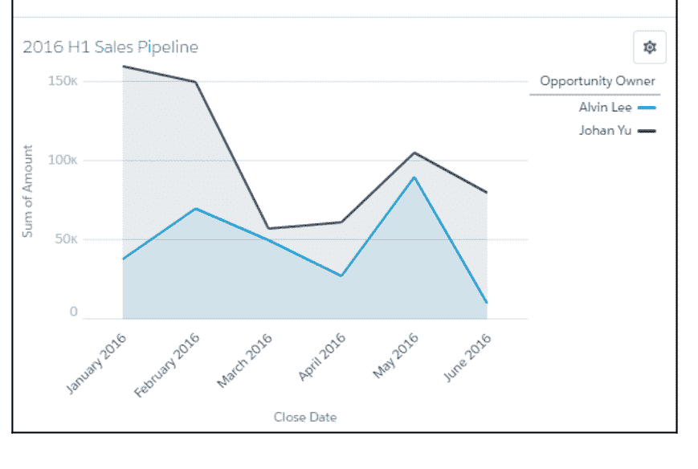

您可以将折线图配置为显示累积值；当您想显示一段时间内项目的总数时，这是一个不错的选择。以下屏幕截图显示了具有累积值的折线图：

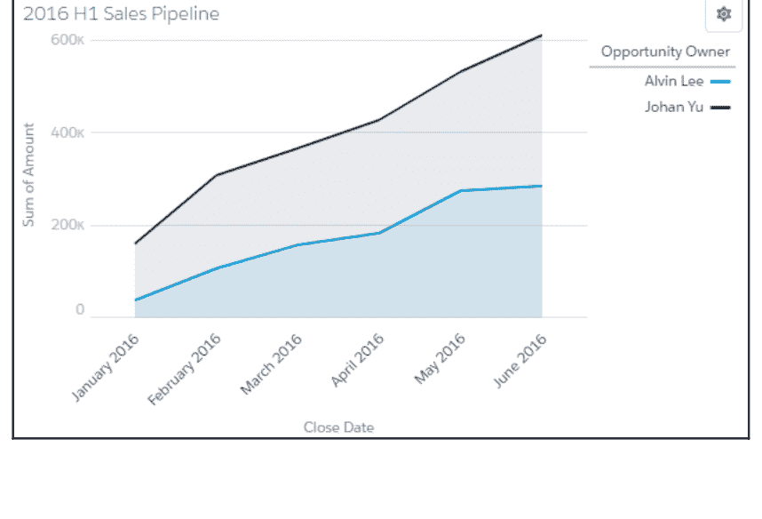

### 圆环图

使用圆环图，用户可以一目了然地看到最大部分和最小部分；除此之外，它还显示总金额和每个组的金额，例如按阶段的管道报表及其总价值。就像堆叠条形图一样，当您将鼠标悬停在组上时，它会显示组名称和组金额。以下示例显示了按关闭日期月份分组的圆环图：

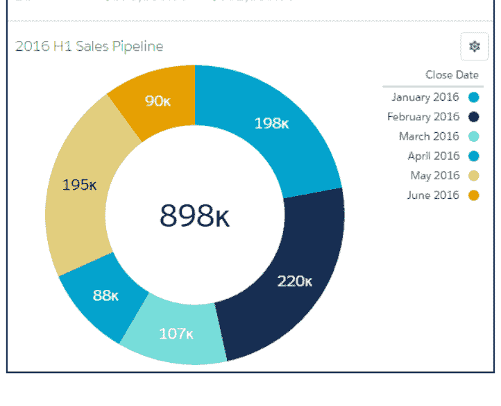

## 在报表和页面中添加图表

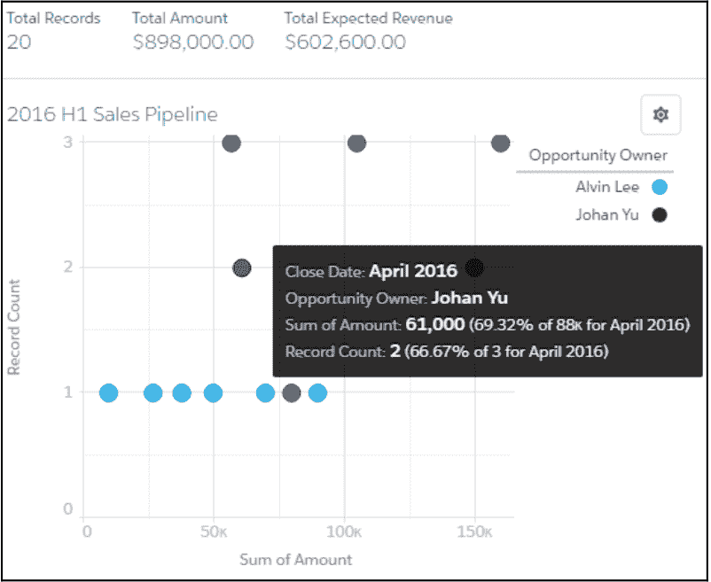

### 向报表添加图表的动手练习

在本练习中，我们将创建一个按商机 **阶段** 分组的 **商机** 报表，格式为 **汇总**。让我们逐步进行：

- 1. 导航到 **报表** 选项卡并点击 **新建报表** 按钮。
- 2. 选择 **商机** 报表类型并点击 **商机** 类别下的加号。
- 3. 点击 **创建** 按钮继续。
- 4. 将 **显示** 改为 **所有商机**。
- 5. 将 **日期字段范围** 改为 **上财年**。
- 6. 点击 **删除所有列** 链接以清除添加到报表的所有默认字段，然后点击 **确定** 按钮确认。
- 7. 将报表格式更改为 **汇总**。
- 8. 将以下字段拖入报表：**商机名称**、**金额** 和 **预期收入**。要快速找到字段名称，请在字段文本框中输入字段名称并双击该字段将其添加到报表中。
- 9. 将 **阶段** 字段拖到分组放置区。
- 10. 使用 **求和** 汇总 **金额** 和 **预期收入**。
- 11. 点击 **显示** 然后点击 **详细信息** 以隐藏报表详细信息。
- 12. 点击 **保存** 按钮并输入以下信息：
  - 报表名称为 `Previous FY Opportunities by Stage`
  - 报表文件夹为 **我的个人自定义报表**
  - 点击 **保存** 按钮
  - 点击 **运行报表** 按钮
- 13. 您应该会看到与以下屏幕截图类似的内容；这是一个标准的 Salesforce 报表：

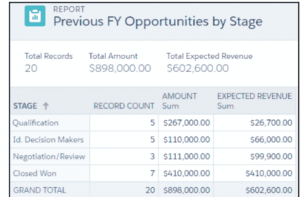

14. 现在我们将向此报表添加图表；点击报表名称旁上方右侧的饼图图标；默认情况下，它将生成一个水平条形图：

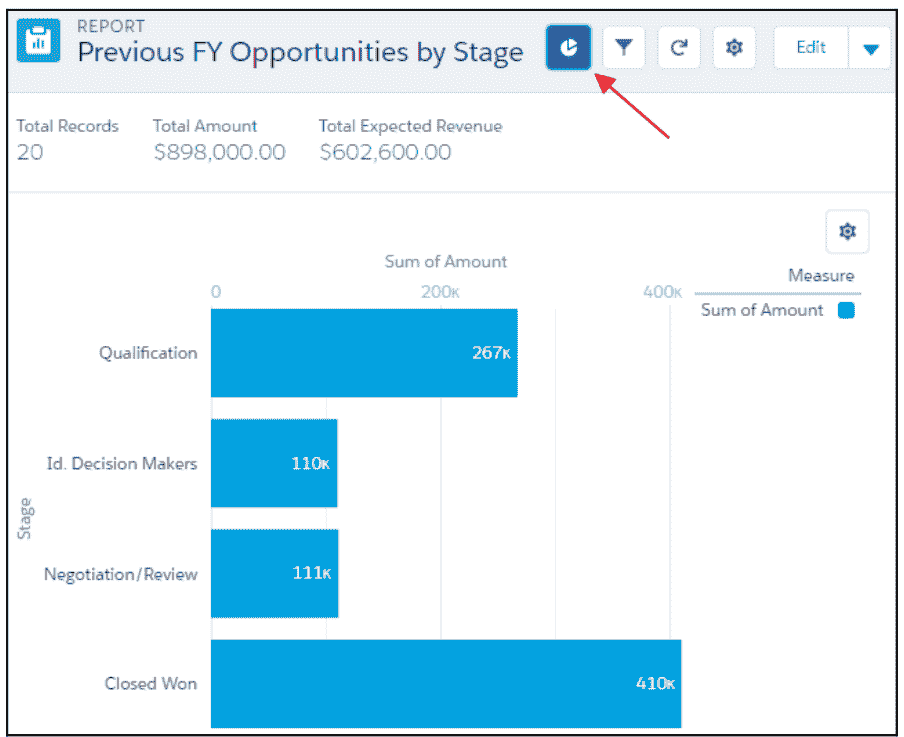

15. 如果您对该图表满意，请点击 **编辑** 按钮旁箭头下的 **保存**：

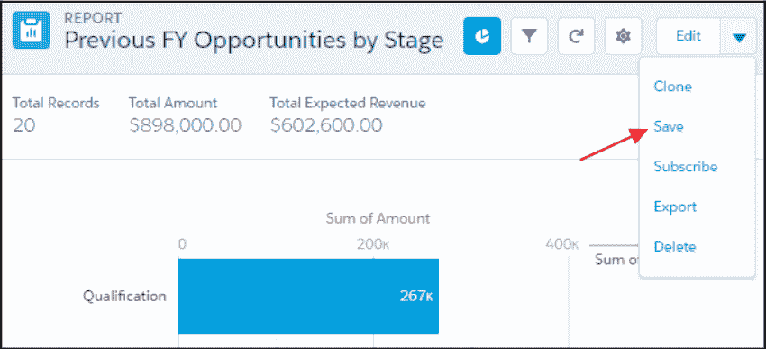

16. 让我们将此图表自定义为 **圆环** 图表。

17. 点击齿轮图标，即图表右侧上方的那个，而不是 **编辑** 按钮旁的齿轮图标：
  - 在 **显示为** 下，选择 **圆环**。
  - 添加 **图表标题** 为 `Previous FY Opportunity`。
  - 在 **值** 下，我们可以选择 **金额合计**、**预期收入合计** 和 **记录数**；请记住在步骤 10 中我们对两个字段都使用了求和；目前只需保留为 **金额合计**。
  - 在 **按切片** 下，您可以通过点击颜色图标更改图表颜色。
  - 默认情况下，**显示值** 已被勾选；让我们保持原样。
  - 您可以选择将 **图例位置** 显示在右侧或底部。如以下屏幕截图所示：

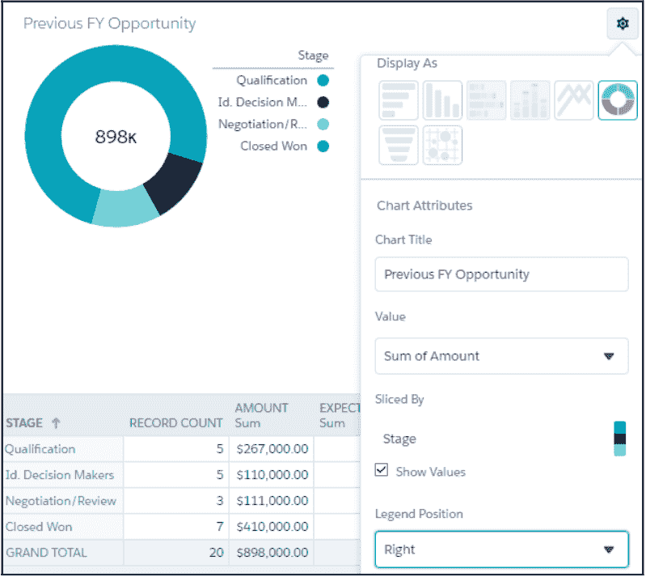

18. 点击图表中的任意位置以显示结果。记得保存报表。这将包含我们刚刚配置的图表；否则，添加的图表将不会被保存，并且在您或他人将来打开报表时将不会存在。

19. 现在让我们将报表另存为新报表并将图表格式更改为 **折线**。

20. 点击 **编辑** 按钮，点击 **另存为** 按钮，报表名称为 `Previous FY Opportunities by Stage /Line`，然后点击 **保存并运行报表** 按钮继续。

21. 点击报表中的齿轮图标；如果将鼠标悬停在图标上，它会显示弹出标签--**编辑图表**。

## 在报表和页面中添加图表

22. 选择**折线图**图标；保留所有默认值，只需勾选**累计**复选框。
23. 在报表中点击任意位置以关闭**编辑图表**面板。
24. 报表将立即显示；不要忘记再次保存报表以更新新的**折线图**：

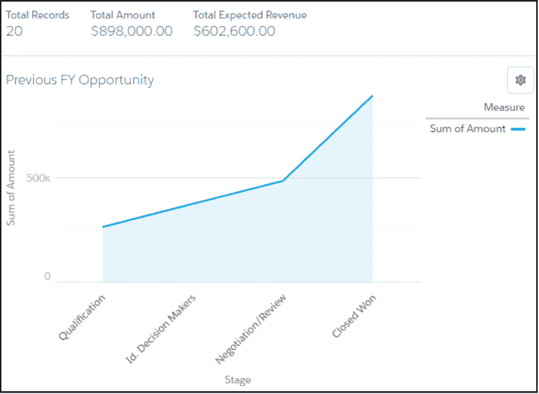

25. 接下来，让我们修改报表，使其增加第二个分组维度：**商机所有者**。点击**编辑**按钮，并将**商机所有者**拖放到**阶段**下方的分组区域中。
26. 点击**运行报表**按钮；现在您应该看到**商机所有者**作为**阶段**之后的第二级分组被添加。
27. 点击报表中的齿轮图标，在**编辑图表**面板中滚动到底部，注意**添加**下拉框，然后选择**分组**。
28. 因为我们只有一个额外的分组，即**商机所有者**，所以它会默认被添加。请参考以下截图：

**显示为**

**图表属性**

| 字段 | 值 |
|---|---|
| 图表标题 | 上一财年商机 |
| X轴 | 阶段 |
| Y轴 | 金额合计 |
| 显示参考线 |  |
| 累计 |  |
| 添加 | 分组 |
| 分组 | 商机所有者 |
| 编辑 |  |

29. 在报表中点击任意位置以关闭**编辑图表**面板。
30. 现在您应该看到多条线；在我的示例中，因为我只有两个所有者，所以只显示两条线。请记住点击**保存**以保存报表更改。请参考以下截图：

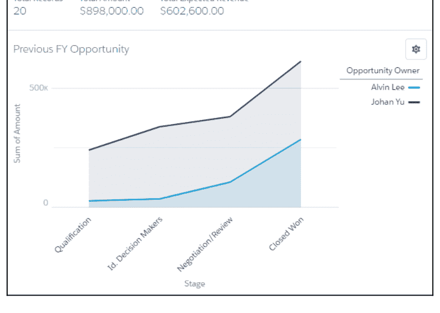

### 在对象页面中嵌入报表图表

如果您能够直接在**客户**页面上以图表形式展示某个客户的所有商机，并按**商机阶段**分组，那岂不是很好？同样，在**客户**页面上显示该客户提出的与客户支持相关的工单图表，或其他自定义对象的图表，也是如此。这是 Salesforce 开箱即用的一项强大功能，可以将报表图表嵌入标准或自定义对象页面中。

关于记录页面中嵌入图表，需要注意以下几点：

-   要将图表添加到页面布局中，您需要编辑页面布局，因此只有管理员或具有**自定义应用程序**权限的用户才能执行此操作。
-   每个页面布局中最多只能添加两个图表。
-   记录页面上显示的图表基于在**摘要**或**矩阵**报表中添加的图表。
-   您无法在页面布局中修改图表类型。
-   您可以设置图表在用户打开页面布局时自动刷新。
-   当用户点击页面布局中的图表时，系统会打开报表，并根据用户正在查看的记录自动筛选报表，从而下钻到数据详情。

### 将图表添加到页面布局的动手练习

让我们考虑一个用例：在**客户**页面布局中添加一个嵌入的商机图表和个案数量图表。

1. 创建一个**商机**报表，按**阶段**分组，添加**金额**字段，对其进行汇总，将报表保存到公共文件夹，添加**垂直条形图**，然后再次保存报表。
2. 从**客户支持报表**报表类型类别中创建一个个案报表，按**状态**分组，将报表保存到公共文件夹，添加**环形图**，然后再次保存报表。
3. 通过导航至**设置 | 对象和字段 | 对象管理器 | 客户 | 页面布局**来编辑客户页面布局。打开相应的页面布局，在左侧菜单中找到**报表图表**。点击**报表图表**，在右侧面板中找到该报表；只有包含图表的报表才会显示在这里，并且存储在公共文件夹中：

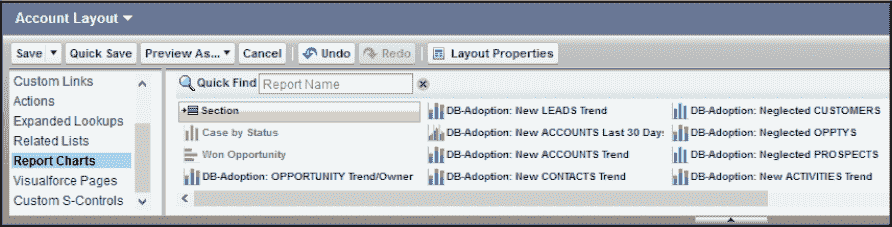

4. 您将看到图表类型显示为报表的图标。
5. 将这两个报表拖放到报表区域。为了获得更好的用户体验，我倾向于创建一个新分区。
6. 将组件添加到页面布局后，点击**属性**图标进行修改：
   -   **大小：** 小、中、大。
   -   **外观：** 显示报表标题，有错误时隐藏图表。
   -   **数据：** 筛选和刷新。请参考以下截图：

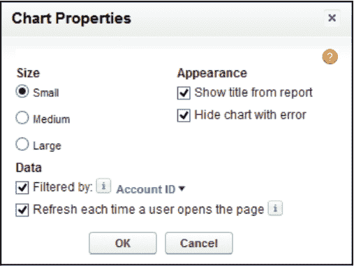

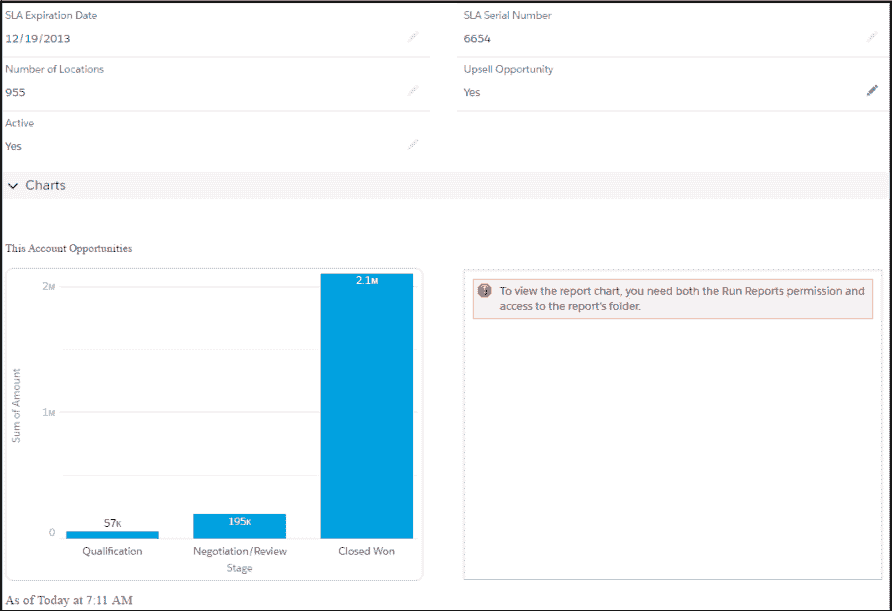

因此，请确保该报表对公司中的所有人可见，除非有特定原因不这样做。

在图表的底部，您会看到图表的最后刷新时间。如果您没有为图表勾选**每次用户打开页面时刷新**，请点击此处的图表，您应该会看到**刷新**按钮和**转到报表**按钮。

您可以将图表添加到其他页面布局，包括具有关联关系的自定义对象：

-   对于**主从关系**，您无需更改任何内容；页面布局中的子对象字段不必在报表或图表中，即可按父字段进行筛选。
-   对于**查找关系**，请确保报表类型中提供父字段；否则，创建一个新的报表类型来容纳它。对于**主从关系**也是一样的；您不需要在报表或图表中添加该字段。

### 本章小结

在本章中，我们了解了 Salesforce Lightning 中可用的图表类型。任何能够运行报表的用户都能够在运行报表时即时添加或修改图表，这包括没有创建和自定义报表权限的用户。我们还讨论了支持添加图表的报表格式。

如果将图表添加到报表中，并且该报表存储在公共文件夹中，我们就可以将图表嵌入记录页面布局。一个记录页面中最多可以有两个图表。只有系统管理员或具有**自定义应用程序**权限的用户才能将图表添加到页面布局。您可以选择将图表设置为每 24 小时自动刷新一次，或由用户手动刷新。

在下一章中，我们将讨论如何使用报表。Lightning 中的报表为我们提供了许多可供探索的功能；然后我们可以分析由这些报表生成的数据。
