## 使用报表

在日常工作中，我们大多数人处理的是运行报表，而不是创建或编辑报表。因此，掌握在 Lightning Experience 中使用报表的知识非常重要，包括一些能让我们的工作更高效、更省力的技巧。

在本章中，我们将讨论如何使用报表，包括打开报表、搜索报表以及将报表添加到收藏夹。然后，我们将继续介绍报表导航以及运行报表时需要注意的组件，包括添加图表、显示或隐藏报表选项，以及更改和删除报表筛选器。

到本章结束时，您将全面掌握在 Lightning 中使用 Salesforce 报表的工作知识，包括订阅报表以通过电子邮件接收报表。

在本章中，我们将提供注释和提示，帮助您理解重要内容。将涵盖以下主题：

-   打开和搜索报表
-   导航到报表和报表组件
-   订阅报表

### 打开报表

让我们从在 Salesforce Lightning 中打开报表开始；请记住，报表存储在报表文件夹中，可以是私有文件夹或公共文件夹。私有报表仅对将报表保存到**我的个人自定义报表**文件夹的用户可访问。我们已在*第 2 章，报表和仪表板中的概念与权限*中深入讨论了这一点；如需复习权限，请参阅该章节。

在 Salesforce Lightning 中，有多种打开报表的方法。首先，点击**报表**选项卡。

### 报表选项卡

您将在这里看到两个主要面板：左侧面板和右侧面板。左侧面板包含**报表**和**文件夹**的类别，右侧面板将显示与左侧面板中所选菜单相关的报表或文件夹列表。

### 报表菜单

一旦您点击**报表**选项卡，您将看到与报表相关的所有内容。左侧面板中有两个主要类别，即**报表**和**文件夹**。在**报表**类别下，有多个菜单，它们将筛选右侧面板中显示的报表。请参考以下截图：

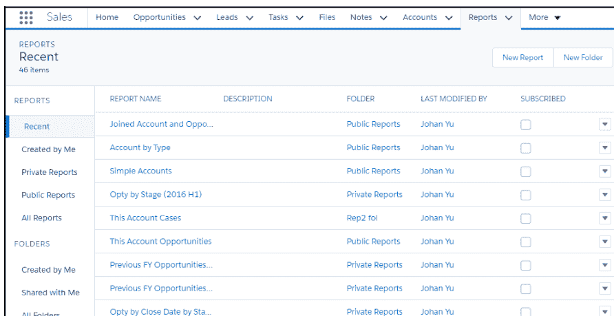

从前面的截图中可以看到，**报告**下有五个菜单：

- **最近使用**：这是单击**报告**选项卡后的默认选择。选中此项后，右侧面板将列出该用户最近打开的所有报告，因此我的最近列表会与同事的列表不同。
- **我创建的**：单击此项将显示用户创建的所有报告，包括存储在私有文件夹和公共文件夹中的报告。
- **私有报告**：这包括用户存储到**我的个人自定义报告**文件夹中的所有报告。
- **公共报告**：这些是存储在**未归档公共报告**文件夹中的报告；所有具有运行报告权限的用户都可以运行存储在此文件夹中的报告。
- **所有报告**：这将显示用户有权访问的所有报告，包括私有报告和公共报告。如果你的组织中有太多不再使用的报告，最好定期删除它们，以免此处的列表过大。

当你选择这里的任意菜单时，右侧面板将根据左侧选择的菜单列出所有报告。此面板中有五个列和一个操作列：**报告名称**、**描述**、**文件夹**、**最后修改者**、**已订阅**，以及一个用于操作下拉菜单的箭头图标。你可以按**报告名称**、**文件夹**、**最后修改者**和**已订阅**对列表进行排序。仅当用户具有**订阅报告**权限时，**已订阅**列才可见。

让我们看看每个报告可用的操作菜单：

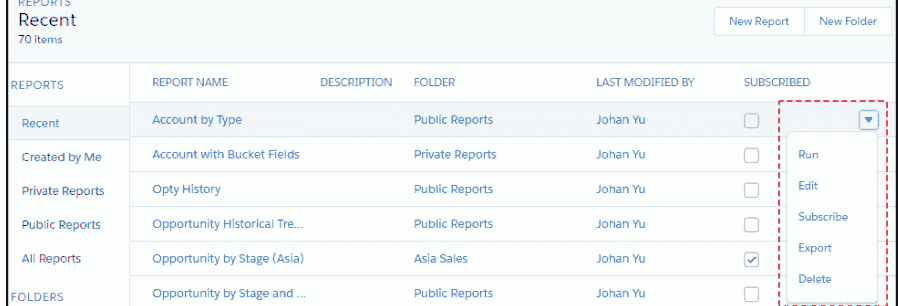

对于每个报告最后一列的操作菜单，菜单的可见性将取决于用户权限：

- **运行：** 这与单击报告名称运行报告相同。
- **编辑：** 仅当用户能够编辑报告时，此选项才可见。
- **订阅：** 如果用户具有**订阅**报告权限，则此选项可见。
- **导出：** 如果用户具有导出报告权限，则此选项可见。
- **删除：** 如果用户根据其在该报告文件夹中的访问权限能够删除报告，则此选项可见。用户将能够删除其私有文件夹中的所有报告。

## 文件夹菜单

与**报告**类别一样，在**文件夹**类别下也有多个菜单，用于筛选右侧面板中显示的文件夹。请看以下截图：

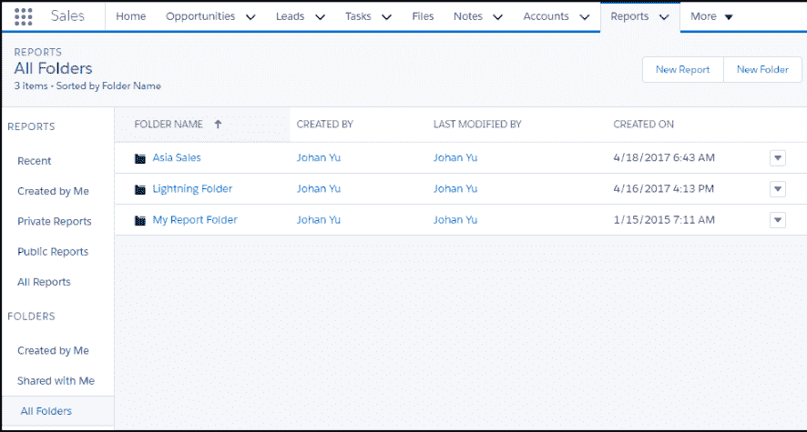

**文件夹**下有三个菜单：

- **我创建的**：这将列出你创建的所有报告文件夹
- **与我共享的**：这将列出由其他人创建但与你共享的所有报告文件夹
- **所有文件夹**：这将列出你有权访问的所有报告文件夹，无论是由你自己还是其他人创建的

当你选择这里的任意菜单时，右侧面板将根据左侧选择的菜单列出所有报告文件夹。这里有四个列和一个操作列。这些列分别为**文件夹名称**、**创建者**、**最后修改者**、**创建时间**，以及一个用于操作下拉菜单的箭头图标。

点击文件夹行最后一列中的箭头；如果用户有权删除该文件夹，则会显示**删除**菜单。对于具有删除文件夹权限的用户，用户可以从此处删除报告文件夹，但只能删除其中没有任何报告的文件夹；否则，用户将收到错误消息。

你还可以通过将鼠标悬停在标题上并单击列标题来按任意列对列表排序。单击一次按升序排序，再次单击按降序排序。

## 收藏图标

在屏幕右上角、**全局操作**（**+**图标）之前，可以看到星形图标及其旁边的箭头。星形图标用于添加到收藏夹，而它旁边的箭头用于打开已添加到收藏夹的项目。收藏夹让你可以快速访问 Salesforce 中的重要记录、列表、组、仪表板以及其他常用页面，包括报告。

收藏夹类似于 Web 浏览器中的书签，但更好，因为无论你使用哪种设备或浏览器登录 Lightning Experience，你的收藏夹都可用。因此，每个用户都有自己的收藏夹列表。

## 动手练习：将项目添加到收藏夹

让我们考虑一个用例：因为你总是处理报告，尤其是名为**Opty by Stage (2016 H1)**的报告，请将报告选项卡和该报告添加为**收藏**。

你可以按照以下步骤将**报告**选项卡添加为收藏项目：

- 1. 单击**报告**选项卡。
- 2. 单击星形图标。
- 3. 系统将弹出“**报告**”已添加到你的收藏夹消息。请看以下截图：
- 4. 添加后，通过单击收藏图标中星形旁边的箭头来确认它已添加。请参考以下截图：

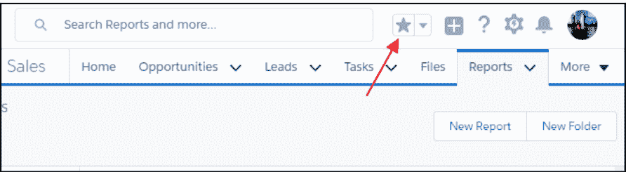

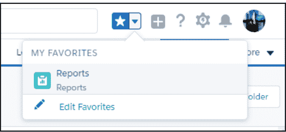

- 5. 现在你应该会在**我的收藏**下看到带有报告图标的**报告**。
- 6. 如果你从这里单击**报告**，就相当于你单击**报告**选项卡。
- 7. 你可以通过单击**编辑收藏**链接来重命名或删除它。

你不仅可以将**报告**选项卡添加为收藏，还可以将单个报告添加为收藏。让我们按照以下步骤操作：

- 1. 打开一个现有报告。在我的示例中，我将打开一个名为**Opty by Stage (2016 H1)**的报告。
- 2. 单击星形图标。
- 3. 系统将弹出“**Opty by Stage (2016 H1)**”已添加到你的**收藏**消息。
- 4. 单击收藏图标中星形旁边的箭头，你应该会看到**Opty by Stage (2016 H1)**已添加到**我的收藏**，如下截图所示：

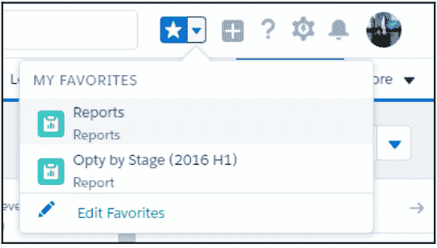

一旦**报告**被添加到收藏夹，它也会列在**报告**选项卡的**我的收藏**下。不要单击**报告**选项卡，而是单击**报告**选项卡旁边的箭头，以在**我的收藏**和**最近记录**中显示最近打开的报告。请看以下截图：

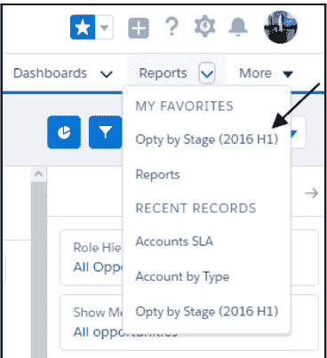

此步骤可应用于**仪表板**、**客户**或任何其他记录和选项卡。添加到收藏夹的项目也将在对象选项卡中显示为**我的收藏**。如下截图所示：

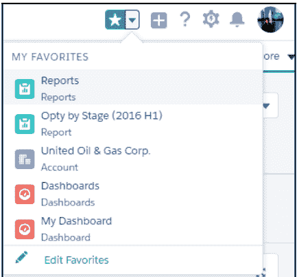

但如果你按 *Enter* 键或单击放大镜，系统将在搜索结果页面上显示所有结果，如下截图所示：

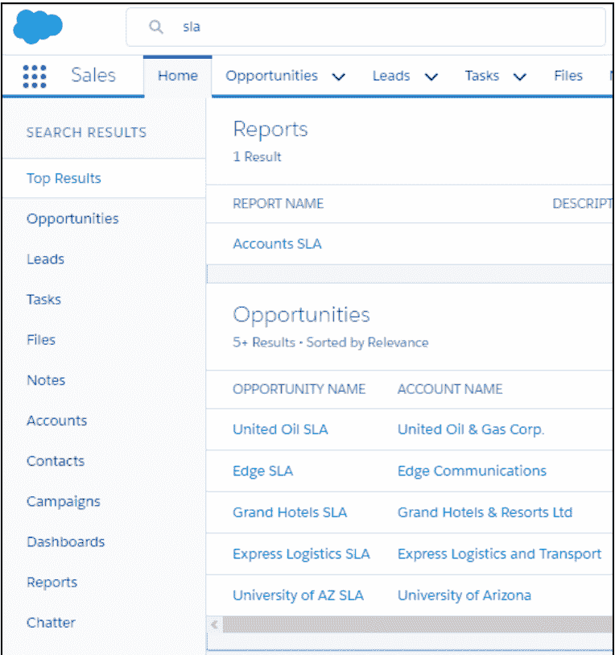

- 6. **图表：** 单击此按钮可在报告中添加、隐藏或更改图表。我们在*第7章，在报告和页面中添加图表*中深入讨论了图表。
- 7. **筛选：** 单击该图标可隐藏或显示筛选面板，如上图中的编号 7 所示。
- 8. **协作：** 仅当启用了报告的**Chatter 动态跟踪**时，此选项才可见。我们将在*第11章，报告和仪表板的高级技巧与提示*中讨论用于协作的**Chatter 动态跟踪**。
- 9. **刷新：** 单击该图标可刷新报告中显示的数据，如上图中的编号 9 所示。
- 10. **设置：** 用于显示/隐藏报告结果，此处可用的选项将取决于报告格式。
- 11. **操作按钮：** 如果用户对该报告拥有多个打开权限，则按钮旁边会出现一个箭头，此按钮将包括**编辑**、**克隆**、**保存**、**订阅**、**导出**和**删除**。

## 汇总字段

当你的报告配置了汇总字段，并且启用了**总计**（位于**设置**下）时，所有汇总字段将显示在报告标题旁边：

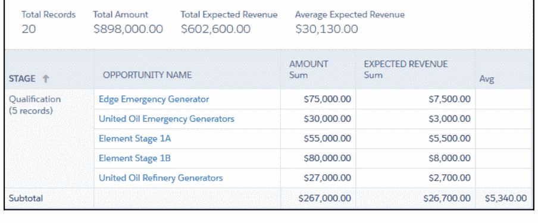

前面的截图显示，**金额**以**求和**汇总，而**预期收入**以**求和**和**平均值**汇总；这适用于所有格式的报告。

## 筛选器

要隐藏右侧的筛选器面板，只需单击面板右上角的箭头或单击筛选器图标；再次切换即可恢复筛选器面板。

在 Lightning 中，所有有权运行报告的用户都可以更改默认筛选器，例如**显示方式**、日期范围以及所有未锁定的附加筛选器，即使是没有权限创建和自定义报告的用户也可以。

让我们通过下面的截图来讨论这一点：

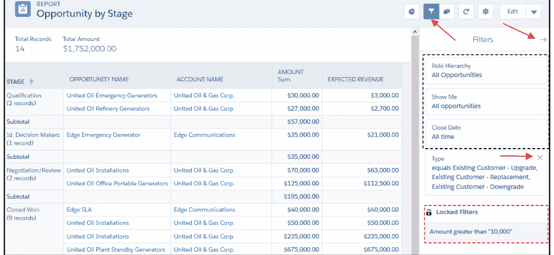

此报告**按阶段的商机**是一种**商机**报告类型。对于报告类型为**商机**的报告，您会看到一个额外的默认筛选器**角色层级**，而其他报告类型则没有，它们只有**显示方式**和**日期**筛选器。用户可以在运行报告时更改筛选器。无需编辑报告；只需单击筛选器名称即可修改筛选器值。

以下默认筛选器是报告创建者添加的附加筛选器；创建者可以留给用户更改筛选器值，也可以锁定筛选器。前面报告中的“类型”字段未锁定，因此运行用户可以更改或移除该筛选器，点击筛选器进行编辑，或点击该筛选器中的叉号图标来移除筛选器。下面的截图显示了添加到报告中的所有筛选器，包括已锁定的筛选器：

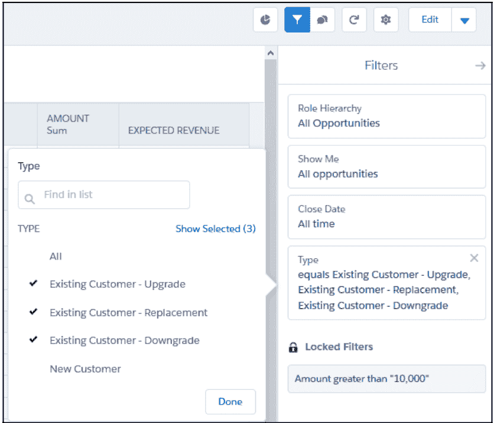

下一个筛选器“金额”已锁定，因此用户将无法删除它。这里的所有更改都不会被保存，也不会影响其他用户，除非该用户具有编辑权限并从操作按钮点击“保存”。

## “协作”字段

如果启用了**报告的 Chatter 动态跟踪**，那么所有能够打开报告的用户都可以看到此图标。要启用此功能，请导航到**设置 | 功能设置 | 动态跟踪**，在左侧面板中找到**报告**并勾选**启用动态跟踪**。

默认情况下，它将具有**帖子**和**投票**用于协作。其他所有 **Chatter** 帖子也是如此；您可以使用 @ 后接用户名来提及他人。其他用户可以**点赞**、**评论**和**收藏**该帖子，而对于在 **Chatter** 动态中发帖的用户，该用户还可以**删除**和**编辑**该帖子。

## 报告设置

对于**矩阵**和**汇总**报告，用户可以选择显示或隐藏--**详细信息**、**小计**、**总计**和**记录数**。考虑下面的截图：

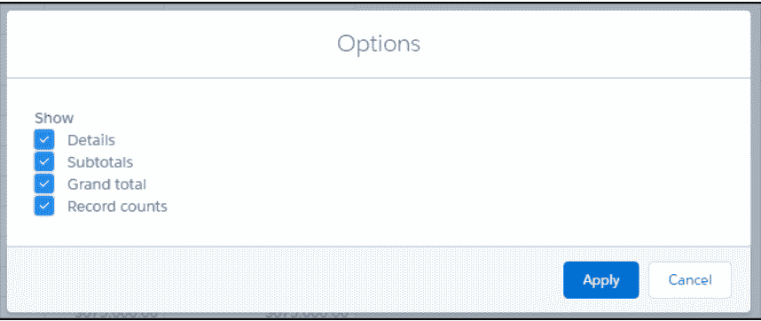

对于**表格式**报告，选项仅限于显示或隐藏**详细信息**和**总计**。考虑下面的截图：

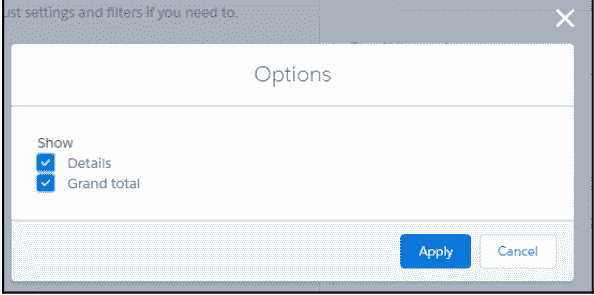

在**汇总**和**矩阵**报告中隐藏**记录数**时，它也会在顶部被隐藏。隐藏**总计**将同时隐藏报告底部以及顶部标题下方的值。**小计**仅适用于**汇总**和**矩阵**报告，这完全合理，因为**表格式**报告中没有小计。

## 操作按钮

以下是在已打开报告中可以执行的完整操作。考虑下面的截图：

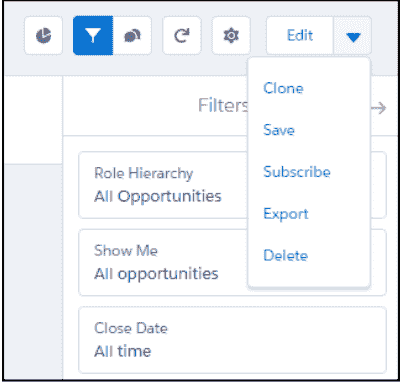

根据用户权限，用户将看到不同的操作；让我们简要解释每个可用的操作：

- **编辑**：用于在报告构建器中编辑报告
- **克隆**：用于克隆到新报告；您可以选择将其存储为私人报告、设为公开或存储到特定文件夹
- **保存**：保存报告及所做的任何更改，例如添加图表
- **订阅**：按计划订阅报告以通过电子邮件递送；我们将在下一节讨论
- **导出**：用于将报告导出为逗号分隔的 `.csv` 或 Excel 格式 `.xls`
- **删除**：已删除的报告将在回收站中保留 15 天，并可在此期间恢复

## 订阅报告

在 Lightning Experience 中，您可以订阅最多五个报告，并按照您设定的计划（每日、每周或每月）通过电子邮件接收刷新后的报告结果。

要订阅报告，您需要从**配置文件**或**权限集**获得**订阅报告**权限。除此之外，还有两个与此相关的附加权限：

- **订阅报告：添加收件人**
- **订阅报告：设置运行用户**

这些权限需要启用**订阅报告**权限。

这是当您订阅报告时发送给您的电子邮件示例；您可以点击报告标题直接在 Salesforce 中打开报告，或点击记录名称（如账户名称或商机名称）在 Salesforce 中打开报告：

# 按阶段的商机

截至 5/8/17 晚上 11:00 · 查看者：Johan Yu · 报告订阅由 Johan Yu 启动

所有商机 关闭日期：自定义 金额大于“10,000” 类型等于“现有客户 - 升级”、“现有客户 - 替换”、“现有客户 - 降级”

总记录数 总金额
14 $1,752,000.00

| 阶段 | 商机名称 | 账户名称 | 金额求和 | 预期收入 |
| 资格确认（2 条记录） | United Oil Emergency Generators | United Oil & Gas Corp. | $30,000.00 | $3,000.00 |
|  | United Oil Refinery Generators | United Oil & Gas Corp. | $27,000.00 | $2,700.00 |
|  |  |  | $57,000.00 |  |
| 识别决策者（1 条记录） | Edge Emergency Generator | Edge Communications | $35,000.00 | $21,000.00 |
|  |  |  | $35,000.00 |  |
| 谈判/审核（2 条记录） | United Oil Installations | United Oil & Gas Corp. | $70,000.00 | $63,000.00 |
|  | United Oil Office Portable Generators | United Oil & Gas Corp. | $125,000.00 | $112,500.00 |
|  |  |  | $195,000.00 |  |
| 已赢单（9 条记录） | Edge SLA | Edge Communications | $40,000.00 | $40,000.00 |
|  | United Oil Installations | United Oil & Gas Corp. | $50,000.00 | $50,000.00 |
|  | United Oil Installations | United Oil & Gas Corp. | $235,000.00 | $235,000.00 |
|  | United Oil Plant Standby Generators | United Oil & Gas Corp. | $675,000.00 | $675,000.00 |
|  | United Oil SLA | United Oil & Gas Corp. | $120,000.00 | $120,000.00 |
|  | United Oil Standby Generators | United Oil & Gas Corp. | $120,000.00 | $120,000.00 |
|  | Edge Installation | Edge Communications | $50,000.00 | $50,000.00 |
|  | Project Motor Links in Kentica | Burlington Textiles Corp of America | $75,000.00 | $75,000.00 |
|  | Project Motor Head | Burlington Textiles Corp of America | $100,000.00 | $100,000.00 |
|  |  |  | $1,465,000.00 |  |
| 总计（14 条记录） |  |  | $1,752,000.00 |  |

6. 您和 Alvin Lee 将在每周一早上收到附有报告的电子邮件。考虑下面的截图：

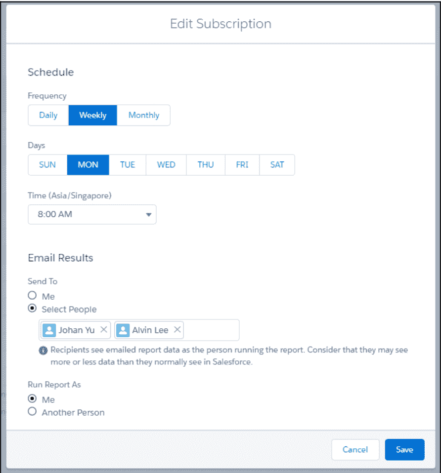
