## 在 Lightning Experience 中构建仪表板

仪表板提供一目了然的数据可视化。受众将能够在图形布局中看到数据摘要，包括图表、矩阵和表格。

在 Salesforce 中，仪表板是最有趣的功能之一。它由许多组件组成。它允许您在宽阔的空白画布上展示多个组件，让受众可以轻松比较每个组件；例如，西部区域与东部区域之间的销售额、将上个月销售额与两个月前销售额进行比较，等等。

在本章中，我们将详细讨论 Lightning 仪表板，并介绍**仪表板**选项卡，以及围绕仪表板视图的导航、仪表板构建器、仪表板组件和支持每个组件的数据源。

仪表板的工作方式与报告不同。报告显示当前数据，而仪表板显示其上次刷新时数据的快照。

到本章结束时，您将全面掌握 Lightning 中 Salesforce 仪表板的实用知识，从创建仪表板到安排仪表板刷新；这包括通过电子邮件发送刷新后仪表板的计划。

在本章中，我们将提供一些注释和提示，帮助您理解重要内容。将涵盖以下主题：

- 打开和搜索仪表盘
- 浏览仪表盘
- 仪表盘构建器
- 仪表盘刷新
- 仪表盘组件

# Salesforce 中的仪表盘简介

仪表盘是一种可视化数据，可根据报表中的条件、运行用户以及可选的仪表盘筛选器显示关键指标。一个强大的仪表盘会使用多个通常具有共同主题的报表，例如全球销售、客户支持等等。仪表盘将存储在 Salesforce 中的数据可视化，帮助您识别趋势、整理数量并衡量其活动的影响。

# 构建组件

仪表盘通常由许多仪表盘组件构建而成。我们可以在一个仪表盘中混合使用不同类型的图表或表格组件。每个仪表盘组件始终需要一个报表作为数据源。但是，我们可以在同一个仪表盘中将同一个报表用作多个组件的数据源（例如，在条形图和饼图中使用同一个报表），也可以在多个不同的仪表盘中使用它。

# 仪表盘的可访问性

与报表类似，仪表盘也存储在文件夹中，但这些文件夹是不同类型的文件夹。文件夹控制谁可以访问仪表盘，而不是仪表盘本身。如果您有权访问仪表盘文件夹，则可以查看该文件夹中的所有仪表盘。由于仪表盘是建立在组件之上的，而每个组件都需要一个报表作为数据源，因此仪表盘运行用户也需要具有对该报表的访问权限。

## 运行用户

与报表不同，每个仪表盘都定义了一个运行用户，该用户将使用安全设置来确定仪表盘中显示的数据。如果运行用户是一个特定用户，则所有仪表盘查看者都将看到基于该用户（包括数据安全和层级）的仪表盘数据。因此，当您创建报表时，需要为仪表盘选择正确的运行用户，以显示正确的数据。例如，将**国家经理**设置为某个国家销售业绩仪表盘的运行用户；这将允许所有用户查看该国家的整体销售业绩。当您为团队构建业绩排行榜时，所有用户将看到相同的数据，因此请确保将仪表盘查看者设置为**国家经理**。

## 动态仪表盘

动态仪表盘与前面介绍的标准仪表盘完全不同。使用动态仪表盘时，仪表盘中显示的数据将遵循运行用户的可见性，而运行用户始终是当前登录用户。这样，每个用户都可以根据自己的访问级别查看仪表盘。我们将在*第10章“学习高级仪表盘配置”*中详细介绍动态仪表盘。

具有特定权限的用户在运行仪表盘时将能够更改运行用户；但前提是动态仪表盘已配置为允许这样做。这对于高层管理人员通过更改运行用户来分析数据非常有用，并且无需更改仪表盘或报表筛选器。

# 新体验

如果您从 Classic 切换过来，Salesforce 必须在 Lightning 中重新设计整个仪表盘体验，但使用 Classic 构建的现有仪表盘可以在 Lightning 中正常工作，无需迁移或重新配置。Lightning Experience 引入了新的仪表盘构建器，并提供了创建不同大小组件的灵活性：

- **灵活的仪表盘组件大小：**您可以拖动仪表盘组件的边角或边缘来调整其大小。组件的大小可以是从一列一行到您想要的任意大小。当您调整组件大小时，图表和所有其他项目（如图例）都会自动调整大小。您可以通过单击铅笔图标来配置图表，从图表类型、图表标题、图表坐标轴等开始。请参考以下截图：

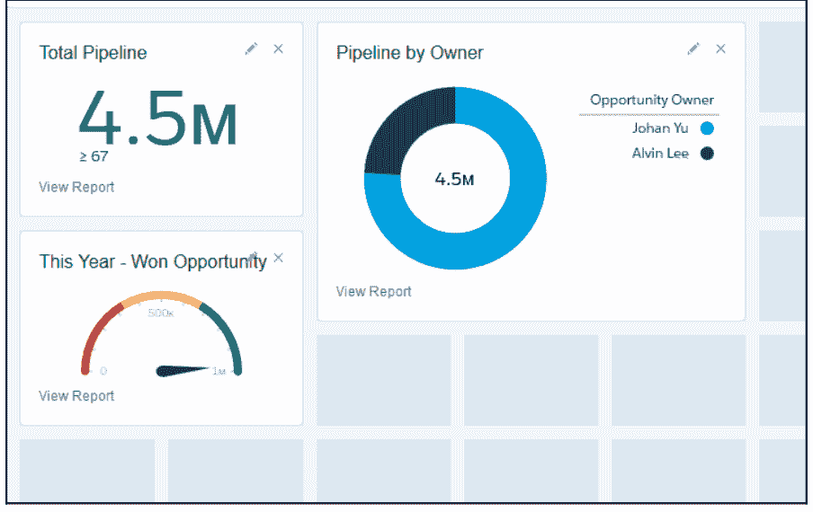

- **拖放仪表盘组件：**您可以通过拖放组件来排列仪表盘组件的位置。请参考以下截图：

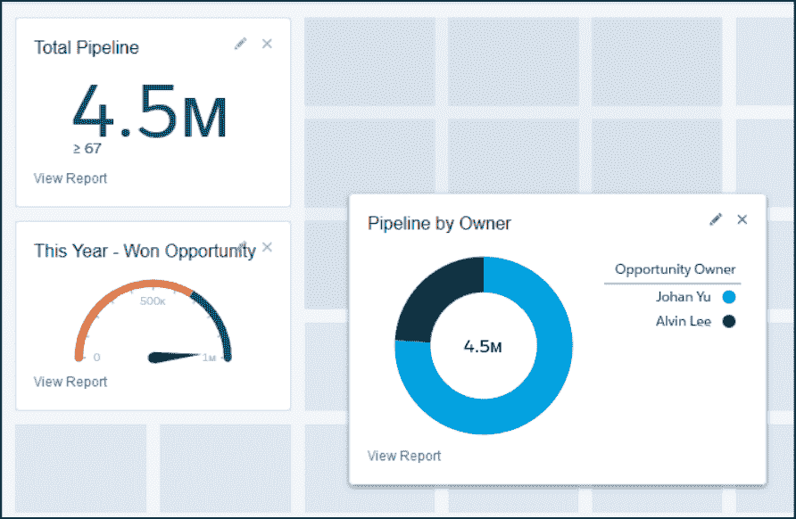

- **超过三列的仪表盘：**在 Lightning Experience 中，仪表盘最多可以有九列，而在 Classic 中，我们最多只有三列。

# 打开仪表盘

如果您拥有**运行报表**权限，您将能够从**仪表盘**选项卡、搜索结果或收藏图标查看您有权访问的仪表盘。与报表类似，仪表盘的可访问性由存储该仪表盘的文件夹控制。

在仪表盘选项卡中，如果您拥有“创建和自定义仪表盘”权限，则可以通过单击“新建仪表盘”按钮来创建新仪表盘，或者编辑存储在您具有编辑权限的文件夹中的现有仪表盘。有关仪表盘权限以及用于存储仪表盘的仪表盘文件夹的完整参考，请参阅第2章“报表和仪表盘中的概念与权限”和第3章“在报表和仪表盘中实施安全性”。

让我们开始在 Salesforce Lightning 中打开仪表盘；请记住，仪表盘存储在仪表盘文件夹中，可以是私有文件夹或公共文件夹。私有报告仅对将仪表盘保存在“私有仪表盘”文件夹中的用户可见；我们已经在第2章“报表和仪表盘中的概念与权限”中详细讨论过这一点，因此这里不再重复。

在 Salesforce Lightning 中有多种方式可以打开仪表盘。首先，单击“仪表盘”选项卡。

# “仪表盘”选项卡

下面是单击“仪表盘”选项卡后所截取的截图；让我们来逐一了解这里的所有组成部分：

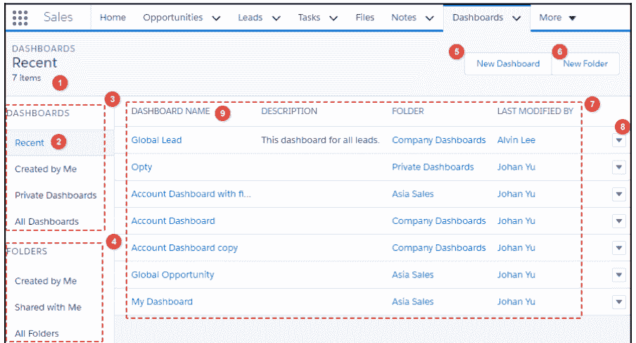

1. **标题（以1标示）：** 这里会显示所选菜单、该文件夹中的项目数量，以及仪表盘列表是否按某列排序的信息（如果有）。
2. **最近使用（2）：** 当您单击**仪表盘**选项卡时，默认会显示您最近打开的仪表盘列表。
3. **仪表盘菜单（3）：** 仪表盘区域中有四个菜单。
4. **文件夹菜单（4）：** 文件夹区域中有三个菜单。
5. **新建仪表盘按钮（5）：** 单击此按钮可创建新的仪表盘；仅当您具有创建和自定义仪表盘的权限时，此按钮才可见。
6. **新建文件夹按钮（6）：** 单击此按钮可为仪表盘创建新的文件夹；仅当您具有创建仪表盘文件夹的权限时，此按钮才可见。
7. **仪表盘或文件夹区域（7）：** 这里显示的是仪表盘或文件夹的列表，具体取决于左侧选中的菜单。
8. **操作按钮（8）：** 通过这里，您可以查看（与单击仪表盘名称相同）、编辑或删除仪表盘，或者删除文件夹。菜单的可见性取决于用户权限。
9. **排序（9）：** 您可以通过单击表头，以升序或降序对仪表盘或文件夹列表进行排序。

与 Lightning 中的**报表**选项卡或其他对象选项卡类似，如果您单击**仪表盘**选项卡旁边的箭头，它将显示您已添加到收藏夹的仪表盘以及最近打开的仪表盘列表。将仪表盘添加到收藏夹与将报表或其他记录添加到收藏夹类似；请参阅第8章*使用报表*。以下截图显示了当您单击**仪表盘**选项卡旁边的箭头图标时弹出的**仪表盘**选项卡菜单，包括**我的收藏**和**最近使用记录**：

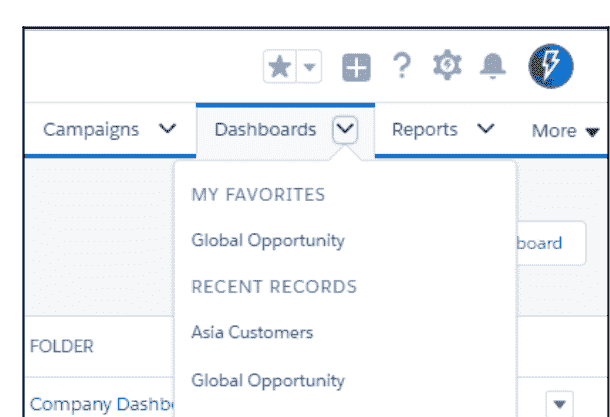

# 仪表盘菜单

单击**仪表盘**选项卡后，您将看到两个主面板：左侧面板和右侧面板。左侧面板包含**仪表盘**和**文件夹**菜单的分类，右侧面板将显示与左侧面板中所选菜单相关的仪表盘或文件夹列表。如下截图所示：

当您在此处选择任何菜单时，右侧面板将列出基于左侧所选菜单的所有仪表板。该面板将有四列和一列操作列：DASHBOARD NAME、DESCRIPTION、FOLDER、LAST MODIFIED BY，以及操作下拉菜单的箭头图标。您将能够按 DASHBOARD NAME、FOLDER 和 LAST MODIFIED BY 对列表进行排序。

对于每份报告最后一列中的操作菜单，菜单的可见性将取决于用户权限：

- **View**：这与单击报告名称以查看仪表板相同。
- **Edit**：只有当用户能够编辑仪表板时，此选项才会可见。
- **Delete**：只有当用户根据文件夹中的用户访问权限能够删除报告时，此选项才会可见。用户将能够删除其个人文件夹中的仪表板。

## The FOLDERS menu

与 DASHBOARDS 的排列方式相同，您将在 FOLDERS 下找到几个菜单：

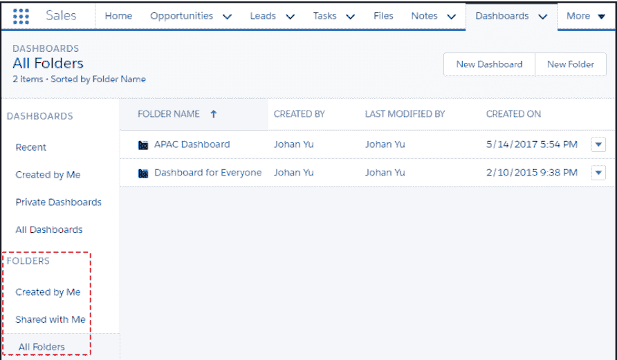

**FOLDERS** 下有三个菜单：

- 1. **Created by Me**：这将列出您创建的所有仪表板文件夹。
- 2. **Shared with Me**：这将列出由其他人创建但与您共享的所有仪表板文件夹。
- 3. **All Folders**：这将列出您有权访问的所有仪表板文件夹，无论是由您自己创建还是由其他人创建。

当您在此处选择任何菜单时，右侧面板将列出基于左侧所选菜单的所有报告文件夹。将有四列和一列操作列。列将为 **FOLDER NAME**、**CREATED BY**、**LAST MODIFIED BY**、**CREATED ON**，以及操作下拉菜单的箭头图标。

单击文件夹行最后一列中的箭头将显示 **Delete** 菜单，前提是用户具有删除文件夹的权限。对于有权删除仪表板文件夹的用户，用户可以从此处删除仪表板文件夹，但仅限于该文件夹中没有任何仪表板的文件夹；否则，用户将收到错误消息。

您还可以通过将鼠标悬停在标题上并单击列标题来按任意列对列表进行排序。单击一次按升序排序，再次单击按降序排序。

## The favorites icon

到目前为止，您应该已经熟悉收藏夹图标；简单回顾一下，您可以将任何记录，包括报告和仪表板添加为个人收藏。只需在报告或仪表板打开时单击星形图标即可；您可以在 **Account**、**Opportunities** 或任何其他记录上执行此操作。

添加后，您可以从 Lightning 环境中的任何位置轻松访问记录、报告和仪表板，因为它位于顶部区域并且始终可见。请考虑以下屏幕截图：

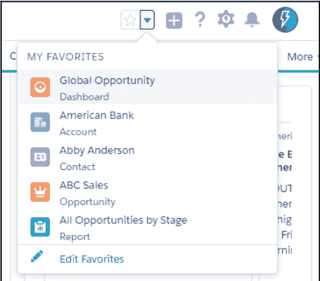

## The search textbox

与报告或任何其他记录类似，您可以从全局搜索文本框搜索仪表板；只需输入完整的仪表板名称或部分名称，如果您不记得完整的仪表板名称。

请确保在搜索仪表板时您不在 SETUP 菜单中；否则它将不会搜索任何记录，而只会搜索 SETUP 菜单中的元数据，例如用户、配置文件、对象等。请参阅以下屏幕截图：

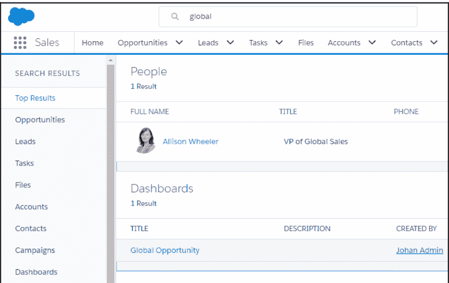

## Navigating to a dashboard

交互式仪表板组件为查看者提供更多信息和指向数据供应报告的链接。让我们看一下仪表板中的所有项目：

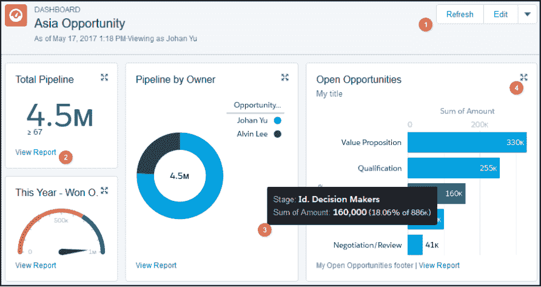

- 1. **Refresh, Edit, Clone, New Dashboard, or Delete：** 每个仪表板顶部的按钮和下拉菜单可一键访问管理任务。
- 2. **View Report** underlying a component：您想获取指标或图表背后的数据吗？单击 **View Report** 以深入了解数据。
- 3. **Hover over charts to get more information：** 将鼠标悬停在图表段上会显示有关图表的更多信息。
- 4. **Expand dashboard components to get the big picture：** 单击展开图标即可查看组件的较大版本，然后继续使用 **View Report** 按钮深入了解数据。

## Dragging and dropping in the Dashboard Builder

**Dashboard Builder** 是一个拖放界面，用于创建和修改仪表板。您可以使用它来自定义整个仪表板、仪表板中的一列或仪表板中的一个组件。

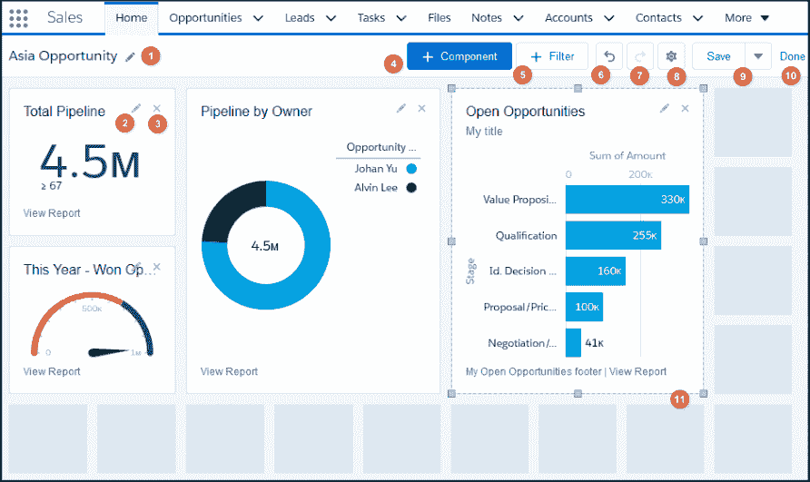

让我们根据前面的屏幕截图介绍 Dashboard Builder 中的所有项目：

- 1. **Editing the dashboard title (denoted by 1)：** 您可以从铅笔图标轻松更改仪表板标题。
- 2. **Editing the components (2)：** 单击此铅笔图标可更改组件类型、排序、显示的最大值、标题、副标题和页脚。
- 3. **The Delete component (3)：** 单击此叉号图标可删除组件。
- 4. **The add + Component button (4)：** 单击此按钮可在仪表板中添加新组件。
- 5. **The add + Filter button (5)：** 单击此按钮可为整个仪表板添加筛选器。
- 6. **The undo button (6)：** 单击此按钮可撤消已更改但尚未保存的项目。
- 7. **The redo button (7)：** 单击此按钮可重做项目。
- 8. **The edit properties button (8)：** 单击此按钮可编辑仪表板属性：标题、描述、文件夹、View Dashboard as 和启用 Dynamic Dashboard。
- 9. **The Save, Save As, and Delete buttons (9)：** **Save** 按钮保存并覆盖现有仪表板，**Save As** 按钮将仪表板另存为新仪表板，**Delete** 按钮删除仪表板。

已删除的仪表板可在 15 天内从回收站恢复，但在 Summer '17 版本中，回收站尚不存在于 Lightning Experience 中，因此您需要切换到 Classic 才能恢复删除。

- 10. **The Done button (10)：** 单击此按钮可关闭仪表板编辑器：如果您尚未保存所做的更改，系统将提示您保存或丢弃更改。
- 11. **Resize and move (11)：** 拖动组件角落可调整组件大小，或按住组件可移动它。

## Refreshing dashboards

仪表板与报告不同。当您打开报告时，报告数据将根据当前数据生成。另一方面，对于仪表板，当您打开仪表板时，它将显示截至最新仪表板刷新时的数据，无论是由任何用户还是按计划刷新。

所有能够查看仪表板的用户都可以通过在打开仪表板后简单单击 **Refresh** 按钮来刷新仪表板。即使用户没有权限编辑仪表板，也能够刷新仪表板。刷新后，其他用户看到的仪表板将基于最新刷新数据。

请注意，在以下屏幕截图中，仪表板标题下方的信息将向我们显示用于仪表板的数据，这与最新的仪表板刷新相同：

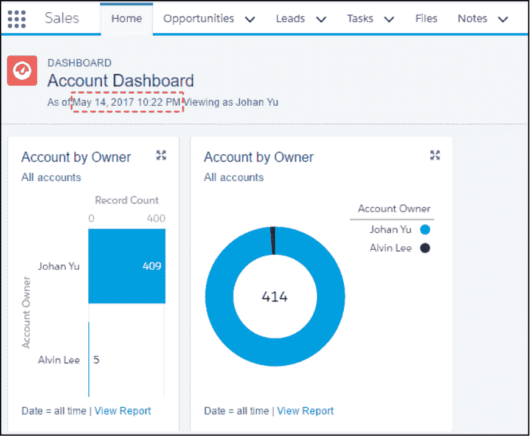

但如果仪表板在 24 小时内未被刷新，它会通过带有感叹号图标的有用警告消息通知您，如以下屏幕截图所示：

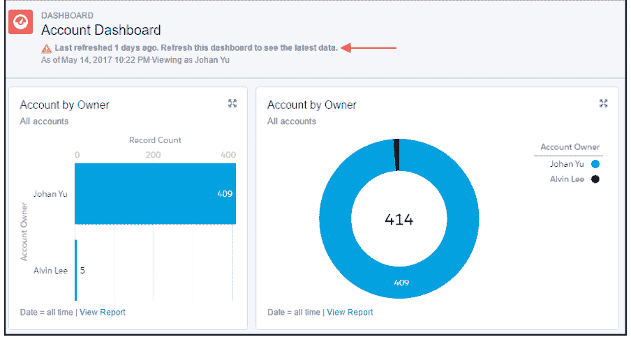

如果您从 Classic 切换到 Lightning，并且拥有由您的供应商或顾问开发的 Visualforce 组件，则 Visualforce 组件在 Lightning 中不再受支持。这将导致您无法刷新仪表板。为了解决此问题，请删除 Visualforce 组件，您应该能够在 Lightning Experience 中刷新仪表板。

## Scheduling a dashboard refresh

这是让系统按计划自动刷新仪表板的非常有用的功能。您还可以配置系统将仪表板通过电子邮件发送给您和您的团队。不幸的是，此功能在 Summer '17 版本之前在 Lightning 中不可用，因此您需要切换到 Classic 来配置此功能。

要计划仪表板刷新，请执行以下步骤：

- 1. 从 Classic 中打开仪表板。
- 2. 单击 **刷新** 按钮附近的箭头。此选项不适用于 Salesforce 免费版。
- 3. 单击 **计划刷新...**。请参阅以下截图：

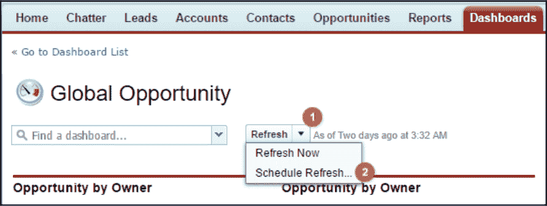

接下来，您需要配置以下内容：

- 4. **电子邮件仪表板：** 如果您（和您的团队）希望在仪表板自动刷新时收到包含仪表板的电子邮件，请使用此选项。
- 5. **频率：** 每日、每周、每月。
- 6. **开始日期** 和 **结束日期**。

7. 首选开始时间。请参阅以下截图：

## 计划仪表板刷新

此仪表板按您设置的计划刷新。要在刷新完成后发送电子邮件，请使用“电子邮件仪表板”选项。

运行用户 Johan Admin

电子邮件仪表板 发送给我 发送给其他人...

计划刷新

频率

- 每日
- 每周
- 每月

- 每个工作日
- 每天

开始 5/16/2017 [5/16/2017]

结束 6/16/2017 [5/16/2017]

首选开始时间 11:00 PM

确切的开始时间将取决于作业队列活动。

## 在 Lightning Experience 中构建仪表板

下面是一个按计划随仪表板刷新一起发送的电子邮件示例：

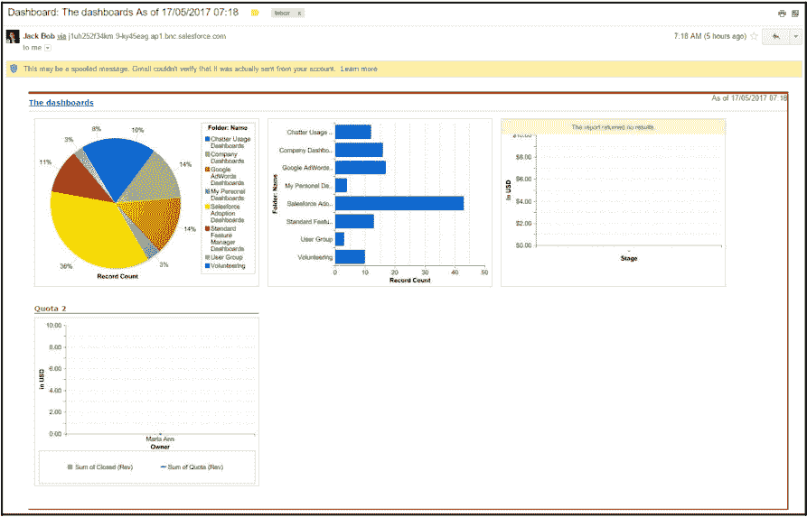

如果您从电子邮件中单击仪表板标题，它将在 Web 浏览器中打开仪表板，并且应显示与电子邮件中相同的数据和刷新日期时间：

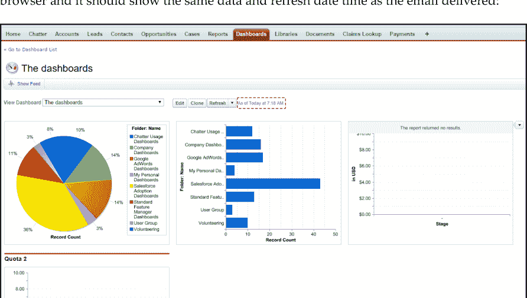

对于在 Lightning Experience 中创建的仪表板，您将无法在 Salesforce Classic 中编辑它 - 编辑按钮将不可见。在 Classic 中创建的仪表板也是如此；然后，您在 Lightning 中编辑并保存，之后您无法在 Classic 中再次编辑它。您应该考虑克隆仪表板并将其保存在 Lightning Experience 中。这样，您仍然可以在需要时在 Salesforce Classic 中编辑原始仪表板。

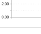

要检查是否所有仪表板都已计划自动刷新，请导航到 设置 | 监控 | 作业 | 计划作业（从 Classic 中），或 设置 | 环境 | 作业 | 计划作业（从 Lightning 中）。您可以从此处删除计划。

## 创建您的第一个仪表板

如果您从 Classic 切换到 Lightning，仪表板是最吸引人们切换到 Lightning 的功能之一。在 Classic 中，仪表板组件最多可以有三列，而在 Lightning 中，组件最多可以有九列，尽管仪表板的最大组件数保持不变，即 20。

我们在本章或前面的章节中已经讨论了许多与创建仪表板相关的主题，包括以下内容：

- 仪表板权限
- 仪表板文件夹和权限
- 打开和搜索仪表板
- 导航仪表板选项卡

那么，让我们开始创建一个仪表板。

## 创建仪表板的动手练习

让我们创建一个仪表板，其中一个组件以水平条形图显示每个销售代表的客户数量，但在此之前，我们需要为仪表板组件数据源创建一份报告。假设您拥有创建报告和仪表板所需的所有权限。

在 Lightning 中创建仪表板非常酷；您只需指向并单击即可构建仪表板。首先为仪表板选择一个有效的报告：

- 1. 导航到 **报告** 选项卡以创建新报告。
- 2. 报告是仪表板的基本要求，因为它将报告用作仪表板组件的数据源，所以让我们创建报告：
  - 1. 单击 **新建报告** 按钮。
  - 2. 通过单击 **客户和联系人** 类别来选择 **客户** 报告类型。
  - 3. 单击 **创建** 按钮继续。
  - 4. 在 **显示** 筛选器中选择 **所有客户**。
  - 5. 将 **创建日期范围** 更改为 **所有时间**。
  - 6. 将报告格式更改为 **摘要**。
  - 7. 删除所有列，并仅向报告添加 **客户名称**。
- 8. 将客户负责人拖到分组放置区域。
- 9. 导航到 显示 | 详细信息 以隐藏记录详细信息。
- 10. 将报告以名称“按所有者的客户”保存到“未归档的公共报告”文件夹。以下截图显示了创建的报告：

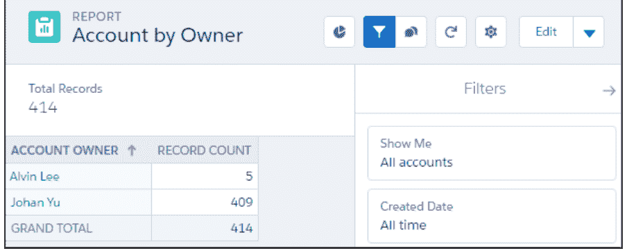

- 3. 导航到仪表板选项卡，并单击新建仪表板按钮。
- 4. 输入名称为“客户仪表板”。
- 5. 通过单击交叉图标从文件夹中删除“私人仪表板”，并选择一个公共文件夹；在我的情况下，我有一个名为“公司仪表板”的仪表板文件夹。
- 6. 单击 **创建** 按钮继续。
- 7. 现在您应该看到九列多行的矩阵。
- 8. 单击 **+ 组件** 按钮以开始添加仪表板组件。

11. 默认情况下，刚添加的组件将占据三列三行。您可以调整组件使其更小或更大；让我们将其更改为两列三行。保持默认组件标题不变，即报告标题。请参阅以下截图：

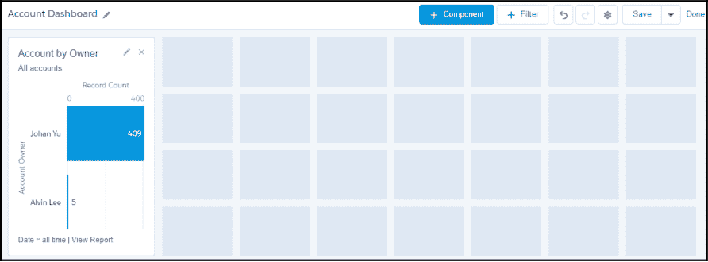

- 15. 单击 **保存** 按钮，然后点击 **完成** 按钮。
- 16. 这是我们的第一个仪表板：

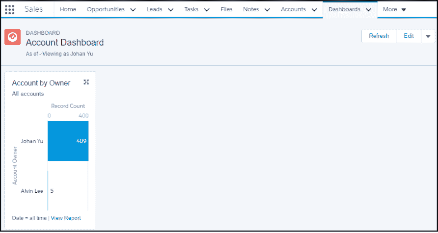

让我们继续添加另一个仪表板组件：

- 1. 单击 **编辑** 按钮。
- 2. 单击 **+ 组件** 按钮以添加另一个仪表板组件。
- 3. 选择之前创建的同一报告，**按所有者的客户**。
- 4. 现在选择 **环形** 图表。
- 5. 为 **副标题** 添加所有 `accounts`，为 **页脚** 添加 `Date = all time`。
- 6. 单击 **添加** 按钮。
- 7. 新组件将添加到现有组件下方；将其拖到现有组件的右侧，并保持大小为 3 x 3 的框。
- 8. 单击 **保存** 按钮，然后点击 **完成** 按钮；您将看到以下内容：

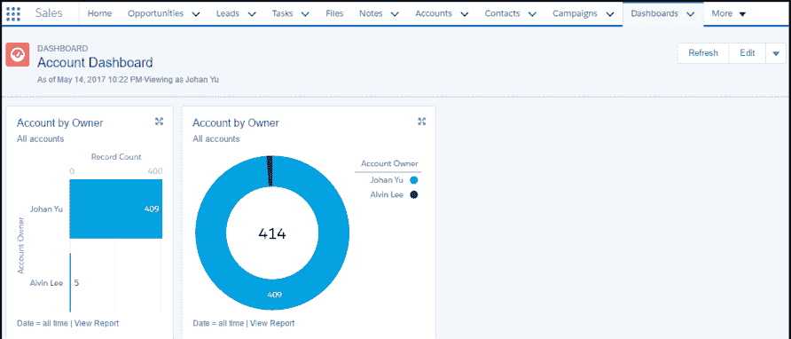

如果您将鼠标悬停在两个图表上，您将获得我们在报告中看到的详细信息。
让我们分析此仪表板：

- 单击图表或展开图标，以全屏查看图表。
- 注意 **查看报告** 链接；单击此链接将打开报告。
- 将鼠标悬停在图表上，您将获得有关该图表切片的更多信息。
- 在本练习中，我们证明了可以在同一仪表板中将同一报告用于多个组件，并且可以将其用于不同类型的图表。
- 请注意仪表板标题下方的 **截至 2017 年 5 月 14 日晚上 10:22 - 以 Johan Yu 身份查看。** 这意味着查看仪表板的其他用户将看到与用户 **Johan Yu** 相同的内容，数据刷新于 **2017 年 5 月 14 日晚上 10:22**。如果对象共享是私有的，用户将看到仪表板，其中包含的数据集是该用户没有可见性的。
- 仪表板与报告不同。当您打开报告时，它将显示当前数据，而对于仪表板，默认情况下，它将显示截至最新刷新的数据。其他用户将能够通过单击 **刷新** 按钮来刷新仪表板，即使是没有编辑仪表板权限的用户也可以。刷新后，其他用户将看到基于最新刷新数据的仪表板。
- 当其他用户单击 **查看报告** 时，他们将看到自己的数据（登录用户）；生成的报告不再与查看仪表板的用户相关；因此，数字可能与仪表板数据中的数字不同。

## 编辑和维护仪表板的动手练习

有两种方法可以编辑仪表板：

- 打开仪表板并单击 **编辑** 按钮，如下面的截图所示：

一旦进入 **Edit** 模式或 **Dashboard Builder**，您可以添加、删除或修改现有组件，与创建新仪表板时一样。您可以通过单击 **Save** 按钮旁箭头下的 **Save As** 链接，将修改后的仪表板保存为新仪表板，或者您也可以使用 **Save As** 下的 **Delete** 链接删除仪表板，如以下屏幕截图所示：

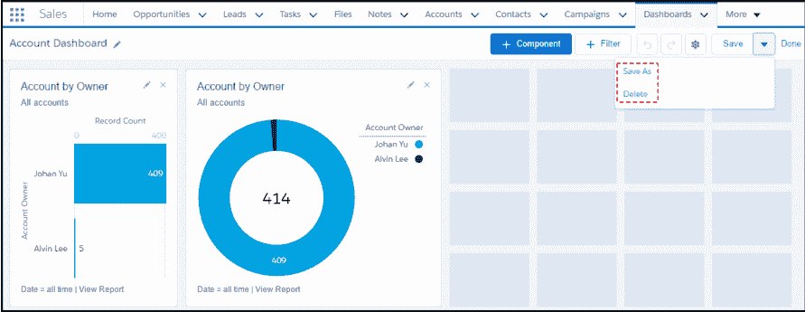

好的，让我们来看一个动手练习，编辑之前创建的仪表板，通过添加一个新组件然后将仪表板保存为新仪表板：

1. 打开 **Account Dashboard**。
2. 单击 **Edit** 按钮。
3. 单击第一个组件（最左侧）并将大小更改为四列三行。
4. 相应地将第二个组件移动到第一个组件的右侧。
5. 通过单击 **+ Component** 按钮添加新组件。
6. 选择相同的 **Account by Owner** 报表。
7. 选择 **Vertical Bar Chart**。
8. 将 **Sort Rows By** 更改为 **Value Ascending**。
9. 添加 **Subtitle** 为 `All accounts` 和 **Footer** 为 `Date = all time`。
10. 单击 **Add** 按钮。
11. 修改组件大小为两列三行并将其移动到第二个组件的右侧。
12. 单击 **Save** 按钮旁箭头下的 **Save As** 链接；如果单击 **Done** 按钮，系统会询问是否要保存或丢弃更改。
13. 输入名称为 `Account Dashboard copy`；将文件夹保留为现有文件夹。
14. 单击 **Create** 按钮。参考以下屏幕截图：

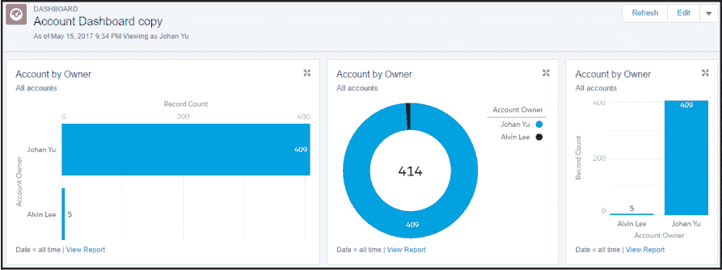

15. 现在我们不再处于编辑模式或仪表板构建器中；我们处于查看模式。请注意，右上角有几个按钮和链接：

- **Refresh:** 单击此按钮刷新仪表板数据。
- **Edit:** 单击此按钮编辑仪表板。
- **Clone:** 单击此链接克隆为新仪表板而无需编辑，并保存为新仪表板。
- **New Dashboard:** 单击此项可在无需返回 **Dashboards** 选项卡的情况下创建新仪表板。
- **Delete:** 单击此项可删除现有仪表板；被删除的仪表板将被移至回收站（截至 Summer '17 版本，您需要切换到 Classic 才能访问回收站）。

接下来，让我们将 **Account Dashboard copy** 仪表板从 **Company Dashboards** 文件夹移动到名为 **Asia Sales** 的文件夹：

1. 编辑仪表板。
2. 单击齿轮图标 **Edit Dashboard Properties** 按钮。
3. 单击现有文件夹，选择新文件夹，然后单击 **Save** 按钮关闭属性窗口。这在以下屏幕截图中显示：

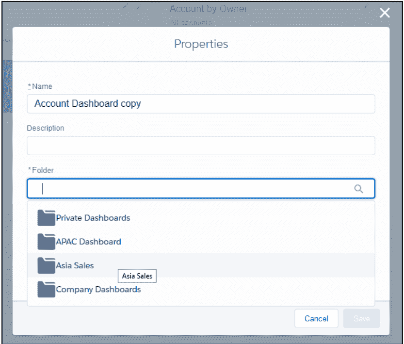

4. 再次单击 **Save** 按钮以保存仪表板的更改。
5. 现在仪表板应位于新文件夹中；您可以通过单击 Dashboards 选项卡进行双重检查，它应列在最近项目中。

## The dashboard components

如前所述，一个仪表板最多可包含 20 个组件，每个组件可以以图表、矩阵或表格的形式呈现。

构建仪表板主要有两个步骤：

1. 选择报表作为数据源。
2. 选择组件类型。

### Defining the dashboard components

在 Salesforce Lightning 中提供 11 种仪表板组件类型（截至 Summer '17 版本）：

- Horizontal Bar Chart
- Vertical Bar Chart
- Stacked Horizontal Bar Chart
- Stacked Vertical Bar Chart
- Line Chart
- Donut Chart
- Metric Chart
- Gauge Chart
- Funnel Chart
- Scatter Chart
- Table

以下屏幕截图中突出显示的区域显示了这些：

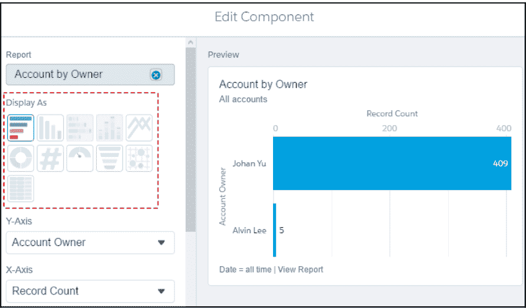

我们不会讨论所有组件类型，但让我们讨论其中几种。

### Tables

表格在以易于扫描的格式呈现信息方面很有用。图表可以让仪表板阅读者一目了然地获取信息，而表格则提供更多详细信息。将表格添加到您的仪表板以按摘要显示数据，如以下屏幕截图所示：

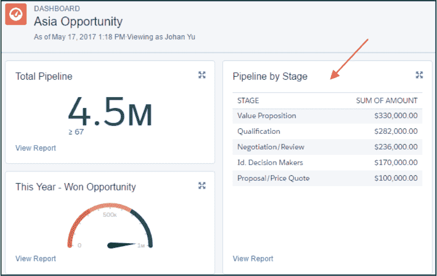

| STAGE | SUM OF AMOUNT |
|---|---:|
| Value Proposition | $330,000.00 |
| Qualification | $282,000.00 |
| Negotiation/Review | $236,000.00 |
| Id. Decision Makers | $170,000.00 |
| Proposal/Price Quote | $100,000.00 |

### Funnel charts

当您在有序集合中有多个分组并希望显示它们之间的比例时，使用漏斗图。漏斗图非常适合显示您的机会阶段。请考虑以下屏幕截图：

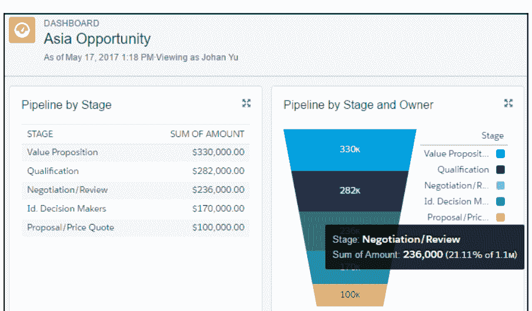

### Gauge charts

添加到 Lightning Experience 仪表板的仪表图默认显示百分比和总数。您可以手动设置每个区段范围的值，并且还可以更改图表颜色。请考虑以下屏幕截图：

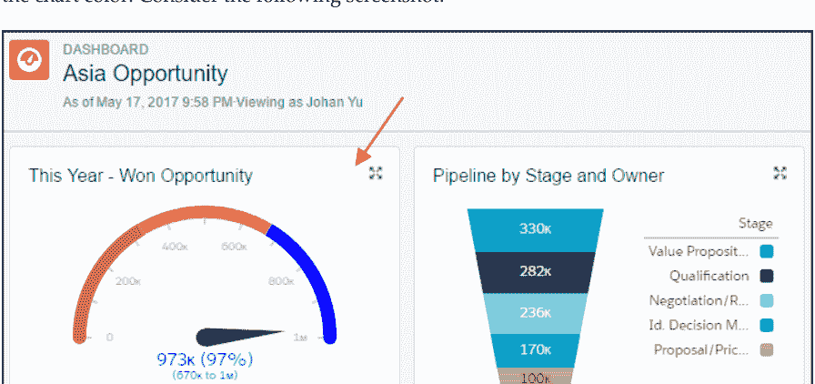

### Stacked Bar charts

堆叠条形图非常适合比较条形之间的绝对值。要使用堆叠条形图，报表必须至少有两个分组，并且其中一个分组必须是数字。

您可以将堆叠条形图配置为 100%；这使您可以比较每个条形的相对值。例如，堆叠条形图可让您比较销售代表之间的机会比例。

以下屏幕截图显示了两个堆叠条形图；右侧的堆叠条形图配置为 Stack to 100%：

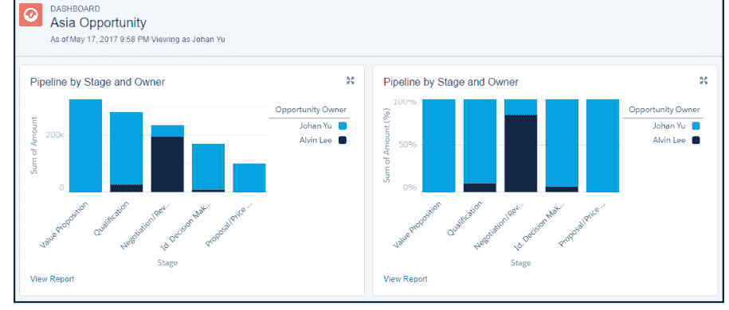

### Scatter charts

散点图可用于显示一个或两个报表数据组以及摘要。它们也适用于识别大型数据集中的趋势。要使用散点图，报表必须至少有两个汇总字段。散点图可以轻松显示机会的年龄与机会阶段。请考虑以下屏幕截图：

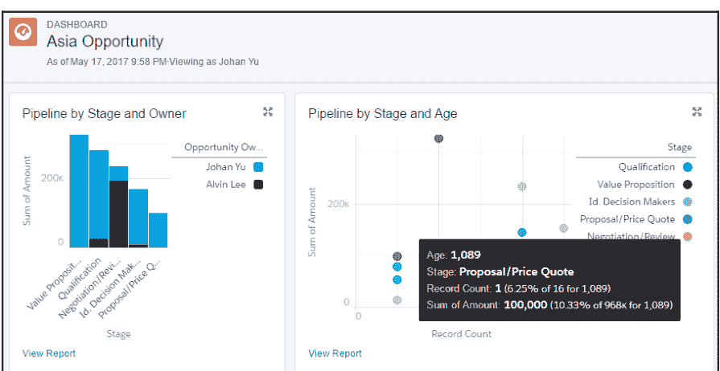

### Cumulative Line charts

与其使用普通折线图，您可以将折线图配置为累积折线图。您可以在累积报表上制作折线图，以突出显示每月已赢得的机会。请考虑以下屏幕截图：

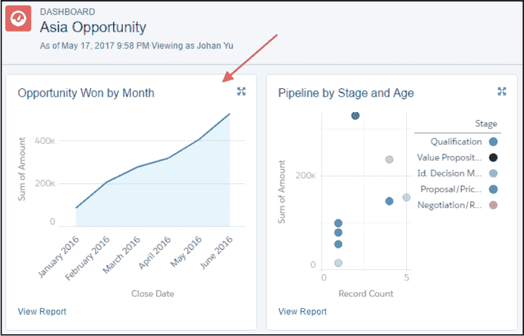

### Combination charts

组合图在单个图表上绘制两个或多个数据集，使图表 *multimetric*。例如，条形图显示每个月的管道 **Amount**，而 **Line Chart** 显示每个月的管道数量，并在右侧添加第二个 y 轴以进行额外测量。这在以下屏幕截图中显示：

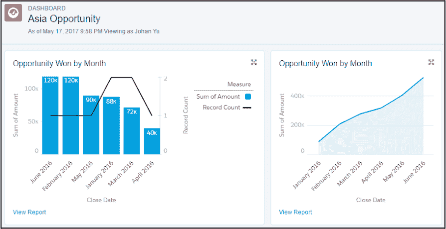

## Reports as a data source

Salesforce 为您提供灵活性，可使用任何已保存的报表作为组件的数据源。但是，使用保存在 **My Personal Custom Reports / Private Report** 文件夹中的报表的组件将不适用于其他用户，除非报表存储在查看用户的私有报表文件夹中，因为仪表板是作为私有报表文件夹所有者查看的。

您可以使用任何报表类型的报表作为数据源，但对于 **Tabular** 格式的报表，只有添加了 **Row Limit** 过滤器的 **Tabular** 报表才能用作数据源。请考虑以下屏幕截图：

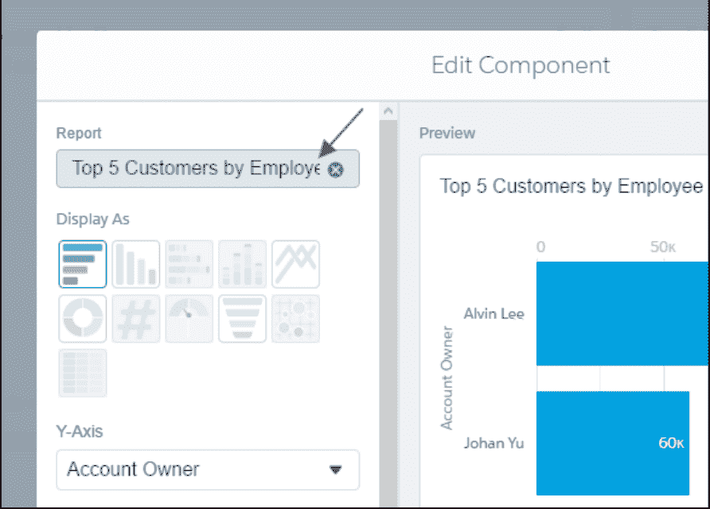

本节的要点是不要假设报表和仪表板中图表的类型和图表功能是相同的。它们看起来相似，但并不完全相同。

## Summary

在本章中，我们使用报表，包括打开报表、搜索报表以及将报表添加到收藏夹。我们还导航报表并讨论了运行报表时可用的每个组件。

当您单击 **Reports** 选项卡时，您将看到最近打开的报表。您可以单击标题以排序查找报表。 **REPORTS** 下有一个菜单。在 **REPORTS** 下将是 **FOLDERS** 类别，您可以在其中检查您创建的文件夹、与您共享的文件夹以及您有权访问的所有文件夹。

操作按钮在 Reports 选项卡中为每个报表提供，并且在打开报表后也可用，具体取决于用户一般权限和与特定报表相关的用户权限。

您还了解了订阅报表；要将报表交付到电子邮件，您需要具有订阅报表的权限，并且最多可以订阅五个报表。

在下一章中，我们将开始使用仪表板，其中报表充当仪表板组件的数据源。

