## 10 学习高级仪表板配置

在第9章“在Lightning Experience中构建仪表板”中，我们介绍了仪表板，从打开仪表板、导航到仪表板选项卡、导航到仪表板以及查看仪表板构建器中的项目开始。你学习了仪表板的基本结构，了解了它与报表的关系，以及仪表板如何在Salesforce平台上定义和存储。我们继续介绍了仪表板组件，它们是Salesforce仪表板的核心和灵魂。最后，我们从零开始创建了一个仪表板，然后通过仪表板过滤器对其进行了增强，并安排了仪表板的自动刷新。

在本章中，你将继续学习并使用Salesforce提供的开箱即用功能创建高级仪表板。我们将从仪表板过滤器开始，介绍如何实现它以及仪表板过滤器的其他用例。我们将继续探讨动态仪表板的概念，并研究从仪表板到报表保留过滤器的仪表板向下钻取。最后，我们将在AppExchange中查找可用的预构建仪表板，并进行动手练习来安装它。

本章将涵盖以下主题：

- 实现仪表板过滤器
- 使用动态仪表板
- 仪表板和报表的下钻
- 从AppExchange获取更多

### 实现仪表板过滤器

你是否曾经需要根据不同的条件来分析仪表板？例如，我们想查看当前年度、当前季度和当前月份的机会管道（pipeline）仪表板。

对于这个例子，创建三个仪表板没有问题，但由于仪表板的数据源是由报表驱动的，这意味着我们需要为每个仪表板创建三组报表，如果你的仪表板有10个组件，你将需要30个报表来支持。

因此，与其创建多个仪表板，不如合并起来，对用户来说只使用一个仪表板更容易，因为仪表板的所有组件都是相同的。另外，考虑一下维护30个报表和三个仪表板的工作量，并将其与一个使用10个报表作为数据源的仪表板进行比较。

在这种情况下，仪表板过滤器就派上用场了；只需一个仪表板，你就可以根据选定的过滤器更改过滤器以在仪表板中包含不同的记录。

### 了解仪表板过滤器

仪表板过滤器是一个很好的功能，可以过滤仪表板组件中的数据。所有组件都将根据选定的过滤器进行过滤。使用仪表板过滤器，你可以在同一个仪表板上使用不同的数据组合。

向仪表板添加过滤器可以让用户通过一个仪表板获得多种结果，因此一个仪表板可以起到多个仪表板的作用。如果没有过滤器，你将不得不创建多个仪表板，每个仪表板具有相同的组件但使用不同的过滤器。例如，在行业字段中添加一个过滤器，按行业跟踪客户。作为管理员，维护更少的仪表板更容易。

如果你在仪表板上选择了过滤器，重新打开仪表板时，默认会应用你上次选择的过滤器。Salesforce会记住每个用户对每个仪表板应用的过滤器。

要创建仪表板过滤器，你需要为过滤器定义一个标签，选择包含要过滤的信息类型的字段，然后定义过滤器如何返回数据。理想情况下，每个过滤器包含多个值，包括运算符。每个过滤器最多可以有10个值，每个仪表板最多可以有3个过滤器。

### 向仪表板添加过滤器的动手练习

让我们使用在第9章*在Lightning Experience中构建仪表板*中创建的**Account Dashboard**（账户仪表板）进行此练习；我们将添加一个基于**Industry**（行业）（**Account**（账户）中的一个字段）的过滤器，其选项等于：

- **服装**或**教育**
- **能源**
- 非空白

这允许用户分析与**账户行业**相关的账户数量：

1. 打开并编辑**Account Dashboard**仪表板。如果你来自**Dashboards**（仪表板）选项卡，可以直接点击**Edit**（编辑）链接；它位于箭头操作菜单下，如下图所示：
   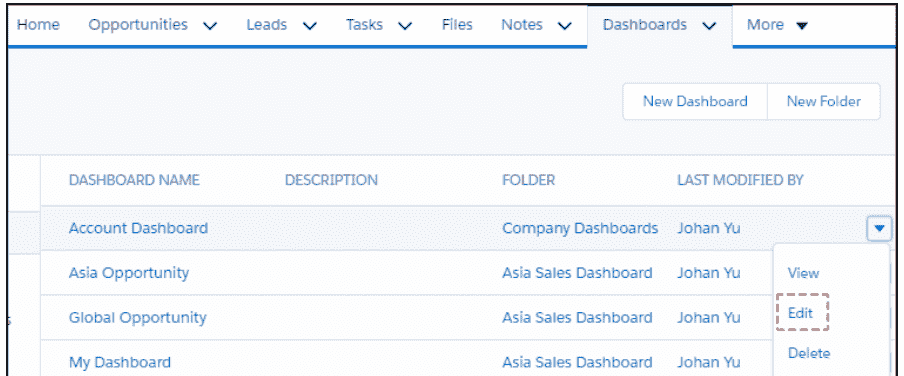

2. 此时，此仪表板中有两个组件；让我们添加另一个组件，例如`Account by Type`（按类型划分的账户）：
   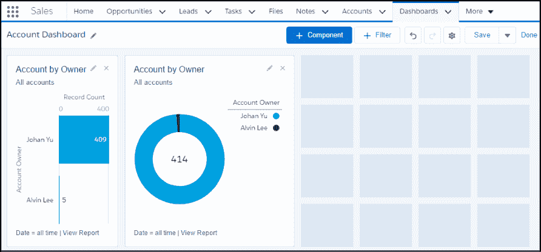

3. 创建一个新报表`Account by Type`：
    - 点击**Reports**（报表）选项卡
    - 点击**New Report**（新建报表）按钮
    - 选择**Accounts**（账户）记录类型，然后点击**Create**（创建）按钮
    - 将筛选器更改为**Show as All accounts**（显示为所有账户），并将**Date Field Range**（日期字段范围）设置为**All time**（所有时间）
    - 将报表格式更改为**Summary**（摘要）
    - 将**Type**（类型）拖入分组区域
    - 将报表保存为`Account by Type`，报表文件夹保存到**Unfiled Public Reports**（未归档的公共报表）

4. 从仪表板构建器返回到仪表板，然后点击+ **Component**（组件）按钮。

5. 选择刚刚创建的报表**Account by Type**。

6. 点击**Add**（添加）按钮。如下图所示：
   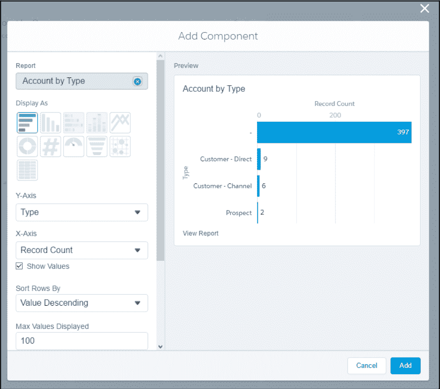

7. 将新添加的组件移动到第二个组件的右侧。

8. 点击+ Filter（过滤器）按钮以添加过滤器。

9. 选择要用作过滤器的字段；在此练习中，选择Industry（行业）。

10. 在Display Name（显示名称）中，输入Account Industry（账户行业）。

11. 点击Add Filter Value（添加过滤器值）按钮。

12. 在过滤器选项中，在**Operator**（运算符）中选择**equals**（等于）。对于**Value(s)**（值），选择**服装**和**教育**，并在**Display Text**（显示文本）中输入`Apparel or Education`。请看下面的截图：
    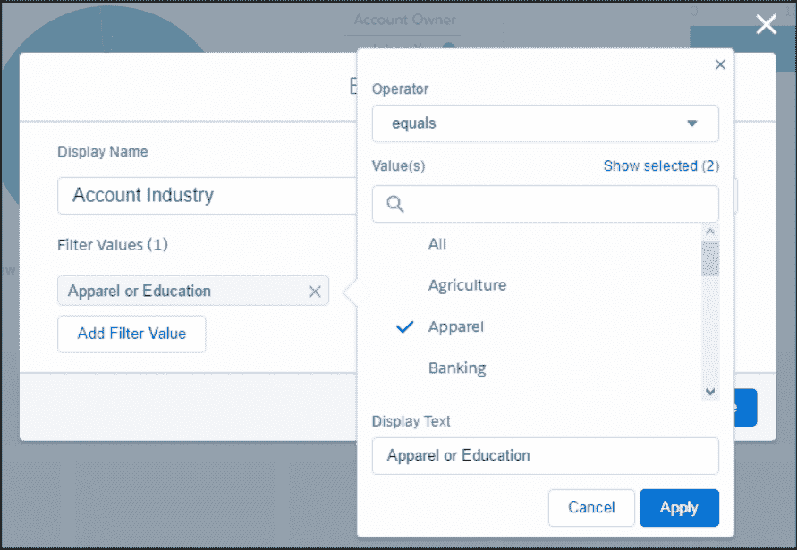

13. 点击第一个值的**Apply**（应用）按钮，然后再次点击**Add Filter Value**按钮以添加第二个过滤器值。

14. 在过滤器选项中，在**Operator**中选择**equals**。对于**Value(s)**，选择**能源**，在**Display Text**中输入`Energy`。

15. 点击第二个值的**Apply**按钮，然后再次点击**Add Filter Value**按钮以添加第三个过滤器值。

16. 在过滤器选项中，选择**not equal to**（不等于）。对于**Value(s)**，将其留空；在**Display Text**中输入空白。

17. 点击第三个值的**Apply**按钮，然后点击**Add**按钮。效果如下所示：
    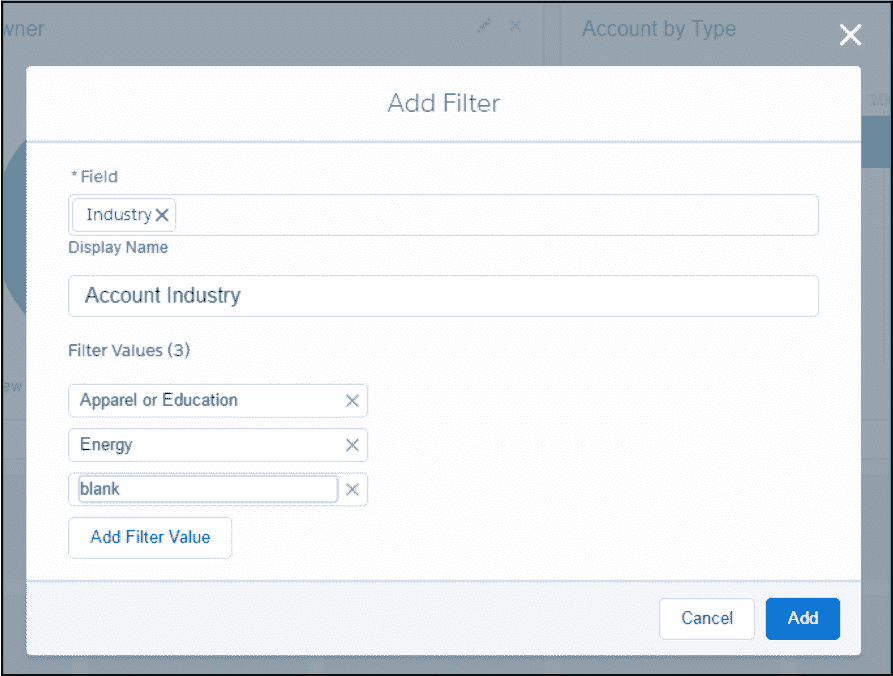

18. 返回仪表板构建器，点击Save（保存）按钮，然后点击Done（完成）退出仪表板构建器。

19. 现在，仪表板中有一个名为Account Industry的过滤器，其中定义了三个值。请看下面的截图：
    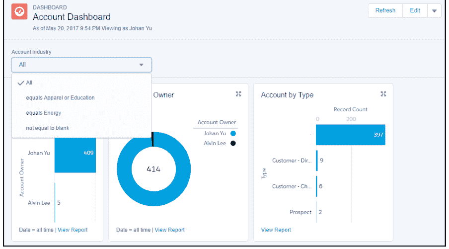

21. 要删除或编辑过滤器，请点击仪表板中的**Edit**按钮进入仪表板构建器；接下来，查找铅笔图标（**Edit Filter**（编辑过滤器）），如下图所示：
    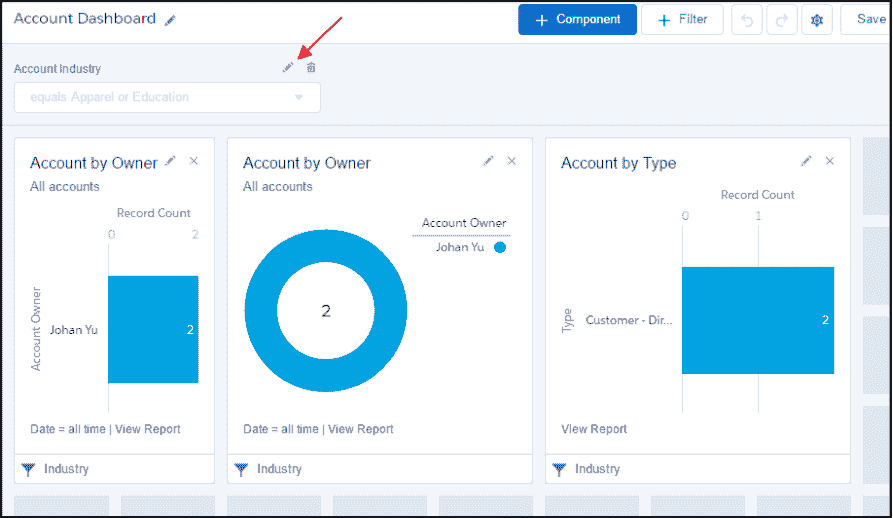

从这里，你可以通过点击**Add Filter Value**按钮添加过滤器，或通过点击叉号图标删除该值。要编辑现有值，请点击过滤器值名称；对于此示例，让我们点击**能源**，然后选择**电子产品**，并将Display Text更改为`Electronics or Energy`。点击**Apply**按钮，然后点击**Update**（更新）按钮。点击**Save**按钮，然后点击**Done**退出仪表板构建器。请看下面的截图：

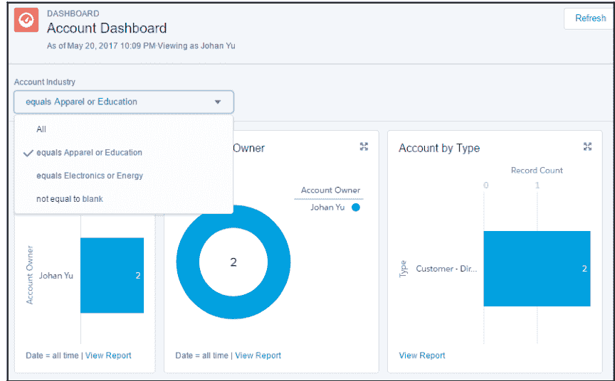

一个仪表板中最多可以有三个过滤器。要添加更多过滤器，请在仪表板编辑模式下点击Add Filter（添加过滤器）按钮。

### 查看仪表板

就运行时而论，正如我们在第9章*在Lightning Experience中构建仪表板*中讨论的，当你打开仪表板时，它会显示基于最新刷新（手动或计划）的数据；而对于报表，当你打开报表时，它总是显示当前数据。

请注意，当用户从仪表盘组件中点击**查看报告**时，系统只会显示该用户可查看的记录，而不会像仪表盘查看用户那样显示。因此，每个用户生成的报告可能有所不同。

普通仪表盘以特定用户（即已定义的用户）的安全设置来运行。所有对仪表盘有访问权限的用户，无论其个人设置如何，都会看到相同的数据。使用普通仪表盘的一个良好场景是，以公司高层管理人员的身份来展示仪表盘，例如业务部门负责人或地区负责人，这样员工就能了解公司的整体业绩。此外，另一个不错的方法是通过展示团队内同级别成员的绩效，来激励团队成员。

## 什么是动态仪表盘？

动态仪表盘允许用户根据当前运行用户的数据可见性，或团队中某位成员的数据可见性，或组织中某位成员的数据可见性来查看仪表盘数据；这取决于用户权限和仪表盘设置。借助动态仪表盘，用户可以看到基于当前运行用户数据可见性的仪表盘；这种方式更加简单，无需为每个用户单独创建仪表盘。

当你需要为每位销售代表制作仪表盘时，这一功能非常实用；销售代表登录时，他们将看到自己的数据；但当经理登录时，他们将看到团队数据。此外，经理还可以通过更改查看用户，查看其团队成员各自的仪表盘，而无需更改仪表盘本身。请注意，为此目的，经理需要拥有**查看我团队的仪表盘**权限。

将动态仪表盘与之前讨论过的仪表盘筛选器结合使用，可以让经理全面了解团队的销售管道或其他统计数据。

在第 2 章“报告和仪表盘中的概念与权限”中，我们讨论了与仪表盘相关的权限。其中有些权限仅专门适用于动态仪表盘：

- **管理动态仪表盘**权限
- **查看我团队的仪表盘**权限

拥有**管理动态仪表盘**权限的用户能够创建和编辑动态仪表盘。动态仪表盘会标记为**已将当前登录用户选为“查看仪表盘为”**，并且每个用户根据其数据可见性在仪表盘中看到不同的数据。这与普通仪表盘不同，后者所有用户都是基于某个单一用户的数据可见性看到相同的数据。

对于拥有**查看我团队的仪表盘**权限的用户，当他们打开启用了**允许仪表盘查看者更改此设置（动态仪表盘）**的动态仪表盘时，他们可以从角色层级中选择其团队内的另一名用户，这样仪表盘中的所有数据都会根据该用户的数据可见性进行刷新。这包括该用户的数据、与其共享的数据以及该用户团队下属的数据。此外，拥有**查看所有数据**权限的用户将能够在动态仪表盘中选择任何用户作为仪表盘查看者。

## 动态仪表盘的局限性

你可以配置的动态仪表盘数量取决于你的 Salesforce 版本；企业版最多可配置 5 个动态仪表盘，无限版和性能版最多可配置 10 个，开发者版最多可配置 3 个。如果你需要更多动态仪表盘，可以联系你的客户经理进行购买。

你不能将动态仪表盘保存到个人文件夹。动态仪表盘必须存储在具有共享访问权限的文件夹中。

你不能对动态仪表盘进行计划刷新；仪表盘必须手动刷新。

## 创建动态仪表盘的上机练习

让我们考虑以下实践操作步骤：将普通仪表盘更改为动态仪表盘，并让用户在仪表盘中选择当前运行用户。

在开始之前，请确保你拥有**管理动态仪表盘**和**查看我团队的仪表盘**权限；否则，你将不会在仪表盘属性中看到**“查看仪表盘为”**选项。如果你不确定自己是否拥有这些权限，可以联系你的 Salesforce 管理员。这些权限在你的用户配置文件设置中定义，也可以通过**权限集**单独添加到你的用户详细信息中。这如下面的截图所示：

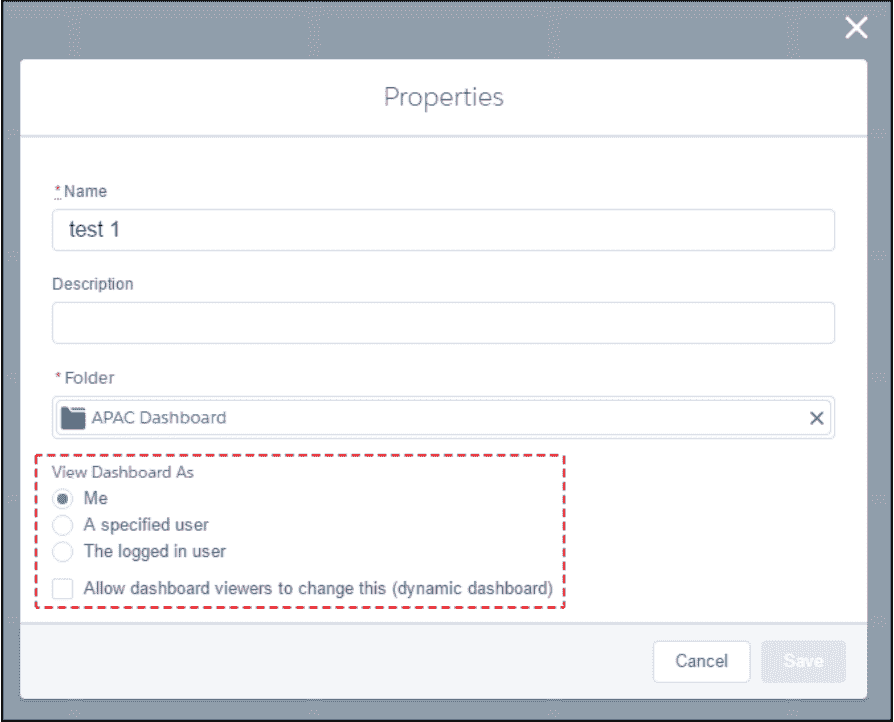

同样，我们使用“账户仪表盘”来完成此练习。在我们将仪表盘更改为动态仪表盘之前，让我们再看看这个仪表盘；请注意，该仪表盘的查看用户是 Johan Yu，以下截图是以 Alvin Lee 身份登录时截取的：

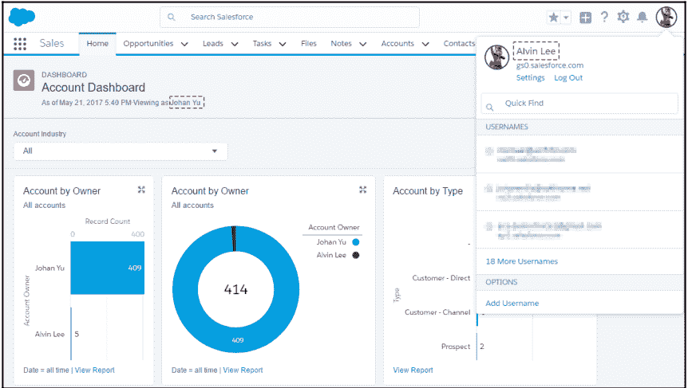

请按照以下步骤完成此上机练习：

1. 导航到“仪表盘”选项卡，找到“账户仪表盘”，点击仪表盘名称右侧箭头下的“编辑”链接。或者，你可以打开仪表盘，然后点击“编辑”按钮。

2. 点击齿轮图标；将鼠标悬停在其上，标签显示为“编辑仪表盘属性”。

3. 在“查看仪表盘为”下，此时应选择“我”。

4. 将其更改为“当前登录用户”，并勾选“允许仪表盘查看者更改此设置（动态仪表盘）”。

5. 点击“保存”按钮关闭属性窗口。

6. 再次点击“保存”按钮以保存仪表盘更改，然后点击“完成”退出仪表盘生成器。

7. 现在你应该能看到“查看者”旁边的“更改”链接；如果没有看到，请刷新仪表盘或刷新 Web 浏览器。请参考以下截图：

8. 点击“更改”链接；这将允许你选择其他用户作为仪表盘查看用户。在我的练习中，我将选择 Alvin Lee，如下面的截图所示：

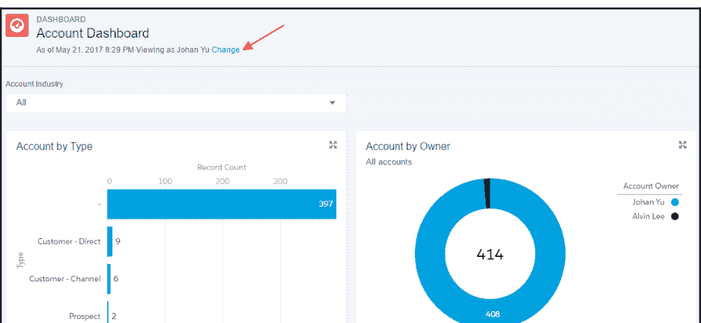

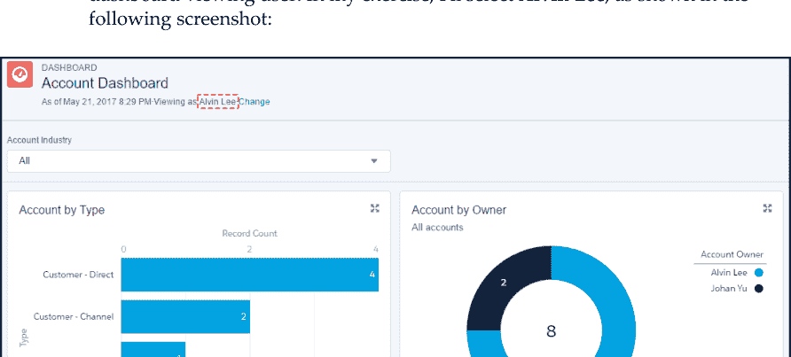

### 账户仪表盘

截至 2017 年 5 月 21 日 下午 6:32 查看者：Johan Yu 更改

账户行业 等于 服装或教育

### 按类型划分的账户

查看报告

### 按所有者划分的账户

所有账户 日期 = 所有时间 | 查看报告

### 按所有者划分的账户

所有账户 日期 = 所有时间 | 查看报告

### 按类型划分的账户

总记录数 2

筛选器

显示：所有账户

创建日期：所有时间

链接的筛选器：行业 等于 服装，教育

| 类型 | 账户所有者 | 账户名称 | 上次修改日期 | 创建日期 | 创建者 |
|---|---|---|---|---|---|
| 客户 - 直接（2 条记录） | Johan Yu | Burlington Textiles Corp of America | 2017/5/4 | 2014/5/24 | Johan |
|  | Alvin Lee | University of Arizona | 2017/5/21 | 2014/5/24 | Johan |
| 总计（2 条记录） |  |  |  |  |  |

## 从 AppExchange 获取更多

如果你不熟悉 AppExchange，它是 Salesforce.com 为 Salesforce 用户托管的商业应用商店。你可以找到成千上万的应用安装到你的 Salesforce 实例中，以满足或增强你的业务需求。其中一些应用是免费的，而许多应用需要许可费用。它们由 Salesforce 合作伙伴构建。此外，还有一些由 Salesforce Labs 提供的示例应用。Salesforce Labs 不支持他们在 AppExchange 上发布的应用，但它提供了许多 Salesforce 功能的示例，帮助管理员学习如何使用这些功能。

从 AppExchange 安装的应用被视为第三方应用，这意味着它不受 Salesforce 支持团队的支持。对于付费应用，通常由开发者为其应用提供支持。

要访问 Salesforce AppExchange，请导航至 https://appexchange.salesforce.com，在那里你可以找到许多应用，或者你可以在文本框中借助关键字搜索它们。

要查找与仪表盘相关的应用，请在搜索文本框中键入 dashboard，你将获得许多由 Salesforce Labs 构建的仪表盘应用，你可以免费安装和使用它们，还有由 Salesforce 合作伙伴构建的应用，这些应用要么免费，要么付费。

在将应用安装到生产环境之前，先将其安装到沙盒中进行试用总是一个好习惯。此外，即使你安装了 AppExchange 包，你也可以将其卸载，而不会对你的其他 Salesforce 组织造成任何问题。

以下是一些由 Salesforce Labs 构建的仪表盘应用：

- SALESFORCE CRM DASHBOARDS
- SALES ACTIVITY DASHBOARD
- SERVICE & SUPPORT DASHBOARDS
- SALESFORCE1 ADOPTION DASHBOARD AND REPORTS

## 学习高级仪表板配置

4. 点击 **Get It Now** 按钮，如下图所示：

   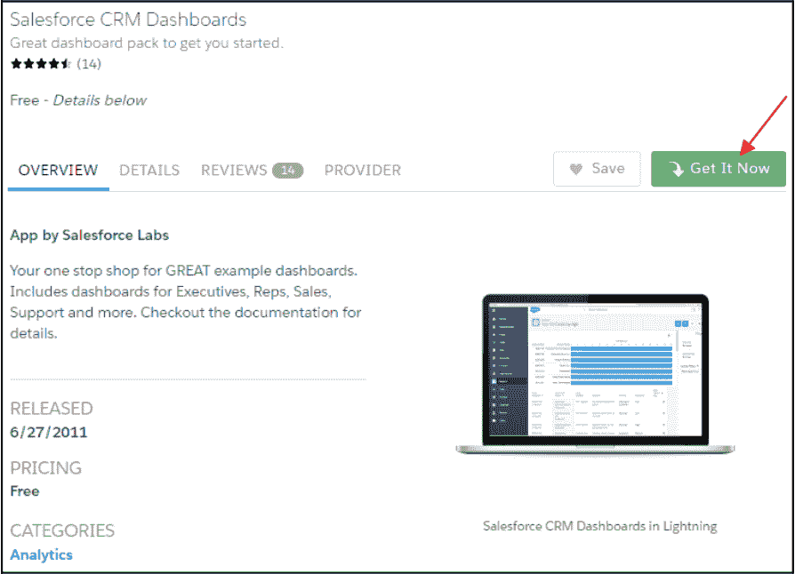

5. 点击 **Log in to the AppExchange** 按钮，使用你的 Salesforce 凭据登录。

6. 现在点击 **Install in Production** 或 **Install in Sandbox** 按钮，如下面的截图所示：

   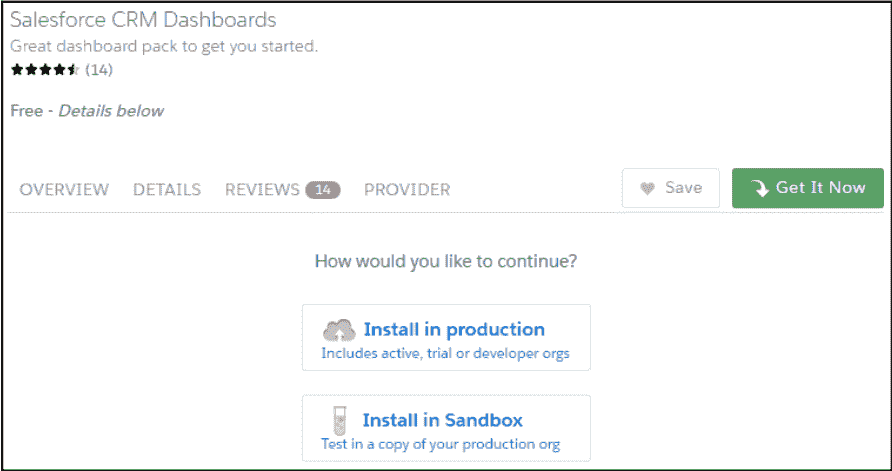

7. 勾选 **I have read and agree to the terms and conditions.**，然后点击 **Confirm and Install!!** 按钮。

8. 系统可能会提示你输入 Salesforce 用户名和密码。

9. 现在你可以选择安装应用的范围：**Admin Only**、**All Users** 或 **Specific Profiles...**。在本练习中，我将选择 **Admin Only**，然后点击 **Install** 按钮。

10. 等待一分钟左右完成安装；安装完成后，页面会显示 **Installation Complete!**。然后点击 **Done** 按钮。

11. 安装完成后，你也会收到电子邮件通知；对于某些较大的软件包，你可能需要等待邮件通知，而不是在屏幕上看到完成状态。

12. 这将带你进入 **Installed Packages** 设置菜单，你将在这里找到该应用：

    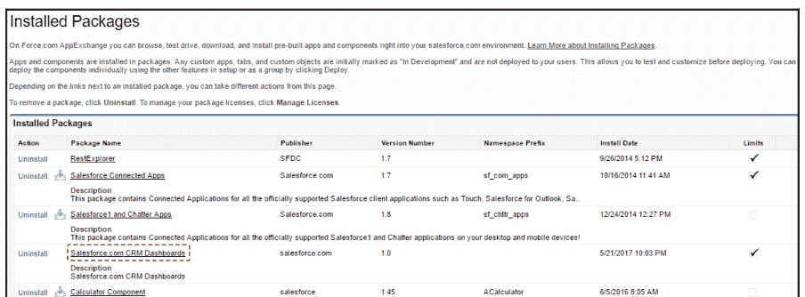

13. 你可以点击软件包名称 **Salesforce.com CRM Dashboards** 查看软件包详细信息。你可以从这里卸载，或查看软件包组件。让我们点击 **View Components**。

14. 请注意，该软件包会在多个仪表板文件夹中安装多个仪表板，包括报表，如下面的截图所示：

    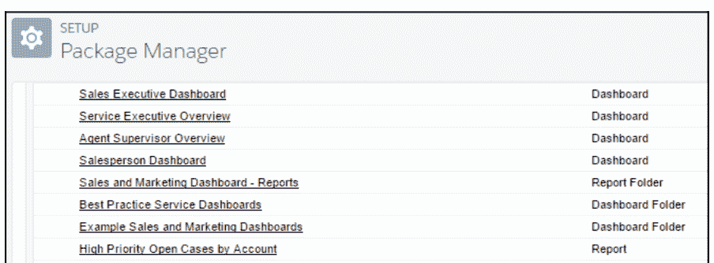

15. 让我们打开一个 **Sales Executive Dashboard** 仪表板；你可以使用全局搜索搜索仪表板名称，或转到 **Dashboards** 选项卡查找该仪表板。

4. 将上述报表克隆为一个名为 `Expired Pipeline` 的新报表，将其存储到同一个报表文件夹 **Global Sales** 中，并使用以下内容更新克隆的报表：

   - 将 **Close Date** 筛选器更改为 **All Time**
   - 添加 **Close Date** 作为 **Field filter**，选择操作为 **less than**，筛选值为 **Today**，勾选 **Locked** 以锁定筛选器，然后点击 **OK** 按钮
   - 从分组中移除 **Close Date**，但将其添加到报表中
   - 保存报表

5. 将 **Expired Pipeline** 报表克隆为一个名为 `Won Opportunities (YTD) by Sales Rep` 的新报表，将其存储到同一个报表文件夹 **Global Sales** 中，并使用以下内容更新克隆的报表：

   - 将 **Opportunity Status** 更改为 **Closed Won**
   - 将 **Close Date** 作为 **Field filter** 的操作更改为 **less or equal**，然后点击 **OK** 按钮
   - 从分组中移除 **Stage**，然后添加 **Opportunity Owner** 作为分组
   - 保存报表

6. 将 **Won Opportunities (YTD) by Sales Rep** 报表克隆为一个名为 `Won Opportunities (YTD) by Month` 的新报表，并将其存储到同一个报表文件夹 **Global Sales** 中。使用以下内容更新克隆的报表：

   - 从分组中移除 **Opportunity Owner**，然后添加 **Close Date** 作为分组，将 **Close Date** 分组更改为 **Calendar Month**
   - 保存报表

7. 将 **Won Opportunities (YTD) by Month** 报表克隆为一个名为 `Lost Opportunities (YTD)` 的新报表，将其存储到同一个报表文件夹 **Global Sales** 中，并使用以下内容更新克隆的报表：

   - 将 **Opportunity Status** 更改为 **Any**
   - 添加 **Stage** 作为 **Field filter**，选择操作为 **equals**，筛选值为 **Closed Lost**，勾选 **Locked** 以锁定筛选器，然后点击 **OK** 按钮
   - 从分组中删除 **Opportunity Owner**，然后添加 **Lost Reason** 作为报表分组。**Lost Reason** 是一个自定义选项列表字段；在本练习中，你需要创建这个自定义字段或改用其他字段
   - 保存报表

8. 现在，我们在 **Global Sales** 报表文件夹中存储了五个 **Summary** 报表。

让我们使用之前准备的报表再添加几个组件：

1. 添加第三个组件：

   - 使用报表 **Won Opportunities by Sales Rep (YTD)**
   - 使用的 **Chart Type** 为 **Horizontal Bar Chart**
   - 将组件移动到第二个组件右侧

2. 添加第四个组件：

   - 使用报表 **Pipeline for 120 days by Stage**
   - 使用的 **Chart Type** 为 **Horizontal Bar Chart**
   - 在 **Y-Axis** 上选择 **Close Date**，并选择 **Sort Rows By Label Ascending**
   - 由于报表有两个分组，默认情况下图表中也会有两个分组。将图表大小调整为 5x7 个网格。将图表放大是为了在未来几个月更好地可视化销售管道阶段

3. 添加第五个组件：

   - 使用报表 **Expired Pipeline**
   - 使用的 **Chart Type** 为 **Horizontal Bar Chart**
   - 在 **X-Axis** 上选择 **Record Count**，并选择 **Sort Rows By Label Ascending**
   - 添加 **Subtitle** 为 **This needs to be clean!**，并将 **Footer** 设置为 **No record should be here**
   - 将组件移动到第四个组件右侧，并将图表大小设置为 4x4 个网格

4. 添加第六个组件：

   - 使用报表 **Lost Opportunities (YTD)**
   - 使用的 **Chart Type** 为 **Donut**
   - 将组件移动到第五个组件下方，并将图表大小设置为 2x3 个网格

5. 保存仪表板。

### 让我们看看现在的效果：

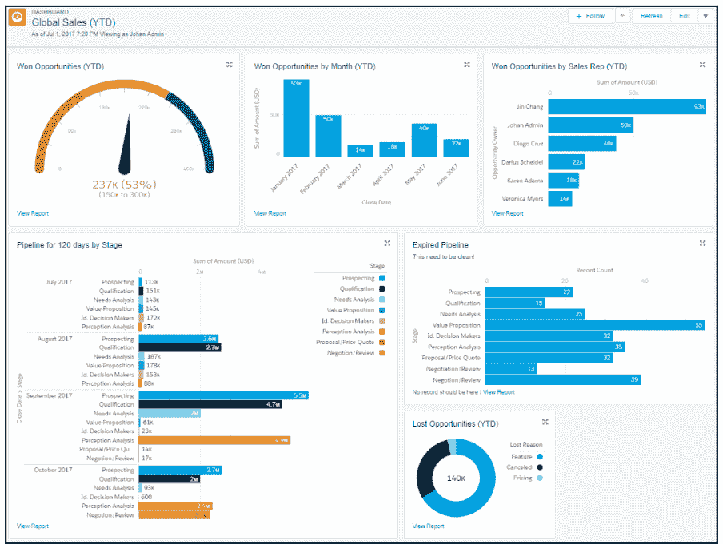

从这个仪表板中，有很多项目需要管理，销售经理需要重点关注和处理：

1. 销售年初至今完成目标的 53%；我们需要再赢得至少 47% 的赢单机会。

2. 三月份和四月份的销售业绩不佳。

3. 为排行榜顶部的销售代表颁发奖金，并为排行榜底部的销售代表提供指导。

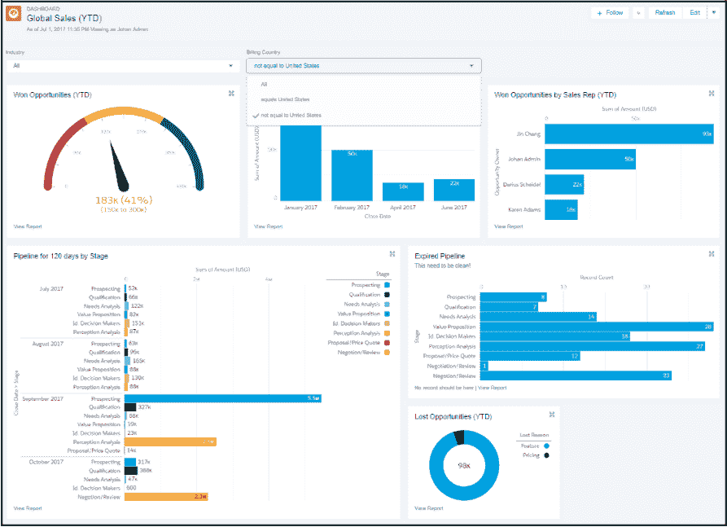

### 添加动态仪表板

将仪表板启用为动态仪表板非常简单，只要您拥有所需的权限，并且尚未用完分配给您组织的动态仪表板数量：

1. 编辑仪表板。
2. 点击齿轮图标编辑仪表板属性。
3. 在 **View Dashboard As** 选项中，选择 **The logged-in user**，并启用 **Allow dashboard viewers to change this (dynamic dashboard)**。
4. 保存仪表板。

刷新仪表板，现在您应该会在报表名称下方的 **Viewing as** 旁边看到 **Change** 链接。通过此功能，销售经理可以将仪表板查看者用户更改为经理角色层级下的任何销售代表。

### 总结

本章对本书中的仪表板部分进行了总体收尾。我们首先实现了仪表板筛选器，以便一个仪表板可用于多种场景，而不是为每个条件创建一个仪表板。

接着，我们深入探讨了动态仪表板，了解了它们与普通仪表板的区别，介绍了如何创建动态仪表板，最后讨论了使用动态仪表板的限制。

我们介绍了仪表板中与仪表板筛选器和报表筛选器相关的下钻选项，并解释了如何从 AppExchange 获取预构建的仪表板，无论是免费的还是付费的。在本章的最后一个主题中，我们从零开始构建了一个完整的示例仪表板，使用了报表、仪表板组件、仪表板筛选器，并启用了动态仪表板。

在下一章中，我们将讨论与报表和仪表板相关的高级技巧和窍门，这些内容可能对您在 Salesforce 中创建出色的分析非常有用。

## 利用 Chatter 开展报表和仪表板的协作

Salesforce 在系统中提供了 **Chatter** 作为协作平台，类似于 Facebook，你可以发布消息、照片等内容。你还可以创建群组并在群组内进行协作。此外，通过 **Chatter 流**，你可以在记录级别与其他用户协作，例如**客户**、**商机**以及其他对象，其中就包括报表和仪表板。

### 在报表中启用协作

你可以在报表中使用 **Chatter 流**与团队协作，例如，让团队关注销售管道报表或其他报表。

让我们回顾一下打开报表时可用的项目——在“筛选器”旁边有一个名为“协作”的图标，如下面的截图所示：

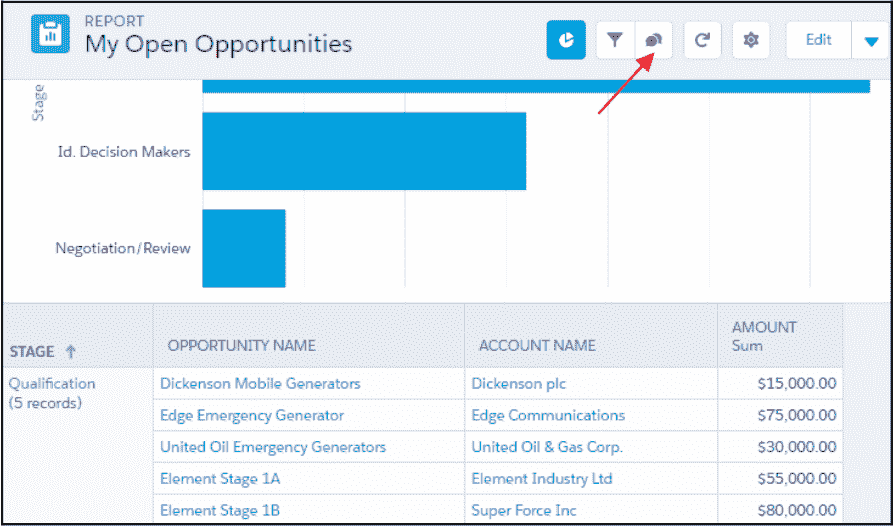

由于这只是 Chatter 帖子或投票，你可以使用 Chatter 风格进行发布，例如使用 @ 来提及用户名。完成后点击“共享”按钮。如下面的截图所示：

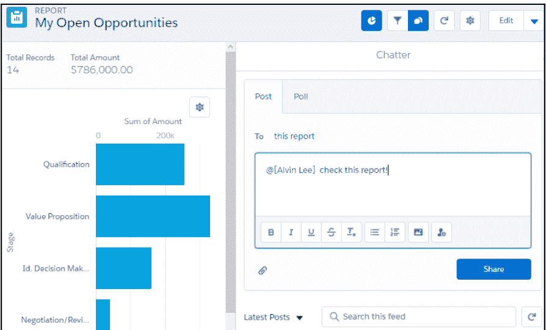

与普通 Chatter 帖子类似，被提及的用户会收到通知。该用户只需点击右上角用户名旁边的“通知”图标，即可打开帖子并进行评论或点赞。为报表启用 Chatter 帖子可能看起来很简单，但它是一项强大的功能，可作为报表内用户之间的协作工具。此功能与记录中的 Chatter 帖子非常相似，例如客户、商机等。下面的截图显示了右侧的 Chatter 面板：

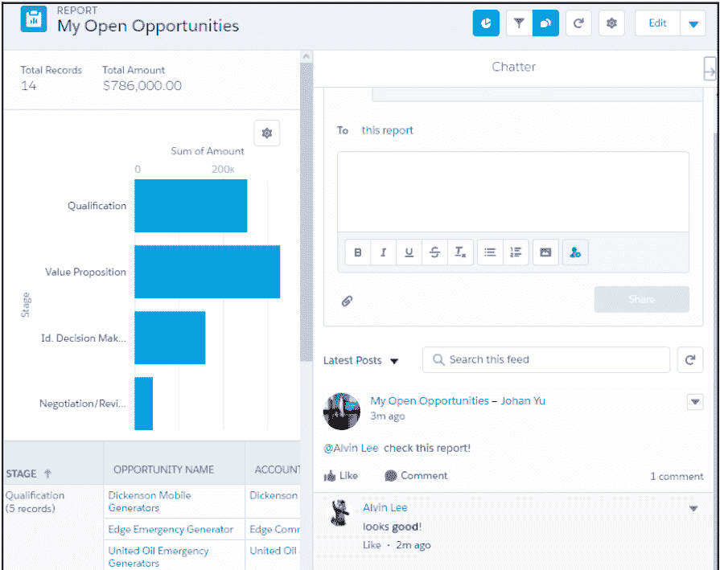

在上面的截图中，Chatter 页面中只有“发帖”和“投票”操作。我们可以通过导航至“设置 | 用户界面 | 全局操作 | 发布者布局”来添加或删除操作。然后编辑布局并选择“Salesforce1 与 Lightning 操作”。

### 跟踪报表流

如果你还记得，在之前的练习中，当启用报表的流跟踪时，我们还启用了以下项目的跟踪：

- 报表名称
- 报表唯一名称
- 描述

让我们做一个简单的练习：通过编辑报表来更改报表名称——打开报表属性，更改“报表名称”和“报表唯一名称”。保存报表，让我们看看跟踪是如何工作的。从报表中点击“协作”图标打开 Chatter 面板。如下面的截图所示：

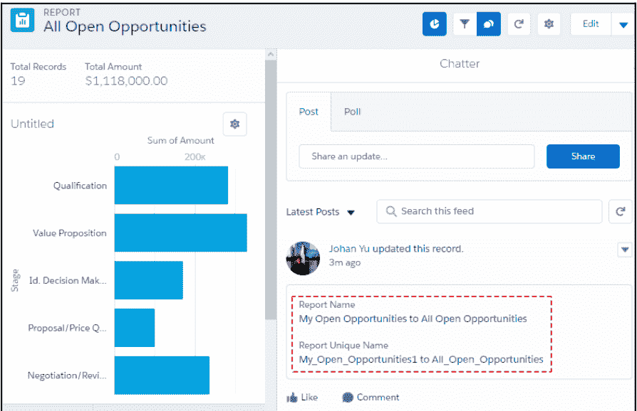

### 仪表板协作与流跟踪

与报表类似，你可以在仪表板中使用 Chatter 流跟踪进行协作。“协作”图标位于仪表板上的“刷新”按钮旁边；如果你没有看到该图标，请按照以下步骤操作：

1. 导航至“设置 | 功能设置 | Chatter | 流跟踪”。
2. 查找“仪表板”并勾选“启用流跟踪”；在此处选择所有要跟踪的字段。
3. 点击“保存”按钮。

以下是你可以在仪表板流中跟踪的五个项目：

- **仪表板运行用户**
- **仪表板唯一名称**
- **描述**
- **标题**
- **使用网格布局**

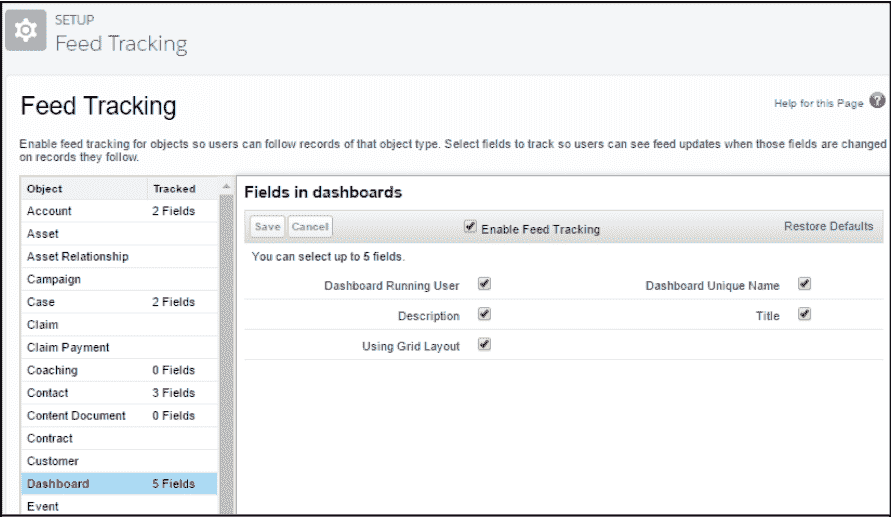

上面的截图显示了仪表板流中的项目。

让我们快速进行一个关于仪表板协作和流跟踪的动手练习：

1. 打开我们现有的仪表板“客户仪表板”。
2. 点击“协作”图标打开 Chatter 窗口。如下面的截图所示：

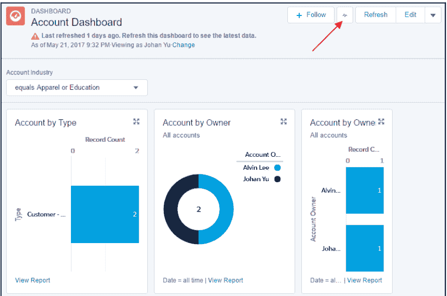

3. 无论是 Chatter 帖子还是投票，你都可以提及其他用户以发送通知。在本练习中，让我们创建一个新的投票，看看用户是否更喜欢新的仪表板设计。请查看以下截图：

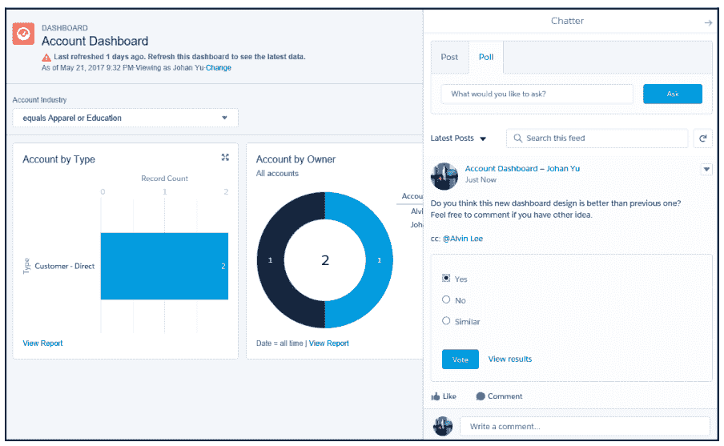

4. 用户也可以对投票进行点赞或评论。
5. 让我们为仪表板添加一个**描述**；请记住，我们之前在 **Chatter** 流跟踪中跟踪了**描述**。
6. 编辑仪表板，编辑仪表板属性（齿轮图标），然后在**描述**文本框中添加文本。在本练习中，让我们输入`该仪表板包含与客户相关的所有项目。`
7. 点击**保存**按钮退出仪表板属性窗口。再次点击“保存”保存仪表板，然后点击**完成**。
8. 再次打开 Chatter 面板（协作图标），注意在“发帖”下，我们对描述所做的更改被记录为一条帖子。

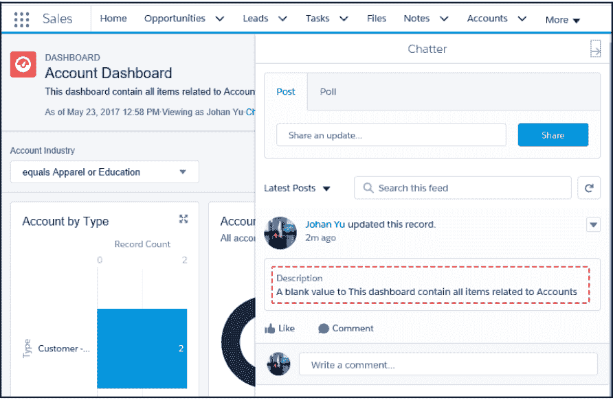

9. 由于这里的流是 Chatter 流的一部分，现在让我们打开 Chatter 选项卡。它也应当显示在那里，如下面的截图所示：

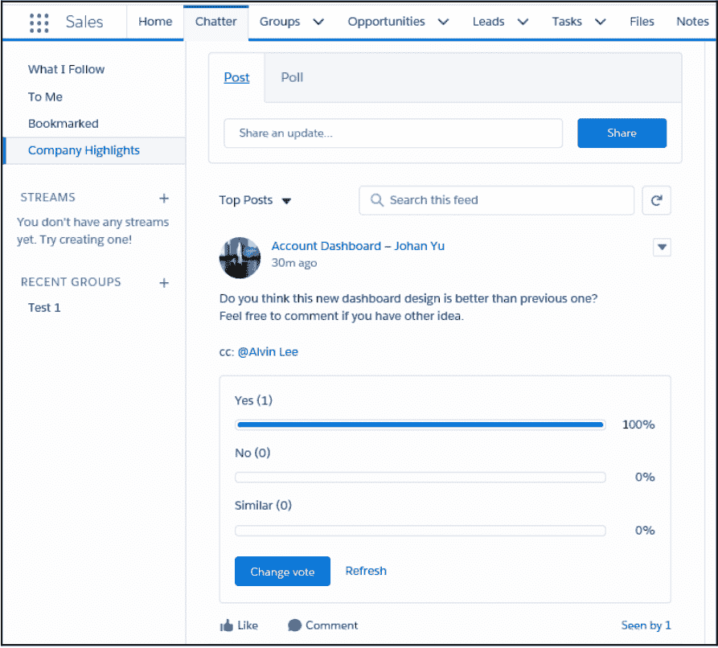

### 关注仪表板

你可能知道，在 Salesforce 中，我们可以关注记录，例如客户、商机或其他记录。因此，当有人更改记录值时，我们会通过 **Chatter** 流以及电子邮件收到更新通知（取决于每个用户的 **Chatter** 电子邮件设置）。仪表板也是如此；通过关注仪表板，用户会在自己的 **Chatter** 流中收到更新通知。

管理员需要为仪表板启用流跟踪，否则组织中的任何用户都将无法关注任何仪表板。如果未为仪表板启用流跟踪，你将看不到该按钮。

需要明确的是，当我们关注仪表板时，我们关注的是仪表板本身，而不是该仪表板中的组件，因此更新的组件不会出现在我们的 Chatter 流中。请考虑以下截图：

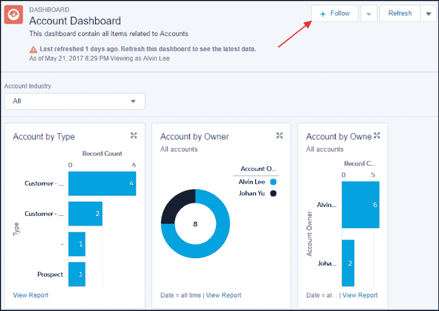

点击“协作”图标旁边的**+ 关注**按钮以关注仪表板。这与关注对象中的记录（例如**客户**、**商机**等）相同。当你关注仪表板时，你会收到仪表板被跟踪字段更改的通知，例如**仪表板运行用户**、**描述**、**仪表板唯一名称**和**标题**。

让我们看一下下面的示例。用户会在其 Chatter 页面上看到仪表板中的帖子，不是因为该用户在该帖子中被提及，而是因为该用户关注了该仪表板，就像用户关注客户、联系人或其他记录一样：

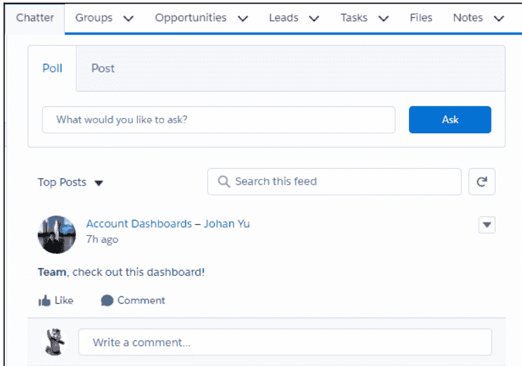

### 发布仪表板组件快照

通过将仪表板组件快照发布到 Chatter，你可以让团队对某个主题进行回应或提供反馈，例如显示商机管道下降的仪表板组件或其他内容。一旦为仪表板启用了流跟踪，你的用户就可以将仪表板快照共享到仪表板流、Chatter 群组或用户流中。

要启用仪表板组件快照，请导航至**设置 | 功能设置 | 分析 | 报表与仪表板设置**，并查找**启用仪表板组件快照**。如果你未启用流跟踪，用户将无法将仪表板组件发布到仪表板流。将组件发布到个人或群组的流中，可以让无权访问仪表板的人也能看到图表。

快照帖子是发布时仪表板组件的一张静态图像。如果仪表板应用了筛选器，快照图像将基于应用了筛选器的组件。快照发布和用户查看的时间信息将添加到快照帖子中。

以下是发布仪表板快照的三个选项：

1. **此仪表板**
2. **一个群组**
3. **我的关注者**

当快照发布到仪表板流时，所有能够打开仪表板的用户都会在 **Chatter** 中以**帖子**的形式看到某个时间点的仪表板快照。

让我们快速进行一个发布仪表板快照的动手练习：

1. 打开仪表板。
2. 选择要截取快照的组件；该组件将显示为一个大图表。
3. 点击屏幕右下角的**共享**按钮。
4. 你可以选择发布到此仪表板、一个群组或我的关注者。在本练习中，让我们选择**此仪表板**。
5. 你可以在**消息**框中输入消息。
6. 点击**发布**按钮。如下面的截图所示：

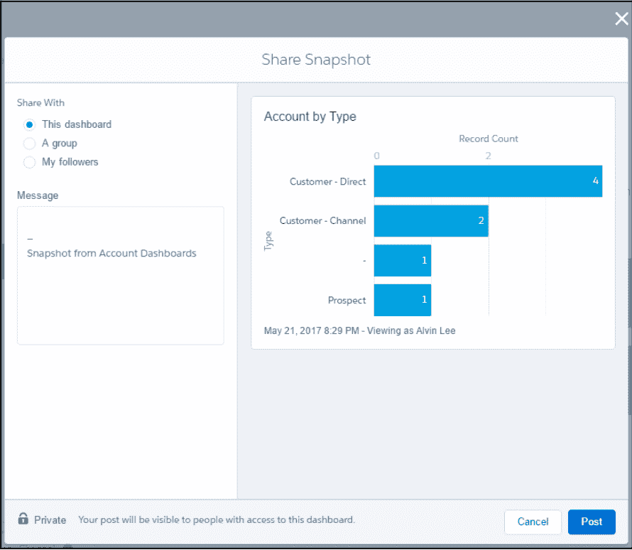

将快照发布到 **Chatter** 组会获得该 **Chatter** 组中用户的关注。发布到 **Chatter** 组动态中的快照可以被组内的所有人看到——即使是那些没有仪表板访问权限的人，因此不要发布敏感信息。要将快照发布到 **Chatter** 组，请执行以下步骤：

- 1. 打开仪表板。
- 2. 选择要截取快照的组件；该组件将显示为一张大图表。
- 3. 点击屏幕右下角的 **分享** 按钮。
- 4. 选择发布到 **一个组**，然后输入组名称。
- 5. 你可以在 **消息** 框中输入消息。
- 6. 点击 **发布** 按钮。如下图所示：

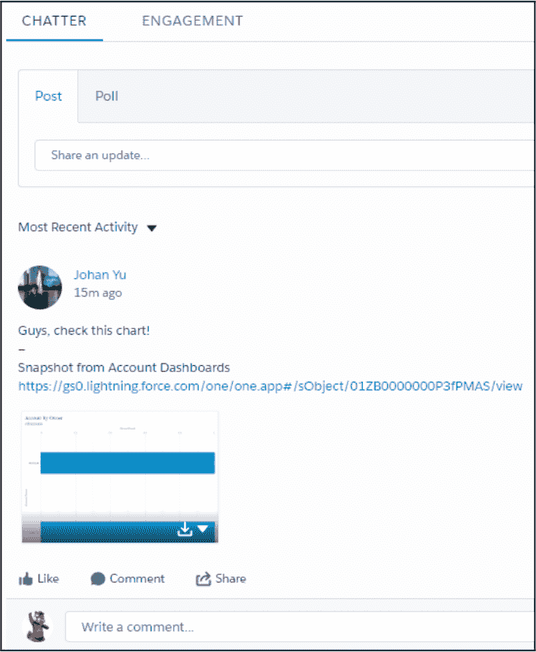

## 通过 URL 参数筛选报告

如果你熟悉 Classic，可以通过在报告 URL 后添加 `pv` 来实现报告参数。在 Lightning 中如何做到呢？幸运的是，Salesforce 提供了同样的功能，但在查看示例并动手练习之前，先让我们讨论一下这个功能有多强大。

借助此功能，你可以在报告 URL 中传递值，这些参数相当于报告的筛选值。其中一个用途是：从记录页面创建一个自定义按钮或链接，指向已创建的报告，并通过特定筛选条件，根据源记录生成动态报告。例如，为一个客户（Account）的所有相关商机（Opportunities）生成报告。

URL 参数化报告的另一个用途是：可以针对不同目的复用同一份报告，而无需创建两份相似的报告。例如，在 URL 参数的情况下，针对“新业务管道（Pipeline for New Business）”和“现有业务管道（Pipeline for Existing Business）”的报告，一旦报告加载完成，你可以创建带有 URL 参数的两个书签。

将参数用作报告筛选器，可以避免创建许多仅靠筛选器区分的相似报告，也无需不断编辑报告并修改筛选值。

### 通过 URL 参数实现报告筛选器的动手练习

用例：我们想要分析某些在客户页面布局中不可见的 **客户（Account）** 字段。报告将按 **客户名称（Account Name）** 进行筛选，但与其反复编辑报告来更改 **客户名称（Account Name）** 值，不如使用带有 URL 参数的报告筛选器。

- 1. 创建一份简单的 **客户表格（Tabular Account）** 报告，并将其命名为 `Account Name Report`。
- 2. 将 **显示（Show）** 字段选择为 **所有客户（All accounts）**。
- 3. 将 **日期字段范围（Date Field Range）** 设置为 **所有时间（All Time）**。
- 4. 添加筛选条件：**客户名称包含** `blank`；点击 **OK** 确认筛选。
- 5. 点击 **保存（Save）** 按钮，然后点击 **运行报告（Run Report）**。
- 6. 点击 **报告（Reports）** 选项卡，然后重新打开该报告（它应出现在列表顶部）。
- 7. 下面的截图显示了生成的报告，并获取报告的 URL。在我的示例中，URL 是 `https://gs0.lightning.force.com/one/one.app#/sObject/00OB0000001sBuoMAE/view`：

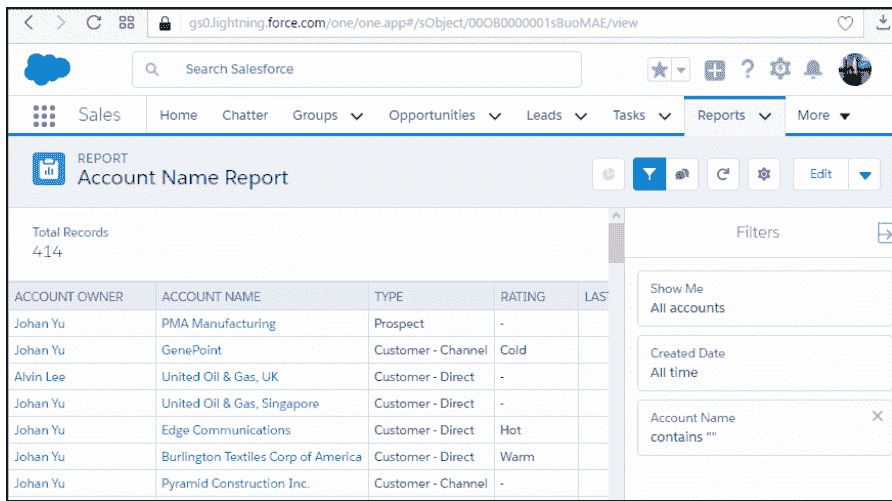

- 8. 好了，现在我们要向报告 URL 添加一个参数。
- 9. 假设我们希望显示所有名称中包含 united 的客户。
- 10. 将 `united` 作为 URL 参数添加，然后在 Web 浏览器中按 Enter：`https://gs0.lightning.force.com/one/one.app#/sObject/00OB0000001sBuoMAE?fv0=united`。如下图所示：

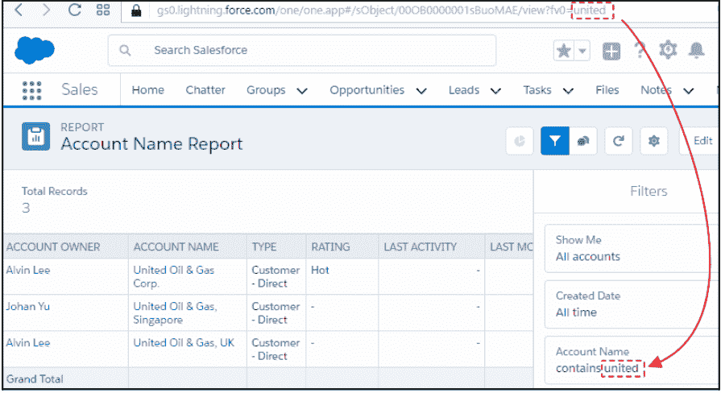

正如你在前面的截图中所见，添加到参数中的 united 成为报告的筛选值。如果你不保存报告，报告将保持原样；但如果保存报告，united 将被永久存储在该报告中。

让我们分析一下前面的报告和 URL：

- 这里是原始 URL：

  `https://gs0.lightning.force.com/one/one.app#/sObject/00OB0000001sBuoMAE/view`

- 然后我们通过添加参数来修改 URL，如下所示：

  `https://gs0.lightning.force.com/one/one.app#/sObject/00OB0000001sBuoMAE/view?fv0=united`

- 我们在报告 ID（即 `00OB0000001sBuoMAE`）后面添加 `?`；`&` 表示 URL 中的新参数。如果有多个参数，从第二个参数开始，将 `?` 替换为 `&`。
- 我们添加 `fv0`，其中 `fv` 代表筛选值（filter value），作为参数名。`0` 是筛选条件在报告中出现的顺序编号：第一个筛选条件是 0，第二个是 1，第三个是 2，以此类推。要设置报告中第二个筛选条件的值，请将 `fv1` 指定为参数名。标准筛选条件不计入此顺序，也无法通过 URL 参数进行筛选。
- 我们将 `united` 作为参数值添加——请记住，筛选条件不区分大小写，因此无论你输入 `united` 还是 `United` 都没有关系。如果想添加一个包含空格的多词值，例如 `united oil`，你只需按原样输入即可，但浏览器会按照 URI 编码在中间添加 `%20`，因此它将变为 `https://gs0.lightning.force.com/one/one.app#/sObject/00OB0000001sBuoMAE/view?fv0=united%20oil.`

现在，如果我只想更改第二个参数的筛选值，而不想更改第一个参数的筛选值，该怎么办？这不成问题——你可以仅在参数中添加 `fv1`（不包含 `fv0`），例如：`https://gs0.lightning.force.com/one/one.app#/sObject/00OB0000001sBuoMAE/view?fv1=customer`。如下图所示：

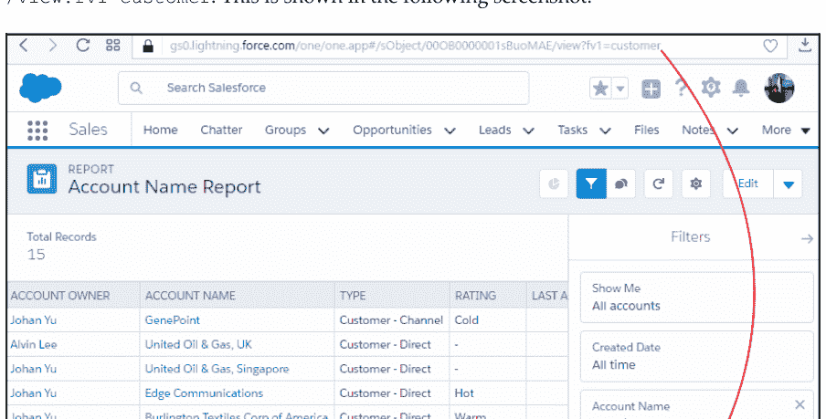

关于使用 URL 参数进行筛选，有几点需要注意，如下所示：

- URL 参数仅支持手动添加到报告中的字段筛选条件。
- 它们不支持报告提供的标准筛选条件，例如 **角色层级（Role Hierarchy）**、范围、区域、**商机状态（Opportunity Status）**、**概率（Probability）** 和日期筛选条件。
- 它们不支持 **交叉筛选（Cross Filter）** 和 **行数限制（Row Limit）** 筛选条件。
- 手动添加为筛选条件的第一个字段将被视为第一个参数，即 `fv0`。
- 如果报告中添加了图表，则在应用报告筛选条件（包括使用 URL 参数的筛选条件）时，图表会相应调整。
- 你不能通过 URL 参数添加、更改或删除被筛选的字段；只能修改现有筛选条件的值。
- 参数的添加顺序不必与报告筛选条件的顺序一致，例如，我们将 `fv1` 放在 `fv0` 之前：`https://gs0.lightning.force.com/one/one.app#/sObject/00OB0000001sBuoMAE/view?fv1=customer&fv0=united`；这里，`fv1` 作为第一个参数添加，但它对应第二个筛选条件。然后我们添加 `fv0`（对应第一个筛选条件）作为第二个参数。仅在第一个参数前使用 `?`，然后使用 `&` 分隔其他所有参数。

## 设置和使用字段历史跟踪

字段历史跟踪是 Salesforce 的一项开箱即用功能，用于跟踪字段中的值更改。每个对象最多可以选择 20 个字段进行跟踪；如果需要跟踪更多字段，请联系 Salesforce 支持。对于 **长文本区域（Text Area (Long)）**、**富文本区域（Text Area (Rich)）** 和 **多选下拉列表（Picklist (Multi-Select)）** 等字段类型，历史跟踪不会在记录更新时跟踪原始值和新值，而只跟踪该字段是否发生了更改。此功能虽然简单，但在审计用途上非常强大。

Salesforce 保留历史记录最长为 18 个月；但是，如果你需要更长时间的归档，请联系你的 Salesforce 支持以获取字段审计追踪（Field Audit Trail），并定义你希望保留字段历史跟踪的时长策略。这项付费功能允许你将归档时间延长至最多 10 年。

作为管理员，你可以通过几次点击自行启用字段历史跟踪——为标准对象和自定义对象选择某些重要字段进行跟踪。

请记住，在启用对象跟踪并选择字段进行跟踪之前，字段值不会被跟踪。这意味着，如果你今天启用了 **客户名称** 的跟踪，你将无法跟踪今天之前对 **客户名称** 所做的更改。

历史跟踪不仅用于跟踪你何时编辑记录，还用于跟踪你何时创建新记录，包括 **线索（Lead）** 被转换时创建的记录。当你创建新记录时，字段历史条目将被标记为 **已创建**；当记录由 **线索（Lead）** 记录转换而来时，则被标记为 **由线索转换创建**；旧值和新值都将为空。

### 标准对象的历史跟踪

历史跟踪同时支持标准对象和自定义对象。但并非所有标准对象都支持字段跟踪；只有以下标准对象支持历史跟踪：**客户（Accounts）、文章（Articles）、资产（Assets）、营销活动（Campaigns）、个案（Cases）、联系人（Contacts）、合同（Contracts）、合同行项目（Contract Line Items）、权利（Entitlements）、线索（Leads）、商机（Opportunities）、订单（Orders）、订单产品（Order Products）、产品（Products）、服务合同（Service Contracts）和解决方案（Solutions）。**

要在标准对象（如 **客户**）上启用历史跟踪，请执行以下步骤：

- 1. 导航到 **设置 | 对象和字段 | 对象管理器 | 客户 | 字段和关系**，然后点击 **设置历史跟踪** 按钮。
- 2. 勾选 **启用客户历史** 复选框。
- 3. 选择要跟踪的字段。
- 4. 请注意，**描述** 将仅被跟踪更改情况。这是因为 **描述** 是一个 **长文本区域（Text Area (Long)）** 字段，这与跟踪类型为 **长文本区域（Text Area (Long)）**、**富文本区域（Text Area (Rich)）** 和 **多选下拉列表（Picklist (Multi-Select)）** 的字段时相同。
- 5. 点击 **保存** 按钮以保存更改。

## 自定义对象上的历史跟踪

对于自定义对象，您需要在对象详细信息中启用跟踪，然后再选择要跟踪的字段。假设我们有一个名为 `Claim` 的自定义对象。请执行以下步骤：

1. 导航到 **Setup | Objects and Fields | Object Manager**。
2. 点击 **Claim** 对象链接并点击 **Edit** 按钮。
3. 在可选功能中启用 **Track Field History**，然后点击 **Save** 按钮。这在以下屏幕截图中显示：

    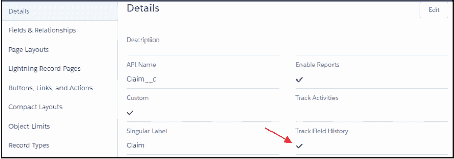

4. 从左侧菜单中选择 **Fields & Relationships**。
5. 点击 **Set History Tracking** 按钮，并选择您想要跟踪的字段。
6. 对标准对象中的 **Text Area (Long)**、**Text Area (Rich)** 和 **Picklist (Multi-Select)** 字段执行相同的操作——它只会跟踪更改，而不会跟踪旧值和新值。
7. 点击 **Save** 按钮保存更改。

## 历史对象

当您为对象启用 **Field History Tracking** 时，在后端，Salesforce 会创建一个新对象。该对象的名称将以 **History** 结尾，例如 **AccountHistory**、**ContactHistory** 等标准对象，对于自定义对象则为 **__History**，例如 `Claim__History`。

当记录中跟踪的字段发生任何更改时，Salesforce 会在此对象中创建一个新记录。例如，如果对象中有五个跟踪字段，而其中三个在一次事务中更改，Salesforce 将在此对象中创建三条记录。

作为熟悉 SOQL 的开发人员或管理员，您可以查看该对象以查询以下内容：

- `CreatedById`：进行更改的用户
- `CreatedDate`：更改日期
- `OldValue`：显示旧值
- `NewValue`：显示新值
- `ParentId`：(对于自定义对象)，与更改相关的记录 ID
- `ObjectId`（例如：标准对象的 `AccountId` 或 `ContactId`）

您不能手动创建、更新或删除此对象中的记录，只能查询。出于很好的原因，历史对象的存储使用量不计入数据存储。

## 读取历史跟踪值

一旦启用历史跟踪，除了使用 API 查询之外，还有两种查看跟踪值的方法。接下来将讨论这两种方法。

### 历史相关列表

将字段历史信息相关列表添加到对象页面布局。此信息将对分配给特定页面布局的所有用户可见，以防您有多个页面布局。

要将历史相关列表添加到对象页面布局，请打开页面布局编辑器。在此练习中，让我们以 Account 对象为例，因此此处的相关列表为 Account History。选择 Related Lists 中的 Account History，并将其拖到页面布局中。这在以下屏幕截图中显示：

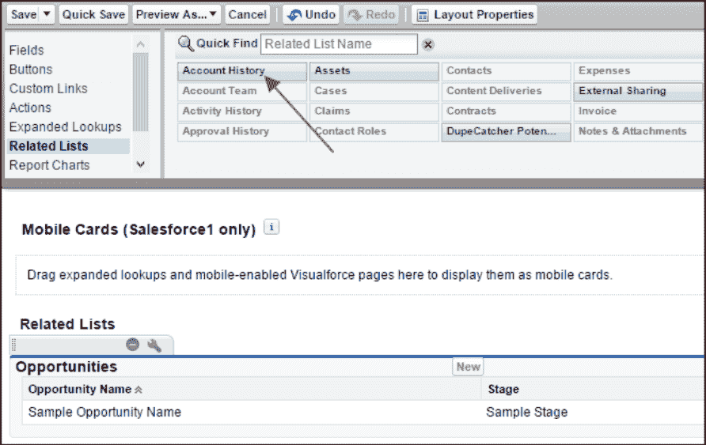

一旦历史相关列表被添加到页面布局，对跟踪字段的任何更新都将显示在此处，如以下屏幕截图中 Related 选项卡下所示（左箭头）；但您也可以将其作为 Lightning 组件中的相关列表添加（右箭头）：

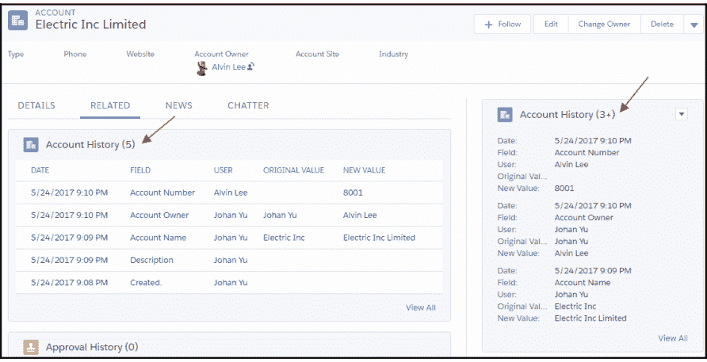

让我们分析前面的屏幕截图：

- 历史记录按日期以降序排序
- 第一个历史记录显示记录何时创建
- 在一次事务中更新多个字段时，它将作为两个不同的项目跟踪，但日期和时间相同；请参阅 Account Owner 和 Account Number 的更改
- 因为 Description 是一个长文本区域字段，所以它不会跟踪原始值和新值，而只是跟踪发生了更改

所有对象都将具有相同的标签，并以 History 结尾，例如 Account History、Contact History、Claim History 等。但对于 Opportunity 对象，它是一个例外——它被称为 Opportunity Field History。请考虑以下屏幕截图作为 Opportunity Field History 的示例：

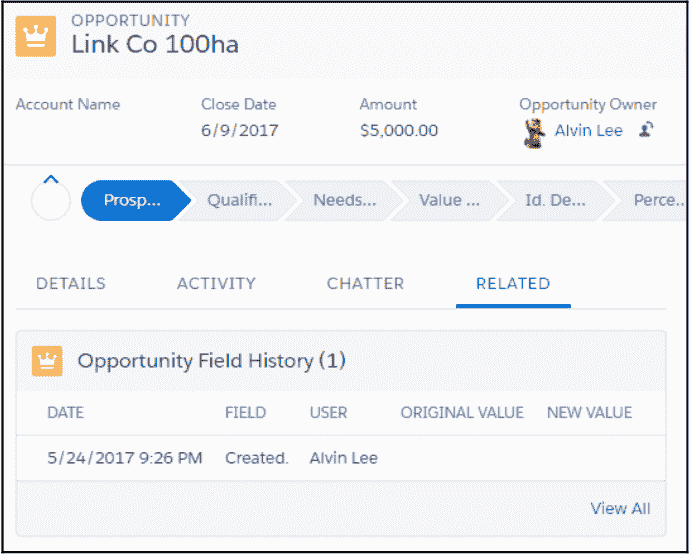

对于 API 对象名称也是如此——它被称为 **Opportunity Field History** 而不是 **Opportunity History**。**Opportunity History** 对象用于存储 **Opportunity Stage** 信息。

### 历史报告

获取历史跟踪值的另一种选择是使用报告。用户只需要拥有 **Run Report** 权限，以及运行所创建报告的对象的访问权限即可。

要创建报告，首先选择自定义报表类型，例如 **Account History** 报表，如以下屏幕截图所示：

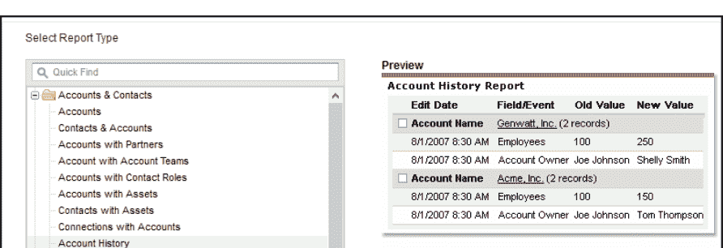

默认情况下，它将显示 **My accounts**，但您可以像普通报表一样修改它。添加筛选器、添加分组、更改报表格式，并添加/删除报表字段。如果您查看左侧面板的字段可用性，只有来自 **History Data** 组中的字段才包含历史数据，而其他字段如果您将该字段带入报表，则会在 Salesforce 中显示实时数据。请考虑以下屏幕截图中 **History Data** 下的字段：

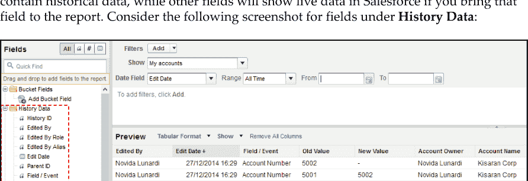

如果您注意到前面的屏幕截图，**Account History** 报表类型的 Parent ID 为 **Account ID**。这对于其他对象也是相同的；例如，如果这是 **Contact History**，则 **Parent ID** 将为 Contact ID。

对于自定义对象，一旦在对象详细信息中启用 **Track Field History**，请创建一个新的自定义报表，并注意报表类型以 `History` 结尾可供您使用，例如 `Claim History`。与上述 **Account History** 类似，您可以像普通报表一样使用此报表类型。请考虑以下屏幕截图中的报表：

| HISTORY ID | PARENT ID | ACCOUNT NAME | EDITED BY | EDIT DATE | FIELD / EVENT | OLD VALUE | NEW VALUE |
|---|---|---|---|---|---|---|---|
| 017B000002tGNh | 001B000000SWOQO | Electric Inc Limited | Alvin Lee | 5/24/2017 9:10 PM | Account Number | - | 8001 |
| 017B000002tGfz | 001B000000SWOQO | Electric Inc Limited | Johan Yu | 5/24/2017 9:10 PM | Account Owner | Johan Yu | Alvin Lee |
| 017B000002tGcL | 001B000000SWOQO | Electric Inc Limited | Johan Yu | 5/24/2017 9:09 PM | Description | - | - |
| 017B000002tGcK | 001B000000SWOQO | Electric Inc Limited | Johan Yu | 5/24/2017 9:08 PM | Account Name | Electric Inc | Electric Inc Limited |
| 017B000002tGyA | 001B000000SWOQO | Electric Inc Limited | Johan Yu | 5/24/2017 9:08 PM | Created | - | - |
| 017B000002tGVC | 001B000000SWOQJ | Big Inc. Limited | Johan Yu | 5/24/2017 9:07 PM | Description | - | - |
| 017B000002tGVB | 001B000000SWOQJ | Big Inc. Limited | Johan Yu | 5/24/2017 9:07 PM | Account Name | Big Inc. | Big Inc. Limited |
| 017B000002tGWM | 001B000000SWOQJ | Big Inc. Limited | Johan Yu | 5/24/2017 9:07 PM | Created | - | - |

## 使用字段历史跟踪的限制

其中一些限制之前已经解释过，但让我们在这里总结一下：

- 默认情况下，最多只能跟踪 20 个字段
- 对于 **Text Area (Long)**、**Text Area (Rich)** 和 **Picklist (Multi-Select)** 类型的字段，您无法跟踪原始值和新值
- 并非所有标准对象都可以跟踪；例如，**User**、**Task**、**Event**、**Campaign** 和 **Quote**
- 并非所有字段都可以跟踪；例如，**Formula** 字段、**Roll-Up Summary**、自动编号字段、**Created By**、**Last Modified By** 和 **Opportunity** 上的 **Expected Revenue** 字段

## 使用 Reporting Snapshots 报告历史数据

我们能否在 Salesforce 中对数据趋势进行报告？Salesforce 是否只报告当前数据？字段历史跟踪会在检测到字段值更改时存储旧值和新值。但要将其用于趋势分析会太困难，除非您将数据导出到外部数据库并使用实时数据进行分析——它也不会包含已删除的数据（如果有）。

那么，在 Salesforce 中是否还有其他方式可以存储历史数据，以便我们轻松用于报表？有，如果你使用的是 Salesforce 企业版或更高版本，你可以配置**报表快照**来存储历史数据。

与字段跟踪一样，不要指望在配置**报表快照**之前就能获得旧的历史数据。只有在**报表快照**被正确配置并安排计划后，特定**报表快照**的历史数据才会可用。

每个 Salesforce 版本都有数量有限的**报表快照**可供创建和安排计划，所以请明智使用，或者你可以联系 Salesforce 支持以获取更多数量。

## 配置报表快照

只有拥有**管理报表快照**权限的用户才能创建和配置报表快照。

配置和实施**报表快照**的主要步骤如下：

1. **创建源报表**，步骤如下：

   使用**表格**或**摘要**报表格式创建报表。在目标对象中创建的记录数取决于报表格式以及报表结果中返回的记录数。

   对于**表格**报表，它将是一对一的，即报表中的每条记录都将在目标对象中创建一条记录。

   对于**摘要**报表，它可以是**组汇总**或**总计汇总**。**总计汇总**始终在目标对象中只创建一条记录，而**组汇总**会在目标对象中创建多条记录——数量与分组数相同。以下截图显示了**分组级别**的选项：

   **编辑报表快照 — 字段映射**

   **1. 选择源报表汇总分组级别**

   你已选择摘要报表作为源。摘要报表记录可能被分组为一到三个级别。如果你的源报表有多个分组级别，请选择要提取汇总数据所在的分组级别。

   **分组级别**

   - 总计汇总
   - 分组 1：阶段

   *I = 必填信息*

   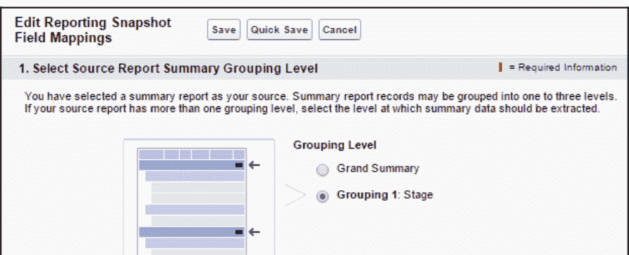

   每次快照运行最多存储 2000 条记录。

2. 要创建目标对象，请创建一个自定义对象作为目标对象，以存储报表返回的数据。确保目标对象不包含在工作流中。

3. 在目标对象中创建字段：默认情况下，报表快照会提供三项信息，我们可以在目标对象字段中捕获这些信息：报表快照名称、报表快照运行用户和执行时间。创建相似的字段名称是一种好做法，否则将根据源报表创建所表示的数据。你需要创建额外的自定义字段来捕获源报表中收集的数据。

### 创建摘要报表

我们不会逐步介绍如何创建报表，因为前面章节已经详细讲过了。此报表需要采用摘要格式——按阶段分组，添加金额列，并使用求和进行汇总。请看下面的截图，确保你的报表与之类似。

只要运行用户能够访问该报表，你可以将其存储在任何文件夹中。但作为良好实践，请专门为报表快照创建一个新的报表文件夹。

我们将此报表命名为 `Opportunity by Stage (for Snapshot)`：

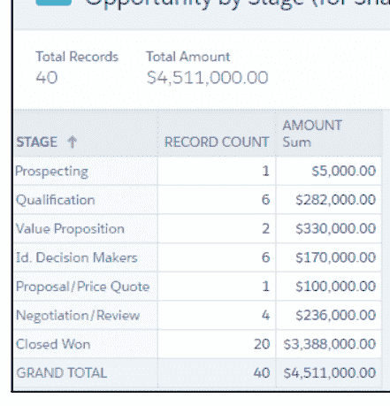

### 创建自定义对象

该自定义对象将用于在快照按计划运行时存储所有值。导航到设置 | 对象和字段 | 对象管理器 | 创建 | 自定义对象来创建新对象；我们将该对象命名为 `Opportunity Snapshot`。将记录名称数据类型设置为自动编号。

### 创建自定义字段

在之前创建的自定义对象中，创建以下字段以存储来自报表和快照运行信息的值，并确保所创建的字段具有正确的字段类型。请参考需要创建的字段的截图：

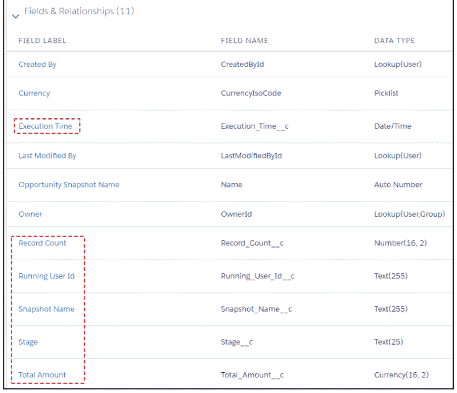

在本练习中，我们将捕获组汇总（这由用作源报表的报表定义，该报表为摘要格式），因此我们只需要几个自定义字段来存储汇总信息，在本练习中即记录数和总金额。

但如果你使用**表格**报表作为**源报表**，它将捕获报表详细信息。你可能需要创建更多字段，因为你需要从**表格**报表中捕获数据。报表中的每一行都将在目标快照对象中创建一条记录。

### 创建报表快照

在这里，我们按如下方式定义**报表快照**配置：

1. 导航到**设置 | 功能设置 | 分析 | 报表和仪表板 | 报表快照**。
2. 单击**新建报表快照**按钮。
3. 输入以下信息：
   - **报表快照名称：** 我们将其命名为 `Opportunity Snapshot`。
   - **描述：** 这是可选的，但为快照添加描述始终是一种好的做法。
   - **运行用户：** 该用户将决定快照运行时的数据可见性。
   - **报表源名称：** 选择我们在步骤 1 中创建的报表，**按阶段划分的机会（用于快照）**。
   - **目标对象：** 选择我们在步骤 2 中创建的对象，**机会快照**。
   - 单击**保存**按钮继续。请查看以下截图：

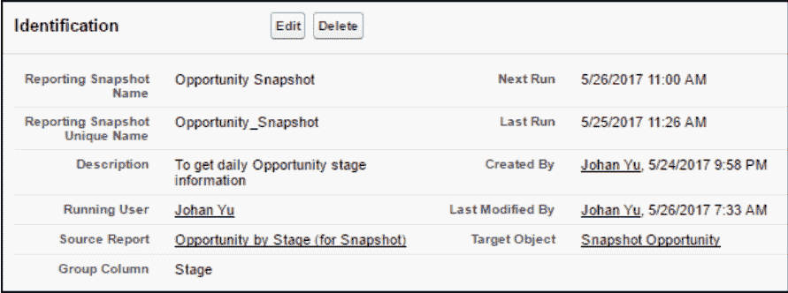

### 将字段从源报表映射到目标对象

创建**报表快照**后，单击**字段映射**部分中的**编辑**按钮。

- 选择分组级别为**分组 1：阶段**。
- **将源报表中的汇总字段映射到目标对象。** 如下面的截图所示：

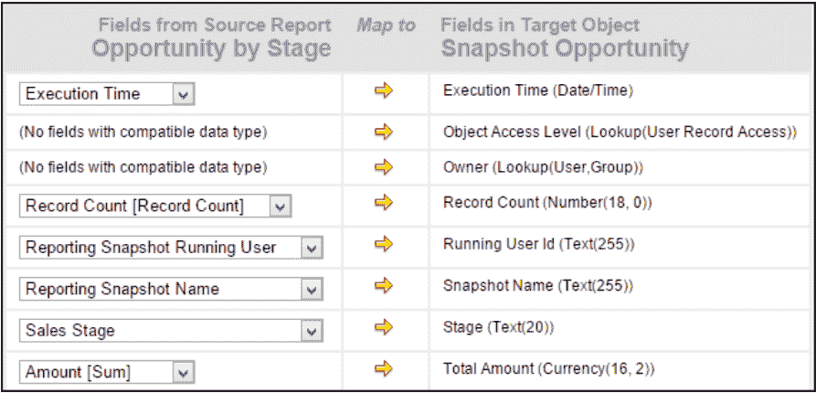

- 单击**保存**按钮继续。

### 安排报表快照计划

创建**报表快照**后，单击**安排报表快照计划**部分中的**编辑**按钮。

- 可选地，你可以启用根据**公共组、角色、角色和下属，**以及**用户**向你或其他用户发送电子邮件。在本练习中，我们将选择电子邮件选项中的**我**。

### 摘要和计划

我们来看一下目前所完成的内容，见下面的截图：

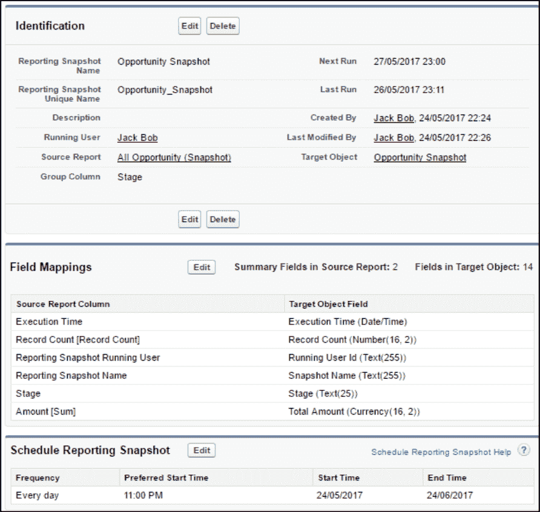

**标识**

- 报表快照名称：机会快照
- 报表快照唯一名称：Opportunity_Snapshot
- 描述：
- 运行用户：Jack Bob
- 源报表：所有机会（快照）
- 分组列：阶段
- 下次运行：27/05/2017 23:00
- 上次运行：26/05/2017 23:11
- 创建者：Jack Bob，24/05/2017 22:24
- 最后修改者：Jack Bob，24/05/2017 22:26
- 目标对象：机会快照

**字段映射**

| 源报表列 | 目标对象字段 |
|---|---|
| 执行时间 | 执行时间（日期/时间） |
| 记录数 [记录数] | 记录数（数字(16, 2)） |
| 报表快照运行用户 | 运行用户 ID（文本(255)） |
| 报表快照名称 | 快照名称（文本(255)） |
| 阶段 | 阶段（文本(25)） |
| 金额 [求和] | 总金额（货币(16, 2)） |

**安排报表快照计划**

| 频率 | 首选开始时间 | 开始时间 | 结束时间 |
|---|---|---|---|
| 每天 | 晚上 11:00 | 24/05/2017 | 24/06/2017 |

我们已经完成了实施**报表快照**所需的全部配置。之后，我们能做的就是等待到达**首选开始时间**。这是一个限制，因为我们无法立即测试。但你可以手动运行**源报表**，以确保它显示你想要收集的汇总信息。

由于我们已启用**报表快照**的电子邮件通知，当天的快照计划完成后，我们将收到来自 Salesforce 的电子邮件，主题为 `Reporting Snapshot: Name - Status - Status`。邮件内容将描述快照的运行时间、快照运行的状态、向目标对象插入了多少条记录、失败记录数，以及指向**报表快照**日志的链接。以下是电子邮件示例：

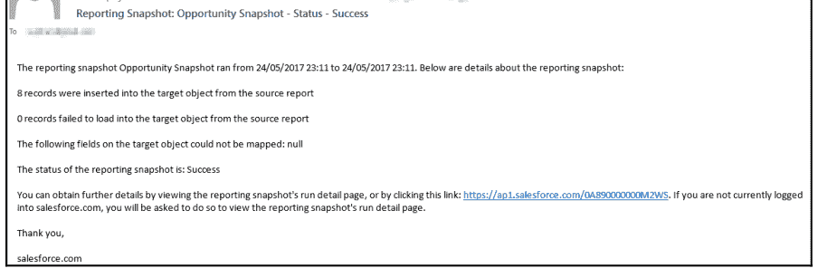

## 历史记录和监控 Reporting Snapshot

要查找快照的过去计划运行记录，请打开特定的 **Reporting Snapshot**，并向下滚动到 **Run History** 部分，该部分位于我们在 **Schedule Reporting Snapshot** 中安排它的位置正下方。请考虑以下屏幕截图：

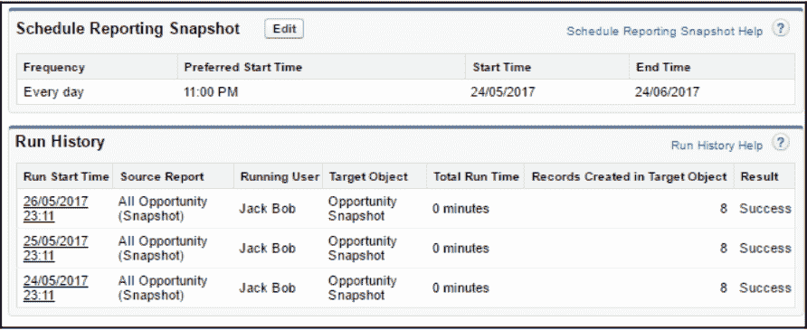

如果您安排了多个 **Reporting Snapshots**，您可以通过导航到 **Setup | Environment | Jobs | Scheduled Jobs** 来监控它们。查找类型为 **Reporting Snapshot** 的项目。请考虑以下屏幕截图：

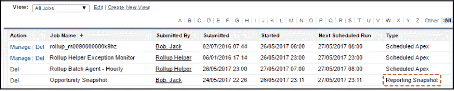

作为管理员，此页面将向您显示所有已安排的 **Reporting Snapshots**，以及每个快照下一次计划运行的时间。

## 对历史数据的报告

一旦快照运行，它会将报表结果复制到目标自定义对象中。您可以创建常规报表来分析该自定义对象中的数据；只需确保为该自定义对象启用了 **Enable Reports**。

让我们通过创建报表来看看数据是如何复制到目标对象的：

| STAGE ↑ | EXECUTION TIME | RECORD COUNT | TOTAL AMOUNT | RUNNING USER ID |
|---|---|---:|---:|---|
| Closed Lost (3 records) | 24/05/2017 23:11 | 3.00 | USD 9,900.00 | 00590000000OjrD |
|  | 25/05/2017 23:11 | 3.00 | USD 9,900.00 | 00590000000OjrD |
|  | 26/05/2017 23:11 | 4.00 | USD 109,900.00 | 00590000000OjrD |
| Closed Won (3 records) | 24/05/2017 23:11 | 25.00 | USD 1,092,612.92 | 00590000000OjrD |
|  | 25/05/2017 23:11 | 25.00 | USD 1,092,612.92 | 00590000000OjrD |
|  | 26/05/2017 23:11 | 25.00 | USD 1,092,612.92 | 00590000000OjrD |
| Id. Decision Makers (3 records) | 24/05/2017 23:11 | 5.00 | USD 208,807.20 | 00590000000OjrD |
|  | 25/05/2017 23:11 | 5.00 | USD 208,807.20 | 00590000000OjrD |
|  | 26/05/2017 23:11 | 5.00 | USD 208,807.20 | 00590000000OjrD |
| Needs Analysis (3 records) | 24/05/2017 23:11 | 34.00 | USD 565,387.00 | 00590000000OjrD |
|  | 25/05/2017 23:11 | 35.00 | USD 575,387.00 | 00590000000OjrD |
|  | 26/05/2017 23:11 | 35.00 | USD 575,387.00 | 00590000000OjrD |
| Negotiation/Review (3 records) | 24/05/2017 23:11 | 2.00 | USD 117,500.00 | 00590000000OjrD |
|  | 25/05/2017 23:11 | 2.00 | USD 117,500.00 | 00590000000OjrD |
|  | 26/05/2017 23:11 | 1.00 | USD 17,500.00 | 00590000000OjrD |
| Perception Analysis (3 records) | 24/05/2017 23:11 | 2.00 | USD 8,499.00 | 00590000000OjrD |
|  | 25/05/2017 23:11 | 3.00 | USD 28,499.00 | 00590000000OjrD |
|  | 26/05/2017 23:11 | 3.00 | USD 28,499.00 | 00590000000OjrD |

## 报表和仪表板的进阶技巧

对于此示例，使用此报表，我们可以分析 **Record Count** 和 **Total Amount** 按 **Stage** 在一段时间内的变化情况。

### 摘要

本章分享了许多技巧，从使用 **Chatter** 动态 feed 和群组在报表和仪表板中设置协作开始。我们继续介绍了在报表中使用参数的技巧，这是通过向 Web 浏览器 URL 添加参数来完成的。此参数会覆盖报表中定义的值，并且可以暂时更改报表筛选器值，而无需不断编辑报表。我们继续介绍了 **Field History Tracking**，以及如何通过简单地为字段启用历史跟踪来利用它。我们不需要开发人员，并且可以在几分钟内完成。我们以一个动手练习结束本章，使用 **Reporting Snapshot** 将每日或每周数据存储在自定义对象中。

在下一章中，我们将讨论从 Salesforce1 移动应用程序访问报表和仪表板，该应用程序支持 iOS 和 Android 设备。它还支持离线模式，供用户在没有互联网连接时需要读取、编辑和向 Salesforce 添加数据。
